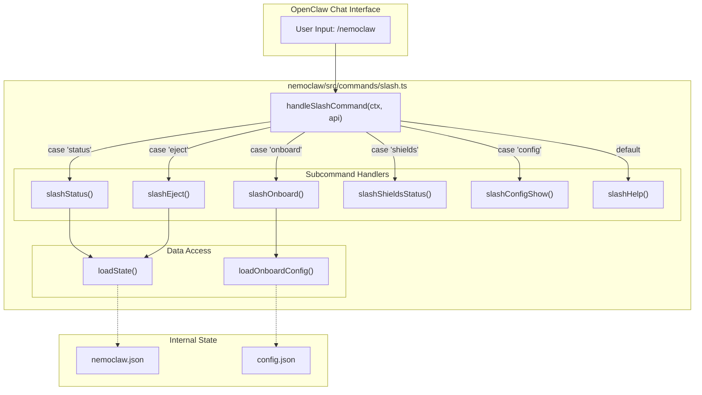
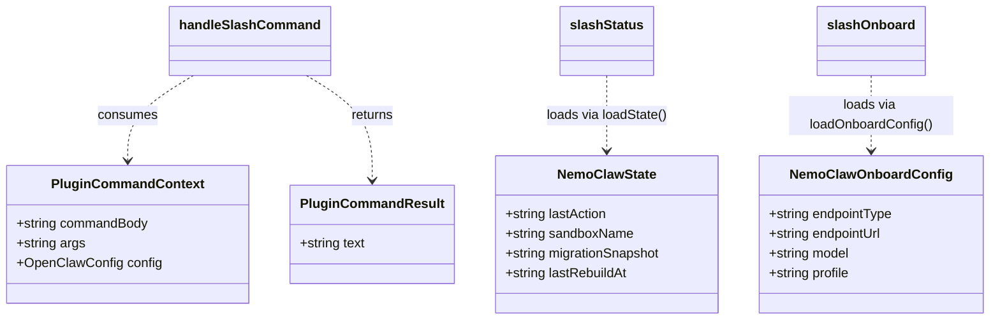
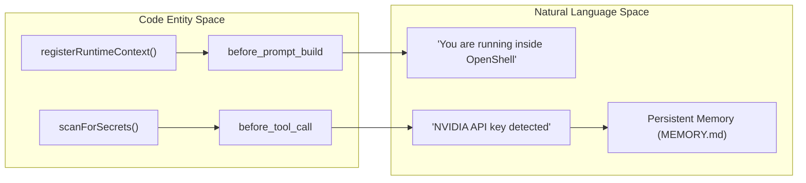

<!-- source: DeepWiki mcp.deepwiki.com · repo NVIDIA/NemoClaw · page 4.2 Plugin Commands (openclaw nemoclaw) · fetched 2026-10-26 -->

# Plugin Commands (openclaw nemoclaw)

Relevant source files

The following files were used as context for generating this wiki page:

- [docs/reference/host-files-and-state.mdx](docs/reference/host-files-and-state.mdx)
- [nemoclaw/src/blueprint/state.test.ts](nemoclaw/src/blueprint/state.test.ts)
- [nemoclaw/src/blueprint/state.ts](nemoclaw/src/blueprint/state.ts)
- [nemoclaw/src/commands/migration-state-sanitizer-test-fixture.ts](nemoclaw/src/commands/migration-state-sanitizer-test-fixture.ts)
- [nemoclaw/src/commands/migration-state.test.ts](nemoclaw/src/commands/migration-state.test.ts)
- [nemoclaw/src/commands/migration-state.ts](nemoclaw/src/commands/migration-state.ts)
- [nemoclaw/src/commands/shields-status.test.ts](nemoclaw/src/commands/shields-status.test.ts)
- [nemoclaw/src/commands/shields-status.ts](nemoclaw/src/commands/shields-status.ts)
- [nemoclaw/src/commands/slash.test.ts](nemoclaw/src/commands/slash.test.ts)
- [nemoclaw/src/commands/slash.ts](nemoclaw/src/commands/slash.ts)
- [nemoclaw/src/index.ts](nemoclaw/src/index.ts)
- [nemoclaw/src/onboard/config.test.ts](nemoclaw/src/onboard/config.test.ts)
- [nemoclaw/src/onboard/config.ts](nemoclaw/src/onboard/config.ts)
- [nemoclaw/src/register.test.ts](nemoclaw/src/register.test.ts)
- [nemoclaw/src/runtime-context.test.ts](nemoclaw/src/runtime-context.test.ts)
- [nemoclaw/src/runtime-context.ts](nemoclaw/src/runtime-context.ts)
- [nemoclaw/src/security/credential-filter.test.ts](nemoclaw/src/security/credential-filter.test.ts)
- [nemoclaw/src/security/credential-filter.ts](nemoclaw/src/security/credential-filter.ts)
- [nemoclaw/src/security/safe-resolve-path.test.ts](nemoclaw/src/security/safe-resolve-path.test.ts)
- [nemoclaw/src/security/safe-resolve-path.ts](nemoclaw/src/security/safe-resolve-path.ts)
- [nemoclaw/src/security/secret-scanner.test.ts](nemoclaw/src/security/secret-scanner.test.ts)
- [nemoclaw/src/security/secret-scanner.ts](nemoclaw/src/security/secret-scanner.ts)
- [nemoclaw/src/security/snapshot-sanitizer-failure.test.ts](nemoclaw/src/security/snapshot-sanitizer-failure.test.ts)
- [nemoclaw/src/security/snapshot-sanitizer.test.ts](nemoclaw/src/security/snapshot-sanitizer.test.ts)
- [test/Dockerfile.sandbox](test/Dockerfile.sandbox)
- [test/e2e-test.sh](test/e2e-test.sh)
- [test/openclaw-tool-catalog-patch.test.ts](test/openclaw-tool-catalog-patch.test.ts)

The `openclaw nemoclaw` commands run inside the sandbox context, integrated with the OpenClaw CLI. These commands provide sandbox-specific operations for bootstrapping, monitoring, and debugging the sandboxed agent environment. They operate on the same system where the agent runs, in contrast to host commands that manage infrastructure from outside the sandbox.

For host-level operations like setup and deployment, see [Host Commands (nemoclaw)](4.1). For direct OpenShell CLI usage, see [OpenShell Commands](4.3).

**Status**: These commands are under active development. The primary operational interface is the `nemoclaw` host CLI. Plugin commands provide convenience wrappers for advanced users working directly inside the sandbox.

## Command Overview

The plugin registers command interfaces under the `openclaw nemoclaw` namespace. While the CLI provides full management, the slash command interface allows for quick interaction within the chat UI.

| Command | Purpose | Typical Use Case |
|---------|---------|------------------|
| `launch` | Bootstrap OpenClaw inside OpenShell sandbox | Initial sandbox setup via blueprint |
| `status` | Display sandbox health and configuration | Monitor blueprint execution state |
| `logs` | Stream blueprint and sandbox logs | Debug blueprint failures |
| `skill` | Manage agent skills (install/remove) | Deploying `SKILL.md` tools to a live sandbox |
| `/nemoclaw` | Slash command in chat interface | Quick status checks and eject info during chat |

**Sources**: [nemoclaw/src/index.ts:190-192]()

## Plugin Architecture

The plugin is implemented as a TypeScript package that registers with the OpenClaw host via the `OpenClawPluginApi` [nemoclaw/src/index.ts:183-198](). It provides hooks for secret scanning and runtime context injection to ensure the agent understands its sandboxed boundaries.

### Chat Interface Logic

**Diagram**: Slash command routing and data flow within the NemoClaw plugin.

**Sources**: [nemoclaw/src/commands/slash.ts:30-50](), [nemoclaw/src/onboard/config.ts:143-156](), [nemoclaw/src/blueprint/state.ts:4-5]()

## Slash Commands

The `/nemoclaw` slash command provides immediate feedback on the sandbox state. It is the primary way users verify their environment from within the agent's chat interface.

### Subcommand: status
The `status` subcommand calls `slashStatus()`, which reads the current deployment state using `loadState()`. It reports the active sandbox name, inference endpoint, and provider details [nemoclaw/src/commands/slash.ts:77-110]().

**Implementation Details**:
- Displays `sandboxName` from the plugin configuration [nemoclaw/src/commands/slash.ts:79]().
- Reports the `endpointUrl` and `providerLabel` using `describeOnboardEndpoint` and `describeOnboardProvider` [nemoclaw/src/commands/slash.ts:91-92]().
- Includes the `migrationSnapshot` if a rollback point exists [nemoclaw/src/commands/slash.ts:98-100]().
- Reports the `lastRebuildAt` timestamp if a rebuild has occurred [nemoclaw/src/commands/slash.ts:102-107]().

### Subcommand: onboard
The `onboard` subcommand calls `slashOnboard()`, which interfaces with the onboarding configuration via `loadOnboardConfig()`. It displays the active inference settings or provides instructions to run `nemoclaw onboard` if no configuration is found [nemoclaw/src/commands/slash.ts:112-144]().

### Subcommand: shields
The `shields` subcommand calls `slashShieldsStatus()` to show whether security shields are up or down, including any active timeouts or policy overrides [nemoclaw/src/commands/slash.ts:43-44]().

**Sources**: [nemoclaw/src/commands/slash.ts:77-110](), [nemoclaw/src/commands/slash.ts:112-144](), [nemoclaw/src/onboard/config.ts:74-123]()

## Skill Management

The `skill` command allows for dynamic deployment of agent capabilities into a running sandbox. It handles the transfer of `SKILL.md` files and associated scripts over SSH.

### Skill Installation Flow
1. **Validation**: The CLI parses the YAML frontmatter of `SKILL.md` to extract the `name` [test/e2e-test.sh:100-104]().
2. **Path Resolution**: Paths are resolved based on whether the agent is OpenClaw or a generic agent (e.g., `/sandbox/.openclaw/skills/<name>`) [test/Dockerfile.sandbox:23-26]().
3. **Upload**: Files are collected (skipping dotfiles and unsafe paths) and piped through SSH to the sandbox [test/Dockerfile.sandbox:66-67]().
4. **Post-Install**: For OpenClaw agents, the session index is cleared to trigger a refresh of the agent's available tools [test/Dockerfile.sandbox:56-57]().

**Sources**: [test/e2e-test.sh:100-104](), [test/Dockerfile.sandbox:23-26](), [test/Dockerfile.sandbox:66-67](), [test/Dockerfile.sandbox:56-57]()

## Security Hooks

The plugin implements critical security layers within the sandbox to prevent data exfiltration and ensure environment awareness.

### Secret Scanner
A `before_tool_call` hook intercepts tool executions to scan for high-confidence secrets (NVIDIA API keys, OpenAI tokens, Private Keys, etc.) before they are written to persistent memory locations like `MEMORY.md` or `IDENTITY.md` [nemoclaw/src/index.ts:246-271]().

**Protected Paths**:
- Absolute paths containing `.openclaw/memory/` or `.openclaw/workspace/` [nemoclaw/src/security/secret-scanner.ts:109-115]().
- Canonical basenames like `SOUL.md`, `USER.md`, and `IDENTITY.md` [nemoclaw/src/security/secret-scanner.ts:135-141]().

### Runtime Context Injection
A `before_prompt_build` hook prepends a `<nemoclaw-runtime>` block to the agent's system prompt. This block informs the agent that it is in a sandboxed environment and provides grounding on how to handle network and filesystem errors [nemoclaw/src/runtime-context.ts:79-83]().

**Sources**: [nemoclaw/src/security/secret-scanner.ts:24-77](), [nemoclaw/src/security/secret-scanner.ts:109-124](), [nemoclaw/src/runtime-context.ts:56-73]()

## Command Implementation & Data Flow

The plugin commands bridge the "Natural Language Space" (user chat) to the "Code Entity Space" (state files and configuration objects).

**Diagram**: Association between chat command context and internal state/config entities.

**Diagram**: Bridging security and context logic to the agent's operational environment.

**Sources**: [nemoclaw/src/index.ts:83-93](), [nemoclaw/src/onboard/config.ts:28-38](), [nemoclaw/src/blueprint/state.ts:4-5](), [nemoclaw/src/runtime-context.ts:79-83](), [nemoclaw/src/security/secret-scanner.ts:83-100]()

---

