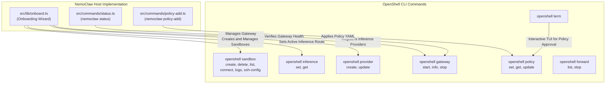
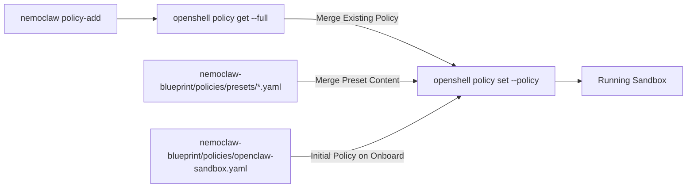

<!-- source: DeepWiki mcp.deepwiki.com · repo NVIDIA/NemoClaw · page 4.3 OpenShell Commands · fetched 2026-10-26 -->

# OpenShell Commands

<details>
<summary>Relevant source files</summary>

The following files were used as context for generating this wiki page:

- [.gitignore](.gitignore)
- [ci/test-file-size-budget.json](ci/test-file-size-budget.json)
- [docs/DORI_SETUP.md](docs/DORI_SETUP.md)
- [docs/changelog/2026-07-30.mdx](docs/changelog/2026-07-30.mdx)
- [docs/configure-agents/configure-memory-search.mdx](docs/configure-agents/configure-memory-search.mdx)
- [docs/index.yml](docs/index.yml)
- [docs/inference/set-up-vllm-on-two-dgx-stations.mdx](docs/inference/set-up-vllm-on-two-dgx-stations.mdx)
- [docs/manage-sandboxes/run-deep-agents-code.mdx](docs/manage-sandboxes/run-deep-agents-code.mdx)
- [docs/reference/commands.mdx](docs/reference/commands.mdx)
- [docs/reference/configure-runtime-identity.mdx](docs/reference/configure-runtime-identity.mdx)
- [docs/reference/troubleshooting.mdx](docs/reference/troubleshooting.mdx)
- [docs/resources/engineer-agentic-documentation.mdx](docs/resources/engineer-agentic-documentation.mdx)
- [scripts/check-docs-published-routes.mts](scripts/check-docs-published-routes.mts)
- [src/lib/adapters/openshell/client.test.ts](src/lib/adapters/openshell/client.test.ts)
- [src/lib/adapters/openshell/client.ts](src/lib/adapters/openshell/client.ts)
- [src/lib/adapters/openshell/runtime.ts](src/lib/adapters/openshell/runtime.ts)
- [src/lib/gateway-runtime-action.test.ts](src/lib/gateway-runtime-action.test.ts)
- [src/lib/gateway-runtime-action.ts](src/lib/gateway-runtime-action.ts)
- [src/lib/list-command-deps.ts](src/lib/list-command-deps.ts)
- [src/lib/onboard.ts](src/lib/onboard.ts)
- [src/lib/policy/index.ts](src/lib/policy/index.ts)
- [src/lib/registry-recovery-action.test.ts](src/lib/registry-recovery-action.test.ts)
- [src/lib/registry-recovery-action.ts](src/lib/registry-recovery-action.ts)
- [src/lib/runtime-recovery.test.ts](src/lib/runtime-recovery.test.ts)
- [src/lib/runtime-recovery.ts](src/lib/runtime-recovery.ts)
- [src/lib/sandbox/version.test.ts](src/lib/sandbox/version.test.ts)
- [src/lib/sandbox/version.ts](src/lib/sandbox/version.ts)
- [src/nemoclaw.ts](src/nemoclaw.ts)
- [test/check-docs-published-routes.test.ts](test/check-docs-published-routes.test.ts)
- [test/cli/connect-readiness.test.ts](test/cli/connect-readiness.test.ts)
- [test/cli/connect-recovery.test.ts](test/cli/connect-recovery.test.ts)
- [test/cli/list-share-live-inference.test.ts](test/cli/list-share-live-inference.test.ts)
- [test/onboard-selection.test.ts](test/onboard-selection.test.ts)
- [test/onboard.test.ts](test/onboard.test.ts)
- [test/policies.test.ts](test/policies.test.ts)

</details>


## Purpose and Scope

This page documents the low-level OpenShell CLI commands that NemoClaw uses to manage the gateway, inference providers, sandboxes, and policies. These commands are primitives that both the `nemoclaw` host CLI and the blueprint delegate to during setup and runtime operations.

For high-level operations, see [Host Commands (nemoclaw)](4.1). For in-sandbox plugin commands, see [Plugin Commands (openclaw nemoclaw)](4.2). This page focuses on direct invocation of `openshell` for manual control and troubleshooting.

**When to use these commands:**
- Debugging infrastructure issues that `nemoclaw` commands don't expose.
- Manually updating policies or inference routes during development. [src/lib/policy/index.ts:139-146]()
- Inspecting gateway and sandbox state at a low level. [docs/reference/commands.mdx:32-37]()
- Recovering from failed automated setup. [docs/reference/troubleshooting.mdx:167-175]()

**Command execution context:**
All `openshell` commands run on the host and communicate with the gateway container. The gateway must be running before executing provider, inference, or sandbox commands. [docs/reference/troubleshooting.mdx:78-88]()

---

## Command Categories Overview

OpenShell provides five primary command categories that NemoClaw orchestrates:

**OpenShell to Code Entity Mapping**


Sources: [src/lib/onboard.ts](), [src/commands/status.ts](), [src/commands/policy-add.ts]()

---

## Gateway Management

The gateway is a k3s-in-Docker container (or a host-side process on some platforms) that runs the OpenShell control plane. NemoClaw requires OpenShell version `0.0.44` or later to support WebSocket text frames and provider-shaped request body credential rewrites. [scripts/install-openshell.sh:38-44]()

### Start and Stop Gateway
NemoClaw's `onboard` command handles gateway lifecycle. On systems with cgroup v2 or specialized runtimes, it verifies Docker configuration before starting.
- **Start**: `openshell gateway start --name nemoclaw` [test/e2e/test-sandbox-survival.sh:191]()
- **Stop**: `openshell gateway stop -g nemoclaw` [test/e2e/test-sandbox-survival.sh:153]()

### Verify Gateway Health
```bash
openshell status
```
Returns connection status and active gateway name. NemoClaw checks this to ensure the environment is ready for sandbox operations. [docs/reference/commands.mdx:35]()

### Monitor Activity (TUI)
The `openshell term` command opens the Terminal UI for a live view of sandbox network activity and egress requests.

Sources: [scripts/install-openshell.sh:38-44](), [test/e2e/test-sandbox-survival.sh:151-153](), [docs/reference/commands.mdx:35]()

---

## Provider Management

Providers define inference endpoints that sandboxes can route to. NemoClaw abstracts these through the onboarding wizard.

### Provider Configuration
NemoClaw supports various providers through OpenShell:
- **NVIDIA Endpoints**: Routes to `integrate.api.nvidia.com`.
- **OpenAI / Anthropic**: Native compatible routes.
- **Local Ollama / vLLM / NIM**: Routes to local host services via `inference.local`.

### Credentials
Credentials registered via `openshell provider` stay on the host. The sandbox does not receive the API keys; OpenShell intercepts the traffic at `inference.local` and injects the stored credentials. [test/onboard-selection.test.ts:95-121]()

Sources: [test/onboard-selection.test.ts:95-121]()

---

## Inference Routing

Inference commands control which provider and model the gateway routes requests to.

### Set Inference Route
```bash
openshell inference set --provider PROVIDER --model MODEL
```
This configuration is global for the gateway. NemoClaw uses this to switch between cloud providers and local instances. The agent inside the sandbox always targets `https://inference.local`. [src/lib/onboard/inference-route.ts]()

Sources: [src/lib/onboard/inference-route.ts]()

---

## Sandbox Management

Sandboxes are isolated environments. NemoClaw uses OpenShell to manage their lifecycle and connectivity.

### Sandbox Commands
| Command | NemoClaw Equivalent | Purpose |
|---------|-------------|---------|
| `openshell sandbox connect` | `nemoclaw <name> connect` | Enter the sandbox shell. [docs/reference/commands.mdx:40]() |
| `openshell sandbox logs` | `nemoclaw <name> logs` | View agent and blueprint logs. [docs/reference/commands.mdx:30-37]() |
| `openshell sandbox list` | `nemoclaw list` | List registered sandboxes. [docs/reference/commands.mdx:133]() |
| `openshell sandbox ssh-config` | N/A | Generate SSH config for direct access. [test/e2e/test-sandbox-survival.sh:111]() |
| `openshell forward stop` | N/A | Stop active port forwards. [test/e2e/test-sandbox-survival.sh:152]() |

Sources: [docs/reference/commands.mdx:30-40](), [test/e2e/test-sandbox-survival.sh:111-152]()

---

## Policy Management

NemoClaw implements a deny-by-default network policy. Requests to unlisted destinations trigger the operator approval flow. [src/lib/policy/index.ts:173-187]()

### Applying Policies
NemoClaw manages policies through two primary mechanisms:
- **Static Changes**: Editing `nemoclaw-blueprint/policies/openclaw-sandbox.yaml` and re-running `nemoclaw onboard`.
- **Dynamic Changes**: Applying updates to a running sandbox using `openshell policy set` or `openshell policy update`. **Warning**: `set` replaces the live policy; `update` (used by `nemoclaw policy-add`) merges. [src/lib/policy/index.ts:30-31]()

### Policy Application Flow


Sources: [src/lib/policy/index.ts:30-31](), [src/lib/policy/index.ts:103-128](), [test/policies.test.ts:140-157]()

### Policy Tiers and Presets
NemoClaw uses OpenShell to apply "Tiers" which are collections of presets. [src/lib/policy/index.ts:103-128]()
- **Restricted**: Base sandbox only.
- **Balanced (Default)**: Includes dev tooling (npm, pypi, brew) and web search.
- **Open**: Broad access including messaging (Slack, Discord, Telegram).

Sources: [src/lib/policy/index.ts:103-128]()

---

## Advanced Operations

### Operator Approval Flow
When a request is blocked, the operator uses `openshell term` to review the attempt.
1. **Intercept**: OpenShell blocks the connection based on `enforcement: enforce` rules.
2. **Review**: Operator sees host, port, and the SHA256 hash of the requesting binary in the TUI.
3. **Action**: Operator approves or denies. Approval adds the endpoint to the running session policy.

### CoreDNS and Networking
On specialized runtimes like JetPack or corporate firewalls, NemoClaw may require manual DNS patching or `br_netfilter` loading to resolve names through the OpenShell gateway's k3s cluster. [docs/reference/troubleshooting.mdx:129-137]()

Sources: [docs/reference/troubleshooting.mdx:129-137]()

---

