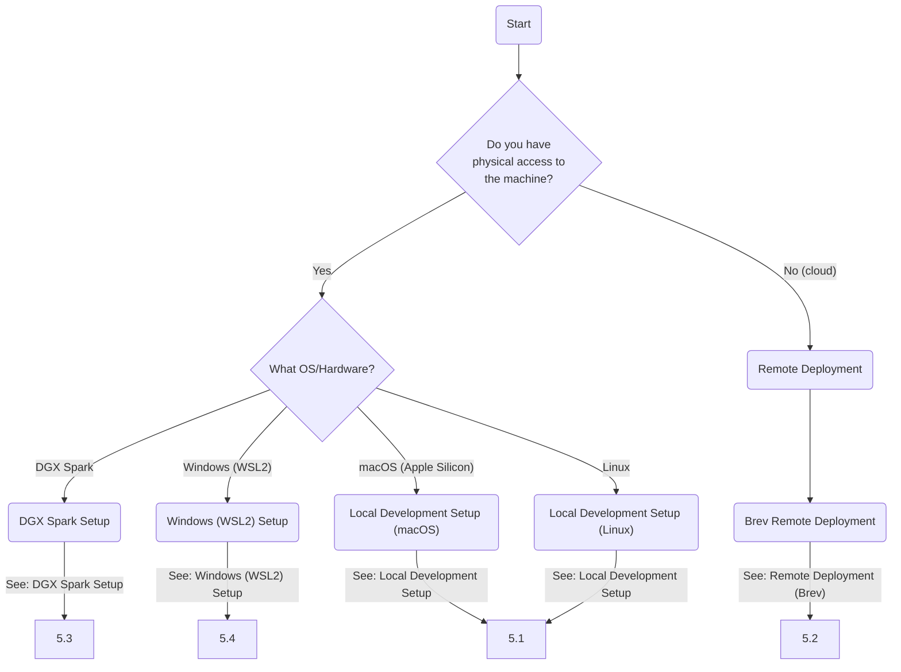
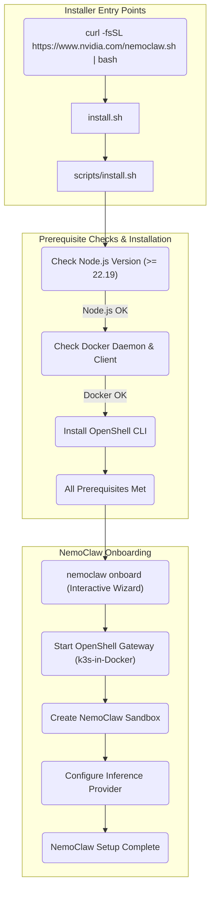

<!-- source: DeepWiki mcp.deepwiki.com · repo NVIDIA/NemoClaw · page 5 Setup and Deployment · fetched 2026-10-26 -->

# Setup and Deployment

Relevant source files

The following files were used as context for generating this wiki page:

- [README.md](README.md)
- [bin/nemoclaw.js](bin/nemoclaw.js)
- [ci/platform-matrix.json](ci/platform-matrix.json)
- [docs/about/ecosystem-deepagents.mdx](docs/about/ecosystem-deepagents.mdx)
- [docs/about/ecosystem-hermes.mdx](docs/about/ecosystem-hermes.mdx)
- [docs/about/ecosystem.mdx](docs/about/ecosystem.mdx)
- [docs/about/overview.mdx](docs/about/overview.mdx)
- [docs/get-started/dgx-station-preparation.mdx](docs/get-started/dgx-station-preparation.mdx)
- [docs/get-started/prerequisites.mdx](docs/get-started/prerequisites.mdx)
- [docs/get-started/quickstart-hermes.mdx](docs/get-started/quickstart-hermes.mdx)
- [docs/get-started/quickstart.mdx](docs/get-started/quickstart.mdx)
- [docs/index.mdx](docs/index.mdx)
- [docs/reference/platform-support.mdx](docs/reference/platform-support.mdx)
- [install.sh](install.sh)
- [scripts/install.sh](scripts/install.sh)
- [scripts/start-services.sh](scripts/start-services.sh)
- [test/install-onboard-yes.test.ts](test/install-onboard-yes.test.ts)
- [test/install-preflight.test.ts](test/install-preflight.test.ts)
- [test/station-doc-ownership.test.ts](test/station-doc-ownership.test.ts)
- [uninstall.sh](uninstall.sh)

This document provides a high-level overview of NemoClaw's deployment architecture and setup workflows. It introduces the different deployment scenarios and links to detailed guides for each.

For detailed step-by-step instructions for each deployment scenario, please refer to the dedicated child pages:
- [Local Development Setup](#5.1) — Setting up NemoClaw on local machines (macOS, Linux), handling Docker, OpenShell gateway, and local inference engines like vLLM or Ollama.
- [Remote Deployment (Brev)](#5.2) — Deploying to remote GPU instances via Brev, including instance provisioning, environment setup, and service startup.
- [DGX Spark Setup](#5.3) — Special considerations for DGX Spark hardware, including cgroup v2 compatibility and Docker daemon configuration.
- [Windows (WSL2) Setup](#5.4) — Setting up NemoClaw on Windows via WSL2, including bootstrap scripts and host alias configuration.

For initial installation of the `nemoclaw` CLI itself, see [Installation](#2.1). For guided interactive setup, see [Configuration and Onboarding](#2.3).

## Deployment Scenarios

NemoClaw supports several deployment scenarios, each tailored for different environments and use cases. The primary scenarios are local development, remote GPU instances (e.g., via Brev), and specialized DGX Spark environments.

| Scenario | Target Hardware | Use Case | Key Installer | GPU Support |
|----------|-----------------|----------|---------------|-------------|
| **Local Development** | Developer workstation (macOS/Linux) | Development, testing, experimentation | `scripts/install.sh` | Optional (vLLM, Ollama, or cloud inference) |
| **Remote GPU (Brev)** | Cloud GPU instances | Production workloads requiring GPU inference | `nemoclaw deploy` | NVIDIA GPU required |
| **DGX Spark** | NVIDIA DGX Spark devices | On-premises deployment on Spark hardware | `scripts/install.sh` | NVIDIA GPU (built-in) |
| **Windows (WSL2)** | Windows workstation with WSL2 | Local development on Windows | `scripts/install.sh` | Optional (via WSL2 Docker Desktop) |

**Sources:** [ci/platform-matrix.json:28-78](), [scripts/install.sh:7-10]()

### Decision Tree: Choosing Your Deployment Path

The following diagram illustrates how to choose the appropriate deployment path based on your environment and needs.

**Sources:** [ci/platform-matrix.json:28-78]()

## Setup Workflow Architecture

All deployment paths share a common core workflow initiated by the NemoClaw installer. The installer handles cloning the repository, performing prerequisite checks, and invoking the onboarding wizard.

### Setup Execution Flow

**Sources:** [install.sh:1-154](), [scripts/install.sh:1-239](), [test/install-preflight.test.ts:129-185](), [docs/get-started/prerequisites.mdx:31-42]()

## Component Provisioning

The `nemoclaw onboard` command orchestrates the provisioning of various components essential for NemoClaw's operation.

### Infrastructure Components

| Component | Command / Function | Purpose | When Created |
|-----------|--------------------|---------|--------------|
| **OpenShell Gateway** | `openshell gateway start` | Manages the k3s-in-Docker cluster for sandboxing. | During `nemoclaw onboard` |
| **NemoClaw Sandbox** | `openshell sandbox create` | The isolated container environment where the agent runs. | During `nemoclaw onboard` |
| **CoreDNS Patch** | Internal DNS logic | Ensures proper DNS resolution within the sandbox, especially in corporate or Colima environments. | During `nemoclaw onboard` preflight |
| **Cloudflared Tunnel** | `scripts/start-services.sh` | Optional service for creating a secure public tunnel to the sandbox. | Optional, configured during `nemoclaw onboard` |

**Sources:** [docs/get-started/prerequisites.mdx:81-84](), [scripts/start-services.sh:182-188]()

### Inference Providers

NemoClaw integrates with various inference providers, configured during the onboarding process. The `NEMOCLAW_PROVIDER` environment variable or interactive prompts guide this selection.

| Provider Choice | Environment Variable Value | Typical Endpoint | Description |
|---------------|----------------------------|------------------|--------------|
| **NVIDIA Endpoints** | `build` | `https://integrate.api.nvidia.com/v1` | Default, hosted models from NVIDIA API Catalog. |
| **Ollama** | `ollama` | `http://host.docker.internal:11434` | Local Ollama instance for running models locally. |
| **vLLM** | `vllm` | `http://host.docker.internal:8000` | Local vLLM instance for high-performance local inference. |
| **OpenRouter** | `openrouter` | `https://openrouter.ai/api/v1` | Third-party model routing service. |
| **OpenAI** | `openai` | `https://api.openai.com/v1` | OpenAI's API for various models. |
| **Anthropic** | `anthropic` | `https://api.anthropic.com/v1` | Anthropic's API for Claude models. |
| **Google Gemini** | `gemini` | `https://generativelanguage.googleapis.com/v1beta` | Google's Gemini models. |
| **Custom** | `custom` | User-defined | For custom inference endpoints. |
| **NIM Local** | `nim-local` | `http://localhost:8000` | NVIDIA Inference Microservices running locally. |
| **Routed** | `routed` | Configured by blueprint | Uses OpenShell's internal routing mechanism. |
| **Hermes Provider** | `hermes-provider` | Hermes-specific | Inference route for the Hermes agent. |

**Sources:** [install.sh:133-140](), [ci/platform-matrix.json:81-120]()

## Platform-Specific Setup Overviews

Each deployment scenario has unique considerations and setup steps.

### Local Development Setup

This scenario covers setting up NemoClaw on your local macOS (Apple Silicon) or Linux workstation. It involves ensuring Docker (or Colima on macOS) is running, and optionally configuring local inference providers like vLLM or Ollama. The installer handles most prerequisites, including Node.js and OpenShell CLI. For details, see [Local Development Setup](#5.1).

**Sources:** [docs/get-started/prerequisites.mdx:70-78](), [ci/platform-matrix.json:36-42]()

### Remote Deployment (Brev)

For deploying NemoClaw to remote GPU instances, Brev is a supported platform. This involves provisioning a remote machine, setting up the environment, and configuring SSH access. The `nemoclaw deploy` command (a legacy compatibility wrapper) facilitates this process, forwarding necessary environment variables like `HF_TOKEN` for model access. For details, see [Remote Deployment (Brev)](#5.2).

**Sources:** [README.md:35-43]()

### DGX Spark Setup

NVIDIA DGX Spark environments have specific requirements, particularly concerning `cgroup v2` compatibility and Docker daemon configuration. The standard NemoClaw installer is used, but special attention is paid to the underlying system configuration to ensure optimal performance and stability. For details, see [DGX Spark Setup](#5.3).

**Sources:** [ci/platform-matrix.json:29-34]()

### Windows (WSL2) Setup

Setting up NemoClaw on Windows requires using Windows Subsystem for Linux 2 (WSL2) with Docker Desktop's WSL backend. This involves running the standard installer within the WSL2 environment, configuring host aliases, and addressing WSL-specific considerations. For details, see [Windows (WSL2) Setup](#5.4).

**Sources:** [ci/platform-matrix.json:52-59](), [docs/get-started/prerequisites.mdx:49]()

## Verification and Cleanup

After setup, you can verify the deployment or remove NemoClaw components.

- **Check Status:** Use `nemoclaw <sandbox-name> status` to check the sandbox state. Auxiliary services like `cloudflared` can be managed via `scripts/start-services.sh --status` [scripts/start-services.sh:154-162]().
- **Interactive Shell:** Connect to your sandbox using `nemoclaw <sandbox-name> connect` for local interaction, or `nemoclaw deploy <instance>` for remote instances [docs/get-started/quickstart.mdx:73-76]().
- **Uninstall:** The `uninstall.sh` script or `nemoclaw internal uninstall` command initiates a cleanup plan to remove sandboxes, gateways, and other NemoClaw artifacts [uninstall.sh:1-27]().

**Sources:** [docs/get-started/quickstart.mdx:57-61](), [docs/get-started/quickstart-hermes.mdx:56-60](), [uninstall.sh:1-27]()

---

