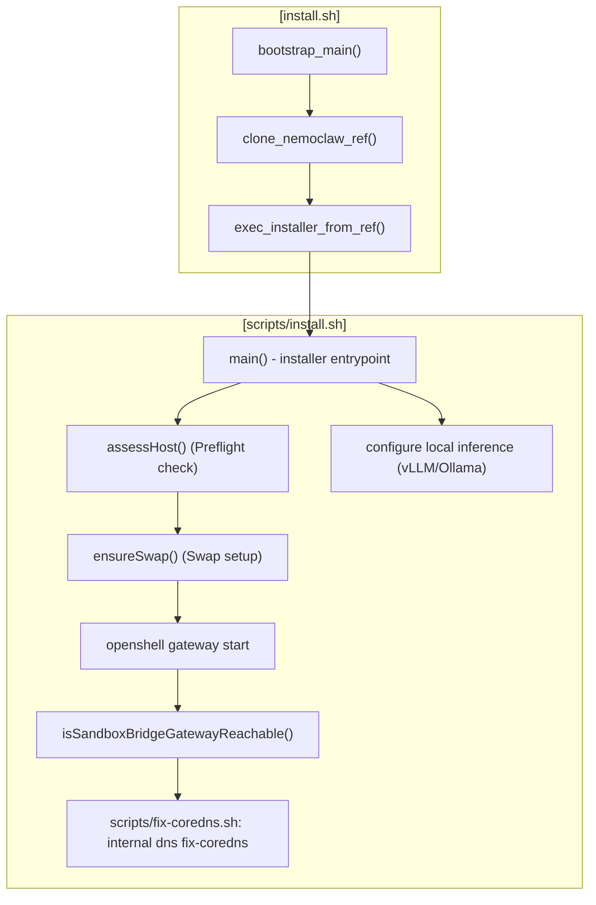
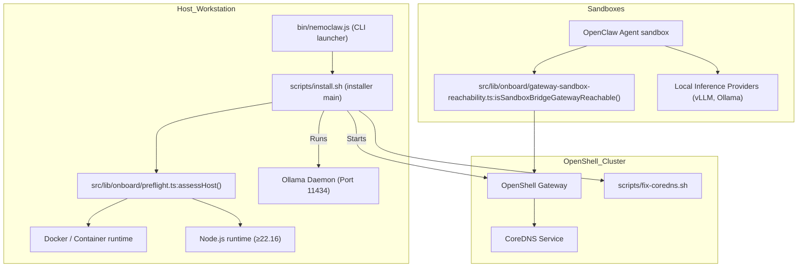

<!-- source: DeepWiki mcp.deepwiki.com · repo NVIDIA/NemoClaw · page 5.1 Local Development Setup · fetched 2026-10-26 -->

# Local Development Setup

<details>
<summary>Relevant source files</summary>

The following files were used as context for generating this wiki page:

- [README.md](README.md)
- [bin/nemoclaw.js](bin/nemoclaw.js)
- [install.sh](install.sh)
- [scripts/fix-coredns.sh](scripts/fix-coredns.sh)
- [scripts/install.sh](scripts/install.sh)
- [scripts/lib/runtime.sh](scripts/lib/runtime.sh)
- [scripts/ollama-auth-proxy.mts](scripts/ollama-auth-proxy.mts)
- [scripts/smoke-macos-install.sh](scripts/smoke-macos-install.sh)
- [scripts/start-services.sh](scripts/start-services.sh)
- [src/lib/actions/sandbox/status.test.ts](src/lib/actions/sandbox/status.test.ts)
- [src/lib/adapters/http/curl-args.ts](src/lib/adapters/http/curl-args.ts)
- [src/lib/adapters/http/probe.test.ts](src/lib/adapters/http/probe.test.ts)
- [src/lib/adapters/http/probe.ts](src/lib/adapters/http/probe.ts)
- [src/lib/inference/gpu-trust.ts](src/lib/inference/gpu-trust.ts)
- [src/lib/inference/health.test.ts](src/lib/inference/health.test.ts)
- [src/lib/inference/health.ts](src/lib/inference/health.ts)
- [src/lib/inference/local.test.ts](src/lib/inference/local.test.ts)
- [src/lib/inference/local.ts](src/lib/inference/local.ts)
- [src/lib/inference/nim.test.ts](src/lib/inference/nim.test.ts)
- [src/lib/inference/nim.ts](src/lib/inference/nim.ts)
- [src/lib/inference/ollama-model-registry.test.ts](src/lib/inference/ollama-model-registry.test.ts)
- [src/lib/inference/ollama-model-registry.ts](src/lib/inference/ollama-model-registry.ts)
- [src/lib/inference/ollama-probe-timeout.test.ts](src/lib/inference/ollama-probe-timeout.test.ts)
- [src/lib/inference/ollama-runtime-context.test.ts](src/lib/inference/ollama-runtime-context.test.ts)
- [src/lib/inference/ollama-runtime-context.ts](src/lib/inference/ollama-runtime-context.ts)
- [src/lib/inference/ollama-version.ts](src/lib/inference/ollama-version.ts)
- [src/lib/inference/ollama/model-size.ts](src/lib/inference/ollama/model-size.ts)
- [src/lib/inference/ollama/proxy.test.ts](src/lib/inference/ollama/proxy.test.ts)
- [src/lib/inference/ollama/proxy.ts](src/lib/inference/ollama/proxy.ts)
- [src/lib/onboard/ollama-systemd.test.ts](src/lib/onboard/ollama-systemd.test.ts)
- [src/lib/onboard/ollama-systemd.ts](src/lib/onboard/ollama-systemd.ts)
- [test/helpers/vitest-temp-root.ts](test/helpers/vitest-temp-root.ts)
- [test/install-onboard-yes.test.ts](test/install-onboard-yes.test.ts)
- [test/install-preflight.test.ts](test/install-preflight.test.ts)
- [test/install-stage-from-stdin.test.ts](test/install-stage-from-stdin.test.ts)
- [test/nemo-deepagents-alias.test.ts](test/nemo-deepagents-alias.test.ts)
- [test/ollama-auth-proxy-handler-helpers.ts](test/ollama-auth-proxy-handler-helpers.ts)
- [test/ollama-auth-proxy-handler.test.ts](test/ollama-auth-proxy-handler.test.ts)
- [test/ollama-proxy-recovery.test.ts](test/ollama-proxy-recovery.test.ts)
- [test/runtime-shell.test.ts](test/runtime-shell.test.ts)
- [uninstall.sh](uninstall.sh)

</details>


This page covers setting up NemoClaw for local development on your workstation. It explains prerequisite installation, host assessment, gateway configuration, local inference setup (vLLM/Ollama), and platform-specific fixes like DNS resolution for Colima or WSL.

---

## Purpose and Scope

Local development setup prepares a host machine to run the OpenShell gateway, build the NemoClaw sandbox image, and optionally run local inference backends. This setup is largely automated by `install.sh` and `scripts/install.sh`, which handle environment detection and component orchestration [scripts/install.sh:7-102](), [install.sh:1-172]().

The setup process is suitable for:  
- Contributors developing NemoClaw features or agent skills.  
- Users testing sandboxes on local hardware before remote deployment.  
- Offline development using local LLMs (Ollama/vLLM).  

---

## Prerequisites

The following software must be installed before running setup scripts:

| Component          | Version       | Purpose                                            |
|--------------------|---------------|----------------------------------------------------|
| **Linux / macOS**  | Ubuntu 22.04+ / macOS 13+ | Host operating system.                        |
| **Docker**         | 20.10+        | Container runtime for OpenShell gateway and sandboxes. |
| **Node.js**        | >= 22.16.0    | NemoClaw CLI runtime [test/install-preflight.test.ts:21-33]()        |
| **OpenShell CLI**  | >= 0.0.37     | Gateway and sandbox management [install.sh:123-130]()     |
| **NVIDIA API Key** | N/A           | Required for cloud inference via NVIDIA API Catalog.  |

### Host Assessment (Preflight)

NemoClaw performs extensive host assessment via `assessHost` in `src/lib/onboard/preflight.ts`. This check verifies:  
- **Container Runtime**: Detects Docker, Docker Desktop, Colima, or Podman [src/lib/onboard/preflight.ts:206-214]().  
- **Memory/Swap**: Checks for sufficient RAM and swap space, ensuring `/swapfile` exists if needed [src/lib/onboard/preflight.ts:70-103]().  
- **GPU Capability**: Probes for NVIDIA GPUs and CDI (Container Device Interface) spec health [src/lib/onboard/preflight.ts:136-148]().  
- **Network Ports**: Verifies availability of `DASHBOARD_PORT` (18789) using `lsof` or net probes [src/lib/onboard/preflight.ts:51-68]().

**Sources**: [src/lib/onboard/preflight.ts:51-214](), [test/install-preflight.test.ts:21-125]()

---

## Installation Methods

### Quick Install (Bootstrap)

The `install.sh` script is a thin bootstrap that clones the repository and executes the versioned installer payload [install.sh:5-172]().

```bash
# Recommended: Hosted install
curl -fsSL https://www.nvidia.com/nemoclaw.sh | bash
```

The bootstrap logic:  
1. Resolves the release tag (defaults to `lkg`) [install.sh:23-29]().  
2. Clones the ref to a temporary directory using `clone_nemoclaw_ref` [install.sh:65-76]().  
3. Executes the payload script `scripts/install.sh` from the checkout [install.sh:78-106]().

Inside `scripts/install.sh`, the main installation sequence initializes environment, validates prerequisites, installs Node.js, possibly Ollama (if GPU detected), installs OpenShell gateway, and sets up local sandbox images [scripts/install.sh:7-102]().

**Sources**: [install.sh:1-172](), [scripts/install.sh:1-143]()

### Manual Development Setup

For contributors, manual setup ensures use of local source and `dist/` build directory.

```bash
git clone https://github.com/NVIDIA/NemoClaw.git
cd NemoClaw
npm install
npm run build
# The 'nemoclaw' CLI script uses compiled dist/nemoclaw.js
node bin/nemoclaw.js setup
```

The binary launcher `bin/nemoclaw.js` sets environment variables for agent selection and imports the CLI module [bin/nemoclaw.js:1-13]().

**Sources**: [bin/nemoclaw.js:1-13](), [uninstall.sh:11-27]()

---

## Setup Process and Data Flow

### Setup Execution Flow

The following diagram maps the high-level steps of the local development setup to the principal scripts and key functions involved:



This flow shows how the bootstrap script clones the repository, runs the installer payload script that performs host checks, sets up necessary system components like swap, starts the OpenShell gateway, verifies network reachability, patches CoreDNS for container DNS resolution, and optionally configures local inference backends.

**Sources**: [install.sh:8-172](), [scripts/install.sh:7-102](), [src/lib/onboard/preflight.ts:160-175](), [src/lib/onboard/gateway-sandbox-reachability.ts:48-62](), [scripts/fix-coredns.sh:5-20]()

### Sandbox-to-Gateway Reachability

NemoClaw verifies that sandboxes can reach the host gateway through the Docker network bridge:  
- It probes `host.openshell.internal` or `host.docker.internal` DNS names inside the sandbox [src/lib/onboard/gateway-sandbox-reachability.ts:31-33]().  
- On Linux, if blocked, NemoClaw may attempt to automatically apply firewall (UFW) rules to allow the connection [src/lib/onboard/gateway-sandbox-reachability.ts:23-27]().  
- For WSL users, specific hints and checks guide Docker Desktop WSL integration to ensure correct networking [src/lib/onboard/gateway-sandbox-reachability.ts:160-162]().

**Sources**: [src/lib/onboard/gateway-sandbox-reachability.ts:1-162]()

### DNS Fixes (CoreDNS)

The `scripts/fix-coredns.sh` script applies patches to the CoreDNS server configuration running in the OpenShell gateway to ensure proper DNS forwarding from sandbox containers. This prevents issues where sandboxes fail to resolve external domains due to restrictive DNS policies [scripts/fix-coredns.sh:5-20]().

This patching step is generally invoked automatically as part of the local setup.

**Sources**: [scripts/fix-coredns.sh:1-20]()

---

## Local Inference Setup

NemoClaw supports local inference providers, notably:

- **vLLM**: NVIDIA's open source local inference server running in a container.
- **Ollama**: Local MacOS/Windows AI model daemon with an authorization proxy to secure access.

### Key Functions and Behavior

- `getOllamaContainerPort()` determines the appropriate Ollama port exposed to sandboxes, switching between direct and proxy ports depending on container network reachability [src/lib/inference/local.ts:60-66]().  
- `findReachableOllamaHost()` probes multiple candidate hosts to detect Ollama availability, supporting WSL and native Linux/macOS hosts [src/lib/inference/local.ts:113-145]().  
- Ollama auth proxy token and process lifecycle are managed via `spawnOllamaAuthProxy()` and persistent files under adapter lifecycle helpers [src/lib/inference/ollama/proxy.ts:59-192]().  

### Setup Flow

During onboarding:  
- The installer or `nemoclaw onboard` automatically detects GPU presence to decide if Ollama should be installed locally on the host (typically macOS or Windows) [scripts/install.sh:7-102]().  
- Ollama proxy tokens are persisted for sandbox authorization, and proxy processes managed to ensure exclusive control [src/lib/inference/ollama/proxy.ts:73-192]().  
- The inference providers are mapped through the OpenShell gateway to sandbox containers for routed inference functionality.

**Sources**:  
[src/lib/inference/local.ts:53-161](),  
[src/lib/inference/ollama/proxy.ts:59-192](),  
[scripts/install.sh:7-102]()

---

## System Architecture (Code Entity Space)

The diagram below illustrates how the main NemoClaw setup components correspond to code entities, bridging natural language concepts with precise code references:



This clarifies the interplay between the installation CLI, preflight host checks, Docker runtime, OpenShell gateway and DNS patching, local inference daemons, and sandbox reachability checks.

**Sources**:  
[bin/nemoclaw.js:1-13](),  
[scripts/install.sh:7-102](),  
[src/lib/onboard/preflight.ts:163-175](),  
[src/lib/onboard/gateway-sandbox-reachability.ts:48-62](),  
[scripts/fix-coredns.sh:5-20]()

---

## Uninstallation

The `uninstall.sh` script is a wrapper around the internal TypeScript uninstaller that stops running sandboxes, removes configuration and state, and optionally deletes user data or the OpenShell gateway [uninstall.sh:1-27](). It typically runs via:

```bash
./uninstall.sh [--yes] [--keep-openshell] [--delete-models] [--destroy-user-data]
```

This allows a clean reset of the local NemoClaw development environment.

**Sources**: [uninstall.sh:1-27]()

---

# Summary

This page has detailed the full local development setup for NemoClaw, bridging from installation and prerequisites through host validation, gateway setup, DNS fixes, and local inference provisioning. It provides developers and early users the essential technical insight and references required to configure NemoClaw effectively on personal hardware.

# End of 5.1 Local Development Setup page

---

