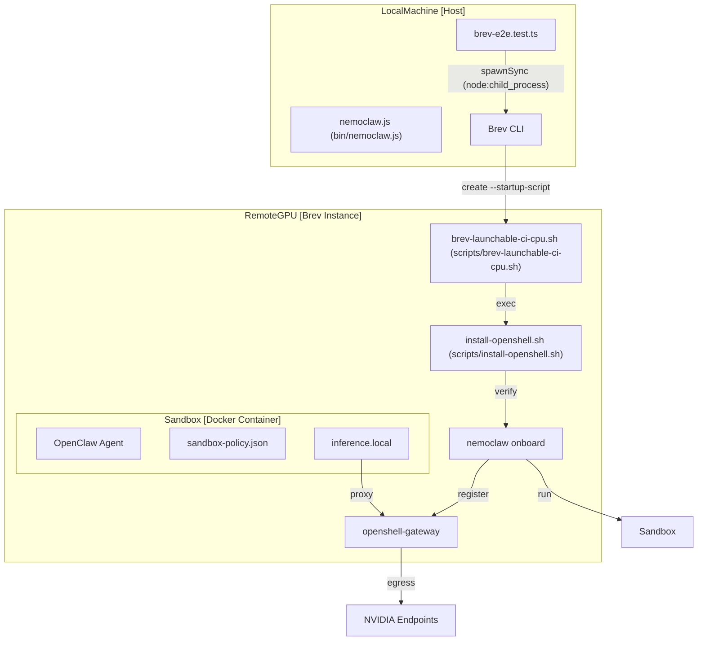
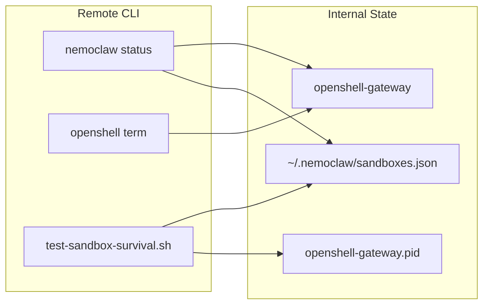

<!-- source: DeepWiki mcp.deepwiki.com · repo NVIDIA/NemoClaw · page 5.2 Remote Deployment (Brev) · fetched 2026-10-26 -->

# Remote Deployment (Brev)

<details>
<summary>Relevant source files</summary>

The following files were used as context for generating this wiki page:

- [.github/dco-bypass.txt](.github/dco-bypass.txt)
- [.github/workflows/dco-check.yaml](.github/workflows/dco-check.yaml)
- [.github/workflows/installer-hash-check.yaml](.github/workflows/installer-hash-check.yaml)
- [README.md](README.md)
- [bin/nemoclaw.js](bin/nemoclaw.js)
- [install.sh](install.sh)
- [nemoclaw-blueprint/blueprint.yaml](nemoclaw-blueprint/blueprint.yaml)
- [scripts/brev-launchable-ci-cpu.sh](scripts/brev-launchable-ci-cpu.sh)
- [scripts/check-installer-hash.sh](scripts/check-installer-hash.sh)
- [scripts/checks/extract-installer-pins.mts](scripts/checks/extract-installer-pins.mts)
- [scripts/install-openshell.sh](scripts/install-openshell.sh)
- [scripts/install.sh](scripts/install.sh)
- [scripts/start-services.sh](scripts/start-services.sh)
- [src/lib/readiness/platform-qualification.test.ts](src/lib/readiness/platform-qualification.test.ts)
- [src/lib/readiness/platform-qualification.ts](src/lib/readiness/platform-qualification.ts)
- [src/lib/runner.ts](src/lib/runner.ts)
- [src/lib/shields/timer-control.test.ts](src/lib/shields/timer-control.test.ts)
- [src/lib/shields/timer-control.ts](src/lib/shields/timer-control.ts)
- [src/lib/tunnel/agent-forward-stop.test.ts](src/lib/tunnel/agent-forward-stop.test.ts)
- [src/lib/tunnel/agent-forward-stop.ts](src/lib/tunnel/agent-forward-stop.ts)
- [src/lib/tunnel/gateway-stop-script.test.ts](src/lib/tunnel/gateway-stop-script.test.ts)
- [src/lib/tunnel/gateway-stop-script.ts](src/lib/tunnel/gateway-stop-script.ts)
- [src/lib/tunnel/services-gateway-ownership.test.ts](src/lib/tunnel/services-gateway-ownership.test.ts)
- [src/lib/tunnel/services-sandbox.test.ts](src/lib/tunnel/services-sandbox.test.ts)
- [src/lib/tunnel/services.ts](src/lib/tunnel/services.ts)
- [test/brev-launchable-ci-cpu-checksum.test.ts](test/brev-launchable-ci-cpu-checksum.test.ts)
- [test/dependency-pins-check.test.ts](test/dependency-pins-check.test.ts)
- [test/host-readiness-station-release-marker.test.ts](test/host-readiness-station-release-marker.test.ts)
- [test/install-onboard-yes.test.ts](test/install-onboard-yes.test.ts)
- [test/install-openshell-version-check.test.ts](test/install-openshell-version-check.test.ts)
- [test/install-preflight.test.ts](test/install-preflight.test.ts)
- [test/installer-hash-check.test.ts](test/installer-hash-check.test.ts)
- [test/runner.test.ts](test/runner.test.ts)
- [uninstall.sh](uninstall.sh)

</details>


This document covers deploying NemoClaw to remote GPU instances using Brev. Brev provides on-demand GPU VMs that NemoClaw can provision and configure automatically for running OpenClaw agents with NVIDIA models.

For local development setup, see [Local Development Setup](5.1). For DGX Spark-specific deployment, see [DGX Spark Setup](5.3).

---

## Overview

Deploying to a remote GPU instance via Brev can be handled through two paths: the preferred modern flow (provision VM, install, and onboard) or the legacy `nemoclaw deploy` compatibility flow. The goal of both is to establish a fully functional NemoClaw environment where an OpenClaw agent runs inside a secure OpenShell sandbox on a remote host.

Sources: [README.md:12-13](), [README.md:20-21]()

---

## Prerequisites

### Required Software

| Tool | Purpose | Installation |
|------|---------|-------------|
| `brev` CLI | VM provisioning and SSH configuration | [brev.nvidia.com](https://brev.nvidia.com) |
| Node.js 22.19+ | Host CLI execution | `actions/setup-node@v4` in CI or manual install |
| `openshell` | Sandbox and Gateway management | Installed during `onboard` or via `install-openshell.sh` |
| `docker` | Container runtime | Required on remote host |

### Required Credentials

| Credential | Environment Variable | Purpose |
|------------|---------------------|---------|
| NVIDIA API key | `NVIDIA_API_KEY` | Inference via NVIDIA Cloud API |
| Brev API Key | `BREV_API_KEY` | Instance provisioning and CLI auth |
| Hugging Face Token | `HF_TOKEN` | Accessing gated models for vLLM |
| GitHub Token | `GITHUB_TOKEN` | OpenShell binary downloads in CI |

Sources: [test/install-preflight.test.ts:130-131](), [test/install-preflight.test.ts:18-19](), [scripts/install.sh:136-140]()

---

## Deployment Architecture

The deployment process involves local CLI orchestration, remote VM provisioning, and sandbox instantiation.

### Deployment Flow: Code Entity Space



Sources: [bin/nemoclaw.js:1-13](), [test/runner.test.ts:5-6](), [scripts/install-openshell.sh:1-5](), [scripts/brev-launchable-ci-cpu.sh:1-5]()

---

## Provisioning and Deployment

### The Preferred Flow
The current recommended practice is to provision the VM separately using the Brev CLI or web console, run the standard NemoClaw installer, and then execute the onboarding wizard:

1.  **Provision VM**: `brev create --name <name> --gpu <type>`.
2.  **Run Installer**: `curl -fsSL https://raw.githubusercontent.com/NVIDIA/NemoClaw/main/scripts/install.sh | bash`. This command executes the `install.sh` script [install.sh:1-10]() which then delegates to `scripts/install.sh` [scripts/install.sh:1-10]().
3.  **Onboard**: Run `nemoclaw onboard` to configure inference and network policies.

### Automated E2E Flow (CI)
For automated validation, NemoClaw uses a specialized runner `brev-e2e.test.ts` which handles the entire lifecycle:
-   **Provisioning**: Uses `brev search` to find instances matching `BREV_MIN_VCPU` and `BREV_MIN_RAM`.
-   **Setup**: Executes `brev-launchable-ci-cpu.sh` [scripts/brev-launchable-ci-cpu.sh:1-5]() to pre-bake Docker, Node.js, and OpenShell. This script writes a sentinel file at `/var/run/nemoclaw-launchable-ready` upon completion [scripts/brev-launchable-ci-cpu.sh:48]().
-   **Verification**: The presence of `/var/run/nemoclaw-launchable-ready` indicates readiness.

| Variable | Default Value | Description |
|----------|---------------|-------------|
| `BREV_MIN_VCPU` | `4` | Minimum vCPUs for CPU instance |
| `BREV_MIN_RAM` | `16` | Minimum RAM in GB |
| `BREV_GPU_MIN_VRAM` | `20` | Minimum total VRAM GB for GPU tests |

Sources: [scripts/brev-launchable-ci-cpu.sh:44-49](), [scripts/brev-launchable-ci-cpu.sh:31-35](), [install.sh:1-10](), [scripts/install.sh:1-10]()

---

## Remote Configuration

### Dashboard and Remote Access
The NemoClaw dashboard validates browser origins. For remote access (e.g., via a `.brevlab.com` URL), the `CHAT_UI_URL` must be set before onboarding. If `CHAT_UI_URL` is non-loopback, NemoClaw disables device pairing via `NEMOCLAW_DISABLE_DEVICE_AUTH`.

```console
$ export CHAT_UI_URL="https://openclaw0-<id>.brevlab.com"
$ nemoclaw onboard
```

### Network Proxy
If the remote environment requires an outbound proxy, configure `NEMOCLAW_PROXY_HOST` and `NEMOCLAW_PROXY_PORT`. These are forwarded into the runtime container.

Sources: [src/lib/runner.ts:38-41]()

---

## Monitoring and Health

### Sandbox Verification
To monitor a remote sandbox, SSH to the instance and use the following tools:

-   **Status Check**: `nemoclaw <name> status` provides health data for the gateway, sandbox, and inference endpoints.
-   **Traffic Monitoring**: `openshell term` (TUI) allows for live inspection of egress requests.
-   **Survival Validation**: The `test-sandbox-survival.sh` script verifies that sandboxes persist across gateway restarts by checking `~/.nemoclaw/sandboxes.json`.

### Code-to-System Mapping



Sources: [src/lib/runner.ts:80-82]()

---

## Troubleshooting

| Issue | Root Cause | Resolution |
|-------|------------|------------|
| `nemoclaw` not found | PATH not updated | Run `source ~/.bashrc` or `source ~/.zshrc`. |
| `openshell` version mismatch | Binary out of date | `install-openshell.sh` checks `MIN_VERSION` (0.0.85) and `MAX_VERSION` (0.0.85) [scripts/install-openshell.sh:40-43](). |
| Missing Capability | Binary lacks rewrite support | `openshell_has_required_messaging_features` checks for `request-body-credential-rewrite` [test/install-openshell-version-check.test.ts:36-37](). |
| DNS failure in Docker | Corporate Firewall | Configure DNS in `daemon.json` or use `--dns`. |

Sources: [scripts/install-openshell.sh:38-41](), [scripts/install-openshell.sh:135-161](), [test/install-openshell-version-check.test.ts:140-145](), [nemoclaw-blueprint/blueprint.yaml:6-7]()

---

