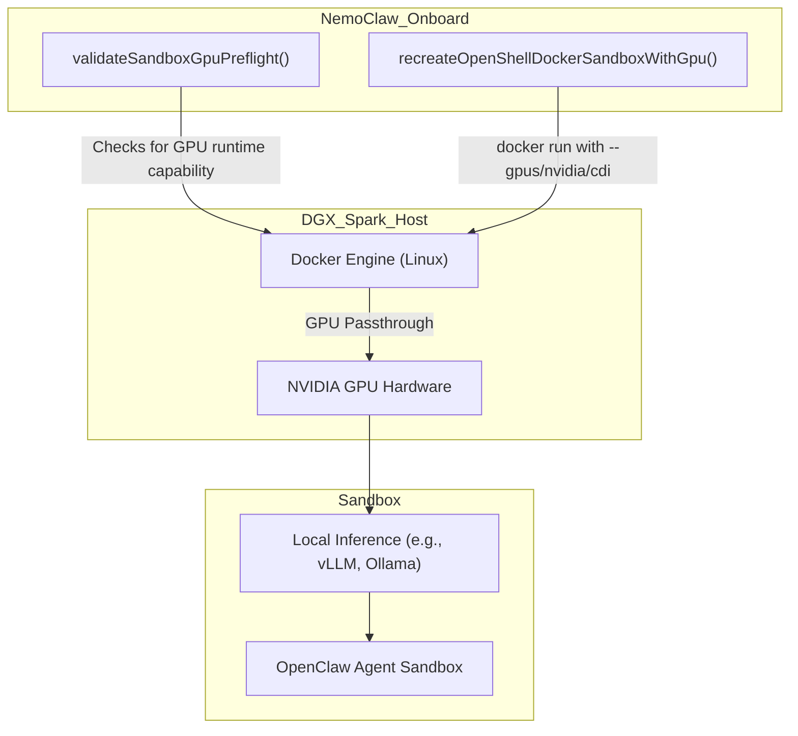
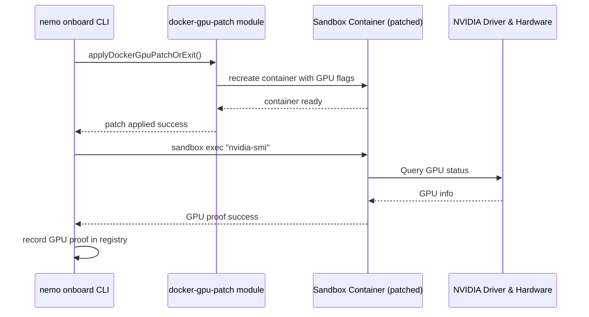
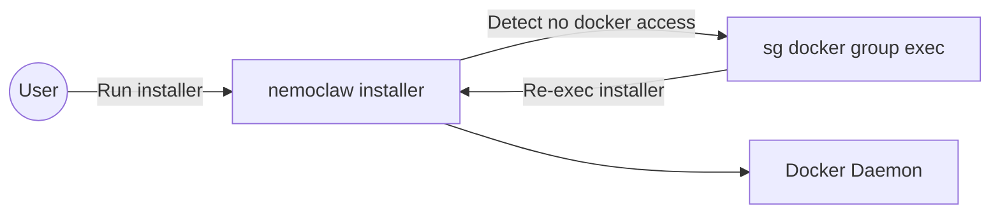

<!-- source: DeepWiki mcp.deepwiki.com · repo NVIDIA/NemoClaw · page 5.3 DGX Spark Setup · fetched 2026-10-26 -->

# DGX Spark Setup

<details>
<summary>Relevant source files</summary>

The following files were used as context for generating this wiki page:

- [ci/platform-matrix.json](ci/platform-matrix.json)
- [docs/about/ecosystem-deepagents.mdx](docs/about/ecosystem-deepagents.mdx)
- [docs/about/ecosystem-hermes.mdx](docs/about/ecosystem-hermes.mdx)
- [docs/about/ecosystem.mdx](docs/about/ecosystem.mdx)
- [docs/about/overview.mdx](docs/about/overview.mdx)
- [docs/get-started/dgx-station-preparation.mdx](docs/get-started/dgx-station-preparation.mdx)
- [docs/get-started/prerequisites.mdx](docs/get-started/prerequisites.mdx)
- [docs/get-started/quickstart-hermes.mdx](docs/get-started/quickstart-hermes.mdx)
- [docs/get-started/quickstart.mdx](docs/get-started/quickstart.mdx)
- [docs/index.mdx](docs/index.mdx)
- [docs/inference/set-up-sub-agent.mdx](docs/inference/set-up-sub-agent.mdx)
- [docs/inference/set-up-vllm.mdx](docs/inference/set-up-vllm.mdx)
- [docs/monitoring/monitor-sandbox-activity.mdx](docs/monitoring/monitor-sandbox-activity.mdx)
- [docs/reference/platform-support.mdx](docs/reference/platform-support.mdx)
- [nemoclaw/tsconfig.shared.json](nemoclaw/tsconfig.shared.json)
- [nemoclaw/vitest.project.ts](nemoclaw/vitest.project.ts)
- [scripts/checks/vitest-project-overlap.mts](scripts/checks/vitest-project-overlap.mts)
- [scripts/lib/station-vllm-conflict.sh](scripts/lib/station-vllm-conflict.sh)
- [scripts/prepare-dgx-station-host.sh](scripts/prepare-dgx-station-host.sh)
- [src/lib/inference/vllm-models.test.ts](src/lib/inference/vllm-models.test.ts)
- [src/lib/inference/vllm-models.ts](src/lib/inference/vllm-models.ts)
- [src/lib/inference/vllm-storage.test.ts](src/lib/inference/vllm-storage.test.ts)
- [src/lib/inference/vllm-storage.ts](src/lib/inference/vllm-storage.ts)
- [src/lib/inference/vllm.test.ts](src/lib/inference/vllm.test.ts)
- [src/lib/inference/vllm.ts](src/lib/inference/vllm.ts)
- [test/detect-vllm-profile.test.ts](test/detect-vllm-profile.test.ts)
- [test/inference-options-docs.test.ts](test/inference-options-docs.test.ts)
- [test/install-express-prompt.test.ts](test/install-express-prompt.test.ts)
- [test/install-station-container-coexistence.test.ts](test/install-station-container-coexistence.test.ts)
- [test/install-station-dgx-os.test.ts](test/install-station-dgx-os.test.ts)
- [test/install-station-forced-preparation.test.ts](test/install-station-forced-preparation.test.ts)
- [test/install-station-host-preparation.test.ts](test/install-station-host-preparation.test.ts)
- [test/install-station-package-transaction.test.ts](test/install-station-package-transaction.test.ts)
- [test/install-station-platform-identity.test.ts](test/install-station-platform-identity.test.ts)
- [test/install-station-vllm-continuation.test.ts](test/install-station-vllm-continuation.test.ts)
- [test/plugin-vitest-project.test.ts](test/plugin-vitest-project.test.ts)
- [test/station-doc-ownership.test.ts](test/station-doc-ownership.test.ts)
- [test/test-boundary-guards.test.ts](test/test-boundary-guards.test.ts)
- [vitest.config.ts](vitest.config.ts)

</details>


This page covers NemoClaw installation and configuration on NVIDIA DGX Spark devices. DGX Spark ships with Ubuntu 24.04 (which uses cgroup v2) and Docker pre-installed, but requires specific configuration for local GPU inference and sandbox container stability. Special considerations include handling cgroup v2 compatibility, Docker runtime GPU passthrough patching, and requirements for running k3s Kubernetes-in-Docker in the DGX Spark environment.

---

## Overview

DGX Spark devices are optimized for GPU workloads and come with a Linux Docker runtime. To ensure NemoClaw works seamlessly on DGX Spark, the system applies a Docker GPU patch that adapts sandbox containers for GPU passthrough with CUDA support. This patch supports multiple runtime modes, including NVIDIA Container Runtime, CDI (Container Device Interface), and the `--gpus` Docker flag.

The onboard installer is compatible with DGX Spark's environment and supports non-interactive re-execution to acquire correct Docker permissions. The system enforces a GPU "proof" step to verify hardware visibility and functionality post-container launch. For local inference, such as running Ollama or vLLM containers on the host, NemoClaw manages secure, token-authenticated proxies accessed from the sandbox with carefully configured network modes.

Additionally, DGX Spark requires explicit compatibility with cgroup v2, which differs from traditional Linux distros using cgroup v1. NemoClaw detects and adapts to these runtime cgroup conditions for proper resource control and monitoring.

### Key Highlights

- Uses a patched Docker container with GPU runtime flags to support sandbox GPU acceleration.
- Supports both legacy `--runtime=nvidia`, modern `nvidia.com/gpu=all` CDI devices, and Docker `--gpus all`.
- Runs an authenticated proxy for local inference access within sandbox networking constraints.
- PSA: Operates on Ubuntu 24.04 with systemd cgroup v2; host and sandbox processes require compatible resource control.
- Waits for OpenShell supervisor to reconnect after sandbox container recreation to maintain control.
- Installer reexecs using `sg docker` non-interactively if user lacks docker group permissions.
- Supports multi-node inference setups via vLLM Distributed serving (details in other pages).

**Sources:**  
[spark-install.md:6-9](), [src/lib/onboard/docker-gpu-patch.ts:1-16](), [test/install-docker-group-reexec.test.ts:128-150](), [src/lib/onboard/docker-gpu-supervisor-reconnect.ts:24-32]()

---

## Docker GPU Patch for DGX Spark

NemoClaw's core mechanism for enabling GPU passthrough into sandboxes on DGX Spark uses a Docker GPU patch module that detects when a sandbox lacks GPU access and re-creates it with appropriate runtime flags.

### Supported GPU Passthrough Methods

1. **CDI (Container Device Interface):** Preferred modern method usage with `nvidia.com/gpu=all` device requests.  
   Enables explicit GPU device injection as a CDI device [src/lib/onboard/docker-gpu-patch.ts:94-102]().

2. **Legacy NVIDIA Runtime:** Use of the deprecated `--runtime=nvidia` flag on Docker to enable GPU support.  
   Supports backwards compatibility for older host setups [src/lib/onboard/docker-gpu-patch.ts:94-102]().

3. **Standard Docker GPUs Flag:** Use of `--gpus all` Docker flag to request all GPUs on the host.  
   Acts as a fallback if CDI or the runtime is not available [src/lib/onboard/docker-gpu-patch.test.ts:111-118]().

### Patch Mechanism Flow



- **Preflight Validation:** Ensures that the host supports the required GPU runtime modes for the sandbox (CDI, NVIDIA runtime, or Docker gpus flag).
- **Patch Application:** If the sandbox is missing GPU runtime flags, NemoClaw recreates the container with the needed GPU arguments to enable access.
- **GPU Passthrough:** The patched container has GPU visibility injected and CUDA calls inside the sandbox are enabled.
- **Local Inference:** GPU-accelerated inference containers on the host interact securely through proxied APIs accessible to the sandboxed agent.

**Sources:** [src/lib/onboard/docker-gpu-patch.ts:83-145](), [src/lib/onboard/docker-gpu-patch.test.ts:90-120](), [src/lib/onboard/sandbox-gpu-preflight.ts:17-18]()

---

## Local Inference and Secure Proxy Setup

DGX Spark environments frequently run local inference services such as Ollama or vLLM containers on the host for low-latency AI queries. NemoClaw includes specialized handling for these cases to enable sandbox agents to access local inference endpoints securely without exposing undesired host services or relaxing sandbox isolation excessively.

### Authenticated Proxy for Ollama

- NemoClaw launches a local authentication proxy in the host user domain, which sits between the sandbox and the Ollama service.
- The proxy requires a shared token stored in `~/.nemoclaw/ollama-proxy-token` to authenticate sandbox requests [test/e2e/test-gpu-double-onboard.sh:111]().

### Network Mode Configuration

- The GPU patched container can be run under a specific network mode configured via the environment variable `NEMOCLAW_DOCKER_GPU_PATCH_NETWORK` (typically `host` on DGX Spark to simplify loopback access). This is critical because some local inference setups do not allow bridged container network access on Docker under cgroup v2 hosts [src/lib/onboard/docker-gpu-local-inference.ts:13-64]().

| Component           | Entity Name                    | Purpose                                                        |
|---------------------|--------------------------------|----------------------------------------------------------------|
| Auth Proxy          | `ollama-auth-proxy`             | Protects host Ollama service from unauthorized sandbox access. |
| Token File          | `~/.nemoclaw/ollama-proxy-token` | Shared secret for sandbox to authenticate proxy requests.     |
| Patch Env Var       | `NEMOCLAW_DOCKER_GPU_PATCH_NETWORK` | Specifies the network mode for the GPU patched container (`host` or default Docker bridge). |

This architecture ensures the sandboxed AI agents can access inference services efficiently and securely under strict sandbox isolation requirements.

**Sources:** [src/lib/onboard/docker-gpu-local-inference.ts:53-82](), [test/e2e/test-gpu-double-onboard.sh:106-111]()

---

## cgroup v2 Compatibility

DGX Spark ships with Ubuntu 24.04 that uses systemd's unified cgroup v2 hierarchy instead of cgroup v1. NemoClaw fully supports running inside this environment but requires special handling for:

- Proper sandbox isolation and resource limits.
- Correct interaction with the Docker runtime's cgroup management (Docker on cgroup v2 uses `cgroupfs` or systemd delegated modes).
- System monitors and telemetry that query cgroup controllers and files must account for cgroup v2 path semantics.

The onboard installer checks for the presence of cgroup v2 and adapts sandbox launch parameters accordingly during environment preflight. This ensures that resource control and sandbox stability are maintained under this modern Linux configuration.

Sources clearly describe cgroup v2 checks and compatibility in the host preparation and Docker GPU patching flow, but the exact code paths reside in system initialization and container launch hooks.

**Sources:** [scripts/prepare-dgx-station-host.sh:1-114892](), [src/lib/onboard/docker-gpu-patch.ts:83-90]()

---

## k3s-in-Docker Requirements on DGX Spark

For running Kubernetes (k3s) inside Docker on DGX Spark (e.g., in development scenarios or orchestration layers), some specific requirements must be met:

- The underlying Docker must support cgroup v2 delegation properly.
- Host kernel and Docker configuration must ensure compatibility with containerd's container runtime and cgroup v2 kernel features.
- Proper volume mounts and network mode settings (often `host`) are needed to make the k3s-in-Docker instance stable.
- The DGX Spark host environment requires careful resource management to avoid conflicts between k3s containers and GPU-patched NemoClaw sandboxes.

While NemoClaw itself does not provide native k3s orchestration, installation on DGX Spark anticipates users running k3s-in-Docker setups and ensures compatible system levels, documented in the DGX Spark host preparation scripts.

For more details on preparing DGX Station/OS hosts for running such orchestrators, see the host preparation script references and platform support notes.

**Sources:** [scripts/prepare-dgx-station-host.sh:1-114892](), [ci/platform-matrix.json:27-81]()

---

## Sandbox GPU Proof Verification

To ensure GPU passthrough works correctly after patching, NemoClaw runs a "sandbox GPU proof" step:

- Once the patched sandbox container is running, NemoClaw executes `nvidia-smi` or another CUDA query within the container.
- It waits for a successful, valid GPU report response.
- The result is persisted in the sandbox GPU proof registry to avoid silent failures.



This verification is essential to guarantee that computational GPU resources are actually present and usable inside the sandbox environment.

**Sources:** [src/lib/onboard/docker-gpu-sandbox-create.ts:160-163](), [src/lib/onboard/sandbox-gpu-preflight.ts:162-181](), [src/lib/actions/sandbox/status-snapshot.ts:88-90]()

---

## Installer Non-Interactive Re-execution for Docker Group

On DGX Spark, a common permission issue arises when the user invoking NemoClaw onboarding is not a member of the `docker` group, which prevents plain Docker commands.

The installer silently attempts a non-interactive re-execution of itself with `sg docker -c <command>` to gain docker access if the user is in the group but the group membership is inactive in the current shell session.

- This allows the complete installation and onboarding process to run without manual logout/login cycles.
- It uses environment variables to re-invoke the installer shell in the new group context.
- If this fails, the installer instructs the user to run `newgrp docker` or add themselves to the group.



This improves the DX for DGX Spark users, avoiding common post-install permission barriers.

**Sources:** [test/install-docker-group-reexec.test.ts:128-150]()

---

## Supervisor Reconnect After GPU Patch

When the patched sandbox container is recreated with GPU runtime options, the OpenShell supervisor process managing the sandbox container loses connection briefly. NemoClaw implements the `waitForOpenShellSupervisorReconnect` function, which:

- Polls the OpenShell gateway until the sandbox’s control plane reconnects successfully.
- Uses the Docker container ID to detect the new instance.
- Resumes sandbox command forwarding and log streaming once reconnect is established.

This reconnection wait ensures a smooth user experience after the GPU patch triggers a container restart.

**Source:** [src/lib/onboard/docker-gpu-supervisor-reconnect.ts:24-32]()

---

## Troubleshooting Summary

| Issue                                 | Cause                                            | Remedy                                                          |
|-------------------------------------|-------------------------------------------------|-----------------------------------------------------------------|
| `nvidia-smi` missing in sandbox      | Patch not applied or missing driver in container | Verify environment variable `NEMOCLAW_DOCKER_GPU_PATCH` is set; ensure `nvidia-container-toolkit` installed on host. Check logs for patch errors. |
| Sandbox sandbox stuck in "Error" phase | Patched container crashed on launch               | Inspect container logs `docker logs <id>`. Possible GPU driver/runtime mismatch. |
| Inference API returns 401 Unauthorized | Proxy token mismatch between host and sandbox auth proxy | Re-run `nemoclaw onboard` to sync proxy token `~/.nemoclaw/ollama-proxy-token`. |
| Permission denied on Docker commands  | User not in active docker group or session missing permissions | Run `newgrp docker` or re-invoke installer with group permissions. Consider reboot. |

**Sources:** [src/lib/onboard/docker-gpu-patch.ts:171-183](), [test/e2e/test-gpu-double-onboard.sh:7-11]()

---

# System Components and Code Mapping

This diagram relates the key DGX Spark components and system steps to their associated code entities for easy navigation.

```mermaid
graph LR
    subgraph "NemoClaw Onboard Flow"
        CLI[nemoclaw onboard CLI]
        Patch[docker-gpu-patch.ts (83-145)]
        Preflight[sandbox-gpu-preflight.ts (15-60)]
        SupervisorReconnect[docker-gpu-supervisor-reconnect.ts (24-32)]
        Proxy[docker-gpu-local-inference.ts (13-82)]
        Installer[install-docker-group-reexec.test.ts (128-150)]
    end

    subgraph "Runtime Containers / Services"
        Docker[Docker Engine]
        Sandbox[OpenShell Sandbox Container]
        GPU[NVIDIA GPU & Driver]
        LocalInference[vLLM / Ollama Host Containers]
    end

    CLI --> Preflight --> Patch --> Docker --> GPU
    Patch --> Sandbox --> SupervisorReconnect
    Proxy --> Sandbox
    Installer --> CLI
    LocalInference --> Proxy --> Sandbox
```

This visual maps natural language concepts to concrete code modules controlling DGX Spark deployment and GPU passthrough.

---

# Summary

Setting up NemoClaw on DGX Spark requires handling:

- cgroup v2 support inherent in Ubuntu 24.04 environments.
- Docker GPU patching to transparently create GPU-enabled sandboxes from standard OpenShell container launches.
- Secure local inference access via authenticated proxy mechanisms.
- Non-interactive installation reexec to attain Docker group privileges.
- Supervisor reconnect logic to manage container lifecycle during patch.

Together, these mechanisms enable NemoClaw to run secure, GPU-accelerated AI agent sandboxes on DGX Spark with optimized resource handling and stable runtime behavior.

For installation walkthroughs and more detailed DGX Spark playbooks, see linked external NVIDIA resources and DGX Spark preparation scripts.

---

**Sources:**  
- [src/lib/onboard/docker-gpu-patch.ts:1-16,83-145]()  
- [src/lib/onboard/docker-gpu-patch.test.ts:90-120]()  
- [src/lib/onboard/sandbox-gpu-preflight.ts:15-60,162-181]()  
- [src/lib/onboard/docker-gpu-local-inference.ts:13-82]()  
- [test/e2e/test-gpu-double-onboard.sh:7-11,106-111]()  
- [test/install-docker-group-reexec.test.ts:128-150]()  
- [src/lib/onboard/docker-gpu-supervisor-reconnect.ts:24-32]()  
- [scripts/prepare-dgx-station-host.sh:1-114892]()  
- [ci/platform-matrix.json:27-81]()

---

