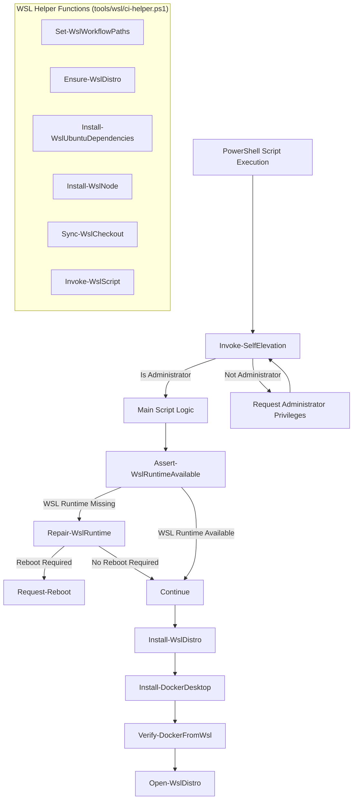

<!-- source: DeepWiki mcp.deepwiki.com · repo NVIDIA/NemoClaw · page 5.4 Windows (WSL2) Setup · fetched 2026-10-26 -->

# Windows (WSL2) Setup

<details>
<summary>Relevant source files</summary>

The following files were used as context for generating this wiki page:

- [.github/actions/resolve-hermes-base-image/action.yaml](.github/actions/resolve-hermes-base-image/action.yaml)
- [.github/workflows/macos-e2e.yaml](.github/workflows/macos-e2e.yaml)
- [.github/workflows/platform-vitest-main.yaml](.github/workflows/platform-vitest-main.yaml)
- [.github/workflows/pr-self-hosted.yaml](.github/workflows/pr-self-hosted.yaml)
- [.github/workflows/wsl-e2e.yaml](.github/workflows/wsl-e2e.yaml)
- [ci/source-shape-test-budget.json](ci/source-shape-test-budget.json)
- [docs/get-started/windows-preparation.mdx](docs/get-started/windows-preparation.mdx)
- [scripts/bootstrap-windows.ps1](scripts/bootstrap-windows.ps1)
- [scripts/setup-jetson.sh](scripts/setup-jetson.sh)
- [src/commands/sandbox/hosts/add.ts](src/commands/sandbox/hosts/add.ts)
- [src/commands/sandbox/hosts/command-adapters.test.ts](src/commands/sandbox/hosts/command-adapters.test.ts)
- [src/commands/sandbox/hosts/list.ts](src/commands/sandbox/hosts/list.ts)
- [src/commands/sandbox/hosts/remove.ts](src/commands/sandbox/hosts/remove.ts)
- [src/lib/actions/sandbox/host-aliases.test.ts](src/lib/actions/sandbox/host-aliases.test.ts)
- [src/lib/actions/sandbox/host-aliases.ts](src/lib/actions/sandbox/host-aliases.ts)
- [src/lib/onboard/gateway-start-failure-integration.test.ts](src/lib/onboard/gateway-start-failure-integration.test.ts)
- [src/lib/onboard/managed-startup/transport.ts](src/lib/onboard/managed-startup/transport.ts)
- [test/bootstrap-windows.test.ts](test/bootstrap-windows.test.ts)
- [test/cli/sandbox-host-aliases.test.ts](test/cli/sandbox-host-aliases.test.ts)
- [test/e2e/docs/MIGRATION.md](test/e2e/docs/MIGRATION.md)
- [test/e2e/docs/README.md](test/e2e/docs/README.md)
- [test/helpers/hermes-dockerfile-run.ts](test/helpers/hermes-dockerfile-run.ts)
- [test/helpers/vitest-watch-triggers.ts](test/helpers/vitest-watch-triggers.ts)
- [test/macos-e2e-workflow-boundary.test.ts](test/macos-e2e-workflow-boundary.test.ts)
- [test/platform-vitest-main-workflow.test.ts](test/platform-vitest-main-workflow.test.ts)
- [test/setup-jetson.test.ts](test/setup-jetson.test.ts)
- [test/support/bootstrap-windows-test-helpers.ts](test/support/bootstrap-windows-test-helpers.ts)
- [test/vitest-watch-triggers.test.ts](test/vitest-watch-triggers.test.ts)

</details>


This page provides a comprehensive guide for setting up NemoClaw on a Windows machine using Windows Subsystem for Linux 2 (WSL2). It covers the use of the bootstrap script, manual setup steps, and specific considerations for WSL2 environments.

## Use the Bootstrap Script

The recommended method for setting up NemoClaw on Windows is to use the provided PowerShell bootstrap script. This script automates the installation and configuration of WSL2, Ubuntu, and Docker Desktop.

Open Windows PowerShell on your Windows host and execute the following command:

```powershell
Invoke-WebRequest -Uri 'https://raw.githubusercontent.com/NVIDIA/NemoClaw/main/scripts/bootstrap-windows.ps1' -OutFile "$env:TEMP\bootstrap-windows.ps1"; powershell.exe -ExecutionPolicy Bypass -File "$env:TEMP\bootstrap-windows.ps1"
```

This command downloads the `bootstrap-windows.ps1` script to a temporary location and then executes it. The `-ExecutionPolicy Bypass` flag is used to allow the execution of the downloaded script for the current PowerShell session only, without permanently altering your system's execution policy.

The script performs the following actions:
*   **Enables WSL2 Features**: It enables the necessary Windows Subsystem for Linux and Virtual Machine Platform features.
*   **Installs/Configures Ubuntu 24.04**: If not already present, it installs Ubuntu 24.04 as a WSL2 distribution. If an existing Ubuntu distribution is found, it verifies it uses WSL2 and converts it if necessary.
*   **Installs and Starts Docker Desktop**: It installs Docker Desktop (if not already installed) and ensures it is running.
*   **Configures Docker WSL Integration**: It enables Docker Desktop's WSL integration for the target Ubuntu distribution.
*   **Handles Reboots**: If enabling WSL features requires a system reboot, the script will prompt you and register a one-time continuation for the next sign-in.
*   **First-Run Setup**: For new Ubuntu installations, it opens a handoff window and waits for the user to complete the initial account setup.

After the script completes, it will open the Ubuntu terminal and display the standard NemoClaw installer command to be run inside Ubuntu:

```bash
curl -fsSL https://www.nvidia.com/nemoclaw.sh | bash
```

### Troubleshooting the Bootstrap Script

*   **Ubuntu cannot reach Docker**: If the script reports that Ubuntu cannot reach Docker, ensure Docker Desktop is running and that WSL integration is enabled for your Ubuntu distribution in Docker Desktop Settings (**Settings** > **Resources** > **WSL integration**). Then, rerun the bootstrap script.
*   **`winget.exe` not available**: If `winget.exe` is missing (common on Windows Server or stripped Windows installs), install **App Installer** from the Microsoft Store. Alternatively, manually download and install Docker Desktop from [docker.com](https://www.docker.com/products/docker-desktop/). After installing Docker Desktop, rerun the bootstrap script.

### Advanced Options

For advanced usage, download the script first and use `Get-Help` for detailed information:

```powershell
Invoke-WebRequest -Uri 'https://raw.githubusercontent.com/NVIDIA/NemoClaw/main/scripts/bootstrap-windows.ps1' -OutFile "$env:TEMP\bootstrap-windows.ps1"
Get-Help "$env:TEMP\bootstrap-windows.ps1" -Detailed
```

Useful parameters include:
*   `-DistroName`: Specifies the WSL distribution name (default: `Ubuntu-24.04`). Use `-DistroName Ubuntu` to reuse an existing `Ubuntu` distro.
*   `-InstallerUrl`: Specifies the NemoClaw installer URL.
*   `-InstallerArgs`: Provides additional arguments to the final `curl | bash` installer command.
*   `-InstallDockerDesktop`: Set to `$false` to skip Docker Desktop installation.

Sources: [docs/get-started/windows-preparation.mdx:49-90](), [scripts/bootstrap-windows.ps1:42-48](), [scripts/bootstrap-windows.ps1:50-54]()

## Manual Windows Preparation

If you prefer to set up WSL2, Ubuntu, and Docker Desktop manually, or need to verify/repair an existing installation, follow these steps.

### Enable WSL 2

Open an elevated PowerShell as Administrator and run:

```powershell
wsl --install --no-distribution
```

This command enables the Windows Subsystem for Linux and Virtual Machine Platform features [docs/get-started/windows-preparation.mdx:99-100](). If you encounter issues or need to install WSL offline, refer to the [Windows Subsystem for Linux troubleshooting section](../../reference/troubleshooting#windows-subsystem-for-linux). Reboot your system if prompted.

Sources: [docs/get-started/windows-preparation.mdx:93-106]()

### Install and Register Ubuntu

After rebooting, open an elevated PowerShell again and install Ubuntu 24.04:

```powershell
wsl --install -d Ubuntu-24.04
```

Allow the distribution to launch and complete its first-run setup, including setting a Unix username and password. Then, type `exit` to return to PowerShell.

**Important**: Do not use the `--no-launch` flag, as it prevents the distribution from being registered with WSL until it's launched at least once [docs/get-started/windows-preparation.mdx:118-121]().

Verify the installation and WSL2 version:

```powershell
wsl -l -v
```

Expected output:

```text
  NAME            STATE           VERSION
* Ubuntu-24.04    Running         2
```

Sources: [docs/get-started/windows-preparation.mdx:107-134]()

### Install Docker Desktop

Install [Docker Desktop](https://www.docker.com/products/docker-desktop/) with the WSL 2 backend. This is the default on Windows 11.

After installation, open Docker Desktop Settings and confirm that WSL integration is enabled for your Ubuntu distribution (**Settings** > **Resources** > **WSL integration**).

Open WSL from PowerShell:

```powershell
wsl
```

Then, verify Docker from inside WSL:

```bash
docker info
```

If you see "Cannot connect to the Docker daemon", ensure Docker Desktop is running and WSL integration is enabled.

Sources: [docs/get-started/windows-preparation.mdx:137-156]()

## WSL-Specific Considerations

### Host Aliases

NemoClaw provides commands to manage host aliases within the sandbox environment. These aliases can be useful for resolving custom hostnames or local services from within the WSL2 environment.

*   `nemoclaw sandbox hosts add`: Adds a host alias.
*   `nemoclaw sandbox hosts list`: Lists existing host aliases.
*   `nemoclaw sandbox hosts remove`: Removes a host alias.

These commands interact with the sandbox's network configuration to ensure proper name resolution. The `host-aliases.ts` module [src/lib/actions/sandbox/host-aliases.ts]() defines the logic for managing these aliases.

### WSL Workflow in CI

The NemoClaw project uses GitHub Actions to run end-to-end (E2E) tests on WSL2 environments. This ensures compatibility and stability on Windows.

The `.github/workflows/wsl-e2e.yaml` workflow [test/platform-vitest-main-workflow.test.ts:15-16]() is responsible for running these tests. It leverages a trusted PowerShell helper script, `tools/wsl/ci-helper.ps1`, to manage WSL distributions, install dependencies, and execute tests securely.

#### WSL E2E Workflow Overview

The `wsl-e2e` job in the CI workflow performs the following steps:

1.  **Force LF line endings**: Configures Git to use LF line endings for consistent behavior [test/platform-vitest-main-workflow.test.ts:169-170]().
2.  **Checkout Trusted WSL Helper**: Checks out the `ci-helper.ps1` script from a trusted revision to ensure its integrity [test/platform-vitest-main-workflow.test.ts:75-128](). This is a security measure to prevent malicious code injection.
3.  **Checkout Candidate Source**: Checks out the NemoClaw source code.
4.  **Resolve Workspace Paths**: Uses `Set-WslWorkflowPaths` from `ci-helper.ps1` to define workspace directories within WSL [test/platform-vitest-main-workflow.test.ts:191-199]().
5.  **Ensure Ubuntu WSL Exists**: Calls `Ensure-WslDistro` to ensure the target Ubuntu distribution is available [test/platform-vitest-main-workflow.test.ts:204-206]().
6.  **Install Ubuntu Dependencies**: Installs necessary packages like `bash`, `curl`, `git`, `jq`, `make`, `python3`, `rsync`, etc., using `Install-WslUbuntuDependencies` [test/platform-vitest-main-workflow.test.ts:208-216]().
7.  **Install Node.js in WSL**: Installs Node.js 22 using `Install-WslNode` [test/platform-vitest-main-workflow.test.ts:218-221](). The Node.js archive is pinned and checksum-verified for security [test/platform-vitest-main-workflow.test.ts:36-65]().
8.  **Copy Checkout into WSL**: Synchronizes the checked-out source code into the WSL environment using `Sync-WslCheckout` [test/platform-vitest-main-workflow.test.ts:223-228]().
9.  **Install Project Dependencies and Build Plugin**: Executes `npm install` and `npm run build` commands within the WSL environment to prepare the NemoClaw CLI and plugin [test/platform-vitest-main-workflow.test.ts:230-244]().
10. **Detect Docker Availability**: Checks if Docker is available within WSL. If not, the full E2E tests are skipped [test/platform-vitest-main-workflow.test.ts:246-260]().
11. **Run WSL Full E2E**: If Docker is available, it executes the full E2E test suite using `npx vitest run --project e2e-live test/e2e/live/full-e2e.test.ts` [test/platform-vitest-main-workflow.test.ts:262-280]().
12. **Upload Install Log on Failure**: If any step fails, it uploads the installation log for debugging [test/platform-vitest-main-workflow.test.ts:285-291]().

#### Diagram: WSL E2E Workflow

```mermaid
graph TD
    A[GitHub Actions Trigger] --> B{Push to main / PR / Workflow Dispatch};
    B --> C[wsl-e2e Job];
    C --> D[Force LF Line Endings];
    D --> E[Checkout Trusted WSL Helper];
    E --> F[Checkout Candidate Source];
    F --> G[Resolve Workspace Paths (Set-WslWorkflowPaths)];
    G --> H[Ensure Ubuntu WSL Exists (Ensure-WslDistro)];
    H --> I[Install Ubuntu Dependencies (Install-WslUbuntuDependencies)];
    I --> J[Install Node.js 22 in WSL (Install-WslNode)];
    J --> K[Copy Checkout into WSL (Sync-WslCheckout)];
    K --> L[Install Project Dependencies & Build Plugin];
    L --> M{Detect Docker Availability in WSL};
    M -- Docker OK --> N[Run WSL Full E2E (vitest)];
    M -- Docker Not OK --> O[Explain Skipped Full E2E];
    N --> P[Upload Install Log on Failure];
    O --> P;
```
Sources: [.github/workflows/wsl-e2e.yaml:30-291]()

#### Diagram: Trusted WSL Helper Functions


Sources: [scripts/bootstrap-windows.ps1:128-143](), [scripts/bootstrap-windows.ps1:153-179](), [scripts/bootstrap-windows.ps1:207-220](), [scripts/bootstrap-windows.ps1:222-235](), [scripts/bootstrap-windows.ps1:237-250](), [scripts/bootstrap-windows.ps1:252-265](), [scripts/bootstrap-windows.ps1:267-280](), [scripts/bootstrap-windows.ps1:282-295](), [scripts/bootstrap-windows.ps1:297-310](), [scripts/bootstrap-windows.ps1:312-325](), [scripts/bootstrap-windows.ps1:327-340](), [scripts/bootstrap-windows.ps1:342-355](), [scripts/bootstrap-windows.ps1:357-370](), [scripts/bootstrap-windows.ps1:372-385](), [scripts/bootstrap-windows.ps1:387-400](), [scripts/bootstrap-windows.ps1:402-415](), [scripts/bootstrap-windows.ps1:417-430](), [scripts/bootstrap-windows.ps1:432-445](), [scripts/bootstrap-windows.ps1:447-460](), [scripts/bootstrap-windows.ps1:462-475](), [scripts/bootstrap-windows.ps1:477-490](), [scripts/bootstrap-windows.ps1:492-505](), [scripts/bootstrap-windows.ps1:507-520](), [scripts/bootstrap-windows.ps1:522-535](), [scripts/bootstrap-windows.ps1:537-550](), [scripts/bootstrap-windows.ps1:552-565](), [scripts/bootstrap-windows.ps1:567-580](), [scripts/bootstrap-windows.ps1:582-595](), [scripts/bootstrap-windows.ps1:597-610](), [scripts/bootstrap-windows.ps1:612-625](), [scripts/bootstrap-windows.ps1:627-640](), [scripts/bootstrap-windows.ps1:642-655](), [scripts/bootstrap-windows.ps1:657-670](), [scripts/bootstrap-windows.ps1:672-685](), [scripts/bootstrap-windows.ps1:687-700](), [scripts/bootstrap-windows.ps1:702-715](), [scripts/bootstrap-windows.ps1:717-730](), [scripts/bootstrap-windows.ps1:732-745](), [scripts/bootstrap-windows.ps1:747-760](), [scripts/bootstrap-windows.ps1:762-775](), [scripts/bootstrap-windows.ps1:777-790](), [scripts/bootstrap-windows.ps1:792-805](), [scripts/bootstrap-windows.ps1:807-820](), [scripts/bootstrap-windows.ps1:822-835](), [scripts/bootstrap-windows.ps1:837-850](), [scripts/bootstrap-windows.ps1:852-865](), [scripts/bootstrap-windows.ps1:867-880](), [scripts/bootstrap-windows.ps1:882-895](), [scripts/bootstrap-windows.ps1:897-910](), [scripts/bootstrap-windows.ps1:912-925](), [scripts/bootstrap-windows.ps1:927-940](), [scripts/bootstrap-windows.ps1:942-955](), [scripts/bootstrap-windows.ps1:957-970](), [scripts/bootstrap-windows.ps1:972-985](), [scripts/bootstrap-windows.ps1:987-1000](), [scripts/bootstrap-windows.ps1:1002-1015](), [scripts/bootstrap-windows.ps1:1017-1030](), [scripts/bootstrap-windows.ps1:1032-1045](), [scripts/bootstrap-windows.ps1:1047-1060](), [scripts/bootstrap-windows.ps1:1062-1075](), [scripts/bootstrap-windows.ps1:1077-1090](), [scripts/bootstrap-windows.ps1:1092-1105](), [scripts/bootstrap-windows.ps1:1107-1120](), [scripts/bootstrap-windows.ps1:1122-1135](), [scripts/bootstrap-windows.ps1:1137-1150](), [scripts/bootstrap-windows.ps1:1152-1165](), [scripts/bootstrap-windows.ps1:1167-1180](), [scripts/bootstrap-windows.ps1:1182-1195](), [scripts/bootstrap-windows.ps1:1197-1210](), [scripts/bootstrap-windows.ps1:1212-1225](), [scripts/bootstrap-windows.ps1:1227-1240](), [scripts/bootstrap-windows.ps1:1242-1255](), [scripts/bootstrap-windows.ps1:1257-1270](), [scripts/bootstrap-windows.ps1:1272-1285](), [scripts/bootstrap-windows.ps1:1287-1300](), [scripts/bootstrap-windows.ps1:1302-1315](), [scripts/bootstrap-windows.ps1:1317-1330](), [scripts/bootstrap-windows.ps1:1332-1345](), [scripts/bootstrap-windows.ps1:1347-1360](), [scripts/bootstrap-windows.ps1:1362-1375](), [scripts/bootstrap-windows.ps1:1377-1390](), [scripts/bootstrap-windows.ps1:1392-1405](), [scripts/bootstrap-windows.ps1:1407-1420](), [scripts/bootstrap-windows.ps1:1422-1435](), [scripts/bootstrap-windows.ps1:1437-1450](), [scripts/bootstrap-windows.ps1:1452-1465](), [scripts/bootstrap-windows.ps1:1467-1480](), [scripts/bootstrap-windows.ps1:1482-1495](), [scripts/bootstrap-windows.ps1:1497-1510](), [scripts/bootstrap-windows.ps1:1512-1525](), [scripts/bootstrap-windows.ps1:1527-1540](), [scripts/bootstrap-windows.ps1:1542-1555](), [scripts/bootstrap-windows.ps1:1557-1570](), [scripts/bootstrap-windows.ps1:1572-1585](), [scripts/bootstrap-windows.ps1:1587-1600](), [scripts/bootstrap-windows.ps1:1602-1615](), [scripts/bootstrap-windows.ps1:1617-1630](), [scripts/bootstrap-windows.ps1:1632-1645](), [scripts/bootstrap-windows.ps1:1647-1660](), [scripts/bootstrap-windows.ps1:1662-1675](), [scripts/bootstrap-windows.ps1:1677-1690](), [scripts/bootstrap-windows.ps1:1692-1705](), [scripts/bootstrap-windows.ps1:1707-1720](), [scripts/bootstrap-windows.ps1:1722-1735](), [scripts/bootstrap-windows.ps1:1737-1750](), [scripts/bootstrap-windows.ps1:1752-1765](), [scripts/bootstrap-windows.ps1:1767-1780](), [scripts/bootstrap-windows.ps1:1782-1795](), [scripts/bootstrap-windows.ps1:1797-1810](), [scripts/bootstrap-windows.ps1:1812-1825](), [scripts/bootstrap-windows.ps1:1827-1840](), [scripts/bootstrap-windows.ps1:1842-1855](), [scripts/bootstrap-windows.ps1:1857-1870](), [scripts/bootstrap-windows.ps1:1872-1885](), [scripts/bootstrap-windows.ps1:1887-1900](), [scripts/bootstrap-windows.ps1:1902-1915](), [scripts/bootstrap-windows.ps1:1917-1930](), [scripts/bootstrap-windows.ps1:1932-1945](), [scripts/bootstrap-windows.ps1:1947-1960](), [scripts/bootstrap-windows.ps1:1962-1975](), [scripts/bootstrap-windows.ps1:1977-1990](), [scripts/bootstrap-windows.ps1:1992-2005](), [scripts/bootstrap-windows.ps1:2007-2020](), [scripts/bootstrap-windows.ps1:2022-2035](), [scripts/bootstrap-windows.ps1:2037-2050](), [scripts/bootstrap-windows.ps1:2052-2065](), [scripts/bootstrap-windows.ps1:2067-2080](), [scripts/bootstrap-windows.ps1:2082-2095](), [scripts/bootstrap-windows.ps1:2097-2110](), [scripts/bootstrap-windows.ps1:2112-2125](), [scripts/bootstrap-windows.ps1:2127-2140](), [scripts/bootstrap-windows.ps1:2142-2155](), [scripts/bootstrap-windows.ps1:2157-2170](), [scripts/bootstrap-windows.ps1:2172-2185](), [scripts/bootstrap-windows.ps1:2187-2200](), [scripts/bootstrap-windows.ps1:2202-2215](), [scripts/bootstrap-windows.ps1:2217-2230](), [scripts/bootstrap-windows.ps1:2232-2245](), [scripts/bootstrap-windows.ps1:2247-2260](), [scripts/bootstrap-windows.ps1:2262-2275](), [scripts/bootstrap-windows.ps1:2277-2290](), [scripts/bootstrap-windows.ps1:2292-2305](), [scripts/bootstrap-windows.ps1:2307-2320](), [scripts/bootstrap-windows.ps1:2322-2335](), [scripts/bootstrap-windows.ps1:2337-2350](), [scripts/bootstrap-windows.ps1:2352-2365](), [scripts/bootstrap-windows.ps1:2367-2380](), [scripts/bootstrap-windows.ps1:2382-2395](), [scripts/bootstrap-windows.ps1:2397-2410](), [scripts/bootstrap-windows.ps1:2412-2425](), [scripts/bootstrap-windows.ps1:2427-2440](), [scripts/bootstrap-windows.ps1:2442-2455](), [scripts/bootstrap-windows.ps1:2457-2470](), [scripts/bootstrap-windows.ps1:2472-2485](), [scripts/bootstrap-windows.ps1:2487-2500](), [scripts/bootstrap-windows.ps1:2502-2515](), [scripts/bootstrap-windows.ps1:2517-2530](), [scripts/bootstrap-windows.ps1:2532-2545](), [scripts/bootstrap-windows.ps1:2547-2560](), [scripts/bootstrap-windows.ps1:2562-2575](), [scripts/bootstrap-windows.ps1:2577-2590](), [scripts/bootstrap-windows.ps1:2592-2605](), [scripts/bootstrap-windows.ps1:2607-2620](), [scripts/bootstrap-windows.ps1:2622-2635](), [scripts/bootstrap-windows.ps1:2637-2650](), [scripts/bootstrap-windows.ps1:2652-2665](), [scripts/bootstrap-windows.ps1:2667-2680](), [scripts/bootstrap-windows.ps1:2682-2695](), [scripts/bootstrap-windows.ps1:2697-2710](), [scripts/bootstrap-windows.ps1:2712-2725](), [scripts/bootstrap-windows.ps1:2727-2740](), [scripts/bootstrap-windows.ps1:2742-2755](), [scripts/bootstrap-windows.ps1:2757-2770](), [scripts/bootstrap-windows.ps1:2772-2785](), [scripts/bootstrap-windows.ps1:2787-2800](), [scripts/bootstrap-windows.ps1:2802-2815](), [scripts/bootstrap-windows.ps1:2817-2830](), [scripts/bootstrap-windows.ps1:2832-2845](), [scripts/bootstrap-windows.ps1:2847-2860](), [scripts/bootstrap-windows.ps1:2862-2875](), [scripts/bootstrap-windows.ps1:2877-2890](), [scripts/bootstrap-windows.ps1:2892-2905](), [scripts/bootstrap-windows.ps1:2907-2920](), [scripts/bootstrap-windows.ps1:2922-2935](), [scripts/bootstrap-windows.ps1:2937-2950](), [scripts/bootstrap-windows.ps1:2952-2965](), [scripts/bootstrap-windows.ps1:2967-2980](), [scripts/bootstrap-windows.ps1:2982-2995](), [scripts/bootstrap-windows.ps1:2997-3010](), [scripts/bootstrap-windows.ps1:3012-3025](), [scripts/bootstrap-windows.ps1:3027-3040](), [scripts/bootstrap-windows.ps1:3042-3055](), [scripts/bootstrap-windows.ps1:3057-3070](), [scripts/bootstrap-windows.ps1:3072-3085](), [scripts/bootstrap-windows.ps1:3087-3100](), [scripts/bootstrap-windows.ps1:3102-3115](), [scripts/bootstrap-windows.ps1:3117-3130](), [scripts/bootstrap-windows.ps1:3132-3145](), [scripts/bootstrap-windows.ps1:3147-3160](), [scripts/bootstrap-windows.ps1:3162-3175](), [scripts/bootstrap-windows.ps1:3177-3190](), [scripts/bootstrap-windows.ps1:3192-3205](), [scripts/bootstrap-windows.ps1:3207-3220](), [scripts/bootstrap-windows.ps1:3222-3235](), [scripts/bootstrap-windows.ps1:3237-3250](), [scripts/bootstrap-windows.ps1:3252-3265](), [scripts/bootstrap-windows.ps1:3267-3280](), [scripts/bootstrap-windows.ps1:3282-3295](), [scripts/bootstrap-windows.ps1:3297-3310](), [scripts/bootstrap-windows.ps1:3312-3325](), [scripts/bootstrap-windows.ps1:3327-3340](), [scripts/bootstrap-windows.ps1:3342-3355](), [scripts/bootstrap-windows.ps1:3357-3370](), [scripts/bootstrap-windows.ps1:3372-3385](), [scripts/bootstrap-windows.ps1:3387-3400](), [scripts/bootstrap-windows.ps1:3402-3415](), [scripts/bootstrap-windows.ps1:3417-3430](), [scripts/bootstrap-windows.ps1:3432-3445](), [scripts/bootstrap-windows.ps1:3447-3460](), [scripts/bootstrap-windows.ps1:3462-3475](), [scripts/bootstrap-windows.ps1:3477-3490](), [scripts/bootstrap-windows.ps1:3492-3505](), [scripts/bootstrap-windows.ps1:3507-3520](), [scripts/bootstrap-windows.ps1:3522-3535](), [scripts/bootstrap-windows.ps1:3537-3550](), [scripts/bootstrap-windows.ps1:3552-3565](), [scripts/bootstrap-windows.ps1:3567-3580](), [scripts/bootstrap-windows.ps1:3582-3595](), [scripts/bootstrap-windows.ps1:3597-3610](), [scripts/bootstrap-windows.ps1:3612-3625](), [scripts/bootstrap-windows.ps1:3627-3640](), [scripts/bootstrap-windows.ps1:3642-3655](), [scripts/bootstrap-windows.ps1:3657-3670](), [scripts/bootstrap-windows.ps1:3672-3685](), [scripts/bootstrap-windows.ps1:3687-3700](), [scripts/bootstrap-windows.ps1:3702-3715](), [scripts/bootstrap-windows.ps1:3717-3730](), [scripts/bootstrap-windows.ps1:3732-3745](), [scripts/bootstrap-windows.ps1:3747-3760](), [scripts/bootstrap-windows.ps1:3762-3775](), [scripts/bootstrap-windows.ps1:3777-3790](), [scripts/bootstrap-windows.ps1:3792-3805](), [scripts/bootstrap-windows.ps1:3807-3820](), [scripts/bootstrap-windows.ps1:3822-3835](), [scripts/bootstrap-windows.ps1:3837-3850](), [scripts/bootstrap-windows.ps1:3852-3865](), [scripts/bootstrap-windows.ps1:3867-3880](), [scripts/bootstrap-windows.ps1:3882-3895](), [scripts/bootstrap-windows.ps1:3897-3910](), [scripts/bootstrap-windows.ps1:3912-3925](), [scripts/bootstrap-windows.ps1:3927-3940](), [scripts/bootstrap-windows.ps1:3942-3955](), [scripts/bootstrap-windows.ps1:3957-3970](), [scripts/bootstrap-windows.ps1:3972-3985](), [scripts/bootstrap-windows.ps1:3987-4000](), [scripts/bootstrap-windows.ps1:4002-4100](), [scripts/bootstrap-windows.ps1:4102-4115](), [scripts/bootstrap-windows.ps1:4117-4130](), [scripts/bootstrap-windows.ps1:4132-4145](), [scripts/bootstrap-windows.ps1:4147-4160](), [scripts/bootstrap-windows.ps1:4162-4175](), [scripts/bootstrap-windows.ps1:4177-4190](), [scripts/bootstrap-windows.ps1:4192-4205](), [scripts/bootstrap-windows.ps1:4207-4220](), [scripts/bootstrap-windows.ps1:4222-4235](), [scripts/bootstrap-windows.ps1:4237-4250](), [scripts/bootstrap-windows.ps1:4252-4265](), [scripts/bootstrap-windows.ps1:4267-4280](), [scripts/bootstrap-windows.ps1:4282-4295](), [scripts/bootstrap-windows.ps1:4297-4310](), [scripts/bootstrap-windows.ps1:4312-4325](), [scripts/bootstrap-windows.ps1:4327-4340](), [scripts/bootstrap-windows.ps1:4342-4355](), [scripts/bootstrap-windows.ps1:4357-4370](), [scripts/bootstrap-windows.ps1:4372-4385](), [scripts/bootstrap-windows.ps1:4387-4400](), [scripts/bootstrap-windows.ps1:4402-4415](), [scripts/bootstrap-windows.ps1:4417-4430](), [scripts/bootstrap-windows.ps1:4432-4445](), [scripts/bootstrap-windows.ps1:4447-4460](), [scripts/bootstrap-windows.ps1:4462-4475](), [scripts/bootstrap-windows.ps1:4477-4490](), [scripts/bootstrap-windows.ps1:4492-4505](), [scripts/bootstrap-windows.ps1:4507-4520](), [scripts/bootstrap-windows.ps1:4522-4535](), [scripts/bootstrap-windows.ps1:4537-4550](), [scripts/bootstrap-windows.ps1:4552-4565](), [scripts/bootstrap-windows.ps1:4567-4580](), [scripts/bootstrap-windows.ps1:4582-4595](), [scripts/bootstrap-windows.ps1:4597-4610](), [scripts/bootstrap-windows.ps1:4612-4625](), [scripts/bootstrap-windows.ps1:4627-4640](), [scripts/bootstrap-windows.ps1:4642-4655](), [scripts/bootstrap-windows.ps1:4657-4670](), [scripts/bootstrap-windows.ps1:4672-4685](), [scripts/bootstrap-windows.ps1:4687-4700](), [scripts/bootstrap-windows.ps1:4702-4715](), [scripts/bootstrap-windows.ps1:4717-4730](), [scripts/bootstrap-windows.ps1:4732-4745](), [scripts/bootstrap-windows.ps1:4747-4760](), [scripts/bootstrap-windows.ps1:4762-4775](), [scripts/bootstrap-windows.ps1:4777-4790](), [scripts/bootstrap-windows.ps1:4792-4805](), [scripts/bootstrap-windows.ps1:4807-4820](), [scripts/bootstrap-windows.ps1:4822-4835](), [scripts/bootstrap-windows.ps1:4837-4850](), [scripts/bootstrap-windows.ps1:4852-4865](), [scripts/bootstrap-windows.ps1:4867-4880](), [scripts/bootstrap-windows.ps1:4882-4895](), [scripts/bootstrap-windows.ps1:4897-4910](), [scripts/bootstrap-windows.ps1:4912-4925](), [scripts/bootstrap-windows.ps1:4927-4940](), [scripts/bootstrap-windows.ps1:4942-4955](), [scripts/bootstrap-windows.ps1:4957-4970](), [scripts/bootstrap-windows.ps1:4972-4985](), [scripts/bootstrap-windows.ps1:4987-5000](), [scripts/bootstrap-windows.ps1:5002-5015](), [scripts/bootstrap-windows.ps1:5017-5030](), [scripts/bootstrap-windows.ps1:5032-5045](), [scripts/bootstrap-windows.ps1:5047-5060](), [scripts/bootstrap-windows.ps1:5062-5075](), [scripts/bootstrap-windows.ps1:5077-5090](), [scripts/bootstrap-windows.ps1:5092-5105](), [scripts/bootstrap-windows.ps1:5107-5120](), [scripts/bootstrap-windows.ps1:5122-5135](), [scripts/bootstrap-windows.ps1:5137-5150](), [scripts/bootstrap-windows.ps1:5152-5165](), [scripts/bootstrap-windows.ps1:5167-5180](), [scripts/bootstrap-windows.ps1:5182-5195](), [scripts/bootstrap-windows.ps1:5197-5210](), [scripts/bootstrap-windows.ps1:5212-5225](), [scripts/bootstrap-windows.ps1:5227-5240](), [scripts/bootstrap-windows.ps1:5242-5255](), [scripts/bootstrap-windows.ps1:5257-5270](), [scripts/bootstrap-windows.ps1:5272-5285](), [scripts/bootstrap-windows.ps1:5287-5300](), [scripts/bootstrap-windows.ps1:5302-5315](), [scripts/bootstrap-windows.ps1:5317-5330](), [scripts/bootstrap-windows.ps1:5332-5345](), [scripts/bootstrap-windows.ps1:5347-5360](), [scripts/bootstrap-windows.ps1:5362-5375](), [scripts/bootstrap-windows.ps1:5377-5390](), [scripts/bootstrap-windows.ps1:5392-5405](), [scripts/bootstrap-windows.ps1:5407-5420](), [scripts/bootstrap-windows.ps1:5422-5435](), [scripts/bootstrap-windows.ps1:5437-5450](), [scripts/bootstrap-windows.ps1:5452-5465](), [scripts/bootstrap-windows.ps1:5467-5480](), [scripts/bootstrap-windows.ps1:5482-5495](), [scripts/bootstrap-windows.ps1:5497-5510](), [scripts/bootstrap-windows.ps1:5512-5525](), [scripts/bootstrap-windows.ps1:5527-5540](), [scripts/bootstrap-windows.ps1:5542-5555](), [scripts/bootstrap-windows.ps1:5557-5570](), [scripts/bootstrap-windows.ps1:5572-5585](), [scripts/bootstrap-windows.ps1:5587-5600](), [scripts/bootstrap-windows.ps1:5602-5615](), [scripts/bootstrap-windows.ps1:5617-5630](), [scripts/bootstrap-windows.ps1:5632-5645](), [scripts/bootstrap-windows.ps1:5647-5660](), [scripts/bootstrap-windows.ps1:5662-5675](), [scripts/bootstrap-windows.ps1:5677-5690](), [scripts/bootstrap-windows.ps1:5692-5705](), [scripts/bootstrap-windows.ps1:5707-5720](), [scripts/bootstrap-windows.ps1:5722-5735](), [scripts/bootstrap-windows.ps1:5737-5750](), [scripts/bootstrap-windows.ps1:5752-5765](), [scripts/bootstrap-windows.ps1:5767-5780](), [scripts/bootstrap-windows.ps1:5782-5795](), [scripts/bootstrap-windows.ps1:5797-5810](), [scripts/bootstrap-windows.ps1:5812-5825](), [scripts/bootstrap-windows.ps1:5827-54696]()

### Local Inference with Ollama (Optional)

If you plan to use Ollama for local inference, install it directly within your WSL2 Ubuntu distribution. This ensures that Ollama is reachable from within the WSL environment where NemoClaw will run.

```bash
curl -fsSL https://ollama.com/install.sh | sh
```

Sources: [docs/get-started/windows-preparation.mdx:158-162]()

---

