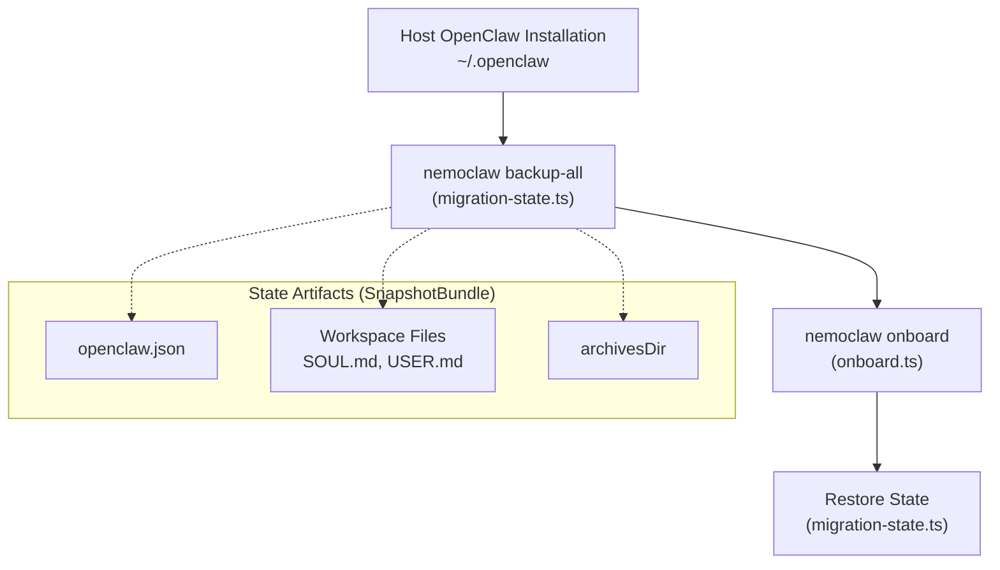
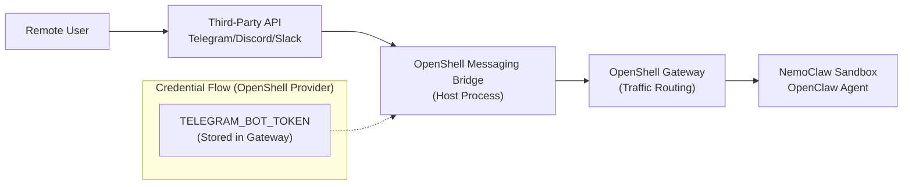
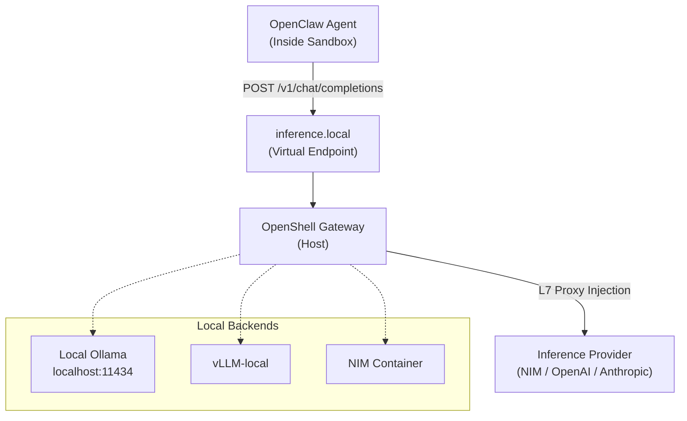

<!-- source: DeepWiki mcp.deepwiki.com · repo NVIDIA/NemoClaw · page 6 Advanced Topics · fetched 2026-10-26 -->

# Advanced Topics

Relevant source files

The following files were used as context for generating this wiki page:

- [.agents/skills/_shared/controlled-words.md](.agents/skills/_shared/controlled-words.md)
- [.agents/skills/_shared/documentation-writing-review.md](.agents/skills/_shared/documentation-writing-review.md)
- [.agents/skills/_shared/pr-follow-up.md](.agents/skills/_shared/pr-follow-up.md)
- [.agents/skills/nemoclaw-contributor-create-pr/SKILL.md](.agents/skills/nemoclaw-contributor-create-pr/SKILL.md)
- [.agents/skills/nemoclaw-contributor-onboard-messaging-channel/SKILL.md](.agents/skills/nemoclaw-contributor-onboard-messaging-channel/SKILL.md)
- [.agents/skills/nemoclaw-contributor-update-docs/SKILL.md](.agents/skills/nemoclaw-contributor-update-docs/SKILL.md)
- [.agents/skills/nemoclaw-maintainer-day/PR-REVIEW-PRIORITIES.md](.agents/skills/nemoclaw-maintainer-day/PR-REVIEW-PRIORITIES.md)
- [.agents/skills/nemoclaw-maintainer-day/SALVAGE-PR.md](.agents/skills/nemoclaw-maintainer-day/SALVAGE-PR.md)
- [.agents/skills/nemoclaw-maintainer-day/TEST-GAPS.md](.agents/skills/nemoclaw-maintainer-day/TEST-GAPS.md)
- [.agents/skills/nemoclaw-maintainer-policies/SKILL.md](.agents/skills/nemoclaw-maintainer-policies/SKILL.md)
- [.agents/skills/nemoclaw-maintainer-refactor-docs/SKILL.md](.agents/skills/nemoclaw-maintainer-refactor-docs/SKILL.md)
- [.agents/skills/nemoclaw-maintainer-release-notes/SKILL.md](.agents/skills/nemoclaw-maintainer-release-notes/SKILL.md)
- [.github/PULL_REQUEST_TEMPLATE.md](.github/PULL_REQUEST_TEMPLATE.md)
- [.gitignore](.gitignore)
- [.pre-commit-config.yaml](.pre-commit-config.yaml)
- [AGENTS.md](AGENTS.md)
- [CONTRIBUTING.md](CONTRIBUTING.md)
- [WRITING.md](WRITING.md)
- [docs/AGENTS.md](docs/AGENTS.md)
- [docs/CONTRIBUTING.md](docs/CONTRIBUTING.md)
- [docs/DORI_SETUP.md](docs/DORI_SETUP.md)
- [docs/changelog/2026-07-30.mdx](docs/changelog/2026-07-30.mdx)
- [docs/configure-agents/configure-memory-search.mdx](docs/configure-agents/configure-memory-search.mdx)
- [docs/index.yml](docs/index.yml)
- [docs/inference/set-up-vllm-on-two-dgx-stations.mdx](docs/inference/set-up-vllm-on-two-dgx-stations.mdx)
- [docs/manage-sandboxes/run-deep-agents-code.mdx](docs/manage-sandboxes/run-deep-agents-code.mdx)
- [docs/reference/commands.mdx](docs/reference/commands.mdx)
- [docs/reference/configure-runtime-identity.mdx](docs/reference/configure-runtime-identity.mdx)
- [docs/reference/troubleshooting.mdx](docs/reference/troubleshooting.mdx)
- [docs/resources/engineer-agentic-documentation.mdx](docs/resources/engineer-agentic-documentation.mdx)
- [fern/AGENTS.md](fern/AGENTS.md)
- [package-lock.json](package-lock.json)
- [package.json](package.json)
- [scripts/check-docs-published-routes.mts](scripts/check-docs-published-routes.mts)
- [src/lib/sandbox/config-format.test.ts](src/lib/sandbox/config-format.test.ts)
- [src/lib/sandbox/config-format.ts](src/lib/sandbox/config-format.ts)
- [src/lib/sandbox/config-get.test.ts](src/lib/sandbox/config-get.test.ts)
- [test/check-docs-published-routes.test.ts](test/check-docs-published-routes.test.ts)

This page covers advanced NemoClaw workflows and customization options for power users and developers. These topics go beyond basic installation and operation to enable migration from existing OpenClaw setups, integration with external messaging services, custom inference configuration, and development workflows.

For basic setup and usage, see [Getting Started](#2). For detailed command reference, see [Command-Line Interface](#4). For deployment scenarios, see [Setup and Deployment](#5).

## Overview

Advanced NemoClaw usage falls into five categories:

**Migration** ([Migrating from Host OpenClaw](#6.1))
: Transferring an existing host-based OpenClaw installation into the NemoClaw sandbox, preserving configuration and state. Managed via `$$nemoclaw onboard` or specific migration subcommands [docs/reference/commands.mdx:38-38]().

**Auxiliary Services** ([Auxiliary Services](#6.2))
: Integrating external interfaces like the Telegram bridge, Discord, or Slack, and cloudflared tunnels for remote access [docs/index.yml:140-140]().

**Custom Inference Providers** ([Custom Inference Providers](#6.3))
: Configuring inference endpoints beyond the default profiles, including custom NIM deployments and local providers like Ollama or vLLM [docs/index.yml:98-109]().

**Workspace Management** ([Workspace Files and Persistence](#6.4))
: Understanding and managing persistent agent files like `SOUL.md`, `MEMORY.md`, and `IDENTITY.md` which represent the agent's state [docs/configure-agents/configure-memory-search.mdx:10-10]().

**Development and Testing** ([Development and Testing](#6.5))
: Building NemoClaw from source, running tests, and customizing Docker images [CONTRIBUTING.md:103-106]().

## Migration Architecture

The migration process allows users to move an existing OpenClaw installation into a managed OpenShell sandbox. This involves capturing the host state and applying it within the isolated environment.

### Migration Workflow

**Sources:** [nemoclaw/src/commands/migration-state.ts:72-79](), [docs/reference/commands.mdx:113-116]()

The migration lifecycle is facilitated by the `$$nemoclaw backup-all` command, which preserves sandbox state before retiring old gateways [docs/reference/commands.mdx:114-115](). The `SnapshotBundle` interface defines the structure of this migration, including a `manifest` and the `preparedStateDir` [nemoclaw/src/commands/migration-state.ts:72-79](). This process ensures that the agent's persona, located in the workspace, is preserved across the transition. For details, see [Migrating from Host OpenClaw](#6.1).

## Auxiliary Service Integration

NemoClaw supports external service integrations that extend agent capabilities. These services often run on the host and communicate with the sandbox via the OpenShell gateway.

### Messaging Bridge Architecture

NemoClaw configures messaging channels during onboarding, using OpenShell-managed processes to connect platforms like Telegram to the sandboxed agent.

**Sources:** [docs/index.yml:140-140](), [docs/configure-agents/configure-messaging-channels.mdx:16-20]()

NemoClaw allows for the configuration of these channels during the `$$nemoclaw onboard` wizard [docs/configure-agents/configure-messaging-channels.mdx:29-30](). Credentials for these services, such as `TELEGRAM_BOT_TOKEN` or `SLACK_APP_TOKEN`, are registered with the OpenShell gateway and are never persisted to the host disk [docs/configure-agents/configure-messaging-channels.mdx:17-17](). For details, see [Auxiliary Services](#6.2).

## Custom Inference Provider Configuration

While NemoClaw defaults to NVIDIA Endpoints, the system is designed to route inference through any OpenShell-compatible provider, including local instances of Ollama or vLLM.

### Inference Routing Logic

**Sources:** [docs/index.yml:98-109](), [docs/inference/use-local-inference.mdx:19-22]()

Inference requests are intercepted by the OpenShell gateway. The agent within the sandbox communicates with a virtual `inference.local` endpoint, making the actual provider transparent to the agent [docs/inference/use-local-inference.mdx:19-21](). This allows users to switch models or providers (e.g., from NVIDIA Endpoints to a local NIM) at runtime using `$$nemoclaw inference set` without modifying the agent's code [docs/inference/switch-providers.mdx:150-153](). For details, see [Custom Inference Providers](#6.3).

## Workspace Files and Persistence

Agent state is stored in specific Markdown files that represent the "long-term memory" of the agent. These files persist across sandbox restarts and are located within the sandbox workspace.

| File | Purpose | Reference |
|---|---|---|
| `SOUL.md` | Core agent personality and behavioral instructions. | [docs/configure-agents/configure-memory-search.mdx:10-10]() |
| `IDENTITY.md` | Agent's self-identification and role. | [docs/configure-agents/configure-memory-search.mdx:10-10]() |
| `MEMORY.md` | Long-term memory and accumulated knowledge. | [docs/configure-agents/configure-memory-search.mdx:10-10]() |
| `USER.md` | Information about the human operator. | [docs/configure-agents/configure-memory-search.mdx:10-10]() |

**Sources:** [docs/configure-agents/configure-memory-search.mdx:10-10](), [docs/configure-agents/configure-runtime-identity.mdx:10-10]()

NemoClaw ensures these files persist by mounting workspace directories from the host into the sandbox container. For details on backing up and restoring these files, see [Workspace Files and Persistence](#6.4).

## Development and Testing

NemoClaw is an open-source project that encourages community contribution. Developers can build from source and customize the sandbox environment.

### Development Workflow

The development process typically involves:
1. **Source Installation**: Cloning the repository and installing dependencies via `npm install` [CONTRIBUTING.md:103-106]().
2. **Custom Blueprints**: Modifying the Dockerfile or blueprint configuration to add custom tools or capabilities [AGENTS.md:36-36]().
3. **Testing**: Verifying changes using the `$$nemoclaw onboard` wizard with the `--from <Dockerfile>` flag to test custom images [docs/reference/commands.mdx:115-115]().
4. **CLI Extension**: Adding new commands or subcommands to the `nemoclaw` binary.

**Sources:** [docs/reference/commands.mdx:115-115](), [CONTRIBUTING.md:103-106]()

For detailed developer guides, see [Development and Testing](#6.5).

---

