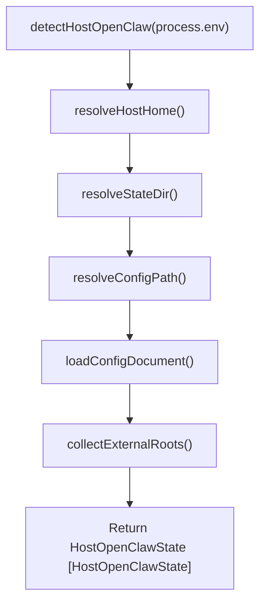
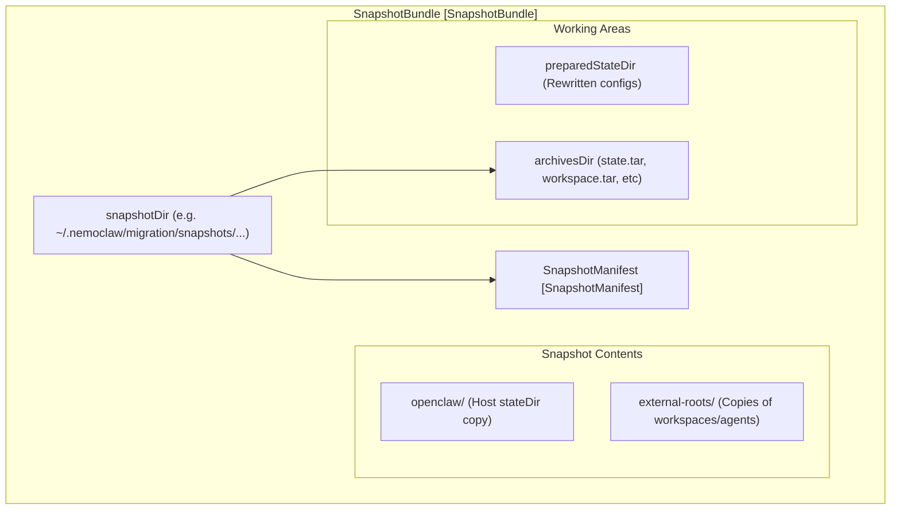
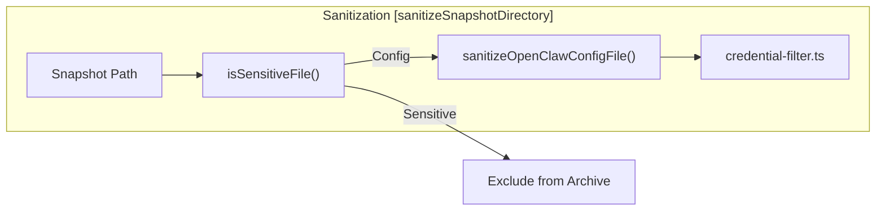

<!-- source: DeepWiki mcp.deepwiki.com · repo NVIDIA/NemoClaw · page 6.1 Migrating from Host OpenClaw · fetched 2026-10-26 -->

# Migrating from Host OpenClaw

Relevant source files

The following files were used as context for generating this wiki page:

- [docs/reference/host-files-and-state.mdx](docs/reference/host-files-and-state.mdx)
- [nemoclaw/src/commands/migration-state-sanitizer-test-fixture.ts](nemoclaw/src/commands/migration-state-sanitizer-test-fixture.ts)
- [nemoclaw/src/commands/migration-state.test.ts](nemoclaw/src/commands/migration-state.test.ts)
- [nemoclaw/src/commands/migration-state.ts](nemoclaw/src/commands/migration-state.ts)
- [nemoclaw/src/security/credential-filter.test.ts](nemoclaw/src/security/credential-filter.test.ts)
- [nemoclaw/src/security/credential-filter.ts](nemoclaw/src/security/credential-filter.ts)
- [nemoclaw/src/security/snapshot-sanitizer-failure.test.ts](nemoclaw/src/security/snapshot-sanitizer-failure.test.ts)
- [nemoclaw/src/security/snapshot-sanitizer.test.ts](nemoclaw/src/security/snapshot-sanitizer.test.ts)
- [scripts/extract-semver.sh](scripts/extract-semver.sh)
- [scripts/state-dir-guard.py](scripts/state-dir-guard.py)
- [src/lib/actions/inference-set-failure-handling.test.ts](src/lib/actions/inference-set-failure-handling.test.ts)
- [src/lib/actions/sandbox/dcode-activity-probe.test.ts](src/lib/actions/sandbox/dcode-activity-probe.test.ts)
- [src/lib/actions/sandbox/dcode-activity-probe.ts](src/lib/actions/sandbox/dcode-activity-probe.ts)
- [src/lib/actions/sandbox/destroy-execution.ts](src/lib/actions/sandbox/destroy-execution.ts)
- [src/lib/actions/sandbox/destroy-flow.test.ts](src/lib/actions/sandbox/destroy-flow.test.ts)
- [src/lib/actions/sandbox/destroy.ts](src/lib/actions/sandbox/destroy.ts)
- [src/lib/actions/sandbox/doctor-flow.test.ts](src/lib/actions/sandbox/doctor-flow.test.ts)
- [src/lib/actions/sandbox/doctor-gateway-fallback.ts](src/lib/actions/sandbox/doctor-gateway-fallback.ts)
- [src/lib/actions/sandbox/doctor-host-command.test.ts](src/lib/actions/sandbox/doctor-host-command.test.ts)
- [src/lib/actions/sandbox/doctor-host-command.ts](src/lib/actions/sandbox/doctor-host-command.ts)
- [src/lib/actions/sandbox/doctor-inference.test.ts](src/lib/actions/sandbox/doctor-inference.test.ts)
- [src/lib/actions/sandbox/doctor-inference.ts](src/lib/actions/sandbox/doctor-inference.ts)
- [src/lib/actions/sandbox/doctor-system-checks.ts](src/lib/actions/sandbox/doctor-system-checks.ts)
- [src/lib/actions/sandbox/doctor.ts](src/lib/actions/sandbox/doctor.ts)
- [src/lib/actions/sandbox/snapshot-restore-lifecycle.test.ts](src/lib/actions/sandbox/snapshot-restore-lifecycle.test.ts)
- [src/lib/actions/sandbox/snapshot-restore-test-fixture.ts](src/lib/actions/sandbox/snapshot-restore-test-fixture.ts)
- [src/lib/actions/sandbox/snapshot.test.ts](src/lib/actions/sandbox/snapshot.test.ts)
- [src/lib/actions/sandbox/snapshot.ts](src/lib/actions/sandbox/snapshot.ts)
- [src/lib/actions/sandbox/status-inference.test.ts](src/lib/actions/sandbox/status-inference.test.ts)
- [src/lib/onboard/sandbox-verification-exec.ts](src/lib/onboard/sandbox-verification-exec.ts)
- [src/lib/state/openclaw-config-merge.test.ts](src/lib/state/openclaw-config-merge.test.ts)
- [src/lib/state/openclaw-config-merge.ts](src/lib/state/openclaw-config-merge.ts)
- [src/lib/state/openclaw-config-restore-input.test.ts](src/lib/state/openclaw-config-restore-input.test.ts)
- [src/lib/state/openclaw-config-restore-input.ts](src/lib/state/openclaw-config-restore-input.ts)
- [src/lib/state/openclaw-managed-extensions.test.ts](src/lib/state/openclaw-managed-extensions.test.ts)
- [src/lib/state/openclaw-managed-extensions.ts](src/lib/state/openclaw-managed-extensions.ts)
- [src/lib/state/sandbox-manifest-publish.test.ts](src/lib/state/sandbox-manifest-publish.test.ts)
- [src/lib/state/sandbox-recreated-openclaw-restore.test.ts](src/lib/state/sandbox-recreated-openclaw-restore.test.ts)
- [src/lib/state/sandbox.ts](src/lib/state/sandbox.ts)
- [src/lib/state/tar-listing.ts](src/lib/state/tar-listing.ts)
- [src/lib/verify-deployment.test.ts](src/lib/verify-deployment.test.ts)
- [src/lib/verify-deployment.ts](src/lib/verify-deployment.ts)
- [test/destroy-cleanup-sandbox-services.test.ts](test/destroy-cleanup-sandbox-services.test.ts)
- [test/helpers/destroy-flow-test-harness.ts](test/helpers/destroy-flow-test-harness.ts)
- [test/helpers/fetch-guard-patch-harness.ts](test/helpers/fetch-guard-patch-harness.ts)
- [test/image-cleanup.test.ts](test/image-cleanup.test.ts)
- [test/openclaw-config-snapshot.test.ts](test/openclaw-config-snapshot.test.ts)
- [test/openclaw-version-parser.test.ts](test/openclaw-version-parser.test.ts)
- [test/security-sandbox-tar-traversal.test.ts](test/security-sandbox-tar-traversal.test.ts)
- [test/snapshot-gateway-guard.test.ts](test/snapshot-gateway-guard.test.ts)
- [test/snapshot.test.ts](test/snapshot.test.ts)
- [test/state-dir-guard.test.ts](test/state-dir-guard.test.ts)

This page explains how to migrate an existing OpenClaw installation from the host system into a NemoClaw-managed OpenShell sandbox. The migration process preserves all OpenClaw state, configuration, and user data while moving the agent into a sandboxed environment with network and filesystem isolation.

---

## Overview

The migration process is handled by the `nemoclaw` plugin logic which transfers an existing host-based OpenClaw installation into an OpenShell sandbox. This operation:

- **Detects** the host OpenClaw installation location (default `~/.openclaw` or custom paths via environment variables like `OPENCLAW_HOME` and `OPENCLAW_STATE_DIR`) [nemoclaw/src/commands/migration-state.ts:131-182]().
- **Creates a snapshot** backup of all OpenClaw state for rollback purposes [nemoclaw/src/commands/migration-state.ts:316-368]().
- **Provisions** an OpenShell sandbox using the NemoClaw blueprint system [src/lib/actions/sandbox/snapshot.ts:47-48]().
- **Packages** OpenClaw state and external directories as tar archives to preserve symlinks [nemoclaw/src/commands/migration-state.ts:401-443]().
- **Syncs** archives into the sandbox and verifies the migrated paths [nemoclaw/src/commands/migration-state.ts:445-472]().
- **Fixes Permissions** by performing a recursive `chown` inside the sandbox to ensure the `sandbox` user owns the migrated data [src/lib/state/sandbox.ts:814-818]().

**Sources**: [nemoclaw/src/commands/migration-state.ts:30-85](), [src/lib/state/sandbox.ts:4-10](), [src/lib/actions/sandbox/snapshot.ts:98-107]()

---

## State Detection

### Detection Logic

The `detectHostOpenClaw()` function locates the host OpenClaw installation by checking environment variables and default paths. It resolves the `stateDir` (where database and logs live) and the `configPath` (the `openclaw.json` file) [nemoclaw/src/commands/migration-state.ts:271-314]().

**Sources**: [nemoclaw/src/commands/migration-state.ts:271-314](), [nemoclaw/src/commands/migration-state.ts:131-144](), [nemoclaw/src/commands/migration-state.ts:168-182]()

### External Roots

External roots represent OpenClaw directories configured outside the default state directory, such as custom workspaces or agent directories [nemoclaw/src/commands/migration-state.ts:33-42]().

| Field | Type | Description |
|-------|------|-------------|
| `id` | `string` | Unique slugified identifier for the root [nemoclaw/src/commands/migration-state.ts:40](). |
| `kind` | `MigrationRootKind` | One of `workspace`, `agentDir`, or `skillsExtraDir` [nemoclaw/src/commands/migration-state.ts:33](). |
| `sourcePath` | `string` | Absolute path on the host system [nemoclaw/src/commands/migration-state.ts:43](). |
| `sandboxPath` | `string` | Target path in sandbox (under `/sandbox/.nemoclaw/migration/`) [nemoclaw/src/commands/migration-state.ts:45](). |
| `symlinkPaths` | `string[]` | Relative paths of symlinks found within this root [nemoclaw/src/commands/migration-state.ts:46](). |

**Sources**: [nemoclaw/src/commands/migration-state.ts:33-48](), [nemoclaw/src/commands/migration-state.ts:204-225]()

---

## Snapshot and Archive Creation

### Snapshot Bundle Structure

The `createSnapshotBundle()` function creates a complete backup of the host OpenClaw state before migration [nemoclaw/src/commands/migration-state.ts:316-368](). In the sandbox runtime, `backupSandboxState` performs a similar capture for active sandboxes [src/lib/state/sandbox.ts:205-270]().

**Sources**: [nemoclaw/src/commands/migration-state.ts:66-85](), [nemoclaw/src/commands/migration-state.ts:316-368](), [src/lib/state/sandbox.ts:79-115]()

### Tar-Based Preservation

Migration uses `tar` to preserve file attributes and symbolic links. The `createArchiveFromDirectory` function utilizes the `tar.create` library to bundle directories into `.tar` files stored in the `archivesDir` [nemoclaw/src/commands/migration-state.ts:21](), [nemoclaw/src/commands/migration-state.ts:401-417]().

1. **`state.tar`**: Contains the `.openclaw` state directory and the rewritten `openclaw.json` [nemoclaw/src/commands/migration-state.ts:430]().
2. **Root Archives**: Each external root (like a workspace) is archived individually using its ID [nemoclaw/src/commands/migration-state.ts:438]().

**Sources**: [nemoclaw/src/commands/migration-state.ts:401-443](), [src/lib/state/sandbox.ts:285-300]()

---

## Verification and Security

### Path Validation and Sanitization

To prevent path traversal or credential leakage during migration, NemoClaw performs sanitization. The `sanitizeSnapshotDirectory` function ensures no sensitive credentials or invalid symlinks are included in the transfer [src/lib/state/sandbox.ts:46](), [nemoclaw/src/commands/migration-state.ts:23-27]().

**Sources**: [nemoclaw/src/security/snapshot-sanitizer.ts:1-50](), [nemoclaw/src/commands/migration-state.ts:161-166](), [src/lib/state/sandbox.ts:46-51]()

### Sandbox Restoration and Permissions

Restoration is managed by `restoreSandboxState`, which transfers archives into the sandbox via SSH transport [src/lib/state/sandbox.ts:514-530](). After extraction, the system verifies directory integrity and repairs permissions.

The system executes `chown -R sandbox:sandbox` to ensure the sandbox user has write access to the persistent data volume [src/lib/state/sandbox.ts:814-818]().

**Sources**: [src/lib/state/sandbox.ts:514-600](), [src/lib/state/sandbox.ts:814-825]()

---

## Workspace Persistence

Migrated workspace files (e.g., `SOUL.md`, `USER.md`, `MEMORY.md`) are placed in `/sandbox/.openclaw/workspace/` and persist across sandbox restarts.

| File | Purpose |
|---|---|
| `openclaw.json` | Core agent configuration and profile settings [nemoclaw/src/commands/migration-state.ts:184-202](). |
| `workspace/` | Project-specific markdown files and agent scratchpad [src/lib/state/sandbox.ts:67-68](). |
| `skills/` | Custom agent skills and tool definitions [nemoclaw/src/commands/migration-state.ts:58](). |

Persistence is achieved by storing these files on a persistent volume. NemoClaw maintains a registry of snapshots in `~/.nemoclaw/rebuild-backups` [src/lib/state/sandbox.ts:67]().

**Sources**: [nemoclaw/src/commands/migration-state.ts:50-64](), [src/lib/state/sandbox.ts:66-68]()

---

## Rollback (Restore to Host)

If a migration needs to be reversed, NemoClaw provides mechanisms to restore the host state from a snapshot.

1. **`restoreSnapshotToHost()`**: Validates the manifest and copies the original state directory back to the host, ensuring existing files are backed up first [nemoclaw/src/commands/migration-state.ts:474-539]().
2. **`rollback` Command**: The CLI supports a rollback flow that identifies the latest snapshot and restores it to the host filesystem using `findBackup` [src/lib/state/sandbox.ts:446-465]().

**Sources**: [nemoclaw/src/commands/migration-state.ts:474-539](), [src/lib/state/sandbox.ts:446-465]()

---

