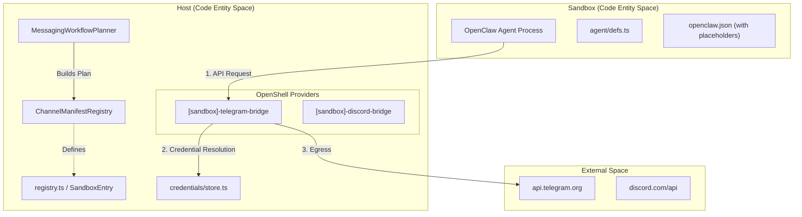
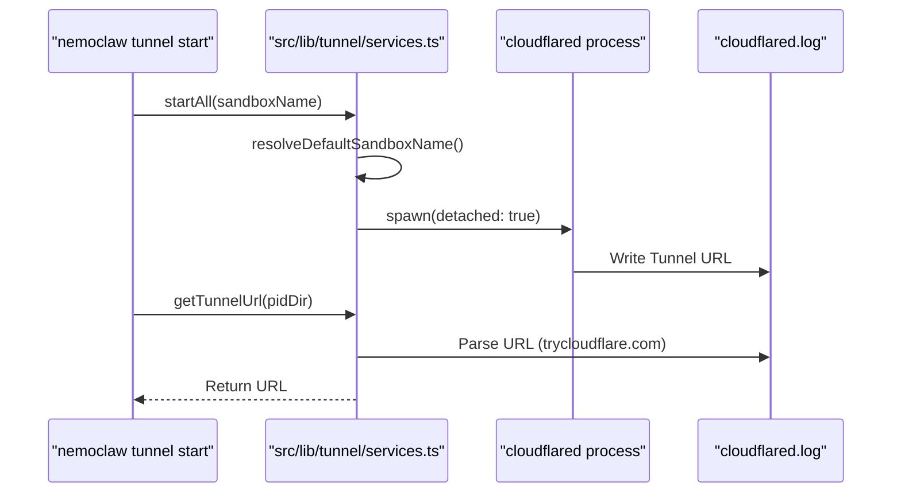

<!-- source: DeepWiki mcp.deepwiki.com · repo NVIDIA/NemoClaw · page 6.2 Auxiliary Services · fetched 2026-10-26 -->

# Auxiliary Services

Relevant source files

The following files were used as context for generating this wiki page:

- [README.md](README.md)
- [bin/nemoclaw.js](bin/nemoclaw.js)
- [install.sh](install.sh)
- [scripts/install.sh](scripts/install.sh)
- [scripts/start-services.sh](scripts/start-services.sh)
- [src/lib/agent/dashboard-ui.ts](src/lib/agent/dashboard-ui.ts)
- [src/lib/onboard/agent-dashboard-forward.test.ts](src/lib/onboard/agent-dashboard-forward.test.ts)
- [src/lib/onboard/agent-dashboard-forward.ts](src/lib/onboard/agent-dashboard-forward.ts)
- [src/lib/onboard/agent-fixed-forward.ts](src/lib/onboard/agent-fixed-forward.ts)
- [src/lib/onboard/dashboard.ts](src/lib/onboard/dashboard.ts)
- [src/lib/onboard/forward-cleanup.test.ts](src/lib/onboard/forward-cleanup.test.ts)
- [src/lib/onboard/forward-cleanup.ts](src/lib/onboard/forward-cleanup.ts)
- [src/lib/onboard/forward-start.test.ts](src/lib/onboard/forward-start.test.ts)
- [src/lib/onboard/forward-start.ts](src/lib/onboard/forward-start.ts)
- [src/lib/onboard/hermes-dashboard.test.ts](src/lib/onboard/hermes-dashboard.test.ts)
- [src/lib/onboard/hermes-dashboard.ts](src/lib/onboard/hermes-dashboard.ts)
- [src/lib/readiness/platform-qualification.test.ts](src/lib/readiness/platform-qualification.test.ts)
- [src/lib/readiness/platform-qualification.ts](src/lib/readiness/platform-qualification.ts)
- [src/lib/shields/timer-control.test.ts](src/lib/shields/timer-control.test.ts)
- [src/lib/shields/timer-control.ts](src/lib/shields/timer-control.ts)
- [src/lib/tunnel/agent-forward-stop.test.ts](src/lib/tunnel/agent-forward-stop.test.ts)
- [src/lib/tunnel/agent-forward-stop.ts](src/lib/tunnel/agent-forward-stop.ts)
- [src/lib/tunnel/gateway-stop-script.test.ts](src/lib/tunnel/gateway-stop-script.test.ts)
- [src/lib/tunnel/gateway-stop-script.ts](src/lib/tunnel/gateway-stop-script.ts)
- [src/lib/tunnel/services-gateway-ownership.test.ts](src/lib/tunnel/services-gateway-ownership.test.ts)
- [src/lib/tunnel/services-sandbox.test.ts](src/lib/tunnel/services-sandbox.test.ts)
- [src/lib/tunnel/services.ts](src/lib/tunnel/services.ts)
- [test/host-readiness-station-release-marker.test.ts](test/host-readiness-station-release-marker.test.ts)
- [test/install-onboard-yes.test.ts](test/install-onboard-yes.test.ts)
- [test/install-preflight.test.ts](test/install-preflight.test.ts)
- [test/onboard-dashboard.test.ts](test/onboard-dashboard.test.ts)
- [test/onboard-forward-stop-quiet.test.ts](test/onboard-forward-stop-quiet.test.ts)
- [uninstall.sh](uninstall.sh)

This page documents the auxiliary services that extend NemoClaw's functionality beyond the core sandbox environment. These services include the `cloudflared` tunnel for public dashboard access and the integrated messaging channels (Telegram, Discord, Slack, WeChat, WhatsApp) which are managed as native processes with host-side credential protection or in-sandbox pairing.

---

## Overview

NemoClaw provides optional auxiliary services that facilitate external access to the agent and its dashboard.

| Service | Purpose | Implementation |
|---------|---------|----------------|
| **Messaging Channels** | Native Telegram, Discord, Slack, etc. integration | Orchestrated via `MessagingWorkflowPlanner` [src/lib/onboard/messaging-channel-setup.ts:149]() |
| **Cloudflared Tunnel** | Expose dashboard via public HTTPS URL | Host-side `cloudflared` process managed via `services.ts` [src/lib/tunnel/services.ts:12-19]() |
| **Inference Proxy** | Local Ollama/vLLM backend routing | `proxy.js` wrapper for local inference [src/lib/tunnel/services.test.ts:37-47]() |

**Sources:** [src/lib/onboard/messaging-channel-setup.ts:149](), [src/lib/tunnel/services.ts:12-19](), [src/lib/tunnel/services.test.ts:37-47]()

---

## Messaging Architecture

Messaging integration is handled through a manifest-driven architecture. Credentials for most channels are stored in the host's secure store and injected as OpenShell providers, while some (WhatsApp) use in-sandbox QR pairing.

### Messaging Data Flow and Entity Mapping

**Sources:** [src/lib/onboard/messaging-channel-setup.ts:133-149](), [src/lib/messaging/index.ts:12-23](), [src/lib/sandbox/channels.ts:58-135](), [src/lib/inventory/index.ts:9-25]()

### Channel Definitions and Login Methods
NemoClaw distinguishes between three login methods for messaging:

1.  **Token-Paste:** User provides a static token (e.g., Telegram `TELEGRAM_BOT_TOKEN`, Slack `SLACK_BOT_TOKEN`) [src/lib/sandbox/channels.ts:60-128]().
2.  **Host-QR:** A host-side handshake captures a token (e.g., WeChat) [src/lib/sandbox/channels.ts:105]().
3.  **In-Sandbox-QR:** The bot library manages session state inside the sandbox (e.g., WhatsApp). NemoClaw does not manage host-side credentials for these [src/lib/sandbox/channels.ts:129-134]().

### Conflict and Health Monitoring
NemoClaw implements proactive health checks for messaging bridges:
- **Telegram Conflict Detection:** Probes `/tmp/gateway.log` inside the sandbox for `409 Conflict` errors, indicating multiple consumers are using the same bot token [src/lib/status-command-deps.ts:34-59]().
- **Token Reachability:** During onboarding, NemoClaw validates Telegram tokens against `api.telegram.org` before finalizing setup [src/lib/onboard/messaging-channel-setup.test.ts:107-141]().
- **Overlap Detection:** The system scans the `registry` to find sandboxes sharing the same provider credentials [src/lib/status-command-deps.ts:100-109]().

**Sources:** [src/lib/sandbox/channels.ts:58-135](), [src/lib/status-command-deps.ts:34-59](), [src/lib/onboard/messaging-channel-setup.test.ts:107-141]()

---

## Cloudflared Tunnel

The `cloudflared` service provides a secure HTTPS tunnel to the NemoClaw dashboard without requiring inbound firewall rules.

### Service Lifecycle Flow

**Sources:** [src/lib/tunnel/services.ts:12-18](), [src/lib/tunnel/service-command.ts:7](), [src/lib/tunnel/services.test.ts:49-76]()

### Implementation Details
- **PID Management:** Services use a dedicated directory `/tmp/nemoclaw-services-${sandboxName}/` to store `.pid` and `.log` files [src/lib/tunnel/services.test.ts:21-24]().
- **URL Parsing:** `getTunnelUrl` parses the `cloudflared.log` to extract either a "quick tunnel" (`trycloudflare.com`) or a named tunnel hostname matching the dashboard port (default `18789`) [src/lib/tunnel/services.test.ts:49-76]().
- **Status Reporting:** The `getServiceStatuses` function verifies if the process identified by the PID file is actually alive on the host [src/lib/tunnel/services.test.ts:78-128]().

**Sources:** [src/lib/tunnel/services.ts:13-19](), [src/lib/tunnel/services.test.ts:21-24](), [src/lib/tunnel/services.test.ts:49-76]()

---

## Troubleshooting

### Logs and State Locations
| Component | Path |
|-----------|------|
| **Service PIDs** | `/tmp/nemoclaw-services-<sandbox>/cloudflared.pid` [src/lib/tunnel/services.test.ts:34]() |
| **Tunnel Logs** | `/tmp/nemoclaw-services-<sandbox>/cloudflared.log` [src/lib/tunnel/services.test.ts:65]() |
| **Gateway Logs** | `/tmp/gateway.log` (Inside Sandbox) [src/lib/status-command-deps.ts:46]() |
| **Sandbox Registry** | `~/.nemoclaw/sandboxes.json` [test/e2e/test-channels-stop-start.sh:99]() |

### Common Issues
- **Telegram Privacy Mode:** For group chats, privacy mode must be disabled via `@BotFather`. NemoClaw prints this guidance if `TELEGRAM_REQUIRE_MENTION` is set [src/lib/onboard/messaging-channel-setup.test.ts:79-105]().
- **Stale PIDs:** If a service crashes, a stale `.pid` file might remain. `getServiceStatuses` detects this by checking if the PID exists in the host process table [src/lib/tunnel/services.test.ts:104-112]().
- **Path Traversal:** Sandbox names are validated to prevent path traversal when creating service directories [src/lib/tunnel/services.test.ts:130-146]().

**Sources:** [src/lib/tunnel/services.test.ts:104-112](), [src/lib/onboard/messaging-channel-setup.test.ts:79-105](), [src/lib/status-command-deps.ts:46]()

---

