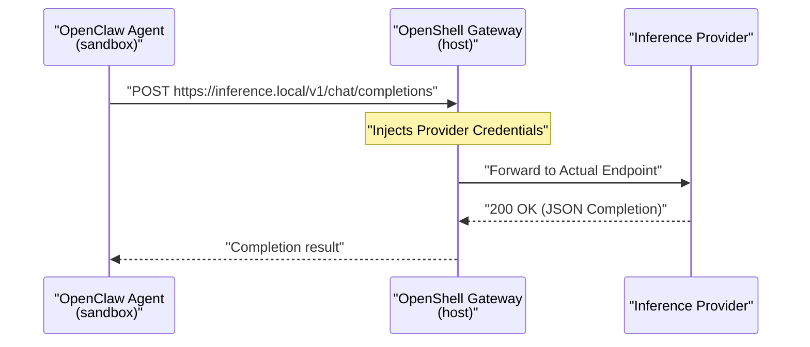
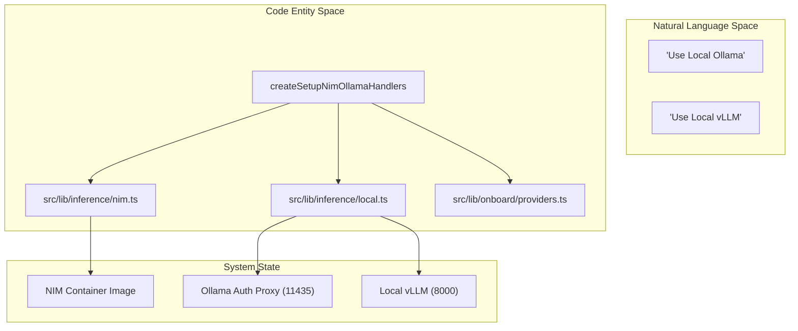

<!-- source: DeepWiki mcp.deepwiki.com · repo NVIDIA/NemoClaw · page 6.3 Custom Inference Providers · fetched 2026-10-26 -->

# Custom Inference Providers

Relevant source files

The following files were used as context for generating this wiki page:

- [docs/changelog/2026-07-25.mdx](docs/changelog/2026-07-25.mdx)
- [docs/inference/custom-endpoint-security.mdx](docs/inference/custom-endpoint-security.mdx)
- [docs/inference/set-up-ollama.mdx](docs/inference/set-up-ollama.mdx)
- [docs/security/sandbox-base-2026-07-25-dependency-review.md](docs/security/sandbox-base-2026-07-25-dependency-review.md)
- [src/lib/actions/sandbox/status.test.ts](src/lib/actions/sandbox/status.test.ts)
- [src/lib/adapters/http/curl-args.ts](src/lib/adapters/http/curl-args.ts)
- [src/lib/adapters/http/probe.test.ts](src/lib/adapters/http/probe.test.ts)
- [src/lib/adapters/http/probe.ts](src/lib/adapters/http/probe.ts)
- [src/lib/inference/config.test.ts](src/lib/inference/config.test.ts)
- [src/lib/inference/config.ts](src/lib/inference/config.ts)
- [src/lib/inference/gpu-trust.ts](src/lib/inference/gpu-trust.ts)
- [src/lib/inference/health.test.ts](src/lib/inference/health.test.ts)
- [src/lib/inference/health.ts](src/lib/inference/health.ts)
- [src/lib/inference/https-pin-runtime-adapter.test.ts](src/lib/inference/https-pin-runtime-adapter.test.ts)
- [src/lib/inference/https-pin-runtime-adapter.ts](src/lib/inference/https-pin-runtime-adapter.ts)
- [src/lib/inference/https-pin-runtime-revoke-source-policy.test.ts](src/lib/inference/https-pin-runtime-revoke-source-policy.test.ts)
- [src/lib/inference/local.test.ts](src/lib/inference/local.test.ts)
- [src/lib/inference/local.ts](src/lib/inference/local.ts)
- [src/lib/inference/model-prompts.test.ts](src/lib/inference/model-prompts.test.ts)
- [src/lib/inference/model-prompts.ts](src/lib/inference/model-prompts.ts)
- [src/lib/inference/nim.test.ts](src/lib/inference/nim.test.ts)
- [src/lib/inference/nim.ts](src/lib/inference/nim.ts)
- [src/lib/inference/nvidia-featured-models.test.ts](src/lib/inference/nvidia-featured-models.test.ts)
- [src/lib/inference/nvidia-featured-models.ts](src/lib/inference/nvidia-featured-models.ts)
- [src/lib/inference/ollama-runtime-context.test.ts](src/lib/inference/ollama-runtime-context.test.ts)
- [src/lib/inference/ollama-runtime-context.ts](src/lib/inference/ollama-runtime-context.ts)
- [src/lib/inference/ollama-version.ts](src/lib/inference/ollama-version.ts)
- [src/lib/inference/ollama/model-size.ts](src/lib/inference/ollama/model-size.ts)
- [src/lib/onboard/nvidia-featured-model-selection.test.ts](src/lib/onboard/nvidia-featured-model-selection.test.ts)
- [src/lib/onboard/nvidia-featured-model-selection.ts](src/lib/onboard/nvidia-featured-model-selection.ts)
- [src/lib/onboard/ollama-systemd.test.ts](src/lib/onboard/ollama-systemd.test.ts)
- [src/lib/onboard/ollama-systemd.ts](src/lib/onboard/ollama-systemd.ts)
- [src/lib/onboard/provider-menu.test.ts](src/lib/onboard/provider-menu.test.ts)
- [src/lib/onboard/provider-menu.ts](src/lib/onboard/provider-menu.ts)
- [src/lib/onboard/providers.test.ts](src/lib/onboard/providers.test.ts)
- [src/lib/onboard/providers.ts](src/lib/onboard/providers.ts)
- [src/lib/onboard/setup-nim-ollama.test.ts](src/lib/onboard/setup-nim-ollama.test.ts)
- [src/lib/onboard/setup-nim-ollama.ts](src/lib/onboard/setup-nim-ollama.ts)
- [test/e2e/lib/ci-compatible-inference.sh](test/e2e/lib/ci-compatible-inference.sh)

Configure NemoClaw to use inference endpoints beyond the built-in profiles. This page covers registering custom OpenAI-compatible APIs, local model servers (Ollama, vLLM), and self-hosted NIM containers.

## Purpose and Scope

NemoClaw ships with pre-configured inference profiles that cover common scenarios: NVIDIA Cloud API, local vLLM, and local Ollama. Custom providers extend this system to support:

- **NVIDIA Cloud Partner (NCP) endpoints**: Dedicated NVIDIA-hosted inference via `build.nvidia.com` [src/lib/onboard/providers.ts:82-92]().
- **Custom OpenAI-compatible APIs**: Any service implementing `/v1/chat/completions`, such as OpenRouter or LocalAI [src/lib/onboard/providers.ts:164-174]().
- **Google Gemini**: Support for Gemini's OpenAI-compatible endpoint and specific authentication requirements [src/lib/onboard/providers.ts:135-145]().
- **Self-hosted NIM**: Managed local NIM containers or remote NIM instances [src/lib/inference/nim.ts:38-42]().
- **Local Model Servers**: Automated management for Ollama and vLLM [src/lib/inference/local.ts:4-7]().

All agent inference requests inside the sandbox are routed through the OpenShell gateway, which injects credentials server-side [src/lib/inference/config.ts:13-16]().

Sources: [src/lib/onboard/providers.ts:82-92,135-145,164-174](), [src/lib/inference/nim.ts:38-42](), [src/lib/inference/local.ts:4-7](), [src/lib/inference/config.ts:13-16]()

---

## Provider Architecture

The OpenShell gateway intercepts all inference requests from the agent. Agents inside the sandbox use the virtual hostname `inference.local` [src/lib/inference/config.ts:13](). The host-side gateway maintains the actual provider credentials and target URLs, ensuring API keys never enter the sandbox [docs/inference/custom-endpoint-security.mdx:14-18]().

### Inference Request Flow

Sources: [src/lib/inference/config.ts:13](), [docs/inference/custom-endpoint-security.mdx:14-18]()

---

## Local Inference Providers

NemoClaw provides specialized logic for managing local model servers, including automated installation, startup, and health monitoring [src/lib/inference/local.ts:4-7]().

### Natural Language to Code Mapping

This diagram maps user intent during onboarding to the underlying code entities and validation logic.

Sources: [src/lib/onboard/setup-nim-ollama.ts:9](), [src/lib/inference/nim.ts:4-22](), [src/lib/inference/local.ts:50-62](), [src/lib/onboard/providers.ts:178]()

### Ollama Management
- **Detection**: The wizard probes candidate hosts (e.g., `127.0.0.1`, `host.docker.internal`) to find a responding Ollama instance [src/lib/inference/local.ts:112-114]().
- **Context Window**: NemoClaw enforces a minimum context window (e.g., 64,000 for Hermes) and verifies it via the runtime API [docs/inference/set-up-ollama.mdx:91-99]().
- **Container Reachability**: Port mapping is memoized based on whether the container can reach the host loopback directly via `host-gateway` [src/lib/inference/local.ts:60-66]().

### vLLM Management
- **Local vLLM**: NemoClaw targets `http://127.0.0.1:8000/v1` for validation and health checks [src/lib/inference/local.test.ts:119-121]().
- **Credentials**: Uses dedicated environment variables like `NEMOCLAW_VLLM_LOCAL_TOKEN` to isolate local inference from cloud API keys [src/lib/inference/config.ts:63-68]().

Sources: [src/lib/inference/local.ts:60-66,112-114](), [docs/inference/set-up-ollama.mdx:91-99](), [src/lib/inference/local.test.ts:119-121](), [src/lib/inference/config.ts:63-68]()

---

## NVIDIA NIM Management

NemoClaw provides logic for pulling, starting, and health-checking NVIDIA NIM containers [src/lib/inference/nim.ts:4-5]().

### Hardware Detection and Preflight
NemoClaw queries hardware capabilities to recommend appropriate models:
- **GPU Grouping**: Groups GPUs by model name to handle multi-GPU or mixed-GPU hosts [src/lib/inference/nim.ts:134-148]().
- **Platform Identification**: Detects specific platforms like `spark`, `station`, or `jetson` [src/lib/inference/nim.ts:45]().
- **Memory Sizing**: Calculates `totalMemoryMB` and `availableMemoryMB` to ensure models fit [src/lib/inference/nim.ts:65-73]().

### Preflight Summary Formatting
| Detection Type | Output Format |
|----------------|---------------|
| Homogeneous | `NVIDIA GPU detected (Nx <model>, <vram> MB)` [src/lib/inference/nim.ts:166-169]() |
| Mixed Model | Aggregate header + indented per-group breakdown [src/lib/inference/nim.ts:170-174]() |

Sources: [src/lib/inference/nim.ts:4-5,45,65-73,134-148,166-174]()

---

## DNS-Backed HTTPS Adapter

For public HTTPS endpoints, NemoClaw uses a host-side adapter to secure the connection [docs/inference/custom-endpoint-security.mdx:53-55]().

### HTTPS Pin Runtime Adapter
- **Purpose**: Routes public DNS-backed HTTPS custom endpoints through a host-side adapter to preserve SNI and TLS validation [docs/changelog/2026-07-25.mdx:16-17]().
- **Credential Isolation**: Each route receives a separate sandbox-facing credential, while the upstream endpoint and credential remain host-only [docs/inference/custom-endpoint-security.mdx:66-67]().
- **SSRF Guard**: NemoClaw rejects loopback, private, and internal addresses for custom endpoints unless explicitly trusted [docs/inference/custom-endpoint-security.mdx:29-31,35-37]().

Sources: [docs/inference/custom-endpoint-security.mdx:29-31,35-37,53-55,66-67](), [docs/changelog/2026-07-25.mdx:16-17]()

---

## Validation and Health Checks

NemoClaw performs multi-stage validation to ensure the selected provider is functional.

### Probing Logic
1. **Connectivity**: Uses `curl` with explicit timeouts (`--connect-timeout 3`, `--max-time 5`) to prevent blackholed hosts from stalling probes [src/lib/inference/local.ts:127-134]().
2. **Local Provider Validation**: The `validateLocalProvider` function confirms the endpoint responds with valid JSON (e.g., `{"models":[]}`) [src/lib/inference/local.test.ts:189-196]().
3. **Container Reachability**: Verifies the sandbox can reach the host-side inference endpoint using a `curlimages/curl` container [src/lib/inference/local.test.ts:158-177]().

### Local Endpoint Mapping

| Provider | Validation URL (Host) | Sandbox Base URL |
|----------|-----------------------|------------------|
| Ollama | `http://127.0.0.1:11434/v1` [src/lib/inference/local.test.ts:134]() | `http://host.openshell.internal:11435/v1` [src/lib/inference/local.test.ts:97-99]() |
| vLLM | `http://127.0.0.1:8000/v1` [src/lib/inference/local.test.ts:120]() | `http://host.openshell.internal:8000/v1` [src/lib/inference/local.test.ts:93]() |

Sources: [src/lib/inference/local.ts:127-134](), [src/lib/inference/local.test.ts:93,97-99,120,134,158-177,189-196]()

---

