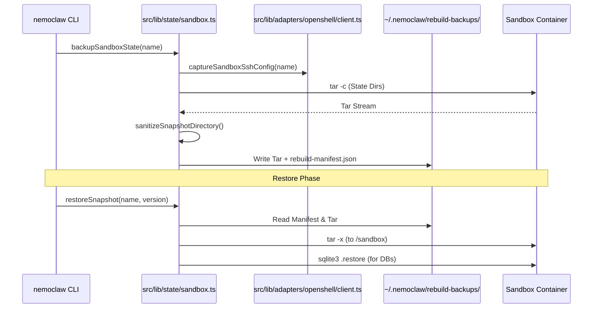

<!-- source: DeepWiki mcp.deepwiki.com · repo NVIDIA/NemoClaw · page 6.4 Workspace Files and Persistence · fetched 2026-10-26 -->

# Workspace Files and Persistence

<details>
<summary>Relevant source files</summary>

The following files were used as context for generating this wiki page:

- [docs/manage-sandboxes/backup-restore.mdx](docs/manage-sandboxes/backup-restore.mdx)
- [docs/manage-sandboxes/update-sandboxes.mdx](docs/manage-sandboxes/update-sandboxes.mdx)
- [docs/manage-sandboxes/workspace-files.mdx](docs/manage-sandboxes/workspace-files.mdx)
- [scripts/extract-semver.sh](scripts/extract-semver.sh)
- [scripts/state-dir-guard.py](scripts/state-dir-guard.py)
- [src/lib/actions/maintenance.test.ts](src/lib/actions/maintenance.test.ts)
- [src/lib/actions/maintenance.ts](src/lib/actions/maintenance.ts)
- [src/lib/actions/sandbox/doctor-gateway-fallback.ts](src/lib/actions/sandbox/doctor-gateway-fallback.ts)
- [src/lib/actions/sandbox/doctor-host-command.test.ts](src/lib/actions/sandbox/doctor-host-command.test.ts)
- [src/lib/actions/sandbox/doctor-host-command.ts](src/lib/actions/sandbox/doctor-host-command.ts)
- [src/lib/actions/sandbox/skill-install.test.ts](src/lib/actions/sandbox/skill-install.test.ts)
- [src/lib/actions/sandbox/skill-install.ts](src/lib/actions/sandbox/skill-install.ts)
- [src/lib/actions/sandbox/stopped-sandbox-backup.test.ts](src/lib/actions/sandbox/stopped-sandbox-backup.test.ts)
- [src/lib/actions/sandbox/stopped-sandbox-backup.ts](src/lib/actions/sandbox/stopped-sandbox-backup.ts)
- [src/lib/actions/upgrade-sandboxes-preflight.test.ts](src/lib/actions/upgrade-sandboxes-preflight.test.ts)
- [src/lib/actions/upgrade-sandboxes-recovery.test.ts](src/lib/actions/upgrade-sandboxes-recovery.test.ts)
- [src/lib/actions/upgrade-sandboxes.ts](src/lib/actions/upgrade-sandboxes.ts)
- [src/lib/core/json-types.ts](src/lib/core/json-types.ts)
- [src/lib/onboard/sandbox-verification-exec.ts](src/lib/onboard/sandbox-verification-exec.ts)
- [src/lib/openshell-sandbox-list.test.ts](src/lib/openshell-sandbox-list.test.ts)
- [src/lib/openshell-sandbox-list.ts](src/lib/openshell-sandbox-list.ts)
- [src/lib/skill-install-shared.test.ts](src/lib/skill-install-shared.test.ts)
- [src/lib/skill-install.test.ts](src/lib/skill-install.test.ts)
- [src/lib/skill-install.ts](src/lib/skill-install.ts)
- [src/lib/skill-remote.test.ts](src/lib/skill-remote.test.ts)
- [src/lib/skill-remote.ts](src/lib/skill-remote.ts)
- [src/lib/state/openclaw-config-merge.test.ts](src/lib/state/openclaw-config-merge.test.ts)
- [src/lib/state/openclaw-config-merge.ts](src/lib/state/openclaw-config-merge.ts)
- [src/lib/state/openclaw-config-restore-input.test.ts](src/lib/state/openclaw-config-restore-input.test.ts)
- [src/lib/state/openclaw-config-restore-input.ts](src/lib/state/openclaw-config-restore-input.ts)
- [src/lib/state/openclaw-managed-extensions.test.ts](src/lib/state/openclaw-managed-extensions.test.ts)
- [src/lib/state/openclaw-managed-extensions.ts](src/lib/state/openclaw-managed-extensions.ts)
- [src/lib/state/sandbox-manifest-publish.test.ts](src/lib/state/sandbox-manifest-publish.test.ts)
- [src/lib/state/sandbox-recreated-openclaw-restore.test.ts](src/lib/state/sandbox-recreated-openclaw-restore.test.ts)
- [src/lib/state/sandbox.ts](src/lib/state/sandbox.ts)
- [src/lib/state/tar-listing.ts](src/lib/state/tar-listing.ts)
- [src/lib/verify-deployment.test.ts](src/lib/verify-deployment.test.ts)
- [src/lib/verify-deployment.ts](src/lib/verify-deployment.ts)
- [test/helpers/fetch-guard-patch-harness.ts](test/helpers/fetch-guard-patch-harness.ts)
- [test/install-orphaned-sandbox-recovery.test.ts](test/install-orphaned-sandbox-recovery.test.ts)
- [test/install-preexisting-sandbox-recovery.test.ts](test/install-preexisting-sandbox-recovery.test.ts)
- [test/openclaw-config-snapshot.test.ts](test/openclaw-config-snapshot.test.ts)
- [test/openclaw-version-parser.test.ts](test/openclaw-version-parser.test.ts)
- [test/security-sandbox-tar-traversal.test.ts](test/security-sandbox-tar-traversal.test.ts)
- [test/snapshot.test.ts](test/snapshot.test.ts)
- [test/state-dir-guard.test.ts](test/state-dir-guard.test.ts)

</details>


This page explains how NemoClaw manages agent identity, behavior, and memory through workspace files. It covers the structure of these files, their location within the sandboxed filesystem, how they persist across sessions, and the technical implementation of backup and restore mechanisms via the snapshot system.

---

## Overview

OpenClaw, Hermes, and Deep Agents runtimes rely on a set of Markdown and configuration files to maintain state, personality, and context. In a NemoClaw environment, these files are isolated within an OpenShell sandbox but are designed to persist across sandbox restarts. These files define the agent's persona, user context, and behavioral configuration.

**Sources**: [src/lib/state/sandbox.ts:4-10](), [docs/manage-sandboxes/backup-restore.mdx:14-16]()

---

## Workspace File Reference

The agent's "brain" is composed of several key files located in the workspace directory. Each file serves a specific functional role in the agent's cognitive architecture.

### OpenClaw Workspace Files
Located at `/sandbox/.openclaw/workspace/` by default.

| File | Purpose | Description |
|---|---|---|
| `SOUL.md` | **Core Personality** | Defines tone, behavioral rules, and communication style. |
| `USER.md` | **User Context** | Stores information about the human the agent assists. |
| `IDENTITY.md` | **Self-Presentation** | Short identity card: name, language, emoji, and creature type. |
| `MEMORY.md` | **Long-term Memory** | High-level distilled insights and permanent knowledge. |
| `memory/` | **Daily Notes** | Directory containing `YYYY-MM-DD.md` files for session continuity. |

### Hermes Workspace Files
Located at `/sandbox/.hermes/workspace/`. Hermes maintains critical state in `.hermes/` including the SQLite database and dashboard profiles.

| File / Path | Purpose | Description |
|---|---|---|
| `SOUL.md` | **Personality** | Defines agent behavior and instructions. |
| `.hermes/state.db` | **Session State** | SQLite database for session metadata and history. |
| `.hermes/kanban.db` | **Tasks** | Default kanban board data. |
| `.hermes/dashboard-home/` | **Profile** | Contains `MEMORY.md` and `USER.md`. |

**Sources**: [docs/manage-sandboxes/backup-restore.mdx:49-62](), [src/lib/skill-install.ts:129-131]()

---

## Filesystem Implementation

All workspace files reside within the sandbox's protected filesystem. The path is standardized to ensure compatibility with backup scripts and agent discovery logic.

### Natural Language to Code Entity Mapping

The following diagram maps the logical workspace concepts to the specific filesystem entities and the internal initialization logic.

**Diagram: Workspace Logic to Code Entities**
```mermaid
graph TD
    subgraph "Natural Language Space"
        Personality["Agent Personality"]
        UserContext["User Preferences"]
        LongTermMem["Long-term Memory"]
        SecretState["API Keys & Tokens"]
    end

    subgraph "Code Entity Space (Sandbox Filesystem)"
        SoulFile["/sandbox/.openclaw/workspace/SOUL.md"]
        UserFile["/sandbox/.openclaw/workspace/USER.md"]
        MemFile["/sandbox/.hermes/dashboard-home/MEMORY.md"]
        EnvFile["/sandbox/.hermes/.env"]
    end

    subgraph "NemoClaw Internal Logic"
        SandboxState["src/lib/state/sandbox.ts"]
        SkillInstall["src/lib/skill-install.ts"]
        Registry["src/lib/state/registry.ts"]
    end

    Personality --> SoulFile
    UserContext --> UserFile
    LongTermMem --> MemFile
    SecretState --> EnvFile
    
    SandboxState -.-> "Backup/Restore" -.-> SoulFile
    SkillInstall -.-> "Skill Deploy" -.-> SoulFile
    Registry -.-> "Metadata" -.-> EnvFile
```

**Sources**: [src/lib/state/sandbox.ts:79-115](), [src/lib/skill-install.ts:150-169](), [docs/manage-sandboxes/backup-restore.mdx:49-62]()

---

## Persistence and Lifecycle: Snapshots

NemoClaw uses a manifest-driven snapshot system to preserve sandbox state. Snapshots capture all workspace state directories defined in the agent manifest and store them on the host.

### Snapshot Implementation Details
Snapshots are stored in `~/.nemoclaw/rebuild-backups/<name>/` [src/lib/state/sandbox.ts:67-68](). The `RebuildManifest` tracks metadata including agent version, state directories, and custom policies [src/lib/state/sandbox.ts:79-115]().

**Snapshot Features:**
*   **Virtual Versioning**: Snapshots are assigned virtual versions (`v1`, `v2`, etc.) based on timestamp order at list time [src/lib/state/sandbox.ts:117-120]().
*   **Credential Sanitization**: NemoClaw strips recognized credentials from JSON, YAML, and `.env` files before completing a snapshot [docs/manage-sandboxes/backup-restore.mdx:41-45]().
*   **SQLite Online Backup**: For databases like Hermes' `state.db`, NemoClaw uses SQLite's online backup API instead of raw file copies to ensure consistency [docs/manage-sandboxes/backup-restore.mdx:53-55]().

### Snapshot Workflow Diagram
**Diagram: Snapshot Backup and Restore Flow**


**Sources**: [src/lib/state/sandbox.ts:4-10](), [src/lib/state/sandbox.ts:632-650](), [docs/manage-sandboxes/backup-restore.mdx:83-90]()

---

## Security and Integrity

Workspace files are protected by validation logic and sanitization to prevent path traversal or credential leakage.

### Sanitization and Validation
*   **Path Traversal Protection**: During restore, `validateTarEntries` ensures that a compromised snapshot cannot write files outside the intended sandbox directories via `../` or absolute paths [test/security-sandbox-tar-traversal.test.ts:191-196]().
*   **Credential Filtering**: The `sanitizeSnapshotDirectory` function removes sensitive API keys while preserving OpenShell credential placeholders, allowing the host-side provider to be reattached on rebuild [docs/manage-sandboxes/backup-restore.mdx:41-43]().
*   **Shields Requirement**: `snapshot create` requires shields to be down. If the shields-down window expires during a snapshot operation, the operation is interrupted to maintain security posture [docs/manage-sandboxes/backup-restore.mdx:91-96]().

### Lifecycle Events
| Event | Workspace Data Status | Technical Implementation |
|---|---|---|
| **`snapshot create`** | **Archived** | Captures `state_dirs` into a host-side tarball [src/lib/state/sandbox.ts:67-68](). |
| **`nemoclaw rebuild`** | **Restored** | Automatically restores the latest snapshot to the new container [src/lib/actions/upgrade-sandboxes.ts:98-103](). |
| **`nemoclaw destroy`** | **DELETED** | Deletes the sandbox container and local registry entry, but host-side snapshots persist in `rebuild-backups` unless manually removed. |

**Sources**: [src/lib/state/sandbox.ts:46-51](), [docs/manage-sandboxes/backup-restore.mdx:41-48](), [src/lib/actions/maintenance.ts:81-89]()

---

