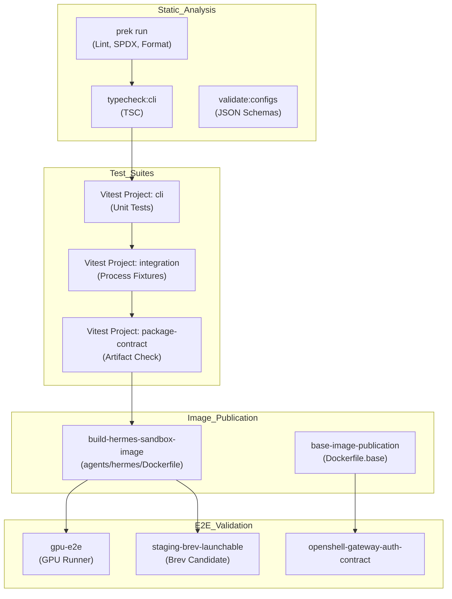
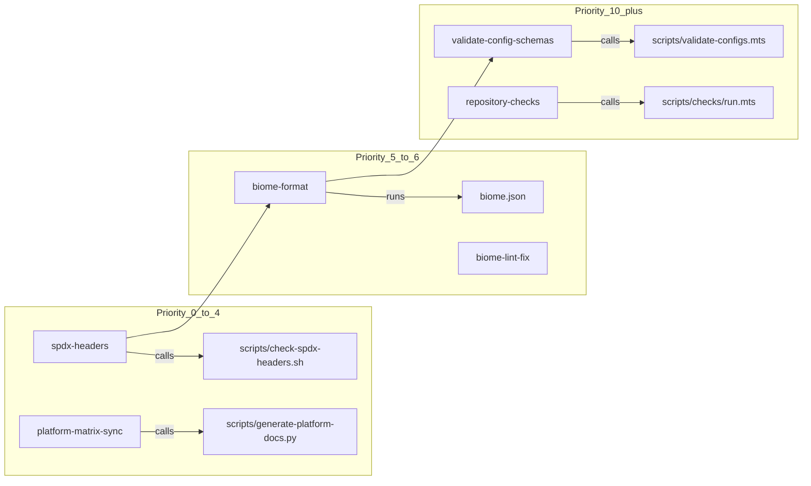

<!-- source: DeepWiki mcp.deepwiki.com · repo NVIDIA/NemoClaw · page 6.5 Development and Testing · fetched 2026-10-26 -->

# Development and Testing

<details>
<summary>Relevant source files</summary>

The following files were used as context for generating this wiki page:

- [.agents/skills/_shared/controlled-words.md](.agents/skills/_shared/controlled-words.md)
- [.agents/skills/_shared/documentation-writing-review.md](.agents/skills/_shared/documentation-writing-review.md)
- [.agents/skills/_shared/pr-follow-up.md](.agents/skills/_shared/pr-follow-up.md)
- [.agents/skills/nemoclaw-contributor-create-pr/SKILL.md](.agents/skills/nemoclaw-contributor-create-pr/SKILL.md)
- [.agents/skills/nemoclaw-contributor-onboard-messaging-channel/SKILL.md](.agents/skills/nemoclaw-contributor-onboard-messaging-channel/SKILL.md)
- [.agents/skills/nemoclaw-contributor-update-docs/SKILL.md](.agents/skills/nemoclaw-contributor-update-docs/SKILL.md)
- [.agents/skills/nemoclaw-maintainer-day/PR-REVIEW-PRIORITIES.md](.agents/skills/nemoclaw-maintainer-day/PR-REVIEW-PRIORITIES.md)
- [.agents/skills/nemoclaw-maintainer-day/SALVAGE-PR.md](.agents/skills/nemoclaw-maintainer-day/SALVAGE-PR.md)
- [.agents/skills/nemoclaw-maintainer-day/TEST-GAPS.md](.agents/skills/nemoclaw-maintainer-day/TEST-GAPS.md)
- [.agents/skills/nemoclaw-maintainer-policies/SKILL.md](.agents/skills/nemoclaw-maintainer-policies/SKILL.md)
- [.agents/skills/nemoclaw-maintainer-refactor-docs/SKILL.md](.agents/skills/nemoclaw-maintainer-refactor-docs/SKILL.md)
- [.agents/skills/nemoclaw-maintainer-release-notes/SKILL.md](.agents/skills/nemoclaw-maintainer-release-notes/SKILL.md)
- [.github/PULL_REQUEST_TEMPLATE.md](.github/PULL_REQUEST_TEMPLATE.md)
- [.github/actions/ci-build-typecheck/action.yaml](.github/actions/ci-build-typecheck/action.yaml)
- [.github/actions/ci-cli-coverage-merge/action.yaml](.github/actions/ci-cli-coverage-merge/action.yaml)
- [.github/actions/ci-cli-coverage-shard/action.yaml](.github/actions/ci-cli-coverage-shard/action.yaml)
- [.github/actions/ci-plugin-coverage/action.yaml](.github/actions/ci-plugin-coverage/action.yaml)
- [.github/actions/ci-static-checks/action.yaml](.github/actions/ci-static-checks/action.yaml)
- [.github/workflows/e2e.yaml](.github/workflows/e2e.yaml)
- [.github/workflows/main.yaml](.github/workflows/main.yaml)
- [.github/workflows/pr.yaml](.github/workflows/pr.yaml)
- [.github/workflows/sandbox-images-and-e2e.yaml](.github/workflows/sandbox-images-and-e2e.yaml)
- [.pre-commit-config.yaml](.pre-commit-config.yaml)
- [AGENTS.md](AGENTS.md)
- [CONTRIBUTING.md](CONTRIBUTING.md)
- [WRITING.md](WRITING.md)
- [docs/AGENTS.md](docs/AGENTS.md)
- [docs/CONTRIBUTING.md](docs/CONTRIBUTING.md)
- [fern/AGENTS.md](fern/AGENTS.md)
- [nemoclaw/tsconfig.shared.json](nemoclaw/tsconfig.shared.json)
- [nemoclaw/vitest.project.ts](nemoclaw/vitest.project.ts)
- [package-lock.json](package-lock.json)
- [package.json](package.json)
- [scripts/checks/openshell-policy-mutation-read.mts](scripts/checks/openshell-policy-mutation-read.mts)
- [scripts/checks/vitest-project-overlap.mts](scripts/checks/vitest-project-overlap.mts)
- [scripts/lib/station-vllm-conflict.sh](scripts/lib/station-vllm-conflict.sh)
- [scripts/prepare-dgx-station-host.sh](scripts/prepare-dgx-station-host.sh)
- [src/lib/sandbox/config-format.test.ts](src/lib/sandbox/config-format.test.ts)
- [src/lib/sandbox/config-format.ts](src/lib/sandbox/config-format.ts)
- [src/lib/sandbox/config-get.test.ts](src/lib/sandbox/config-get.test.ts)
- [test/e2e-mock-parity.test.ts](test/e2e-mock-parity.test.ts)
- [test/e2e/README.md](test/e2e/README.md)
- [test/e2e/mock-parity.json](test/e2e/mock-parity.json)
- [test/e2e/support/dockerhub-auth-workflow-boundary.test.ts](test/e2e/support/dockerhub-auth-workflow-boundary.test.ts)
- [test/e2e/support/e2e-operations-workflow-boundary.test.ts](test/e2e/support/e2e-operations-workflow-boundary.test.ts)
- [test/e2e/support/e2e-workflow.test.ts](test/e2e/support/e2e-workflow.test.ts)
- [test/e2e/support/hermes-secret-boundary-workflow.test.ts](test/e2e/support/hermes-secret-boundary-workflow.test.ts)
- [test/e2e/support/jetson-workflow-boundary.test.ts](test/e2e/support/jetson-workflow-boundary.test.ts)
- [test/e2e/support/sandbox-images-workflow-boundary.test.ts](test/e2e/support/sandbox-images-workflow-boundary.test.ts)
- [test/e2e/support/upload-e2e-artifacts-workflow-boundary.test.ts](test/e2e/support/upload-e2e-artifacts-workflow-boundary.test.ts)
- [test/e2e/support/workflow-plan.test.ts](test/e2e/support/workflow-plan.test.ts)
- [test/helpers/e2e-workflow-contract.ts](test/helpers/e2e-workflow-contract.ts)
- [test/install-express-prompt.test.ts](test/install-express-prompt.test.ts)
- [test/install-station-container-coexistence.test.ts](test/install-station-container-coexistence.test.ts)
- [test/install-station-dgx-os.test.ts](test/install-station-dgx-os.test.ts)
- [test/install-station-forced-preparation.test.ts](test/install-station-forced-preparation.test.ts)
- [test/install-station-host-preparation.test.ts](test/install-station-host-preparation.test.ts)
- [test/install-station-package-transaction.test.ts](test/install-station-package-transaction.test.ts)
- [test/install-station-platform-identity.test.ts](test/install-station-platform-identity.test.ts)
- [test/install-station-vllm-continuation.test.ts](test/install-station-vllm-continuation.test.ts)
- [test/plugin-vitest-project.test.ts](test/plugin-vitest-project.test.ts)
- [test/policy-mutation-read-discovery.test.ts](test/policy-mutation-read-discovery.test.ts)
- [test/pr-e2e-gate-typed-target.test.ts](test/pr-e2e-gate-typed-target.test.ts)
- [test/pr-risk-plan.test.ts](test/pr-risk-plan.test.ts)
- [test/pr-workflow-contract.test.ts](test/pr-workflow-contract.test.ts)
- [test/test-boundary-guards.test.ts](test/test-boundary-guards.test.ts)
- [tools/advisors/risk-plan.mts](tools/advisors/risk-plan.mts)
- [tools/e2e/operations-workflow-boundary.mts](tools/e2e/operations-workflow-boundary.mts)
- [tools/e2e/report-e2e-results.mts](tools/e2e/report-e2e-results.mts)
- [tools/e2e/sandbox-images-workflow-boundary.mts](tools/e2e/sandbox-images-workflow-boundary.mts)
- [tools/e2e/selector-aliases.mts](tools/e2e/selector-aliases.mts)
- [tools/e2e/upload-e2e-artifacts-workflow-boundary.mts](tools/e2e/upload-e2e-artifacts-workflow-boundary.mts)
- [tools/e2e/workflow-boundary.mts](tools/e2e/workflow-boundary.mts)
- [tools/e2e/workflow-plan.mts](tools/e2e/workflow-plan.mts)
- [vitest.config.ts](vitest.config.ts)

</details>


This page covers building NemoClaw from source, running the test suite, customizing the sandbox Docker images, and the infrastructure supporting the multi-agent framework and JS-to-TS migration.

---

## Building from Source

NemoClaw consists of a TypeScript plugin (`nemoclaw/`), a host CLI (`src/lib/`), and agent-specific manifests and Dockerfiles (`agents/`). The plugin and CLI must be compiled before use or before building a production sandbox image [AGENTS.md:81-88]().

### Development Environment Setup

Prepare the checkout and verify host tools using the integrated setup script:

```bash
# Prepare the checkout (installs deps, builds CLI/plugin, installs hooks)
./scripts/dev-setup.sh

# Run the contributor doctor to verify host environment
npm run dev:doctor
```
**Sources:** [CONTRIBUTING.md:101-125](), [package.json:23-24]()

### Compilation and Type-Checking

| Target | Command | Description |
|---|---|---|
| **Plugin** | `npm --prefix nemoclaw run build` | Compiles TS plugin slash commands to `nemoclaw/dist/` [AGENTS.md:56]() |
| **CLI** | `npm run build:cli` | Compiles `src/lib/` to `dist/`, generates build identity and OCLIF metadata [package.json:58]() |
| **Type-check** | `npm run typecheck:cli` | Validates CLI source using `tsconfig.cli.json` [package.json:60]() |
| **Policy Boundary** | `npm run build:policy-boundary` | Compiles shared policy schemas used by both CLI and Plugin [package.json:57]() |

**Sources:** [package.json:56-60](), [AGENTS.md:28-35]()

---

## Test Infrastructure

NemoClaw uses Vitest organized into disjoint projects to handle unit, integration, and contract testing.

### Test Projects Matrix
Tests are isolated into projects defined in `vitest.config.ts` to manage timeouts and environment stubs [vitest.config.ts:101-162]().

| Project | Scope | Source Path |
|---|---|---|
| `cli` | CLI Unit Tests | `src/**/*.test.ts` |
| `plugin` | Plugin Unit Tests | `nemoclaw/src/**/*.test.ts` |
| `integration` | Root Integration | `test/**/*.test.{js,ts}` |
| `package-contract`| Artifact Validation | `test/package-contract/**/*.test.ts` |
| `e2e-support` | Fixture Logic | Fast tests for E2E support layer |
| `e2e-live` | Live E2E Targets | `test/e2e/live/**/*.test.ts` |

**Sources:** [vitest.config.ts:101-162](), [AGENTS.md:92-102]()

### CI Quality Gate and Artifact Flow

The GitHub Actions workflows automate validation from static analysis to live GPU testing.

Title: CI Quality Gate and Agent Image Factory

**Sources:** [.github/workflows/pr.yaml:91-150](), [.github/workflows/e2e.yaml:103-169](), [test/e2e/README.md:28-40]()

---

## E2E Testing Framework

The E2E system supports "Credential-free" tests that run on standard runners and "Live" tests requiring secrets.

### Credential-Free E2E Discovery
Tests tagged with `// @module-tag e2e/credential-free` are automatically discovered and added to the shared E2E job matrix [test/e2e/README.md:73-86]().

### Workflow Boundaries
The `tools/e2e/workflow-boundary.mts` script enforces security and configuration constraints on the E2E workflows, such as:
- **Secret Guards**: Ensuring `NVIDIA_API_KEY` and `DOCKERHUB_TOKEN` are only used in trusted contexts [tools/e2e/workflow-boundary.mts:151-157]().
- **Runner Routing**: Dynamically assigning jobs to `ubuntu-latest` or specialized GPU runners [tools/e2e/workflow-boundary.mts:164-168]().
- **Sandbox Naming**: Restricting destructive cleanup to sandboxes with specific prefixes (e.g., `e2e-channels-stop-start-`) [test/e2e/support/e2e-workflow.test.ts:25-36]().

**Sources:** [test/e2e/README.md:73-105](), [tools/e2e/workflow-boundary.mts:1-192](), [test/e2e/support/e2e-workflow.test.ts:25-79]()

---

## Multi-Agent Development (`agents/`)

NemoClaw defines agent runtimes in the `agents/` directory. Each agent includes its own `Dockerfile` and `manifest.yaml`.

### Hermes Agent Build Lifecycle
The Hermes agent uses a multi-stage Docker build and a dedicated publication pipeline [.github/workflows/e2e.yaml:103-154]().
1. **Build**: The `build-hermes-sandbox-image` job uses Buildx and a 32 GiB swap file to handle intensive builds [test/e2e/README.md:28-32]().
2. **Scan**: Post-build, the image is scanned for `node-tar` and file permissions are verified [test/e2e/README.md:33-35]().
3. **Artifact**: The image is uploaded as a `hermes-isolation-image` artifact for downstream E2E jobs [test/e2e/README.md:35-36]().

**Sources:** [test/e2e/README.md:28-41](), [.github/workflows/e2e.yaml:103-154](), [AGENTS.md:28-42]()

---

## JS-to-TS Migration Infrastructure

The codebase maintains strict quality gates to ensure the migration from JavaScript to TypeScript remains sound.

### Migration Tools and Metrics
- **Type Safety Hotspots**: `scripts/type-safety-hotspots.mts` identifies files with low type coverage [package.json:62]().
- **Source Shape Check**: `scripts/find-source-shape-tests.mts --check` ensures that source files and their corresponding tests follow the expected structure [package.json:64]().
- **Project Overlap**: `scripts/checks/vitest-project-overlap.mts` prevents files from being tested by multiple Vitest projects, ensuring disjoint coverage [package.json:41]().

**Sources:** [package.json:62-66](), [vitest.config.ts:101-162]()

---

## Development Workflow

### Git Hooks (`prek`)
Hooks are managed by `prek` and defined in `.pre-commit-config.yaml`. They run in parallel based on priority levels [package.json:44](), [.pre-commit-config.yaml:20-27]().

Title: Prek Hook Implementation to Code Entity Mapping

**Sources:** [.pre-commit-config.yaml:45-178](), [package.json:44-50]()

### Common Development Commands

| Task | Command |
|---|---|
| **Run Fast Tests** | `npm run test:fast` (cli + plugin + e2e-support) [package.json:28]() |
| **Check PR Readiness** | `npm run validate:pr` [package.json:45]() |
| **Build CLI Metadata** | `npm run build:cli` [package.json:58]() |
| **Diagnose Leaks** | `npm run test:diagnose:leaks` [package.json:32]() |
| **Run Live E2E** | `npm run test:live-e2e` (Requires credentials) [package.json:39]() |

**Sources:** [package.json:21-72](), [AGENTS.md:50-78]()

---

