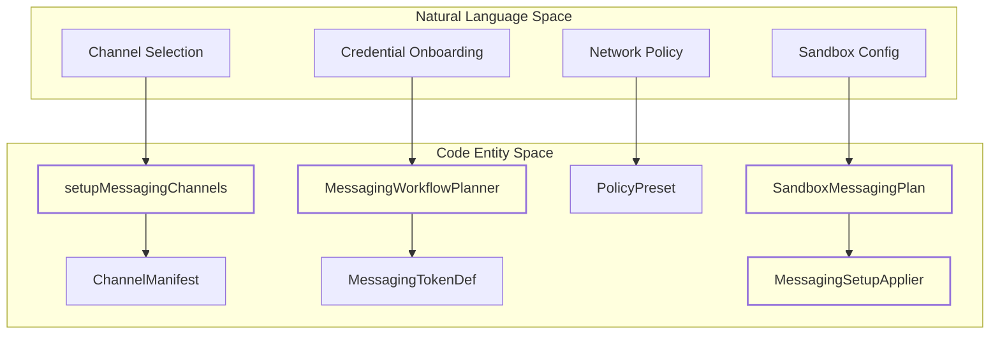
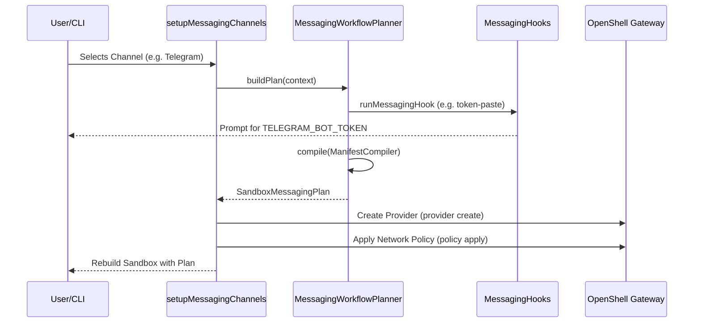

<!-- source: DeepWiki mcp.deepwiki.com · repo NVIDIA/NemoClaw · page 6.6 Messaging Channels · fetched 2026-10-26 -->

# Messaging Channels

Relevant source files

The following files were used as context for generating this wiki page:

- [docs/manage-sandboxes/lifecycle.mdx](docs/manage-sandboxes/lifecycle.mdx)
- [docs/manage-sandboxes/messaging-channels.mdx](docs/manage-sandboxes/messaging-channels.mdx)
- [nemoclaw/src/plugin-config.ts](nemoclaw/src/plugin-config.ts)
- [src/lib/actions/sandbox/policy-channel-conflict.test.ts](src/lib/actions/sandbox/policy-channel-conflict.test.ts)
- [src/lib/actions/sandbox/policy-channel.ts](src/lib/actions/sandbox/policy-channel.ts)
- [src/lib/messaging-channel-config.test.ts](src/lib/messaging-channel-config.test.ts)
- [src/lib/messaging-channel-config.ts](src/lib/messaging-channel-config.ts)
- [src/lib/messaging/AGENTS.md](src/lib/messaging/AGENTS.md)
- [src/lib/messaging/README.md](src/lib/messaging/README.md)
- [src/lib/messaging/applier/host-state-applier.ts](src/lib/messaging/applier/host-state-applier.ts)
- [src/lib/messaging/channels/built-ins.ts](src/lib/messaging/channels/built-ins.ts)
- [src/lib/messaging/channels/discord/manifest.ts](src/lib/messaging/channels/discord/manifest.ts)
- [src/lib/messaging/channels/manifests.test.ts](src/lib/messaging/channels/manifests.test.ts)
- [src/lib/messaging/channels/metadata.test.ts](src/lib/messaging/channels/metadata.test.ts)
- [src/lib/messaging/channels/metadata.ts](src/lib/messaging/channels/metadata.ts)
- [src/lib/messaging/channels/slack/manifest.ts](src/lib/messaging/channels/slack/manifest.ts)
- [src/lib/messaging/channels/teams/manifest.ts](src/lib/messaging/channels/teams/manifest.ts)
- [src/lib/messaging/channels/telegram/manifest.ts](src/lib/messaging/channels/telegram/manifest.ts)
- [src/lib/messaging/channels/template-resolver.ts](src/lib/messaging/channels/template-resolver.ts)
- [src/lib/messaging/channels/wechat/manifest.ts](src/lib/messaging/channels/wechat/manifest.ts)
- [src/lib/messaging/channels/whatsapp/manifest.ts](src/lib/messaging/channels/whatsapp/manifest.ts)
- [src/lib/messaging/compiler/manifest-compiler.test.ts](src/lib/messaging/compiler/manifest-compiler.test.ts)
- [src/lib/messaging/compiler/manifest-compiler.ts](src/lib/messaging/compiler/manifest-compiler.ts)
- [src/lib/messaging/compiler/types.ts](src/lib/messaging/compiler/types.ts)
- [src/lib/messaging/compiler/workflow-planner.test.ts](src/lib/messaging/compiler/workflow-planner.test.ts)
- [src/lib/messaging/compiler/workflow-planner.ts](src/lib/messaging/compiler/workflow-planner.ts)
- [src/lib/messaging/diagnostics.test.ts](src/lib/messaging/diagnostics.test.ts)
- [src/lib/messaging/hooks/builtins.ts](src/lib/messaging/hooks/builtins.ts)
- [src/lib/messaging/hooks/common/config-prompt.ts](src/lib/messaging/hooks/common/config-prompt.ts)
- [src/lib/messaging/hooks/common/token-paste.ts](src/lib/messaging/hooks/common/token-paste.ts)
- [src/lib/messaging/hooks/hook-runner.test.ts](src/lib/messaging/hooks/hook-runner.test.ts)
- [src/lib/messaging/hydration.ts](src/lib/messaging/hydration.ts)
- [src/lib/messaging/index.ts](src/lib/messaging/index.ts)
- [src/lib/messaging/manifest/registry.test.ts](src/lib/messaging/manifest/registry.test.ts)
- [src/lib/messaging/manifest/registry.ts](src/lib/messaging/manifest/registry.ts)
- [src/lib/messaging/manifest/types.test.ts](src/lib/messaging/manifest/types.test.ts)
- [src/lib/messaging/manifest/types.ts](src/lib/messaging/manifest/types.ts)
- [src/lib/messaging/persistence.ts](src/lib/messaging/persistence.ts)
- [src/lib/messaging/plan-validation.test.ts](src/lib/messaging/plan-validation.test.ts)
- [src/lib/messaging/plan-validation.ts](src/lib/messaging/plan-validation.ts)
- [src/lib/messaging/utils.ts](src/lib/messaging/utils.ts)
- [src/lib/onboard/messaging-channel-setup.test.ts](src/lib/onboard/messaging-channel-setup.test.ts)
- [src/lib/onboard/messaging-channel-setup.ts](src/lib/onboard/messaging-channel-setup.ts)
- [src/lib/onboard/messaging-conflict-guard.test.ts](src/lib/onboard/messaging-conflict-guard.test.ts)
- [src/lib/onboard/messaging-conflict-guard.ts](src/lib/onboard/messaging-conflict-guard.ts)
- [src/lib/onboard/messaging-host-forward.ts](src/lib/onboard/messaging-host-forward.ts)
- [src/lib/policy/context.ts](src/lib/policy/context.ts)
- [src/lib/policy/failure-classifier.ts](src/lib/policy/failure-classifier.ts)
- [src/lib/state/registry-messaging.ts](src/lib/state/registry-messaging.ts)
- [test/channels-add-preset.test.ts](test/channels-add-preset.test.ts)
- [test/e2e/fixtures/paths.ts](test/e2e/fixtures/paths.ts)
- [test/e2e/live/channels-stop-start-helpers.ts](test/e2e/live/channels-stop-start-helpers.ts)
- [test/e2e/live/channels-stop-start.test.ts](test/e2e/live/channels-stop-start.test.ts)
- [test/onboard-messaging.test.ts](test/onboard-messaging.test.ts)

NemoClaw provides a robust framework for integrating AI agents (OpenClaw and Hermes) with popular messaging platforms. This system manages the full lifecycle of a channel—from credential acquisition and network policy enforcement to host-side traffic forwarding and sandbox configuration.

## Overview and Supported Channels

NemoClaw supports several messaging channels, categorized by their authentication and delivery mechanisms. While token-based bots are standard, NemoClaw also supports experimental QR-based pairing for mobile-first platforms.

| Channel | Authentication Mode | Agent Support | Primary Credential |
| :--- | :--- | :--- | :--- |
| **Telegram** | Token-based | OpenClaw, Hermes | `TELEGRAM_BOT_TOKEN` |
| **Discord** | Token-based | OpenClaw, Hermes | `DISCORD_BOT_TOKEN` |
| **Slack** | Dual-token (Socket Mode) | OpenClaw, Hermes | `SLACK_BOT_TOKEN`, `SLACK_APP_TOKEN` |
| **WeChat** | Host-side QR Scan | OpenClaw, Hermes | Captured session token |
| **WhatsApp** | In-sandbox QR Scan | OpenClaw, Hermes | Mutable session state |
| **MS Teams** | Bot Framework + Webhook | OpenClaw, Hermes | `MSTEAMS_APP_PASSWORD` |
| **Google Chat** | Service Account + Webhook | OpenClaw only | Service Account JSON |

Sources: `[docs/manage-sandboxes/messaging-channels.mdx:15-49]()`, `[src/lib/messaging/channels/manifests.test.ts:17-30]()`

## Architecture and Data Flow

The messaging system is built on a **Manifest-Plan-Applier** pattern. Channel definitions are decoupled from the core logic using manifests, which describe the inputs, credentials, and network policies required for each platform.

### Conceptual to Code Mapping

The following diagram bridges the natural language concepts of "Messaging Setup" to the specific classes and functions in the codebase.

Sources: `[src/lib/onboard/messaging-channel-setup.ts:118-124]()`, `[src/lib/messaging/compiler/workflow-planner.ts:33-44]()`, `[src/lib/messaging/manifest/types.ts:1-50]()`

### Messaging Lifecycle Flow

When a user enables a channel (e.g., via `nemoclaw onboard` or `nemoclaw <name> channels add`), the system executes the following flow:

Sources: `[src/lib/onboard/messaging-channel-setup.ts:155-200]()`, `[src/lib/messaging/compiler/workflow-planner.ts:44-59]()`, `[test/onboard-messaging.test.ts:168-186]()`

## Key Implementation Details

### 1. Channel Manifests
Each channel is defined by a `ChannelManifest`. This includes:
* **Inputs**: Configuration fields (e.g., `WHATSAPP_ALLOWED_IDS`) and secrets (e.g., `DISCORD_BOT_TOKEN`).
* **Credentials**: Definitions for OpenShell providers that will securely store tokens.
* **Hooks**: Code executed during setup, such as `validateSlackCredentials` or `runWechatHostQrLogin`.

Sources: `[src/lib/messaging/channels/slack/manifest.ts:1-50]()`, `[src/lib/messaging/channels/wechat/manifest.ts:1-50]()`

### 2. Workflow Planning
The `MessagingWorkflowPlanner` is responsible for generating a `SandboxMessagingPlan`. This plan is a serializable object that contains everything needed to configure the sandbox and host.

* **buildPlan**: The entry point for creating a new plan during onboarding. `[src/lib/messaging/compiler/workflow-planner.ts:44-60]()`
* **buildChannelAddPlanFromSandboxEntry**: Used when adding a channel to an existing sandbox, ensuring new credentials don't conflict with existing ones. `[src/lib/messaging/compiler/workflow-planner.ts:62-81]()`

### 3. Conflict Detection
To prevent multiple sandboxes from using the same messaging bot (which causes connection flapping), NemoClaw implements a `findChannelConflicts` check. It hashes credentials using `hashCredential` and compares them across all registered sandboxes in the `registry`.

Sources: `[src/lib/actions/sandbox/policy-channel.ts:41-43]()`, `[src/lib/security/credential-hash.ts:1-20]()`, `[src/lib/actions/sandbox/policy-channel-conflict.test.ts:40-49]()`

### 4. Lifecycle Management
Channels are managed using host-side commands. NemoClaw explicitly forbids changing channel configurations inside the sandbox because the files (e.g., `/sandbox/.openclaw/openclaw.json`) are generated at build time and will be overwritten on the next rebuild.

* **Add**: `addSandboxChannel` in `[src/lib/actions/sandbox/policy-channel.ts:173-200]()`
* **Remove**: `removeSandboxChannel` in `[src/lib/actions/sandbox/policy-channel.ts:250-280]()`
* **Start/Stop**: `startSandboxChannel` and `stopSandboxChannel` toggle the `active` bit in the plan without removing credentials. `[src/lib/actions/sandbox/policy-channel.ts:300-350]()`

## Network Policy and Egress
Every messaging channel requires specific network egress rules. NemoClaw automates this by mapping channel IDs to policy presets.

* **Telegram**: Requires access to `api.telegram.org`.
* **Slack**: Requires access to `slack.com` and WebSocket endpoints for Socket Mode.
* **Teams**: Requires an inbound host forward (default port `3978`) to receive webhooks.

Sources: `[src/lib/messaging/compiler/manifest-compiler.test.ts:168-205]()`, `[src/lib/onboard/messaging-host-forward.ts:1-30]()`

## Experimental Channel Considerations
Channels like **WhatsApp** and **WeChat** utilize QR pairing.
* **WeChat**: The `runWechatHostQrLogin` hook executes on the host to capture a session token before sandbox creation. `[src/lib/onboard/messaging-channel-setup.test.ts:10-15]()`
* **WhatsApp**: Uses `in-sandbox-qr` pairing. The session state is stored in a mutable volume within the sandbox, as it cannot be easily represented as a static token. `[docs/manage-sandboxes/messaging-channels.mdx:22-29]()`

Sources: `[docs/manage-sandboxes/messaging-channels.mdx:27-33]()`, `[src/lib/messaging/channels/whatsapp/manifest.ts:1-40]()`

---

