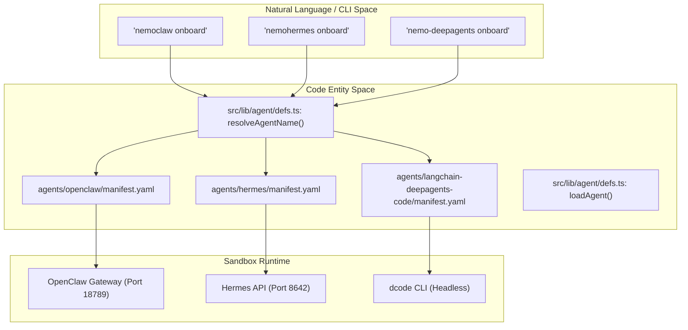
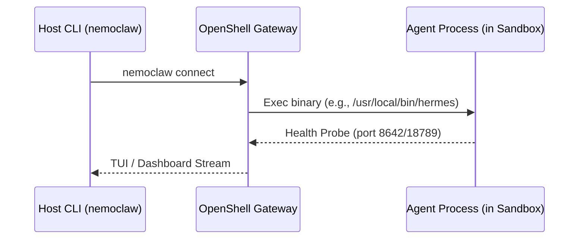

<!-- source: DeepWiki mcp.deepwiki.com · repo NVIDIA/NemoClaw · page 7 Agent Runtimes · fetched 2026-10-26 -->

# Agent Runtimes

Relevant source files

The following files were used as context for generating this wiki page:

- [agents/hermes/manifest.yaml](agents/hermes/manifest.yaml)
- [agents/langchain-deepagents-code/manifest.yaml](agents/langchain-deepagents-code/manifest.yaml)
- [agents/openclaw/manifest.yaml](agents/openclaw/manifest.yaml)
- [ci/platform-matrix.json](ci/platform-matrix.json)
- [docs/about/ecosystem-deepagents.mdx](docs/about/ecosystem-deepagents.mdx)
- [docs/about/ecosystem-hermes.mdx](docs/about/ecosystem-hermes.mdx)
- [docs/about/ecosystem.mdx](docs/about/ecosystem.mdx)
- [docs/about/overview.mdx](docs/about/overview.mdx)
- [docs/get-started/dgx-station-preparation.mdx](docs/get-started/dgx-station-preparation.mdx)
- [docs/get-started/prerequisites.mdx](docs/get-started/prerequisites.mdx)
- [docs/get-started/quickstart-hermes.mdx](docs/get-started/quickstart-hermes.mdx)
- [docs/get-started/quickstart.mdx](docs/get-started/quickstart.mdx)
- [docs/index.mdx](docs/index.mdx)
- [docs/reference/platform-support.mdx](docs/reference/platform-support.mdx)
- [src/lib/agent/defs.test.ts](src/lib/agent/defs.test.ts)
- [src/lib/agent/defs.ts](src/lib/agent/defs.ts)
- [src/lib/agent/hermes-recovery-boundary-fixtures.ts](src/lib/agent/hermes-recovery-boundary-fixtures.ts)
- [src/lib/agent/onboard.test.ts](src/lib/agent/onboard.test.ts)
- [src/lib/agent/onboard.ts](src/lib/agent/onboard.ts)
- [src/lib/agent/runtime-recovery-preload.test.ts](src/lib/agent/runtime-recovery-preload.test.ts)
- [src/lib/agent/runtime-recovery-preload.ts](src/lib/agent/runtime-recovery-preload.ts)
- [src/lib/agent/runtime.test.ts](src/lib/agent/runtime.test.ts)
- [src/lib/agent/runtime.ts](src/lib/agent/runtime.ts)
- [test/helpers/runtime-recovery-preload-test-helpers.ts](test/helpers/runtime-recovery-preload-test-helpers.ts)
- [test/install-agent-alias-parity.test.ts](test/install-agent-alias-parity.test.ts)
- [test/station-doc-ownership.test.ts](test/station-doc-ownership.test.ts)

NemoClaw supports multiple AI agent runtimes, each providing a unique execution model, toolset, and interaction pattern. These runtimes are executed within [NVIDIA OpenShell](https://github.com/NVIDIA/OpenShell) sandboxes, benefiting from unified inference routing, network policy enforcement, and lifecycle management.

While the runtimes share a common infrastructure, they are defined by unique manifests in the `agents/` directory that declare their integration contracts, including binary paths, health probes, and state persistence requirements [agents/openclaw/manifest.yaml:1-5](), [agents/hermes/manifest.yaml:1-5]().

## Supported Agents Overview

NemoClaw currently validates three primary agent runtimes. The system determines which runtime to use based on the `--agent` flag during onboarding or the `NEMOCLAW_AGENT` environment variable [src/lib/agent/onboard.ts:123-134]().

| Agent | CLI Alias | Primary Use Case | Dashboard Port |
| :--- | :--- | :--- | :--- |
| **OpenClaw** | `nemoclaw` | General purpose, plugin-heavy automation | `18789` |
| **Hermes** | `nemohermes` | Self-improving loops, managed tool gateways | `18789` (UI), `8642` (API) |
| **Deep Agents Code** | `dcode` | Terminal-centric coding and AST-based tasks | N/A (Headless) |

### Runtime Space Mapping
The following diagram illustrates how natural language intent and CLI commands map to specific code entities and sandbox configurations within the NemoClaw repository.

**Agent Entity Mapping**

*Sources: [src/lib/agent/defs.ts:14-16](), [src/lib/agent/onboard.ts:123-134]()*

---

## OpenClaw Agent
OpenClaw is the default agent runtime for NemoClaw. It is a Node.js-based environment [agents/openclaw/manifest.yaml:14]() that features a rich plugin ecosystem and a web-based TUI.

*   **Sandbox Entrypoint:** Managed by `scripts/nemoclaw-start.sh` [agents/openclaw/manifest.yaml:121]().
*   **Authentication:** Uses a unique device pairing system where the sandbox generates an identity and the host CLI auto-pairs on connection [agents/openclaw/manifest.yaml:59-67]().
*   **Persistence:** Tracks state across directories like `agents/`, `workspace/`, and `memory/` [agents/openclaw/manifest.yaml:43-57]().

For details on configuration and patching, see [OpenClaw Agent](#7.1).

---

## Hermes Agent
The Hermes agent (by Nous Research) is a Python-based runtime [agents/hermes/manifest.yaml:11]() designed for self-improving AI loops. It operates with a multi-port architecture, exposing both a Web UI and an OpenAI-compatible API.

*   **API & Dashboard:** The API server listens on port `8642`, while the dashboard is exposed via `socat` on port `18789` [agents/hermes/manifest.yaml:28-48]().
*   **Diagnostics:** Includes specialized health probes and startup diagnostics to monitor the "Tirith" installation marker [src/lib/agent/onboard.ts:157-192]().
*   **Managed Tools:** Integrates with Nous Portal OAuth for managed tool gateway access [docs/get-started/quickstart-hermes.mdx:90-91]().

For details on the multi-stage build and secret boundaries, see [Hermes Agent](#7.2).

---

## LangChain Deep Agents Code
The `langchain-deepagents-code` runtime (invoked via `dcode`) is a terminal-oriented coding harness. Unlike the other agents, it does not run a persistent gateway or dashboard.

*   **Execution Model:** Runs as a managed harness where NemoClaw drops credential-bearing proxy URLs from the persisted shell environment for security [docs/reference/platform-support.mdx:68]().
*   **Inference:** Routes through OpenShell's `inference.local` endpoint using the Deep Agents SDK OpenAI-compatible provider [docs/reference/platform-support.mdx:68]().
*   **Posture:** Enforces a "managed posture" where unmanaged sandbox or MCP overrides are rejected [docs/reference/platform-support.mdx:68]().

For details on AST patching and headless execution, see [LangChain Deep Agents Code](#7.3).

---

## Agent Lifecycle and Interaction
The following diagram shows the internal flow from the host CLI to the sandboxed agent process.

**Execution Flow**

*Sources: [agents/hermes/manifest.yaml:17-33](), [agents/openclaw/manifest.yaml:20-30](), [src/lib/agent/onboard.ts:26-27]()*

### Common Agent Properties
All agents defined in NemoClaw must adhere to a standard `AgentDefinition` which includes:
*   **Phone-Home Hosts:** A list of egress endpoints allowed by the network policy for updates and auth (e.g., `pypi.org`, `registry.npmjs.org`) [agents/hermes/manifest.yaml:154-165](), [agents/openclaw/manifest.yaml:105-115]().
*   **State Files:** Specific files like `SOUL.md` or SQLite databases that require specialized backup strategies (e.g., `sqlite_backup`) [agents/hermes/manifest.yaml:97-121]().
*   **Inference Configuration:** Mapping of OpenShell provider profiles to agent-specific config keys (e.g., `model.base_url`) [agents/hermes/manifest.yaml:139-146]().

*Sources: [src/lib/agent/defs.ts:1-200](), [src/lib/agent/onboard.ts:1-150]()*

---

