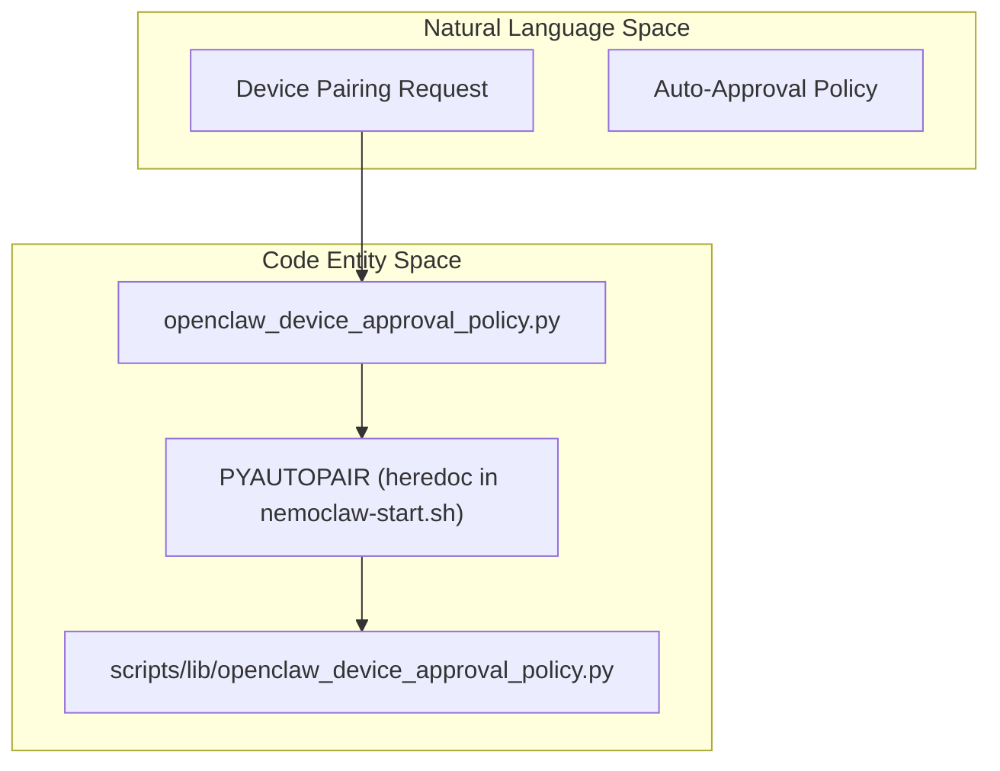
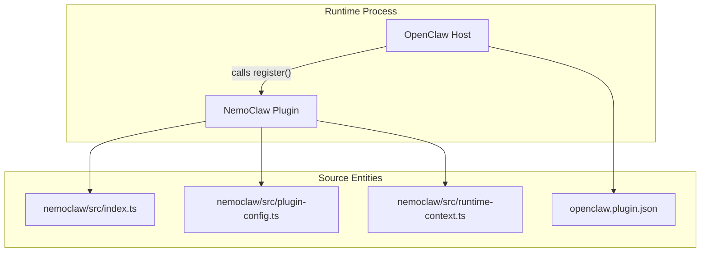

<!-- source: DeepWiki mcp.deepwiki.com · repo NVIDIA/NemoClaw · page 7.1 OpenClaw Agent · fetched 2026-10-26 -->

# OpenClaw Agent

Relevant source files

The following files were used as context for generating this wiki page:

- [Dockerfile](Dockerfile)
- [Dockerfile.base](Dockerfile.base)
- [agents/hermes/config/build-env.ts](agents/hermes/config/build-env.ts)
- [agents/hermes/generate-config.ts](agents/hermes/generate-config.ts)
- [agents/hermes/host/tool-gateway-broker.ts](agents/hermes/host/tool-gateway-broker.ts)
- [agents/hermes/plugin/__init__.py](agents/hermes/plugin/__init__.py)
- [agents/hermes/plugin/plugin.yaml](agents/hermes/plugin/plugin.yaml)
- [agents/hermes/plugin/test_register_tools.py](agents/hermes/plugin/test_register_tools.py)
- [docs/security/openclaw-2026.6.10-dependency-review.md](docs/security/openclaw-2026.6.10-dependency-review.md)
- [docs/security/sandbox-base-libexpat-jq-2026-07-24-dependency-review.md](docs/security/sandbox-base-libexpat-jq-2026-07-24-dependency-review.md)
- [nemoclaw/src/index.ts](nemoclaw/src/index.ts)
- [nemoclaw/src/register.test.ts](nemoclaw/src/register.test.ts)
- [nemoclaw/src/runtime-context.test.ts](nemoclaw/src/runtime-context.test.ts)
- [nemoclaw/src/runtime-context.ts](nemoclaw/src/runtime-context.ts)
- [nemoclaw/src/security/safe-resolve-path.test.ts](nemoclaw/src/security/safe-resolve-path.test.ts)
- [nemoclaw/src/security/safe-resolve-path.ts](nemoclaw/src/security/safe-resolve-path.ts)
- [nemoclaw/src/security/secret-scanner.test.ts](nemoclaw/src/security/secret-scanner.test.ts)
- [nemoclaw/src/security/secret-scanner.ts](nemoclaw/src/security/secret-scanner.ts)
- [scripts/generate-openclaw-config.mts](scripts/generate-openclaw-config.mts)
- [scripts/nemoclaw-start.sh](scripts/nemoclaw-start.sh)
- [scripts/patch-openclaw-device-self-approval.mts](scripts/patch-openclaw-device-self-approval.mts)
- [scripts/patch-openclaw-issue-4434-diagnostics.mts](scripts/patch-openclaw-issue-4434-diagnostics.mts)
- [src/lib/actions/sandbox/auto-pair-approval-receipt.test.ts](src/lib/actions/sandbox/auto-pair-approval-receipt.test.ts)
- [src/lib/actions/sandbox/auto-pair-approval-restored-root.test.ts](src/lib/actions/sandbox/auto-pair-approval-restored-root.test.ts)
- [src/lib/actions/sandbox/auto-pair-approval-script.test.ts](src/lib/actions/sandbox/auto-pair-approval-script.test.ts)
- [src/lib/actions/sandbox/auto-pair-approval.test.ts](src/lib/actions/sandbox/auto-pair-approval.test.ts)
- [src/lib/actions/sandbox/auto-pair-approval.ts](src/lib/actions/sandbox/auto-pair-approval.ts)
- [src/lib/actions/sandbox/auto-pair-warmup.test.ts](src/lib/actions/sandbox/auto-pair-warmup.test.ts)
- [src/lib/actions/sandbox/auto-pair-warmup.ts](src/lib/actions/sandbox/auto-pair-warmup.ts)
- [src/lib/actions/sandbox/connect-autopair-budget.test.ts](src/lib/actions/sandbox/connect-autopair-budget.test.ts)
- [src/lib/actions/sandbox/connect-autopair-budget.ts](src/lib/actions/sandbox/connect-autopair-budget.ts)
- [src/lib/actions/sandbox/restore-gateway-pairing.test.ts](src/lib/actions/sandbox/restore-gateway-pairing.test.ts)
- [src/lib/actions/sandbox/restore-gateway-pairing.ts](src/lib/actions/sandbox/restore-gateway-pairing.ts)
- [src/lib/messaging/applier/setup-applier.test.ts](src/lib/messaging/applier/setup-applier.test.ts)
- [src/lib/messaging/applier/setup-applier.ts](src/lib/messaging/applier/setup-applier.ts)
- [src/lib/onboard/dockerfile-patch.test.ts](src/lib/onboard/dockerfile-patch.test.ts)
- [src/lib/onboard/dockerfile-patch.ts](src/lib/onboard/dockerfile-patch.ts)
- [src/lib/sandbox/build-context.ts](src/lib/sandbox/build-context.ts)
- [test/Dockerfile.sandbox](test/Dockerfile.sandbox)
- [test/e2e-test.sh](test/e2e-test.sh)
- [test/e2e/live/issue-4434-tui-unreachable-inference.test.ts](test/e2e/live/issue-4434-tui-unreachable-inference.test.ts)
- [test/e2e/live/issue-4462-scope-upgrade-approval.test.ts](test/e2e/live/issue-4462-scope-upgrade-approval.test.ts)
- [test/e2e/live/runtime-overrides.test.ts](test/e2e/live/runtime-overrides.test.ts)
- [test/e2e/live/snapshot-commands-helpers.ts](test/e2e/live/snapshot-commands-helpers.ts)
- [test/e2e/live/snapshot-commands.test.ts](test/e2e/live/snapshot-commands.test.ts)
- [test/e2e/support/snapshot-commands-helpers.test.ts](test/e2e/support/snapshot-commands-helpers.test.ts)
- [test/fetch-guard-patch-regression.test.ts](test/fetch-guard-patch-regression.test.ts)
- [test/generate-openclaw-config.test.ts](test/generate-openclaw-config.test.ts)
- [test/helpers/base-apt-security-functions.ts](test/helpers/base-apt-security-functions.ts)
- [test/helpers/messaging-plan-fixtures.ts](test/helpers/messaging-plan-fixtures.ts)
- [test/helpers/openclaw-device-self-approval-patch-harness.ts](test/helpers/openclaw-device-self-approval-patch-harness.ts)
- [test/helpers/openclaw-real-device-self-approval-proof.ts](test/helpers/openclaw-real-device-self-approval-proof.ts)
- [test/hermes-plugin-handlers.test.ts](test/hermes-plugin-handlers.test.ts)
- [test/hermes-tool-gateway-broker.test.ts](test/hermes-tool-gateway-broker.test.ts)
- [test/issue-4434-error-fields.test.ts](test/issue-4434-error-fields.test.ts)
- [test/nemoclaw-start.test.ts](test/nemoclaw-start.test.ts)
- [test/ollama-local-openclaw-config-propagation.test.ts](test/ollama-local-openclaw-config-propagation.test.ts)
- [test/openclaw-dependency-review.test.ts](test/openclaw-dependency-review.test.ts)
- [test/openclaw-device-self-approval-patch.test.ts](test/openclaw-device-self-approval-patch.test.ts)
- [test/openclaw-integrity-pin-suite.ts](test/openclaw-integrity-pin-suite.ts)
- [test/openclaw-issue-4434-diagnostics-patch.test.ts](test/openclaw-issue-4434-diagnostics-patch.test.ts)
- [test/openclaw-real-patched-dist-harness.test.ts](test/openclaw-real-patched-dist-harness.test.ts)
- [test/openclaw-tool-catalog-patch.test.ts](test/openclaw-tool-catalog-patch.test.ts)
- [test/perl-critical-cve-remediation.test.ts](test/perl-critical-cve-remediation.test.ts)
- [test/sandbox-base-security-packages.test.ts](test/sandbox-base-security-packages.test.ts)
- [test/sandbox-build-context.test.ts](test/sandbox-build-context.test.ts)
- [test/sandbox-connect-inference/auto-pair-approval.test.ts](test/sandbox-connect-inference/auto-pair-approval.test.ts)
- [test/sandbox-connect-inference/helpers.ts](test/sandbox-connect-inference/helpers.ts)
- [test/sandbox-provisioning.test.ts](test/sandbox-provisioning.test.ts)
- [test/service-env.test.ts](test/service-env.test.ts)

The OpenClaw Agent runtime provides a secure, sandboxed environment for executing OpenClaw-based AI agents within the NemoClaw ecosystem. It integrates the OpenClaw agent core with the OpenShell security gateway, providing a managed runtime that includes automated configuration generation, security patching, and device pairing orchestration.

## Sandbox Entrypoint and Initialization

The runtime lifecycle is managed by `scripts/nemoclaw-start.sh`, which serves as the Docker `ENTRYPOINT` [scripts/nemoclaw-start.sh:5-6](). It operates in two privilege phases to ensure security isolation between the management gateway and the agent process.

### Startup Phases

1.  **Root Phase (PID 1):** The script starts as root to perform privileged initialization. It hardens resource limits (nproc and nofile) using `harden_resource_limits` before dropping privileges [scripts/nemoclaw-start.sh:135-137](). It also locks down the `PATH` to prevent command injection [scripts/nemoclaw-start.sh:37-39]().
2.  **Gateway Supervision:** The script launches the OpenShell gateway as a dedicated `gateway` user [scripts/nemoclaw-start.sh:5-6](). This separation prevents the sandboxed agent from tampering with the gateway configuration or process [scripts/nemoclaw-start.sh:8-10]().
3.  **Agent Phase:** Finally, it drops privileges to the `sandbox` user to execute agent-specific commands [scripts/nemoclaw-start.sh:5-6]().

### Tool Cache Redirection
To maintain a clean and durable workspace in `/sandbox`, the entrypoint redirects various tool caches (e.g., `.npm`, `.cache`, `.gitconfig`) to `/tmp` [scripts/nemoclaw-start.sh:142-152](). This ensures that transient shell and package manager state does not clutter the agent's persistent storage.

**Sources:** [scripts/nemoclaw-start.sh:5-152](), [scripts/nemoclaw-start.sh:135-137]()

## Configuration Generation

The OpenClaw agent requires a complex `openclaw.json` configuration file. NemoClaw automates this via `scripts/generate-openclaw-config.mts`, which maps environment variables and system state into the OpenClaw schema.

### Data Flow: Environment to OpenClaw Config

| Environment Variable | OpenClaw Config Field | Description |
| :--- | :--- | :--- |
| `NEMOCLAW_MODEL` | `agents[0].model` | The primary inference model [test/generate-openclaw-config.test.ts:27]() |
| `NEMOCLAW_INFERENCE_BASE_URL` | `providers[].baseUrl` | The endpoint for the inference provider [test/generate-openclaw-config.test.ts:31]() |
| `NEMOCLAW_PROXY_HOST/PORT` | `proxy` settings | Configures the agent to route traffic through the OpenShell gateway [test/generate-openclaw-config.test.ts:34-35]() |
| `NEMOCLAW_CONTEXT_WINDOW` | `model.contextWindow` | Overrides the model's context window size [test/generate-openclaw-config.test.ts:36]() |

The `buildConfig` function in `scripts/generate-openclaw-config.mts` is responsible for assembling this object [test/generate-openclaw-config.test.ts:14]().

**Sources:** [scripts/generate-openclaw-config.mts:1-100](), [test/generate-openclaw-config.test.ts:25-40]()

## Patching Pipeline

NemoClaw applies a series of runtime patches to the OpenClaw distribution to enhance security and integrate with the NemoClaw environment. These patches are applied during the Docker build process or at runtime via the entrypoint.

### Key Patches
*   **Media Fetch Patch:** Intercepts and secures media fetching logic [test/fetch-guard-patch-regression.test.ts:185-186]().
*   **Device Self-Approval:** Injects logic to handle automated device pairing within the sandbox [scripts/patch-openclaw-device-self-approval.mts:1-10]().
*   **Tool Catalog Patch:** Modifies how OpenClaw discovers and executes tools to ensure compliance with sandbox policies [scripts/patch-openclaw-tool-catalog.mts:1-10]().
*   **MCP NPX Patch:** Wraps `npx` calls for Model Context Protocol (MCP) tools to ensure they respect the sandboxed environment [scripts/patch-openclaw-mcp-npx.mts:1-10]().

**Sources:** [Dockerfile:79-88](), [test/fetch-guard-patch-regression.test.ts:183-190]()

## Device Pairing and Auth

OpenClaw requires device pairing for dashboard access. NemoClaw automates this using a specialized approval policy and a watcher script.

### Auto-Pairing Mechanism

The entrypoint includes a Python-based auto-pairing script (`PYAUTOPAIR`) that monitors OpenClaw for pairing requests [test/nemoclaw-start.test.ts:171-175](). It uses `openclaw_device_approval_policy.py` to determine if a pairing request should be automatically granted based on the environment configuration [scripts/lib/openclaw_device_approval_policy.py:1-20]().

**Code Entity Mapping: Device Pairing**

**Sources:** [scripts/nemoclaw-start.sh:15-18](), [test/nemoclaw-start.test.ts:171-178](), [scripts/lib/openclaw_device_approval_policy.py:1-20]()

## Plugin System

The OpenClaw agent runtime includes the `nemoclaw` plugin, which provides the glue between OpenClaw and the NemoClaw host.

### Plugin Architecture
The plugin is implemented in TypeScript and resides in the `nemoclaw/` directory. It uses the `OpenClawPluginApi` to register commands and services [nemoclaw/src/index.ts:184-199]().

### Key Components
*   **Slash Commands:** Handled via `handleSlashCommand` to provide agent-side management [nemoclaw/src/index.ts:16]().
*   **Secret Scanner:** Uses `scanForSecrets` to prevent credentials from leaking into agent memory or logs [nemoclaw/src/index.ts:25]().
*   **Onboarding:** Manages the initial configuration flow via `loadOnboardConfig` [nemoclaw/src/index.ts:20]().

**Code Entity Mapping: Plugin Lifecycle**

**Sources:** [nemoclaw/src/index.ts:5-26](), [nemoclaw/src/index.ts:184-199]()

## Build Infrastructure

The runtime image is built in multiple stages to minimize size and maximize security.

### Docker Stages
1.  **Builder Stage:** Compiles the TypeScript plugin and runtime preloads [Dockerfile:16-40]().
2.  **MCP Discovery Stage:** Builds the MCP tool discovery runtime [Dockerfile:45-54]().
3.  **Payload Stages:** Groups dependencies, plugins, and patches into scratch-based layers for efficient copying [Dockerfile:58-111]().
4.  **Final Runtime:** Pulls the `sandbox-base` image and layers the payloads on top [Dockerfile:115-125]().

### Sandbox Staging Logic
The `src/lib/sandbox/build-context.ts` file defines how the build context is prepared, including `stageOptimizedSandboxBuildContext` which selectively copies only necessary files to the Docker daemon [src/lib/sandbox/build-context.ts:119-200]().

**Sources:** [Dockerfile:1-125](), [src/lib/sandbox/build-context.ts:119-200]()

---

