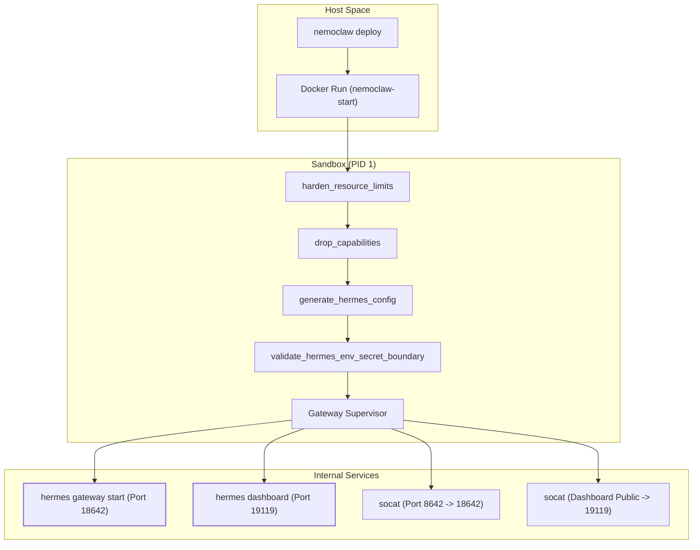
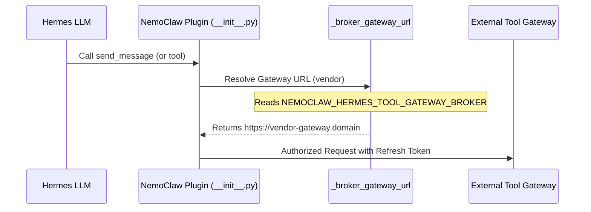

<!-- source: DeepWiki mcp.deepwiki.com · repo NVIDIA/NemoClaw · page 7.2 Hermes Agent · fetched 2026-10-26 -->

# Hermes Agent

Relevant source files

The following files were used as context for generating this wiki page:

- [.agents/skills/nemoclaw-contributor-update-hermes/SKILL.md](.agents/skills/nemoclaw-contributor-update-hermes/SKILL.md)
- [.agents/skills/nemoclaw-contributor-update-hermes/references/hermes-contract-map.md](.agents/skills/nemoclaw-contributor-update-hermes/references/hermes-contract-map.md)
- [agents/hermes/Dockerfile](agents/hermes/Dockerfile)
- [agents/hermes/Dockerfile.base](agents/hermes/Dockerfile.base)
- [agents/hermes/config/build-env.ts](agents/hermes/config/build-env.ts)
- [agents/hermes/config/hermes-config.ts](agents/hermes/config/hermes-config.ts)
- [agents/hermes/generate-config.ts](agents/hermes/generate-config.ts)
- [agents/hermes/host/tool-gateway-broker.ts](agents/hermes/host/tool-gateway-broker.ts)
- [agents/hermes/image-build-probes.py](agents/hermes/image-build-probes.py)
- [agents/hermes/patch-gateway-process-identity.py](agents/hermes/patch-gateway-process-identity.py)
- [agents/hermes/plugin/__init__.py](agents/hermes/plugin/__init__.py)
- [agents/hermes/plugin/plugin.yaml](agents/hermes/plugin/plugin.yaml)
- [agents/hermes/plugin/test_register_tools.py](agents/hermes/plugin/test_register_tools.py)
- [agents/hermes/start.sh](agents/hermes/start.sh)
- [docs/manage-sandboxes/install-plugins-hermes.mdx](docs/manage-sandboxes/install-plugins-hermes.mdx)
- [scripts/generate-openclaw-config.mts](scripts/generate-openclaw-config.mts)
- [src/lib/messaging/applier/setup-applier.test.ts](src/lib/messaging/applier/setup-applier.test.ts)
- [src/lib/messaging/applier/setup-applier.ts](src/lib/messaging/applier/setup-applier.ts)
- [src/lib/onboard/dockerfile-patch.test.ts](src/lib/onboard/dockerfile-patch.test.ts)
- [src/lib/onboard/dockerfile-patch.ts](src/lib/onboard/dockerfile-patch.ts)
- [test/e2e/live/hermes-root-entrypoint-smoke.test.ts](test/e2e/live/hermes-root-entrypoint-smoke.test.ts)
- [test/e2e/live/hermes-sandbox-secret-boundary.test.ts](test/e2e/live/hermes-sandbox-secret-boundary.test.ts)
- [test/e2e/live/issue-4434-tui-unreachable-inference.test.ts](test/e2e/live/issue-4434-tui-unreachable-inference.test.ts)
- [test/e2e/live/runtime-overrides.test.ts](test/e2e/live/runtime-overrides.test.ts)
- [test/generate-hermes-config.test.ts](test/generate-hermes-config.test.ts)
- [test/helpers/messaging-plan-fixtures.ts](test/helpers/messaging-plan-fixtures.ts)
- [test/hermes-cron-execution-runtime-patch.test.ts](test/hermes-cron-execution-runtime-patch.test.ts)
- [test/hermes-dashboard-provisioning.test.ts](test/hermes-dashboard-provisioning.test.ts)
- [test/hermes-discord-recovery-permissions.test.ts](test/hermes-discord-recovery-permissions.test.ts)
- [test/hermes-final-image-layout.test.ts](test/hermes-final-image-layout.test.ts)
- [test/hermes-gateway-process-identity-patch.test.ts](test/hermes-gateway-process-identity-patch.test.ts)
- [test/hermes-image-build-probes.test.ts](test/hermes-image-build-probes.test.ts)
- [test/hermes-plugin-handlers.test.ts](test/hermes-plugin-handlers.test.ts)
- [test/hermes-profile-policy-defaults.test.ts](test/hermes-profile-policy-defaults.test.ts)
- [test/hermes-share-mount-deps.test.ts](test/hermes-share-mount-deps.test.ts)
- [test/hermes-start.test.ts](test/hermes-start.test.ts)
- [test/hermes-tool-gateway-broker.test.ts](test/hermes-tool-gateway-broker.test.ts)
- [test/node-tar-dockerfile-contract.test.ts](test/node-tar-dockerfile-contract.test.ts)
- [test/ollama-local-openclaw-config-propagation.test.ts](test/ollama-local-openclaw-config-propagation.test.ts)
- [test/openclaw-final-image-layout.test.ts](test/openclaw-final-image-layout.test.ts)

The Hermes agent runtime provides a Python-based, tool-heavy execution environment within the NemoClaw sandbox architecture [agents/hermes/Dockerfile:4-7](). Unlike the Node.js-based OpenClaw agent, Hermes focuses on a rich set of built-in platform toolsets and a specialized dashboard for session management [agents/hermes/Dockerfile.base:10-11]().

## Image Architecture

Hermes is delivered via a multi-stage Docker build that layers NemoClaw-specific security patches and configuration generators onto a specialized base image [agents/hermes/Dockerfile:9-77]().

### Build Stages
| Stage | Purpose | Key Entities |
| :--- | :--- | :--- |
| `mcp-tool-discovery-runtime` | Builds the TypeScript discovery service for Model Context Protocol tools. | `install-reviewed-runtime.sh` |
| `hermes-agent-payload` | Packages the NemoClaw Hermes plugin and config generators. | `agents/hermes/plugin/`, `generate-config.ts` |
| `hermes-runtime-payload` | Includes startup scripts and security boundary validators. | `start.sh`, `validate-env-secret-boundary.py` |
| `hermes-wrapper-payload` | Provides the `hermes-wrapper.py` for intercepting CLI calls. | `hermes-wrapper.py` |

**Sources:** [agents/hermes/Dockerfile:12-72]()

### Base Image Composition
The base image (`Dockerfile.base`) provides the heavy dependency layer, including:
*   **Node.js & Python:** Dual runtimes required for OpenShell integration and the Hermes CLI [agents/hermes/Dockerfile.base:6-8]().
*   **Security Patches:** Native builds of `libssh2` and `python3` to address specific CVEs [agents/hermes/Dockerfile.base:39-43]().
*   **Hermes Extras:** Pinned installation of `hermes-agent` with `anthropic`, `messaging`, `web`, `pty`, and `mcp` extras [agents/hermes/Dockerfile.base:73-77]().

**Sources:** [agents/hermes/Dockerfile.base:1-80]()

## Startup Lifecycle and Gateway Provisioning

The entrypoint for the Hermes sandbox is `nemoclaw-start` (aliased to `agents/hermes/start.sh`) [agents/hermes/start.sh:5-7]().

### Startup Flow Diagram
The following diagram illustrates the transition from the host-initiated Docker command to the internal process tree.

**Hermes Runtime Initialization**

**Sources:** [agents/hermes/start.sh:48-200](), [agents/hermes/Dockerfile:51]()

### Key Startup Functions
*   `harden_resource_limits`: Enforces `nproc` and `nofile` limits before process step-down [agents/hermes/start.sh:49]().
*   `validate_hermes_env_secret_boundary`: A Python-based check (`validate-env-secret-boundary.py`) ensuring that the `.env` file containing secrets is not a symlink to unauthorized system files [agents/hermes/start.sh:248-255](), [test/hermes-start.test.ts:24-30]().
*   `socat` Proxying: Hermes binds to `127.0.0.1` by default. NemoClaw uses `socat` to expose the OpenAI-compatible API on port `8642` and the dashboard on a configurable public port (default `18789`) [agents/hermes/start.sh:187-195]().

**Sources:** [agents/hermes/start.sh:1-300]()

## Configuration Generation

Hermes configuration is managed via `agents/hermes/generate-config.ts`. This script translates NemoClaw environment variables into Hermes-native `config.yaml` and `.env` files [agents/hermes/generate-config.ts:32-34]().

### Configuration Mapping
| NemoClaw Env | Hermes Config Entity | Role |
| :--- | :--- | :--- |
| `NEMOCLAW_MODEL` | `model.default` | Sets the primary model ID [agents/hermes/config/hermes-config.ts:51-52](). |
| `NEMOCLAW_INFERENCE_API` | `model.api_mode` | Maps to `anthropic_messages` or `codex_responses` [agents/hermes/config/hermes-config.ts:30-41](). |
| `NEMOCLAW_CONTEXT_WINDOW` | `model.context_length` | Explicitly pins the context window to prevent detection failures [agents/hermes/config/hermes-config.ts:71](). |
| `NEMOCLAW_TOOL_DISCLOSURE` | `tools.tool_search.enabled` | Toggles "direct" vs "on" (deferred) tool discovery [agents/hermes/config/hermes-config.ts:148-157](). |

**Sources:** [agents/hermes/config/hermes-config.ts:30-158](), [test/generate-hermes-config.test.ts:36-46]()

## Managed Tool Gateway and Broker

Hermes features a specialized **Managed Tool Gateway Broker** implemented via the NemoClaw Hermes plugin [agents/hermes/plugin/__init__.py:6-8]().

### Data Flow: Tool Execution
When the agent calls a tool that requires an external service (e.g., `firecrawl`, `browser-use`), the plugin intercepts the request and routes it through the NemoClaw managed gateway.

**Managed Tool Routing**

**Sources:** [agents/hermes/plugin/__init__.py:192-211](), [agents/hermes/plugin/__init__.py:49-57]()

### Security Enforcement
*   **Secret Boundary:** The runtime validates that the environment configuration has not been tampered with by checking the hash of the generated config against a build-time marker [agents/hermes/start.sh:15-16]().
*   **URL Safety:** The broker plugin implements a `_broker_url_safety_patch` that blocks requests to `localhost`, `.local` suffixes, and specific metadata IP addresses (e.g., `169.254.169.254`) to prevent SSRF [agents/hermes/plugin/__init__.py:111-128]().

**Sources:** [agents/hermes/plugin/__init__.py:111-128](), [agents/hermes/start.sh:15-16]()

## Plugin Features

The `nemoclaw-hermes-plugin` provides deep integration with the Hermes lifecycle:

1.  **Skill Hot-Reload:** The `nemoclaw_reload_skills` tool allows the agent to refresh its slash-command registry without a gateway restart by clearing the module-global cache [agents/hermes/plugin/__init__.py:10-15]().
2.  **Runtime Grounding:** Uses the `pre_llm_call` context hook to inject sandbox topology information (e.g., tool execution boundaries) directly into the model's context without cluttering the user-visible chat transcript [agents/hermes/plugin/__init__.py:17-22]().
3.  **Messaging Interception:** Patches the messaging response system to handle NemoClaw-specific channel routing for Telegram, Discord, and Slack [agents/hermes/plugin/__init__.py:81-99]().

**Sources:** [agents/hermes/plugin/__init__.py:1-100]()

---

