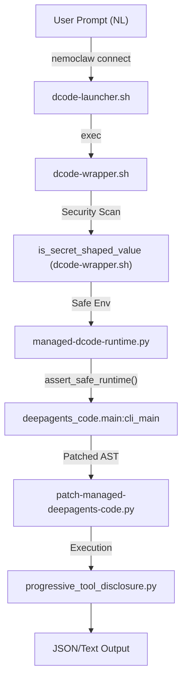
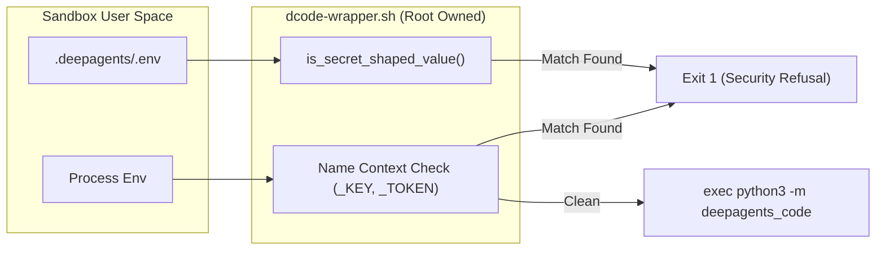

<!-- source: DeepWiki mcp.deepwiki.com · repo NVIDIA/NemoClaw · page 7.3 LangChain Deep Agents Code · fetched 2026-10-26 -->

# LangChain Deep Agents Code

Relevant source files

The following files were used as context for generating this wiki page:

- [agents/hermes/security-dependencies.patch](agents/hermes/security-dependencies.patch)
- [agents/langchain-deepagents-code/Dockerfile](agents/langchain-deepagents-code/Dockerfile)
- [agents/langchain-deepagents-code/Dockerfile.base](agents/langchain-deepagents-code/Dockerfile.base)
- [agents/langchain-deepagents-code/dcode-launcher.sh](agents/langchain-deepagents-code/dcode-launcher.sh)
- [agents/langchain-deepagents-code/dcode-wrapper.sh](agents/langchain-deepagents-code/dcode-wrapper.sh)
- [agents/langchain-deepagents-code/dependency-review.md](agents/langchain-deepagents-code/dependency-review.md)
- [agents/langchain-deepagents-code/generate-config.ts](agents/langchain-deepagents-code/generate-config.ts)
- [agents/langchain-deepagents-code/managed-dcode-runtime.py](agents/langchain-deepagents-code/managed-dcode-runtime.py)
- [agents/langchain-deepagents-code/patch-managed-deepagents-code.py](agents/langchain-deepagents-code/patch-managed-deepagents-code.py)
- [agents/langchain-deepagents-code/requirements.in](agents/langchain-deepagents-code/requirements.in)
- [agents/langchain-deepagents-code/requirements.lock](agents/langchain-deepagents-code/requirements.lock)
- [agents/langchain-deepagents-code/start.sh](agents/langchain-deepagents-code/start.sh)
- [docs/get-started/quickstart-langchain-deepagents-code.mdx](docs/get-started/quickstart-langchain-deepagents-code.mdx)
- [docs/inference/configure-model-capabilities.mdx](docs/inference/configure-model-capabilities.mdx)
- [docs/security/hermes-0.19.0-dependency-review.md](docs/security/hermes-0.19.0-dependency-review.md)
- [scripts/check-dcode-profile-import-gate.sh](scripts/check-dcode-profile-import-gate.sh)
- [scripts/upgrade-bundled-npm.mts](scripts/upgrade-bundled-npm.mts)
- [test/dcode-managed-exec.test.ts](test/dcode-managed-exec.test.ts)
- [test/dcode-non-interactive-json.test.ts](test/dcode-non-interactive-json.test.ts)
- [test/dcode-start-keepalive.test.ts](test/dcode-start-keepalive.test.ts)
- [test/dcode-wrapper-identity.test.ts](test/dcode-wrapper-identity.test.ts)
- [test/deepagents-code-tui-startup-check.test.ts](test/deepagents-code-tui-startup-check.test.ts)
- [test/e2e/e2e-cloud-experimental/checks/07-deepagents-code-headless-inference.sh](test/e2e/e2e-cloud-experimental/checks/07-deepagents-code-headless-inference.sh)
- [test/e2e/e2e-cloud-experimental/checks/10-deepagents-code-tui-startup.sh](test/e2e/e2e-cloud-experimental/checks/10-deepagents-code-tui-startup.sh)
- [test/helpers/langchain-deepagents-code-headless.ts](test/helpers/langchain-deepagents-code-headless.ts)
- [test/helpers/langchain-deepagents-code-patch-fixture.ts](test/helpers/langchain-deepagents-code-patch-fixture.ts)
- [test/hermes-dependency-review.test.ts](test/hermes-dependency-review.test.ts)
- [test/langchain-deepagents-code-config.test.ts](test/langchain-deepagents-code-config.test.ts)
- [test/langchain-deepagents-code-direct-module-patch.test.ts](test/langchain-deepagents-code-direct-module-patch.test.ts)
- [test/langchain-deepagents-code-headless-runtime.test.ts](test/langchain-deepagents-code-headless-runtime.test.ts)
- [test/langchain-deepagents-code-image.test.ts](test/langchain-deepagents-code-image.test.ts)
- [test/langchain-deepagents-code-progressive-tool-disclosure.test.ts](test/langchain-deepagents-code-progressive-tool-disclosure.test.ts)
- [test/langchain-deepagents-code-proxy-launcher.test.ts](test/langchain-deepagents-code-proxy-launcher.test.ts)
- [test/patch-bundled-npm-tar.test.ts](test/patch-bundled-npm-tar.test.ts)
- [test/support/dcode-start-script-fixture.ts](test/support/dcode-start-script-fixture.ts)
- [test/upgrade-bundled-npm.test.ts](test/upgrade-bundled-npm.test.ts)

The LangChain Deep Agents Code (`dcode`) runtime is a specialized NemoClaw agent environment designed for secure, sandboxed execution of coding tasks. It integrates the `deepagents-code` package within a hardened container posture, utilizing build-time AST patching, strict proxy normalization, and headless execution modes to ensure that agent activities remain within defined security boundaries.

## Implementation Overview

The runtime is built upon a two-stage Docker architecture (`Dockerfile.base` and `Dockerfile`) that separates expensive dependency installations from agent-specific logic and security hardening [agents/langchain-deepagents-code/Dockerfile.base:6-9](). The environment is pinned to `deepagents-code` version `0.1.34` [agents/langchain-deepagents-code/patch-managed-deepagents-code.py:29-29]().

### Data Flow: Natural Language to Code Entity Space

The following diagram illustrates how a user's natural language request is transformed into executed code within the sandboxed `dcode` environment, highlighting the code entities responsible for each stage.

**Sources:** [agents/langchain-deepagents-code/dcode-launcher.sh:1-20](), [agents/langchain-deepagents-code/dcode-wrapper.sh:92-150](), [agents/langchain-deepagents-code/managed-dcode-runtime.py:186-200](), [agents/langchain-deepagents-code/patch-managed-deepagents-code.py:71-75]().

## Key Components and Functions

### 1. Build-Time AST Patching
NemoClaw applies Abstract Syntax Tree (AST) patches to the upstream `deepagents-code` package during the image build process. This enforces a "managed posture" by disabling unsafe features that could bypass sandbox policies.

*   **File:** `patch-managed-deepagents-code.py`
*   **Mechanism:** Injects `assert_safe_runtime()` calls and environment overrides directly into the entry points of the Python package [agents/langchain-deepagents-code/patch-managed-deepagents-code.py:48-75]().
*   **Hardening:** Disables MCP (Model Context Protocol) commands, update/install flows, and first-run model selection modals [agents/langchain-deepagents-code/patch-managed-deepagents-code.py:107-120]().

### 2. Managed Posture and Proxy Normalization
The runtime enforces a strict network posture by normalizing proxy settings and unsetting potentially dangerous environment variables before the agent starts.

*   **Proxy Host/Port:** Read from root-owned files `/usr/local/share/nemoclaw/dcode-proxy-host` and `port` [agents/langchain-deepagents-code/start.sh:72-73]().
*   **Inference Routing:** Redirects `OPENAI_BASE_URL` to `https://inference.local/v1` to ensure all LLM traffic passes through the NemoClaw managed proxy [agents/langchain-deepagents-code/start.sh:32-32]().
*   **Environment Scrubbing:** Unsets `ALL_PROXY`, `OPENAI_PROXY`, and other variables that might carry host credentials [agents/langchain-deepagents-code/dcode-wrapper.sh:14-18](), [agents/langchain-deepagents-code/dcode-wrapper.sh:153-155]().

### 3. Secret Boundary Enforcement
A Bash-based secret guard in the wrapper script scans the environment and `.env` files for patterns matching known credential shapes (e.g., `nvapi-`, `sk-`, `ghp_`) before allowing execution [agents/langchain-deepagents-code/dcode-wrapper.sh:97-145]().

**Sources:** [agents/langchain-deepagents-code/dcode-wrapper.sh:110-145](), [test/e2e/e2e-cloud-experimental/checks/07-deepagents-code-headless-inference.sh:26-30]().

## Headless Execution and JSON Output

The `dcode` runtime supports a headless mode for non-interactive automation, typically invoked via `dcode -n "<prompt>" --json`.

*   **JSON Envelope:** When `--json` is passed, the runtime wraps the agent's output in a structured JSON envelope, including `output`, `status`, and `turns` metadata [agents/langchain-deepagents-code/patch-managed-deepagents-code.py:40-47]().
*   **Timeout Handling:** Headless sessions use a configurable `timeout_seconds` parameter, which is specifically handled in the patched `cli_main` to prevent TUI-style blocking [agents/langchain-deepagents-code/patch-managed-deepagents-code.py:44-47]().

## Runtime Lifecycle and Entrypoints

| Component | Path | Role |
| :--- | :--- | :--- |
| **Entrypoint** | `/usr/local/bin/nemoclaw-start` | Initializes resource limits (RLIMITs) and sets up the base environment [agents/langchain-deepagents-code/start.sh:1-50](). |
| **Launcher** | `/usr/local/lib/nemoclaw/dcode-launcher.sh` | The primary user-facing binary (aliased to `dcode`) [agents/langchain-deepagents-code/Dockerfile:69-70](). |
| **Wrapper** | `/usr/local/lib/nemoclaw/dcode-wrapper.sh` | Performs the security scan and proxy normalization [agents/langchain-deepagents-code/dcode-wrapper.sh:5-10](). |
| **Supervisor**| `/usr/local/lib/nemoclaw/dcode-session-supervisor.py` | Manages long-running sessions and cleanup [agents/langchain-deepagents-code/Dockerfile:71-71](). |

### Resource Limits (RLIMITs)
The runtime enforces strict resource constraints to prevent denial-of-service within the sandbox:
*   `nproc`: 512
*   `nofile`: 65536
These are verified by `verify_resource_limits_exact` during startup [agents/langchain-deepagents-code/start.sh:34-55](), [test/e2e/e2e-cloud-experimental/checks/07-deepagents-code-headless-inference.sh:15-16]().

## Observability
Deep Agents Code includes a managed observability bridge (`nemoclaw_observability.py`) that supports OTLP tracing.
*   **Egress Control:** Only the host `host.openshell.internal` is permitted for OTLP traffic [agents/langchain-deepagents-code/managed-dcode-runtime.py:84-84]().
*   **Security:** The runtime unsets `OTEL_EXPORTER_OTLP_HEADERS` to prevent credential leakage via trace headers [agents/langchain-deepagents-code/managed-dcode-runtime.py:66-68]().

**Sources:**
*   [agents/langchain-deepagents-code/Dockerfile:1-96]()
*   [agents/langchain-deepagents-code/start.sh:1-172]()
*   [agents/langchain-deepagents-code/dcode-wrapper.sh:1-150]()
*   [agents/langchain-deepagents-code/patch-managed-deepagents-code.py:1-137]()
*   [agents/langchain-deepagents-code/managed-dcode-runtime.py:1-185]()
*   [test/e2e/e2e-cloud-experimental/checks/07-deepagents-code-headless-inference.sh:1-80]()

---

