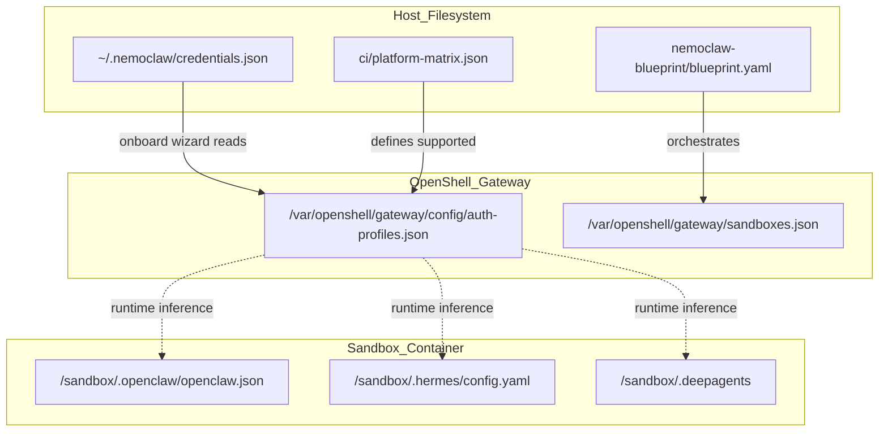
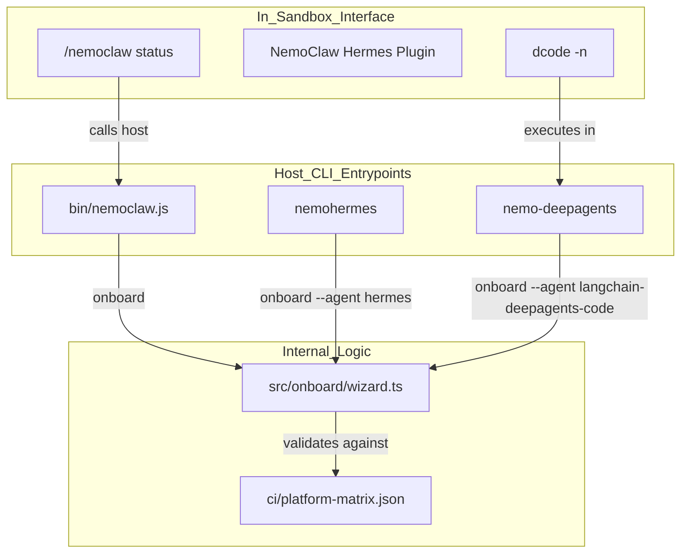

<!-- source: DeepWiki mcp.deepwiki.com · repo NVIDIA/NemoClaw · page 8 Reference · fetched 2026-10-26 -->

# Reference

Relevant source files

The following files were used as context for generating this wiki page:

- [.gitignore](.gitignore)
- [ci/platform-matrix.json](ci/platform-matrix.json)
- [docs/DORI_SETUP.md](docs/DORI_SETUP.md)
- [docs/about/ecosystem-deepagents.mdx](docs/about/ecosystem-deepagents.mdx)
- [docs/about/ecosystem-hermes.mdx](docs/about/ecosystem-hermes.mdx)
- [docs/about/ecosystem.mdx](docs/about/ecosystem.mdx)
- [docs/about/overview.mdx](docs/about/overview.mdx)
- [docs/changelog/2026-07-30.mdx](docs/changelog/2026-07-30.mdx)
- [docs/configure-agents/configure-memory-search.mdx](docs/configure-agents/configure-memory-search.mdx)
- [docs/get-started/dgx-station-preparation.mdx](docs/get-started/dgx-station-preparation.mdx)
- [docs/get-started/prerequisites.mdx](docs/get-started/prerequisites.mdx)
- [docs/get-started/quickstart-hermes.mdx](docs/get-started/quickstart-hermes.mdx)
- [docs/get-started/quickstart.mdx](docs/get-started/quickstart.mdx)
- [docs/index.mdx](docs/index.mdx)
- [docs/index.yml](docs/index.yml)
- [docs/inference/set-up-vllm-on-two-dgx-stations.mdx](docs/inference/set-up-vllm-on-two-dgx-stations.mdx)
- [docs/manage-sandboxes/run-deep-agents-code.mdx](docs/manage-sandboxes/run-deep-agents-code.mdx)
- [docs/reference/commands.mdx](docs/reference/commands.mdx)
- [docs/reference/configure-runtime-identity.mdx](docs/reference/configure-runtime-identity.mdx)
- [docs/reference/platform-support.mdx](docs/reference/platform-support.mdx)
- [docs/reference/troubleshooting.mdx](docs/reference/troubleshooting.mdx)
- [docs/resources/engineer-agentic-documentation.mdx](docs/resources/engineer-agentic-documentation.mdx)
- [scripts/check-docs-published-routes.mts](scripts/check-docs-published-routes.mts)
- [test/check-docs-published-routes.test.ts](test/check-docs-published-routes.test.ts)
- [test/station-doc-ownership.test.ts](test/station-doc-ownership.test.ts)

This section provides detailed technical reference material for NemoClaw configurations, files, environment variables, and troubleshooting guidance. Use these pages to look up specific configuration syntax, understand file formats, and resolve common issues.

For step-by-step setup instructions, see [Getting Started](#2). For conceptual explanations of how the system works, see [Core Concepts](#3).

## Reference Material Organization

The reference section covers five areas:

| Topic | Page | Content |
|-------|------|---------|
| **Inference Profiles** | [Inference Profiles](#8.1) | Complete reference for NVIDIA Cloud, NIM, vLLM, and Ollama provider configurations. Covers `ci/platform-matrix.json` [ci/platform-matrix.json:1-100](). |
| **Network Policy** | [Network Policy Reference](#8.2) | Detailed network policy syntax, endpoint groups, and binary restrictions. Covers `schemas/sandbox-policy.schema.json`. |
| **Configuration Files** | [Configuration Files](#8.3) | Format and structure of `openclaw.json`, `auth-profiles.json`, `blueprint.yaml`, and `sandboxes.json`. |
| **Environment Variables** | [Environment Variables](#8.4) | All environment variables recognized by NemoClaw, including `NVIDIA_API_KEY` and `NEMOCLAW_AGENT` [docs/reference/commands.mdx:43-65](). |
| **Troubleshooting** | [Troubleshooting](#8.5) | Common issues and solutions for DNS, sandbox startup, and Node.js version requirements [docs/reference/troubleshooting.mdx:1-160](). |

---

## Configuration Files Overview

NemoClaw uses multiple configuration files at different layers of the stack. The table below maps each file to its purpose and location.

| File Path | Scope | Purpose | Format |
|-----------|-------|---------|--------|
| `~/.nemoclaw/credentials.json` | Host | Stores API keys for NVIDIA Cloud, NIM, and third-party providers. | JSON |
| `nemoclaw-blueprint/blueprint.yaml` | Host | Blueprint orchestration definitions: versions, profiles, and pinned image digests. | YAML |
| `/sandbox/.openclaw/openclaw.json` | Sandbox | OpenClaw agent configuration, including wizard state and tool settings [docs/reference/commands.mdx:45-45](). | JSON |
| `/sandbox/.hermes/config.yaml` | Sandbox | Hermes agent configuration and provider updates [docs/reference/commands.mdx:53-53](). | YAML |
| `/sandbox/.deepagents` | Sandbox | Managed configuration for LangChain Deep Agents Code [docs/reference/commands.mdx:66-66](). | Directory |
| `/var/openshell/gateway/config/auth-profiles.json` | Gateway | OpenShell inference provider credentials and authentication methods. | JSON |
| `/var/openshell/gateway/sandboxes.json` | Gateway | Registry of active sandboxes and their runtime configurations. | JSON |

**Diagram: Configuration File Hierarchy and Loading**

**Sources:**
- [docs/reference/commands.mdx:40-73]()
- [ci/platform-matrix.json:1-100]()
- [docs/get-started/quickstart.mdx:101-128]()

---

## Key Environment Variables

NemoClaw and OpenShell recognize the following environment variables. These are typically set during `$$nemoclaw onboard` or during installation.

| Variable | Required | Used By | Purpose |
|----------|----------|---------|---------|
| `NVIDIA_API_KEY` | Yes (default) | `nvidia` provider | Authenticates to NVIDIA Cloud API [docs/get-started/quickstart.mdx:110-110](). |
| `NEMOCLAW_AGENT` | Optional | `onboard` | Selects the agent variant (`openclaw`, `hermes`, `langchain-deepagents-code`) [docs/reference/commands.mdx:43-65](). |
| `NEMOCLAW_SANDBOX_NAME` | Optional | `onboard` | Sets the target sandbox name for lifecycle commands [docs/get-started/quickstart.mdx:41-41](). |
| `NEMOCLAW_NON_INTERACTIVE` | Optional | `onboard` | Disables prompts for CI/CD or automated setups [docs/get-started/quickstart.mdx:106-106](). |
| `CHAT_UI_URL` | Optional | `hermes` | Configures the externally reachable dashboard origin for Hermes [docs/get-started/quickstart-hermes.mdx:114-114](). |
| `NEMOCLAW_EXPERIMENTAL` | Optional | Host CLI | Enables experimental features like local vLLM on consumer GPUs [ci/platform-matrix.json:21-21](). |

For a detailed environment variable reference, see [Environment Variables](#8.4).

**Sources:**
- [docs/reference/commands.mdx:40-73]()
- [docs/get-started/quickstart.mdx:85-128]()
- [docs/get-started/quickstart-hermes.mdx:94-136]()
- [ci/platform-matrix.json:18-28]()

---

## Command Line Interface Reference

NemoClaw exposes primary host command namespaces tailored to the selected agent: `$$nemoclaw`, `nemohermes`, and `nemo-deepagents`.

**Diagram: CLI Command Structure and Code Association**

For complete command reference with all flags and options, see [Command-Line Interface](#4).

**Sources:**
- [docs/reference/commands.mdx:12-115]()
- [docs/reference/platform-support.mdx:63-69]()

---

## Inference Provider Configuration

NemoClaw configures OpenShell inference providers through the onboarding wizard. The `inference.local` address is a managed route intercepted by the gateway.

- **NVIDIA Endpoints**: Hosted models on `integrate.api.nvidia.com` [ci/platform-matrix.json:83-87]().
- **OpenRouter**: First-class route for all agents with default attribution headers [ci/platform-matrix.json:89-92]().
- **Local vLLM**: Automatically selected on DGX Spark for local inference [docs/get-started/quickstart.mdx:102-102]().
- **Ollama**: Supported for local development via the onboard wizard [docs/get-started/quickstart.mdx:132-132]().

See [Inference Profiles](#8.1) for detailed provider configuration.

**Sources:**
- [ci/platform-matrix.json:81-93]()
- [docs/get-started/quickstart.mdx:131-139]()

---

## Network Policy Enforcement

Network policies are defined during onboarding and enforced at the gateway. The system supports multiple policy tiers and presets.

- **Policy Tiers**: Suggested tiers (restricted, balanced, open) are presented during onboarding [docs/get-started/quickstart.mdx:53-53]().
- **Shields**: Host-side commands `$$nemoclaw <name> shields status|up|down` allow inspection and modification of the posture [docs/reference/commands.mdx:89-89]().
- **Agent Restrictions**: LangChain Deep Agents Code rejects unmanaged sandbox/MCP overrides to maintain security [docs/reference/platform-support.mdx:68-68]().

For detailed syntax and preset examples, see [Network Policy Reference](#8.2).

**Sources:**
- [docs/get-started/quickstart.mdx:53-53]()
- [docs/reference/commands.mdx:89-89]()
- [docs/reference/platform-support.mdx:63-69]()

---

## Troubleshooting

Common issues often relate to environment prerequisites or container runtime connectivity.

| Issue | Resolution |
|-------|------------|
| **Node.js version** | Ensure Node.js 22.19 or later is installed [docs/reference/troubleshooting.mdx:46-64](). |
| **Docker Connectivity** | Verify daemon reachability with `$$nemoclaw host probe` [docs/reference/troubleshooting.mdx:73-84](). |
| **Permissions** | On Linux, ensure the user is in the `docker` group and run `newgrp docker` [docs/reference/troubleshooting.mdx:94-112](). |
| **OOM Errors** | Configure at least 8 GB of swap for machines with low RAM to prevent image push failures [docs/reference/troubleshooting.mdx:65-72](). |
| **macOS Prerequisites** | Install Xcode Command Line Tools before running the installer [docs/reference/troubleshooting.mdx:157-166](). |

For a complete guide, see [Troubleshooting](#8.5).

**Sources:**
- [docs/reference/troubleshooting.mdx:26-166]()
- [docs/get-started/prerequisites.mdx:14-93]()

---

