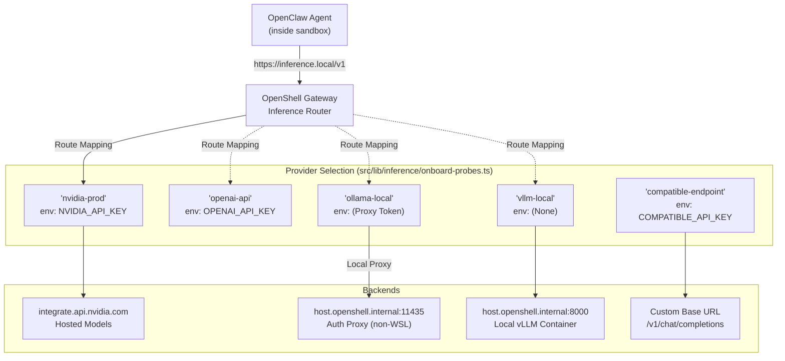
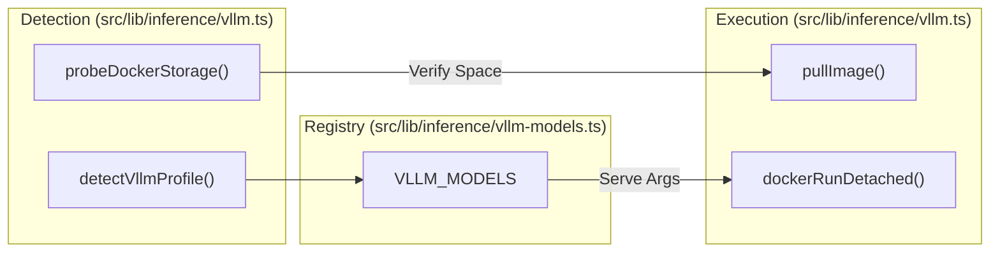

<!-- source: DeepWiki mcp.deepwiki.com · repo NVIDIA/NemoClaw · page 8.1 Inference Profiles · fetched 2026-10-26 -->

# Inference Profiles

Relevant source files

The following files were used as context for generating this wiki page:

- [ci/platform-matrix.json](ci/platform-matrix.json)
- [docs/about/ecosystem-deepagents.mdx](docs/about/ecosystem-deepagents.mdx)
- [docs/about/ecosystem-hermes.mdx](docs/about/ecosystem-hermes.mdx)
- [docs/about/ecosystem.mdx](docs/about/ecosystem.mdx)
- [docs/about/overview.mdx](docs/about/overview.mdx)
- [docs/get-started/dgx-station-preparation.mdx](docs/get-started/dgx-station-preparation.mdx)
- [docs/get-started/prerequisites.mdx](docs/get-started/prerequisites.mdx)
- [docs/get-started/quickstart-hermes.mdx](docs/get-started/quickstart-hermes.mdx)
- [docs/get-started/quickstart.mdx](docs/get-started/quickstart.mdx)
- [docs/index.mdx](docs/index.mdx)
- [docs/inference/set-up-sub-agent.mdx](docs/inference/set-up-sub-agent.mdx)
- [docs/inference/set-up-vllm.mdx](docs/inference/set-up-vllm.mdx)
- [docs/monitoring/monitor-sandbox-activity.mdx](docs/monitoring/monitor-sandbox-activity.mdx)
- [docs/reference/platform-support.mdx](docs/reference/platform-support.mdx)
- [nemoclaw-blueprint/scripts/ciao-network-guard.js](nemoclaw-blueprint/scripts/ciao-network-guard.js)
- [nemoclaw-blueprint/scripts/http-proxy-fix.js](nemoclaw-blueprint/scripts/http-proxy-fix.js)
- [nemoclaw-blueprint/scripts/nemotron-inference-fix.js](nemoclaw-blueprint/scripts/nemotron-inference-fix.js)
- [nemoclaw-blueprint/scripts/sandbox-safety-net.js](nemoclaw-blueprint/scripts/sandbox-safety-net.js)
- [src/lib/actions/inference-set-gateway-restart.ts](src/lib/actions/inference-set-gateway-restart.ts)
- [src/lib/actions/inference-set-hermes-run.test.ts](src/lib/actions/inference-set-hermes-run.test.ts)
- [src/lib/actions/inference-set-openclaw-gateway-restart.test.ts](src/lib/actions/inference-set-openclaw-gateway-restart.test.ts)
- [src/lib/actions/inference-set-openclaw-run.test.ts](src/lib/actions/inference-set-openclaw-run.test.ts)
- [src/lib/actions/inference-set-patch-openclaw.test.ts](src/lib/actions/inference-set-patch-openclaw.test.ts)
- [src/lib/inference/config.test.ts](src/lib/inference/config.test.ts)
- [src/lib/inference/config.ts](src/lib/inference/config.ts)
- [src/lib/inference/model-prompts.test.ts](src/lib/inference/model-prompts.test.ts)
- [src/lib/inference/model-prompts.ts](src/lib/inference/model-prompts.ts)
- [src/lib/inference/nvidia-featured-models.test.ts](src/lib/inference/nvidia-featured-models.test.ts)
- [src/lib/inference/nvidia-featured-models.ts](src/lib/inference/nvidia-featured-models.ts)
- [src/lib/inference/vllm-models.test.ts](src/lib/inference/vllm-models.test.ts)
- [src/lib/inference/vllm-models.ts](src/lib/inference/vllm-models.ts)
- [src/lib/inference/vllm-storage.test.ts](src/lib/inference/vllm-storage.test.ts)
- [src/lib/inference/vllm-storage.ts](src/lib/inference/vllm-storage.ts)
- [src/lib/inference/vllm.test.ts](src/lib/inference/vllm.test.ts)
- [src/lib/inference/vllm.ts](src/lib/inference/vllm.ts)
- [src/lib/onboard/nvidia-featured-model-selection.test.ts](src/lib/onboard/nvidia-featured-model-selection.test.ts)
- [src/lib/onboard/nvidia-featured-model-selection.ts](src/lib/onboard/nvidia-featured-model-selection.ts)
- [test/detect-vllm-profile.test.ts](test/detect-vllm-profile.test.ts)
- [test/e2e-runtime/4851-ultra-toolless-validation.md](test/e2e-runtime/4851-ultra-toolless-validation.md)
- [test/http-proxy-fix-sync.test.ts](test/http-proxy-fix-sync.test.ts)
- [test/inference-options-docs.test.ts](test/inference-options-docs.test.ts)
- [test/nemotron-inference-fix.test.ts](test/nemotron-inference-fix.test.ts)
- [test/station-doc-ownership.test.ts](test/station-doc-ownership.test.ts)

Inference profiles define how model inference requests from AI agents (OpenClaw, Hermes, or LangChain Deep Agents Code) are routed through the OpenShell gateway. Each profile specifies a provider type, endpoint URL, credential environment variable, and default model. Profiles are hot-swappable at runtime without requiring a sandbox restart.

NemoClaw keeps provider credentials on the host; the sandbox does not receive raw API keys. Instead, it communicates with a virtualized `inference.local` endpoint managed by the gateway. The source of truth for supported platforms and providers is maintained in `ci/platform-matrix.json` [ci/platform-matrix.json:1-5]().

---

## Profile Architecture

NemoClaw implements inference routing through the OpenShell gateway, which acts as a proxy between the sandboxed agent and external model APIs. The agent communicates with `https://inference.local/v1`, and OpenShell intercepts this traffic on the host to forward it to the selected provider.

### Inference Data Flow
The following diagram bridges the Natural Language "Inference Routing" to the "Code Entity Space" used in the onboarding and routing logic.

**Sources**: [ci/platform-matrix.json:81-110](), [docs/inference/set-up-vllm.mdx:20-25](), [src/lib/inference/vllm.ts:60-64]()

---

## Supported Providers and Profiles

NemoClaw supports several provider paths available through the `nemoclaw onboard` flow. The availability of these providers depends on the host platform as defined in the platform matrix [ci/platform-matrix.json:27-79]().

| Profile / Provider | Endpoint Type | Credential Env | Default Models / Notes |
|--------------------|---------------|----------------|------------------------|
| **NVIDIA Endpoints** | `nvidia-prod` | `NVIDIA_API_KEY` | Hosted models on `integrate.api.nvidia.com` [ci/platform-matrix.json:83-87](). |
| **OpenRouter** | `openai` | `OPENROUTER_API_KEY` | First-class route for all agents; sends attribution headers [ci/platform-matrix.json:89-93](). |
| **OpenAI** | `openai-api` | `OPENAI_API_KEY` | Standard OpenAI endpoint [ci/platform-matrix.json:95-98](). |
| **Anthropic** | `anthropic` | `ANTHROPIC_API_KEY` | Native Anthropic API support [ci/platform-matrix.json:100-103](). |
| **Local Ollama** | `ollama-local` | `(Managed)` | Managed local server; requires `zstd` for extraction [docs/get-started/prerequisites.mdx:51-53](). |
| **Local vLLM** | `vllm-local` | `(None)` | Managed container on NVIDIA GPU hosts [docs/inference/set-up-vllm.mdx:13-15](). |

**Sources**: [ci/platform-matrix.json:81-110](), [docs/get-started/prerequisites.mdx:51-53](), [docs/inference/set-up-vllm.mdx:13-15]()

---

## Managed vLLM Implementation

NemoClaw manages the lifecycle of vLLM containers based on the detected hardware platform. It supports `DGX Spark`, `DGX Station`, and generic `Linux + NVIDIA GPU` profiles [src/lib/inference/vllm.ts:89-123]().

### vLLM Platform Profiles
Profiles pin specific image digests and resource flags to ensure stability.

| Platform | Image Reference (Digest Pinned) | Default Model |
|----------|---------------------------------|---------------|
| **DGX Spark** | `nvcr.io/nvidia/vllm@sha256:9204...` | `qwen3.6-27b` |
| **DGX Station**| `vllm/vllm-openai@sha256:0fec...` | `nemotron-3-ultra-550b-a55b` |
| **Linux (AMD64)**| `nvcr.io/nvidia/vllm@sha256:7be6...` | `nemotron-3-nano-4b` |
| **Linux (ARM64)**| `nvcr.io/nvidia/vllm@sha256:4479...` | `nemotron-3-nano-4b` |

**Sources**: [src/lib/inference/vllm.ts:138-159](), [src/lib/inference/vllm.ts:101-105](), [docs/inference/set-up-vllm.mdx:91-97]()

### Model Registry and Serving Flags
The `VLLM_MODELS` registry defines the exact `vllm serve` arguments for each model to ensure tool-calling and reasoning parsers are correctly configured [src/lib/inference/vllm-models.ts:4-28]().

- **Tool Call Parsers**: Models like `Nemotron-3-Nano` require `--enable-auto-tool-choice` and `--tool-call-parser qwen3_coder` to function with agents [src/lib/inference/vllm-models.ts:158-166]().
- **Reasoning Parsers**: Reasoning models use specific parsers (e.g., `--reasoning-parser nemotron_v3`) to handle `<think>` tags correctly [src/lib/inference/vllm-models.ts:168-175]().
- **Gated Models**: Models like `DeepSeek-R1 Distill Llama 70B` require a `HF_TOKEN` and license acceptance [src/lib/inference/vllm-models.ts:130-148]().

**Sources**: [src/lib/inference/vllm-models.ts:105-180](), [docs/inference/set-up-vllm.mdx:61-77]()

---

## Hardware-Aware Logic

NemoClaw performs automated hardware detection to select compatible inference configurations.

### Storage and Memory Preflight
- **Storage**: NemoClaw calculates the combined size of the compressed image and the unpacked Hugging Face model weights before starting a download [src/lib/inference/vllm.ts:95-100]().
- **GPU Indices**: On DGX Station, NemoClaw can target specific GPUs (e.g., GB300) for inference while leaving others for display or different tasks [src/lib/inference/vllm.ts:110-113]().
- **Shared Memory**: Large models like Nemotron Ultra require increased shared memory (`--shm-size 16g`) and memory locks [src/lib/inference/vllm-models.test.ts:93]().

**Sources**: [src/lib/inference/vllm.ts:74-84](), [src/lib/inference/vllm.ts:110-113](), [src/lib/inference/vllm-models.test.ts:91-94]()

---

## Model-Specific Fixes (Preloads)

For certain cloud endpoints (like NVIDIA NIM), NemoClaw injects model-specific parameters at the HTTP level using Node.js preloads.

- **NEMOTRON_FIX**: Injects `chat_template_kwargs` such as `force_nonempty_content: true` for Nemotron models to prevent empty turn errors [test/nemotron-inference-fix.test.ts:142-145]().
- **Thinking Control**: Automatically sets `thinking: false` for models where reasoning traces would interfere with agent parsing [test/nemotron-inference-fix.test.ts:149-153]().
- **Implementation**: The `nemoclaw-start.sh` script writes these preloads to `/tmp` inside the sandbox and registers them in `NODE_OPTIONS` via `--require` [test/nemotron-inference-fix.test.ts:40-52]().

**Sources**: [test/nemotron-inference-fix.test.ts:37-52](), [test/nemotron-inference-fix.test.ts:141-160]()

---

