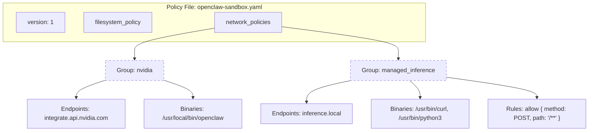
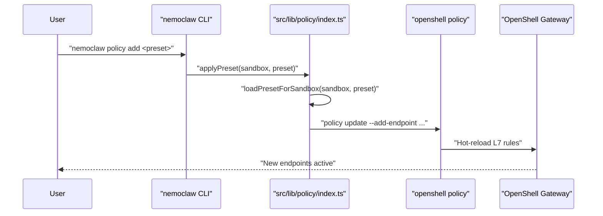

<!-- source: DeepWiki mcp.deepwiki.com · repo NVIDIA/NemoClaw · page 8.2 Network Policy Reference · fetched 2026-10-26 -->

# Network Policy Reference

<details>
<summary>Relevant source files</summary>

The following files were used as context for generating this wiki page:

- [agents/hermes/policy-additions.yaml](agents/hermes/policy-additions.yaml)
- [agents/hermes/policy-permissive.yaml](agents/hermes/policy-permissive.yaml)
- [agents/openclaw/policy-permissive.yaml](agents/openclaw/policy-permissive.yaml)
- [docs/deployment/sandbox-hardening.mdx](docs/deployment/sandbox-hardening.mdx)
- [docs/network-policy/apply-policy-presets.mdx](docs/network-policy/apply-policy-presets.mdx)
- [docs/network-policy/approve-network-requests.mdx](docs/network-policy/approve-network-requests.mdx)
- [docs/network-policy/change-baseline-network-policy.mdx](docs/network-policy/change-baseline-network-policy.mdx)
- [docs/network-policy/create-custom-policy-presets.mdx](docs/network-policy/create-custom-policy-presets.mdx)
- [docs/network-policy/customize-network-policy.mdx](docs/network-policy/customize-network-policy.mdx)
- [docs/network-policy/integration-policy-examples.mdx](docs/network-policy/integration-policy-examples.mdx)
- [docs/reference/cli-selection-guide.mdx](docs/reference/cli-selection-guide.mdx)
- [docs/reference/network-policies.mdx](docs/reference/network-policies.mdx)
- [docs/security/best-practices.mdx](docs/security/best-practices.mdx)
- [nemoclaw-blueprint/policies/openclaw-sandbox-permissive.yaml](nemoclaw-blueprint/policies/openclaw-sandbox-permissive.yaml)
- [nemoclaw-blueprint/policies/openclaw-sandbox.yaml](nemoclaw-blueprint/policies/openclaw-sandbox.yaml)
- [nemoclaw-blueprint/policies/presets/github.yaml](nemoclaw-blueprint/policies/presets/github.yaml)
- [nemoclaw-blueprint/policies/presets/huggingface.yaml](nemoclaw-blueprint/policies/presets/huggingface.yaml)
- [nemoclaw-blueprint/policies/presets/jira.yaml](nemoclaw-blueprint/policies/presets/jira.yaml)
- [nemoclaw-blueprint/policies/presets/npm.yaml](nemoclaw-blueprint/policies/presets/npm.yaml)
- [nemoclaw-blueprint/policies/presets/openclaw-pricing.yaml](nemoclaw-blueprint/policies/presets/openclaw-pricing.yaml)
- [nemoclaw-blueprint/policies/presets/outlook.yaml](nemoclaw-blueprint/policies/presets/outlook.yaml)
- [nemoclaw-blueprint/policies/presets/public-reference.yaml](nemoclaw-blueprint/policies/presets/public-reference.yaml)
- [nemoclaw-blueprint/policies/presets/pypi.yaml](nemoclaw-blueprint/policies/presets/pypi.yaml)
- [nemoclaw-blueprint/policies/presets/weather.yaml](nemoclaw-blueprint/policies/presets/weather.yaml)
- [nemoclaw-blueprint/policies/tiers.yaml](nemoclaw-blueprint/policies/tiers.yaml)
- [scripts/lib/sandbox-init.sh](scripts/lib/sandbox-init.sh)
- [scripts/lib/sandbox-rlimits.sh](scripts/lib/sandbox-rlimits.sh)
- [src/lib/actions/sandbox/policy-list-render.test.ts](src/lib/actions/sandbox/policy-list-render.test.ts)
- [src/lib/onboard/agent-policy-presets.ts](src/lib/onboard/agent-policy-presets.ts)
- [src/lib/onboard/hermes-managed-tools.ts](src/lib/onboard/hermes-managed-tools.ts)
- [src/lib/onboard/messaging-policy-presets.test.ts](src/lib/onboard/messaging-policy-presets.test.ts)
- [src/lib/onboard/messaging-policy-presets.ts](src/lib/onboard/messaging-policy-presets.ts)
- [src/lib/onboard/openclaw-otel-policy-presets.test.ts](src/lib/onboard/openclaw-otel-policy-presets.test.ts)
- [src/lib/onboard/policy-preset-persistence.test.ts](src/lib/onboard/policy-preset-persistence.test.ts)
- [src/lib/onboard/policy-preset-sync.ts](src/lib/onboard/policy-preset-sync.ts)
- [src/lib/onboard/policy-presets.ts](src/lib/onboard/policy-presets.ts)
- [src/lib/onboard/policy-resume-selection.ts](src/lib/onboard/policy-resume-selection.ts)
- [src/lib/onboard/policy-selection.ts](src/lib/onboard/policy-selection.ts)
- [test/deepagents-monitoring-published-routes.test.ts](test/deepagents-monitoring-published-routes.test.ts)
- [test/e2e-gateway-isolation.sh](test/e2e-gateway-isolation.sh)
- [test/e2e/live/brave-search.test.ts](test/e2e/live/brave-search.test.ts)
- [test/e2e/live/common-egress-agent.test.ts](test/e2e/live/common-egress-agent.test.ts)
- [test/e2e/live/cron-preflight-inference-local.test.ts](test/e2e/live/cron-preflight-inference-local.test.ts)
- [test/network-policies-published-routes.test.ts](test/network-policies-published-routes.test.ts)
- [test/onboard-policy-suggestions.test.ts](test/onboard-policy-suggestions.test.ts)
- [test/onboard-preset-diff.test.ts](test/onboard-preset-diff.test.ts)
- [test/policy-preset-sync.test.ts](test/policy-preset-sync.test.ts)
- [test/policy-roundtrip-docs.test.ts](test/policy-roundtrip-docs.test.ts)
- [test/policy-tiers-onboard.test.ts](test/policy-tiers-onboard.test.ts)
- [test/policy-tiers.test.ts](test/policy-tiers.test.ts)
- [test/rebuild-policy-presets.test.ts](test/rebuild-policy-presets.test.ts)
- [test/sandbox-init.test.ts](test/sandbox-init.test.ts)
- [test/sandbox-rlimit-hooks.test.ts](test/sandbox-rlimit-hooks.test.ts)
- [test/validate-blueprint.test.ts](test/validate-blueprint.test.ts)

</details>


This page provides detailed reference documentation for NemoClaw network policy syntax and configuration. Network policies control which external endpoints the sandboxed OpenClaw agent can access, using declarative YAML rules that specify allowed hosts, ports, protocols, and HTTP method constraints.

NemoClaw utilizes a "deny-by-default" security model [nemoclaw-blueprint/policies/openclaw-sandbox.yaml:5-5](). Core functionality is enabled via a baseline policy, while additional capabilities (e.g., Slack integration, npm access) are added via hot-reloadable policy presets [docs/network-policy/customize-network-policy.mdx:16-21]().

---

## Network Policy Architecture

Network policies are defined in YAML files following OpenShell's policy schema. The system distinguishes between static, creation-locked fields (filesystem, process) and dynamic, hot-reloadable fields (network, inference) [nemoclaw-blueprint/policies/openclaw-sandbox.yaml:6-14]().

### Top-Level Structure

```yaml
version: 1

filesystem_policy:
  # Creation-locked: defines sandbox R/W boundaries
  
landlock:
  # Linux Landlock LSM configuration (best_effort)
  
process:
  # Sandbox UID/GID mapping
  
network_policies:
  # Named endpoint groups (hot-reloadable)
```

The `network_policies` section contains named groups. Each group defines a set of allowed network destinations, the specific binaries permitted to access them, and granular HTTP rules.



**Sources:** [nemoclaw-blueprint/policies/openclaw-sandbox.yaml:16-105](), [test/validate-blueprint.test.ts:87-90]()

---

## Endpoint Group Schema

Each entry under `network_policies` defines a security boundary for a specific service or integration.

| Field | Type | Required | Description |
|-------|------|----------|-------------|
| `name` | string | Yes | Unique identifier for the group (e.g., `github`, `pypi`). |
| `endpoints` | array | Yes | List of allowed network destinations (Host/Port). |
| `binaries` | array | Yes | **Mandatory** list of executables allowed to use this group. |

### Binary Restriction (Security Requirement)
NemoClaw enforces strict binary-to-endpoint mapping. Every `network_policies` entry should include a `binaries` section to prevent arbitrary data exfiltration via common tools like `curl` or `wget` unless explicitly allowed [nemoclaw-blueprint/policies/openclaw-sandbox.yaml:104-109](). Validation tests ensure that every endpoint with rules has `protocol: rest` and `enforcement: enforce` [test/validate-blueprint.test.ts:70-79]().

Example from [nemoclaw-blueprint/policies/presets/telegram.yaml:9-22]():
```yaml
telegram_bot:
  name: telegram_bot
  endpoints:
    - host: api.telegram.org
      port: 443
      protocol: rest
      enforcement: enforce
      # ... rules ...
  binaries:
    - { path: /usr/local/bin/node } # Only Node.js can talk to Telegram
```

**Sources:** [test/validate-blueprint.test.ts:67-85](), [nemoclaw-blueprint/policies/presets/telegram.yaml:9-22]()

---

## Endpoint Configuration

### Protocol and TLS Handling

Endpoints support different levels of inspection and tunneling:

| Field | Value | Description |
|-------|-------|-------------|
| `protocol` | `rest` | Enables application-layer inspection (HTTP methods/paths). |
| `protocol` | `websocket` | Enables L7 WebSocket relay with text-frame inspection [nemoclaw-blueprint/policies/presets/discord.yaml:31-31](). |
| `enforcement` | `enforce` | Actively blocks traffic not matching rules. |
| `access` | `full` | **L4 Tunneling**. Bypasses L7 inspection. Used for specific package manager compatibility [nemoclaw-blueprint/policies/presets/npm.yaml:18-18](). |
| `tls` | `skip` | Skips TLS termination. Used with `access: full` for raw TLS passthrough, e.g., for WebSocket connections that perform their own TLS negotiation [nemoclaw-blueprint/policies/openclaw-sandbox.yaml:135-135](). |
| `allowed_ips` | array | List of IP addresses explicitly allowed for a given host, bypassing SSRF guard for private ranges [nemoclaw-blueprint/policies/openclaw-sandbox.yaml:138-139](). |
| `allow_encoded_slash` | boolean | Allows encoded slashes (`%2F`) in the path. Defaults to `false` for security [test/validate-blueprint.test.ts:166-172](). |

#### Advanced Relay Features
- **Credential Rewrite**: NemoClaw can rewrite credentials at the relay boundary for WebSockets or request bodies to protect sandbox secrets [nemoclaw-blueprint/policies/presets/discord.yaml:33-33]().
- **L4 Pass-through**: Used for registries (like npm) where Node's `undici` library issues `HTTP CONNECT` through proxies, which standard REST inspection might reject [nemoclaw-blueprint/policies/presets/npm.yaml:12-15]().

**Sources:** [nemoclaw-blueprint/policies/presets/discord.yaml:25-33](), [nemoclaw-blueprint/policies/presets/npm.yaml:9-19](), [nemoclaw-blueprint/policies/openclaw-sandbox.yaml:135-135](), [nemoclaw-blueprint/policies/openclaw-sandbox.yaml:138-139](), [test/validate-blueprint.test.ts:166-172]()

---

## HTTP Method and Path Rules

When using `protocol: rest`, granular rules restrict the agent's "verbs" and "scopes".

### Rule Syntax
Rules are defined inside the specific endpoint, restricting access to specific methods and path patterns [nemoclaw-blueprint/policies/openclaw-sandbox.yaml:69-74]().

```yaml
endpoints:
  - host: integrate.api.nvidia.com
    port: 443
    protocol: rest
    enforcement: enforce
    rules:
      - allow: { method: POST, path: "/v1/chat/completions" }
      - allow: { method: GET, path: "/v1/models" }
```

### Pattern Matching
- **Method**: Supports standard HTTP verbs (`GET`, `POST`, `PUT`, `PATCH`, `DELETE`). Wildcard methods (`*`) are strictly forbidden to prevent exfiltration [nemoclaw-blueprint/policies/presets/discord.yaml:23-24]().
- **Path**: Supports globbing. `/**` matches all subpaths. `/bot*/**` restricts the agent to Bot API endpoints specifically [nemoclaw-blueprint/policies/presets/telegram.yaml:17-19]().

**Sources:** [nemoclaw-blueprint/policies/openclaw-sandbox.yaml:69-84](), [nemoclaw-blueprint/policies/presets/telegram.yaml:17-19](), [nemoclaw-blueprint/policies/presets/discord.yaml:23-24]()

---

## Policy Tiers and Presets

NemoClaw provides pre-configured policy "bundles" and "tiers" to simplify onboarding [docs/reference/network-policies.mdx:60-71]().

### Policy Tiers
During `nemoclaw onboard`, users select a tier that applies a pre-defined set of presets [docs/reference/network-policies.mdx:65-69]():

| Tier | Presets included | Description |
|------|------------------|-------------|
| **Restricted** | No tier defaults | Starts from the baseline policy. Web search or messaging integrations selected earlier can still suggest their required presets; deselect them during policy review for baseline-only access. Restricted suppresses other agent-required additions; reapply them later with `policy add` only after reviewing the additional egress. |
| **Balanced** (default) | `npm`, `pypi`, `huggingface`, `brew`, selected `brave` or `tavily` web search preset | Full dev tooling and web search. |
| **Open** | `npm`, `pypi`, `slack`, `discord`, `telegram`, `jira`, `outlook` | Broad access including messaging and productivity. |

**Sources:** [docs/reference/network-policies.mdx:60-71](), [nemoclaw-blueprint/policies/tiers.yaml]()

### Available Presets
NemoClaw ships with maintained policy presets for common services in `nemoclaw-blueprint/policies/presets/` [docs/network-policy/integration-policy-examples.mdx:47-48]().

| Preset Name | Purpose | Key Endpoints |
|-------------|---------|---------------|
| `brave` | Brave Search API | `api.search.brave.com` |
| `brew` | Homebrew package manager | `formulae.brew.sh`, `ghcr.io` |
| `discord` | Discord Bot & Gateway access | `discord.com`, `gateway.discord.gg` [nemoclaw-blueprint/policies/presets/discord.yaml:12-29]() |
| `github` | GitHub API and raw content | `github.com`, `api.github.com`, `raw.githubusercontent.com` [nemoclaw-blueprint/policies/presets/github.yaml]() |
| `gmail` | Gmail IMAP/SMTP | `imap.gmail.com`, `smtp.gmail.com` |
| `huggingface` | Hugging Face Hub & Inference API | `huggingface.co`, `api-inference.huggingface.co` [nemoclaw-blueprint/policies/presets/huggingface.yaml]() |
| `jira` | Jira and Atlassian Cloud | `api.atlassian.com`, `*.atlassian.net` [nemoclaw-blueprint/policies/presets/jira.yaml]() |
| `local-inference` | Local Ollama/vLLM via host gateway | `127.0.0.1`, `localhost` (with `allowed_ips`) |
| `npm` | Node package registry | `registry.npmjs.org` [nemoclaw-blueprint/policies/presets/npm.yaml:16-16]() |
| `openclaw-pricing` | OpenClaw model pricing reference | `pricing.openclaw.ai` |
| `outlook` | Microsoft 365, Outlook, Graph API | `graph.microsoft.com`, `login.microsoftonline.com` [nemoclaw-blueprint/policies/presets/outlook.yaml]() |
| `public-reference` | General public APIs | `api.ipify.org`, `icanhazip.com` [nemoclaw-blueprint/policies/presets/public-reference.yaml]() |
| `pypi` | Python Package Index | `pypi.org`, `files.pythonhosted.org` [nemoclaw-blueprint/policies/presets/pypi.yaml:12-19]() |
| `slack` | Slack messaging | `slack.com`, `api.slack.com` |
| `tavily` | Tavily Search API | `api.tavily.com` |
| `telegram`| Telegram Bot API access | `api.telegram.org` [nemoclaw-blueprint/policies/presets/telegram.yaml:12-12]() |
| `weather` | Weather and geocoding APIs | `api.weather.gov`, `nominatim.openstreetmap.org` [nemoclaw-blueprint/policies/presets/weather.yaml]() |
| `wechat` | WeChat iLink Bot API (experimental) | `api.wechat.com` |
| `whatsapp` | WhatsApp Web messaging (experimental) | `web.whatsapp.com` |

**Sources:** [docs/reference/network-policies.mdx:60-71](), [nemoclaw-blueprint/policies/presets/discord.yaml:4-31](), [nemoclaw-blueprint/policies/presets/pypi.yaml:4-19](), [docs/network-policy/integration-policy-examples.mdx:47-71]()

---

## Policy Application Workflow

NemoClaw manages the lifecycle of these policies by orchestrating the underlying `openshell` CLI.



### Management Flows
- **Static Changes**: Edit `nemoclaw-blueprint/policies/openclaw-sandbox.yaml` and re-run `nemoclaw onboard` to recreate the sandbox with the new baseline [docs/reference/network-policies.mdx:118-123]().
- **Dynamic (Non-destructive)**: Use `nemoclaw <name> policy add` which merges new rules into the live policy [docs/network-policy/integration-policy-examples.mdx:76-80]().
- **Operator Approval**: When an agent hits an unlisted host, OpenShell blocks the request. The operator can approve it via `openshell term`, which adds the endpoint to the running session [docs/reference/network-policies.mdx:99-105]().
- **Policy Exclusion**: An operator can persistently exclude a specific baseline entry using `policy exclude` to accept reduced functionality. This is a registry-backed way to replay an exact-key removal during rebuild [docs/reference/network-policies.mdx:131-133]().
- **Custom Presets**: Users can create their own policy preset YAML files and apply them using `nemoclaw <sandbox> policy add --from-file` or `--from-dir` [docs/network-policy/customize-network-policy.mdx:81-86]().

**Sources:** [src/lib/policy/index.ts:178-184](), [docs/reference/network-policies.mdx:99-105](), [docs/network-policy/integration-policy-examples.mdx:76-80](), [docs/reference/network-policies.mdx:131-133](), [docs/network-policy/customize-network-policy.mdx:81-86]()

---

## Common Configurations

### 1. Restricted Read-Only Access
Used for documentation or static assets.
```yaml
openclaw_docs:
  name: openclaw_docs
  endpoints:
    - host: docs.openclaw.ai
      port: 443
      protocol: rest
      enforcement: enforce
      rules:
        - allow: { method: GET, path: "/**" } # POST/PUT/DELETE blocked
  binaries:
    - { path: /usr/local/bin/openclaw }
```

### 2. Managed Inference Route
Every sandbox includes the `managed_inference` block, allowing traffic to `inference.local`. The OpenShell gateway proxies this internal hostname to the actual provider configured in the blueprint [nemoclaw-blueprint/policies/openclaw-sandbox.yaml:94-104]().

### 3. Binary Wildcards
Used for package managers or runtime environments where multiple binary paths (e.g., system vs local) need access [nemoclaw-blueprint/policies/presets/pypi.yaml:28-32]().
```yaml
binaries:
  - { path: /usr/bin/python3* }
  - { path: /usr/bin/pip* }
```

### 4. Gateway Dial-back
The `openclaw_gateway_dialback` policy allows spawned sub-agent runtimes to connect back to the OpenClaw gateway over WebSocket. This uses `access: full` and `tls: skip` to prevent L7 inspection from breaking the WebSocket upgrade, targeting the sandbox's `eth0` address (e.g., `10.200.0.2`) [nemoclaw-blueprint/policies/openclaw-sandbox.yaml:112-145]().

**Sources:** [nemoclaw-blueprint/policies/openclaw-sandbox.yaml:94-104](), [nemoclaw-blueprint/policies/openclaw-sandbox.yaml:152-163](), [nemoclaw-blueprint/policies/presets/pypi.yaml:26-32](), [nemoclaw-blueprint/policies/openclaw-sandbox.yaml:112-145]()

---

