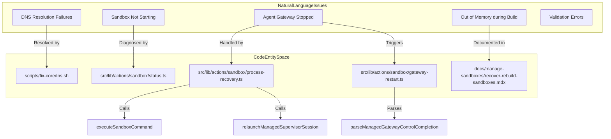
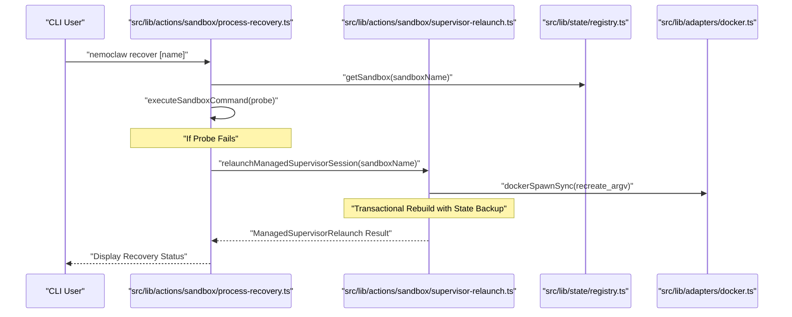

<!-- source: DeepWiki mcp.deepwiki.com · repo NVIDIA/NemoClaw · page 8.5 Troubleshooting · fetched 2026-10-26 -->

# Troubleshooting

<details>
<summary>Relevant source files</summary>

The following files were used as context for generating this wiki page:

- [.github/ISSUE_TEMPLATE/bug_report.yml](.github/ISSUE_TEMPLATE/bug_report.yml)
- [.github/ISSUE_TEMPLATE/config.yml](.github/ISSUE_TEMPLATE/config.yml)
- [.github/ISSUE_TEMPLATE/doc_issue.yml](.github/ISSUE_TEMPLATE/doc_issue.yml)
- [.github/ISSUE_TEMPLATE/feature_request.yml](.github/ISSUE_TEMPLATE/feature_request.yml)
- [.gitignore](.gitignore)
- [docs/DORI_SETUP.md](docs/DORI_SETUP.md)
- [docs/changelog/2026-07-30.mdx](docs/changelog/2026-07-30.mdx)
- [docs/configure-agents/configure-memory-search.mdx](docs/configure-agents/configure-memory-search.mdx)
- [docs/index.yml](docs/index.yml)
- [docs/inference/set-up-vllm-on-two-dgx-stations.mdx](docs/inference/set-up-vllm-on-two-dgx-stations.mdx)
- [docs/manage-sandboxes/recover-rebuild-sandboxes.mdx](docs/manage-sandboxes/recover-rebuild-sandboxes.mdx)
- [docs/manage-sandboxes/run-deep-agents-code.mdx](docs/manage-sandboxes/run-deep-agents-code.mdx)
- [docs/reference/commands.mdx](docs/reference/commands.mdx)
- [docs/reference/configure-runtime-identity.mdx](docs/reference/configure-runtime-identity.mdx)
- [docs/reference/troubleshooting.mdx](docs/reference/troubleshooting.mdx)
- [docs/resources/engineer-agentic-documentation.mdx](docs/resources/engineer-agentic-documentation.mdx)
- [scripts/check-docs-published-routes.mts](scripts/check-docs-published-routes.mts)
- [scripts/debug.sh](scripts/debug.sh)
- [scripts/fix-coredns.sh](scripts/fix-coredns.sh)
- [scripts/lib/runtime.sh](scripts/lib/runtime.sh)
- [scripts/smoke-macos-install.sh](scripts/smoke-macos-install.sh)
- [src/lib/actions/sandbox/process-recovery.test.ts](src/lib/actions/sandbox/process-recovery.test.ts)
- [src/lib/actions/sandbox/process-recovery.ts](src/lib/actions/sandbox/process-recovery.ts)
- [src/lib/actions/sandbox/supervisor-relaunch.test.ts](src/lib/actions/sandbox/supervisor-relaunch.test.ts)
- [src/lib/actions/sandbox/supervisor-relaunch.ts](src/lib/actions/sandbox/supervisor-relaunch.ts)
- [src/lib/credentials/store.ts](src/lib/credentials/store.ts)
- [src/lib/state/state-file-restore-mode.test.ts](src/lib/state/state-file-restore-mode.test.ts)
- [src/lib/state/state-file-restore.ts](src/lib/state/state-file-restore.ts)
- [test/check-docs-published-routes.test.ts](test/check-docs-published-routes.test.ts)
- [test/credentials.test.ts](test/credentials.test.ts)
- [test/e2e/live/gateway-guard-legacy-keepalive-fixture.ts](test/e2e/live/gateway-guard-legacy-keepalive-fixture.ts)
- [test/e2e/live/gateway-guard-recovery.test.ts](test/e2e/live/gateway-guard-recovery.test.ts)
- [test/e2e/support/gateway-guard-legacy-keepalive-fixture.test.ts](test/e2e/support/gateway-guard-legacy-keepalive-fixture.test.ts)
- [test/helpers/vitest-temp-root.ts](test/helpers/vitest-temp-root.ts)
- [test/install-stage-from-stdin.test.ts](test/install-stage-from-stdin.test.ts)
- [test/nemo-deepagents-alias.test.ts](test/nemo-deepagents-alias.test.ts)
- [test/process-recovery-supervisor-relaunch.test.ts](test/process-recovery-supervisor-relaunch.test.ts)
- [test/runtime-shell.test.ts](test/runtime-shell.test.ts)
- [test/secret-redaction.test.ts](test/secret-redaction.test.ts)
- [test/snapshot-recovery-validation.test.ts](test/snapshot-recovery-validation.test.ts)

</details>


This page provides diagnostic procedures and solutions for common issues encountered when installing, onboarding, or running NemoClaw. It covers infrastructure dependencies (Docker, Node.js), networking (DNS, CoreDNS), inference routing, and security (cgroup v2, policies).

---

## Diagnostic Data Collection

Before deep-diving into specific issues, use the built-in diagnostic tools to collect the system state.

### `nemoclaw status`
The `status` command is the first line of defense. It probes the sandbox state, gateway health, and active inference configuration [src/lib/actions/sandbox/status.ts:162-171](). It reconciles the local registry state with the live OpenShell gateway [src/lib/actions/sandbox/status.ts:65-70]().

Key diagnostics in the output:
- **Inference Health**: Probes host-side health endpoints for local Ollama and vLLM routes [src/lib/actions/sandbox/status.ts:53-60]().
- **Sandbox GPU**: Reports if the sandbox is enabled for GPU and the specific device being used, including CUDA-usability proof verification [src/lib/actions/sandbox/status.ts:75-93]().

### `nemoclaw debug`
The `debug` command collects system info, Docker logs, OpenShell status, and redacted environment variables [docs/reference/troubleshooting.mdx:7-10](). NemoClaw provides a compatibility wrapper script for the TypeScript debug collector [scripts/debug.sh:5-9]().

1.  **Redaction**: Automatically masks sensitive patterns using centralized regex.
2.  **Container Logs**: Collects logs for all containers labeled with the NemoClaw namespace.
3.  **OpenShell State**: Captures output from `openshell sandbox list` and `openshell gateway info`.

**Sources**: [src/lib/actions/sandbox/status.ts:5-171](), [scripts/debug.sh:5-35](), [docs/reference/troubleshooting.mdx:6-10]()

---

## Installation & Environment Issues

### `nemoclaw` command not found
If you use a Node version manager like `nvm` or `fnm`, the installer may not update your current shell's `PATH` immediately [docs/reference/troubleshooting.mdx:28-32]().
**Solution**: Run `source ~/.bashrc` (or `source ~/.zshrc`) or open a new terminal window [docs/reference/troubleshooting.mdx:33](). If installing from source, add `~/.local/bin` to your `PATH` [docs/reference/troubleshooting.mdx:35-37]().

### Node.js version mismatch
NemoClaw requires **Node.js 22.19 or later** [docs/reference/troubleshooting.mdx:48-53]().
**Diagnosis**: Check version with `node --version`.
**Solution**: Update using `nvm install 22 && nvm use 22` [docs/reference/troubleshooting.mdx:58-61]().

### Docker Permission Denied (Linux)
On Linux, if the Docker daemon is running but you see "permission denied" errors, your user may not be in the `docker` group [docs/reference/troubleshooting.mdx:94-97]().
**Solution**:
```bash
sudo usermod -aG docker $USER
newgrp docker
```
[docs/reference/troubleshooting.mdx:107-110]()

### Image Push / Out-of-Memory (OOM)
The sandbox image is ~2.4 GB compressed. On machines with less than 8 GB of RAM, the combined usage of Docker, k3s, and the export pipeline can trigger the OOM killer [docs/reference/troubleshooting.mdx:65-70]().
**Solution**: Configure at least 8 GB of swap space [docs/reference/troubleshooting.mdx:71-72]().

**Sources**: [docs/reference/troubleshooting.mdx:28-110]()

---

## DNS Resolution Failures (CoreDNS)

### Symptom
The sandbox fails to resolve external DNS names (e.g., `integrate.api.nvidia.com`). This often occurs in corporate environments or when using Colima on macOS.

### CoreDNS Patching
NemoClaw includes a TypeScript-based patcher for CoreDNS issues in the OpenShell gateway. This handles cases where the k3s CoreDNS pod inherits a loopback address (`127.0.0.11`) that is unreachable from within the cluster [scripts/fix-coredns.sh:1-6]().
**Solution**: Use the internal fix-coredns command:
```bash
nemoclaw internal dns fix-coredns [gateway-name]
```
[scripts/fix-coredns.sh:15-19]()

**Sources**: [scripts/fix-coredns.sh:1-20]()

---

## Sandbox Lifecycle & Recovery

### Sandbox Not Starting
If a sandbox fails to start, verify the host readiness [docs/reference/troubleshooting.mdx:73-79](). A `host.docker.daemon_unreachable` finding means NemoClaw cannot reach the daemon [docs/reference/troubleshooting.mdx:82-83]().

### Agent Runtime Recovery
If `status` reports the sandbox is alive but the gateway is not running, use the `recover` command [docs/manage-sandboxes/recover-rebuild-sandboxes.mdx:30-34]().
- **OpenClaw/Hermes**: The `recover` command repairs a stopped in-sandbox gateway and re-establishes port-forwards [docs/manage-sandboxes/recover-rebuild-sandboxes.mdx:37-41]().
- **Managed Relaunch**: For local Docker-driver sandboxes, `recover` can transactionally recreate the container with a managed startup command [docs/manage-sandboxes/recover-rebuild-sandboxes.mdx:82-84]().

### Process Recovery Logic
The `executeSandboxCommand` function attempts to run commands via SSH [src/lib/actions/sandbox/process-recovery.ts:126-137](). If SSH fails, it can fall back to `privilegedSandboxExecArgv` for direct Docker execution [src/lib/actions/sandbox/process-recovery.ts:189-197]().

**Sources**: [docs/manage-sandboxes/recover-rebuild-sandboxes.mdx:30-114](), [src/lib/actions/sandbox/process-recovery.ts:126-205](), [docs/reference/troubleshooting.mdx:73-83]()

---

## Troubleshooting Entity Map

The following diagrams map high-level issues to specific code entities and functions.

### Troubleshooting Entity Map

**Sources**: [src/lib/actions/sandbox/process-recovery.ts:126](), [src/lib/actions/sandbox/gateway-restart.ts:45](), [scripts/fix-coredns.sh:19](), [docs/manage-sandboxes/recover-rebuild-sandboxes.mdx:30]()

### Logic Flow: Sandbox Recovery and Process Relaunch

**Sources**: [src/lib/actions/sandbox/process-recovery.ts:126-172](), [src/lib/actions/sandbox/supervisor-relaunch.ts:10-64](), [src/lib/state/registry.ts:27-35](), [src/lib/adapters/docker.ts:6]()

---

