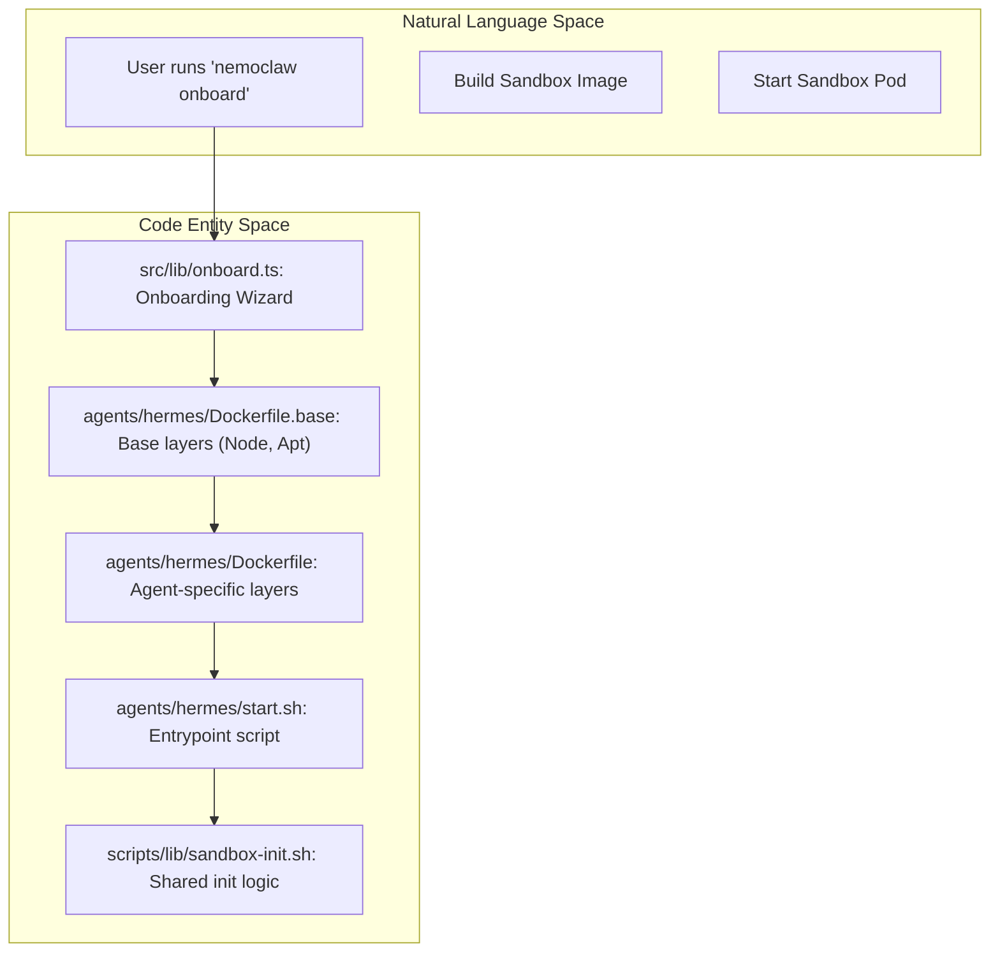
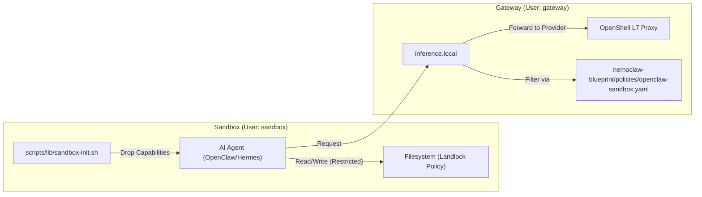

<!-- source: DeepWiki mcp.deepwiki.com · repo NVIDIA/NemoClaw · page 9 Glossary · fetched 2026-10-26 -->

# Glossary

Relevant source files

The following files were used as context for generating this wiki page:

- [.agents/skills/_shared/controlled-words.md](.agents/skills/_shared/controlled-words.md)
- [.agents/skills/_shared/documentation-writing-review.md](.agents/skills/_shared/documentation-writing-review.md)
- [.agents/skills/_shared/pr-follow-up.md](.agents/skills/_shared/pr-follow-up.md)
- [.agents/skills/nemoclaw-contributor-create-pr/SKILL.md](.agents/skills/nemoclaw-contributor-create-pr/SKILL.md)
- [.agents/skills/nemoclaw-contributor-onboard-messaging-channel/SKILL.md](.agents/skills/nemoclaw-contributor-onboard-messaging-channel/SKILL.md)
- [.agents/skills/nemoclaw-contributor-update-docs/SKILL.md](.agents/skills/nemoclaw-contributor-update-docs/SKILL.md)
- [.agents/skills/nemoclaw-maintainer-day/PR-REVIEW-PRIORITIES.md](.agents/skills/nemoclaw-maintainer-day/PR-REVIEW-PRIORITIES.md)
- [.agents/skills/nemoclaw-maintainer-day/SALVAGE-PR.md](.agents/skills/nemoclaw-maintainer-day/SALVAGE-PR.md)
- [.agents/skills/nemoclaw-maintainer-day/TEST-GAPS.md](.agents/skills/nemoclaw-maintainer-day/TEST-GAPS.md)
- [.agents/skills/nemoclaw-maintainer-policies/SKILL.md](.agents/skills/nemoclaw-maintainer-policies/SKILL.md)
- [.agents/skills/nemoclaw-maintainer-refactor-docs/SKILL.md](.agents/skills/nemoclaw-maintainer-refactor-docs/SKILL.md)
- [.agents/skills/nemoclaw-maintainer-release-notes/SKILL.md](.agents/skills/nemoclaw-maintainer-release-notes/SKILL.md)
- [.github/PULL_REQUEST_TEMPLATE.md](.github/PULL_REQUEST_TEMPLATE.md)
- [.gitignore](.gitignore)
- [.pre-commit-config.yaml](.pre-commit-config.yaml)
- [AGENTS.md](AGENTS.md)
- [CONTRIBUTING.md](CONTRIBUTING.md)
- [WRITING.md](WRITING.md)
- [agents/hermes/Dockerfile](agents/hermes/Dockerfile)
- [agents/hermes/Dockerfile.base](agents/hermes/Dockerfile.base)
- [agents/hermes/config/hermes-config.ts](agents/hermes/config/hermes-config.ts)
- [agents/hermes/start.sh](agents/hermes/start.sh)
- [agents/langchain-deepagents-code/Dockerfile](agents/langchain-deepagents-code/Dockerfile)
- [agents/langchain-deepagents-code/dcode-launcher.sh](agents/langchain-deepagents-code/dcode-launcher.sh)
- [agents/langchain-deepagents-code/dcode-wrapper.sh](agents/langchain-deepagents-code/dcode-wrapper.sh)
- [agents/langchain-deepagents-code/generate-config.ts](agents/langchain-deepagents-code/generate-config.ts)
- [agents/langchain-deepagents-code/managed-dcode-runtime.py](agents/langchain-deepagents-code/managed-dcode-runtime.py)
- [agents/langchain-deepagents-code/patch-managed-deepagents-code.py](agents/langchain-deepagents-code/patch-managed-deepagents-code.py)
- [agents/langchain-deepagents-code/start.sh](agents/langchain-deepagents-code/start.sh)
- [ci/platform-matrix.json](ci/platform-matrix.json)
- [ci/test-file-size-budget.json](ci/test-file-size-budget.json)
- [docs/AGENTS.md](docs/AGENTS.md)
- [docs/CONTRIBUTING.md](docs/CONTRIBUTING.md)
- [docs/DORI_SETUP.md](docs/DORI_SETUP.md)
- [docs/about/ecosystem-deepagents.mdx](docs/about/ecosystem-deepagents.mdx)
- [docs/about/ecosystem-hermes.mdx](docs/about/ecosystem-hermes.mdx)
- [docs/about/ecosystem.mdx](docs/about/ecosystem.mdx)
- [docs/about/overview.mdx](docs/about/overview.mdx)
- [docs/changelog/2026-07-30.mdx](docs/changelog/2026-07-30.mdx)
- [docs/configure-agents/configure-memory-search.mdx](docs/configure-agents/configure-memory-search.mdx)
- [docs/get-started/dgx-station-preparation.mdx](docs/get-started/dgx-station-preparation.mdx)
- [docs/get-started/prerequisites.mdx](docs/get-started/prerequisites.mdx)
- [docs/get-started/quickstart-hermes.mdx](docs/get-started/quickstart-hermes.mdx)
- [docs/get-started/quickstart-langchain-deepagents-code.mdx](docs/get-started/quickstart-langchain-deepagents-code.mdx)
- [docs/get-started/quickstart.mdx](docs/get-started/quickstart.mdx)
- [docs/index.mdx](docs/index.mdx)
- [docs/index.yml](docs/index.yml)
- [docs/inference/configure-model-capabilities.mdx](docs/inference/configure-model-capabilities.mdx)
- [docs/inference/set-up-vllm-on-two-dgx-stations.mdx](docs/inference/set-up-vllm-on-two-dgx-stations.mdx)
- [docs/manage-sandboxes/run-deep-agents-code.mdx](docs/manage-sandboxes/run-deep-agents-code.mdx)
- [docs/reference/commands.mdx](docs/reference/commands.mdx)
- [docs/reference/configure-runtime-identity.mdx](docs/reference/configure-runtime-identity.mdx)
- [docs/reference/platform-support.mdx](docs/reference/platform-support.mdx)
- [docs/reference/troubleshooting.mdx](docs/reference/troubleshooting.mdx)
- [docs/resources/engineer-agentic-documentation.mdx](docs/resources/engineer-agentic-documentation.mdx)
- [fern/AGENTS.md](fern/AGENTS.md)
- [package-lock.json](package-lock.json)
- [package.json](package.json)
- [scripts/check-dcode-profile-import-gate.sh](scripts/check-dcode-profile-import-gate.sh)
- [scripts/check-docs-published-routes.mts](scripts/check-docs-published-routes.mts)
- [src/lib/onboard.ts](src/lib/onboard.ts)
- [src/lib/policy/index.ts](src/lib/policy/index.ts)
- [src/lib/sandbox/config-format.test.ts](src/lib/sandbox/config-format.test.ts)
- [src/lib/sandbox/config-format.ts](src/lib/sandbox/config-format.ts)
- [src/lib/sandbox/config-get.test.ts](src/lib/sandbox/config-get.test.ts)
- [src/nemoclaw.ts](src/nemoclaw.ts)
- [test/check-docs-published-routes.test.ts](test/check-docs-published-routes.test.ts)
- [test/dcode-managed-exec.test.ts](test/dcode-managed-exec.test.ts)
- [test/dcode-non-interactive-json.test.ts](test/dcode-non-interactive-json.test.ts)
- [test/dcode-start-keepalive.test.ts](test/dcode-start-keepalive.test.ts)
- [test/dcode-wrapper-identity.test.ts](test/dcode-wrapper-identity.test.ts)
- [test/deepagents-code-tui-startup-check.test.ts](test/deepagents-code-tui-startup-check.test.ts)
- [test/e2e/e2e-cloud-experimental/checks/07-deepagents-code-headless-inference.sh](test/e2e/e2e-cloud-experimental/checks/07-deepagents-code-headless-inference.sh)
- [test/e2e/e2e-cloud-experimental/checks/10-deepagents-code-tui-startup.sh](test/e2e/e2e-cloud-experimental/checks/10-deepagents-code-tui-startup.sh)
- [test/e2e/live/hermes-root-entrypoint-smoke.test.ts](test/e2e/live/hermes-root-entrypoint-smoke.test.ts)
- [test/e2e/live/hermes-sandbox-secret-boundary.test.ts](test/e2e/live/hermes-sandbox-secret-boundary.test.ts)
- [test/generate-hermes-config.test.ts](test/generate-hermes-config.test.ts)
- [test/helpers/langchain-deepagents-code-headless.ts](test/helpers/langchain-deepagents-code-headless.ts)
- [test/helpers/langchain-deepagents-code-patch-fixture.ts](test/helpers/langchain-deepagents-code-patch-fixture.ts)
- [test/hermes-dashboard-provisioning.test.ts](test/hermes-dashboard-provisioning.test.ts)
- [test/hermes-final-image-layout.test.ts](test/hermes-final-image-layout.test.ts)
- [test/hermes-share-mount-deps.test.ts](test/hermes-share-mount-deps.test.ts)
- [test/hermes-start.test.ts](test/hermes-start.test.ts)
- [test/langchain-deepagents-code-config.test.ts](test/langchain-deepagents-code-config.test.ts)
- [test/langchain-deepagents-code-direct-module-patch.test.ts](test/langchain-deepagents-code-direct-module-patch.test.ts)
- [test/langchain-deepagents-code-headless-runtime.test.ts](test/langchain-deepagents-code-headless-runtime.test.ts)
- [test/langchain-deepagents-code-image.test.ts](test/langchain-deepagents-code-image.test.ts)
- [test/langchain-deepagents-code-progressive-tool-disclosure.test.ts](test/langchain-deepagents-code-progressive-tool-disclosure.test.ts)
- [test/langchain-deepagents-code-proxy-launcher.test.ts](test/langchain-deepagents-code-proxy-launcher.test.ts)
- [test/node-tar-dockerfile-contract.test.ts](test/node-tar-dockerfile-contract.test.ts)
- [test/onboard-selection.test.ts](test/onboard-selection.test.ts)
- [test/onboard.test.ts](test/onboard.test.ts)
- [test/openclaw-final-image-layout.test.ts](test/openclaw-final-image-layout.test.ts)
- [test/policies.test.ts](test/policies.test.ts)
- [test/station-doc-ownership.test.ts](test/station-doc-ownership.test.ts)
- [test/support/dcode-start-script-fixture.ts](test/support/dcode-start-script-fixture.ts)

This glossary defines technical terms, jargon, and abbreviations used throughout the NemoClaw codebase. It is intended for onboarding engineers to understand the relationship between system concepts and their underlying code implementations.

## Core System Terms

### NemoClaw
The reference stack and CLI tool that orchestrates the execution of AI agents within the OpenShell runtime. It provides the "glue" between the agent, the sandbox, and the inference gateway.
*   **Main Entrypoint:** `src/nemoclaw.ts` [src/nemoclaw.ts:1-17]()
*   **Host Commands:** Handles lifecycle operations like `onboard`, `resources`, and `connect` [docs/reference/commands.mdx:117-120]().

### OpenClaw
An open-source autonomous AI agent framework. NemoClaw packages OpenClaw into a hardened container image and manages its lifecycle.
*   **Binary in Sandbox:** `/usr/local/bin/openclaw` [agents/hermes/Dockerfile.base:135-135]()
*   **Configuration:** Managed under `/sandbox/.openclaw` [agents/hermes/Dockerfile.base:113-133]().

### OpenShell
The security-focused runtime environment developed by NVIDIA. It provides the gateway, provider system, and sandboxing primitives (Landlock, seccomp) that NemoClaw utilizes.
*   **Resolution Logic:** `src/lib/adapters/openshell/resolve.ts` [test/policies.test.ts:18-20]()
*   **Gateway Integration:** NemoClaw creates an OpenShell gateway to manage network and inference [docs/reference/commands.mdx:110-112]().

### Blueprint
A declarative artifact that defines the sandbox environment, including its base image, metadata, and default policies. NemoClaw uses blueprints to ensure reproducible deployments.
*   **Definition File:** `nemoclaw-blueprint/blueprint.yaml` [test/langchain-deepagents-code-image.test.ts:157-157]()
*   **Runner Logic:** `nemoclaw/src/blueprint/runner.ts` [nemoclaw/src/blueprint/runner.ts:1-50]()

### Sandbox
An isolated execution environment for a single agent instance. In NemoClaw, this is implemented as a K3s-backed container managed by OpenShell, utilizing Linux namespaces and security modules.
*   **User Isolation:** Runs as `sandbox` user, while the management gateway runs as `gateway` [agents/hermes/Dockerfile.base:103-107]().
*   **Registry:** Tracks sandbox state on the host [test/policies.test.ts:24-24]().

---

## Security & Isolation

### Landlock
A Linux Security Module (LSM) used by OpenShell to provide fine-grained filesystem access control. NemoClaw uses it to make sensitive configuration files read-only for the agent.
*   **Implementation:** Enforced via `filesystem_policy` in the blueprint [nemoclaw-blueprint/policies/openclaw-sandbox.yaml:18-43]()
*   **Enforcement Mode:** Set to `best_effort` to ensure compatibility across kernel versions [nemoclaw-blueprint/policies/openclaw-sandbox.yaml:47-48]()

### seccomp
Secure Computing Mode. A Linux kernel feature used to restrict the system calls a process can make. Applied to the sandbox to reduce the kernel attack surface.

### SSRF Guard
A security mechanism that prevents Server-Side Request Forgery. NemoClaw implements this through OpenShell's network policies and specific probes.
*   **DNS Probe:** Runs a `nslookup` probe before starting the sandbox build to detect DNS-over-TLS or blocked egress [docs/reference/troubleshooting.mdx:137-140]()

### Policy Preset
Pre-defined YAML snippets that allow common integrations (e.g., Slack, GitHub, PyPI) through the sandbox firewall.
*   **Storage:** `nemoclaw-blueprint/policies/presets/` [test/policies.test.ts:198-198]()
*   **Listing Logic:** `policies.listPresets()` [test/policies.test.ts:40-46]()

### Policy Tier
A predefined security posture (e.g., `default` or `relaxed`) that determines the initial set of allowed endpoints.
*   **Default Policy:** Deny by default, allow only core functionality [nemoclaw-blueprint/policies/openclaw-sandbox.yaml:4-12]()

---

## Inference & Connectivity

### Gateway
The OpenShell component that intercepts and routes all inference and network traffic from the sandbox.
*   **Role:** Registers inference providers and handles credential injection [docs/reference/commands.mdx:110-112]()

### Inference Profile
A configuration mapping in the blueprint that defines an LLM backend and its provider type.
*   **Validation:** Verified during blueprint testing [test/langchain-deepagents-code-image.test.ts:180-199]()

### NIM (NVIDIA Inference Microservice)
Optimized inference containers. NemoClaw supports routing to NIMs hosted on NVIDIA API Catalog or running locally.
*   **Routing:** Handled via the `nvidia` network policy in the sandbox [nemoclaw-blueprint/policies/openclaw-sandbox.yaml:61-84]()

### inference.local
A "magic" DNS hostname used inside the sandbox. The OpenShell gateway intercepts requests to `https://inference.local` and routes them to the configured inference provider.
*   **Implementation:** Defined as the internal virtual hostname for managed inference [nemoclaw-blueprint/policies/openclaw-sandbox.yaml:94-103]()

---

## Agent Variants

### Hermes Agent
A specialized agent variant with its own manifest and Dockerfile. It uses a YAML-based configuration and exposes an OpenAI-compatible API.
*   **Entrypoint:** `agents/hermes/start.sh` [agents/hermes/start.sh:5-12]()
*   **CLI Alias:** `nemohermes` [docs/reference/commands.mdx:21-24]()
*   **Manifest:** `agents/hermes/manifest.yaml`

### LangChain Deep Agents Code
A specialized agent variant focused on code execution and deep agent capabilities. It uses the `dcode` CLI for interactive and headless operation.
*   **Entrypoint:** `agents/langchain-deepagents-code/start.sh` [agents/langchain-deepagents-code/start.sh:5-12]()
*   **CLI Alias:** `nemo-deepagents` [docs/reference/commands.mdx:29-32]()
*   **Manifest:** `agents/langchain-deepagents-code/manifest.yaml`

### Agent Manifest
A file defining the metadata and configuration requirements for an agent variant.
*   **Location:** `agents/<agent_name>/manifest.yaml`

---

## Technical Diagrams

### Concept to Code Mapping: Sandbox Initialization
This diagram bridges the natural language concepts of "Onboarding" to the specific code entities that handle the build and start sequence.

**Sources:** [src/lib/onboard.ts:1-10]() , [agents/hermes/Dockerfile.base:1-50](), [agents/hermes/Dockerfile:1-13](), [agents/hermes/start.sh:1-30]().

### Data Flow: Secure Agent Execution
This diagram shows how an agent's request is handled by the layered security controls.

**Sources:** [agents/hermes/start.sh:94-95](), [nemoclaw-blueprint/policies/openclaw-sandbox.yaml:18-43](), [nemoclaw-blueprint/policies/openclaw-sandbox.yaml:94-103](), [agents/hermes/Dockerfile.base:103-107]().

---

## Operational Terms

### Run ID
A unique identifier used to track onboarding sessions and builds.
*   **Onboarding Resume:** Progress is recorded so interrupted runs can continue using the session record [test/onboard.test.ts:48-51]()

### Registry
A module that tracks the state and metadata of all sandboxes managed by NemoClaw.
*   **Module:** `src/lib/state/registry.ts` [test/policies.test.ts:24-24]()

### Onboard Config
The configuration generated during the interactive onboarding wizard, which includes selected agent, inference provider, and policy presets.
*   **Onboarding Wizard:** `src/lib/onboard.ts` [src/lib/onboard.ts:1-4]()
*   **Config Sync:** `src/lib/onboard/config-sync.ts` [src/lib/onboard.ts:67-70]()

### Migration Snapshot
A backup of an agent's state used when moving from a host-based installation into a sandbox.
*   **Command:** `backup-all` is used to preserve state during upgrades [docs/reference/commands.mdx:155-160]()

### Slash Command
Commands prefixed with `/` used within the OpenClaw chat interface.
*   **Reference:** `/nemoclaw status`, `/nemoclaw onboard`, `/nemoclaw eject` [docs/reference/commands.mdx:58-66]()

### Agent Skills
Specific capabilities or tools granted to the agent.
*   **Reload Support:** Hermes includes tools for skill reload support [docs/reference/commands.mdx:72-74]()
*   **Skill Definitions:** `.agents/skills/` directory [AGENTS.md:20-21]()

### Credential Placeholder
Variables that are hydrated from the OpenShell gateway store at runtime.
*   **Usage:** `.env` files in the sandbox hold placeholders for the provider pipeline [agents/hermes/Dockerfile:144-144]()
*   **Extra Placeholders:** `src/lib/onboard/extra-placeholder-keys.ts` [src/lib/onboard.ts:46-46]()

### Auto-pair Watcher
A background process inside the sandbox that monitors for device pairing requests (OpenClaw specific).
*   **Hermes Difference:** Hermes does not use the auto-pair watcher as it has no browser pairing [agents/hermes/start.sh:7-9]()

### dcode
The command-line interface for the LangChain Deep Agents Code runtime, used for interactive TUI and headless automation within the sandbox.
*   **Usage:** `dcode`, `dcode -n "Summarize this repository"`, `dcode status` [docs/reference/commands.mdx:107-111]()
*   **Launcher:** `agents/langchain-deepagents-code/dcode-launcher.sh` [agents/langchain-deepagents-code/dcode-launcher.sh:1-10]()

### Managed Posture
Refers to the security and configuration state of the sandbox, which is managed and enforced by NemoClaw and OpenShell. This includes network policies, filesystem restrictions, and process isolation.
*   **Deep Agents Code:** `agents/langchain-deepagents-code/patch-managed-deepagents-code.py` [agents/langchain-deepagents-code/patch-managed-deepagents-code.py:1-10]()

### Shields
A security feature that provides an additional layer of protection for the sandbox, often involving network egress controls or other runtime restrictions.
*   **Status Command:** `/nemoclaw shields [status]` [docs/reference/commands.mdx:83-83]()

### Station Express
A specific deployment or configuration for NVIDIA DGX Station environments.
*   **Documentation:** `docs/get-started/dgx-station-preparation.mdx` [docs/get-started/dgx-station-preparation.mdx:1-10]()
*   **Test:** `test/station-doc-ownership.test.ts` [test/station-doc-ownership.test.ts:1-10]()

### LKG (Last Known Good)
Refers to a previously validated and working configuration or state, often used for rollback or recovery.

### CDI (Container Device Interface)
A specification for exposing host devices (like GPUs) to containers. NemoClaw uses CDI for GPU passthrough to inference containers.
*   **NVIDIA CDI Spec:** `src/lib/onboard/docker-cdi.ts` [src/lib/onboard.ts:82-85]()

### fuse-overlayfs
A FUSE-based overlay filesystem implementation, often used in container environments to manage layers and provide copy-on-write semantics.
*   **Prerequisites:** Mentioned in `docs/get-started/prerequisites.mdx` [docs/get-started/prerequisites.mdx:1-10]()

---
**Sources:**
*   `AGENTS.md`: [20-21]()
*   `agents/hermes/Dockerfile`: [1-149]()
*   `agents/hermes/Dockerfile.base`: [1-147]()
*   `agents/hermes/start.sh`: [1-124]()
*   `agents/langchain-deepagents-code/dcode-launcher.sh`: [1-10]()
*   `agents/langchain-deepagents-code/patch-managed-deepagents-code.py`: [1-10]()
*   `agents/langchain-deepagents-code/start.sh`: [5-12]()
*   `docs/get-started/dgx-station-preparation.mdx`: [1-10]()
*   `docs/get-started/prerequisites.mdx`: [1-10]()
*   `docs/reference/commands.mdx`: [21-160]()
*   `docs/reference/troubleshooting.mdx`: [137-140]()
*   `nemoclaw-blueprint/policies/openclaw-sandbox.yaml`: [4-103]()
*   `src/lib/onboard.ts`: [1-4](), [46-46](), [67-70](), [82-85]()
*   `src/nemoclaw.ts`: [1-17]()
*   `test/langchain-deepagents-code-image.test.ts`: [157-157](), [180-199]()
*   `test/onboard.test.ts`: [48-51]()
*   `test/policies.test.ts`: [18-24](), [40-46](), [198-198]()
*   `test/station-doc-ownership.test.ts`: [1-10]()