# Page: Overview

# Overview

<details>
<summary>Relevant source files</summary>

The following files were used as context for generating this wiki page:

- [.agents/skills/_shared/controlled-words.md](.agents/skills/_shared/controlled-words.md)
- [.agents/skills/_shared/documentation-writing-review.md](.agents/skills/_shared/documentation-writing-review.md)
- [.agents/skills/_shared/pr-follow-up.md](.agents/skills/_shared/pr-follow-up.md)
- [.agents/skills/nemoclaw-contributor-create-pr/SKILL.md](.agents/skills/nemoclaw-contributor-create-pr/SKILL.md)
- [.agents/skills/nemoclaw-contributor-onboard-messaging-channel/SKILL.md](.agents/skills/nemoclaw-contributor-onboard-messaging-channel/SKILL.md)
- [.agents/skills/nemoclaw-contributor-update-docs/SKILL.md](.agents/skills/nemoclaw-contributor-update-docs/SKILL.md)
- [.agents/skills/nemoclaw-maintainer-day/PR-REVIEW-PRIORITIES.md](.agents/skills/nemoclaw-maintainer-day/PR-REVIEW-PRIORITIES.md)
- [.agents/skills/nemoclaw-maintainer-day/SALVAGE-PR.md](.agents/skills/nemoclaw-maintainer-day/SALVAGE-PR.md)
- [.agents/skills/nemoclaw-maintainer-day/TEST-GAPS.md](.agents/skills/nemoclaw-maintainer-day/TEST-GAPS.md)
- [.agents/skills/nemoclaw-maintainer-policies/SKILL.md](.agents/skills/nemoclaw-maintainer-policies/SKILL.md)
- [.agents/skills/nemoclaw-maintainer-refactor-docs/SKILL.md](.agents/skills/nemoclaw-maintainer-refactor-docs/SKILL.md)
- [.agents/skills/nemoclaw-maintainer-release-notes/SKILL.md](.agents/skills/nemoclaw-maintainer-release-notes/SKILL.md)
- [.github/PULL_REQUEST_TEMPLATE.md](.github/PULL_REQUEST_TEMPLATE.md)
- [.gitignore](.gitignore)
- [.pre-commit-config.yaml](.pre-commit-config.yaml)
- [AGENTS.md](AGENTS.md)
- [CONTRIBUTING.md](CONTRIBUTING.md)
- [README.md](README.md)
- [WRITING.md](WRITING.md)
- [bin/nemoclaw.js](bin/nemoclaw.js)
- [ci/platform-matrix.json](ci/platform-matrix.json)
- [docs/AGENTS.md](docs/AGENTS.md)
- [docs/CONTRIBUTING.md](docs/CONTRIBUTING.md)
- [docs/DORI_SETUP.md](docs/DORI_SETUP.md)
- [docs/about/ecosystem-deepagents.mdx](docs/about/ecosystem-deepagents.mdx)
- [docs/about/ecosystem-hermes.mdx](docs/about/ecosystem-hermes.mdx)
- [docs/about/ecosystem.mdx](docs/about/ecosystem.mdx)
- [docs/about/overview.mdx](docs/about/overview.mdx)
- [docs/changelog/2026-07-30.mdx](docs/changelog/2026-07-30.mdx)
- [docs/configure-agents/configure-memory-search.mdx](docs/configure-agents/configure-memory-search.mdx)
- [docs/get-started/dgx-station-preparation.mdx](docs/get-started/dgx-station-preparation.mdx)
- [docs/get-started/prerequisites.mdx](docs/get-started/prerequisites.mdx)
- [docs/get-started/quickstart-hermes.mdx](docs/get-started/quickstart-hermes.mdx)
- [docs/get-started/quickstart.mdx](docs/get-started/quickstart.mdx)
- [docs/index.mdx](docs/index.mdx)
- [docs/index.yml](docs/index.yml)
- [docs/inference/set-up-vllm-on-two-dgx-stations.mdx](docs/inference/set-up-vllm-on-two-dgx-stations.mdx)
- [docs/manage-sandboxes/run-deep-agents-code.mdx](docs/manage-sandboxes/run-deep-agents-code.mdx)
- [docs/reference/commands.mdx](docs/reference/commands.mdx)
- [docs/reference/configure-runtime-identity.mdx](docs/reference/configure-runtime-identity.mdx)
- [docs/reference/platform-support.mdx](docs/reference/platform-support.mdx)
- [docs/reference/troubleshooting.mdx](docs/reference/troubleshooting.mdx)
- [docs/resources/engineer-agentic-documentation.mdx](docs/resources/engineer-agentic-documentation.mdx)
- [fern/AGENTS.md](fern/AGENTS.md)
- [install.sh](install.sh)
- [package-lock.json](package-lock.json)
- [package.json](package.json)
- [scripts/check-docs-published-routes.mts](scripts/check-docs-published-routes.mts)
- [scripts/install.sh](scripts/install.sh)
- [scripts/start-services.sh](scripts/start-services.sh)
- [src/lib/sandbox/config-format.test.ts](src/lib/sandbox/config-format.test.ts)
- [src/lib/sandbox/config-format.ts](src/lib/sandbox/config-format.ts)
- [src/lib/sandbox/config-get.test.ts](src/lib/sandbox/config-get.test.ts)
- [test/check-docs-published-routes.test.ts](test/check-docs-published-routes.test.ts)
- [test/install-onboard-yes.test.ts](test/install-onboard-yes.test.ts)
- [test/install-preflight.test.ts](test/install-preflight.test.ts)
- [test/station-doc-ownership.test.ts](test/station-doc-ownership.test.ts)
- [uninstall.sh](uninstall.sh)

</details>


NVIDIA NemoClaw is an open-source reference stack for running always-on AI agents more safely inside [NVIDIA OpenShell](https://github.com/NVIDIA/OpenShell) sandboxes. [README.md:6-12]() It provides guided onboarding, a hardened blueprint, routed inference, network policy, and lifecycle management through a single CLI. [README.md:13-14]()

NemoClaw addresses the security, cost, and compliance risks of autonomous AI agents by providing policy-based privacy and security guardrails. [README.md:12-14]() This enables agents like [OpenClaw](https://openclaw.ai), [Hermes](https://get-hermes.ai/), or [LangChain Deep Agents Code](https://docs.langchain.com/oss/python/deepagents/code/overview) to run securely across various environments, including RTX PCs, DGX Spark, and cloud instances. [README.md:15-20](), [docs/reference/commands.mdx:12-36]()

## Core Capabilities

| Capability | Description |
| :--- | :--- |
| **Sandboxed Execution** | Agents run in isolated environments with container security measures, capability drops, and process limits. [README.md:60-60]() |
| **Inference Routing** | Traffic is routed through the OpenShell gateway. Agents use `inference.local` while sensitive API keys stay on the host. [README.md:56-56](), [docs/reference/commands.mdx:45-53]() |
| **Guided Onboarding** | An interactive wizard (`nemoclaw onboard`) handles gateway setup, provider registration, and image building. [docs/reference/commands.mdx:43-44](), [scripts/install.sh:7-8]() |
| **Local Inference** | Native support for local model servers like Ollama, vLLM, and NVIDIA NIM with automatic detection and installation. [scripts/install.sh:7-8](), [README.md:56-56]() |
| **Policy Enforcement** | Egress rules and filesystem access are defined via schemas and enforced by the runtime. [README.md:57-58]() |

**Sources**: [README.md:12-21](), [docs/reference/commands.mdx:12-60](), [scripts/install.sh:7-8]()

## System Architecture

NemoClaw consists of a host-side CLI (available as `nemoclaw`, `nemohermes`, or `nemo-deepagents`) that orchestrates the OpenShell runtime and manages agent-specific runtimes. [bin/nemoclaw.js:6-10](), [package.json:7-11](), [docs/reference/commands.mdx:38-73]()

### High-Level Component Interaction

The following diagram illustrates the relationship between the host CLI, the OpenShell gateway, and the sandboxed agent runtimes.

**Diagram 1: NemoClaw Component Integration**
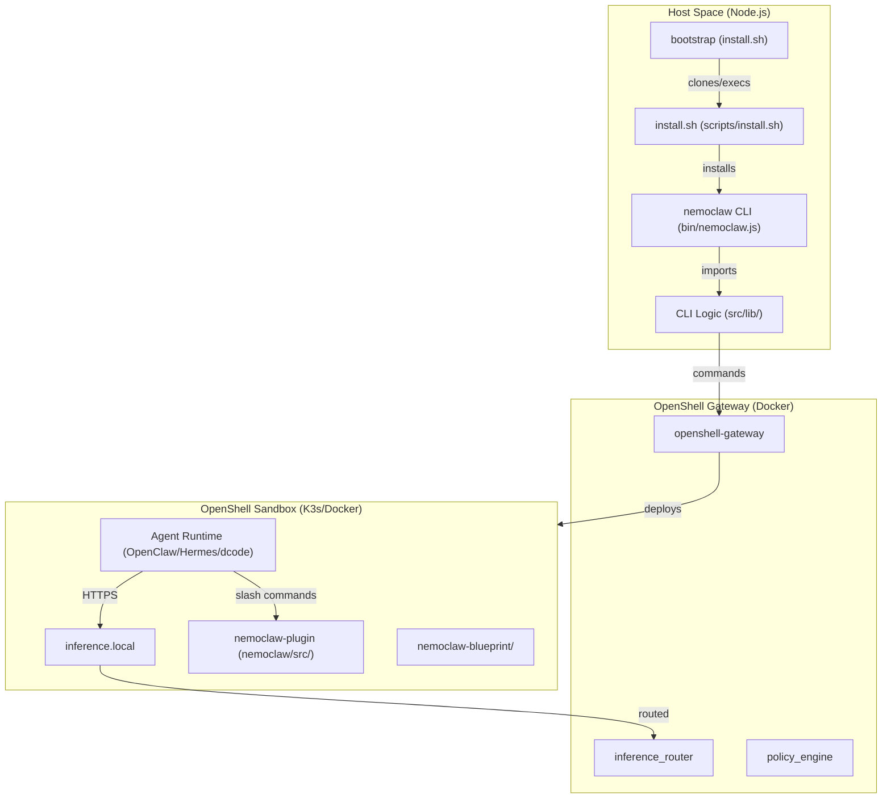
**Sources**: [AGENTS.md:28-43](), [bin/nemoclaw.js:1-12](), [scripts/install.sh:7-8](), [install.sh:5-10](), [docs/reference/commands.mdx:75-115]()

### Component Roles

| Component | Code Reference | Role |
| :--- | :--- | :--- |
| **Host CLI** | `bin/nemoclaw.js` | Primary interface for `onboard`, `status`, `logs`, and `connect`. [package.json:7-11](), [docs/reference/commands.mdx:117-145]() |
| **Installer** | `scripts/install.sh` | Bootstraps Node.js, Ollama, and NemoClaw CLI. [scripts/install.sh:7-8]() |
| **Plugin** | `nemoclaw/src/` | TypeScript plugin for in-sandbox slash commands and TUI interactions. [AGENTS.md:32-35]() |
| **Blueprint** | `nemoclaw-blueprint/` | YAML definitions for sandbox orchestration and network policies. [AGENTS.md:36-37]() |
| **Core Logic** | `src/lib/` | Core TypeScript logic for onboarding, credentials, and policies. [AGENTS.md:31-31]() |

**Sources**: [AGENTS.md:28-43](), [package.json:7-11](), [scripts/install.sh:7-8](), [docs/reference/commands.mdx:12-36]()

## How It Works

### The Onboarding Lifecycle
NemoClaw uses an interactive wizard to transition from a clean host to a fully secured agent environment. The `nemoclaw onboard` command handles provider selection and credential management. [docs/reference/commands.mdx:43-45](), [docs/get-started/quickstart.mdx:48-54]()

**Diagram 2: Onboarding Data Flow**
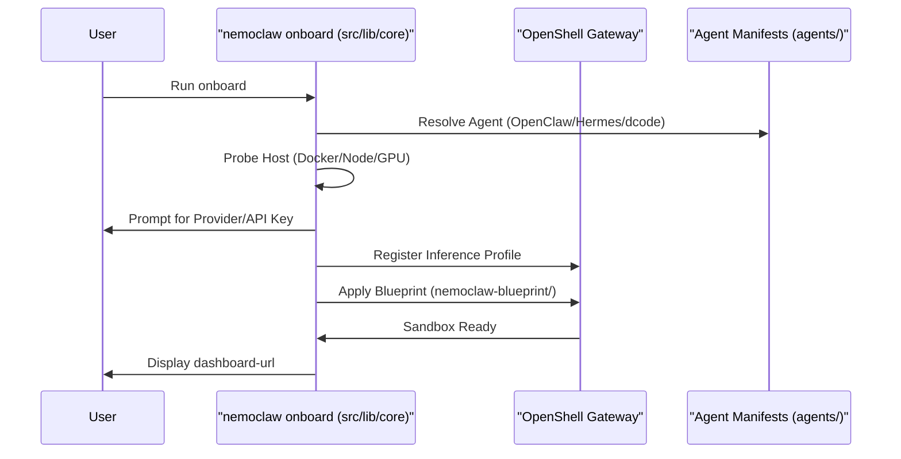
**Sources**: [docs/reference/commands.mdx:38-73](), [docs/get-started/quickstart.mdx:37-78](), [AGENTS.md:28-43]()

### Multi-Agent Support
NemoClaw supports multiple agent runtimes through a unified CLI. Users can switch agents via environment variables or specific binary aliases. [bin/nemoclaw.js:6-10](), [docs/reference/commands.mdx:38-73]()

*   **OpenClaw**: The default agent, providing a chat interface with `/nemoclaw` slash commands. [docs/reference/commands.mdx:42-45]()
*   **Hermes**: Selected via `NEMOCLAW_AGENT=hermes` or the `nemohermes` alias. Includes a built-in dashboard. [docs/reference/commands.mdx:48-59]()
*   **LangChain Deep Agents Code**: Selected via the `nemo-deepagents` alias; uses the `dcode` terminal runtime. [docs/reference/commands.mdx:61-73]()

**Sources**: [bin/nemoclaw.js:6-10](), [docs/reference/commands.mdx:12-73](), [package.json:7-11]()

### Security and Isolation
NemoClaw enforces multiple layers of protection:
*   **Network Policy**: Egress control based on baseline and session policies. [README.md:57-58]()
*   **Credential Isolation**: API keys are managed by the host CLI and OpenShell gateway, keeping them out of the sandbox filesystem. [README.md:13-14](), [docs/reference/commands.mdx:45-45]()
*   **Hardened Runtimes**: Leverages OpenShell's container security measures, including capability drops and process limits. [README.md:60-60]()

**Sources**: [README.md:57-60](), [docs/reference/commands.mdx:45-53](), [AGENTS.md:8-9]()

## Next Steps

*   [Getting Started](Getting-Started) — Install the CLI and launch your first agent.
*   [Core Concepts](Core-Concepts) — Deep dive into the architecture and security model.
*   [Command-Line Interface](Command-Line-Interface) — Complete reference for `nemoclaw`, `nemohermes`, and `nemo-deepagents` commands.

**Sources**: [README.md:45-62](), [docs/reference/commands.mdx:4-11]()

---

# Page: Getting Started

# Getting Started

<details>
<summary>Relevant source files</summary>

The following files were used as context for generating this wiki page:

- [README.md](README.md)
- [bin/nemoclaw.js](bin/nemoclaw.js)
- [ci/platform-matrix.json](ci/platform-matrix.json)
- [docs/about/ecosystem-deepagents.mdx](docs/about/ecosystem-deepagents.mdx)
- [docs/about/ecosystem-hermes.mdx](docs/about/ecosystem-hermes.mdx)
- [docs/about/ecosystem.mdx](docs/about/ecosystem.mdx)
- [docs/about/overview.mdx](docs/about/overview.mdx)
- [docs/get-started/dgx-station-preparation.mdx](docs/get-started/dgx-station-preparation.mdx)
- [docs/get-started/prerequisites.mdx](docs/get-started/prerequisites.mdx)
- [docs/get-started/quickstart-hermes.mdx](docs/get-started/quickstart-hermes.mdx)
- [docs/get-started/quickstart.mdx](docs/get-started/quickstart.mdx)
- [docs/index.mdx](docs/index.mdx)
- [docs/reference/platform-support.mdx](docs/reference/platform-support.mdx)
- [install.sh](install.sh)
- [scripts/install.sh](scripts/install.sh)
- [scripts/start-services.sh](scripts/start-services.sh)
- [test/install-onboard-yes.test.ts](test/install-onboard-yes.test.ts)
- [test/install-preflight.test.ts](test/install-preflight.test.ts)
- [test/station-doc-ownership.test.ts](test/station-doc-ownership.test.ts)
- [uninstall.sh](uninstall.sh)

</details>


This section guides you through initial installation and setup to get NemoClaw running on your system. You will install prerequisites, set up the OpenShell runtime, configure inference providers, and launch your first sandboxed AI agent.

NemoClaw simplifies the execution of AI assistants like [OpenClaw](https://openclaw.ai), [Hermes](https://get-hermes.ai/), and [LangChain Deep Agents Code](https://docs.langchain.com/oss/python/deepagents/code/overview) by providing guided onboarding, a hardened blueprint, and routed inference on top of the [NVIDIA OpenShell](https://github.com/NVIDIA/OpenShell) runtime [README.md:6-21]().

For detailed installation procedures covering different installation methods, see [Installation](#2.1). For a hands-on walkthrough of launching and interacting with your first sandbox, see [Quick Start Guide](#2.2). For information about the onboarding wizard and credential configuration, see [Configuration and Onboarding](#2.3).

---

## Installation Paths

NemoClaw supports several installation paths depending on your environment. The primary method is a unified bootstrap script (`install.sh`) that handles Node.js detection, OpenShell installation, and the onboarding wizard [install.sh:5-20](). The installer is designed to run as a normal user, although it may request elevated privileges for system package management or Docker configuration [docs/get-started/prerequisites.mdx:38-42]().

### Installation Flow and System Association
```mermaid
graph TB
    subgraph "Host_Environment"
        ["👤 User Entrypoint"] --> ["install.sh [bootstrap]"]
        ["install.sh [bootstrap]"] -- "exec_installer_from_ref" --> ["scripts/install.sh [payload]"]
        ["scripts/install.sh [payload]"] -- "npm install" --> ["nemoclaw CLI [bin/nemoclaw.js]"]
    end

    subgraph "NemoClaw_Logic_Space"
        ["nemoclaw CLI [bin/nemoclaw.js]"] -- "onboard command" --> ["src/lib/onboard/"]
        ["src/lib/onboard/"] -- "executes" --> ["openshell binary"]
    end

    subgraph "OpenShell_Runtime_Space"
        ["openshell binary"] -- "manages" --> ["Gateway_Process"]
        ["openshell binary"] -- "creates" --> ["Sandbox_Container"]
    end

    subgraph "Sandbox_Internal_Space"
        ["Sandbox_Container"] -- "runs" --> ["Agent_Runtime (OpenClaw/Hermes/dcode)"]
        ["Sandbox_Container"] -- "mounts" --> ["nemoclaw-plugin"]
    end
```

**Installation Path Comparison**

| Path | Script / Entry Point | Target User | Automation Level |
|------|--------|-------------|------------------|
| Quick Install | `install.sh` | End users wanting minimal setup | Fully automated bootstrap [install.sh:123-140]() |
| Manual / Dev | `./scripts/dev-setup.sh` | Developers and contributors | Manual dependency management [README.md:82-95]() |
| Uninstaller | `uninstall.sh` | Users removing all resources | Automated cleanup via CLI [uninstall.sh:11-26]() |

**Sources:** [README.md:23-44](), [install.sh:5-27](), [scripts/install.sh:7-15](), [uninstall.sh:11-26](), [docs/get-started/quickstart.mdx:37-46]()

---

## Prerequisites

Before installing NemoClaw, verify your system meets the hardware and software requirements. The installer performs preflight checks for Node.js versions and required binaries like `docker` and `strings` [docs/get-started/prerequisites.mdx:28-53]().

### System Requirements

| Component | Requirement | Notes |
|-----------|-------------|-------|
| Node.js | `>= 22.19` | Required for host CLI [docs/get-started/prerequisites.mdx:32]() |
| Docker | Running | Required for sandbox execution [docs/get-started/prerequisites.mdx:35]() |
| Python | Python 3 | Trusted system location for snapshot sanitization [docs/get-started/prerequisites.mdx:34, 44-48]() |
| OS | Linux / macOS / WSL2 | Primary tested platforms [ci/platform-matrix.json:27-79]() |
| Memory | 8 GB RAM | Minimum to avoid OOM during image operations [docs/get-started/prerequisites.mdx:16-26]() |

**Sources:** [docs/get-started/prerequisites.mdx:14-37](), [ci/platform-matrix.json:27-79](), [scripts/install.sh:151-160](), [test/install-preflight.test.ts:130-185]()

---

## Getting Started Workflow

The setup process moves from host-level environment preparation to sandbox-level agent execution. The bootstrap `install.sh` orchestrates the transition from raw scripts to the compiled `nemoclaw` CLI.

### Logic Flow: Host to Sandbox
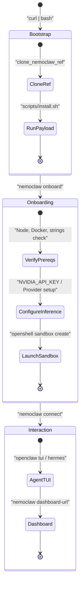

**Sources:** [install.sh:78-106](), [scripts/install.sh:173-182](), [docs/get-started/quickstart.mdx:36-78](), [docs/get-started/quickstart-hermes.mdx:37-77]()

---

## Command Hierarchy

NemoClaw uses a layered command approach. The `nemoclaw` host utility orchestrates the `openshell` CLI, while the agents (OpenClaw, Hermes, or dcode) run inside the sandbox.

| Command | Context | Role |
|---------|---------|------|
| `nemoclaw onboard` | Host | Interactive wizard to set up environment and providers [install.sh:123-140]() |
| `nemoclaw connect` | Host | Connect to an active sandbox via SSH [docs/get-started/quickstart.mdx:73-76]() |
| `nemoclaw status` | Host | Check health of sandboxes and gateway [docs/get-started/quickstart.mdx:59-62]() |
| `nemohermes` | Host | NemoClaw CLI with Hermes pre-selected [docs/get-started/quickstart-hermes.mdx:16]() |
| `nemo-deepagents` | Host | NemoClaw CLI with LangChain Deep Agents pre-selected [bin/nemoclaw.js:7-10]() |

**Sources:** [bin/nemoclaw.js:6-12](), [docs/get-started/quickstart.mdx:56-77](), [docs/get-started/quickstart-hermes.mdx:55-76](), [install.sh:119-160]()

---

## Next Steps

After completing the initial setup, proceed to the child pages for detailed guidance:

1. **[Installation](#2.1)** — Detailed instructions for automated and manual setups, platform-specific notes, and dependency management.
2. **[Quick Start Guide](#2.2)** — Hands-on walkthrough to launch your first sandbox and interact with the agent.
3. **[Configuration and Onboarding](#2.3)** — Deep dive into the onboarding wizard, inference provider selection, and credential storage.

For information about the underlying architecture, see [System Architecture](#3.1). For troubleshooting installation issues, see [Troubleshooting](#8.5).

**Sources:** [README.md:45-62](), [docs/index.mdx:1-20]()

---

# Page: Installation

# Installation

<details>
<summary>Relevant source files</summary>

The following files were used as context for generating this wiki page:

- [.github/dco-bypass.txt](.github/dco-bypass.txt)
- [.github/workflows/dco-check.yaml](.github/workflows/dco-check.yaml)
- [.github/workflows/installer-hash-check.yaml](.github/workflows/installer-hash-check.yaml)
- [README.md](README.md)
- [bin/nemoclaw.js](bin/nemoclaw.js)
- [install.sh](install.sh)
- [nemoclaw-blueprint/blueprint.yaml](nemoclaw-blueprint/blueprint.yaml)
- [scripts/brev-launchable-ci-cpu.sh](scripts/brev-launchable-ci-cpu.sh)
- [scripts/check-installer-hash.sh](scripts/check-installer-hash.sh)
- [scripts/checks/extract-installer-pins.mts](scripts/checks/extract-installer-pins.mts)
- [scripts/install-openshell.sh](scripts/install-openshell.sh)
- [scripts/install.sh](scripts/install.sh)
- [scripts/start-services.sh](scripts/start-services.sh)
- [src/lib/onboard/docker-cdi.test.ts](src/lib/onboard/docker-cdi.test.ts)
- [src/lib/onboard/docker-cdi.ts](src/lib/onboard/docker-cdi.ts)
- [src/lib/onboard/fatal-runtime-preflight.test.ts](src/lib/onboard/fatal-runtime-preflight.test.ts)
- [src/lib/onboard/preflight-cdi.test.ts](src/lib/onboard/preflight-cdi.test.ts)
- [src/lib/onboard/preflight-messages.test.ts](src/lib/onboard/preflight-messages.test.ts)
- [src/lib/onboard/preflight-messages.ts](src/lib/onboard/preflight-messages.ts)
- [src/lib/onboard/preflight-podman-compat.test.ts](src/lib/onboard/preflight-podman-compat.test.ts)
- [src/lib/onboard/preflight.test.ts](src/lib/onboard/preflight.test.ts)
- [src/lib/onboard/preflight.ts](src/lib/onboard/preflight.ts)
- [src/lib/runner.ts](src/lib/runner.ts)
- [test/brev-launchable-ci-cpu-checksum.test.ts](test/brev-launchable-ci-cpu-checksum.test.ts)
- [test/dependency-pins-check.test.ts](test/dependency-pins-check.test.ts)
- [test/install-onboard-yes.test.ts](test/install-onboard-yes.test.ts)
- [test/install-openshell-version-check.test.ts](test/install-openshell-version-check.test.ts)
- [test/install-preflight.test.ts](test/install-preflight.test.ts)
- [test/installer-hash-check.test.ts](test/installer-hash-check.test.ts)
- [test/runner.test.ts](test/runner.test.ts)
- [uninstall.sh](uninstall.sh)

</details>


This page covers installing NemoClaw and its prerequisites. For first-time setup and configuration after installation, see [Configuration and Onboarding](#2.3). For running your first agent task, see [Quick Start Guide](#2.2).

## Installation Methods

NemoClaw supports three installation paths depending on your use case:

Title: Installation Decision Flow
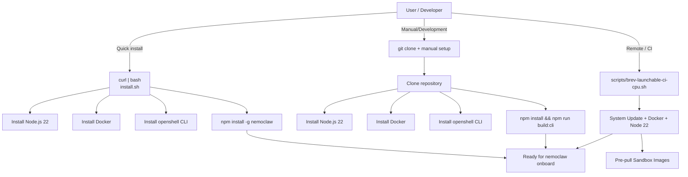

**Sources**: [install.sh:65-76](), [scripts/install.sh:7-9](), [scripts/brev-launchable-ci-cpu.sh:10-15]()

## Prerequisites

NemoClaw requires the following components:

| Component | Minimum Version | Purpose |
|-----------|----------------|---------|
| Node.js | 22.x | Runtime for `nemoclaw` CLI and agent plugins [scripts/install.sh:7-9]() |
| Docker | Native | Container runtime for OpenShell gateway and sandboxes [src/lib/onboard/preflight.ts:124-125]() |
| OpenShell CLI | 0.0.85 | Sandbox orchestration and policy enforcement [scripts/install-openshell.sh:40-43]() |
| API Key | — | NVIDIA Cloud inference access [nemoclaw-blueprint/blueprint.yaml:61-66]() |

### OpenShell Compatibility
NemoClaw requires OpenShell `0.0.85` specifically to support advanced credential rewriting and policy features:
- `request-body-credential-rewrite`: For injecting keys into REST bodies [scripts/install-openshell.sh:36-39]().
- `websocket-credential-rewrite`: For secure WebSocket connections [scripts/install-openshell.sh:36-39]().
- `allow_all_known_mcp_methods`: MCP/JSON-RPC L7 enforcement [scripts/install-openshell.sh:38-40]().

On macOS, the installer verifies the architecture; Apple Silicon (aarch64) is required [install.sh:108-117]().

**Sources**: [scripts/install-openshell.sh:40-48](), [scripts/install-openshell.sh:143-163](), [nemoclaw-blueprint/blueprint.yaml:5-7]()

## Quick Installation

The fastest way to install NemoClaw is via the hosted bootstrap script:

```console
$ curl -fsSL https://www.nvidia.com/nemoclaw.sh | bash
```

This bootstrap script (`install.sh`) performs the following operations:

Title: Automated Installation Data Flow
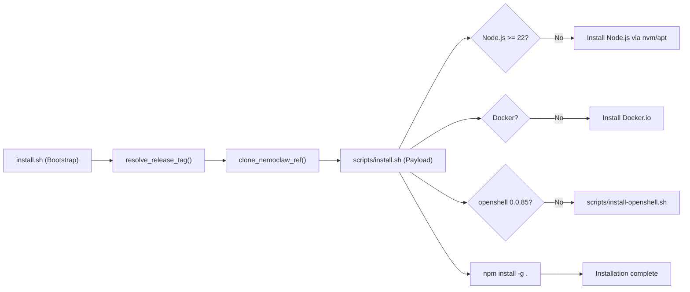

**Sources**: [install.sh:65-106](), [scripts/install.sh:173-182](), [scripts/install-openshell.sh:40-48]()

### Component Installation Details

#### Bootstrap Logic
The root `install.sh` acts as a thin bootstrap. It clones the repository to a temporary directory and executes the versioned payload from `scripts/install.sh` [install.sh:78-106](). It supports options like `--non-interactive` and `--yes-i-accept-third-party-software` [install.sh:129-135]().

#### Version Resolution
The installer determines the version to install by checking environment variables (`NEMOCLAW_INSTALL_REF`), git tags, or the `.version` file [scripts/install.sh:62-98]().

**Sources**: [install.sh:23-29](), [scripts/install.sh:145-154]()

## Manual Installation

### Step 1: Install Node.js 22
NemoClaw is a Node.js application. The installer checks for a minimum version of Node.js and attempts an upgrade if `nvm` is present [test/install-preflight.test.ts:130-185]().

### Step 2: Install Docker
Ensure Docker is running. The host assessment logic verifies the presence of the Docker binary and the running daemon [src/lib/onboard/preflight.ts:121-125]().

### Step 3: Install NemoClaw from Source
```console
$ git clone https://github.com/NVIDIA/NemoClaw.git
$ cd NemoClaw
$ npm install
$ npm run build
```
The entry point for the CLI is located at `bin/nemoclaw.js`, which requires the compiled distribution in `dist/nemoclaw` [bin/nemoclaw.js:1-12]().

## Remote and CI Deployment

For remote GPU instances (e.g., Brev.dev) or CI runners, use the launchable scripts.

### CI Ready CPU Setup
The script `scripts/brev-launchable-ci-cpu.sh` pre-bakes a VM with:
1. Docker and Node.js 22 [scripts/brev-launchable-ci-cpu.sh:132-159]().
2. Pinned OpenShell CLI (v0.0.85) [scripts/brev-launchable-ci-cpu.sh:43-43]().
3. Pre-pulled Docker images for the sandbox base defined in the blueprint [nemoclaw-blueprint/blueprint.yaml:35-35]().

**Sources**: [scripts/brev-launchable-ci-cpu.sh:1-60]()

## Uninstallation

To remove NemoClaw while preserving system tools, use the compatibility wrapper:

```console
$ ./uninstall.sh --yes
```

The uninstaller maps to the internal command: `nemoclaw internal uninstall run-plan` [uninstall.sh:23-26](). It targets:
1. Active sandboxes and the OpenShell gateway.
2. The `~/.nemoclaw` registry and onboard session state [test/install-preflight.test.ts:52-66]().
3. Optionally, local model weights if `--delete-models` is provided [uninstall.sh:7-7]().

**Sources**: [uninstall.sh:1-27]()

## File System Layout

Title: NemoClaw Host-Side Entities
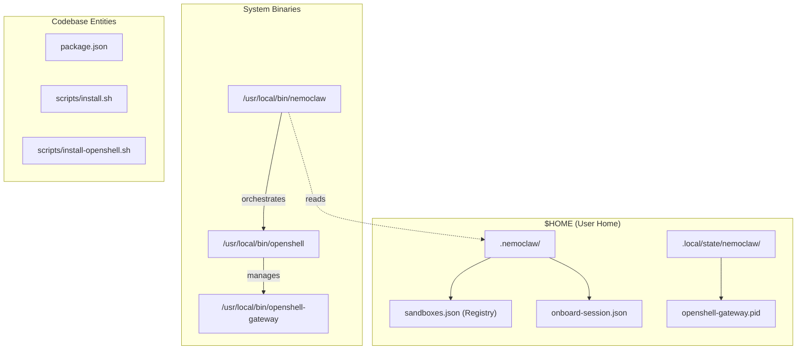

**Sources**: [test/install-preflight.test.ts:52-56](), [bin/nemoclaw.js:1-12](), [src/lib/runner.ts:19-20]()

## Verification

After installation, verify the setup by checking the version of both NemoClaw and the underlying OpenShell:

```bash
# Check NemoClaw version
nemoclaw --version

# Check OpenShell version and capabilities
openshell --version
```

The OpenShell version should be `0.0.85` to ensure compatibility with current NemoClaw release features [scripts/install-openshell.sh:40-43]().

**Sources**: [scripts/install-openshell.sh:40-43](), [test/install-openshell-version-check.test.ts:105-107]()

---

# Page: Quick Start Guide

# Quick Start Guide

<details>
<summary>Relevant source files</summary>

The following files were used as context for generating this wiki page:

- [ci/platform-matrix.json](ci/platform-matrix.json)
- [docs/about/ecosystem-deepagents.mdx](docs/about/ecosystem-deepagents.mdx)
- [docs/about/ecosystem-hermes.mdx](docs/about/ecosystem-hermes.mdx)
- [docs/about/ecosystem.mdx](docs/about/ecosystem.mdx)
- [docs/about/overview.mdx](docs/about/overview.mdx)
- [docs/get-started/dgx-station-preparation.mdx](docs/get-started/dgx-station-preparation.mdx)
- [docs/get-started/prerequisites.mdx](docs/get-started/prerequisites.mdx)
- [docs/get-started/quickstart-hermes.mdx](docs/get-started/quickstart-hermes.mdx)
- [docs/get-started/quickstart.mdx](docs/get-started/quickstart.mdx)
- [docs/index.mdx](docs/index.mdx)
- [docs/reference/platform-support.mdx](docs/reference/platform-support.mdx)
- [src/lib/onboard/__test-helpers__/machine-recorders.ts](src/lib/onboard/__test-helpers__/machine-recorders.ts)
- [src/lib/onboard/exit-step-failure.test.ts](src/lib/onboard/exit-step-failure.test.ts)
- [src/lib/onboard/exit-step-failure.ts](src/lib/onboard/exit-step-failure.ts)
- [src/lib/onboard/finalization-deps.ts](src/lib/onboard/finalization-deps.ts)
- [src/lib/onboard/lifecycle-contracts.md](src/lib/onboard/lifecycle-contracts.md)
- [src/lib/onboard/machine/core-flow-phases.test.ts](src/lib/onboard/machine/core-flow-phases.test.ts)
- [src/lib/onboard/machine/core-flow-phases.ts](src/lib/onboard/machine/core-flow-phases.ts)
- [src/lib/onboard/machine/final-flow-phases.runtime.test.ts](src/lib/onboard/machine/final-flow-phases.runtime.test.ts)
- [src/lib/onboard/machine/final-flow-phases.test.ts](src/lib/onboard/machine/final-flow-phases.test.ts)
- [src/lib/onboard/machine/final-flow-phases.ts](src/lib/onboard/machine/final-flow-phases.ts)
- [src/lib/onboard/machine/handlers/finalization.test.ts](src/lib/onboard/machine/handlers/finalization.test.ts)
- [src/lib/onboard/machine/handlers/finalization.ts](src/lib/onboard/machine/handlers/finalization.ts)
- [src/lib/onboard/machine/initial-flow-phases.test.ts](src/lib/onboard/machine/initial-flow-phases.test.ts)
- [src/lib/onboard/machine/initial-flow-phases.ts](src/lib/onboard/machine/initial-flow-phases.ts)
- [src/lib/onboard/machine/live-flow-slice.test.ts](src/lib/onboard/machine/live-flow-slice.test.ts)
- [src/lib/onboard/machine/live-flow-slice.ts](src/lib/onboard/machine/live-flow-slice.ts)
- [src/lib/onboard/machine/runtime.test.ts](src/lib/onboard/machine/runtime.test.ts)
- [src/lib/onboard/machine/runtime.ts](src/lib/onboard/machine/runtime.ts)
- [src/lib/onboard/machine/transitions.ts](src/lib/onboard/machine/transitions.ts)
- [src/lib/onboard/runtime-boundary-record-only.test.ts](src/lib/onboard/runtime-boundary-record-only.test.ts)
- [src/lib/onboard/runtime-boundary.test.ts](src/lib/onboard/runtime-boundary.test.ts)
- [src/lib/onboard/runtime-boundary.ts](src/lib/onboard/runtime-boundary.ts)
- [src/lib/sandbox/create-stream-process-group.test.ts](src/lib/sandbox/create-stream-process-group.test.ts)
- [src/lib/sandbox/create-stream.ts](src/lib/sandbox/create-stream.ts)
- [src/lib/state/onboard-session.test.ts](src/lib/state/onboard-session.test.ts)
- [src/lib/state/onboard-session.ts](src/lib/state/onboard-session.ts)
- [src/lib/state/onboard-step-mutation.test.ts](src/lib/state/onboard-step-mutation.test.ts)
- [src/lib/state/onboard-step-mutation.ts](src/lib/state/onboard-step-mutation.ts)
- [src/lib/state/onboard-step-state.ts](src/lib/state/onboard-step-state.ts)
- [test/helpers/onboard-final-flow-phases.ts](test/helpers/onboard-final-flow-phases.ts)
- [test/helpers/onboard-legacy-step-mutation.ts](test/helpers/onboard-legacy-step-mutation.ts)
- [test/helpers/rebuild-flow-target-image-cases.ts](test/helpers/rebuild-flow-target-image-cases.ts)
- [test/onboard-exit-handler.test.ts](test/onboard-exit-handler.test.ts)
- [test/onboard-sandbox-recreation.test.ts](test/onboard-sandbox-recreation.test.ts)
- [test/repro-1751-extra.test.ts](test/repro-1751-extra.test.ts)
- [test/station-doc-ownership.test.ts](test/station-doc-ownership.test.ts)

</details>


This guide provides a hands-on walkthrough to launch your first NemoClaw sandbox, configure inference, and interact with the OpenClaw agent. It assumes you have already completed the initial installation.

## Prerequisites

Before starting this guide, verify your environment meets the hardware and software requirements:

- **Hardware**: Minimum 4 vCPU, 8 GB RAM (16 GB recommended), and 20 GB free disk space [docs/get-started/prerequisites.mdx:16-20]().
- **Node.js**: Version 22.19 or later [docs/get-started/prerequisites.mdx:32]().
- **Container Runtime**: Docker Engine, Docker Desktop, or Colima must be running [docs/get-started/prerequisites.mdx:35](), [docs/get-started/quickstart.mdx:145]().
- **Credentials**: An API key for your chosen inference provider (e.g., `NVIDIA_API_KEY`) [docs/get-started/quickstart.mdx:110]().

**Sources**: [docs/get-started/prerequisites.mdx:16-35](), [docs/get-started/quickstart.mdx:110-145]()

---

## Interaction and Code Mapping

The following diagram maps the Natural Language commands used in this guide to the underlying Code Entities and OpenShell resources they invoke.

### Interaction Flow: Host to Sandbox
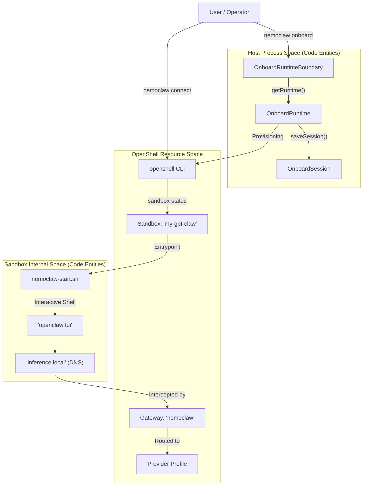
**Sources**: [src/lib/onboard/runtime-boundary.ts:41-57](), [src/lib/onboard/machine/runtime.ts:1-20](), [src/lib/state/onboard-session.ts:154-200](), [docs/get-started/quickstart.mdx:37-78]()

---

## Launching Your First Sandbox

Run the interactive onboarding wizard to configure your environment. This process handles gateway setup, inference registration, and sandbox creation.

```bash
export NEMOCLAW_SANDBOX_NAME=my-gpt-claw
curl -fsSL https://www.nvidia.com/nemoclaw.sh | bash
```
[docs/get-started/quickstart.mdx:41-42]()

### Onboarding Workflow
The onboarding process is managed by a state machine defined in the `OnboardRuntime` [src/lib/onboard/machine/runtime.ts:23](). It transitions through several key phases:

1. **Inference Selection**: Choose from providers like NVIDIA Endpoints, OpenRouter, or local vLLM/Ollama [docs/get-started/quickstart.mdx:132]().
2. **Credentialing**: Provide API keys. The wizard tracks progress in `SandboxPromptProgress` [src/lib/state/onboard-session.ts:142-147]().
3. **Sandbox Provisioning**: Creates the isolated environment using OpenShell. The state is recorded in the `Session` object [src/lib/state/onboard-session.ts:154-200]().
4. **Policy Assignment**: Select a network policy tier to define the agent's boundary [docs/get-started/quickstart.mdx:53]().

For non-interactive or CI environments, you can bypass the wizard by providing environment variables:
```bash
NEMOCLAW_NON_INTERACTIVE=1 \
NEMOCLAW_ACCEPT_THIRD_PARTY_SOFTWARE=1 \
NEMOCLAW_AGENT=openclaw \
NEMOCLAW_PROVIDER=build \
NVIDIA_INFERENCE_API_KEY=<your-key> \
bash nemoclaw.sh
```
[docs/get-started/quickstart.mdx:105-112]()

**Sources**: [src/lib/onboard/machine/runtime.ts:23](), [src/lib/state/onboard-session.ts:142-200](), [docs/get-started/quickstart.mdx:41-112]()

---

## Verify Sandbox Status

Verify that your sandbox is running and check its configuration:

```bash
nemoclaw my-gpt-claw status
```
[docs/get-started/quickstart.mdx:60]()

This command inspects the `OnboardMachineSnapshot` which tracks the durable state of the deployment [src/lib/state/onboard-session.ts:134-140]().

| Attribute | Description | Code Reference |
|-------|-------------|----------------|
| **State** | Current machine phase (e.g., `complete`) | `state` [src/lib/state/onboard-session.ts:136]() |
| **Provider** | The active inference endpoint | `provider` [src/lib/state/onboard-session.ts:167]() |
| **Model** | The LLM assigned to the sandbox | `model` [src/lib/state/onboard-session.ts:168]() |
| **Revision** | Version of the current state snapshot | `revision` [src/lib/state/onboard-session.ts:138]() |

**Sources**: [docs/get-started/quickstart.mdx:60](), [src/lib/state/onboard-session.ts:134-168]()

---

## Connect and Interact

### Connect to the Sandbox Shell
Establish an interactive SSH session into the isolated environment:

```bash
nemoclaw my-gpt-claw connect
```
[docs/get-started/quickstart.mdx:74]()

### Use the OpenClaw TUI
Inside the sandbox, launch the terminal user interface to chat with the agent:

```bash
openclaw tui
```
[docs/get-started/quickstart.mdx:75]()

### Dashboard Access
Alternatively, you can interact via the web dashboard. Retrieve the URL using:

```bash
nemoclaw my-gpt-claw dashboard-url --quiet
```
[docs/get-started/quickstart.mdx:68]()

**Sources**: [docs/get-started/quickstart.mdx:68-75]()

---

## Inference Data Flow

NemoClaw utilizes the OpenShell gateway to route inference requests. The agent inside the sandbox communicates with a local DNS alias, which the gateway intercepts and proxies to the configured provider.

### Inference Request Path
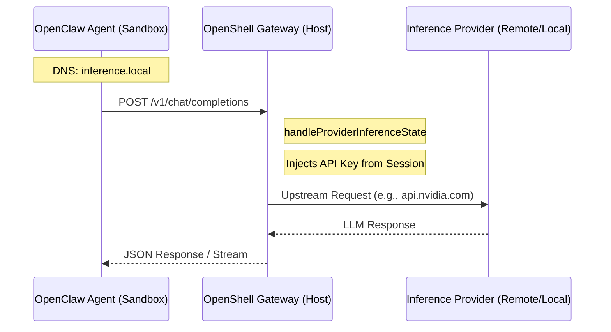
**Sources**: [src/lib/onboard/machine/core-flow-phases.ts:137-169](), [src/lib/state/onboard-session.ts:173-178](), [docs/get-started/quickstart.mdx:132-134]()

---

# Page: Configuration and Onboarding

# Configuration and Onboarding

<details>
<summary>Relevant source files</summary>

The following files were used as context for generating this wiki page:

- [ci/env-var-doc-allowlist.json](ci/env-var-doc-allowlist.json)
- [ci/test-file-size-budget.json](ci/test-file-size-budget.json)
- [scripts/lib/entrypoint-env-wrapper.sh](scripts/lib/entrypoint-env-wrapper.sh)
- [src/lib/actions/sandbox/rebuild-preflight-target-phase.test.ts](src/lib/actions/sandbox/rebuild-preflight-target-phase.test.ts)
- [src/lib/actions/sandbox/rebuild-recreate-phase.ts](src/lib/actions/sandbox/rebuild-recreate-phase.ts)
- [src/lib/actions/sandbox/rebuild-recreate-reasoning.test.ts](src/lib/actions/sandbox/rebuild-recreate-reasoning.test.ts)
- [src/lib/messaging/applier/build/messaging-build-applier.mts](src/lib/messaging/applier/build/messaging-build-applier.mts)
- [src/lib/messaging/post-agent-install-selection.ts](src/lib/messaging/post-agent-install-selection.ts)
- [src/lib/onboard.ts](src/lib/onboard.ts)
- [src/lib/onboard/authoritative-rebuild-target.test.ts](src/lib/onboard/authoritative-rebuild-target.test.ts)
- [src/lib/onboard/authoritative-rebuild-target.ts](src/lib/onboard/authoritative-rebuild-target.ts)
- [src/lib/onboard/machine/handlers/provider-inference-authoritative-recovery.test.ts](src/lib/onboard/machine/handlers/provider-inference-authoritative-recovery.test.ts)
- [src/lib/onboard/machine/handlers/provider-inference-recovery-gating.test.ts](src/lib/onboard/machine/handlers/provider-inference-recovery-gating.test.ts)
- [src/lib/onboard/machine/handlers/provider-inference-recovery.ts](src/lib/onboard/machine/handlers/provider-inference-recovery.ts)
- [src/lib/onboard/machine/handlers/provider-inference-route-containment.test.ts](src/lib/onboard/machine/handlers/provider-inference-route-containment.test.ts)
- [src/lib/onboard/machine/handlers/provider-inference.test-support.ts](src/lib/onboard/machine/handlers/provider-inference.test-support.ts)
- [src/lib/onboard/machine/handlers/provider-inference.test.ts](src/lib/onboard/machine/handlers/provider-inference.test.ts)
- [src/lib/onboard/machine/handlers/provider-inference.ts](src/lib/onboard/machine/handlers/provider-inference.ts)
- [src/lib/onboard/managed-startup-agent-environment.test.ts](src/lib/onboard/managed-startup-agent-environment.test.ts)
- [src/lib/onboard/managed-startup-image-runtime.test.ts](src/lib/onboard/managed-startup-image-runtime.test.ts)
- [src/lib/onboard/managed-startup-onboard-profile.test.ts](src/lib/onboard/managed-startup-onboard-profile.test.ts)
- [src/lib/onboard/managed-startup-profile-builder.test.ts](src/lib/onboard/managed-startup-profile-builder.test.ts)
- [src/lib/onboard/managed-startup-profile.test.ts](src/lib/onboard/managed-startup-profile.test.ts)
- [src/lib/onboard/managed-startup/agent-environment.ts](src/lib/onboard/managed-startup/agent-environment.ts)
- [src/lib/onboard/managed-startup/image-runtime.ts](src/lib/onboard/managed-startup/image-runtime.ts)
- [src/lib/onboard/managed-startup/onboard-profile.ts](src/lib/onboard/managed-startup/onboard-profile.ts)
- [src/lib/onboard/managed-startup/profile-builder.ts](src/lib/onboard/managed-startup/profile-builder.ts)
- [src/lib/onboard/managed-startup/profile.ts](src/lib/onboard/managed-startup/profile.ts)
- [src/lib/onboard/provider-recovery.test.ts](src/lib/onboard/provider-recovery.test.ts)
- [src/lib/onboard/provider-recovery.ts](src/lib/onboard/provider-recovery.ts)
- [src/lib/onboard/rebuild-route-handoff.test.ts](src/lib/onboard/rebuild-route-handoff.test.ts)
- [src/lib/onboard/rebuild-route-handoff.ts](src/lib/onboard/rebuild-route-handoff.ts)
- [src/lib/onboard/session-updates.test.ts](src/lib/onboard/session-updates.test.ts)
- [src/lib/onboard/session-updates.ts](src/lib/onboard/session-updates.ts)
- [src/lib/onboard/setup-inference-route-containment.test.ts](src/lib/onboard/setup-inference-route-containment.test.ts)
- [src/lib/onboard/setup-inference.ts](src/lib/onboard/setup-inference.ts)
- [src/lib/onboard/setup-nim-flow.test.ts](src/lib/onboard/setup-nim-flow.test.ts)
- [src/lib/onboard/setup-nim-flow.ts](src/lib/onboard/setup-nim-flow.ts)
- [src/lib/policy/index.ts](src/lib/policy/index.ts)
- [src/nemoclaw.ts](src/nemoclaw.ts)
- [test/entrypoint-env-wrapper.test.ts](test/entrypoint-env-wrapper.test.ts)
- [test/messaging-build-applier.test.ts](test/messaging-build-applier.test.ts)
- [test/onboard-resume-provider-recovery.test.ts](test/onboard-resume-provider-recovery.test.ts)
- [test/onboard-selection.test.ts](test/onboard-selection.test.ts)
- [test/onboard.test.ts](test/onboard.test.ts)
- [test/policies.test.ts](test/policies.test.ts)

</details>


This page explains the NemoClaw onboarding process, which configures inference endpoints, manages API credentials, and sets up the OpenShell provider routing. After installation (see [Installation]()), onboarding is the next step before launching a sandbox (see [Quick Start Guide]()).

Onboarding creates the necessary OpenShell providers, validates credentials against the selected inference backend, and stores the configuration for future use. The process is governed by a state machine that supports both interactive (wizard-driven) and non-interactive (CLI flag) modes.

---

## Onboarding Workflow

NemoClaw provides an interactive onboarding wizard implemented in `src/lib/onboard.ts` [src/lib/onboard.ts:4-7](). This wizard guides the user through steps from zero to a running sandbox, including host assessments and inference configuration.

### State Machine and Runtime Boundary
The onboarding logic is decoupled from the UI via the `OnboardRuntime` and `OnboardRuntimeBoundary` classes.
*   **OnboardRuntime**: Manages the transitions between machine states (e.g., `init` -> `preflight` -> `gateway`) and ensures valid state transitions [src/lib/onboard/machine/runtime.ts:100-105](). It uses `assertValidOnboardMachineTransition` to enforce the FSM (Finite State Machine) logic [src/lib/onboard/machine/runtime.ts:165]().
*   **OnboardRuntimeBoundary**: Acts as a bridge between the legacy step-based onboarding and the new state machine. It records step completion while ensuring the machine snapshot remains synchronized [src/lib/onboard/runtime-boundary.ts:29-32]().
*   **Event System**: Transitions and context updates emit events (e.g., `state.entered`, `context.updated`) via `emitOnboardMachineEvent` for observability [src/lib/onboard/machine/runtime.ts:182-183]().

### Session Management and Resumption
To ensure robustness, the onboarding process is managed as a **Session** via `src/lib/state/onboard-session.ts` [src/lib/state/onboard-session.ts:80-133]().
*   **Persistence**: State is saved to `~/.nemoclaw/onboard-session.json` to allow resumption if the process is interrupted [src/lib/state/onboard-session.ts:34-35]().
*   **Locking**: A file-based lock (`onboard.lock`) prevents concurrent onboarding processes from corrupting the state [src/lib/state/onboard-session.ts:36]().
*   **Revision Tracking**: Every session includes a `revision` number and `stateEnteredAt` timestamp to track machine progress [src/lib/state/onboard-session.ts:73-78]().

### Technical Data Flow
The following diagram bridges the natural language onboarding steps to the underlying code entities.

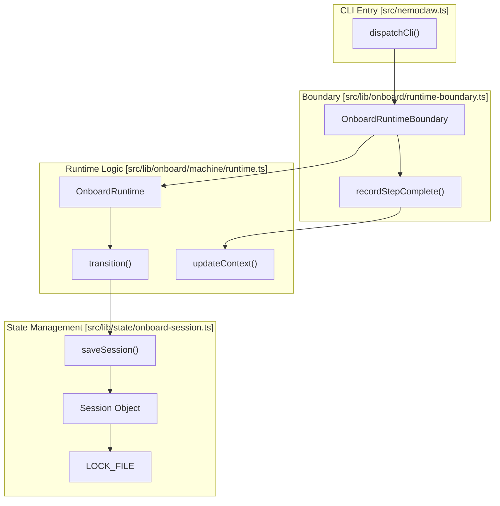
**Sources**: [src/lib/onboard/machine/runtime.ts:100-200](), [src/lib/onboard/runtime-boundary.ts:29-64](), [src/lib/state/onboard-session.ts:32-133](), [src/nemoclaw.ts:9-16]()

---

## Inference Endpoint Selection

NemoClaw supports several inference backends, categorized into Remote (Cloud) and Local providers. Selection is stored in the session context under `provider` and `model` [src/lib/state/onboard-session.ts:93-94]().

### Supported Providers and Credentials
The `ProviderInferenceSetupOptions` and `ProviderSelectionResult` interfaces define the structure for inference provider configuration [src/lib/onboard/machine/handlers/provider-inference.ts:69-91]().

| Endpoint Type | Provider Name | Credential Env | Validation Helper |
| :--- | :--- | :--- | :--- |
| Remote | `nvidia-prod` | `NVIDIA_INFERENCE_API_KEY` | `createNvidiaFeaturedModelSession` [src/lib/onboard.ts:26]() |
| Remote | `openai-api` | `OPENAI_API_KEY` | `validateOpenAiLikeModel` [test/onboard-selection.test.ts:23]() |
| Remote | `anthropic-prod` | `ANTHROPIC_API_KEY` | `validateAnthropicModel` [test/onboard-selection.test.ts:22]() |
| Remote | `gemini-api` | `GEMINI_API_KEY` | `promptCloudModel` [test/onboard-selection.test.ts:14]() |
| Local | `ollama-local` | `OLLAMA_PROXY_TOKEN` | `detectWindowsHostOllama` [test/onboard-selection.test.ts:55]() |
| Local | `vllm-local` | `VLLM_API_KEY` | `handleVllmSelection` [src/lib/onboard/setup-nim-flow.test.ts:131]() |
| Remote | `openrouter-api` | `OPENROUTER_API_KEY` | `openrouterSelection` [src/lib/onboard.ts:31]() |
| Remote | `compatible-endpoint` | `COMPATIBLE_API_KEY` | `createRemoteModelValidator` [src/lib/onboard.ts:27]() |
| Remote | `compatible-anthropic-endpoint` | `ANTHROPIC_COMPATIBLE_API_KEY` | `createRemoteModelValidator` [src/lib/onboard.ts:27]() |

**Sources**: [src/lib/onboard.ts:26-31](), [src/lib/onboard/machine/handlers/provider-inference.ts:69-91](), [src/lib/onboard/setup-nim-flow.test.ts:14-57](), [test/onboard-selection.test.ts:22-23](), [test/onboard-selection.test.ts:14](), [test/onboard-selection.test.ts:55]()

### Model Validation and Probing
NemoClaw performs active probing to ensure the selected model exists and credentials are valid.
*   **Auth Retry Logic**: The onboarding test suite simulates auth failures (403 Forbidden) to verify that the wizard correctly prompts for credential re-entry [test/onboard-selection.test.ts:67-70](). The `CREDENTIAL_RETRY_PROMPT` constant defines the expected prompt text [test/onboard-selection.test.ts:67-68]().
*   **Gemini Special Handling**: Unlike Bearer tokens, Gemini authentication is validated by extracting the `key=` query parameter from the URL [test/onboard-selection.test.ts:118-120]().
*   **Local Inference Timeouts**: Local providers (Ollama/vLLM) use a specific timeout defined by `LOCAL_INFERENCE_TIMEOUT_SECS` [src/lib/onboard.ts:7]().

**Sources**: [src/lib/onboard.ts:7](), [test/onboard-selection.test.ts:67-70](), [test/onboard-selection.test.ts:118-120]()

---

## API Key Management and Credential Storage

### Secure Storage and Redaction
Credentials are treated as sensitive material throughout the onboarding lifecycle.
1.  **Redaction**: The `redactUrl` and `redactSensitiveText` utilities in `src/lib/security/redact.ts` strip sensitive keys from URLs and session files before they are written to disk [src/lib/state/onboard-session.ts:28]().
2.  **Command Line Safety**: The system ensures that API keys are never passed as CLI arguments to `openshell`. Instead, it uses `--credential` flags that pass only the **environment variable name**, forcing the subprocess to read the value from its own environment [test/credential-exposure.test.ts:32-45]().
3.  **Migration Hashes**: To safely migrate legacy credentials, NemoClaw stores SHA-256 hex digests of successfully written credentials in `migratedLegacyValueHashes`. This allows the system to detect if a value was changed out-of-band [src/lib/state/onboard-session.ts:115-126]().

### Credential Flow Diagram
This diagram shows how credentials move from user input to the OpenShell execution environment without being exposed in process listings.

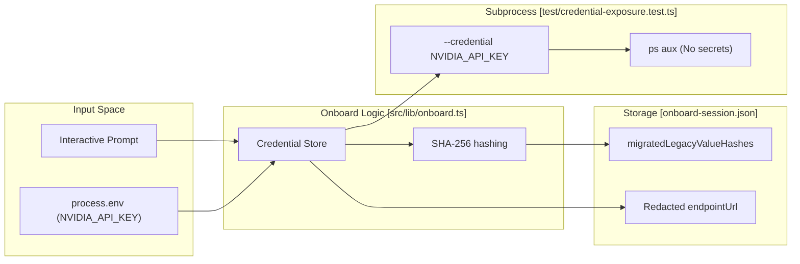
**Sources**: [src/lib/state/onboard-session.ts:115-126](), [test/credential-exposure.test.ts:32-45](), [src/lib/security/redact.ts:1-10]()

---

## Non-Interactive Onboarding

For CI/CD and automated environments, onboarding can be performed without user intervention.
*   **Activation**: Triggered by the `--non-interactive` flag or the `NEMOCLAW_NON_INTERACTIVE=1` environment variable [src/lib/onboard.ts:9-10]().
*   **Abort Logic**: If the system requires user input (e.g., a choice between multiple GPUs) while in non-interactive mode, it calls `abortNonInteractive` to fail gracefully [src/lib/onboard.ts:43-44]().
*   **Proxy Propagation**: In automated environments, host proxy settings (`HTTP_PROXY`, `HTTPS_PROXY`, `NO_PROXY`) are automatically detected and injected into the sandbox environment via `appendHostProxyEnvArgs` [test/onboard.test.ts:10-11](). This ensures that the sandbox can access external resources through the host's proxy configuration.

**Sources**: [src/lib/onboard.ts:9-10](), [src/lib/onboard.ts:43-44](), [test/onboard.test.ts:10-11](), [test/onboard.test.ts:103-119]()

---

## Initial Policy and GPU Configuration

During onboarding, NemoClaw prepares the initial sandbox security policy.
*   **Policy Presets**: The `applyPresets` function merges built-in policy presets (e.g., for messaging channels like Telegram, Discord, Slack, WeChat) into the sandbox's policy [src/lib/policy/index.ts:139-157](). The `arePolicyPresetsApplied` helper checks if a given set of presets has already been applied [test/onboard.test.ts:55-56]().
*   **GPU Integration**:
    *   **CDI Specs**: The system parses Docker CDI (Container Device Interface) specifications to identify NVIDIA GPUs using `findReadableNvidiaCdiSpecFiles` and `parseDockerCdiSpecDirs` [src/lib/onboard.ts:83-84]().
    *   **GPU Arguments**: `buildSandboxGpuCreateArgs` generates the necessary Docker flags to passthrough the GPU to the sandbox container [src/lib/onboard.ts:87-88]().
    *   **Direct GPU Policy**: If a GPU is requested, `buildDirectGpuPolicyYaml` creates a Landlock/seccomp policy that allows the sandbox to access GPU device nodes [src/lib/onboard.ts:108-111]().

**Sources**: [src/lib/onboard.ts:83-84](), [src/lib/onboard.ts:87-88](), [src/lib/onboard.ts:108-111](), [src/lib/policy/index.ts:139-157](), [test/onboard.test.ts:55-56]()

---

# Page: Core Concepts

# Core Concepts

<details>
<summary>Relevant source files</summary>

The following files were used as context for generating this wiki page:

- [.agents/skills/_shared/controlled-words.md](.agents/skills/_shared/controlled-words.md)
- [.agents/skills/_shared/documentation-writing-review.md](.agents/skills/_shared/documentation-writing-review.md)
- [.agents/skills/_shared/pr-follow-up.md](.agents/skills/_shared/pr-follow-up.md)
- [.agents/skills/nemoclaw-contributor-create-pr/SKILL.md](.agents/skills/nemoclaw-contributor-create-pr/SKILL.md)
- [.agents/skills/nemoclaw-contributor-onboard-messaging-channel/SKILL.md](.agents/skills/nemoclaw-contributor-onboard-messaging-channel/SKILL.md)
- [.agents/skills/nemoclaw-contributor-update-docs/SKILL.md](.agents/skills/nemoclaw-contributor-update-docs/SKILL.md)
- [.agents/skills/nemoclaw-maintainer-day/PR-REVIEW-PRIORITIES.md](.agents/skills/nemoclaw-maintainer-day/PR-REVIEW-PRIORITIES.md)
- [.agents/skills/nemoclaw-maintainer-day/SALVAGE-PR.md](.agents/skills/nemoclaw-maintainer-day/SALVAGE-PR.md)
- [.agents/skills/nemoclaw-maintainer-day/TEST-GAPS.md](.agents/skills/nemoclaw-maintainer-day/TEST-GAPS.md)
- [.agents/skills/nemoclaw-maintainer-policies/SKILL.md](.agents/skills/nemoclaw-maintainer-policies/SKILL.md)
- [.agents/skills/nemoclaw-maintainer-refactor-docs/SKILL.md](.agents/skills/nemoclaw-maintainer-refactor-docs/SKILL.md)
- [.agents/skills/nemoclaw-maintainer-release-notes/SKILL.md](.agents/skills/nemoclaw-maintainer-release-notes/SKILL.md)
- [.github/PULL_REQUEST_TEMPLATE.md](.github/PULL_REQUEST_TEMPLATE.md)
- [.pre-commit-config.yaml](.pre-commit-config.yaml)
- [AGENTS.md](AGENTS.md)
- [CONTRIBUTING.md](CONTRIBUTING.md)
- [WRITING.md](WRITING.md)
- [ci/platform-matrix.json](ci/platform-matrix.json)
- [docs/AGENTS.md](docs/AGENTS.md)
- [docs/CONTRIBUTING.md](docs/CONTRIBUTING.md)
- [docs/about/ecosystem-deepagents.mdx](docs/about/ecosystem-deepagents.mdx)
- [docs/about/ecosystem-hermes.mdx](docs/about/ecosystem-hermes.mdx)
- [docs/about/ecosystem.mdx](docs/about/ecosystem.mdx)
- [docs/about/overview.mdx](docs/about/overview.mdx)
- [docs/get-started/dgx-station-preparation.mdx](docs/get-started/dgx-station-preparation.mdx)
- [docs/get-started/prerequisites.mdx](docs/get-started/prerequisites.mdx)
- [docs/get-started/quickstart-hermes.mdx](docs/get-started/quickstart-hermes.mdx)
- [docs/get-started/quickstart.mdx](docs/get-started/quickstart.mdx)
- [docs/index.mdx](docs/index.mdx)
- [docs/reference/architecture.mdx](docs/reference/architecture.mdx)
- [docs/reference/platform-support.mdx](docs/reference/platform-support.mdx)
- [fern/AGENTS.md](fern/AGENTS.md)
- [nemoclaw-blueprint/provider-profiles/entra-runtime-v1.yaml](nemoclaw-blueprint/provider-profiles/entra-runtime-v1.yaml)
- [nemoclaw-blueprint/provider-profiles/okta-runtime-v1.yaml](nemoclaw-blueprint/provider-profiles/okta-runtime-v1.yaml)
- [nemoclaw/src/blueprint/runner-identity.test.ts](nemoclaw/src/blueprint/runner-identity.test.ts)
- [nemoclaw/src/blueprint/runner.test.ts](nemoclaw/src/blueprint/runner.test.ts)
- [nemoclaw/src/blueprint/runner.ts](nemoclaw/src/blueprint/runner.ts)
- [nemoclaw/src/blueprint/runtime-identity.test.ts](nemoclaw/src/blueprint/runtime-identity.test.ts)
- [nemoclaw/src/blueprint/runtime-identity.ts](nemoclaw/src/blueprint/runtime-identity.ts)
- [nemoclaw/src/blueprint/ssrf.test.ts](nemoclaw/src/blueprint/ssrf.test.ts)
- [nemoclaw/src/blueprint/ssrf.ts](nemoclaw/src/blueprint/ssrf.ts)
- [package-lock.json](package-lock.json)
- [package.json](package.json)
- [schemas/blueprint.schema.json](schemas/blueprint.schema.json)
- [src/lib/actions/inference-set-endpoint-security.test.ts](src/lib/actions/inference-set-endpoint-security.test.ts)
- [src/lib/sandbox/config-format.test.ts](src/lib/sandbox/config-format.test.ts)
- [src/lib/sandbox/config-format.ts](src/lib/sandbox/config-format.ts)
- [src/lib/sandbox/config-get.test.ts](src/lib/sandbox/config-get.test.ts)
- [test/blueprint-runtime-identity-lifecycle.test.ts](test/blueprint-runtime-identity-lifecycle.test.ts)
- [test/blueprint-runtime-identity-schema.test.ts](test/blueprint-runtime-identity-schema.test.ts)
- [test/e2e/live/inference-routing.test.ts](test/e2e/live/inference-routing.test.ts)
- [test/e2e/live/runtime-identity-oauth-server.ts](test/e2e/live/runtime-identity-oauth-server.ts)
- [test/station-doc-ownership.test.ts](test/station-doc-ownership.test.ts)

</details>


This page explains the fundamental concepts and architecture of the NemoClaw system. It describes how NemoClaw integrates with OpenShell to provide a secure, orchestrated environment for AI agents like OpenClaw and Hermes.

---

## Overview

NemoClaw is a reference stack designed to run always-on AI agents inside [NVIDIA OpenShell](https://github.com/NVIDIA/OpenShell) sandboxes [AGENTS.md:6-9](). It follows a **plugin-blueprint model**, where a host-side CLI orchestrates sandboxed environments using versioned blueprints [docs/reference/architecture.mdx:12-13]().

### Component Roles

| Component | Code Entity / Path | Responsibility |
| :--- | :--- | :--- |
| **Host CLI** | `src/lib/` | User-facing commands (`nemoclaw`, `nemohermes`), onboarding, and credential management [AGENTS.md:31](). |
| **Plugin** | `nemoclaw/src/` | In-sandbox TUI integration, slash commands, and migration logic [AGENTS.md:32-35](). |
| **Blueprint** | `nemoclaw-blueprint/` | YAML-defined sandbox image, network policies, and model registries [AGENTS.md:36-37](). |
| **Gateway** | `openshell-gateway` | A host-level service providing credential storage, inference proxying, and policy enforcement [docs/reference/architecture.mdx:48-49](). |
| **Agent** | `agents/` | The AI runtime (e.g., OpenClaw, Hermes, or Deep Agents) executing within the sandbox [docs/reference/platform-support.mdx:63-69](). |

**Sources:** [AGENTS.md:28-43](), [docs/reference/architecture.mdx:12-18](), [docs/reference/platform-support.mdx:63-69]()

---

## Plugin-Blueprint Architecture

NemoClaw separates the stable CLI interface from the evolving infrastructure requirements of AI agents. The **Plugin** handles the user interface and high-level state, while the **Blueprint** defines the technical "shape" of the sandbox.

### System Architecture: Host to Sandbox
This diagram shows the relationship between the NemoClaw CLI, the OpenShell gateway, and the resulting agent sandbox.

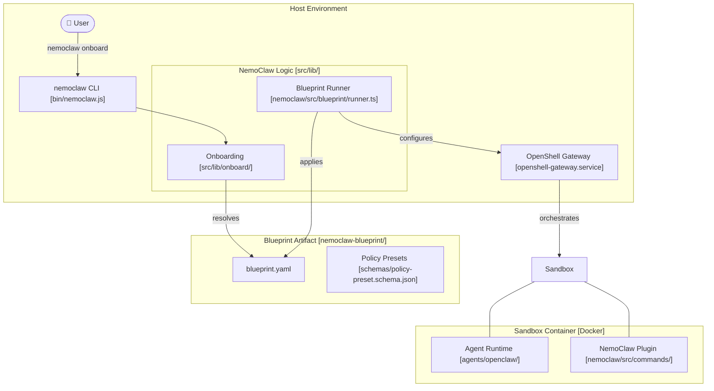
**Sources:** [AGENTS.md:28-38](), [docs/reference/architecture.mdx:20-75](), [nemoclaw/src/blueprint/runner.ts:1-20]()

For details, see [System Architecture](#3.1).

---

## OpenShell Integration

NemoClaw relies on OpenShell for the security and isolation layer. OpenShell provides a "hard shell" around the agent, ensuring that all external interactions (inference, network, tools) are proxied and governed by policy.

### Data Flow: Inference and Security Enforcement
This diagram bridges the natural language concepts of "Inference" and "Security" to the specific code entities that handle them.

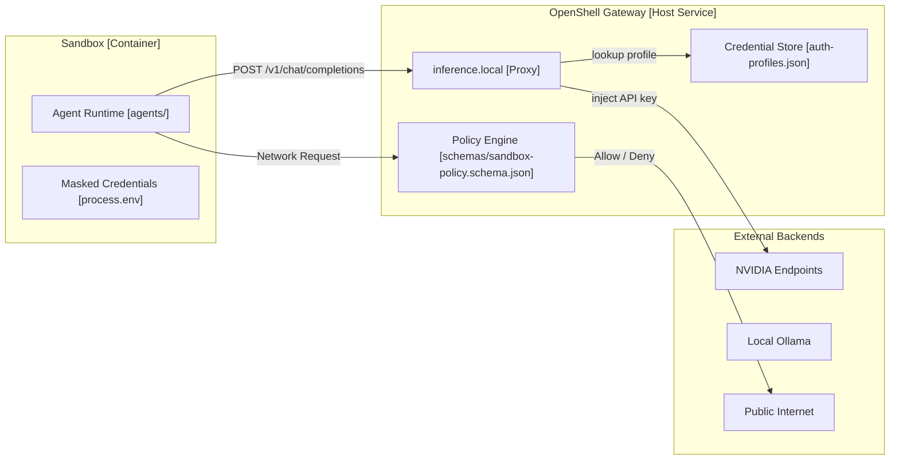
**Sources:** [docs/reference/architecture.mdx:67-74](), [ci/platform-matrix.json:81-98](), [docs/get-started/quickstart.mdx:108-115]()

### Sandboxing and Security
The sandbox is the primary unit of isolation. It utilizes Docker, and on supported platforms, adds layers like Landlock and seccomp to restrict the agent's ability to touch the host filesystem or escalate privileges [ci/platform-matrix.json:34, 69]().

For details, see [Sandboxing and Security](#3.2).

---

## Inference Routing

Agents do not store API keys directly. Instead, they point to a local endpoint (`inference.local`). The OpenShell Gateway intercepts these requests, identifies the intended provider (e.g., NVIDIA, OpenAI, or a local NIM), and injects the appropriate credentials from the host-side store [docs/reference/architecture.mdx:67-68]().

NemoClaw supports a variety of providers defined in the platform matrix, including:
*   **NVIDIA Endpoints** (integrate.api.nvidia.com) [ci/platform-matrix.json:83-87]()
*   **OpenRouter** [ci/platform-matrix.json:89-93]()
*   **Local Inference** (vLLM, Ollama) [ci/platform-matrix.json:110-116]()

For details, see [Inference Routing](#3.3).

---

## Policy and Blueprint Systems

### Policy System
Policies define what an agent is allowed to do. NemoClaw uses a **deny-by-default** stance for network egress. Users can apply different policy tiers (e.g., "baseline" vs "session") to grant specific access to tools or messaging channels [docs/get-started/quickstart.mdx:53-54]().

For details, see [Policy System](#3.4).

### Blueprint System
The blueprint is the source of truth for the sandbox configuration. It includes the Dockerfile, network policy presets, and model-specific setup registries [AGENTS.md:36-37](). The `blueprint.yaml` manifest pins specific versions of these components to ensure reproducible and secure deployments [docs/reference/architecture.mdx:12]().

For details, see [Blueprint System](#3.5).

---

## Summary of Child Pages

*   **[System Architecture](#3.1)**: Deep dive into the relationship between the CLI, the plugin, and the OpenShell runtime.
*   **[Sandboxing and Security](#3.2)**: Details on container isolation, filesystem protection, and the security model.
*   **[Inference Routing](#3.3)**: How the gateway handles model requests and credential injection.
*   **[Policy System](#3.4)**: Explanation of policy schemas, presets, and enforcement.
*   **[Blueprint System](#3.5)**: The lifecycle of blueprint artifacts and orchestration logic.

**Sources:** [package.json:1-11](), [AGENTS.md:1-43](), [docs/reference/architecture.mdx:1-75](), [ci/platform-matrix.json:1-120]()

---

# Page: System Architecture

# System Architecture

<details>
<summary>Relevant source files</summary>

The following files were used as context for generating this wiki page:

- [agents/hermes/manifest.yaml](agents/hermes/manifest.yaml)
- [agents/langchain-deepagents-code/manifest.yaml](agents/langchain-deepagents-code/manifest.yaml)
- [agents/openclaw/manifest.yaml](agents/openclaw/manifest.yaml)
- [docs/reference/architecture.mdx](docs/reference/architecture.mdx)
- [nemoclaw-blueprint/provider-profiles/entra-runtime-v1.yaml](nemoclaw-blueprint/provider-profiles/entra-runtime-v1.yaml)
- [nemoclaw-blueprint/provider-profiles/okta-runtime-v1.yaml](nemoclaw-blueprint/provider-profiles/okta-runtime-v1.yaml)
- [nemoclaw/src/blueprint/runner-identity.test.ts](nemoclaw/src/blueprint/runner-identity.test.ts)
- [nemoclaw/src/blueprint/runner.test.ts](nemoclaw/src/blueprint/runner.test.ts)
- [nemoclaw/src/blueprint/runner.ts](nemoclaw/src/blueprint/runner.ts)
- [nemoclaw/src/blueprint/runtime-identity.test.ts](nemoclaw/src/blueprint/runtime-identity.test.ts)
- [nemoclaw/src/blueprint/runtime-identity.ts](nemoclaw/src/blueprint/runtime-identity.ts)
- [nemoclaw/src/blueprint/ssrf.test.ts](nemoclaw/src/blueprint/ssrf.test.ts)
- [nemoclaw/src/blueprint/ssrf.ts](nemoclaw/src/blueprint/ssrf.ts)
- [nemoclaw/src/index.ts](nemoclaw/src/index.ts)
- [nemoclaw/src/register.test.ts](nemoclaw/src/register.test.ts)
- [nemoclaw/src/runtime-context.test.ts](nemoclaw/src/runtime-context.test.ts)
- [nemoclaw/src/runtime-context.ts](nemoclaw/src/runtime-context.ts)
- [nemoclaw/src/security/safe-resolve-path.test.ts](nemoclaw/src/security/safe-resolve-path.test.ts)
- [nemoclaw/src/security/safe-resolve-path.ts](nemoclaw/src/security/safe-resolve-path.ts)
- [nemoclaw/src/security/secret-scanner.test.ts](nemoclaw/src/security/secret-scanner.test.ts)
- [nemoclaw/src/security/secret-scanner.ts](nemoclaw/src/security/secret-scanner.ts)
- [schemas/blueprint.schema.json](schemas/blueprint.schema.json)
- [src/lib/actions/inference-set-endpoint-security.test.ts](src/lib/actions/inference-set-endpoint-security.test.ts)
- [src/lib/actions/sandbox/rebuild-flow-helpers.test.ts](src/lib/actions/sandbox/rebuild-flow-helpers.test.ts)
- [src/lib/actions/sandbox/rebuild-flow-helpers.ts](src/lib/actions/sandbox/rebuild-flow-helpers.ts)
- [src/lib/actions/sandbox/rebuild-gateway-drift.test.ts](src/lib/actions/sandbox/rebuild-gateway-drift.test.ts)
- [src/lib/actions/sandbox/rebuild-prepared-recovery.ts](src/lib/actions/sandbox/rebuild-prepared-recovery.ts)
- [src/lib/agent/defs.test.ts](src/lib/agent/defs.test.ts)
- [src/lib/agent/defs.ts](src/lib/agent/defs.ts)
- [src/lib/agent/hermes-recovery-boundary-fixtures.ts](src/lib/agent/hermes-recovery-boundary-fixtures.ts)
- [src/lib/agent/onboard.test.ts](src/lib/agent/onboard.test.ts)
- [src/lib/agent/onboard.ts](src/lib/agent/onboard.ts)
- [src/lib/agent/runtime-recovery-preload.test.ts](src/lib/agent/runtime-recovery-preload.test.ts)
- [src/lib/agent/runtime-recovery-preload.ts](src/lib/agent/runtime-recovery-preload.ts)
- [src/lib/agent/runtime.test.ts](src/lib/agent/runtime.test.ts)
- [src/lib/agent/runtime.ts](src/lib/agent/runtime.ts)
- [src/lib/onboard/sandbox-registration.test.ts](src/lib/onboard/sandbox-registration.test.ts)
- [src/lib/onboard/sandbox-registration.ts](src/lib/onboard/sandbox-registration.ts)
- [src/lib/state/registry-entry-view.ts](src/lib/state/registry-entry-view.ts)
- [src/lib/state/registry.ts](src/lib/state/registry.ts)
- [src/lib/state/registry/lock.ts](src/lib/state/registry/lock.ts)
- [src/lib/state/registry/persistence.ts](src/lib/state/registry/persistence.ts)
- [src/lib/state/registry/types.ts](src/lib/state/registry/types.ts)
- [test/Dockerfile.sandbox](test/Dockerfile.sandbox)
- [test/blueprint-runtime-identity-lifecycle.test.ts](test/blueprint-runtime-identity-lifecycle.test.ts)
- [test/blueprint-runtime-identity-schema.test.ts](test/blueprint-runtime-identity-schema.test.ts)
- [test/e2e-test.sh](test/e2e-test.sh)
- [test/e2e/live/inference-routing.test.ts](test/e2e/live/inference-routing.test.ts)
- [test/e2e/live/runtime-identity-oauth-server.ts](test/e2e/live/runtime-identity-oauth-server.ts)
- [test/helpers/runtime-recovery-preload-test-helpers.ts](test/helpers/runtime-recovery-preload-test-helpers.ts)
- [test/install-agent-alias-parity.test.ts](test/install-agent-alias-parity.test.ts)
- [test/openclaw-tool-catalog-patch.test.ts](test/openclaw-tool-catalog-patch.test.ts)
- [test/registry.test.ts](test/registry.test.ts)

</details>


This page provides a detailed technical overview of NemoClaw's architecture, focusing on the plugin-blueprint model, multi-agent support, and integration with OpenShell. NemoClaw acts as an opinionated reference stack built on top of the NVIDIA OpenShell runtime.

## Architecture Overview

NemoClaw implements a three-layer architecture with clear separation between host operations, sandbox execution, and external services. The system is designed around a "Thin Plugin, Versioned Blueprint" model to ensure stable interfaces while allowing orchestration logic to evolve independently.

| Component | Type | Location | Purpose |
|-----------|------|----------|---------|
| **CLI / Plugin** | TypeScript package | `nemoclaw/` | Host CLI commands, in-sandbox plugin API, and blueprint orchestration. |
| **Blueprint** | YAML/TS artifact | `nemoclaw-blueprint/` | Declarative definitions for OpenShell resources, policies, and sandbox images. |
| **Agent Manifests** | YAML/Docker | `agents/` | Definitions for specific agent types like `OpenClaw` and `Hermes`. |

**Sources:** [docs/reference/architecture.mdx:12-18](), [nemoclaw/src/index.ts:4-12](), [agents/openclaw/manifest.yaml:1-10](), [agents/hermes/manifest.yaml:1-10]()

## System Components and Code Entities

The following diagram maps high-level system components to the specific code entities that implement them, bridging the gap between natural language concepts and the implementation files.

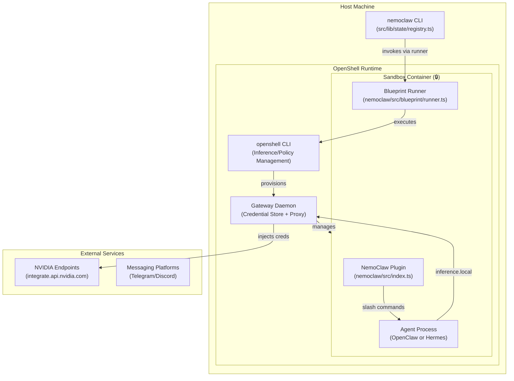

**Diagram: NemoClaw Component Topology**

**Sources:** [docs/reference/architecture.mdx:20-75](), [nemoclaw/src/blueprint/runner.ts:5-13](), [src/lib/state/registry.ts:108-115](), [nemoclaw/src/index.ts:16-23]()

## Multi-Agent Architecture

NemoClaw supports multiple agent types through standardized manifests located in the `agents/` directory. This allows for both Node.js (OpenClaw) and Python-based (Hermes) assistants to run in a unified security model.

### Supported Agents

1.  **OpenClaw**: The primary agent, running as a Node.js application. It uses the NemoClaw TypeScript plugin to register inference providers and handle slash commands.
    *   **Manifest**: Defined in `agents/openclaw/manifest.yaml` [agents/openclaw/manifest.yaml:10-24]().
    *   **Persistence**: Manages state in `.openclaw/` with specific directories for `workspace`, `skills`, and `memory` [agents/openclaw/manifest.yaml:42-58]().
2.  **Hermes**: A Python-based agent developed by Nous Research.
    *   **Manifest**: Defined in `agents/hermes/manifest.yaml` [agents/hermes/manifest.yaml:7-25]().
    *   **Health Probe**: Uses a specialized health check on port 8642 [agents/hermes/manifest.yaml:27-33]().
    *   **State Management**: Utilizes `sqlite_backup` strategy for `state.db` and `cron-executions.db` [agents/hermes/manifest.yaml:97-108]().

### Agent Lifecycle and Registry

The host-side `registry.ts` manages the metadata for every provisioned agent sandbox.
*   **Registration**: The `registerSandbox` function stores inference metadata, GPU status, and agent versions [src/lib/state/registry.ts:108-160]().
*   **Persistence**: Data is stored in `~/.nemoclaw/sandboxes.json` [src/lib/state/registry.ts:64-64]().
*   **Normalization**: The registry ensures baseline exclusions and policy tiers are normalized across different agent types [src/lib/state/registry.ts:127-131]().

**Sources:** [src/lib/state/registry.ts:88-106](), [agents/openclaw/manifest.yaml:1-16](), [agents/hermes/manifest.yaml:1-14]()

## Plugin-Blueprint Model

The core architectural pattern separates the **Plugin** (interface/API) from the **Blueprint** (infrastructure orchestration).

### Blueprint System
The blueprint defines the "desired state" of the OpenShell environment. The `blueprint/runner.ts` orchestrates the lifecycle:
*   **Resolve**: Validates endpoint URLs and SSRF protections [nemoclaw/src/blueprint/runner.ts:47-47]().
*   **Plan**: Generates a run ID (e.g., `nc-YYYYMMDD-HHMMSS-XXXXXXXX`) and calculates required changes [nemoclaw/src/blueprint/runner.ts:158-166]().
*   **Apply**: Executes `openshell` CLI commands to create sandboxes, configure inference, and apply policies [nemoclaw/src/blueprint/runner.ts:65-66]().

### Plugin Architecture
The NemoClaw plugin (`nemoclaw/src/index.ts`) acts as the runtime bridge inside the sandbox.
*   **Slash Commands**: Implements `handleSlashCommand` for in-chat interaction [nemoclaw/src/index.ts:16-16]().
*   **Inference Provider**: Registers a custom provider in the agent's ecosystem that routes to the OpenShell gateway [nemoclaw/src/index.ts:191-193]().
*   **Secret Scanning**: Includes a `secret-scanner.ts` to prevent accidental disclosure of credentials in workspace files [nemoclaw/src/index.ts:25-25]().

**Sources:** [nemoclaw/src/blueprint/runner.ts:5-13](), [nemoclaw/src/index.ts:4-12](), [test/e2e-test.sh:118-126]()

## Data Flow: Inference and Credentials

NemoClaw ensures that sensitive credentials never enter the sandbox environment by utilizing the OpenShell Gateway as a secure proxy.

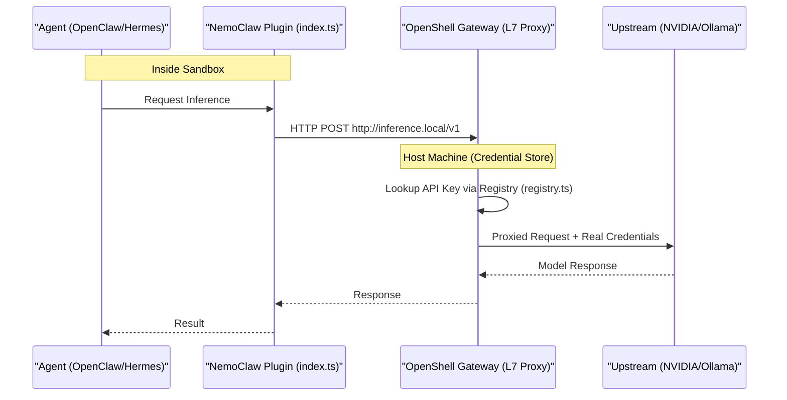

**Diagram: Secure Inference Data Flow**

*   **Credential Isolation**: The agent uses `inference.local` inside the sandbox; real credentials stay on the host [docs/reference/architecture.mdx:67-75]().
*   **Inference Selection**: The registry tracks the `preferredInferenceApi` and `endpointUrl` for each sandbox [src/lib/state/registry.ts:117-117]().
*   **SSRF Protection**: The blueprint runner validates that inference endpoints do not point to restricted internal metadata services [nemoclaw/src/blueprint/ssrf.ts:1-20]().

**Sources:** [nemoclaw/src/blueprint/runner.ts:47-47](), [src/lib/state/registry.ts:72-90](), [test/registry.test.ts:72-90]()

## State and Persistence

NemoClaw manages complex state transitions, especially during agent migrations and rebuilds.

| Feature | Implementation | Code Pointer |
| :--- | :--- | :--- |
| **Sandbox Registry** | JSON persistence with file locking | [src/lib/state/registry.ts:109-110]() |
| **Workload Receipts** | Tracking of provisioned container state | [src/lib/state/registry.ts:167-167]() |
| **Messaging State** | Channel configuration and auth modes | [src/lib/state/registry.ts:170-170]() |
| **Migration** | Snapshot creation and state transfer | [docs/reference/architecture.mdx:43-43]() |

**Sources:** [src/lib/state/registry.ts:1-25](), [test/registry.test.ts:57-70](), [test/Dockerfile.sandbox:13-29]()

---

# Page: Sandboxing and Security

# Sandboxing and Security

<details>
<summary>Relevant source files</summary>

The following files were used as context for generating this wiki page:

- [Dockerfile](Dockerfile)
- [Dockerfile.base](Dockerfile.base)
- [agents/hermes/runtime-config-guard.py](agents/hermes/runtime-config-guard.py)
- [agents/hermes/validate-env-secret-boundary.py](agents/hermes/validate-env-secret-boundary.py)
- [docs/deployment/sandbox-hardening.mdx](docs/deployment/sandbox-hardening.mdx)
- [docs/network-policy/apply-policy-presets.mdx](docs/network-policy/apply-policy-presets.mdx)
- [docs/network-policy/approve-network-requests.mdx](docs/network-policy/approve-network-requests.mdx)
- [docs/network-policy/change-baseline-network-policy.mdx](docs/network-policy/change-baseline-network-policy.mdx)
- [docs/network-policy/create-custom-policy-presets.mdx](docs/network-policy/create-custom-policy-presets.mdx)
- [docs/network-policy/customize-network-policy.mdx](docs/network-policy/customize-network-policy.mdx)
- [docs/network-policy/integration-policy-examples.mdx](docs/network-policy/integration-policy-examples.mdx)
- [docs/reference/cli-selection-guide.mdx](docs/reference/cli-selection-guide.mdx)
- [docs/reference/network-policies.mdx](docs/reference/network-policies.mdx)
- [docs/security/best-practices.mdx](docs/security/best-practices.mdx)
- [docs/security/openclaw-2026.6.10-dependency-review.md](docs/security/openclaw-2026.6.10-dependency-review.md)
- [docs/security/sandbox-base-libexpat-jq-2026-07-24-dependency-review.md](docs/security/sandbox-base-libexpat-jq-2026-07-24-dependency-review.md)
- [nemoclaw/src/lib/subprocess-env.ts](nemoclaw/src/lib/subprocess-env.ts)
- [scripts/lib/sandbox-init.sh](scripts/lib/sandbox-init.sh)
- [scripts/lib/sandbox-rlimits.sh](scripts/lib/sandbox-rlimits.sh)
- [scripts/nemoclaw-start.sh](scripts/nemoclaw-start.sh)
- [scripts/patch-openclaw-issue-4434-diagnostics.mts](scripts/patch-openclaw-issue-4434-diagnostics.mts)
- [src/lib/onboard/http-proxy-preflight.test.ts](src/lib/onboard/http-proxy-preflight.test.ts)
- [src/lib/onboard/http-proxy-preflight.ts](src/lib/onboard/http-proxy-preflight.ts)
- [src/lib/sandbox/build-context.ts](src/lib/sandbox/build-context.ts)
- [src/lib/shields/flow.test.ts](src/lib/shields/flow.test.ts)
- [src/lib/shields/index.test.ts](src/lib/shields/index.test.ts)
- [src/lib/shields/index.ts](src/lib/shields/index.ts)
- [src/lib/shields/legacy-hermes-compat.test.ts](src/lib/shields/legacy-hermes-compat.test.ts)
- [src/lib/shields/legacy-hermes-transition.test.ts](src/lib/shields/legacy-hermes-transition.test.ts)
- [src/lib/shields/policy-transition.test.ts](src/lib/shields/policy-transition.test.ts)
- [src/lib/shields/seal.test.ts](src/lib/shields/seal.test.ts)
- [src/lib/shields/seal.ts](src/lib/shields/seal.ts)
- [src/lib/shields/timer.test.ts](src/lib/shields/timer.test.ts)
- [src/lib/shields/timer.ts](src/lib/shields/timer.ts)
- [src/lib/shields/verify-lock.test.ts](src/lib/shields/verify-lock.test.ts)
- [src/lib/shields/verify-lock.ts](src/lib/shields/verify-lock.ts)
- [src/lib/subprocess-env.test.ts](src/lib/subprocess-env.test.ts)
- [src/lib/subprocess-env.ts](src/lib/subprocess-env.ts)
- [test/credential-exposure.test.ts](test/credential-exposure.test.ts)
- [test/deepagents-monitoring-published-routes.test.ts](test/deepagents-monitoring-published-routes.test.ts)
- [test/e2e-gateway-isolation.sh](test/e2e-gateway-isolation.sh)
- [test/e2e/live/hermes-shields-config.test.ts](test/e2e/live/hermes-shields-config.test.ts)
- [test/fetch-guard-patch-regression.test.ts](test/fetch-guard-patch-regression.test.ts)
- [test/generate-openclaw-config.test.ts](test/generate-openclaw-config.test.ts)
- [test/helpers/base-apt-security-functions.ts](test/helpers/base-apt-security-functions.ts)
- [test/hermes-runtime-config-guard-topology.test.ts](test/hermes-runtime-config-guard-topology.test.ts)
- [test/host-proxy-inference-local-e2e.test.ts](test/host-proxy-inference-local-e2e.test.ts)
- [test/issue-4434-error-fields.test.ts](test/issue-4434-error-fields.test.ts)
- [test/nemoclaw-start.test.ts](test/nemoclaw-start.test.ts)
- [test/network-policies-published-routes.test.ts](test/network-policies-published-routes.test.ts)
- [test/openclaw-dependency-review.test.ts](test/openclaw-dependency-review.test.ts)
- [test/openclaw-integrity-pin-suite.ts](test/openclaw-integrity-pin-suite.ts)
- [test/openclaw-issue-4434-diagnostics-patch.test.ts](test/openclaw-issue-4434-diagnostics-patch.test.ts)
- [test/openclaw-real-patched-dist-harness.test.ts](test/openclaw-real-patched-dist-harness.test.ts)
- [test/perl-critical-cve-remediation.test.ts](test/perl-critical-cve-remediation.test.ts)
- [test/policy-roundtrip-docs.test.ts](test/policy-roundtrip-docs.test.ts)
- [test/repro-2681-group-writable.test.ts](test/repro-2681-group-writable.test.ts)
- [test/sandbox-base-security-packages.test.ts](test/sandbox-base-security-packages.test.ts)
- [test/sandbox-build-context.test.ts](test/sandbox-build-context.test.ts)
- [test/sandbox-init.test.ts](test/sandbox-init.test.ts)
- [test/sandbox-provisioning.test.ts](test/sandbox-provisioning.test.ts)
- [test/sandbox-rlimit-hooks.test.ts](test/sandbox-rlimit-hooks.test.ts)
- [test/service-env.test.ts](test/service-env.test.ts)

</details>


This page describes NemoClaw's security architecture, including the sandbox container structure, multi-layer protection model, policy enforcement mechanisms, and operator control workflows. It covers the technical implementation of isolation layers, hardened container entrypoints, and the lifecycle of security policies.

For information about configuring specific network policies and endpoint groups, see [Network Policy Reference](). For details on the blueprint system that orchestrates sandbox creation, see [Blueprint System]().

---

## Security Model Overview

NemoClaw implements a **defense-in-depth** security model with five distinct protection layers: **Network**, **Filesystem**, **Process**, **Gateway Authentication**, and **Inference** [docs/security/best-practices.mdx:25-28](). The sandbox executes OpenClaw agents in a restricted environment where every system call, file access, network connection, and inference request is subject to policy enforcement.

### Protection Layers Implementation Mapping

The following diagram maps high-level security concepts to the specific code entities and files that implement them.

**Title: Security Layer Implementation Mapping**
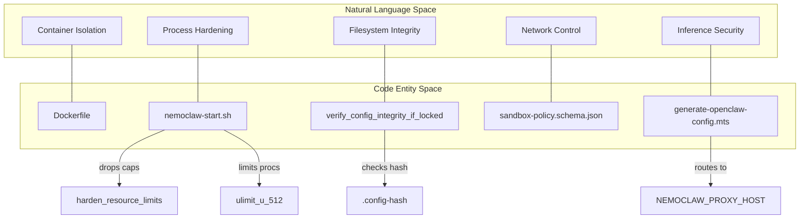
**Sources:** [Dockerfile:1-125](), [scripts/nemoclaw-start.sh:1-170](), [test/e2e-gateway-isolation.sh:5-193](), [docs/security/best-practices.mdx:27-90](), [scripts/generate-openclaw-config.mts:29-30]()

---

## Sandbox Container Architecture

The sandbox is a hardened Docker container managed by OpenShell. It uses a multi-stage build process to ensure that build-time secrets and tools do not leak into the runtime image.

### Container Build Structure

The sandbox image is defined in `Dockerfile`, which layers NemoClaw-specific logic onto a pre-built base image [Dockerfile:1-12]().

| Component | Purpose | Implementation Detail |
|-----------|---------|-----------------------|
| **Base Image** | Minimal runtime | `ghcr.io/nvidia/nemoclaw/sandbox-base:latest` [Dockerfile:12]() |
| **Hardening** | Tool purging | Native security package builds [Dockerfile.base:75-84]() |
| **Privilege Sep** | Multi-user | `gateway` vs `sandbox` users [scripts/nemoclaw-start.sh:8-10]() |
| **Integrity** | Config pinning | Verification of `openclaw.json` hash [scripts/nemoclaw-start.sh:10-11]() |
| **Environment** | Cache isolation | `AWS_EC2_METADATA_DISABLED=true` [Dockerfile:119]() |

### Multi-User Isolation

A critical security feature is the separation of the **Gateway** and the **Agent**.
*   **Gateway User:** Runs the OpenClaw gateway process.
*   **Sandbox User:** Runs the agent and user-defined commands.

The gateway runs as a separate user so the sandboxed agent cannot kill it or restart it with a tampered configuration (mitigating the "fake-HOME" bypass) [scripts/nemoclaw-start.sh:8-10](). 

**Sources:** [Dockerfile:1-145](), [scripts/nemoclaw-start.sh:5-10](), [test/e2e-gateway-isolation.sh:60-72](), [Dockerfile.base:23-24]()

---

## Protection Layers

### Layer 1: Process and Resource Hardening

The entrypoint script `nemoclaw-start.sh` applies several kernel-level restrictions immediately upon container startup:

1.  **Resource Limits:** Calls `harden_resource_limits` (from `sandbox-rlimits.sh`) as root PID 1 to lock down `nproc` and `nofile` [scripts/nemoclaw-start.sh:135-137]().
2.  **Capability Dropping:** Uses `capsh` to drop dangerous Linux capabilities before dropping privileges to the gateway or sandbox user [scripts/nemoclaw-start.sh:135-140]().
3.  **PATH Locking:** Explicitly locks `PATH` to system directories (`/usr/local/bin`, etc.) at the very top of the script to prevent binary hijacking [scripts/nemoclaw-start.sh:37-39]().
4.  **Tool Cache Redirects:** Redirects tool caches (npm, XDG, bash history) to `/tmp` via `_TOOL_REDIRECTS` to ensure transient state stays outside the durable workspace [scripts/nemoclaw-start.sh:150-165]().

**Sources:** [scripts/nemoclaw-start.sh:35-165](), [docs/security/best-practices.mdx:84-90](), [scripts/lib/sandbox-rlimits.sh:1-10]()

### Layer 2: Filesystem Policy and Integrity

NemoClaw enforces strict filesystem boundaries. While OpenShell uses Landlock LSM for runtime path whitelisting [docs/security/best-practices.mdx:84](), NemoClaw adds an additional layer of **DAC (Discretionary Access Control)** hardening:

*   **Config Integrity:** The entrypoint call verifies the config hash to detect tampering before startup [scripts/nemoclaw-start.sh:10-11]().
*   **Secure File Creation:** Uses `_nemoclaw_safe_replace_tmp_file` to write files in `/tmp` with restricted permissions (e.g., 600) to protect diagnostics and tokens [scripts/nemoclaw-start.sh:72-100]().
*   **Permission Normalization:** NemoClaw ensures that the image remains readable to the root entrypoint while maintaining the gateway/sandbox group separation [test/sandbox-provisioning.test.ts:161-165]().
*   **Shields System:** The `shields up` command locks the configuration and applies a restrictive network policy, while `shields down` returns it to a mutable state [src/lib/shields/index.ts:6-11]().

**Sources:** [scripts/nemoclaw-start.sh:10-100](), [test/sandbox-provisioning.test.ts:161-165](), [src/lib/shields/index.ts:6-11]()

### Layer 3: Network and Inference Security

All outbound traffic is intercepted by the OpenShell L7 gateway.

1.  **Deny-by-Default:** All egress is blocked unless explicitly allowed in the policy [docs/security/best-practices.mdx:99-105]().
2.  **SSRF Guard:** Network policy allowlists do not disable OpenShell's SSRF guard; internal-address blocking remains active even when an endpoint matches an egress rule [docs/security/best-practices.mdx:92]().
3.  **Binary-Scoped Rules:** Policy entries can restrict access to specific calling binaries (e.g., restricting HTTP methods for specific tools) [docs/security/best-practices.mdx:83-91]().
4.  **Inference Isolation:** The sandbox receives a narrow `inference.local` interface rather than host credentials, preventing credential exposure [docs/security/best-practices.mdx:115]().

**Sources:** [docs/security/best-practices.mdx:83-115](), [Dockerfile:117-119]()

---

## Security Workflows

### Entrypoint Execution Flow

The entrypoint manages the transition from a high-privilege setup state to a low-privilege execution state.

**Title: nemoclaw-start.sh Execution Sequence**
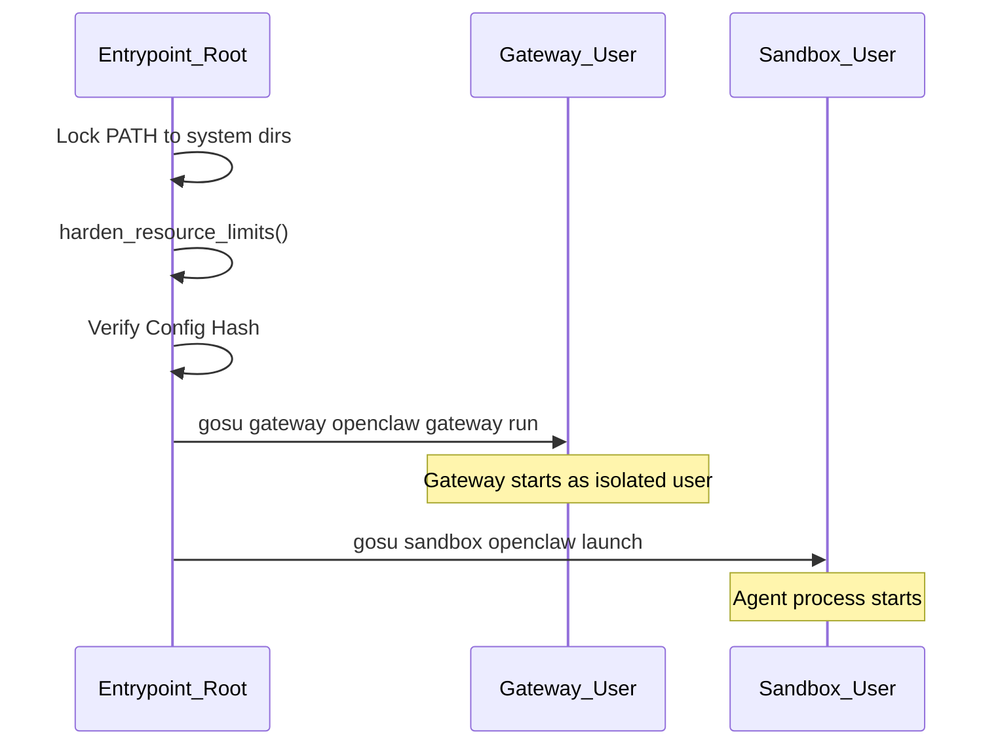

**Sources:** [scripts/nemoclaw-start.sh:5-170](), [test/e2e-gateway-isolation.sh:175-189]()

### Config Generation Integrity

NemoClaw uses a TypeScript script `generate-openclaw-config.mts` to bake the agent configuration. This script is designed to prevent shell injection and ensure environment-driven configuration [test/generate-openclaw-config.test.ts:25-40]().

**Title: Configuration Lifecycle**
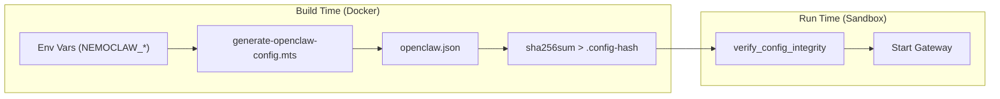

**Sources:** [scripts/generate-openclaw-config.mts:1-40](), [test/generate-openclaw-config.test.ts:106-112](), [test/nemoclaw-start.test.ts:143-160]()

---

## Security Hardening Summary

| Feature | Implementation | File Reference |
|---------|----------------|----------------|
| **Fork Bomb Protection** | `ulimit -u 512` | [scripts/nemoclaw-start.sh:58-60]() |
| **Capability Drop** | `harden_resource_limits` | [scripts/nemoclaw-start.sh:137]() |
| **Config Integrity** | `.config-hash` verification | [scripts/nemoclaw-start.sh:10]() |
| **SSRF Protection** | OpenShell Gateway + SSRF Guard | [docs/security/best-practices.mdx:92]() |
| **Credential Masking** | `inference.local` interface | [docs/security/best-practices.mdx:115]() |
| **Path Locking** | Strict system `PATH` | [scripts/nemoclaw-start.sh:39]() |
| **Tool Cache Isolation** | `/tmp` tool redirects | [scripts/nemoclaw-start.sh:150-165]() |

**Sources:** [Dockerfile:1-125](), [scripts/nemoclaw-start.sh:1-170](), [docs/security/best-practices.mdx:14-132]()

---

# Page: Inference Routing

# Inference Routing

<details>
<summary>Relevant source files</summary>

The following files were used as context for generating this wiki page:

- [docs/changelog/2026-07-31.mdx](docs/changelog/2026-07-31.mdx)
- [docs/inference/declarative-agents-manifest.mdx](docs/inference/declarative-agents-manifest.mdx)
- [docs/inference/set-up-sub-agent.mdx](docs/inference/set-up-sub-agent.mdx)
- [docs/inference/set-up-vllm.mdx](docs/inference/set-up-vllm.mdx)
- [docs/inference/switch-providers.mdx](docs/inference/switch-providers.mdx)
- [docs/inference/understand-provider-validation.mdx](docs/inference/understand-provider-validation.mdx)
- [docs/monitoring/monitor-sandbox-activity.mdx](docs/monitoring/monitor-sandbox-activity.mdx)
- [src/lib/actions/inference-set-compatible-provider.test.ts](src/lib/actions/inference-set-compatible-provider.test.ts)
- [src/lib/actions/inference-set-degraded-state.test.ts](src/lib/actions/inference-set-degraded-state.test.ts)
- [src/lib/actions/inference-set-gateway-route-containment.test.ts](src/lib/actions/inference-set-gateway-route-containment.test.ts)
- [src/lib/actions/inference-set-provider-alias.test.ts](src/lib/actions/inference-set-provider-alias.test.ts)
- [src/lib/actions/inference-set-provider.test.ts](src/lib/actions/inference-set-provider.test.ts)
- [src/lib/actions/inference-set-provider.ts](src/lib/actions/inference-set-provider.ts)
- [src/lib/actions/inference-set-route-containment.ts](src/lib/actions/inference-set-route-containment.ts)
- [src/lib/actions/inference-set.test-support.ts](src/lib/actions/inference-set.test-support.ts)
- [src/lib/actions/inference-set.ts](src/lib/actions/inference-set.ts)
- [src/lib/actions/sandbox/status.test.ts](src/lib/actions/sandbox/status.test.ts)
- [src/lib/adapters/http/curl-args.ts](src/lib/adapters/http/curl-args.ts)
- [src/lib/adapters/http/probe.test.ts](src/lib/adapters/http/probe.test.ts)
- [src/lib/adapters/http/probe.ts](src/lib/adapters/http/probe.ts)
- [src/lib/inference/gpu-trust.ts](src/lib/inference/gpu-trust.ts)
- [src/lib/inference/health.test.ts](src/lib/inference/health.test.ts)
- [src/lib/inference/health.ts](src/lib/inference/health.ts)
- [src/lib/inference/local.test.ts](src/lib/inference/local.test.ts)
- [src/lib/inference/local.ts](src/lib/inference/local.ts)
- [src/lib/inference/nim.test.ts](src/lib/inference/nim.test.ts)
- [src/lib/inference/nim.ts](src/lib/inference/nim.ts)
- [src/lib/inference/ollama-runtime-context.test.ts](src/lib/inference/ollama-runtime-context.test.ts)
- [src/lib/inference/ollama-runtime-context.ts](src/lib/inference/ollama-runtime-context.ts)
- [src/lib/inference/ollama-version.ts](src/lib/inference/ollama-version.ts)
- [src/lib/inference/ollama/model-size.ts](src/lib/inference/ollama/model-size.ts)
- [src/lib/inference/onboard-probes.test.ts](src/lib/inference/onboard-probes.test.ts)
- [src/lib/inference/onboard-probes.ts](src/lib/inference/onboard-probes.ts)
- [src/lib/inference/openai-validation-session.test.ts](src/lib/inference/openai-validation-session.test.ts)
- [src/lib/inference/openai-validation-session.ts](src/lib/inference/openai-validation-session.ts)
- [src/lib/inference/probe-http-helpers.test.ts](src/lib/inference/probe-http-helpers.test.ts)
- [src/lib/inference/probe-http-helpers.ts](src/lib/inference/probe-http-helpers.ts)
- [src/lib/inference/vllm-models.test.ts](src/lib/inference/vllm-models.test.ts)
- [src/lib/inference/vllm-models.ts](src/lib/inference/vllm-models.ts)
- [src/lib/inference/vllm-storage.test.ts](src/lib/inference/vllm-storage.test.ts)
- [src/lib/inference/vllm-storage.ts](src/lib/inference/vllm-storage.ts)
- [src/lib/inference/vllm.test.ts](src/lib/inference/vllm.test.ts)
- [src/lib/inference/vllm.ts](src/lib/inference/vllm.ts)
- [src/lib/onboard/inference-capability-cache.test.ts](src/lib/onboard/inference-capability-cache.test.ts)
- [src/lib/onboard/inference-capability-cache.ts](src/lib/onboard/inference-capability-cache.ts)
- [src/lib/onboard/inference-selection-validation.test.ts](src/lib/onboard/inference-selection-validation.test.ts)
- [src/lib/onboard/inference-selection-validation.ts](src/lib/onboard/inference-selection-validation.ts)
- [src/lib/onboard/ollama-systemd.test.ts](src/lib/onboard/ollama-systemd.test.ts)
- [src/lib/onboard/ollama-systemd.ts](src/lib/onboard/ollama-systemd.ts)
- [src/lib/onboard/setup-nim-selection.test.ts](src/lib/onboard/setup-nim-selection.test.ts)
- [src/lib/onboard/setup-nim-selection.ts](src/lib/onboard/setup-nim-selection.ts)
- [test/agent-variant-docs.test.ts](test/agent-variant-docs.test.ts)
- [test/detect-vllm-profile.test.ts](test/detect-vllm-profile.test.ts)
- [test/helpers/onboard-smoke-verifier-harness.ts](test/helpers/onboard-smoke-verifier-harness.ts)
- [test/inference-options-docs.test.ts](test/inference-options-docs.test.ts)
- [test/onboard-smoke-verifier.test.ts](test/onboard-smoke-verifier.test.ts)

</details>


Inference routing in NemoClaw manages how model API requests from the OpenClaw or Hermes agents reach Large Language Model (LLM) backends. To ensure security and flexibility, all inference requests are intercepted by the **OpenShell Gateway** and routed to configured providers based on active profiles. The agent inside the sandbox interacts only with a virtualized endpoint, `inference.local`, while actual credentials and upstream URLs remain on the host.

---

## Architecture Overview

The routing system operates at the gateway layer. When an agent makes a completion request, it targets `http://inference.local/v1` or `https://inference.local/v1`. The OpenShell gateway intercepts this traffic and redirects it to the provider selected during onboarding.

### Natural Language to Code Entity Mapping

| System Concept | Code Entity / Symbol | File Reference |
|:---|:---|:---|
| **Inference Endpoint** | `inference.local` | [src/lib/actions/inference-set.ts:71-71]() |
| **Local Proxy Script** | `ollama-auth-proxy.js` | [src/lib/inference/ollama/proxy.ts:137-137]() |
| **Model Switcher** | `runInferenceSet` | [src/lib/actions/inference-set.ts:34-34]() |
| **Provider Config** | `getSandboxInferenceConfig` | [src/lib/inference/config.ts:11-13]() |
| **Inference Fix** | `nemotron-inference-fix.js` | [nemoclaw-blueprint/scripts/nemotron-inference-fix.js:1-1]() |

### System Component Diagram

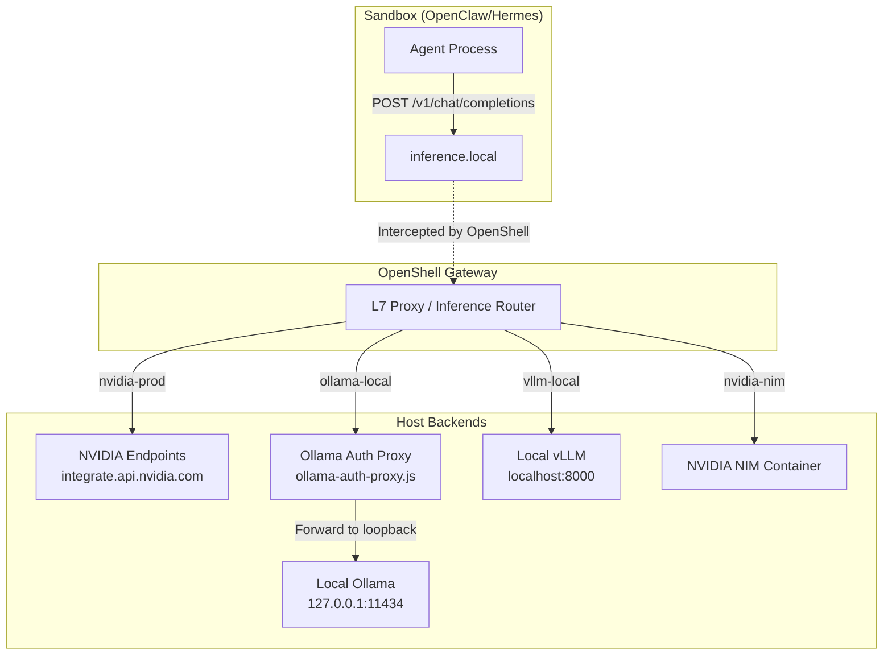

**Sources:** [src/lib/actions/inference-set.ts:84-96](), [src/lib/inference/local.ts:67-68](), [src/lib/inference/ollama/proxy.ts:14-15]()

---

## Routed Provider Model

NemoClaw implements a "Routed Provider" where credentials (API Keys) are kept on the host and never exposed to the sandbox. The `runInferenceSet` function manages the synchronization between the host state and the sandbox agent configuration [src/lib/actions/inference-set.ts:34-46]().

### Data Flow and Request Lifecycle

1.  **Onboarding/Set**: The `handleProviderInferenceState` orchestrator probes the selected endpoint and configures the OpenShell route [src/lib/onboard/machine/handlers/provider-inference.ts:152-164]().
2.  **Inference Interception**: The agent calls `inference.local`. The gateway identifies the request and injects host-side credentials using the provider mapping [src/lib/actions/inference-set.ts:218-220]().
3.  **Local Auth Proxy**: For local Ollama, a token-gated proxy validates requests before they reach the model server [src/lib/inference/ollama/proxy.ts:135-147]().

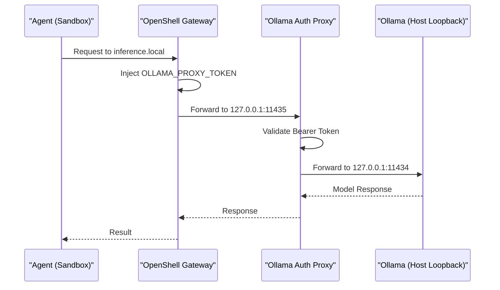

**Sources:** [src/lib/inference/ollama/proxy.ts:177-202](), [src/lib/inference/local.ts:56-62](), [src/lib/actions/inference-set.ts:332-345]()

---

## Inference Providers

NemoClaw supports several provider families, defined in the `SUPPORTED_PROVIDER_NAMES` constant [src/lib/actions/inference-set.ts:84-96]().

| Provider | Endpoint Type | Credential Env | Notes |
|:---|:---|:---|:---|
| **nvidia-prod** | OpenAI-compatible | `NVIDIA_API_KEY` | Hosted NVIDIA API Catalog |
| **openai-api** | Native OpenAI | `OPENAI_API_KEY` | Routes to api.openai.com |
| **anthropic-prod** | Native Anthropic | `ANTHROPIC_API_KEY` | Uses Anthropic Messages API |
| **ollama-local** | Local Ollama API | N/A (Internal Token) | Managed proxy on port 11435 [src/lib/core/ports.ts]() |
| **vllm-local** | OpenAI-compatible | N/A (Local) | Self-hosted vLLM container [src/lib/inference/vllm.ts:28-50]() |
| **nvidia-nim** | NIM API | N/A (Local) | Local NVIDIA NIM deployment [src/lib/inference/nim.ts:4-5]() |

**Sources:** [src/lib/actions/inference-set.ts:84-96](), [src/lib/inference/vllm.ts:121-137](), [src/lib/inference/nim.ts:38-42]()

---

## Local Inference Routing

### Ollama Auth Proxy
On non-WSL hosts, NemoClaw keeps Ollama bound to `127.0.0.1:11434` and starts a token-gated reverse proxy on `0.0.0.0:11435` [src/lib/inference/ollama/proxy.ts:13-14](). 
- **Token Management**: A random 24-byte hex token is generated and stored [src/lib/inference/ollama/proxy.ts:181-182]().
- **Authentication**: The proxy script `ollama-auth-proxy.js` validates the `Authorization: Bearer` header [src/lib/inference/ollama/proxy.ts:82-85]().
- **Container Reachability**: The `getOllamaContainerPort` helper determines if a container should hit the proxy (port 11435) or direct loopback (port 11434) based on platform capabilities [src/lib/inference/local.ts:57-62]().

### vLLM and NIM Profiles
NemoClaw provides specialized profiles for local GPU inference based on detected hardware [src/lib/inference/vllm.ts:180-195]().
- **DGX Spark/Station**: Uses `nvcr.io/nvidia/vllm:26.05.post1-py3` with high-performance models like Qwen-35B [src/lib/inference/vllm.ts:121-145](). The `VLLM_IMAGES` constant defines specific image tags and their download sizes for different platforms and architectures [src/lib/inference/vllm.ts:138-159]().
- **Generic Linux**: Falls back to `Nemotron-3-Nano-4B` for standard NVIDIA GPUs [src/lib/inference/vllm.ts:170-178]().
- **GPU Grouping**: NIM logic groups GPUs by model name to determine if specific images (like H100 optimized) should be pulled [src/lib/inference/nim.ts:133-147](). The `groupGpusByName` function normalizes GPU names and aggregates them into `GpuGroup` objects [src/lib/inference/nim.ts:133-147]().

**Sources:** [src/lib/inference/ollama/proxy.ts:13-14](), [src/lib/inference/ollama/proxy.ts:181-182](), [src/lib/inference/ollama/proxy.ts:82-85](), [src/lib/inference/local.ts:57-62](), [src/lib/inference/vllm.ts:180-195](), [src/lib/inference/vllm.ts:121-145](), [src/lib/inference/vllm.ts:138-159](), [src/lib/inference/vllm.ts:170-178](), [src/lib/inference/nim.ts:133-147]()

---

## Runtime Switching

The active model or provider can be changed using `runInferenceSet`, which updates both the OpenShell route and the agent's internal configuration [src/lib/actions/inference-set.ts:34-46]().

### Switching Logic
- **OpenClaw**: The `patchOpenClawInferenceConfig` function updates the JSON config, modifying provider base URLs and primary model references [src/lib/actions/inference-set.ts:218-235]().
- **Hermes**: The `patchHermesInferenceConfig` function updates YAML configuration, specifically the `model` block and `auth_method` [src/lib/actions/inference-set.ts:286-310]().
- **Verification**: Unless `--no-verify` is passed, the system performs a health check on the new provider before finalizing the switch [src/lib/actions/inference-set.ts:347-350](). The `validateOpenAiLikeSelection` and `validateAnthropicSelectionWithRetryMessage` functions handle endpoint validation, including SSRF preflight checks for custom endpoints [src/lib/onboard/inference-selection-validation.ts:99-126]().

### Dynamic Parameter Injection
NemoClaw uses scripts to fix common inference issues for specific models:
- **Nemotron Fix**: Injects `chat_template_kwargs` into requests to ensure "thinking" tokens are handled correctly [nemoclaw-blueprint/scripts/nemotron-inference-fix.js:1-1]().
- **Context Window Auto-detection**: For Ollama, the system probes the runtime to resolve the actual context window supported by the loaded model [src/lib/inference/ollama-runtime-context.ts:23-24](). The `resolveContextWindowForModel` function determines the appropriate context window based on the provider and model [src/lib/inference/config.ts:11-13]().

**Sources:** [src/lib/actions/inference-set.ts:162-217](), [src/lib/inference/local.ts:17-24](), [src/lib/inference/vllm.ts:180-195](), [src/lib/onboard/inference-selection-validation.ts:99-126](), [src/lib/inference/ollama-runtime-context.ts:23-24](), [src/lib/inference/config.ts:11-13]()

---

# Page: Policy System

# Policy System

<details>
<summary>Relevant source files</summary>

The following files were used as context for generating this wiki page:

- [agents/hermes/policy-additions.yaml](agents/hermes/policy-additions.yaml)
- [agents/hermes/policy-permissive.yaml](agents/hermes/policy-permissive.yaml)
- [agents/openclaw/policy-permissive.yaml](agents/openclaw/policy-permissive.yaml)
- [ci/test-file-size-budget.json](ci/test-file-size-budget.json)
- [docs/deployment/sandbox-hardening.mdx](docs/deployment/sandbox-hardening.mdx)
- [docs/network-policy/apply-policy-presets.mdx](docs/network-policy/apply-policy-presets.mdx)
- [docs/network-policy/approve-network-requests.mdx](docs/network-policy/approve-network-requests.mdx)
- [docs/network-policy/change-baseline-network-policy.mdx](docs/network-policy/change-baseline-network-policy.mdx)
- [docs/network-policy/create-custom-policy-presets.mdx](docs/network-policy/create-custom-policy-presets.mdx)
- [docs/network-policy/customize-network-policy.mdx](docs/network-policy/customize-network-policy.mdx)
- [docs/network-policy/integration-policy-examples.mdx](docs/network-policy/integration-policy-examples.mdx)
- [docs/reference/cli-selection-guide.mdx](docs/reference/cli-selection-guide.mdx)
- [docs/reference/network-policies.mdx](docs/reference/network-policies.mdx)
- [docs/security/best-practices.mdx](docs/security/best-practices.mdx)
- [nemoclaw-blueprint/policies/openclaw-sandbox-permissive.yaml](nemoclaw-blueprint/policies/openclaw-sandbox-permissive.yaml)
- [nemoclaw-blueprint/policies/openclaw-sandbox.yaml](nemoclaw-blueprint/policies/openclaw-sandbox.yaml)
- [nemoclaw-blueprint/policies/presets/github.yaml](nemoclaw-blueprint/policies/presets/github.yaml)
- [nemoclaw-blueprint/policies/presets/huggingface.yaml](nemoclaw-blueprint/policies/presets/huggingface.yaml)
- [nemoclaw-blueprint/policies/presets/jira.yaml](nemoclaw-blueprint/policies/presets/jira.yaml)
- [nemoclaw-blueprint/policies/presets/npm.yaml](nemoclaw-blueprint/policies/presets/npm.yaml)
- [nemoclaw-blueprint/policies/presets/openclaw-pricing.yaml](nemoclaw-blueprint/policies/presets/openclaw-pricing.yaml)
- [nemoclaw-blueprint/policies/presets/outlook.yaml](nemoclaw-blueprint/policies/presets/outlook.yaml)
- [nemoclaw-blueprint/policies/presets/public-reference.yaml](nemoclaw-blueprint/policies/presets/public-reference.yaml)
- [nemoclaw-blueprint/policies/presets/pypi.yaml](nemoclaw-blueprint/policies/presets/pypi.yaml)
- [nemoclaw-blueprint/policies/presets/weather.yaml](nemoclaw-blueprint/policies/presets/weather.yaml)
- [nemoclaw-blueprint/policies/tiers.yaml](nemoclaw-blueprint/policies/tiers.yaml)
- [scripts/lib/sandbox-init.sh](scripts/lib/sandbox-init.sh)
- [scripts/lib/sandbox-rlimits.sh](scripts/lib/sandbox-rlimits.sh)
- [src/lib/actions/sandbox/policy-list-render.test.ts](src/lib/actions/sandbox/policy-list-render.test.ts)
- [src/lib/onboard.ts](src/lib/onboard.ts)
- [src/lib/onboard/agent-policy-presets.ts](src/lib/onboard/agent-policy-presets.ts)
- [src/lib/onboard/hermes-managed-tools.ts](src/lib/onboard/hermes-managed-tools.ts)
- [src/lib/onboard/messaging-policy-presets.test.ts](src/lib/onboard/messaging-policy-presets.test.ts)
- [src/lib/onboard/messaging-policy-presets.ts](src/lib/onboard/messaging-policy-presets.ts)
- [src/lib/onboard/openclaw-otel-policy-presets.test.ts](src/lib/onboard/openclaw-otel-policy-presets.test.ts)
- [src/lib/onboard/policy-preset-persistence.test.ts](src/lib/onboard/policy-preset-persistence.test.ts)
- [src/lib/onboard/policy-preset-sync.ts](src/lib/onboard/policy-preset-sync.ts)
- [src/lib/onboard/policy-presets.ts](src/lib/onboard/policy-presets.ts)
- [src/lib/onboard/policy-resume-selection.ts](src/lib/onboard/policy-resume-selection.ts)
- [src/lib/onboard/policy-selection.ts](src/lib/onboard/policy-selection.ts)
- [src/lib/policy/index.ts](src/lib/policy/index.ts)
- [src/nemoclaw.ts](src/nemoclaw.ts)
- [test/deepagents-monitoring-published-routes.test.ts](test/deepagents-monitoring-published-routes.test.ts)
- [test/e2e-gateway-isolation.sh](test/e2e-gateway-isolation.sh)
- [test/e2e/live/brave-search.test.ts](test/e2e/live/brave-search.test.ts)
- [test/e2e/live/common-egress-agent.test.ts](test/e2e/live/common-egress-agent.test.ts)
- [test/e2e/live/cron-preflight-inference-local.test.ts](test/e2e/live/cron-preflight-inference-local.test.ts)
- [test/network-policies-published-routes.test.ts](test/network-policies-published-routes.test.ts)
- [test/onboard-policy-suggestions.test.ts](test/onboard-policy-suggestions.test.ts)
- [test/onboard-preset-diff.test.ts](test/onboard-preset-diff.test.ts)
- [test/onboard-selection.test.ts](test/onboard-selection.test.ts)
- [test/onboard.test.ts](test/onboard.test.ts)
- [test/policies.test.ts](test/policies.test.ts)
- [test/policy-preset-sync.test.ts](test/policy-preset-sync.test.ts)
- [test/policy-roundtrip-docs.test.ts](test/policy-roundtrip-docs.test.ts)
- [test/policy-tiers-onboard.test.ts](test/policy-tiers-onboard.test.ts)
- [test/policy-tiers.test.ts](test/policy-tiers.test.ts)
- [test/rebuild-policy-presets.test.ts](test/rebuild-policy-presets.test.ts)
- [test/sandbox-init.test.ts](test/sandbox-init.test.ts)
- [test/sandbox-rlimit-hooks.test.ts](test/sandbox-rlimit-hooks.test.ts)
- [test/validate-blueprint.test.ts](test/validate-blueprint.test.ts)

</details>


The Policy System governs network egress, filesystem access, and process capabilities within NemoClaw sandboxes. It implements a defense-in-depth model with three distinct policy types: **network**, **filesystem**, and **process**. Each policy type has different enforcement characteristics—some are locked at sandbox creation, while others can be hot-reloaded at runtime. The system distinguishes between **baseline policies** (defined in configuration files), **policy presets** (reusable YAML templates), and **session policies** (created by operator approvals during runtime).

---

## Policy Types and Enforcement Characteristics

NemoClaw enforces three policy types with different mutability constraints:

| Policy Type | What It Controls | Enforcement Timing | Modifiable at Runtime |
|-------------|------------------|-------------------|----------------------|
| **Network** | Outbound connections to external hosts | Hot-reloadable | Yes, via `openshell policy set` |
| **Filesystem** | Read/write permissions to paths | Locked at creation | No, requires sandbox recreation |
| **Process** | User/group context, syscall restrictions | Locked at creation | No, requires sandbox recreation |

### Policy Lifecycle

```mermaid
stateDiagram-v2
    [*] --> Defined: "openclaw-sandbox.yaml"
    
    Defined --> Applied: "sandbox create"
    
    state Applied {
        [*] --> NetworkBaseline
        [*] --> FilesystemLocked
        [*] --> ProcessLocked
        
        NetworkBaseline --> NetworkBaseline: "openshell policy set<br/>(hot-reload)"
        NetworkBaseline --> NetworkWithSession: "TUI approval"
        NetworkWithSession --> NetworkBaseline: "sandbox restart"
        
        FilesystemLocked --> FilesystemLocked: "(immutable)"
        ProcessLocked --> ProcessLocked: "(immutable)"
    }
    
    Applied --> [*]: "sandbox delete"
    
    note right of NetworkBaseline
        Baseline: from YAML
        Session: runtime approvals
        Both active simultaneously
    end note
    
    note right of FilesystemLocked
        Locked via Landlock/Mounts
        Cannot be changed without recreation
    end note
```

**Sources:**
- [nemoclaw-blueprint/policies/openclaw-sandbox.yaml:4-14]()
- [docs/security/best-practices.mdx:81-87]()

---

## Baseline Policy Structure

The baseline policy is defined in `openclaw-sandbox.yaml` and applied when the sandbox is created. It consists of three sections: `filesystem_policy`, `landlock`/`process`, and `network_policies`.

### Filesystem Policy

The filesystem policy defines read-only and read-write path sets. It ensures that critical system directories are immutable while providing the agent with writable space for configuration and state.

```mermaid
graph TB
    subgraph "filesystem_policy"
        IncludeWorkdir["include_workdir: true"]
        
        subgraph "read_only"
            RO1["/usr"]
            RO2["/lib"]
            RO3["/proc"]
            RO4["/dev/urandom"]
            RO5["/app"]
            RO6["/etc"]
            RO7["/var/log"]
        end
        
        subgraph "read_write"
            RW1["/tmp"]
            RW2["/dev/null"]
            RW3["/dev/pts"]
            RW4["/sandbox/.openclaw (Agent Config)"]
            RW5["/sandbox/.nemoclaw (Plugin State)"]
            RW6["/home/linuxbrew (Homebrew)"]
        end
    end
    
    subgraph "Enforcement"
        Landlock["landlock:<br/>compatibility: best_effort"]
        Process["process:<br/>run_as_user: sandbox<br/>run_as_group: sandbox"]
    end
    
    IncludeWorkdir --> Landlock
    RO1 --> Landlock
    RW3 --> Landlock
    
    Landlock --> Process
```

**Sources:**
- [nemoclaw-blueprint/policies/openclaw-sandbox.yaml:18-54]()
- [docs/security/best-practices.mdx:81-87]()

### Network Policy Structure

Network policies are organized into **endpoint groups**. Each group specifies allowed hosts, ports, protocols, and the binaries permitted to access them. NemoClaw follows a "deny-by-default" principle [docs/security/best-practices.mdx:97-99]().

```mermaid
graph LR
    subgraph "network_policies"
        direction TB
        
        NVIDIA["nvidia:<br/>- integrate.api.nvidia.com:443<br/>binaries: [/usr/local/bin/openclaw]"]
        
        Inference["managed_inference:<br/>- inference.local:443<br/>binaries: [openclaw, node, curl, python3]"]
        
        GatewayDialback["openclaw_gateway_dialback:<br/>- 10.200.0.2:18789<br/>binaries: [openclaw, node]"]
        
        ClawHub["clawhub:<br/>- clawhub.ai:443<br/>binaries: [openclaw, node]"]
    end
    
    subgraph "Enforcement"
        REST["REST Rules:<br/>enforcement: enforce<br/>protocol: rest"]
        Rules["HTTP Rules:<br/>- allow: { method: POST, path: '/v1/chat/completions' }"]
    end
    
    NVIDIA --> REST
    Inference --> REST
    REST --> Rules
```

**Endpoint group anatomy:**

| Field | Purpose | Example |
|-------|---------|---------|
| `name` | Policy identifier | `"nvidia"` |
| `endpoints[]` | Allowed hosts and ports | `host: integrate.api.nvidia.com`, `port: 443` |
| `endpoints[].protocol` | Protocol type | `"rest"` or `"websocket"` |
| `endpoints[].enforcement` | Enforcement level | `"enforce"` |
| `endpoints[].rules[]` | HTTP path/method restrictions | `{ method: POST, path: "/v1/chat/completions" }` |
| `binaries[]` | Executables allowed to access | `{ path: /usr/local/bin/openclaw }` |

**Sources:**
- [nemoclaw-blueprint/policies/openclaw-sandbox.yaml:72-179]()
- [test/validate-blueprint.test.ts:68-90]()
- [docs/security/best-practices.mdx:97-106]()

---

## Policy Preset System

NemoClaw includes a **policy preset system** for managing reusable policy configurations located in `nemoclaw-blueprint/policies/presets/` [src/lib/policy/index.ts:65]() and agent-specific policy additions [src/lib/agent/defs.ts:10-10](). These are typically applied during onboarding or via the `policy add` command.

### Preset Implementation and Logic

The `src/lib/policy/index.ts` file manages the lifecycle of presets, including listing, loading, and merging them with agent-specific policies.

```mermaid
graph TB
    subgraph "src/lib/policy/index.ts"
        listPresets["listPresets()"]
        loadPreset["loadPreset(name)"]
        loadPresetForAgent["loadPresetForAgent(name, options)"]
        getPresetEndpoints["getPresetEndpoints(content)"]
        applyPresets["applyPresets(sandboxName, presetNames)"]
    end
    
    subgraph "Data Flow"
        PresetsDir["nemoclaw-blueprint/policies/presets/*.yaml"]
        AgentAdditions["agents/*/policy-additions.yaml"]
        MessagingChannels["src/lib/messaging/channels/*/policy/*.yaml"]
        Registry["src/lib/state/registry.ts"]
        OpenShellCLI["openshell policy set"]
    end
    
    listPresets --> PresetsDir
    listPresets --> MessagingChannels
    loadPreset --> PresetsDir
    loadPresetForAgent --> PresetsDir
    loadPresetForAgent --> MessagingChannels
    applyPresets --> loadPresetForAgent
    applyPresets --> Registry
    applyPresets --> OpenShellCLI
```

**Key Presets Available:**
- `pypi`: Allows Python package installation via `pip` and `uv` [nemoclaw-blueprint/policies/presets/pypi.yaml:9-37]().
- `github`: Provides access to `github.com` and `api.github.com` [nemoclaw-blueprint/policies/presets/github.yaml]().
- `discord`, `slack`, `telegram`: Messaging channel egress [docs/network-policy/integration-policy-examples.mdx:142-142]().
- `local-inference`: Allows the sandbox to reach the host gateway for local models [docs/network-policy/integration-policy-examples.mdx:58-58]().

**Sources:**
- [src/lib/policy/index.ts:103-128]()
- [src/lib/policy/index.ts:148-152]()
- [src/lib/policy/index.ts:154-156]()
- [src/lib/policy/index.ts:300-300]()
- [docs/network-policy/integration-policy-examples.mdx:50-72]()

---

## Session Policies and Operator Approval

Session policies are **ephemeral policy additions** created when an operator approves a blocked network request in real-time.

### Approval Workflow

```mermaid
sequenceDiagram
    participant Agent as "Agent Binary<br/>(/usr/local/bin/openclaw)"
    participant Gateway as "OpenShell Gateway<br/>(Policy Engine)"
    participant TUI as "openshell term<br/>(TUI)"
    participant Operator as "Human Operator"
    
    Agent->>Gateway: "HTTP POST to api.example.com"
    Gateway->>Gateway: "Check Policy (Baseline + Presets)"
    
    alt Request Blocked
        Gateway->>TUI: "Log blocked request"
        TUI->>Operator: "Display Host/Port/Binary"
        Operator->>TUI: "Approve request"
        TUI->>Gateway: "Update running policy"
        Gateway->>Agent: "Allow connection"
    end
```

**Sources:**
- [docs/security/best-practices.mdx:97-106]()
- [docs/network-policy/integration-policy-examples.mdx:36-45]()

---

## Policy Tiers

During onboarding, the wizard prompts for a policy tier that determines the default set of presets applied on top of the baseline policy [docs/security/best-practices.mdx:81-87]().

| Tier | Presets included | Description |
|------|------------------|-------------|
| **Restricted** | None | Base sandbox only. Minimum for core agent operation. |
| **Balanced** | npm, pypi, huggingface, brew, brave, weather | Default. Full dev tooling and web search. |
| **Open** | Balanced + messaging, productivity, Jira, Outlook | Broadest access across third-party services. |

**Sources:**
- [nemoclaw-blueprint/policies/tiers.yaml:1-1]()
- [test/policy-tiers-onboard.test.ts:126-151]()

---

## Hot-Reloadable vs Locked Policies

The system enforces a strict boundary between what can be changed at runtime and what requires a sandbox rebuild.

### Runtime Updates (Network)
Network policies support dynamic updates via `openshell policy update` or `nemoclaw policy add`. NemoClaw's `policy add` can apply presets to a running sandbox without a restart [docs/network-policy/apply-policy-presets.mdx:1-1]().

### Locked Policies (Filesystem/Process)
Filesystem and Process policies are baked into the sandbox blueprint. 
1. **Static Edit**: Modify `nemoclaw-blueprint/policies/openclaw-sandbox.yaml` [docs/network-policy/change-baseline-network-policy.mdx:1-1]().
2. **Apply**: Re-run the onboarding process or `nemoclaw onboard` to recreate the sandbox with the new static rules [docs/network-policy/change-baseline-network-policy.mdx:1-1]().

**Sources:**
- [nemoclaw-blueprint/policies/openclaw-sandbox.yaml:6-14]()
- [docs/security/best-practices.mdx:81-87]()
- [docs/network-policy/apply-policy-presets.mdx:1-1]()
- [docs/network-policy/change-baseline-network-policy.mdx:1-1]()

---

# Page: Blueprint System

# Blueprint System

<details>
<summary>Relevant source files</summary>

The following files were used as context for generating this wiki page:

- [.github/dco-bypass.txt](.github/dco-bypass.txt)
- [.github/workflows/dco-check.yaml](.github/workflows/dco-check.yaml)
- [.github/workflows/installer-hash-check.yaml](.github/workflows/installer-hash-check.yaml)
- [docs/reference/architecture.mdx](docs/reference/architecture.mdx)
- [nemoclaw-blueprint/blueprint.yaml](nemoclaw-blueprint/blueprint.yaml)
- [nemoclaw-blueprint/provider-profiles/entra-runtime-v1.yaml](nemoclaw-blueprint/provider-profiles/entra-runtime-v1.yaml)
- [nemoclaw-blueprint/provider-profiles/okta-runtime-v1.yaml](nemoclaw-blueprint/provider-profiles/okta-runtime-v1.yaml)
- [nemoclaw/src/blueprint/runner-identity.test.ts](nemoclaw/src/blueprint/runner-identity.test.ts)
- [nemoclaw/src/blueprint/runner-name-validation.test.ts](nemoclaw/src/blueprint/runner-name-validation.test.ts)
- [nemoclaw/src/blueprint/runner.test.ts](nemoclaw/src/blueprint/runner.test.ts)
- [nemoclaw/src/blueprint/runner.ts](nemoclaw/src/blueprint/runner.ts)
- [nemoclaw/src/blueprint/runtime-identity.test.ts](nemoclaw/src/blueprint/runtime-identity.test.ts)
- [nemoclaw/src/blueprint/runtime-identity.ts](nemoclaw/src/blueprint/runtime-identity.ts)
- [nemoclaw/src/blueprint/snapshot.test.ts](nemoclaw/src/blueprint/snapshot.test.ts)
- [nemoclaw/src/blueprint/snapshot.ts](nemoclaw/src/blueprint/snapshot.ts)
- [nemoclaw/src/blueprint/ssrf.test.ts](nemoclaw/src/blueprint/ssrf.test.ts)
- [nemoclaw/src/blueprint/ssrf.ts](nemoclaw/src/blueprint/ssrf.ts)
- [nemoclaw/src/shared/sandbox-name.cts](nemoclaw/src/shared/sandbox-name.cts)
- [nemoclaw/src/shared/sandbox-name.test.ts](nemoclaw/src/shared/sandbox-name.test.ts)
- [schemas/blueprint.schema.json](schemas/blueprint.schema.json)
- [scripts/brev-launchable-ci-cpu.sh](scripts/brev-launchable-ci-cpu.sh)
- [scripts/check-installer-hash.sh](scripts/check-installer-hash.sh)
- [scripts/checks/extract-installer-pins.mts](scripts/checks/extract-installer-pins.mts)
- [scripts/install-openshell.sh](scripts/install-openshell.sh)
- [src/lib/actions/inference-set-endpoint-security.test.ts](src/lib/actions/inference-set-endpoint-security.test.ts)
- [src/lib/name-validation.ts](src/lib/name-validation.ts)
- [src/lib/runner.ts](src/lib/runner.ts)
- [test/blueprint-runtime-identity-lifecycle.test.ts](test/blueprint-runtime-identity-lifecycle.test.ts)
- [test/blueprint-runtime-identity-schema.test.ts](test/blueprint-runtime-identity-schema.test.ts)
- [test/brev-launchable-ci-cpu-checksum.test.ts](test/brev-launchable-ci-cpu-checksum.test.ts)
- [test/dependency-pins-check.test.ts](test/dependency-pins-check.test.ts)
- [test/e2e/live/inference-routing.test.ts](test/e2e/live/inference-routing.test.ts)
- [test/e2e/live/runtime-identity-oauth-server.ts](test/e2e/live/runtime-identity-oauth-server.ts)
- [test/install-openshell-version-check.test.ts](test/install-openshell-version-check.test.ts)
- [test/installer-hash-check.test.ts](test/installer-hash-check.test.ts)
- [test/runner.test.ts](test/runner.test.ts)

</details>


The blueprint system is NemoClaw's infrastructure-as-code layer. It orchestrates sandbox creation, migration, policy application, and inference configuration through the OpenShell CLI. While the NemoClaw plugin handles user interaction and agent lifecycle, the blueprint defines the technical specification of the environment.

---

## Blueprint Artifact Structure

The blueprint is a versioned artifact defined in the `nemoclaw-blueprint/` directory. It contains the declaration of components, inference profiles, and security policies required to run an OpenClaw agent securely.

**Blueprint Directory Structure**

```mermaid
graph TB
    Root["nemoclaw-blueprint/"]
    
    Root --> Manifest["blueprint.yaml<br/>(manifest)"]
    Root --> Runner["runner.ts<br/>(orchestrator)"]
    Root --> Pool["router/pool-config.yaml<br/>(router configuration)"]
    
    Manifest -.-> Version["version: string"]
    Manifest -.-> Components["components: object"]
    Manifest -.-> Profiles["profiles: list"]
    
    Components --> Sandbox["sandbox: image, ports"]
    Components --> Inference["inference: profiles"]
    Components --> Policy["policy: additions"]
    Components --> Router["router: pool_config_path"]
```

| Component | Path | Purpose |
|-----------|------|---------|
| **Manifest** | `nemoclaw-blueprint/blueprint.yaml` | Declares versions, components, and inference profiles. [nemoclaw-blueprint/blueprint.yaml:1-109]() |
| **Orchestrator** | `nemoclaw/src/blueprint/runner.ts` | TypeScript logic for `plan`, `apply`, `status`, and `rollback`. [nemoclaw/src/blueprint/runner.ts:5-27]() |
| **Snapshot Logic** | `nemoclaw/src/blueprint/snapshot.ts` | Handles host-to-sandbox migration of agent data. [nemoclaw/src/blueprint/snapshot.ts:4-12]() |
| **State Store** | `nemoclaw/src/blueprint/state.ts` | Manages persistence of run IDs and deployment status. [nemoclaw/src/blueprint/state.ts:1-29]()

**Sources:** [nemoclaw-blueprint/blueprint.yaml:1-109](), [nemoclaw/src/blueprint/runner.ts:5-27](), [nemoclaw/src/blueprint/snapshot.ts:4-12](), [nemoclaw/src/blueprint/state.ts:1-29]()

---

## Blueprint Manifest Schema

The `blueprint.yaml` file is the source of truth for the environment configuration. It includes pinning for security and definitions for multi-profile inference routing.

| Field | Type | Description |
|-------|------|-------------|
| `version` | string | Semantic version of the blueprint. [nemoclaw-blueprint/blueprint.yaml:4]() |
| `digest` | string | SHA256 digest of the pinned sandbox image for verification. [nemoclaw-blueprint/blueprint.yaml:14]() |
| `components.sandbox.image` | string | Pinned image digest for `openclaw` sandbox. [nemoclaw-blueprint/blueprint.yaml:34]() |
| `components.inference.profiles` | object | Mapping of profiles to provider types, endpoints, and models. [nemoclaw-blueprint/blueprint.yaml:52-94]() |
| `components.router` | object | Configuration for the inference load-balancer/router. [nemoclaw-blueprint/blueprint.yaml:95-98]() |
| `components.policy.additions` | object | Network policy additions for services like `nim_service`. [nemoclaw-blueprint/blueprint.yaml:100-109]()

**Sources:** [nemoclaw-blueprint/blueprint.yaml:1-109]()

---

## Blueprint Runner Lifecycle

The blueprint runner implements a lifecycle consisting of four primary actions: `plan`, `apply`, `status`, and `rollback`.

**Blueprint Lifecycle Flow**

```mermaid
stateDiagram-v2
    [*] --> Resolve: "loadBlueprint()"
    Resolve --> Plan: "actionPlan()"
    Plan --> Apply: "actionApply()"
    Apply --> Status: "actionStatus()"
    
    Apply --> Snapshot: "createSnapshot() (Migration)"
    Snapshot --> Restore: "restoreIntoSandbox()"
    
    Apply --> Rollback: "On Failure"
    Rollback --> [*]
    
    note right of Plan
        Validate prerequisites
        Emit RUN_ID
    end note
    
    note right of Apply
        openshell sandbox create
        openshell policy update
        openshell inference set
    end note
```

### 1. Resolve & Verify
The runner loads the manifest using `loadBlueprint()`, which defaults to `blueprint.yaml` in the current directory [nemoclaw/src/blueprint/runner.ts:220-224](). It validates the structure against internal interfaces like `isBlueprint` to ensure all required components (sandbox, inference, policy) are present [nemoclaw/src/blueprint/runner.ts:178-216]().

### 2. Plan Phase
The `actionPlan` function performs a dry-run of the deployment.
- **Run ID Generation**: `emitRunId()` generates a unique identifier matching the pattern `nc-YYYYMMDD-HHMMSS-<hex8>` [nemoclaw/src/blueprint/runner.ts:81-82]().
- **SSRF Validation**: All endpoint URLs in the blueprint are passed through `validateEndpointUrl` to prevent access to internal networks [nemoclaw/src/blueprint/runner.ts:23]().

### 3. Apply Phase (and Migration)
The `actionApply` function executes the plan by invoking the OpenShell CLI.
- **Sandbox Provisioning**: Calls `openshell sandbox create` [nemoclaw/src/blueprint/runner.ts:241-250]().
- **Host Migration**: If a host `~/.openclaw` directory exists, `createSnapshot()` captures the config, workspace, and skills [nemoclaw/src/blueprint/snapshot.ts:108-143](). This is then pushed into the sandbox via `restoreIntoSandbox()` using `openshell sandbox cp` [nemoclaw/src/blueprint/snapshot.ts:145-163]().
- **Ownership Repair**: Because files copied via OpenShell land as root, the runner executes a `chown -R sandbox:sandbox` inside the container [nemoclaw/src/blueprint/snapshot.ts:214-224]().

**Sources:** [nemoclaw/src/blueprint/runner.ts:81-82](), [nemoclaw/src/blueprint/snapshot.ts:108-224](), [nemoclaw/src/blueprint/runner.ts:220-250]()

---

## Security: SSRF Validation and DNS Pinning

To prevent Server-Side Request Forgery (SSRF) and DNS rebinding attacks, the blueprint runner validates all endpoints.

- **Private IP Blocking**: `isPrivateIp` (within `ssrf.ts`) detects and rejects loopback, private CIDRs (10/8, 192.168/16), and cloud metadata endpoints (169.254.169.254). [nemoclaw/src/blueprint/ssrf.test.ts:19-49]()
- **DNS Pinning**: The `validateEndpointUrl` function performs a DNS lookup and returns a `pinnedUrl` where the hostname is replaced by the resolved IP. This prevents "Time-of-Check to Time-of-Use" attacks where a hostname resolves to a public IP during validation but a private IP during the actual request. [nemoclaw/src/blueprint/runner.test.ts:74-79]()

**Sources:** [nemoclaw/src/blueprint/ssrf.test.ts:19-49](), [nemoclaw/src/blueprint/runner.test.ts:74-79]()

---

## Orchestration Logic (Code Entity Mapping)

The blueprint system bridges the gap between high-level user intent and low-level OpenShell/Docker commands.

**Natural Language to Code Entity Space**

```mermaid
graph LR
    subgraph "Natural Language Space"
        A["'Create the Sandbox'"]
        B["'Migrate my data'"]
        C["'Set up NIM routing'"]
    end

    subgraph "Code Entity Space"
        A --> Runner["Runner.actionApply()<br/>(runner.ts)"]
        Runner --> OSC["openshell sandbox create"]
        
        B --> Snap["Snapshot.createSnapshot()<br/>(snapshot.ts)"]
        Snap --> Restore["Snapshot.restoreIntoSandbox()"]
        
        C --> SSRF["ssrf.validateEndpointUrl()"]
        C --> Router["blueprint.yaml: components.router"]
    end
```

| Logic Step | Code Entity | Implementation Detail |
|------------|-------------|-----------------------|
| **Validation** | `validateEndpointUrl` | Uses `node:dns` to resolve and check against private IP ranges. [nemoclaw/src/blueprint/runner.ts:23]() |
| **Snapshot** | `createSnapshot` | Copies `~/.openclaw` to `~/.nemoclaw/snapshots/<timestamp>`. [nemoclaw/src/blueprint/snapshot.ts:120-128]() |
| **Restore** | `restoreIntoSandbox` | Uses `openshell sandbox cp` and repairs legacy symlinks. [nemoclaw/src/blueprint/snapshot.ts:156-198]() |
| **Runner** | `actionApply` | Orchestrates the sequence of `openshell` CLI calls. [nemoclaw/src/blueprint/runner.ts:241-300]() |

**Sources:** [nemoclaw/src/blueprint/runner.ts:241-300](), [nemoclaw/src/blueprint/snapshot.ts:120-198](), [nemoclaw/src/blueprint/runner.ts:23]()

---

# Page: Command-Line Interface

# Command-Line Interface

<details>
<summary>Relevant source files</summary>

The following files were used as context for generating this wiki page:

- [.gitignore](.gitignore)
- [docs/DORI_SETUP.md](docs/DORI_SETUP.md)
- [docs/changelog/2026-07-30.mdx](docs/changelog/2026-07-30.mdx)
- [docs/configure-agents/configure-memory-search.mdx](docs/configure-agents/configure-memory-search.mdx)
- [docs/index.yml](docs/index.yml)
- [docs/inference/set-up-vllm-on-two-dgx-stations.mdx](docs/inference/set-up-vllm-on-two-dgx-stations.mdx)
- [docs/manage-sandboxes/run-deep-agents-code.mdx](docs/manage-sandboxes/run-deep-agents-code.mdx)
- [docs/reference/commands.mdx](docs/reference/commands.mdx)
- [docs/reference/configure-runtime-identity.mdx](docs/reference/configure-runtime-identity.mdx)
- [docs/reference/troubleshooting.mdx](docs/reference/troubleshooting.mdx)
- [docs/resources/engineer-agentic-documentation.mdx](docs/resources/engineer-agentic-documentation.mdx)
- [scripts/check-docs-published-routes.mts](scripts/check-docs-published-routes.mts)
- [src/commands/sandbox/status.ts](src/commands/sandbox/status.ts)
- [src/commands/status.ts](src/commands/status.ts)
- [src/lib/actions/root-help.ts](src/lib/actions/root-help.ts)
- [src/lib/cli/bare-connect-routing.ts](src/lib/cli/bare-connect-routing.ts)
- [src/lib/cli/public-dispatch.ts](src/lib/cli/public-dispatch.ts)
- [src/lib/cli/public-display-defaults.ts](src/lib/cli/public-display-defaults.ts)
- [test/check-docs-published-routes.test.ts](test/check-docs-published-routes.test.ts)
- [test/cli-oclif-compatibility.test.ts](test/cli-oclif-compatibility.test.ts)
- [test/cli/dispatch-basics.test.ts](test/cli/dispatch-basics.test.ts)
- [test/cli/status-routing.test.ts](test/cli/status-routing.test.ts)
- [test/cli/unknown-sandbox-action.test.ts](test/cli/unknown-sandbox-action.test.ts)
- [test/package-contract/cli/command-registry.test.ts](test/package-contract/cli/command-registry.test.ts)
- [test/package-contract/cli/public-argv-translation.test.ts](test/package-contract/cli/public-argv-translation.test.ts)
- [test/repro-4538-raw-doctor-perms.test.ts](test/repro-4538-raw-doctor-perms.test.ts)
- [test/root-help.test.ts](test/root-help.test.ts)
- [test/support/public-dispatch-test-harness.ts](test/support/public-dispatch-test-harness.ts)

</details>


NemoClaw provides three command interfaces for different operational contexts. The `nemoclaw` binary (and its agent-specific alias `nemohermes`) handles host-level setup, deployment, and service management. The in-sandbox commands run within the agent environment for runtime operations. The `openshell` CLI provides low-level control over the gateway, providers, and policies. This page documents all three interfaces and their interactions.

For configuration options and environment variables used by these commands, see [Configuration Files](#8.3) and [Environment Variables](#8.4).

---

## Command Architecture

NemoClaw implements a three-tier command architecture that separates host operations, sandbox operations, and infrastructure primitives. The `nemoclaw` binary acts as a high-level orchestrator, delegating infrastructure tasks to the `openshell` CLI and managing sandbox lifecycles.

### CLI Context and Delegation
Title: "NemoClaw Command Execution Flow"
```mermaid
graph TB
    subgraph Host["Host Environment"]
        User["Operator"]
        NemoclawBin["nemoclaw binary<br/>(src/lib/cli/public-dispatch.ts)"]
        OnboardCmd["onboard command<br/>(src/lib/cli/public-display-defaults.ts)"]
    end

    subgraph Sandbox["OpenShell Sandbox"]
        AgentCLI["/nemoclaw slash command"]
        Plugin["NemoClaw Plugin<br/>(docs/reference/commands.mdx)"]
    end

    subgraph Infrastructure["OpenShell Layer"]
        OpenShellCLI["openshell CLI"]
        Gateway["Gateway (nemoclaw)"]
        Providers["Providers (Inference)"]
        Policies["Network Policies"]
    end

    User -->|"nemoclaw onboard"| NemoclawBin
    User -->|"nemoclaw status"| NemoclawBin

    NemoclawBin -->|"executes"| OnboardCmd
    NemoclawBin -->|"delegates to"| OpenShellCLI

    User -->|"Chat Interface"| AgentCLI
    AgentCLI -->|"/nemoclaw status"| Plugin

    OpenShellCLI -->|"manages"| Gateway
    OpenShellCLI -->|"configures"| Providers
    OpenShellCLI -->|"enforces"| Policies
```
**Sources:** [src/lib/cli/public-dispatch.ts:1-20](), [docs/reference/commands.mdx:75-115](), [src/lib/cli/public-display-defaults.ts:102-114]()

The architecture enforces clean separation of concerns:

| Tier | Entry Point | Context | Typical Operations |
|------|-------------|---------|-------------------|
| **Host Commands** | `nemoclaw` / `nemohermes` | Host machine | Onboarding, hardware inventory, credentials, lifecycle |
| **Plugin Commands** | `/nemoclaw` | Inside OpenClaw | Status check, onboarding guidance, eject/rollback |
| **Infrastructure** | `openshell` | Host machine | Gateway lifecycle, port forwards, low-level policy edits |

---

## Host Commands (`nemoclaw` / `nemohermes`)

The `nemoclaw` binary is the primary interface for host-side operations. It is responsible for the interactive onboarding wizard, hardware resource inventory, and checking the health of the OpenShell gateway and sandboxes. For the Hermes agent, the `nemohermes` alias provides the same functionality with Hermes-specific defaults [docs/reference/commands.mdx:21-31]().

### Command Dispatch and Routing
Title: "Host CLI Command Routing"
```mermaid
graph LR
    subgraph Entry["CLI Entry"]
        NC["nemoclaw"]
        NH["nemohermes"]
    end

    subgraph Actions["Host Actions"]
        Onboard["onboard wizard<br/>(nemoclaw onboard)"]
        Res["resources inventory<br/>(nemoclaw resources)"]
        Creds["credentials management<br/>(nemoclaw credentials)"]
        Life["sandbox lifecycle<br/>(nemoclaw <name> status/logs/connect)"]
    end

    NC --> Onboard
    NH --> Onboard
    NC --> Res
    NC --> Creds
    NC --> Life
```
**Sources:** [docs/reference/commands.mdx:117-128](), [src/lib/cli/public-display-defaults.ts:133-138](), [src/lib/cli/public-display-defaults.ts:35-57]()

### Key Host Commands

#### `nemoclaw onboard`
The primary entry point for setup. It runs an interactive wizard that configures an inference endpoint and credentials, with an option to choose the agent runtime [src/lib/cli/public-display-defaults.ts:102-107](). It also supports using a custom Dockerfile for the sandbox image [src/lib/cli/public-display-defaults.ts:108-112]().
**Sources:** [src/lib/cli/public-display-defaults.ts:102-112]()

#### `nemoclaw resources`
Displays host hardware inventory, including CPU cores, RAM, and GPU VRAM [src/lib/cli/public-display-defaults.ts:133-138]().
**Sources:** [src/lib/cli/public-display-defaults.ts:133-138]()

#### `nemoclaw credentials`
Manages provider credentials. `credentials:add` registers a provider credential, `credentials:list` lists stored credential keys, and `credentials:reset` removes a stored credential [src/lib/cli/public-display-defaults.ts:35-57]().
**Sources:** [src/lib/cli/public-display-defaults.ts:35-57]()

#### `nemoclaw list`
Lists all registered sandboxes, showing their names and other relevant information [src/lib/cli/public-display-defaults.ts:95-100]().
**Sources:** [src/lib/cli/public-display-defaults.ts:95-100]()

#### `nemoclaw status`
Provides a summary of the current system status, including the gateway and any running sandboxes [src/commands/status.ts:1-3]().
**Sources:** [src/commands/status.ts:1-3]()

For details, see [Host Commands (nemoclaw)](#4.1).

---

## In-Sandbox Commands

In-sandbox commands provide immediate feedback and control from within the agent's environment.

- **OpenClaw Slash Commands**: The `/nemoclaw` command is available inside the OpenClaw chat interface for quick actions like showing sandbox and inference state (`/nemoclaw status`), explaining shields status (`/nemoclaw shields [status]`), or providing onboarding status and reconfiguration guidance (`/nemoclaw onboard`) [docs/reference/commands.mdx:77-88]().
- **Hermes Plugin**: Hermes does not use the OpenClaw chat slash command. Instead, it uses host-side `nemohermes` commands for lifecycle, status, policy, and inference operations. The in-sandbox Hermes integration installs a NemoClaw Hermes plugin that exposes tools for status, environment information, and skill reload support [docs/reference/commands.mdx:92-98]().
- **Deep Agents Commands**: Deep Agents also does not use the OpenClaw chat slash command. Inside the sandbox, `dcode` is used for the interactive TUI and `dcode -n` for explicit headless automation. The `--json` flag can be added for managed, versioned result envelopes [docs/reference/commands.mdx:101-112]().

For details, see [Plugin Commands (openclaw nemoclaw)](#4.2).

**Sources:** [docs/reference/commands.mdx:77-112]()

---

## OpenShell Commands

NemoClaw utilizes the `openshell` CLI as its underlying infrastructure engine. While `nemoclaw` handles the "Agent" layer, `openshell` handles the "Sandbox" and "Gateway" layers. NemoClaw may suggest using `openshell` directly for certain operations [src/lib/cli/public-dispatch.ts:151-193]().

| Command | Role in NemoClaw |
|---------|------------------|
| `openshell gateway` | Manages the core OpenShell gateway service, including stopping it (`openshell gateway stop -g nemoclaw`) [src/lib/cli/public-dispatch.ts:173-177](). |
| `openshell provider` | Low-level registration of inference endpoints. |
| `openshell policy` | Enforces and updates the network egress rules. For setting policies, NemoClaw suggests `openshell policy set --policy <policy-file> --wait <sandbox-name>` [src/lib/cli/public-dispatch.ts:166-171](). |
| `openshell forward` | Manages dashboard port forwards from the host to the sandbox. |
| `openshell sandbox` | Directly manages container creation and connectivity. |
| `openshell term` | Used to monitor gateway logs and policy approval prompts [src/lib/cli/public-dispatch.ts:160-164](). |

For details, see [OpenShell Commands](#4.3).

**Sources:** [src/lib/cli/public-dispatch.ts:151-193]()

---

# Page: Host Commands (nemoclaw)

# Host Commands (nemoclaw)

<details>
<summary>Relevant source files</summary>

The following files were used as context for generating this wiki page:

- [.gitignore](.gitignore)
- [agents/hermes/build-mcp-digest.py](agents/hermes/build-mcp-digest.py)
- [docs/DORI_SETUP.md](docs/DORI_SETUP.md)
- [docs/changelog/2026-07-30.mdx](docs/changelog/2026-07-30.mdx)
- [docs/configure-agents/configure-memory-search.mdx](docs/configure-agents/configure-memory-search.mdx)
- [docs/index.yml](docs/index.yml)
- [docs/inference/set-up-vllm-on-two-dgx-stations.mdx](docs/inference/set-up-vllm-on-two-dgx-stations.mdx)
- [docs/inference/verify-inference-route.mdx](docs/inference/verify-inference-route.mdx)
- [docs/manage-sandboxes/run-deep-agents-code.mdx](docs/manage-sandboxes/run-deep-agents-code.mdx)
- [docs/reference/commands.mdx](docs/reference/commands.mdx)
- [docs/reference/configure-runtime-identity.mdx](docs/reference/configure-runtime-identity.mdx)
- [docs/reference/troubleshooting.mdx](docs/reference/troubleshooting.mdx)
- [docs/resources/engineer-agentic-documentation.mdx](docs/resources/engineer-agentic-documentation.mdx)
- [scripts/check-docs-published-routes.mts](scripts/check-docs-published-routes.mts)
- [scripts/gateway-control.sh](scripts/gateway-control.sh)
- [scripts/lib/gateway-supervisor.sh](scripts/lib/gateway-supervisor.sh)
- [src/commands/sandbox/status.ts](src/commands/sandbox/status.ts)
- [src/commands/status.ts](src/commands/status.ts)
- [src/lib/actions/root-help.ts](src/lib/actions/root-help.ts)
- [src/lib/actions/sandbox/connect-boundary-refusal.ts](src/lib/actions/sandbox/connect-boundary-refusal.ts)
- [src/lib/actions/sandbox/connect-flow-dcode-probe-preamble.test.ts](src/lib/actions/sandbox/connect-flow-dcode-probe-preamble.test.ts)
- [src/lib/actions/sandbox/connect-flow-hermes-boundary.test.ts](src/lib/actions/sandbox/connect-flow-hermes-boundary.test.ts)
- [src/lib/actions/sandbox/connect-flow.test.ts](src/lib/actions/sandbox/connect-flow.test.ts)
- [src/lib/actions/sandbox/connect-inference-route-probe.test.ts](src/lib/actions/sandbox/connect-inference-route-probe.test.ts)
- [src/lib/actions/sandbox/connect-inference-route-probe.ts](src/lib/actions/sandbox/connect-inference-route-probe.ts)
- [src/lib/actions/sandbox/connect.ts](src/lib/actions/sandbox/connect.ts)
- [src/lib/actions/sandbox/gateway-failure-classifier.test.ts](src/lib/actions/sandbox/gateway-failure-classifier.test.ts)
- [src/lib/actions/sandbox/gateway-failure-classifier.ts](src/lib/actions/sandbox/gateway-failure-classifier.ts)
- [src/lib/actions/sandbox/gateway-restart-quarantine-repair.test.ts](src/lib/actions/sandbox/gateway-restart-quarantine-repair.test.ts)
- [src/lib/actions/sandbox/gateway-restart.ts](src/lib/actions/sandbox/gateway-restart.ts)
- [src/lib/actions/sandbox/inference-route-health.test.ts](src/lib/actions/sandbox/inference-route-health.test.ts)
- [src/lib/actions/sandbox/inference-route-health.ts](src/lib/actions/sandbox/inference-route-health.ts)
- [src/lib/actions/sandbox/mcp-bridge-adapter-hermes.ts](src/lib/actions/sandbox/mcp-bridge-adapter-hermes.ts)
- [src/lib/actions/sandbox/sandbox-container-owner.ts](src/lib/actions/sandbox/sandbox-container-owner.ts)
- [src/lib/actions/sandbox/status-flow.test.ts](src/lib/actions/sandbox/status-flow.test.ts)
- [src/lib/actions/sandbox/status-preflight.ts](src/lib/actions/sandbox/status-preflight.ts)
- [src/lib/actions/sandbox/status-snapshot-inference-health.test.ts](src/lib/actions/sandbox/status-snapshot-inference-health.test.ts)
- [src/lib/actions/sandbox/status-snapshot.ts](src/lib/actions/sandbox/status-snapshot.ts)
- [src/lib/actions/sandbox/status-text.ts](src/lib/actions/sandbox/status-text.ts)
- [src/lib/actions/sandbox/status.ts](src/lib/actions/sandbox/status.ts)
- [src/lib/cli/bare-connect-routing.ts](src/lib/cli/bare-connect-routing.ts)
- [src/lib/cli/public-dispatch.ts](src/lib/cli/public-dispatch.ts)
- [src/lib/cli/public-display-defaults.ts](src/lib/cli/public-display-defaults.ts)
- [src/lib/inventory/index.test.ts](src/lib/inventory/index.test.ts)
- [src/lib/inventory/index.ts](src/lib/inventory/index.ts)
- [src/lib/status-command-deps.ts](src/lib/status-command-deps.ts)
- [src/lib/tunnel/services.test.ts](src/lib/tunnel/services.test.ts)
- [test/check-docs-published-routes.test.ts](test/check-docs-published-routes.test.ts)
- [test/cli-oclif-compatibility.test.ts](test/cli-oclif-compatibility.test.ts)
- [test/cli/dispatch-basics.test.ts](test/cli/dispatch-basics.test.ts)
- [test/cli/list-inference.test.ts](test/cli/list-inference.test.ts)
- [test/cli/status-routing.test.ts](test/cli/status-routing.test.ts)
- [test/cli/unknown-sandbox-action.test.ts](test/cli/unknown-sandbox-action.test.ts)
- [test/e2e/e2e-cloud-experimental/checks/06-deepagents-code-python-egress.sh](test/e2e/e2e-cloud-experimental/checks/06-deepagents-code-python-egress.sh)
- [test/gateway-failure-classifier.test.ts](test/gateway-failure-classifier.test.ts)
- [test/openclaw-managed-restart-respawn.test.ts](test/openclaw-managed-restart-respawn.test.ts)
- [test/package-contract/cli/command-registry.test.ts](test/package-contract/cli/command-registry.test.ts)
- [test/package-contract/cli/public-argv-translation.test.ts](test/package-contract/cli/public-argv-translation.test.ts)
- [test/repro-2666-silent-list-status.test.ts](test/repro-2666-silent-list-status.test.ts)
- [test/repro-4538-raw-doctor-perms.test.ts](test/repro-4538-raw-doctor-perms.test.ts)
- [test/root-help.test.ts](test/root-help.test.ts)
- [test/support/connect-flow-test-harness.ts](test/support/connect-flow-test-harness.ts)
- [test/support/public-dispatch-test-harness.ts](test/support/public-dispatch-test-harness.ts)
- [test/support/status-flow-test-harness.ts](test/support/status-flow-test-harness.ts)

</details>


The `nemoclaw` binary provides host-level commands for managing the NemoClaw infrastructure. These commands run outside the sandbox on the host system and handle setup, deployment, sandbox management, and auxiliary services. For Hermes agent variants, the `nemohermes` alias is provided, which selects the Hermes agent by default [docs/reference/commands.mdx:16-27]().

For in-sandbox plugin commands that run within the agent context, see [Plugin Commands (openclaw nemoclaw)](4.2). For direct OpenShell primitives that `nemoclaw` delegates to, see [OpenShell Commands](4.3).

---

## Command Architecture

The `nemoclaw` CLI implements a two-tier command dispatch model: **global commands** that operate on the entire system, and **sandbox-scoped commands** that target a specific sandbox by name.

### Logic Flow Diagram: Code Entity Space
This diagram maps the CLI entry point to specific internal functions and state managers.

```mermaid
graph TB
    CLI["bin/nemoclaw.js"]

    Parse["process.argv.slice(2)"]
    GlobalCheck{"globalCommandTokens()?"}
    RegistryCheck{"registry.getSandbox(name)?"}

    GlobalCmd["Global Dispatcher"]
    SandboxCmd["Sandbox-Scoped Dispatcher"]
    Error["Unknown Command Error"]

    subgraph "Global Command Entities"
        Onboard["runOnboardCommand()<br/>(src/lib/onboard/env.ts)"]
        Resources["showResources()<br/>(src/lib/cli/public-display-defaults.ts)"]
        ListCmd["showSandboxList()"]
        InferenceSet["inference:set"]
        Backup["backup-all"]
    end

    subgraph "Sandbox-Scoped Entities"
        Connect["sandboxConnect()<br/>(src/lib/actions/sandbox/connect.ts)"]
        Status["showSandboxStatus()<br/>(src/lib/actions/sandbox/status.ts)"]
        Logs["sandboxLogs()"]
        Channels["sandbox:channels:add"]
    end

    subgraph "Data & Persistence"
        Registry["src/lib/state/registry.ts<br/>sandboxes.json"]
        Runner["src/lib/adapters/openshell/runtime.ts<br/>runOpenshell"]
    end

    CLI --> Parse
    Parse --> GlobalCheck

    GlobalCheck -->|"Yes"| GlobalCmd
    GlobalCheck -->|No| RegistryCheck

    RegistryCheck -->|"Found"| SandboxCmd
    RegistryCheck -->|"Not Found"| Error

    GlobalCmd --> Onboard
    GlobalCmd --> Resources
    GlobalCmd --> ListCmd
    GlobalCmd --> InferenceSet
    GlobalCmd --> Backup

    SandboxCmd --> Connect
    SandboxCmd --> Status
    SandboxCmd --> Logs
    SandboxCmd --> Channels

    Onboard -.-> Registry
    Status -.-> Registry
    Connect -.->|"openshell sandbox connect"| Runner
```

**Command Dispatch Logic**
The CLI follows this dispatch flow:
1. **Parse arguments**: Extract command and arguments. `globalCommandTokens()` returns the set of 24 tokens matching global dispatch commands including `onboard`, `list`, `status`, and `resources` [test/package-contract/cli/command-registry.test.ts:182-209]().
2. **Check Registry**: If not a global command, it attempts to resolve the first argument as a sandbox name via `registry.getSandbox(name)` [src/lib/actions/sandbox/status.ts:66-66]().
3. **Route to handler**: Execute the logic associated with the matched command or sandbox action.

**Sources**: [test/package-contract/cli/command-registry.test.ts:182-209](), [src/lib/cli/public-display-defaults.ts:11-208](), [src/lib/actions/sandbox/status.ts:66-66]()

---

## Global Operations

### `nemoclaw onboard`
Interactive setup wizard that creates the OpenShell gateway, registers inference providers, and builds the sandbox image [docs/reference/commands.mdx:108-112]().

- **Resume and Fresh**: NemoClaw records progress; `--resume` continues an interrupted session, while `--fresh` discards saved state [docs/reference/commands.mdx:129-145]().
- **Inference Setup**: Detects local providers like Ollama or NIM. For Ollama, it can perform host-side installs or upgrades (e.g., via `brew` on macOS or `install.sh` on Linux) [docs/inference/set-up-ollama.mdx:35-51]().
- **Agent Selection**: Defaults to OpenClaw but can be switched via `--agent hermes` [docs/reference/commands.mdx:35-37]().

**Sources**: [docs/reference/commands.mdx:108-145](), [docs/inference/set-up-ollama.mdx:35-51]()

### `nemoclaw resources`
Displays host hardware inventory including CPU cores, RAM, and GPU VRAM. It also shows Kubernetes allocatable capacity if the gateway is running [src/lib/cli/public-display-defaults.ts:133-138]().

### `nemoclaw inference set`
Allows switching the active model or provider at runtime without rebuilding the sandbox image [src/lib/cli/public-display-defaults.ts:87-92]().

**Sources**: [src/lib/cli/public-display-defaults.ts:87-92](), [src/lib/cli/public-display-defaults.ts:133-138]()

---

## Sandbox-Scoped Operations

### `nemoclaw <name> connect`
Opens an interactive SSH shell into the sandbox.

**Implementation**: [src/lib/actions/sandbox/connect.ts:173-181]()
1. **Preflight**: Runs `checkAndRecoverSandboxProcesses` to ensure the agent gateway is running inside the container [src/lib/actions/sandbox/connect.ts:79-79]().
2. **Inference Route**: Executes `ensureSandboxInferenceRoute` to verify the OpenShell route is healthy before connecting [src/lib/actions/sandbox/connect.ts:110-110]().
3. **Recovery**: If the gateway is down, it attempts automatic recovery and restores dashboard port forwards [src/lib/actions/sandbox/connect.ts:79-83]().

**Terminal Restoration**: When the SSH connection disconnects, `connectSandbox` restores the terminal to a sane state by calling `process.stdin.setRawMode(false)` and `stty sane` [src/lib/actions/sandbox/connect-flow.test.ts:74-138](). This ensures the user's terminal is usable after the SSH session ends.

### `nemoclaw <name> status`
Provides a detailed health report of the sandbox and its environment.

**Implementation**: [src/lib/actions/sandbox/status.ts:66-138]()
1. **Snapshot Collection**: `collectSandboxStatusSnapshot` gathers state from the registry, gateway, and inference probes [src/lib/actions/sandbox/status.ts:73-75]().
2. **GPU Verification**: Shows whether sandbox CUDA usability is `verified`, `unverified`, or `failed` based on the last `SandboxGpuProofResult` [src/lib/actions/sandbox/status-text.ts:100-109]().
3. **Inference Health**: Probes multi-hop providers (e.g., local Ollama + auth proxy) and surfaces individual hop failures [src/lib/actions/sandbox/status-snapshot.ts:100-124]().
4. **Route Drift Warning**: If the live gateway inference route differs from the sandbox's recorded route, a warning is displayed with commands to realign it [src/lib/actions/sandbox/status-flow.test.ts:27-52]().

### `nemoclaw <name> channels`
Manages messaging integrations (Telegram, Discord, Slack, etc.) from the host.
- **Add/Remove**: `channels add <channel>` saves credentials to the gateway and triggers a sandbox rebuild to bake configuration [src/lib/cli/public-display-defaults.ts:158-164]().
- **Status**: `channels status` provides runtime diagnostics for messaging delivery [src/lib/cli/public-display-defaults.ts:199-206]().

**Sources**: [src/lib/actions/sandbox/connect.ts:79-181](), [src/lib/actions/sandbox/connect-flow.test.ts:74-138](), [src/lib/actions/sandbox/status.ts:66-138](), [src/lib/actions/sandbox/status-flow.test.ts:27-52](), [src/lib/actions/sandbox/status-snapshot.ts:100-124](), [src/lib/actions/sandbox/status-text.ts:100-109](), [src/lib/cli/public-display-defaults.ts:158-164](), [src/lib/cli/public-display-defaults.ts:199-206]()

---

## Service Orchestration

NemoClaw manages auxiliary host-side services, primarily the Cloudflared tunnel for remote access.

### Data Flow: External Access to Sandbox
This diagram illustrates how `nemoclaw tunnel` commands interact with the OpenShell Gateway to expose the sandbox dashboard.

```mermaid
graph LR
    User["Host User"]
    Cmd["nemoclaw tunnel start"]

    subgraph "Host Services"
        CF["cloudflared tunnel"]
    end

    subgraph "Gateway Layer"
        GW["OpenShell Gateway<br/>(nemoclaw)"]
        FW["Dashboard Port<br/>(e.g. 18789)"]
    end

    subgraph "Sandbox Layer"
        SB["NemoClaw Sandbox"]
        Agent["Agent Process"]
    end

    User --> Cmd
    Cmd --> CF
    CF -->|"Tunnel"| FW
    FW --> GW
    GW --> SB
    SB --> Agent
```

### `nemoclaw tunnel start` / `stop`
Exposes the sandbox dashboard to the internet via Cloudflare.
- **Start**: Launches the tunnel if the `cloudflared` binary is present on the host [docs/manage-sandboxes/messaging-channels.mdx:37-44]().
- **Status**: `nemoclaw tunnel status` reports the live state of the Cloudflare tunnel directly [docs/changelog/2026-07-30.mdx:23-23]().

**Sources**: [docs/manage-sandboxes/messaging-channels.mdx:37-44](), [docs/changelog/2026-07-30.mdx:23-23]()

---

## Summary of Key Entities

| Code Entity | Source Path | Role |
| :--- | :--- | :--- |
| `showSandboxStatus` | [src/lib/actions/sandbox/status.ts:66]() | Main entry for per-sandbox health reporting and diagnostics. |
| `runConnectAutoPairApprovalPass` | [src/lib/actions/sandbox/connect.ts:89]() | Ensures container and agent processes are healthy before SSH attachment. |
| `collectSandboxStatusSnapshot` | [src/lib/actions/sandbox/status.ts:73]() | Aggregates data from Docker, OpenShell, and Registry for status reports. |
| `assertSandboxGatewayRouteCompatible` | [src/lib/actions/sandbox/connect.ts:64]() | Reconciles the OpenShell inference route with the sandbox's expected provider. |
| `PUBLIC_DISPLAY_LAYOUT` | [src/lib/cli/public-display-defaults.ts:11]() | Defines the CLI help structure, grouping, and command metadata. |

**Sources**: [src/lib/actions/sandbox/status.ts:66-73](), [src/lib/actions/sandbox/connect.ts:64-89](), [src/lib/cli/public-display-defaults.ts:11-34]()

---

# Page: Plugin Commands (openclaw nemoclaw)

# Plugin Commands (openclaw nemoclaw)

<details>
<summary>Relevant source files</summary>

The following files were used as context for generating this wiki page:

- [docs/reference/host-files-and-state.mdx](docs/reference/host-files-and-state.mdx)
- [nemoclaw/src/blueprint/state.test.ts](nemoclaw/src/blueprint/state.test.ts)
- [nemoclaw/src/blueprint/state.ts](nemoclaw/src/blueprint/state.ts)
- [nemoclaw/src/commands/migration-state-sanitizer-test-fixture.ts](nemoclaw/src/commands/migration-state-sanitizer-test-fixture.ts)
- [nemoclaw/src/commands/migration-state.test.ts](nemoclaw/src/commands/migration-state.test.ts)
- [nemoclaw/src/commands/migration-state.ts](nemoclaw/src/commands/migration-state.ts)
- [nemoclaw/src/commands/shields-status.test.ts](nemoclaw/src/commands/shields-status.test.ts)
- [nemoclaw/src/commands/shields-status.ts](nemoclaw/src/commands/shields-status.ts)
- [nemoclaw/src/commands/slash.test.ts](nemoclaw/src/commands/slash.test.ts)
- [nemoclaw/src/commands/slash.ts](nemoclaw/src/commands/slash.ts)
- [nemoclaw/src/index.ts](nemoclaw/src/index.ts)
- [nemoclaw/src/onboard/config.test.ts](nemoclaw/src/onboard/config.test.ts)
- [nemoclaw/src/onboard/config.ts](nemoclaw/src/onboard/config.ts)
- [nemoclaw/src/register.test.ts](nemoclaw/src/register.test.ts)
- [nemoclaw/src/runtime-context.test.ts](nemoclaw/src/runtime-context.test.ts)
- [nemoclaw/src/runtime-context.ts](nemoclaw/src/runtime-context.ts)
- [nemoclaw/src/security/credential-filter.test.ts](nemoclaw/src/security/credential-filter.test.ts)
- [nemoclaw/src/security/credential-filter.ts](nemoclaw/src/security/credential-filter.ts)
- [nemoclaw/src/security/safe-resolve-path.test.ts](nemoclaw/src/security/safe-resolve-path.test.ts)
- [nemoclaw/src/security/safe-resolve-path.ts](nemoclaw/src/security/safe-resolve-path.ts)
- [nemoclaw/src/security/secret-scanner.test.ts](nemoclaw/src/security/secret-scanner.test.ts)
- [nemoclaw/src/security/secret-scanner.ts](nemoclaw/src/security/secret-scanner.ts)
- [nemoclaw/src/security/snapshot-sanitizer-failure.test.ts](nemoclaw/src/security/snapshot-sanitizer-failure.test.ts)
- [nemoclaw/src/security/snapshot-sanitizer.test.ts](nemoclaw/src/security/snapshot-sanitizer.test.ts)
- [test/Dockerfile.sandbox](test/Dockerfile.sandbox)
- [test/e2e-test.sh](test/e2e-test.sh)
- [test/openclaw-tool-catalog-patch.test.ts](test/openclaw-tool-catalog-patch.test.ts)

</details>


The `openclaw nemoclaw` commands run inside the sandbox context, integrated with the OpenClaw CLI. These commands provide sandbox-specific operations for bootstrapping, monitoring, and debugging the sandboxed agent environment. They operate on the same system where the agent runs, in contrast to host commands that manage infrastructure from outside the sandbox.

For host-level operations like setup and deployment, see [Host Commands (nemoclaw)](4.1). For direct OpenShell CLI usage, see [OpenShell Commands](4.3).

**Status**: These commands are under active development. The primary operational interface is the `nemoclaw` host CLI. Plugin commands provide convenience wrappers for advanced users working directly inside the sandbox.

## Command Overview

The plugin registers command interfaces under the `openclaw nemoclaw` namespace. While the CLI provides full management, the slash command interface allows for quick interaction within the chat UI.

| Command | Purpose | Typical Use Case |
|---------|---------|------------------|
| `launch` | Bootstrap OpenClaw inside OpenShell sandbox | Initial sandbox setup via blueprint |
| `status` | Display sandbox health and configuration | Monitor blueprint execution state |
| `logs` | Stream blueprint and sandbox logs | Debug blueprint failures |
| `skill` | Manage agent skills (install/remove) | Deploying `SKILL.md` tools to a live sandbox |
| `/nemoclaw` | Slash command in chat interface | Quick status checks and eject info during chat |

**Sources**: [nemoclaw/src/index.ts:190-192]()

## Plugin Architecture

The plugin is implemented as a TypeScript package that registers with the OpenClaw host via the `OpenClawPluginApi` [nemoclaw/src/index.ts:183-198](). It provides hooks for secret scanning and runtime context injection to ensure the agent understands its sandboxed boundaries.

### Chat Interface Logic

```mermaid
graph TB
    subgraph "OpenClaw Chat Interface"
        UserIn["User Input: /nemoclaw <subcommand>"]
    end

    subgraph "nemoclaw/src/commands/slash.ts"
        Handler["handleSlashCommand(ctx, api)"]
        
        subgraph "Subcommand Handlers"
            H_Status["slashStatus()"]
            H_Eject["slashEject()"]
            H_Onboard["slashOnboard()"]
            H_Shields["slashShieldsStatus()"]
            H_Config["slashConfigShow()"]
            H_Help["slashHelp()"]
        end
        
        subgraph "Data Access"
            LState["loadState()"]
            LOnboard["loadOnboardConfig()"]
        end
    end

    subgraph "Internal State"
        StateFile["nemoclaw.json"]
        OnboardFile["config.json"]
    end

    UserIn --> Handler
    Handler -->|"case 'status'"| H_Status
    Handler -->|"case 'eject'"| H_Eject
    Handler -->|"case 'onboard'"| H_Onboard
    Handler -->|"case 'shields'"| H_Shields
    Handler -->|"case 'config'"| H_Config
    Handler -->|"default"| H_Help

    H_Status --> LState
    H_Eject --> LState
    H_Onboard --> LOnboard
    
    LState -.-> StateFile
    LOnboard -.-> OnboardFile
```

**Diagram**: Slash command routing and data flow within the NemoClaw plugin.

**Sources**: [nemoclaw/src/commands/slash.ts:30-50](), [nemoclaw/src/onboard/config.ts:143-156](), [nemoclaw/src/blueprint/state.ts:4-5]()

## Slash Commands

The `/nemoclaw` slash command provides immediate feedback on the sandbox state. It is the primary way users verify their environment from within the agent's chat interface.

### Subcommand: status
The `status` subcommand calls `slashStatus()`, which reads the current deployment state using `loadState()`. It reports the active sandbox name, inference endpoint, and provider details [nemoclaw/src/commands/slash.ts:77-110]().

**Implementation Details**:
- Displays `sandboxName` from the plugin configuration [nemoclaw/src/commands/slash.ts:79]().
- Reports the `endpointUrl` and `providerLabel` using `describeOnboardEndpoint` and `describeOnboardProvider` [nemoclaw/src/commands/slash.ts:91-92]().
- Includes the `migrationSnapshot` if a rollback point exists [nemoclaw/src/commands/slash.ts:98-100]().
- Reports the `lastRebuildAt` timestamp if a rebuild has occurred [nemoclaw/src/commands/slash.ts:102-107]().

### Subcommand: onboard
The `onboard` subcommand calls `slashOnboard()`, which interfaces with the onboarding configuration via `loadOnboardConfig()`. It displays the active inference settings or provides instructions to run `nemoclaw onboard` if no configuration is found [nemoclaw/src/commands/slash.ts:112-144]().

### Subcommand: shields
The `shields` subcommand calls `slashShieldsStatus()` to show whether security shields are up or down, including any active timeouts or policy overrides [nemoclaw/src/commands/slash.ts:43-44]().

**Sources**: [nemoclaw/src/commands/slash.ts:77-110](), [nemoclaw/src/commands/slash.ts:112-144](), [nemoclaw/src/onboard/config.ts:74-123]()

## Skill Management

The `skill` command allows for dynamic deployment of agent capabilities into a running sandbox. It handles the transfer of `SKILL.md` files and associated scripts over SSH.

### Skill Installation Flow
1. **Validation**: The CLI parses the YAML frontmatter of `SKILL.md` to extract the `name` [test/e2e-test.sh:100-104]().
2. **Path Resolution**: Paths are resolved based on whether the agent is OpenClaw or a generic agent (e.g., `/sandbox/.openclaw/skills/<name>`) [test/Dockerfile.sandbox:23-26]().
3. **Upload**: Files are collected (skipping dotfiles and unsafe paths) and piped through SSH to the sandbox [test/Dockerfile.sandbox:66-67]().
4. **Post-Install**: For OpenClaw agents, the session index is cleared to trigger a refresh of the agent's available tools [test/Dockerfile.sandbox:56-57]().

**Sources**: [test/e2e-test.sh:100-104](), [test/Dockerfile.sandbox:23-26](), [test/Dockerfile.sandbox:66-67](), [test/Dockerfile.sandbox:56-57]()

## Security Hooks

The plugin implements critical security layers within the sandbox to prevent data exfiltration and ensure environment awareness.

### Secret Scanner
A `before_tool_call` hook intercepts tool executions to scan for high-confidence secrets (NVIDIA API keys, OpenAI tokens, Private Keys, etc.) before they are written to persistent memory locations like `MEMORY.md` or `IDENTITY.md` [nemoclaw/src/index.ts:246-271]().

**Protected Paths**:
- Absolute paths containing `.openclaw/memory/` or `.openclaw/workspace/` [nemoclaw/src/security/secret-scanner.ts:109-115]().
- Canonical basenames like `SOUL.md`, `USER.md`, and `IDENTITY.md` [nemoclaw/src/security/secret-scanner.ts:135-141]().

### Runtime Context Injection
A `before_prompt_build` hook prepends a `<nemoclaw-runtime>` block to the agent's system prompt. This block informs the agent that it is in a sandboxed environment and provides grounding on how to handle network and filesystem errors [nemoclaw/src/runtime-context.ts:79-83]().

**Sources**: [nemoclaw/src/security/secret-scanner.ts:24-77](), [nemoclaw/src/security/secret-scanner.ts:109-124](), [nemoclaw/src/runtime-context.ts:56-73]()

## Command Implementation & Data Flow

The plugin commands bridge the "Natural Language Space" (user chat) to the "Code Entity Space" (state files and configuration objects).

```mermaid
classDiagram
    class PluginCommandContext {
        +string commandBody
        +string args
        +OpenClawConfig config
    }
    class PluginCommandResult {
        +string text
    }
    class NemoClawState {
        +string lastAction
        +string sandboxName
        +string migrationSnapshot
        +string lastRebuildAt
    }
    class NemoClawOnboardConfig {
        +string endpointType
        +string endpointUrl
        +string model
        +string profile
    }

    handleSlashCommand ..> PluginCommandContext : consumes
    handleSlashCommand ..> PluginCommandResult : returns
    slashStatus ..> NemoClawState : loads via loadState()
    slashOnboard ..> NemoClawOnboardConfig : loads via loadOnboardConfig()
```

**Diagram**: Association between chat command context and internal state/config entities.

```mermaid
graph LR
    subgraph "Code Entity Space"
        Scanner["scanForSecrets()"]
        Context["registerRuntimeContext()"]
        Hook["before_tool_call"]
        PromptHook["before_prompt_build"]
    end

    subgraph "Natural Language Space"
        Memory["Persistent Memory (MEMORY.md)"]
        AgentAwareness["'You are running inside OpenShell'"]
        SecretDetection["'NVIDIA API key detected'"]
    end

    Scanner --> Hook
    Hook --> SecretDetection
    SecretDetection --> Memory
    Context --> PromptHook
    PromptHook --> AgentAwareness
```

**Diagram**: Bridging security and context logic to the agent's operational environment.

**Sources**: [nemoclaw/src/index.ts:83-93](), [nemoclaw/src/onboard/config.ts:28-38](), [nemoclaw/src/blueprint/state.ts:4-5](), [nemoclaw/src/runtime-context.ts:79-83](), [nemoclaw/src/security/secret-scanner.ts:83-100]()

---

# Page: OpenShell Commands

# OpenShell Commands

<details>
<summary>Relevant source files</summary>

The following files were used as context for generating this wiki page:

- [.gitignore](.gitignore)
- [ci/test-file-size-budget.json](ci/test-file-size-budget.json)
- [docs/DORI_SETUP.md](docs/DORI_SETUP.md)
- [docs/changelog/2026-07-30.mdx](docs/changelog/2026-07-30.mdx)
- [docs/configure-agents/configure-memory-search.mdx](docs/configure-agents/configure-memory-search.mdx)
- [docs/index.yml](docs/index.yml)
- [docs/inference/set-up-vllm-on-two-dgx-stations.mdx](docs/inference/set-up-vllm-on-two-dgx-stations.mdx)
- [docs/manage-sandboxes/run-deep-agents-code.mdx](docs/manage-sandboxes/run-deep-agents-code.mdx)
- [docs/reference/commands.mdx](docs/reference/commands.mdx)
- [docs/reference/configure-runtime-identity.mdx](docs/reference/configure-runtime-identity.mdx)
- [docs/reference/troubleshooting.mdx](docs/reference/troubleshooting.mdx)
- [docs/resources/engineer-agentic-documentation.mdx](docs/resources/engineer-agentic-documentation.mdx)
- [scripts/check-docs-published-routes.mts](scripts/check-docs-published-routes.mts)
- [src/lib/adapters/openshell/client.test.ts](src/lib/adapters/openshell/client.test.ts)
- [src/lib/adapters/openshell/client.ts](src/lib/adapters/openshell/client.ts)
- [src/lib/adapters/openshell/runtime.ts](src/lib/adapters/openshell/runtime.ts)
- [src/lib/gateway-runtime-action.test.ts](src/lib/gateway-runtime-action.test.ts)
- [src/lib/gateway-runtime-action.ts](src/lib/gateway-runtime-action.ts)
- [src/lib/list-command-deps.ts](src/lib/list-command-deps.ts)
- [src/lib/onboard.ts](src/lib/onboard.ts)
- [src/lib/policy/index.ts](src/lib/policy/index.ts)
- [src/lib/registry-recovery-action.test.ts](src/lib/registry-recovery-action.test.ts)
- [src/lib/registry-recovery-action.ts](src/lib/registry-recovery-action.ts)
- [src/lib/runtime-recovery.test.ts](src/lib/runtime-recovery.test.ts)
- [src/lib/runtime-recovery.ts](src/lib/runtime-recovery.ts)
- [src/lib/sandbox/version.test.ts](src/lib/sandbox/version.test.ts)
- [src/lib/sandbox/version.ts](src/lib/sandbox/version.ts)
- [src/nemoclaw.ts](src/nemoclaw.ts)
- [test/check-docs-published-routes.test.ts](test/check-docs-published-routes.test.ts)
- [test/cli/connect-readiness.test.ts](test/cli/connect-readiness.test.ts)
- [test/cli/connect-recovery.test.ts](test/cli/connect-recovery.test.ts)
- [test/cli/list-share-live-inference.test.ts](test/cli/list-share-live-inference.test.ts)
- [test/onboard-selection.test.ts](test/onboard-selection.test.ts)
- [test/onboard.test.ts](test/onboard.test.ts)
- [test/policies.test.ts](test/policies.test.ts)

</details>


## Purpose and Scope

This page documents the low-level OpenShell CLI commands that NemoClaw uses to manage the gateway, inference providers, sandboxes, and policies. These commands are primitives that both the `nemoclaw` host CLI and the blueprint delegate to during setup and runtime operations.

For high-level operations, see [Host Commands (nemoclaw)](4.1). For in-sandbox plugin commands, see [Plugin Commands (openclaw nemoclaw)](4.2). This page focuses on direct invocation of `openshell` for manual control and troubleshooting.

**When to use these commands:**
- Debugging infrastructure issues that `nemoclaw` commands don't expose.
- Manually updating policies or inference routes during development. [src/lib/policy/index.ts:139-146]()
- Inspecting gateway and sandbox state at a low level. [docs/reference/commands.mdx:32-37]()
- Recovering from failed automated setup. [docs/reference/troubleshooting.mdx:167-175]()

**Command execution context:**
All `openshell` commands run on the host and communicate with the gateway container. The gateway must be running before executing provider, inference, or sandbox commands. [docs/reference/troubleshooting.mdx:78-88]()

---

## Command Categories Overview

OpenShell provides five primary command categories that NemoClaw orchestrates:

**OpenShell to Code Entity Mapping**
```mermaid
graph TB
    subgraph "OpenShell CLI Commands"
        GatewayCmd["openshell gateway<br/>start, info, stop"]
        ProviderCmd["openshell provider<br/>create, update"]
        InferenceCmd["openshell inference<br/>set, get"]
        SandboxCmd["openshell sandbox<br/>create, delete, list,<br/>connect, logs, ssh-config"]
        PolicyCmd["openshell policy<br/>set, get, update"]
        TermCmd["openshell term"]
        ForwardCmd["openshell forward<br/>list, stop"]
    end

    subgraph "NemoClaw Host Implementation"
        OnboardFlow["src/lib/onboard.ts<br/>(Onboarding Wizard)"]
        StatusCommand["src/commands/status.ts<br/>(nemoclaw status)"]
        PolicyAddCommand["src/commands/policy-add.ts<br/>(nemoclaw policy-add)"]
    end

    OnboardFlow -->|"Manages Gateway Lifecycle"| GatewayCmd
    OnboardFlow -->|"Registers Inference Providers"| ProviderCmd
    OnboardFlow -->|"Sets Active Inference Route"| InferenceCmd
    OnboardFlow -->|"Creates and Manages Sandboxes"| SandboxCmd
    PolicyAddCommand -->|"Applies Policy YAML"| PolicyCmd
    StatusCommand -->|"Verifies Gateway Health"| GatewayCmd
    TermCmd -->|"Interactive TUI for Policy Approval"| PolicyCmd
```

Sources: [src/lib/onboard.ts](), [src/commands/status.ts](), [src/commands/policy-add.ts]()

---

## Gateway Management

The gateway is a k3s-in-Docker container (or a host-side process on some platforms) that runs the OpenShell control plane. NemoClaw requires OpenShell version `0.0.44` or later to support WebSocket text frames and provider-shaped request body credential rewrites. [scripts/install-openshell.sh:38-44]()

### Start and Stop Gateway
NemoClaw's `onboard` command handles gateway lifecycle. On systems with cgroup v2 or specialized runtimes, it verifies Docker configuration before starting.
- **Start**: `openshell gateway start --name nemoclaw` [test/e2e/test-sandbox-survival.sh:191]()
- **Stop**: `openshell gateway stop -g nemoclaw` [test/e2e/test-sandbox-survival.sh:153]()

### Verify Gateway Health
```bash
openshell status
```
Returns connection status and active gateway name. NemoClaw checks this to ensure the environment is ready for sandbox operations. [docs/reference/commands.mdx:35]()

### Monitor Activity (TUI)
The `openshell term` command opens the Terminal UI for a live view of sandbox network activity and egress requests.

Sources: [scripts/install-openshell.sh:38-44](), [test/e2e/test-sandbox-survival.sh:151-153](), [docs/reference/commands.mdx:35]()

---

## Provider Management

Providers define inference endpoints that sandboxes can route to. NemoClaw abstracts these through the onboarding wizard.

### Provider Configuration
NemoClaw supports various providers through OpenShell:
- **NVIDIA Endpoints**: Routes to `integrate.api.nvidia.com`.
- **OpenAI / Anthropic**: Native compatible routes.
- **Local Ollama / vLLM / NIM**: Routes to local host services via `inference.local`.

### Credentials
Credentials registered via `openshell provider` stay on the host. The sandbox does not receive the API keys; OpenShell intercepts the traffic at `inference.local` and injects the stored credentials. [test/onboard-selection.test.ts:95-121]()

Sources: [test/onboard-selection.test.ts:95-121]()

---

## Inference Routing

Inference commands control which provider and model the gateway routes requests to.

### Set Inference Route
```bash
openshell inference set --provider PROVIDER --model MODEL
```
This configuration is global for the gateway. NemoClaw uses this to switch between cloud providers and local instances. The agent inside the sandbox always targets `https://inference.local`. [src/lib/onboard/inference-route.ts]()

Sources: [src/lib/onboard/inference-route.ts]()

---

## Sandbox Management

Sandboxes are isolated environments. NemoClaw uses OpenShell to manage their lifecycle and connectivity.

### Sandbox Commands
| Command | NemoClaw Equivalent | Purpose |
|---------|-------------|---------|
| `openshell sandbox connect` | `nemoclaw <name> connect` | Enter the sandbox shell. [docs/reference/commands.mdx:40]() |
| `openshell sandbox logs` | `nemoclaw <name> logs` | View agent and blueprint logs. [docs/reference/commands.mdx:30-37]() |
| `openshell sandbox list` | `nemoclaw list` | List registered sandboxes. [docs/reference/commands.mdx:133]() |
| `openshell sandbox ssh-config` | N/A | Generate SSH config for direct access. [test/e2e/test-sandbox-survival.sh:111]() |
| `openshell forward stop` | N/A | Stop active port forwards. [test/e2e/test-sandbox-survival.sh:152]() |

Sources: [docs/reference/commands.mdx:30-40](), [test/e2e/test-sandbox-survival.sh:111-152]()

---

## Policy Management

NemoClaw implements a deny-by-default network policy. Requests to unlisted destinations trigger the operator approval flow. [src/lib/policy/index.ts:173-187]()

### Applying Policies
NemoClaw manages policies through two primary mechanisms:
- **Static Changes**: Editing `nemoclaw-blueprint/policies/openclaw-sandbox.yaml` and re-running `nemoclaw onboard`.
- **Dynamic Changes**: Applying updates to a running sandbox using `openshell policy set` or `openshell policy update`. **Warning**: `set` replaces the live policy; `update` (used by `nemoclaw policy-add`) merges. [src/lib/policy/index.ts:30-31]()

### Policy Application Flow
```mermaid
graph LR
    User["nemoclaw <name> policy-add"]
    Baseline["nemoclaw-blueprint/policies/openclaw-sandbox.yaml"]
    Preset["nemoclaw-blueprint/policies/presets/*.yaml"]
    GetPolicy["openshell policy get --full"]
    SetPolicy["openshell policy set --policy"]
    Sandbox["Running Sandbox"]

    User --> GetPolicy
    GetPolicy -->|"Merge Existing Policy"| SetPolicy
    Preset -->|"Merge Preset Content"| SetPolicy
    Baseline -->|"Initial Policy on Onboard"| SetPolicy
    SetPolicy --> Sandbox
```

Sources: [src/lib/policy/index.ts:30-31](), [src/lib/policy/index.ts:103-128](), [test/policies.test.ts:140-157]()

### Policy Tiers and Presets
NemoClaw uses OpenShell to apply "Tiers" which are collections of presets. [src/lib/policy/index.ts:103-128]()
- **Restricted**: Base sandbox only.
- **Balanced (Default)**: Includes dev tooling (npm, pypi, brew) and web search.
- **Open**: Broad access including messaging (Slack, Discord, Telegram).

Sources: [src/lib/policy/index.ts:103-128]()

---

## Advanced Operations

### Operator Approval Flow
When a request is blocked, the operator uses `openshell term` to review the attempt.
1. **Intercept**: OpenShell blocks the connection based on `enforcement: enforce` rules.
2. **Review**: Operator sees host, port, and the SHA256 hash of the requesting binary in the TUI.
3. **Action**: Operator approves or denies. Approval adds the endpoint to the running session policy.

### CoreDNS and Networking
On specialized runtimes like JetPack or corporate firewalls, NemoClaw may require manual DNS patching or `br_netfilter` loading to resolve names through the OpenShell gateway's k3s cluster. [docs/reference/troubleshooting.mdx:129-137]()

Sources: [docs/reference/troubleshooting.mdx:129-137]()

---

# Page: Setup and Deployment

# Setup and Deployment

<details>
<summary>Relevant source files</summary>

The following files were used as context for generating this wiki page:

- [README.md](README.md)
- [bin/nemoclaw.js](bin/nemoclaw.js)
- [ci/platform-matrix.json](ci/platform-matrix.json)
- [docs/about/ecosystem-deepagents.mdx](docs/about/ecosystem-deepagents.mdx)
- [docs/about/ecosystem-hermes.mdx](docs/about/ecosystem-hermes.mdx)
- [docs/about/ecosystem.mdx](docs/about/ecosystem.mdx)
- [docs/about/overview.mdx](docs/about/overview.mdx)
- [docs/get-started/dgx-station-preparation.mdx](docs/get-started/dgx-station-preparation.mdx)
- [docs/get-started/prerequisites.mdx](docs/get-started/prerequisites.mdx)
- [docs/get-started/quickstart-hermes.mdx](docs/get-started/quickstart-hermes.mdx)
- [docs/get-started/quickstart.mdx](docs/get-started/quickstart.mdx)
- [docs/index.mdx](docs/index.mdx)
- [docs/reference/platform-support.mdx](docs/reference/platform-support.mdx)
- [install.sh](install.sh)
- [scripts/install.sh](scripts/install.sh)
- [scripts/start-services.sh](scripts/start-services.sh)
- [test/install-onboard-yes.test.ts](test/install-onboard-yes.test.ts)
- [test/install-preflight.test.ts](test/install-preflight.test.ts)
- [test/station-doc-ownership.test.ts](test/station-doc-ownership.test.ts)
- [uninstall.sh](uninstall.sh)

</details>


This document provides a high-level overview of NemoClaw's deployment architecture and setup workflows. It introduces the different deployment scenarios and links to detailed guides for each.

For detailed step-by-step instructions for each deployment scenario, please refer to the dedicated child pages:
- [Local Development Setup](#5.1) — Setting up NemoClaw on local machines (macOS, Linux), handling Docker, OpenShell gateway, and local inference engines like vLLM or Ollama.
- [Remote Deployment (Brev)](#5.2) — Deploying to remote GPU instances via Brev, including instance provisioning, environment setup, and service startup.
- [DGX Spark Setup](#5.3) — Special considerations for DGX Spark hardware, including cgroup v2 compatibility and Docker daemon configuration.
- [Windows (WSL2) Setup](#5.4) — Setting up NemoClaw on Windows via WSL2, including bootstrap scripts and host alias configuration.

For initial installation of the `nemoclaw` CLI itself, see [Installation](#2.1). For guided interactive setup, see [Configuration and Onboarding](#2.3).

## Deployment Scenarios

NemoClaw supports several deployment scenarios, each tailored for different environments and use cases. The primary scenarios are local development, remote GPU instances (e.g., via Brev), and specialized DGX Spark environments.

| Scenario | Target Hardware | Use Case | Key Installer | GPU Support |
|----------|-----------------|----------|---------------|-------------|
| **Local Development** | Developer workstation (macOS/Linux) | Development, testing, experimentation | `scripts/install.sh` | Optional (vLLM, Ollama, or cloud inference) |
| **Remote GPU (Brev)** | Cloud GPU instances | Production workloads requiring GPU inference | `nemoclaw deploy` | NVIDIA GPU required |
| **DGX Spark** | NVIDIA DGX Spark devices | On-premises deployment on Spark hardware | `scripts/install.sh` | NVIDIA GPU (built-in) |
| **Windows (WSL2)** | Windows workstation with WSL2 | Local development on Windows | `scripts/install.sh` | Optional (via WSL2 Docker Desktop) |

**Sources:** [ci/platform-matrix.json:28-78](), [scripts/install.sh:7-10]()

### Decision Tree: Choosing Your Deployment Path

The following diagram illustrates how to choose the appropriate deployment path based on your environment and needs.

```mermaid
graph TD
    Start("Start") --> Q1{"Do you have<br/>physical access to<br/>the machine?"}
    
    Q1 -- "Yes" --> Q2{"What OS/Hardware?"}
    Q1 -- "No (cloud)" --> RemoteDeployment("Remote Deployment")
    
    RemoteDeployment --> BrevDetails("Brev Remote Deployment")
    BrevDetails -- "See: Remote Deployment (Brev)" --> BrevPage[5.2]

    Q2 -- "DGX Spark" --> DGXSparkSetup("DGX Spark Setup")
    DGXSparkSetup -- "See: DGX Spark Setup" --> DGXSparkPage[5.3]

    Q2 -- "Windows (WSL2)" --> WindowsWSL2Setup("Windows (WSL2) Setup")
    WindowsWSL2Setup -- "See: Windows (WSL2) Setup" --> WindowsWSL2Page[5.4]

    Q2 -- "macOS (Apple Silicon)" --> LocalMacSetup("Local Development Setup (macOS)")
    LocalMacSetup -- "See: Local Development Setup" --> LocalPage[5.1]

    Q2 -- "Linux" --> LocalLinuxSetup("Local Development Setup (Linux)")
    LocalLinuxSetup -- "See: Local Development Setup" --> LocalPage
```
**Sources:** [ci/platform-matrix.json:28-78]()

## Setup Workflow Architecture

All deployment paths share a common core workflow initiated by the NemoClaw installer. The installer handles cloning the repository, performing prerequisite checks, and invoking the onboarding wizard.

### Setup Execution Flow

```mermaid
graph TD
    subgraph "Installer Entry Points"
        BootstrapInstaller("curl -fsSL https://www.nvidia.com/nemoclaw.sh | bash") --> BootstrapScript[install.sh]
        BootstrapScript --> VersionedInstaller[scripts/install.sh]
    end
    
    subgraph "Prerequisite Checks & Installation"
        VersionedInstaller --> CheckNodeVersion("Check Node.js Version (>= 22.19)")
        CheckNodeVersion -- "Node.js OK" --> CheckDocker("Check Docker Daemon & Client")
        CheckDocker -- "Docker OK" --> InstallOpenShellCLI("Install OpenShell CLI")
        InstallOpenShellCLI --> PrereqsMet("All Prerequisites Met")
    end
    
    subgraph "NemoClaw Onboarding"
        PrereqsMet --> OnboardWizard("nemoclaw onboard (Interactive Wizard)")
        OnboardWizard --> StartOpenShellGateway("Start OpenShell Gateway (k3s-in-Docker)")
        StartOpenShellGateway --> CreateNemoClawSandbox("Create NemoClaw Sandbox")
        CreateNemoClawSandbox --> ConfigureInference("Configure Inference Provider")
        ConfigureInference --> SetupComplete("NemoClaw Setup Complete")
    end
```
**Sources:** [install.sh:1-154](), [scripts/install.sh:1-239](), [test/install-preflight.test.ts:129-185](), [docs/get-started/prerequisites.mdx:31-42]()

## Component Provisioning

The `nemoclaw onboard` command orchestrates the provisioning of various components essential for NemoClaw's operation.

### Infrastructure Components

| Component | Command / Function | Purpose | When Created |
|-----------|--------------------|---------|--------------|
| **OpenShell Gateway** | `openshell gateway start` | Manages the k3s-in-Docker cluster for sandboxing. | During `nemoclaw onboard` |
| **NemoClaw Sandbox** | `openshell sandbox create` | The isolated container environment where the agent runs. | During `nemoclaw onboard` |
| **CoreDNS Patch** | Internal DNS logic | Ensures proper DNS resolution within the sandbox, especially in corporate or Colima environments. | During `nemoclaw onboard` preflight |
| **Cloudflared Tunnel** | `scripts/start-services.sh` | Optional service for creating a secure public tunnel to the sandbox. | Optional, configured during `nemoclaw onboard` |

**Sources:** [docs/get-started/prerequisites.mdx:81-84](), [scripts/start-services.sh:182-188]()

### Inference Providers

NemoClaw integrates with various inference providers, configured during the onboarding process. The `NEMOCLAW_PROVIDER` environment variable or interactive prompts guide this selection.

| Provider Choice | Environment Variable Value | Typical Endpoint | Description |
|---------------|----------------------------|------------------|--------------|
| **NVIDIA Endpoints** | `build` | `https://integrate.api.nvidia.com/v1` | Default, hosted models from NVIDIA API Catalog. |
| **Ollama** | `ollama` | `http://host.docker.internal:11434` | Local Ollama instance for running models locally. |
| **vLLM** | `vllm` | `http://host.docker.internal:8000` | Local vLLM instance for high-performance local inference. |
| **OpenRouter** | `openrouter` | `https://openrouter.ai/api/v1` | Third-party model routing service. |
| **OpenAI** | `openai` | `https://api.openai.com/v1` | OpenAI's API for various models. |
| **Anthropic** | `anthropic` | `https://api.anthropic.com/v1` | Anthropic's API for Claude models. |
| **Google Gemini** | `gemini` | `https://generativelanguage.googleapis.com/v1beta` | Google's Gemini models. |
| **Custom** | `custom` | User-defined | For custom inference endpoints. |
| **NIM Local** | `nim-local` | `http://localhost:8000` | NVIDIA Inference Microservices running locally. |
| **Routed** | `routed` | Configured by blueprint | Uses OpenShell's internal routing mechanism. |
| **Hermes Provider** | `hermes-provider` | Hermes-specific | Inference route for the Hermes agent. |

**Sources:** [install.sh:133-140](), [ci/platform-matrix.json:81-120]()

## Platform-Specific Setup Overviews

Each deployment scenario has unique considerations and setup steps.

### Local Development Setup

This scenario covers setting up NemoClaw on your local macOS (Apple Silicon) or Linux workstation. It involves ensuring Docker (or Colima on macOS) is running, and optionally configuring local inference providers like vLLM or Ollama. The installer handles most prerequisites, including Node.js and OpenShell CLI. For details, see [Local Development Setup](#5.1).

**Sources:** [docs/get-started/prerequisites.mdx:70-78](), [ci/platform-matrix.json:36-42]()

### Remote Deployment (Brev)

For deploying NemoClaw to remote GPU instances, Brev is a supported platform. This involves provisioning a remote machine, setting up the environment, and configuring SSH access. The `nemoclaw deploy` command (a legacy compatibility wrapper) facilitates this process, forwarding necessary environment variables like `HF_TOKEN` for model access. For details, see [Remote Deployment (Brev)](#5.2).

**Sources:** [README.md:35-43]()

### DGX Spark Setup

NVIDIA DGX Spark environments have specific requirements, particularly concerning `cgroup v2` compatibility and Docker daemon configuration. The standard NemoClaw installer is used, but special attention is paid to the underlying system configuration to ensure optimal performance and stability. For details, see [DGX Spark Setup](#5.3).

**Sources:** [ci/platform-matrix.json:29-34]()

### Windows (WSL2) Setup

Setting up NemoClaw on Windows requires using Windows Subsystem for Linux 2 (WSL2) with Docker Desktop's WSL backend. This involves running the standard installer within the WSL2 environment, configuring host aliases, and addressing WSL-specific considerations. For details, see [Windows (WSL2) Setup](#5.4).

**Sources:** [ci/platform-matrix.json:52-59](), [docs/get-started/prerequisites.mdx:49]()

## Verification and Cleanup

After setup, you can verify the deployment or remove NemoClaw components.

- **Check Status:** Use `nemoclaw <sandbox-name> status` to check the sandbox state. Auxiliary services like `cloudflared` can be managed via `scripts/start-services.sh --status` [scripts/start-services.sh:154-162]().
- **Interactive Shell:** Connect to your sandbox using `nemoclaw <sandbox-name> connect` for local interaction, or `nemoclaw deploy <instance>` for remote instances [docs/get-started/quickstart.mdx:73-76]().
- **Uninstall:** The `uninstall.sh` script or `nemoclaw internal uninstall` command initiates a cleanup plan to remove sandboxes, gateways, and other NemoClaw artifacts [uninstall.sh:1-27]().

**Sources:** [docs/get-started/quickstart.mdx:57-61](), [docs/get-started/quickstart-hermes.mdx:56-60](), [uninstall.sh:1-27]()

---

# Page: Local Development Setup

# Local Development Setup

<details>
<summary>Relevant source files</summary>

The following files were used as context for generating this wiki page:

- [README.md](README.md)
- [bin/nemoclaw.js](bin/nemoclaw.js)
- [install.sh](install.sh)
- [scripts/fix-coredns.sh](scripts/fix-coredns.sh)
- [scripts/install.sh](scripts/install.sh)
- [scripts/lib/runtime.sh](scripts/lib/runtime.sh)
- [scripts/ollama-auth-proxy.mts](scripts/ollama-auth-proxy.mts)
- [scripts/smoke-macos-install.sh](scripts/smoke-macos-install.sh)
- [scripts/start-services.sh](scripts/start-services.sh)
- [src/lib/actions/sandbox/status.test.ts](src/lib/actions/sandbox/status.test.ts)
- [src/lib/adapters/http/curl-args.ts](src/lib/adapters/http/curl-args.ts)
- [src/lib/adapters/http/probe.test.ts](src/lib/adapters/http/probe.test.ts)
- [src/lib/adapters/http/probe.ts](src/lib/adapters/http/probe.ts)
- [src/lib/inference/gpu-trust.ts](src/lib/inference/gpu-trust.ts)
- [src/lib/inference/health.test.ts](src/lib/inference/health.test.ts)
- [src/lib/inference/health.ts](src/lib/inference/health.ts)
- [src/lib/inference/local.test.ts](src/lib/inference/local.test.ts)
- [src/lib/inference/local.ts](src/lib/inference/local.ts)
- [src/lib/inference/nim.test.ts](src/lib/inference/nim.test.ts)
- [src/lib/inference/nim.ts](src/lib/inference/nim.ts)
- [src/lib/inference/ollama-model-registry.test.ts](src/lib/inference/ollama-model-registry.test.ts)
- [src/lib/inference/ollama-model-registry.ts](src/lib/inference/ollama-model-registry.ts)
- [src/lib/inference/ollama-probe-timeout.test.ts](src/lib/inference/ollama-probe-timeout.test.ts)
- [src/lib/inference/ollama-runtime-context.test.ts](src/lib/inference/ollama-runtime-context.test.ts)
- [src/lib/inference/ollama-runtime-context.ts](src/lib/inference/ollama-runtime-context.ts)
- [src/lib/inference/ollama-version.ts](src/lib/inference/ollama-version.ts)
- [src/lib/inference/ollama/model-size.ts](src/lib/inference/ollama/model-size.ts)
- [src/lib/inference/ollama/proxy.test.ts](src/lib/inference/ollama/proxy.test.ts)
- [src/lib/inference/ollama/proxy.ts](src/lib/inference/ollama/proxy.ts)
- [src/lib/onboard/ollama-systemd.test.ts](src/lib/onboard/ollama-systemd.test.ts)
- [src/lib/onboard/ollama-systemd.ts](src/lib/onboard/ollama-systemd.ts)
- [test/helpers/vitest-temp-root.ts](test/helpers/vitest-temp-root.ts)
- [test/install-onboard-yes.test.ts](test/install-onboard-yes.test.ts)
- [test/install-preflight.test.ts](test/install-preflight.test.ts)
- [test/install-stage-from-stdin.test.ts](test/install-stage-from-stdin.test.ts)
- [test/nemo-deepagents-alias.test.ts](test/nemo-deepagents-alias.test.ts)
- [test/ollama-auth-proxy-handler-helpers.ts](test/ollama-auth-proxy-handler-helpers.ts)
- [test/ollama-auth-proxy-handler.test.ts](test/ollama-auth-proxy-handler.test.ts)
- [test/ollama-proxy-recovery.test.ts](test/ollama-proxy-recovery.test.ts)
- [test/runtime-shell.test.ts](test/runtime-shell.test.ts)
- [uninstall.sh](uninstall.sh)

</details>


This page covers setting up NemoClaw for local development on your workstation. It explains prerequisite installation, host assessment, gateway configuration, local inference setup (vLLM/Ollama), and platform-specific fixes like DNS resolution for Colima or WSL.

---

## Purpose and Scope

Local development setup prepares a host machine to run the OpenShell gateway, build the NemoClaw sandbox image, and optionally run local inference backends. This setup is largely automated by `install.sh` and `scripts/install.sh`, which handle environment detection and component orchestration [scripts/install.sh:7-102](), [install.sh:1-172]().

The setup process is suitable for:  
- Contributors developing NemoClaw features or agent skills.  
- Users testing sandboxes on local hardware before remote deployment.  
- Offline development using local LLMs (Ollama/vLLM).  

---

## Prerequisites

The following software must be installed before running setup scripts:

| Component          | Version       | Purpose                                            |
|--------------------|---------------|----------------------------------------------------|
| **Linux / macOS**  | Ubuntu 22.04+ / macOS 13+ | Host operating system.                        |
| **Docker**         | 20.10+        | Container runtime for OpenShell gateway and sandboxes. |
| **Node.js**        | >= 22.16.0    | NemoClaw CLI runtime [test/install-preflight.test.ts:21-33]()        |
| **OpenShell CLI**  | >= 0.0.37     | Gateway and sandbox management [install.sh:123-130]()     |
| **NVIDIA API Key** | N/A           | Required for cloud inference via NVIDIA API Catalog.  |

### Host Assessment (Preflight)

NemoClaw performs extensive host assessment via `assessHost` in `src/lib/onboard/preflight.ts`. This check verifies:  
- **Container Runtime**: Detects Docker, Docker Desktop, Colima, or Podman [src/lib/onboard/preflight.ts:206-214]().  
- **Memory/Swap**: Checks for sufficient RAM and swap space, ensuring `/swapfile` exists if needed [src/lib/onboard/preflight.ts:70-103]().  
- **GPU Capability**: Probes for NVIDIA GPUs and CDI (Container Device Interface) spec health [src/lib/onboard/preflight.ts:136-148]().  
- **Network Ports**: Verifies availability of `DASHBOARD_PORT` (18789) using `lsof` or net probes [src/lib/onboard/preflight.ts:51-68]().

**Sources**: [src/lib/onboard/preflight.ts:51-214](), [test/install-preflight.test.ts:21-125]()

---

## Installation Methods

### Quick Install (Bootstrap)

The `install.sh` script is a thin bootstrap that clones the repository and executes the versioned installer payload [install.sh:5-172]().

```bash
# Recommended: Hosted install
curl -fsSL https://www.nvidia.com/nemoclaw.sh | bash
```

The bootstrap logic:  
1. Resolves the release tag (defaults to `lkg`) [install.sh:23-29]().  
2. Clones the ref to a temporary directory using `clone_nemoclaw_ref` [install.sh:65-76]().  
3. Executes the payload script `scripts/install.sh` from the checkout [install.sh:78-106]().

Inside `scripts/install.sh`, the main installation sequence initializes environment, validates prerequisites, installs Node.js, possibly Ollama (if GPU detected), installs OpenShell gateway, and sets up local sandbox images [scripts/install.sh:7-102]().

**Sources**: [install.sh:1-172](), [scripts/install.sh:1-143]()

### Manual Development Setup

For contributors, manual setup ensures use of local source and `dist/` build directory.

```bash
git clone https://github.com/NVIDIA/NemoClaw.git
cd NemoClaw
npm install
npm run build
# The 'nemoclaw' CLI script uses compiled dist/nemoclaw.js
node bin/nemoclaw.js setup
```

The binary launcher `bin/nemoclaw.js` sets environment variables for agent selection and imports the CLI module [bin/nemoclaw.js:1-13]().

**Sources**: [bin/nemoclaw.js:1-13](), [uninstall.sh:11-27]()

---

## Setup Process and Data Flow

### Setup Execution Flow

The following diagram maps the high-level steps of the local development setup to the principal scripts and key functions involved:

```mermaid
flowchart TB
    subgraph Bootstrap ["[install.sh]"]
        Start["bootstrap_main()"]
        Clone["clone_nemoclaw_ref()"]
        ExecPayload["exec_installer_from_ref()"]
    end

    subgraph Installer ["[scripts/install.sh]"]
        Main["main() - installer entrypoint"]
        PreflightCheck["assessHost() (Preflight check)"]
        SwapEnsure["ensureSwap() (Swap setup)"]
        GatewayStart["openshell gateway start"]
        GatewayReach["isSandboxBridgeGatewayReachable()"]
        CoreDNSFix["scripts/fix-coredns.sh: internal dns fix-coredns"]
        LocalInferenceSetup["configure local inference (vLLM/Ollama)"]
    end

    Start --> Clone --> ExecPayload --> Main
    Main --> PreflightCheck --> SwapEnsure --> GatewayStart --> GatewayReach
    GatewayReach --> CoreDNSFix
    Main --> LocalInferenceSetup
```

This flow shows how the bootstrap script clones the repository, runs the installer payload script that performs host checks, sets up necessary system components like swap, starts the OpenShell gateway, verifies network reachability, patches CoreDNS for container DNS resolution, and optionally configures local inference backends.

**Sources**: [install.sh:8-172](), [scripts/install.sh:7-102](), [src/lib/onboard/preflight.ts:160-175](), [src/lib/onboard/gateway-sandbox-reachability.ts:48-62](), [scripts/fix-coredns.sh:5-20]()

### Sandbox-to-Gateway Reachability

NemoClaw verifies that sandboxes can reach the host gateway through the Docker network bridge:  
- It probes `host.openshell.internal` or `host.docker.internal` DNS names inside the sandbox [src/lib/onboard/gateway-sandbox-reachability.ts:31-33]().  
- On Linux, if blocked, NemoClaw may attempt to automatically apply firewall (UFW) rules to allow the connection [src/lib/onboard/gateway-sandbox-reachability.ts:23-27]().  
- For WSL users, specific hints and checks guide Docker Desktop WSL integration to ensure correct networking [src/lib/onboard/gateway-sandbox-reachability.ts:160-162]().

**Sources**: [src/lib/onboard/gateway-sandbox-reachability.ts:1-162]()

### DNS Fixes (CoreDNS)

The `scripts/fix-coredns.sh` script applies patches to the CoreDNS server configuration running in the OpenShell gateway to ensure proper DNS forwarding from sandbox containers. This prevents issues where sandboxes fail to resolve external domains due to restrictive DNS policies [scripts/fix-coredns.sh:5-20]().

This patching step is generally invoked automatically as part of the local setup.

**Sources**: [scripts/fix-coredns.sh:1-20]()

---

## Local Inference Setup

NemoClaw supports local inference providers, notably:

- **vLLM**: NVIDIA's open source local inference server running in a container.
- **Ollama**: Local MacOS/Windows AI model daemon with an authorization proxy to secure access.

### Key Functions and Behavior

- `getOllamaContainerPort()` determines the appropriate Ollama port exposed to sandboxes, switching between direct and proxy ports depending on container network reachability [src/lib/inference/local.ts:60-66]().  
- `findReachableOllamaHost()` probes multiple candidate hosts to detect Ollama availability, supporting WSL and native Linux/macOS hosts [src/lib/inference/local.ts:113-145]().  
- Ollama auth proxy token and process lifecycle are managed via `spawnOllamaAuthProxy()` and persistent files under adapter lifecycle helpers [src/lib/inference/ollama/proxy.ts:59-192]().  

### Setup Flow

During onboarding:  
- The installer or `nemoclaw onboard` automatically detects GPU presence to decide if Ollama should be installed locally on the host (typically macOS or Windows) [scripts/install.sh:7-102]().  
- Ollama proxy tokens are persisted for sandbox authorization, and proxy processes managed to ensure exclusive control [src/lib/inference/ollama/proxy.ts:73-192]().  
- The inference providers are mapped through the OpenShell gateway to sandbox containers for routed inference functionality.

**Sources**:  
[src/lib/inference/local.ts:53-161](),  
[src/lib/inference/ollama/proxy.ts:59-192](),  
[scripts/install.sh:7-102]()

---

## System Architecture (Code Entity Space)

The diagram below illustrates how the main NemoClaw setup components correspond to code entities, bridging natural language concepts with precise code references:

```mermaid
graph TD
    subgraph Host_Workstation
        CLI["bin/nemoclaw.js (CLI launcher)"]
        Installer["scripts/install.sh (installer main)"]
        Preflight["src/lib/onboard/preflight.ts:assessHost()"]
        OllamaDaemon["Ollama Daemon (Port 11434)"]
        DockerRuntime["Docker / Container runtime"]
        NodeRuntime["Node.js runtime (≥22.16)"]
    end

    subgraph OpenShell_Cluster
        Gateway["OpenShell Gateway"]
        CoreDNS["CoreDNS Service"]
        DNSFixer["scripts/fix-coredns.sh"]
    end

    subgraph Sandboxes
        SandboxAgent["OpenClaw Agent sandbox"]
        ReachabilityProbe["src/lib/onboard/gateway-sandbox-reachability.ts:isSandboxBridgeGatewayReachable()"]
        LocalInference["Local Inference Providers (vLLM, Ollama)"]
    end

    CLI --> Installer
    Installer --> Preflight
    Preflight --> DockerRuntime
    Preflight --> NodeRuntime
    Installer -->|Starts| Gateway
    Installer -->|Runs| OllamaDaemon
    SandboxAgent --> ReachabilityProbe
    ReachabilityProbe --> Gateway
    Gateway --> CoreDNS
    Installer --> DNSFixer
    SandboxAgent --> LocalInference
```

This clarifies the interplay between the installation CLI, preflight host checks, Docker runtime, OpenShell gateway and DNS patching, local inference daemons, and sandbox reachability checks.

**Sources**:  
[bin/nemoclaw.js:1-13](),  
[scripts/install.sh:7-102](),  
[src/lib/onboard/preflight.ts:163-175](),  
[src/lib/onboard/gateway-sandbox-reachability.ts:48-62](),  
[scripts/fix-coredns.sh:5-20]()

---

## Uninstallation

The `uninstall.sh` script is a wrapper around the internal TypeScript uninstaller that stops running sandboxes, removes configuration and state, and optionally deletes user data or the OpenShell gateway [uninstall.sh:1-27](). It typically runs via:

```bash
./uninstall.sh [--yes] [--keep-openshell] [--delete-models] [--destroy-user-data]
```

This allows a clean reset of the local NemoClaw development environment.

**Sources**: [uninstall.sh:1-27]()

---

# Summary

This page has detailed the full local development setup for NemoClaw, bridging from installation and prerequisites through host validation, gateway setup, DNS fixes, and local inference provisioning. It provides developers and early users the essential technical insight and references required to configure NemoClaw effectively on personal hardware.

# End of 5.1 Local Development Setup page

---

# Page: Remote Deployment (Brev)

# Remote Deployment (Brev)

<details>
<summary>Relevant source files</summary>

The following files were used as context for generating this wiki page:

- [.github/dco-bypass.txt](.github/dco-bypass.txt)
- [.github/workflows/dco-check.yaml](.github/workflows/dco-check.yaml)
- [.github/workflows/installer-hash-check.yaml](.github/workflows/installer-hash-check.yaml)
- [README.md](README.md)
- [bin/nemoclaw.js](bin/nemoclaw.js)
- [install.sh](install.sh)
- [nemoclaw-blueprint/blueprint.yaml](nemoclaw-blueprint/blueprint.yaml)
- [scripts/brev-launchable-ci-cpu.sh](scripts/brev-launchable-ci-cpu.sh)
- [scripts/check-installer-hash.sh](scripts/check-installer-hash.sh)
- [scripts/checks/extract-installer-pins.mts](scripts/checks/extract-installer-pins.mts)
- [scripts/install-openshell.sh](scripts/install-openshell.sh)
- [scripts/install.sh](scripts/install.sh)
- [scripts/start-services.sh](scripts/start-services.sh)
- [src/lib/readiness/platform-qualification.test.ts](src/lib/readiness/platform-qualification.test.ts)
- [src/lib/readiness/platform-qualification.ts](src/lib/readiness/platform-qualification.ts)
- [src/lib/runner.ts](src/lib/runner.ts)
- [src/lib/shields/timer-control.test.ts](src/lib/shields/timer-control.test.ts)
- [src/lib/shields/timer-control.ts](src/lib/shields/timer-control.ts)
- [src/lib/tunnel/agent-forward-stop.test.ts](src/lib/tunnel/agent-forward-stop.test.ts)
- [src/lib/tunnel/agent-forward-stop.ts](src/lib/tunnel/agent-forward-stop.ts)
- [src/lib/tunnel/gateway-stop-script.test.ts](src/lib/tunnel/gateway-stop-script.test.ts)
- [src/lib/tunnel/gateway-stop-script.ts](src/lib/tunnel/gateway-stop-script.ts)
- [src/lib/tunnel/services-gateway-ownership.test.ts](src/lib/tunnel/services-gateway-ownership.test.ts)
- [src/lib/tunnel/services-sandbox.test.ts](src/lib/tunnel/services-sandbox.test.ts)
- [src/lib/tunnel/services.ts](src/lib/tunnel/services.ts)
- [test/brev-launchable-ci-cpu-checksum.test.ts](test/brev-launchable-ci-cpu-checksum.test.ts)
- [test/dependency-pins-check.test.ts](test/dependency-pins-check.test.ts)
- [test/host-readiness-station-release-marker.test.ts](test/host-readiness-station-release-marker.test.ts)
- [test/install-onboard-yes.test.ts](test/install-onboard-yes.test.ts)
- [test/install-openshell-version-check.test.ts](test/install-openshell-version-check.test.ts)
- [test/install-preflight.test.ts](test/install-preflight.test.ts)
- [test/installer-hash-check.test.ts](test/installer-hash-check.test.ts)
- [test/runner.test.ts](test/runner.test.ts)
- [uninstall.sh](uninstall.sh)

</details>


This document covers deploying NemoClaw to remote GPU instances using Brev. Brev provides on-demand GPU VMs that NemoClaw can provision and configure automatically for running OpenClaw agents with NVIDIA models.

For local development setup, see [Local Development Setup](5.1). For DGX Spark-specific deployment, see [DGX Spark Setup](5.3).

---

## Overview

Deploying to a remote GPU instance via Brev can be handled through two paths: the preferred modern flow (provision VM, install, and onboard) or the legacy `nemoclaw deploy` compatibility flow. The goal of both is to establish a fully functional NemoClaw environment where an OpenClaw agent runs inside a secure OpenShell sandbox on a remote host.

Sources: [README.md:12-13](), [README.md:20-21]()

---

## Prerequisites

### Required Software

| Tool | Purpose | Installation |
|------|---------|-------------|
| `brev` CLI | VM provisioning and SSH configuration | [brev.nvidia.com](https://brev.nvidia.com) |
| Node.js 22.19+ | Host CLI execution | `actions/setup-node@v4` in CI or manual install |
| `openshell` | Sandbox and Gateway management | Installed during `onboard` or via `install-openshell.sh` |
| `docker` | Container runtime | Required on remote host |

### Required Credentials

| Credential | Environment Variable | Purpose |
|------------|---------------------|---------|
| NVIDIA API key | `NVIDIA_API_KEY` | Inference via NVIDIA Cloud API |
| Brev API Key | `BREV_API_KEY` | Instance provisioning and CLI auth |
| Hugging Face Token | `HF_TOKEN` | Accessing gated models for vLLM |
| GitHub Token | `GITHUB_TOKEN` | OpenShell binary downloads in CI |

Sources: [test/install-preflight.test.ts:130-131](), [test/install-preflight.test.ts:18-19](), [scripts/install.sh:136-140]()

---

## Deployment Architecture

The deployment process involves local CLI orchestration, remote VM provisioning, and sandbox instantiation.

### Deployment Flow: Code Entity Space

```mermaid
graph TB
    subgraph "LocalMachine [Host]"
        CMD_DEPLOY["nemoclaw.js (bin/nemoclaw.js)"]
        BrevCLI["Brev CLI"]
        E2E_Runner["brev-e2e.test.ts"]
    end

    subgraph "RemoteGPU [Brev Instance]"
        Installer["install-openshell.sh (scripts/install-openshell.sh)"]
        Wizard["nemoclaw onboard"]
        Launchable["brev-launchable-ci-cpu.sh (scripts/brev-launchable-ci-cpu.sh)"]
        Gateway["openshell-gateway"]
        
        subgraph "Sandbox [Docker Container]"
            OpenClaw["OpenClaw Agent"]
            Policy["sandbox-policy.json"]
            InfLocal["inference.local"]
        end
    end

    E2E_Runner -->|"spawnSync (node:child_process)"| BrevCLI
    BrevCLI -->|"create --startup-script"| Launchable
    Launchable -->|"exec"| Installer
    Installer -->|"verify"| Wizard
    Wizard -->|"register"| Gateway
    Wizard -->|"run"| Sandbox
    InfLocal -->|"proxy"| Gateway
    Gateway -->|"egress"| NVIDIA_API["NVIDIA Endpoints"]
```

Sources: [bin/nemoclaw.js:1-13](), [test/runner.test.ts:5-6](), [scripts/install-openshell.sh:1-5](), [scripts/brev-launchable-ci-cpu.sh:1-5]()

---

## Provisioning and Deployment

### The Preferred Flow
The current recommended practice is to provision the VM separately using the Brev CLI or web console, run the standard NemoClaw installer, and then execute the onboarding wizard:

1.  **Provision VM**: `brev create --name <name> --gpu <type>`.
2.  **Run Installer**: `curl -fsSL https://raw.githubusercontent.com/NVIDIA/NemoClaw/main/scripts/install.sh | bash`. This command executes the `install.sh` script [install.sh:1-10]() which then delegates to `scripts/install.sh` [scripts/install.sh:1-10]().
3.  **Onboard**: Run `nemoclaw onboard` to configure inference and network policies.

### Automated E2E Flow (CI)
For automated validation, NemoClaw uses a specialized runner `brev-e2e.test.ts` which handles the entire lifecycle:
-   **Provisioning**: Uses `brev search` to find instances matching `BREV_MIN_VCPU` and `BREV_MIN_RAM`.
-   **Setup**: Executes `brev-launchable-ci-cpu.sh` [scripts/brev-launchable-ci-cpu.sh:1-5]() to pre-bake Docker, Node.js, and OpenShell. This script writes a sentinel file at `/var/run/nemoclaw-launchable-ready` upon completion [scripts/brev-launchable-ci-cpu.sh:48]().
-   **Verification**: The presence of `/var/run/nemoclaw-launchable-ready` indicates readiness.

| Variable | Default Value | Description |
|----------|---------------|-------------|
| `BREV_MIN_VCPU` | `4` | Minimum vCPUs for CPU instance |
| `BREV_MIN_RAM` | `16` | Minimum RAM in GB |
| `BREV_GPU_MIN_VRAM` | `20` | Minimum total VRAM GB for GPU tests |

Sources: [scripts/brev-launchable-ci-cpu.sh:44-49](), [scripts/brev-launchable-ci-cpu.sh:31-35](), [install.sh:1-10](), [scripts/install.sh:1-10]()

---

## Remote Configuration

### Dashboard and Remote Access
The NemoClaw dashboard validates browser origins. For remote access (e.g., via a `.brevlab.com` URL), the `CHAT_UI_URL` must be set before onboarding. If `CHAT_UI_URL` is non-loopback, NemoClaw disables device pairing via `NEMOCLAW_DISABLE_DEVICE_AUTH`.

```console
$ export CHAT_UI_URL="https://openclaw0-<id>.brevlab.com"
$ nemoclaw onboard
```

### Network Proxy
If the remote environment requires an outbound proxy, configure `NEMOCLAW_PROXY_HOST` and `NEMOCLAW_PROXY_PORT`. These are forwarded into the runtime container.

Sources: [src/lib/runner.ts:38-41]()

---

## Monitoring and Health

### Sandbox Verification
To monitor a remote sandbox, SSH to the instance and use the following tools:

-   **Status Check**: `nemoclaw <name> status` provides health data for the gateway, sandbox, and inference endpoints.
-   **Traffic Monitoring**: `openshell term` (TUI) allows for live inspection of egress requests.
-   **Survival Validation**: The `test-sandbox-survival.sh` script verifies that sandboxes persist across gateway restarts by checking `~/.nemoclaw/sandboxes.json`.

### Code-to-System Mapping

```mermaid
graph LR
    subgraph "Remote CLI"
        Status["nemoclaw status"]
        Term["openshell term"]
        Survival["test-sandbox-survival.sh"]
    end

    subgraph "Internal State"
        Registry["~/.nemoclaw/sandboxes.json"]
        GatewayProc["openshell-gateway"]
        PID_File["openshell-gateway.pid"]
    end

    Status --> Registry
    Status --> GatewayProc
    Term --> GatewayProc
    Survival --> PID_File
    Survival --> Registry
```

Sources: [src/lib/runner.ts:80-82]()

---

## Troubleshooting

| Issue | Root Cause | Resolution |
|-------|------------|------------|
| `nemoclaw` not found | PATH not updated | Run `source ~/.bashrc` or `source ~/.zshrc`. |
| `openshell` version mismatch | Binary out of date | `install-openshell.sh` checks `MIN_VERSION` (0.0.85) and `MAX_VERSION` (0.0.85) [scripts/install-openshell.sh:40-43](). |
| Missing Capability | Binary lacks rewrite support | `openshell_has_required_messaging_features` checks for `request-body-credential-rewrite` [test/install-openshell-version-check.test.ts:36-37](). |
| DNS failure in Docker | Corporate Firewall | Configure DNS in `daemon.json` or use `--dns`. |

Sources: [scripts/install-openshell.sh:38-41](), [scripts/install-openshell.sh:135-161](), [test/install-openshell-version-check.test.ts:140-145](), [nemoclaw-blueprint/blueprint.yaml:6-7]()

---

# Page: DGX Spark Setup

# DGX Spark Setup

<details>
<summary>Relevant source files</summary>

The following files were used as context for generating this wiki page:

- [ci/platform-matrix.json](ci/platform-matrix.json)
- [docs/about/ecosystem-deepagents.mdx](docs/about/ecosystem-deepagents.mdx)
- [docs/about/ecosystem-hermes.mdx](docs/about/ecosystem-hermes.mdx)
- [docs/about/ecosystem.mdx](docs/about/ecosystem.mdx)
- [docs/about/overview.mdx](docs/about/overview.mdx)
- [docs/get-started/dgx-station-preparation.mdx](docs/get-started/dgx-station-preparation.mdx)
- [docs/get-started/prerequisites.mdx](docs/get-started/prerequisites.mdx)
- [docs/get-started/quickstart-hermes.mdx](docs/get-started/quickstart-hermes.mdx)
- [docs/get-started/quickstart.mdx](docs/get-started/quickstart.mdx)
- [docs/index.mdx](docs/index.mdx)
- [docs/inference/set-up-sub-agent.mdx](docs/inference/set-up-sub-agent.mdx)
- [docs/inference/set-up-vllm.mdx](docs/inference/set-up-vllm.mdx)
- [docs/monitoring/monitor-sandbox-activity.mdx](docs/monitoring/monitor-sandbox-activity.mdx)
- [docs/reference/platform-support.mdx](docs/reference/platform-support.mdx)
- [nemoclaw/tsconfig.shared.json](nemoclaw/tsconfig.shared.json)
- [nemoclaw/vitest.project.ts](nemoclaw/vitest.project.ts)
- [scripts/checks/vitest-project-overlap.mts](scripts/checks/vitest-project-overlap.mts)
- [scripts/lib/station-vllm-conflict.sh](scripts/lib/station-vllm-conflict.sh)
- [scripts/prepare-dgx-station-host.sh](scripts/prepare-dgx-station-host.sh)
- [src/lib/inference/vllm-models.test.ts](src/lib/inference/vllm-models.test.ts)
- [src/lib/inference/vllm-models.ts](src/lib/inference/vllm-models.ts)
- [src/lib/inference/vllm-storage.test.ts](src/lib/inference/vllm-storage.test.ts)
- [src/lib/inference/vllm-storage.ts](src/lib/inference/vllm-storage.ts)
- [src/lib/inference/vllm.test.ts](src/lib/inference/vllm.test.ts)
- [src/lib/inference/vllm.ts](src/lib/inference/vllm.ts)
- [test/detect-vllm-profile.test.ts](test/detect-vllm-profile.test.ts)
- [test/inference-options-docs.test.ts](test/inference-options-docs.test.ts)
- [test/install-express-prompt.test.ts](test/install-express-prompt.test.ts)
- [test/install-station-container-coexistence.test.ts](test/install-station-container-coexistence.test.ts)
- [test/install-station-dgx-os.test.ts](test/install-station-dgx-os.test.ts)
- [test/install-station-forced-preparation.test.ts](test/install-station-forced-preparation.test.ts)
- [test/install-station-host-preparation.test.ts](test/install-station-host-preparation.test.ts)
- [test/install-station-package-transaction.test.ts](test/install-station-package-transaction.test.ts)
- [test/install-station-platform-identity.test.ts](test/install-station-platform-identity.test.ts)
- [test/install-station-vllm-continuation.test.ts](test/install-station-vllm-continuation.test.ts)
- [test/plugin-vitest-project.test.ts](test/plugin-vitest-project.test.ts)
- [test/station-doc-ownership.test.ts](test/station-doc-ownership.test.ts)
- [test/test-boundary-guards.test.ts](test/test-boundary-guards.test.ts)
- [vitest.config.ts](vitest.config.ts)

</details>


This page covers NemoClaw installation and configuration on NVIDIA DGX Spark devices. DGX Spark ships with Ubuntu 24.04 (which uses cgroup v2) and Docker pre-installed, but requires specific configuration for local GPU inference and sandbox container stability. Special considerations include handling cgroup v2 compatibility, Docker runtime GPU passthrough patching, and requirements for running k3s Kubernetes-in-Docker in the DGX Spark environment.

---

## Overview

DGX Spark devices are optimized for GPU workloads and come with a Linux Docker runtime. To ensure NemoClaw works seamlessly on DGX Spark, the system applies a Docker GPU patch that adapts sandbox containers for GPU passthrough with CUDA support. This patch supports multiple runtime modes, including NVIDIA Container Runtime, CDI (Container Device Interface), and the `--gpus` Docker flag.

The onboard installer is compatible with DGX Spark's environment and supports non-interactive re-execution to acquire correct Docker permissions. The system enforces a GPU "proof" step to verify hardware visibility and functionality post-container launch. For local inference, such as running Ollama or vLLM containers on the host, NemoClaw manages secure, token-authenticated proxies accessed from the sandbox with carefully configured network modes.

Additionally, DGX Spark requires explicit compatibility with cgroup v2, which differs from traditional Linux distros using cgroup v1. NemoClaw detects and adapts to these runtime cgroup conditions for proper resource control and monitoring.

### Key Highlights

- Uses a patched Docker container with GPU runtime flags to support sandbox GPU acceleration.
- Supports both legacy `--runtime=nvidia`, modern `nvidia.com/gpu=all` CDI devices, and Docker `--gpus all`.
- Runs an authenticated proxy for local inference access within sandbox networking constraints.
- PSA: Operates on Ubuntu 24.04 with systemd cgroup v2; host and sandbox processes require compatible resource control.
- Waits for OpenShell supervisor to reconnect after sandbox container recreation to maintain control.
- Installer reexecs using `sg docker` non-interactively if user lacks docker group permissions.
- Supports multi-node inference setups via vLLM Distributed serving (details in other pages).

**Sources:**  
[spark-install.md:6-9](), [src/lib/onboard/docker-gpu-patch.ts:1-16](), [test/install-docker-group-reexec.test.ts:128-150](), [src/lib/onboard/docker-gpu-supervisor-reconnect.ts:24-32]()

---

## Docker GPU Patch for DGX Spark

NemoClaw's core mechanism for enabling GPU passthrough into sandboxes on DGX Spark uses a Docker GPU patch module that detects when a sandbox lacks GPU access and re-creates it with appropriate runtime flags.

### Supported GPU Passthrough Methods

1. **CDI (Container Device Interface):** Preferred modern method usage with `nvidia.com/gpu=all` device requests.  
   Enables explicit GPU device injection as a CDI device [src/lib/onboard/docker-gpu-patch.ts:94-102]().

2. **Legacy NVIDIA Runtime:** Use of the deprecated `--runtime=nvidia` flag on Docker to enable GPU support.  
   Supports backwards compatibility for older host setups [src/lib/onboard/docker-gpu-patch.ts:94-102]().

3. **Standard Docker GPUs Flag:** Use of `--gpus all` Docker flag to request all GPUs on the host.  
   Acts as a fallback if CDI or the runtime is not available [src/lib/onboard/docker-gpu-patch.test.ts:111-118]().

### Patch Mechanism Flow

```mermaid
graph TD
    subgraph DGX_Spark_Host
        GPU["NVIDIA GPU Hardware"]
        Dock["Docker Engine (Linux)"]
    end

    subgraph NemoClaw_Onboard
        Preflight["validateSandboxGpuPreflight()"]
        Patch["recreateOpenShellDockerSandboxWithGpu()"]
    end

    subgraph Sandbox
        Agent["OpenClaw Agent Sandbox"]
        LocalInf["Local Inference (e.g., vLLM, Ollama)"]
    end

    Preflight -->|Checks for GPU runtime capability| Dock
    Patch -->|docker run with --gpus/nvidia/cdi| Dock
    Dock -->|GPU Passthrough| GPU
    GPU --> LocalInf
    LocalInf --> Agent
```

- **Preflight Validation:** Ensures that the host supports the required GPU runtime modes for the sandbox (CDI, NVIDIA runtime, or Docker gpus flag).
- **Patch Application:** If the sandbox is missing GPU runtime flags, NemoClaw recreates the container with the needed GPU arguments to enable access.
- **GPU Passthrough:** The patched container has GPU visibility injected and CUDA calls inside the sandbox are enabled.
- **Local Inference:** GPU-accelerated inference containers on the host interact securely through proxied APIs accessible to the sandboxed agent.

**Sources:** [src/lib/onboard/docker-gpu-patch.ts:83-145](), [src/lib/onboard/docker-gpu-patch.test.ts:90-120](), [src/lib/onboard/sandbox-gpu-preflight.ts:17-18]()

---

## Local Inference and Secure Proxy Setup

DGX Spark environments frequently run local inference services such as Ollama or vLLM containers on the host for low-latency AI queries. NemoClaw includes specialized handling for these cases to enable sandbox agents to access local inference endpoints securely without exposing undesired host services or relaxing sandbox isolation excessively.

### Authenticated Proxy for Ollama

- NemoClaw launches a local authentication proxy in the host user domain, which sits between the sandbox and the Ollama service.
- The proxy requires a shared token stored in `~/.nemoclaw/ollama-proxy-token` to authenticate sandbox requests [test/e2e/test-gpu-double-onboard.sh:111]().

### Network Mode Configuration

- The GPU patched container can be run under a specific network mode configured via the environment variable `NEMOCLAW_DOCKER_GPU_PATCH_NETWORK` (typically `host` on DGX Spark to simplify loopback access). This is critical because some local inference setups do not allow bridged container network access on Docker under cgroup v2 hosts [src/lib/onboard/docker-gpu-local-inference.ts:13-64]().

| Component           | Entity Name                    | Purpose                                                        |
|---------------------|--------------------------------|----------------------------------------------------------------|
| Auth Proxy          | `ollama-auth-proxy`             | Protects host Ollama service from unauthorized sandbox access. |
| Token File          | `~/.nemoclaw/ollama-proxy-token` | Shared secret for sandbox to authenticate proxy requests.     |
| Patch Env Var       | `NEMOCLAW_DOCKER_GPU_PATCH_NETWORK` | Specifies the network mode for the GPU patched container (`host` or default Docker bridge). |

This architecture ensures the sandboxed AI agents can access inference services efficiently and securely under strict sandbox isolation requirements.

**Sources:** [src/lib/onboard/docker-gpu-local-inference.ts:53-82](), [test/e2e/test-gpu-double-onboard.sh:106-111]()

---

## cgroup v2 Compatibility

DGX Spark ships with Ubuntu 24.04 that uses systemd's unified cgroup v2 hierarchy instead of cgroup v1. NemoClaw fully supports running inside this environment but requires special handling for:

- Proper sandbox isolation and resource limits.
- Correct interaction with the Docker runtime's cgroup management (Docker on cgroup v2 uses `cgroupfs` or systemd delegated modes).
- System monitors and telemetry that query cgroup controllers and files must account for cgroup v2 path semantics.

The onboard installer checks for the presence of cgroup v2 and adapts sandbox launch parameters accordingly during environment preflight. This ensures that resource control and sandbox stability are maintained under this modern Linux configuration.

Sources clearly describe cgroup v2 checks and compatibility in the host preparation and Docker GPU patching flow, but the exact code paths reside in system initialization and container launch hooks.

**Sources:** [scripts/prepare-dgx-station-host.sh:1-114892](), [src/lib/onboard/docker-gpu-patch.ts:83-90]()

---

## k3s-in-Docker Requirements on DGX Spark

For running Kubernetes (k3s) inside Docker on DGX Spark (e.g., in development scenarios or orchestration layers), some specific requirements must be met:

- The underlying Docker must support cgroup v2 delegation properly.
- Host kernel and Docker configuration must ensure compatibility with containerd's container runtime and cgroup v2 kernel features.
- Proper volume mounts and network mode settings (often `host`) are needed to make the k3s-in-Docker instance stable.
- The DGX Spark host environment requires careful resource management to avoid conflicts between k3s containers and GPU-patched NemoClaw sandboxes.

While NemoClaw itself does not provide native k3s orchestration, installation on DGX Spark anticipates users running k3s-in-Docker setups and ensures compatible system levels, documented in the DGX Spark host preparation scripts.

For more details on preparing DGX Station/OS hosts for running such orchestrators, see the host preparation script references and platform support notes.

**Sources:** [scripts/prepare-dgx-station-host.sh:1-114892](), [ci/platform-matrix.json:27-81]()

---

## Sandbox GPU Proof Verification

To ensure GPU passthrough works correctly after patching, NemoClaw runs a "sandbox GPU proof" step:

- Once the patched sandbox container is running, NemoClaw executes `nvidia-smi` or another CUDA query within the container.
- It waits for a successful, valid GPU report response.
- The result is persisted in the sandbox GPU proof registry to avoid silent failures.

```mermaid
sequenceDiagram
    participant CLI as nemo onboard CLI
    participant Patch as docker-gpu-patch module
    participant Sandbox as Sandbox Container (patched)
    participant GPU as NVIDIA Driver & Hardware

    CLI->>Patch: applyDockerGpuPatchOrExit()
    Patch->>Sandbox: recreate container with GPU flags
    Sandbox-->>Patch: container ready
    Patch-->>CLI: patch applied success
    CLI->>Sandbox: sandbox exec "nvidia-smi"
    Sandbox->>GPU: Query GPU status
    GPU-->>Sandbox: GPU info
    Sandbox-->>CLI: GPU proof success
    CLI->>CLI: record GPU proof in registry
```

This verification is essential to guarantee that computational GPU resources are actually present and usable inside the sandbox environment.

**Sources:** [src/lib/onboard/docker-gpu-sandbox-create.ts:160-163](), [src/lib/onboard/sandbox-gpu-preflight.ts:162-181](), [src/lib/actions/sandbox/status-snapshot.ts:88-90]()

---

## Installer Non-Interactive Re-execution for Docker Group

On DGX Spark, a common permission issue arises when the user invoking NemoClaw onboarding is not a member of the `docker` group, which prevents plain Docker commands.

The installer silently attempts a non-interactive re-execution of itself with `sg docker -c <command>` to gain docker access if the user is in the group but the group membership is inactive in the current shell session.

- This allows the complete installation and onboarding process to run without manual logout/login cycles.
- It uses environment variables to re-invoke the installer shell in the new group context.
- If this fails, the installer instructs the user to run `newgrp docker` or add themselves to the group.

```mermaid
flowchart LR
    User((User))
    Installer[nemoclaw installer]
    sgDocker[sg docker group exec]
    DockerDaemon[Docker Daemon]

    User --> |Run installer| Installer
    Installer --> |Detect no docker access| sgDocker
    sgDocker --> |Re-exec installer| Installer
    Installer --> DockerDaemon
```

This improves the DX for DGX Spark users, avoiding common post-install permission barriers.

**Sources:** [test/install-docker-group-reexec.test.ts:128-150]()

---

## Supervisor Reconnect After GPU Patch

When the patched sandbox container is recreated with GPU runtime options, the OpenShell supervisor process managing the sandbox container loses connection briefly. NemoClaw implements the `waitForOpenShellSupervisorReconnect` function, which:

- Polls the OpenShell gateway until the sandbox’s control plane reconnects successfully.
- Uses the Docker container ID to detect the new instance.
- Resumes sandbox command forwarding and log streaming once reconnect is established.

This reconnection wait ensures a smooth user experience after the GPU patch triggers a container restart.

**Source:** [src/lib/onboard/docker-gpu-supervisor-reconnect.ts:24-32]()

---

## Troubleshooting Summary

| Issue                                 | Cause                                            | Remedy                                                          |
|-------------------------------------|-------------------------------------------------|-----------------------------------------------------------------|
| `nvidia-smi` missing in sandbox      | Patch not applied or missing driver in container | Verify environment variable `NEMOCLAW_DOCKER_GPU_PATCH` is set; ensure `nvidia-container-toolkit` installed on host. Check logs for patch errors. |
| Sandbox sandbox stuck in "Error" phase | Patched container crashed on launch               | Inspect container logs `docker logs <id>`. Possible GPU driver/runtime mismatch. |
| Inference API returns 401 Unauthorized | Proxy token mismatch between host and sandbox auth proxy | Re-run `nemoclaw onboard` to sync proxy token `~/.nemoclaw/ollama-proxy-token`. |
| Permission denied on Docker commands  | User not in active docker group or session missing permissions | Run `newgrp docker` or re-invoke installer with group permissions. Consider reboot. |

**Sources:** [src/lib/onboard/docker-gpu-patch.ts:171-183](), [test/e2e/test-gpu-double-onboard.sh:7-11]()

---

# System Components and Code Mapping

This diagram relates the key DGX Spark components and system steps to their associated code entities for easy navigation.

```mermaid
graph LR
    subgraph "NemoClaw Onboard Flow"
        CLI[nemoclaw onboard CLI]
        Patch[docker-gpu-patch.ts (83-145)]
        Preflight[sandbox-gpu-preflight.ts (15-60)]
        SupervisorReconnect[docker-gpu-supervisor-reconnect.ts (24-32)]
        Proxy[docker-gpu-local-inference.ts (13-82)]
        Installer[install-docker-group-reexec.test.ts (128-150)]
    end

    subgraph "Runtime Containers / Services"
        Docker[Docker Engine]
        Sandbox[OpenShell Sandbox Container]
        GPU[NVIDIA GPU & Driver]
        LocalInference[vLLM / Ollama Host Containers]
    end

    CLI --> Preflight --> Patch --> Docker --> GPU
    Patch --> Sandbox --> SupervisorReconnect
    Proxy --> Sandbox
    Installer --> CLI
    LocalInference --> Proxy --> Sandbox
```

This visual maps natural language concepts to concrete code modules controlling DGX Spark deployment and GPU passthrough.

---

# Summary

Setting up NemoClaw on DGX Spark requires handling:

- cgroup v2 support inherent in Ubuntu 24.04 environments.
- Docker GPU patching to transparently create GPU-enabled sandboxes from standard OpenShell container launches.
- Secure local inference access via authenticated proxy mechanisms.
- Non-interactive installation reexec to attain Docker group privileges.
- Supervisor reconnect logic to manage container lifecycle during patch.

Together, these mechanisms enable NemoClaw to run secure, GPU-accelerated AI agent sandboxes on DGX Spark with optimized resource handling and stable runtime behavior.

For installation walkthroughs and more detailed DGX Spark playbooks, see linked external NVIDIA resources and DGX Spark preparation scripts.

---

**Sources:**  
- [src/lib/onboard/docker-gpu-patch.ts:1-16,83-145]()  
- [src/lib/onboard/docker-gpu-patch.test.ts:90-120]()  
- [src/lib/onboard/sandbox-gpu-preflight.ts:15-60,162-181]()  
- [src/lib/onboard/docker-gpu-local-inference.ts:13-82]()  
- [test/e2e/test-gpu-double-onboard.sh:7-11,106-111]()  
- [test/install-docker-group-reexec.test.ts:128-150]()  
- [src/lib/onboard/docker-gpu-supervisor-reconnect.ts:24-32]()  
- [scripts/prepare-dgx-station-host.sh:1-114892]()  
- [ci/platform-matrix.json:27-81]()

---

# Page: Windows (WSL2) Setup

# Windows (WSL2) Setup

<details>
<summary>Relevant source files</summary>

The following files were used as context for generating this wiki page:

- [.github/actions/resolve-hermes-base-image/action.yaml](.github/actions/resolve-hermes-base-image/action.yaml)
- [.github/workflows/macos-e2e.yaml](.github/workflows/macos-e2e.yaml)
- [.github/workflows/platform-vitest-main.yaml](.github/workflows/platform-vitest-main.yaml)
- [.github/workflows/pr-self-hosted.yaml](.github/workflows/pr-self-hosted.yaml)
- [.github/workflows/wsl-e2e.yaml](.github/workflows/wsl-e2e.yaml)
- [ci/source-shape-test-budget.json](ci/source-shape-test-budget.json)
- [docs/get-started/windows-preparation.mdx](docs/get-started/windows-preparation.mdx)
- [scripts/bootstrap-windows.ps1](scripts/bootstrap-windows.ps1)
- [scripts/setup-jetson.sh](scripts/setup-jetson.sh)
- [src/commands/sandbox/hosts/add.ts](src/commands/sandbox/hosts/add.ts)
- [src/commands/sandbox/hosts/command-adapters.test.ts](src/commands/sandbox/hosts/command-adapters.test.ts)
- [src/commands/sandbox/hosts/list.ts](src/commands/sandbox/hosts/list.ts)
- [src/commands/sandbox/hosts/remove.ts](src/commands/sandbox/hosts/remove.ts)
- [src/lib/actions/sandbox/host-aliases.test.ts](src/lib/actions/sandbox/host-aliases.test.ts)
- [src/lib/actions/sandbox/host-aliases.ts](src/lib/actions/sandbox/host-aliases.ts)
- [src/lib/onboard/gateway-start-failure-integration.test.ts](src/lib/onboard/gateway-start-failure-integration.test.ts)
- [src/lib/onboard/managed-startup/transport.ts](src/lib/onboard/managed-startup/transport.ts)
- [test/bootstrap-windows.test.ts](test/bootstrap-windows.test.ts)
- [test/cli/sandbox-host-aliases.test.ts](test/cli/sandbox-host-aliases.test.ts)
- [test/e2e/docs/MIGRATION.md](test/e2e/docs/MIGRATION.md)
- [test/e2e/docs/README.md](test/e2e/docs/README.md)
- [test/helpers/hermes-dockerfile-run.ts](test/helpers/hermes-dockerfile-run.ts)
- [test/helpers/vitest-watch-triggers.ts](test/helpers/vitest-watch-triggers.ts)
- [test/macos-e2e-workflow-boundary.test.ts](test/macos-e2e-workflow-boundary.test.ts)
- [test/platform-vitest-main-workflow.test.ts](test/platform-vitest-main-workflow.test.ts)
- [test/setup-jetson.test.ts](test/setup-jetson.test.ts)
- [test/support/bootstrap-windows-test-helpers.ts](test/support/bootstrap-windows-test-helpers.ts)
- [test/vitest-watch-triggers.test.ts](test/vitest-watch-triggers.test.ts)

</details>


This page provides a comprehensive guide for setting up NemoClaw on a Windows machine using Windows Subsystem for Linux 2 (WSL2). It covers the use of the bootstrap script, manual setup steps, and specific considerations for WSL2 environments.

## Use the Bootstrap Script

The recommended method for setting up NemoClaw on Windows is to use the provided PowerShell bootstrap script. This script automates the installation and configuration of WSL2, Ubuntu, and Docker Desktop.

Open Windows PowerShell on your Windows host and execute the following command:

```powershell
Invoke-WebRequest -Uri 'https://raw.githubusercontent.com/NVIDIA/NemoClaw/main/scripts/bootstrap-windows.ps1' -OutFile "$env:TEMP\bootstrap-windows.ps1"; powershell.exe -ExecutionPolicy Bypass -File "$env:TEMP\bootstrap-windows.ps1"
```

This command downloads the `bootstrap-windows.ps1` script to a temporary location and then executes it. The `-ExecutionPolicy Bypass` flag is used to allow the execution of the downloaded script for the current PowerShell session only, without permanently altering your system's execution policy.

The script performs the following actions:
*   **Enables WSL2 Features**: It enables the necessary Windows Subsystem for Linux and Virtual Machine Platform features.
*   **Installs/Configures Ubuntu 24.04**: If not already present, it installs Ubuntu 24.04 as a WSL2 distribution. If an existing Ubuntu distribution is found, it verifies it uses WSL2 and converts it if necessary.
*   **Installs and Starts Docker Desktop**: It installs Docker Desktop (if not already installed) and ensures it is running.
*   **Configures Docker WSL Integration**: It enables Docker Desktop's WSL integration for the target Ubuntu distribution.
*   **Handles Reboots**: If enabling WSL features requires a system reboot, the script will prompt you and register a one-time continuation for the next sign-in.
*   **First-Run Setup**: For new Ubuntu installations, it opens a handoff window and waits for the user to complete the initial account setup.

After the script completes, it will open the Ubuntu terminal and display the standard NemoClaw installer command to be run inside Ubuntu:

```bash
curl -fsSL https://www.nvidia.com/nemoclaw.sh | bash
```

### Troubleshooting the Bootstrap Script

*   **Ubuntu cannot reach Docker**: If the script reports that Ubuntu cannot reach Docker, ensure Docker Desktop is running and that WSL integration is enabled for your Ubuntu distribution in Docker Desktop Settings (**Settings** > **Resources** > **WSL integration**). Then, rerun the bootstrap script.
*   **`winget.exe` not available**: If `winget.exe` is missing (common on Windows Server or stripped Windows installs), install **App Installer** from the Microsoft Store. Alternatively, manually download and install Docker Desktop from [docker.com](https://www.docker.com/products/docker-desktop/). After installing Docker Desktop, rerun the bootstrap script.

### Advanced Options

For advanced usage, download the script first and use `Get-Help` for detailed information:

```powershell
Invoke-WebRequest -Uri 'https://raw.githubusercontent.com/NVIDIA/NemoClaw/main/scripts/bootstrap-windows.ps1' -OutFile "$env:TEMP\bootstrap-windows.ps1"
Get-Help "$env:TEMP\bootstrap-windows.ps1" -Detailed
```

Useful parameters include:
*   `-DistroName`: Specifies the WSL distribution name (default: `Ubuntu-24.04`). Use `-DistroName Ubuntu` to reuse an existing `Ubuntu` distro.
*   `-InstallerUrl`: Specifies the NemoClaw installer URL.
*   `-InstallerArgs`: Provides additional arguments to the final `curl | bash` installer command.
*   `-InstallDockerDesktop`: Set to `$false` to skip Docker Desktop installation.

Sources: [docs/get-started/windows-preparation.mdx:49-90](), [scripts/bootstrap-windows.ps1:42-48](), [scripts/bootstrap-windows.ps1:50-54]()

## Manual Windows Preparation

If you prefer to set up WSL2, Ubuntu, and Docker Desktop manually, or need to verify/repair an existing installation, follow these steps.

### Enable WSL 2

Open an elevated PowerShell as Administrator and run:

```powershell
wsl --install --no-distribution
```

This command enables the Windows Subsystem for Linux and Virtual Machine Platform features [docs/get-started/windows-preparation.mdx:99-100](). If you encounter issues or need to install WSL offline, refer to the [Windows Subsystem for Linux troubleshooting section](../../reference/troubleshooting#windows-subsystem-for-linux). Reboot your system if prompted.

Sources: [docs/get-started/windows-preparation.mdx:93-106]()

### Install and Register Ubuntu

After rebooting, open an elevated PowerShell again and install Ubuntu 24.04:

```powershell
wsl --install -d Ubuntu-24.04
```

Allow the distribution to launch and complete its first-run setup, including setting a Unix username and password. Then, type `exit` to return to PowerShell.

**Important**: Do not use the `--no-launch` flag, as it prevents the distribution from being registered with WSL until it's launched at least once [docs/get-started/windows-preparation.mdx:118-121]().

Verify the installation and WSL2 version:

```powershell
wsl -l -v
```

Expected output:

```text
  NAME            STATE           VERSION
* Ubuntu-24.04    Running         2
```

Sources: [docs/get-started/windows-preparation.mdx:107-134]()

### Install Docker Desktop

Install [Docker Desktop](https://www.docker.com/products/docker-desktop/) with the WSL 2 backend. This is the default on Windows 11.

After installation, open Docker Desktop Settings and confirm that WSL integration is enabled for your Ubuntu distribution (**Settings** > **Resources** > **WSL integration**).

Open WSL from PowerShell:

```powershell
wsl
```

Then, verify Docker from inside WSL:

```bash
docker info
```

If you see "Cannot connect to the Docker daemon", ensure Docker Desktop is running and WSL integration is enabled.

Sources: [docs/get-started/windows-preparation.mdx:137-156]()

## WSL-Specific Considerations

### Host Aliases

NemoClaw provides commands to manage host aliases within the sandbox environment. These aliases can be useful for resolving custom hostnames or local services from within the WSL2 environment.

*   `nemoclaw sandbox hosts add`: Adds a host alias.
*   `nemoclaw sandbox hosts list`: Lists existing host aliases.
*   `nemoclaw sandbox hosts remove`: Removes a host alias.

These commands interact with the sandbox's network configuration to ensure proper name resolution. The `host-aliases.ts` module [src/lib/actions/sandbox/host-aliases.ts]() defines the logic for managing these aliases.

### WSL Workflow in CI

The NemoClaw project uses GitHub Actions to run end-to-end (E2E) tests on WSL2 environments. This ensures compatibility and stability on Windows.

The `.github/workflows/wsl-e2e.yaml` workflow [test/platform-vitest-main-workflow.test.ts:15-16]() is responsible for running these tests. It leverages a trusted PowerShell helper script, `tools/wsl/ci-helper.ps1`, to manage WSL distributions, install dependencies, and execute tests securely.

#### WSL E2E Workflow Overview

The `wsl-e2e` job in the CI workflow performs the following steps:

1.  **Force LF line endings**: Configures Git to use LF line endings for consistent behavior [test/platform-vitest-main-workflow.test.ts:169-170]().
2.  **Checkout Trusted WSL Helper**: Checks out the `ci-helper.ps1` script from a trusted revision to ensure its integrity [test/platform-vitest-main-workflow.test.ts:75-128](). This is a security measure to prevent malicious code injection.
3.  **Checkout Candidate Source**: Checks out the NemoClaw source code.
4.  **Resolve Workspace Paths**: Uses `Set-WslWorkflowPaths` from `ci-helper.ps1` to define workspace directories within WSL [test/platform-vitest-main-workflow.test.ts:191-199]().
5.  **Ensure Ubuntu WSL Exists**: Calls `Ensure-WslDistro` to ensure the target Ubuntu distribution is available [test/platform-vitest-main-workflow.test.ts:204-206]().
6.  **Install Ubuntu Dependencies**: Installs necessary packages like `bash`, `curl`, `git`, `jq`, `make`, `python3`, `rsync`, etc., using `Install-WslUbuntuDependencies` [test/platform-vitest-main-workflow.test.ts:208-216]().
7.  **Install Node.js in WSL**: Installs Node.js 22 using `Install-WslNode` [test/platform-vitest-main-workflow.test.ts:218-221](). The Node.js archive is pinned and checksum-verified for security [test/platform-vitest-main-workflow.test.ts:36-65]().
8.  **Copy Checkout into WSL**: Synchronizes the checked-out source code into the WSL environment using `Sync-WslCheckout` [test/platform-vitest-main-workflow.test.ts:223-228]().
9.  **Install Project Dependencies and Build Plugin**: Executes `npm install` and `npm run build` commands within the WSL environment to prepare the NemoClaw CLI and plugin [test/platform-vitest-main-workflow.test.ts:230-244]().
10. **Detect Docker Availability**: Checks if Docker is available within WSL. If not, the full E2E tests are skipped [test/platform-vitest-main-workflow.test.ts:246-260]().
11. **Run WSL Full E2E**: If Docker is available, it executes the full E2E test suite using `npx vitest run --project e2e-live test/e2e/live/full-e2e.test.ts` [test/platform-vitest-main-workflow.test.ts:262-280]().
12. **Upload Install Log on Failure**: If any step fails, it uploads the installation log for debugging [test/platform-vitest-main-workflow.test.ts:285-291]().

#### Diagram: WSL E2E Workflow

```mermaid
graph TD
    A[GitHub Actions Trigger] --> B{Push to main / PR / Workflow Dispatch};
    B --> C[wsl-e2e Job];
    C --> D[Force LF Line Endings];
    D --> E[Checkout Trusted WSL Helper];
    E --> F[Checkout Candidate Source];
    F --> G[Resolve Workspace Paths (Set-WslWorkflowPaths)];
    G --> H[Ensure Ubuntu WSL Exists (Ensure-WslDistro)];
    H --> I[Install Ubuntu Dependencies (Install-WslUbuntuDependencies)];
    I --> J[Install Node.js 22 in WSL (Install-WslNode)];
    J --> K[Copy Checkout into WSL (Sync-WslCheckout)];
    K --> L[Install Project Dependencies & Build Plugin];
    L --> M{Detect Docker Availability in WSL};
    M -- Docker OK --> N[Run WSL Full E2E (vitest)];
    M -- Docker Not OK --> O[Explain Skipped Full E2E];
    N --> P[Upload Install Log on Failure];
    O --> P;
```
Sources: [.github/workflows/wsl-e2e.yaml:30-291]()

#### Diagram: Trusted WSL Helper Functions

```mermaid
graph TD
    A[PowerShell Script Execution] --> B[Invoke-SelfElevation];
    B -- Is Administrator --> C[Main Script Logic];
    B -- Not Administrator --> D[Request Administrator Privileges];
    D --> B;

    C --> E[Assert-WslRuntimeAvailable];
    E -- WSL Runtime Missing --> F[Repair-WslRuntime];
    F -- Reboot Required --> G[Request-Reboot];
    F -- No Reboot Required --> H[Continue];
    E -- WSL Runtime Available --> H;

    H --> I[Install-WslDistro];
    I --> J[Install-DockerDesktop];
    J --> K[Verify-DockerFromWsl];
    K --> L[Open-WslDistro];

    subgraph "WSL Helper Functions (tools/wsl/ci-helper.ps1)"
        Set-WslWorkflowPaths
        Ensure-WslDistro
        Install-WslUbuntuDependencies
        Install-WslNode
        Sync-WslCheckout
        Invoke-WslScript
    end
```
Sources: [scripts/bootstrap-windows.ps1:128-143](), [scripts/bootstrap-windows.ps1:153-179](), [scripts/bootstrap-windows.ps1:207-220](), [scripts/bootstrap-windows.ps1:222-235](), [scripts/bootstrap-windows.ps1:237-250](), [scripts/bootstrap-windows.ps1:252-265](), [scripts/bootstrap-windows.ps1:267-280](), [scripts/bootstrap-windows.ps1:282-295](), [scripts/bootstrap-windows.ps1:297-310](), [scripts/bootstrap-windows.ps1:312-325](), [scripts/bootstrap-windows.ps1:327-340](), [scripts/bootstrap-windows.ps1:342-355](), [scripts/bootstrap-windows.ps1:357-370](), [scripts/bootstrap-windows.ps1:372-385](), [scripts/bootstrap-windows.ps1:387-400](), [scripts/bootstrap-windows.ps1:402-415](), [scripts/bootstrap-windows.ps1:417-430](), [scripts/bootstrap-windows.ps1:432-445](), [scripts/bootstrap-windows.ps1:447-460](), [scripts/bootstrap-windows.ps1:462-475](), [scripts/bootstrap-windows.ps1:477-490](), [scripts/bootstrap-windows.ps1:492-505](), [scripts/bootstrap-windows.ps1:507-520](), [scripts/bootstrap-windows.ps1:522-535](), [scripts/bootstrap-windows.ps1:537-550](), [scripts/bootstrap-windows.ps1:552-565](), [scripts/bootstrap-windows.ps1:567-580](), [scripts/bootstrap-windows.ps1:582-595](), [scripts/bootstrap-windows.ps1:597-610](), [scripts/bootstrap-windows.ps1:612-625](), [scripts/bootstrap-windows.ps1:627-640](), [scripts/bootstrap-windows.ps1:642-655](), [scripts/bootstrap-windows.ps1:657-670](), [scripts/bootstrap-windows.ps1:672-685](), [scripts/bootstrap-windows.ps1:687-700](), [scripts/bootstrap-windows.ps1:702-715](), [scripts/bootstrap-windows.ps1:717-730](), [scripts/bootstrap-windows.ps1:732-745](), [scripts/bootstrap-windows.ps1:747-760](), [scripts/bootstrap-windows.ps1:762-775](), [scripts/bootstrap-windows.ps1:777-790](), [scripts/bootstrap-windows.ps1:792-805](), [scripts/bootstrap-windows.ps1:807-820](), [scripts/bootstrap-windows.ps1:822-835](), [scripts/bootstrap-windows.ps1:837-850](), [scripts/bootstrap-windows.ps1:852-865](), [scripts/bootstrap-windows.ps1:867-880](), [scripts/bootstrap-windows.ps1:882-895](), [scripts/bootstrap-windows.ps1:897-910](), [scripts/bootstrap-windows.ps1:912-925](), [scripts/bootstrap-windows.ps1:927-940](), [scripts/bootstrap-windows.ps1:942-955](), [scripts/bootstrap-windows.ps1:957-970](), [scripts/bootstrap-windows.ps1:972-985](), [scripts/bootstrap-windows.ps1:987-1000](), [scripts/bootstrap-windows.ps1:1002-1015](), [scripts/bootstrap-windows.ps1:1017-1030](), [scripts/bootstrap-windows.ps1:1032-1045](), [scripts/bootstrap-windows.ps1:1047-1060](), [scripts/bootstrap-windows.ps1:1062-1075](), [scripts/bootstrap-windows.ps1:1077-1090](), [scripts/bootstrap-windows.ps1:1092-1105](), [scripts/bootstrap-windows.ps1:1107-1120](), [scripts/bootstrap-windows.ps1:1122-1135](), [scripts/bootstrap-windows.ps1:1137-1150](), [scripts/bootstrap-windows.ps1:1152-1165](), [scripts/bootstrap-windows.ps1:1167-1180](), [scripts/bootstrap-windows.ps1:1182-1195](), [scripts/bootstrap-windows.ps1:1197-1210](), [scripts/bootstrap-windows.ps1:1212-1225](), [scripts/bootstrap-windows.ps1:1227-1240](), [scripts/bootstrap-windows.ps1:1242-1255](), [scripts/bootstrap-windows.ps1:1257-1270](), [scripts/bootstrap-windows.ps1:1272-1285](), [scripts/bootstrap-windows.ps1:1287-1300](), [scripts/bootstrap-windows.ps1:1302-1315](), [scripts/bootstrap-windows.ps1:1317-1330](), [scripts/bootstrap-windows.ps1:1332-1345](), [scripts/bootstrap-windows.ps1:1347-1360](), [scripts/bootstrap-windows.ps1:1362-1375](), [scripts/bootstrap-windows.ps1:1377-1390](), [scripts/bootstrap-windows.ps1:1392-1405](), [scripts/bootstrap-windows.ps1:1407-1420](), [scripts/bootstrap-windows.ps1:1422-1435](), [scripts/bootstrap-windows.ps1:1437-1450](), [scripts/bootstrap-windows.ps1:1452-1465](), [scripts/bootstrap-windows.ps1:1467-1480](), [scripts/bootstrap-windows.ps1:1482-1495](), [scripts/bootstrap-windows.ps1:1497-1510](), [scripts/bootstrap-windows.ps1:1512-1525](), [scripts/bootstrap-windows.ps1:1527-1540](), [scripts/bootstrap-windows.ps1:1542-1555](), [scripts/bootstrap-windows.ps1:1557-1570](), [scripts/bootstrap-windows.ps1:1572-1585](), [scripts/bootstrap-windows.ps1:1587-1600](), [scripts/bootstrap-windows.ps1:1602-1615](), [scripts/bootstrap-windows.ps1:1617-1630](), [scripts/bootstrap-windows.ps1:1632-1645](), [scripts/bootstrap-windows.ps1:1647-1660](), [scripts/bootstrap-windows.ps1:1662-1675](), [scripts/bootstrap-windows.ps1:1677-1690](), [scripts/bootstrap-windows.ps1:1692-1705](), [scripts/bootstrap-windows.ps1:1707-1720](), [scripts/bootstrap-windows.ps1:1722-1735](), [scripts/bootstrap-windows.ps1:1737-1750](), [scripts/bootstrap-windows.ps1:1752-1765](), [scripts/bootstrap-windows.ps1:1767-1780](), [scripts/bootstrap-windows.ps1:1782-1795](), [scripts/bootstrap-windows.ps1:1797-1810](), [scripts/bootstrap-windows.ps1:1812-1825](), [scripts/bootstrap-windows.ps1:1827-1840](), [scripts/bootstrap-windows.ps1:1842-1855](), [scripts/bootstrap-windows.ps1:1857-1870](), [scripts/bootstrap-windows.ps1:1872-1885](), [scripts/bootstrap-windows.ps1:1887-1900](), [scripts/bootstrap-windows.ps1:1902-1915](), [scripts/bootstrap-windows.ps1:1917-1930](), [scripts/bootstrap-windows.ps1:1932-1945](), [scripts/bootstrap-windows.ps1:1947-1960](), [scripts/bootstrap-windows.ps1:1962-1975](), [scripts/bootstrap-windows.ps1:1977-1990](), [scripts/bootstrap-windows.ps1:1992-2005](), [scripts/bootstrap-windows.ps1:2007-2020](), [scripts/bootstrap-windows.ps1:2022-2035](), [scripts/bootstrap-windows.ps1:2037-2050](), [scripts/bootstrap-windows.ps1:2052-2065](), [scripts/bootstrap-windows.ps1:2067-2080](), [scripts/bootstrap-windows.ps1:2082-2095](), [scripts/bootstrap-windows.ps1:2097-2110](), [scripts/bootstrap-windows.ps1:2112-2125](), [scripts/bootstrap-windows.ps1:2127-2140](), [scripts/bootstrap-windows.ps1:2142-2155](), [scripts/bootstrap-windows.ps1:2157-2170](), [scripts/bootstrap-windows.ps1:2172-2185](), [scripts/bootstrap-windows.ps1:2187-2200](), [scripts/bootstrap-windows.ps1:2202-2215](), [scripts/bootstrap-windows.ps1:2217-2230](), [scripts/bootstrap-windows.ps1:2232-2245](), [scripts/bootstrap-windows.ps1:2247-2260](), [scripts/bootstrap-windows.ps1:2262-2275](), [scripts/bootstrap-windows.ps1:2277-2290](), [scripts/bootstrap-windows.ps1:2292-2305](), [scripts/bootstrap-windows.ps1:2307-2320](), [scripts/bootstrap-windows.ps1:2322-2335](), [scripts/bootstrap-windows.ps1:2337-2350](), [scripts/bootstrap-windows.ps1:2352-2365](), [scripts/bootstrap-windows.ps1:2367-2380](), [scripts/bootstrap-windows.ps1:2382-2395](), [scripts/bootstrap-windows.ps1:2397-2410](), [scripts/bootstrap-windows.ps1:2412-2425](), [scripts/bootstrap-windows.ps1:2427-2440](), [scripts/bootstrap-windows.ps1:2442-2455](), [scripts/bootstrap-windows.ps1:2457-2470](), [scripts/bootstrap-windows.ps1:2472-2485](), [scripts/bootstrap-windows.ps1:2487-2500](), [scripts/bootstrap-windows.ps1:2502-2515](), [scripts/bootstrap-windows.ps1:2517-2530](), [scripts/bootstrap-windows.ps1:2532-2545](), [scripts/bootstrap-windows.ps1:2547-2560](), [scripts/bootstrap-windows.ps1:2562-2575](), [scripts/bootstrap-windows.ps1:2577-2590](), [scripts/bootstrap-windows.ps1:2592-2605](), [scripts/bootstrap-windows.ps1:2607-2620](), [scripts/bootstrap-windows.ps1:2622-2635](), [scripts/bootstrap-windows.ps1:2637-2650](), [scripts/bootstrap-windows.ps1:2652-2665](), [scripts/bootstrap-windows.ps1:2667-2680](), [scripts/bootstrap-windows.ps1:2682-2695](), [scripts/bootstrap-windows.ps1:2697-2710](), [scripts/bootstrap-windows.ps1:2712-2725](), [scripts/bootstrap-windows.ps1:2727-2740](), [scripts/bootstrap-windows.ps1:2742-2755](), [scripts/bootstrap-windows.ps1:2757-2770](), [scripts/bootstrap-windows.ps1:2772-2785](), [scripts/bootstrap-windows.ps1:2787-2800](), [scripts/bootstrap-windows.ps1:2802-2815](), [scripts/bootstrap-windows.ps1:2817-2830](), [scripts/bootstrap-windows.ps1:2832-2845](), [scripts/bootstrap-windows.ps1:2847-2860](), [scripts/bootstrap-windows.ps1:2862-2875](), [scripts/bootstrap-windows.ps1:2877-2890](), [scripts/bootstrap-windows.ps1:2892-2905](), [scripts/bootstrap-windows.ps1:2907-2920](), [scripts/bootstrap-windows.ps1:2922-2935](), [scripts/bootstrap-windows.ps1:2937-2950](), [scripts/bootstrap-windows.ps1:2952-2965](), [scripts/bootstrap-windows.ps1:2967-2980](), [scripts/bootstrap-windows.ps1:2982-2995](), [scripts/bootstrap-windows.ps1:2997-3010](), [scripts/bootstrap-windows.ps1:3012-3025](), [scripts/bootstrap-windows.ps1:3027-3040](), [scripts/bootstrap-windows.ps1:3042-3055](), [scripts/bootstrap-windows.ps1:3057-3070](), [scripts/bootstrap-windows.ps1:3072-3085](), [scripts/bootstrap-windows.ps1:3087-3100](), [scripts/bootstrap-windows.ps1:3102-3115](), [scripts/bootstrap-windows.ps1:3117-3130](), [scripts/bootstrap-windows.ps1:3132-3145](), [scripts/bootstrap-windows.ps1:3147-3160](), [scripts/bootstrap-windows.ps1:3162-3175](), [scripts/bootstrap-windows.ps1:3177-3190](), [scripts/bootstrap-windows.ps1:3192-3205](), [scripts/bootstrap-windows.ps1:3207-3220](), [scripts/bootstrap-windows.ps1:3222-3235](), [scripts/bootstrap-windows.ps1:3237-3250](), [scripts/bootstrap-windows.ps1:3252-3265](), [scripts/bootstrap-windows.ps1:3267-3280](), [scripts/bootstrap-windows.ps1:3282-3295](), [scripts/bootstrap-windows.ps1:3297-3310](), [scripts/bootstrap-windows.ps1:3312-3325](), [scripts/bootstrap-windows.ps1:3327-3340](), [scripts/bootstrap-windows.ps1:3342-3355](), [scripts/bootstrap-windows.ps1:3357-3370](), [scripts/bootstrap-windows.ps1:3372-3385](), [scripts/bootstrap-windows.ps1:3387-3400](), [scripts/bootstrap-windows.ps1:3402-3415](), [scripts/bootstrap-windows.ps1:3417-3430](), [scripts/bootstrap-windows.ps1:3432-3445](), [scripts/bootstrap-windows.ps1:3447-3460](), [scripts/bootstrap-windows.ps1:3462-3475](), [scripts/bootstrap-windows.ps1:3477-3490](), [scripts/bootstrap-windows.ps1:3492-3505](), [scripts/bootstrap-windows.ps1:3507-3520](), [scripts/bootstrap-windows.ps1:3522-3535](), [scripts/bootstrap-windows.ps1:3537-3550](), [scripts/bootstrap-windows.ps1:3552-3565](), [scripts/bootstrap-windows.ps1:3567-3580](), [scripts/bootstrap-windows.ps1:3582-3595](), [scripts/bootstrap-windows.ps1:3597-3610](), [scripts/bootstrap-windows.ps1:3612-3625](), [scripts/bootstrap-windows.ps1:3627-3640](), [scripts/bootstrap-windows.ps1:3642-3655](), [scripts/bootstrap-windows.ps1:3657-3670](), [scripts/bootstrap-windows.ps1:3672-3685](), [scripts/bootstrap-windows.ps1:3687-3700](), [scripts/bootstrap-windows.ps1:3702-3715](), [scripts/bootstrap-windows.ps1:3717-3730](), [scripts/bootstrap-windows.ps1:3732-3745](), [scripts/bootstrap-windows.ps1:3747-3760](), [scripts/bootstrap-windows.ps1:3762-3775](), [scripts/bootstrap-windows.ps1:3777-3790](), [scripts/bootstrap-windows.ps1:3792-3805](), [scripts/bootstrap-windows.ps1:3807-3820](), [scripts/bootstrap-windows.ps1:3822-3835](), [scripts/bootstrap-windows.ps1:3837-3850](), [scripts/bootstrap-windows.ps1:3852-3865](), [scripts/bootstrap-windows.ps1:3867-3880](), [scripts/bootstrap-windows.ps1:3882-3895](), [scripts/bootstrap-windows.ps1:3897-3910](), [scripts/bootstrap-windows.ps1:3912-3925](), [scripts/bootstrap-windows.ps1:3927-3940](), [scripts/bootstrap-windows.ps1:3942-3955](), [scripts/bootstrap-windows.ps1:3957-3970](), [scripts/bootstrap-windows.ps1:3972-3985](), [scripts/bootstrap-windows.ps1:3987-4000](), [scripts/bootstrap-windows.ps1:4002-4100](), [scripts/bootstrap-windows.ps1:4102-4115](), [scripts/bootstrap-windows.ps1:4117-4130](), [scripts/bootstrap-windows.ps1:4132-4145](), [scripts/bootstrap-windows.ps1:4147-4160](), [scripts/bootstrap-windows.ps1:4162-4175](), [scripts/bootstrap-windows.ps1:4177-4190](), [scripts/bootstrap-windows.ps1:4192-4205](), [scripts/bootstrap-windows.ps1:4207-4220](), [scripts/bootstrap-windows.ps1:4222-4235](), [scripts/bootstrap-windows.ps1:4237-4250](), [scripts/bootstrap-windows.ps1:4252-4265](), [scripts/bootstrap-windows.ps1:4267-4280](), [scripts/bootstrap-windows.ps1:4282-4295](), [scripts/bootstrap-windows.ps1:4297-4310](), [scripts/bootstrap-windows.ps1:4312-4325](), [scripts/bootstrap-windows.ps1:4327-4340](), [scripts/bootstrap-windows.ps1:4342-4355](), [scripts/bootstrap-windows.ps1:4357-4370](), [scripts/bootstrap-windows.ps1:4372-4385](), [scripts/bootstrap-windows.ps1:4387-4400](), [scripts/bootstrap-windows.ps1:4402-4415](), [scripts/bootstrap-windows.ps1:4417-4430](), [scripts/bootstrap-windows.ps1:4432-4445](), [scripts/bootstrap-windows.ps1:4447-4460](), [scripts/bootstrap-windows.ps1:4462-4475](), [scripts/bootstrap-windows.ps1:4477-4490](), [scripts/bootstrap-windows.ps1:4492-4505](), [scripts/bootstrap-windows.ps1:4507-4520](), [scripts/bootstrap-windows.ps1:4522-4535](), [scripts/bootstrap-windows.ps1:4537-4550](), [scripts/bootstrap-windows.ps1:4552-4565](), [scripts/bootstrap-windows.ps1:4567-4580](), [scripts/bootstrap-windows.ps1:4582-4595](), [scripts/bootstrap-windows.ps1:4597-4610](), [scripts/bootstrap-windows.ps1:4612-4625](), [scripts/bootstrap-windows.ps1:4627-4640](), [scripts/bootstrap-windows.ps1:4642-4655](), [scripts/bootstrap-windows.ps1:4657-4670](), [scripts/bootstrap-windows.ps1:4672-4685](), [scripts/bootstrap-windows.ps1:4687-4700](), [scripts/bootstrap-windows.ps1:4702-4715](), [scripts/bootstrap-windows.ps1:4717-4730](), [scripts/bootstrap-windows.ps1:4732-4745](), [scripts/bootstrap-windows.ps1:4747-4760](), [scripts/bootstrap-windows.ps1:4762-4775](), [scripts/bootstrap-windows.ps1:4777-4790](), [scripts/bootstrap-windows.ps1:4792-4805](), [scripts/bootstrap-windows.ps1:4807-4820](), [scripts/bootstrap-windows.ps1:4822-4835](), [scripts/bootstrap-windows.ps1:4837-4850](), [scripts/bootstrap-windows.ps1:4852-4865](), [scripts/bootstrap-windows.ps1:4867-4880](), [scripts/bootstrap-windows.ps1:4882-4895](), [scripts/bootstrap-windows.ps1:4897-4910](), [scripts/bootstrap-windows.ps1:4912-4925](), [scripts/bootstrap-windows.ps1:4927-4940](), [scripts/bootstrap-windows.ps1:4942-4955](), [scripts/bootstrap-windows.ps1:4957-4970](), [scripts/bootstrap-windows.ps1:4972-4985](), [scripts/bootstrap-windows.ps1:4987-5000](), [scripts/bootstrap-windows.ps1:5002-5015](), [scripts/bootstrap-windows.ps1:5017-5030](), [scripts/bootstrap-windows.ps1:5032-5045](), [scripts/bootstrap-windows.ps1:5047-5060](), [scripts/bootstrap-windows.ps1:5062-5075](), [scripts/bootstrap-windows.ps1:5077-5090](), [scripts/bootstrap-windows.ps1:5092-5105](), [scripts/bootstrap-windows.ps1:5107-5120](), [scripts/bootstrap-windows.ps1:5122-5135](), [scripts/bootstrap-windows.ps1:5137-5150](), [scripts/bootstrap-windows.ps1:5152-5165](), [scripts/bootstrap-windows.ps1:5167-5180](), [scripts/bootstrap-windows.ps1:5182-5195](), [scripts/bootstrap-windows.ps1:5197-5210](), [scripts/bootstrap-windows.ps1:5212-5225](), [scripts/bootstrap-windows.ps1:5227-5240](), [scripts/bootstrap-windows.ps1:5242-5255](), [scripts/bootstrap-windows.ps1:5257-5270](), [scripts/bootstrap-windows.ps1:5272-5285](), [scripts/bootstrap-windows.ps1:5287-5300](), [scripts/bootstrap-windows.ps1:5302-5315](), [scripts/bootstrap-windows.ps1:5317-5330](), [scripts/bootstrap-windows.ps1:5332-5345](), [scripts/bootstrap-windows.ps1:5347-5360](), [scripts/bootstrap-windows.ps1:5362-5375](), [scripts/bootstrap-windows.ps1:5377-5390](), [scripts/bootstrap-windows.ps1:5392-5405](), [scripts/bootstrap-windows.ps1:5407-5420](), [scripts/bootstrap-windows.ps1:5422-5435](), [scripts/bootstrap-windows.ps1:5437-5450](), [scripts/bootstrap-windows.ps1:5452-5465](), [scripts/bootstrap-windows.ps1:5467-5480](), [scripts/bootstrap-windows.ps1:5482-5495](), [scripts/bootstrap-windows.ps1:5497-5510](), [scripts/bootstrap-windows.ps1:5512-5525](), [scripts/bootstrap-windows.ps1:5527-5540](), [scripts/bootstrap-windows.ps1:5542-5555](), [scripts/bootstrap-windows.ps1:5557-5570](), [scripts/bootstrap-windows.ps1:5572-5585](), [scripts/bootstrap-windows.ps1:5587-5600](), [scripts/bootstrap-windows.ps1:5602-5615](), [scripts/bootstrap-windows.ps1:5617-5630](), [scripts/bootstrap-windows.ps1:5632-5645](), [scripts/bootstrap-windows.ps1:5647-5660](), [scripts/bootstrap-windows.ps1:5662-5675](), [scripts/bootstrap-windows.ps1:5677-5690](), [scripts/bootstrap-windows.ps1:5692-5705](), [scripts/bootstrap-windows.ps1:5707-5720](), [scripts/bootstrap-windows.ps1:5722-5735](), [scripts/bootstrap-windows.ps1:5737-5750](), [scripts/bootstrap-windows.ps1:5752-5765](), [scripts/bootstrap-windows.ps1:5767-5780](), [scripts/bootstrap-windows.ps1:5782-5795](), [scripts/bootstrap-windows.ps1:5797-5810](), [scripts/bootstrap-windows.ps1:5812-5825](), [scripts/bootstrap-windows.ps1:5827-54696]()

### Local Inference with Ollama (Optional)

If you plan to use Ollama for local inference, install it directly within your WSL2 Ubuntu distribution. This ensures that Ollama is reachable from within the WSL environment where NemoClaw will run.

```bash
curl -fsSL https://ollama.com/install.sh | sh
```

Sources: [docs/get-started/windows-preparation.mdx:158-162]()

---

# Page: Advanced Topics

# Advanced Topics

<details>
<summary>Relevant source files</summary>

The following files were used as context for generating this wiki page:

- [.agents/skills/_shared/controlled-words.md](.agents/skills/_shared/controlled-words.md)
- [.agents/skills/_shared/documentation-writing-review.md](.agents/skills/_shared/documentation-writing-review.md)
- [.agents/skills/_shared/pr-follow-up.md](.agents/skills/_shared/pr-follow-up.md)
- [.agents/skills/nemoclaw-contributor-create-pr/SKILL.md](.agents/skills/nemoclaw-contributor-create-pr/SKILL.md)
- [.agents/skills/nemoclaw-contributor-onboard-messaging-channel/SKILL.md](.agents/skills/nemoclaw-contributor-onboard-messaging-channel/SKILL.md)
- [.agents/skills/nemoclaw-contributor-update-docs/SKILL.md](.agents/skills/nemoclaw-contributor-update-docs/SKILL.md)
- [.agents/skills/nemoclaw-maintainer-day/PR-REVIEW-PRIORITIES.md](.agents/skills/nemoclaw-maintainer-day/PR-REVIEW-PRIORITIES.md)
- [.agents/skills/nemoclaw-maintainer-day/SALVAGE-PR.md](.agents/skills/nemoclaw-maintainer-day/SALVAGE-PR.md)
- [.agents/skills/nemoclaw-maintainer-day/TEST-GAPS.md](.agents/skills/nemoclaw-maintainer-day/TEST-GAPS.md)
- [.agents/skills/nemoclaw-maintainer-policies/SKILL.md](.agents/skills/nemoclaw-maintainer-policies/SKILL.md)
- [.agents/skills/nemoclaw-maintainer-refactor-docs/SKILL.md](.agents/skills/nemoclaw-maintainer-refactor-docs/SKILL.md)
- [.agents/skills/nemoclaw-maintainer-release-notes/SKILL.md](.agents/skills/nemoclaw-maintainer-release-notes/SKILL.md)
- [.github/PULL_REQUEST_TEMPLATE.md](.github/PULL_REQUEST_TEMPLATE.md)
- [.gitignore](.gitignore)
- [.pre-commit-config.yaml](.pre-commit-config.yaml)
- [AGENTS.md](AGENTS.md)
- [CONTRIBUTING.md](CONTRIBUTING.md)
- [WRITING.md](WRITING.md)
- [docs/AGENTS.md](docs/AGENTS.md)
- [docs/CONTRIBUTING.md](docs/CONTRIBUTING.md)
- [docs/DORI_SETUP.md](docs/DORI_SETUP.md)
- [docs/changelog/2026-07-30.mdx](docs/changelog/2026-07-30.mdx)
- [docs/configure-agents/configure-memory-search.mdx](docs/configure-agents/configure-memory-search.mdx)
- [docs/index.yml](docs/index.yml)
- [docs/inference/set-up-vllm-on-two-dgx-stations.mdx](docs/inference/set-up-vllm-on-two-dgx-stations.mdx)
- [docs/manage-sandboxes/run-deep-agents-code.mdx](docs/manage-sandboxes/run-deep-agents-code.mdx)
- [docs/reference/commands.mdx](docs/reference/commands.mdx)
- [docs/reference/configure-runtime-identity.mdx](docs/reference/configure-runtime-identity.mdx)
- [docs/reference/troubleshooting.mdx](docs/reference/troubleshooting.mdx)
- [docs/resources/engineer-agentic-documentation.mdx](docs/resources/engineer-agentic-documentation.mdx)
- [fern/AGENTS.md](fern/AGENTS.md)
- [package-lock.json](package-lock.json)
- [package.json](package.json)
- [scripts/check-docs-published-routes.mts](scripts/check-docs-published-routes.mts)
- [src/lib/sandbox/config-format.test.ts](src/lib/sandbox/config-format.test.ts)
- [src/lib/sandbox/config-format.ts](src/lib/sandbox/config-format.ts)
- [src/lib/sandbox/config-get.test.ts](src/lib/sandbox/config-get.test.ts)
- [test/check-docs-published-routes.test.ts](test/check-docs-published-routes.test.ts)

</details>


This page covers advanced NemoClaw workflows and customization options for power users and developers. These topics go beyond basic installation and operation to enable migration from existing OpenClaw setups, integration with external messaging services, custom inference configuration, and development workflows.

For basic setup and usage, see [Getting Started](#2). For detailed command reference, see [Command-Line Interface](#4). For deployment scenarios, see [Setup and Deployment](#5).

## Overview

Advanced NemoClaw usage falls into five categories:

**Migration** ([Migrating from Host OpenClaw](#6.1))
: Transferring an existing host-based OpenClaw installation into the NemoClaw sandbox, preserving configuration and state. Managed via `$$nemoclaw onboard` or specific migration subcommands [docs/reference/commands.mdx:38-38]().

**Auxiliary Services** ([Auxiliary Services](#6.2))
: Integrating external interfaces like the Telegram bridge, Discord, or Slack, and cloudflared tunnels for remote access [docs/index.yml:140-140]().

**Custom Inference Providers** ([Custom Inference Providers](#6.3))
: Configuring inference endpoints beyond the default profiles, including custom NIM deployments and local providers like Ollama or vLLM [docs/index.yml:98-109]().

**Workspace Management** ([Workspace Files and Persistence](#6.4))
: Understanding and managing persistent agent files like `SOUL.md`, `MEMORY.md`, and `IDENTITY.md` which represent the agent's state [docs/configure-agents/configure-memory-search.mdx:10-10]().

**Development and Testing** ([Development and Testing](#6.5))
: Building NemoClaw from source, running tests, and customizing Docker images [CONTRIBUTING.md:103-106]().

## Migration Architecture

The migration process allows users to move an existing OpenClaw installation into a managed OpenShell sandbox. This involves capturing the host state and applying it within the isolated environment.

### Migration Workflow

```mermaid
flowchart TB
    Host["Host OpenClaw Installation<br/>~/.openclaw"]
    
    Snapshot["nemoclaw backup-all<br/>(migration-state.ts)"]
    Onboard["nemoclaw onboard<br/>(onboard.ts)"]
    Restore["Restore State<br/>(migration-state.ts)"]
    
    Host --> Snapshot
    Snapshot --> Onboard
    Onboard --> Restore
    
    subgraph "State Artifacts (SnapshotBundle)"
        Config["openclaw.json"]
        Workspace["Workspace Files<br/>SOUL.md, USER.md"]
        Archives["archivesDir"]
    end
    
    Snapshot -.-> Config
    Snapshot -.-> Workspace
    Snapshot -.-> Archives
```

**Sources:** [nemoclaw/src/commands/migration-state.ts:72-79](), [docs/reference/commands.mdx:113-116]()

The migration lifecycle is facilitated by the `$$nemoclaw backup-all` command, which preserves sandbox state before retiring old gateways [docs/reference/commands.mdx:114-115](). The `SnapshotBundle` interface defines the structure of this migration, including a `manifest` and the `preparedStateDir` [nemoclaw/src/commands/migration-state.ts:72-79](). This process ensures that the agent's persona, located in the workspace, is preserved across the transition. For details, see [Migrating from Host OpenClaw](#6.1).

## Auxiliary Service Integration

NemoClaw supports external service integrations that extend agent capabilities. These services often run on the host and communicate with the sandbox via the OpenShell gateway.

### Messaging Bridge Architecture

NemoClaw configures messaging channels during onboarding, using OpenShell-managed processes to connect platforms like Telegram to the sandboxed agent.

```mermaid
flowchart LR
    MessagingAPI["Third-Party API<br/>Telegram/Discord/Slack"]
    Bridge["OpenShell Messaging Bridge<br/>(Host Process)"]
    Gateway["OpenShell Gateway<br/>(Traffic Routing)"]
    Sandbox["NemoClaw Sandbox<br/>OpenClaw Agent"]
    
    User["Remote User"] --> MessagingAPI
    MessagingAPI --> Bridge
    Bridge --> Gateway
    Gateway --> Sandbox
    
    subgraph "Credential Flow (OpenShell Provider)"
        Token["TELEGRAM_BOT_TOKEN<br/>(Stored in Gateway)"]
    end
    
    Token -.-> Bridge
```

**Sources:** [docs/index.yml:140-140](), [docs/configure-agents/configure-messaging-channels.mdx:16-20]()

NemoClaw allows for the configuration of these channels during the `$$nemoclaw onboard` wizard [docs/configure-agents/configure-messaging-channels.mdx:29-30](). Credentials for these services, such as `TELEGRAM_BOT_TOKEN` or `SLACK_APP_TOKEN`, are registered with the OpenShell gateway and are never persisted to the host disk [docs/configure-agents/configure-messaging-channels.mdx:17-17](). For details, see [Auxiliary Services](#6.2).

## Custom Inference Provider Configuration

While NemoClaw defaults to NVIDIA Endpoints, the system is designed to route inference through any OpenShell-compatible provider, including local instances of Ollama or vLLM.

### Inference Routing Logic

```mermaid
flowchart TB
    Agent["OpenClaw Agent<br/>(Inside Sandbox)"]
    LocalInf["inference.local<br/>(Virtual Endpoint)"]
    Gateway["OpenShell Gateway<br/>(Host)"]
    Provider["Inference Provider<br/>(NIM / OpenAI / Anthropic)"]
    
    Agent -->|"POST /v1/chat/completions"| LocalInf
    LocalInf --> Gateway
    Gateway -->|"L7 Proxy Injection"| Provider
    
    subgraph "Local Backends"
        Ollama["Local Ollama<br/>localhost:11434"]
        VLLM["vLLM-local"]
        NIM["NIM Container"]
    end
    
    Gateway -.-> Ollama
    Gateway -.-> VLLM
    Gateway -.-> NIM
```

**Sources:** [docs/index.yml:98-109](), [docs/inference/use-local-inference.mdx:19-22]()

Inference requests are intercepted by the OpenShell gateway. The agent within the sandbox communicates with a virtual `inference.local` endpoint, making the actual provider transparent to the agent [docs/inference/use-local-inference.mdx:19-21](). This allows users to switch models or providers (e.g., from NVIDIA Endpoints to a local NIM) at runtime using `$$nemoclaw inference set` without modifying the agent's code [docs/inference/switch-providers.mdx:150-153](). For details, see [Custom Inference Providers](#6.3).

## Workspace Files and Persistence

Agent state is stored in specific Markdown files that represent the "long-term memory" of the agent. These files persist across sandbox restarts and are located within the sandbox workspace.

| File | Purpose | Reference |
|---|---|---|
| `SOUL.md` | Core agent personality and behavioral instructions. | [docs/configure-agents/configure-memory-search.mdx:10-10]() |
| `IDENTITY.md` | Agent's self-identification and role. | [docs/configure-agents/configure-memory-search.mdx:10-10]() |
| `MEMORY.md` | Long-term memory and accumulated knowledge. | [docs/configure-agents/configure-memory-search.mdx:10-10]() |
| `USER.md` | Information about the human operator. | [docs/configure-agents/configure-memory-search.mdx:10-10]() |

**Sources:** [docs/configure-agents/configure-memory-search.mdx:10-10](), [docs/configure-agents/configure-runtime-identity.mdx:10-10]()

NemoClaw ensures these files persist by mounting workspace directories from the host into the sandbox container. For details on backing up and restoring these files, see [Workspace Files and Persistence](#6.4).

## Development and Testing

NemoClaw is an open-source project that encourages community contribution. Developers can build from source and customize the sandbox environment.

### Development Workflow

The development process typically involves:
1. **Source Installation**: Cloning the repository and installing dependencies via `npm install` [CONTRIBUTING.md:103-106]().
2. **Custom Blueprints**: Modifying the Dockerfile or blueprint configuration to add custom tools or capabilities [AGENTS.md:36-36]().
3. **Testing**: Verifying changes using the `$$nemoclaw onboard` wizard with the `--from <Dockerfile>` flag to test custom images [docs/reference/commands.mdx:115-115]().
4. **CLI Extension**: Adding new commands or subcommands to the `nemoclaw` binary.

**Sources:** [docs/reference/commands.mdx:115-115](), [CONTRIBUTING.md:103-106]()

For detailed developer guides, see [Development and Testing](#6.5).

---

# Page: Migrating from Host OpenClaw

# Migrating from Host OpenClaw

<details>
<summary>Relevant source files</summary>

The following files were used as context for generating this wiki page:

- [docs/reference/host-files-and-state.mdx](docs/reference/host-files-and-state.mdx)
- [nemoclaw/src/commands/migration-state-sanitizer-test-fixture.ts](nemoclaw/src/commands/migration-state-sanitizer-test-fixture.ts)
- [nemoclaw/src/commands/migration-state.test.ts](nemoclaw/src/commands/migration-state.test.ts)
- [nemoclaw/src/commands/migration-state.ts](nemoclaw/src/commands/migration-state.ts)
- [nemoclaw/src/security/credential-filter.test.ts](nemoclaw/src/security/credential-filter.test.ts)
- [nemoclaw/src/security/credential-filter.ts](nemoclaw/src/security/credential-filter.ts)
- [nemoclaw/src/security/snapshot-sanitizer-failure.test.ts](nemoclaw/src/security/snapshot-sanitizer-failure.test.ts)
- [nemoclaw/src/security/snapshot-sanitizer.test.ts](nemoclaw/src/security/snapshot-sanitizer.test.ts)
- [scripts/extract-semver.sh](scripts/extract-semver.sh)
- [scripts/state-dir-guard.py](scripts/state-dir-guard.py)
- [src/lib/actions/inference-set-failure-handling.test.ts](src/lib/actions/inference-set-failure-handling.test.ts)
- [src/lib/actions/sandbox/dcode-activity-probe.test.ts](src/lib/actions/sandbox/dcode-activity-probe.test.ts)
- [src/lib/actions/sandbox/dcode-activity-probe.ts](src/lib/actions/sandbox/dcode-activity-probe.ts)
- [src/lib/actions/sandbox/destroy-execution.ts](src/lib/actions/sandbox/destroy-execution.ts)
- [src/lib/actions/sandbox/destroy-flow.test.ts](src/lib/actions/sandbox/destroy-flow.test.ts)
- [src/lib/actions/sandbox/destroy.ts](src/lib/actions/sandbox/destroy.ts)
- [src/lib/actions/sandbox/doctor-flow.test.ts](src/lib/actions/sandbox/doctor-flow.test.ts)
- [src/lib/actions/sandbox/doctor-gateway-fallback.ts](src/lib/actions/sandbox/doctor-gateway-fallback.ts)
- [src/lib/actions/sandbox/doctor-host-command.test.ts](src/lib/actions/sandbox/doctor-host-command.test.ts)
- [src/lib/actions/sandbox/doctor-host-command.ts](src/lib/actions/sandbox/doctor-host-command.ts)
- [src/lib/actions/sandbox/doctor-inference.test.ts](src/lib/actions/sandbox/doctor-inference.test.ts)
- [src/lib/actions/sandbox/doctor-inference.ts](src/lib/actions/sandbox/doctor-inference.ts)
- [src/lib/actions/sandbox/doctor-system-checks.ts](src/lib/actions/sandbox/doctor-system-checks.ts)
- [src/lib/actions/sandbox/doctor.ts](src/lib/actions/sandbox/doctor.ts)
- [src/lib/actions/sandbox/snapshot-restore-lifecycle.test.ts](src/lib/actions/sandbox/snapshot-restore-lifecycle.test.ts)
- [src/lib/actions/sandbox/snapshot-restore-test-fixture.ts](src/lib/actions/sandbox/snapshot-restore-test-fixture.ts)
- [src/lib/actions/sandbox/snapshot.test.ts](src/lib/actions/sandbox/snapshot.test.ts)
- [src/lib/actions/sandbox/snapshot.ts](src/lib/actions/sandbox/snapshot.ts)
- [src/lib/actions/sandbox/status-inference.test.ts](src/lib/actions/sandbox/status-inference.test.ts)
- [src/lib/onboard/sandbox-verification-exec.ts](src/lib/onboard/sandbox-verification-exec.ts)
- [src/lib/state/openclaw-config-merge.test.ts](src/lib/state/openclaw-config-merge.test.ts)
- [src/lib/state/openclaw-config-merge.ts](src/lib/state/openclaw-config-merge.ts)
- [src/lib/state/openclaw-config-restore-input.test.ts](src/lib/state/openclaw-config-restore-input.test.ts)
- [src/lib/state/openclaw-config-restore-input.ts](src/lib/state/openclaw-config-restore-input.ts)
- [src/lib/state/openclaw-managed-extensions.test.ts](src/lib/state/openclaw-managed-extensions.test.ts)
- [src/lib/state/openclaw-managed-extensions.ts](src/lib/state/openclaw-managed-extensions.ts)
- [src/lib/state/sandbox-manifest-publish.test.ts](src/lib/state/sandbox-manifest-publish.test.ts)
- [src/lib/state/sandbox-recreated-openclaw-restore.test.ts](src/lib/state/sandbox-recreated-openclaw-restore.test.ts)
- [src/lib/state/sandbox.ts](src/lib/state/sandbox.ts)
- [src/lib/state/tar-listing.ts](src/lib/state/tar-listing.ts)
- [src/lib/verify-deployment.test.ts](src/lib/verify-deployment.test.ts)
- [src/lib/verify-deployment.ts](src/lib/verify-deployment.ts)
- [test/destroy-cleanup-sandbox-services.test.ts](test/destroy-cleanup-sandbox-services.test.ts)
- [test/helpers/destroy-flow-test-harness.ts](test/helpers/destroy-flow-test-harness.ts)
- [test/helpers/fetch-guard-patch-harness.ts](test/helpers/fetch-guard-patch-harness.ts)
- [test/image-cleanup.test.ts](test/image-cleanup.test.ts)
- [test/openclaw-config-snapshot.test.ts](test/openclaw-config-snapshot.test.ts)
- [test/openclaw-version-parser.test.ts](test/openclaw-version-parser.test.ts)
- [test/security-sandbox-tar-traversal.test.ts](test/security-sandbox-tar-traversal.test.ts)
- [test/snapshot-gateway-guard.test.ts](test/snapshot-gateway-guard.test.ts)
- [test/snapshot.test.ts](test/snapshot.test.ts)
- [test/state-dir-guard.test.ts](test/state-dir-guard.test.ts)

</details>


This page explains how to migrate an existing OpenClaw installation from the host system into a NemoClaw-managed OpenShell sandbox. The migration process preserves all OpenClaw state, configuration, and user data while moving the agent into a sandboxed environment with network and filesystem isolation.

---

## Overview

The migration process is handled by the `nemoclaw` plugin logic which transfers an existing host-based OpenClaw installation into an OpenShell sandbox. This operation:

- **Detects** the host OpenClaw installation location (default `~/.openclaw` or custom paths via environment variables like `OPENCLAW_HOME` and `OPENCLAW_STATE_DIR`) [nemoclaw/src/commands/migration-state.ts:131-182]().
- **Creates a snapshot** backup of all OpenClaw state for rollback purposes [nemoclaw/src/commands/migration-state.ts:316-368]().
- **Provisions** an OpenShell sandbox using the NemoClaw blueprint system [src/lib/actions/sandbox/snapshot.ts:47-48]().
- **Packages** OpenClaw state and external directories as tar archives to preserve symlinks [nemoclaw/src/commands/migration-state.ts:401-443]().
- **Syncs** archives into the sandbox and verifies the migrated paths [nemoclaw/src/commands/migration-state.ts:445-472]().
- **Fixes Permissions** by performing a recursive `chown` inside the sandbox to ensure the `sandbox` user owns the migrated data [src/lib/state/sandbox.ts:814-818]().

**Sources**: [nemoclaw/src/commands/migration-state.ts:30-85](), [src/lib/state/sandbox.ts:4-10](), [src/lib/actions/sandbox/snapshot.ts:98-107]()

---

## State Detection

### Detection Logic

The `detectHostOpenClaw()` function locates the host OpenClaw installation by checking environment variables and default paths. It resolves the `stateDir` (where database and logs live) and the `configPath` (the `openclaw.json` file) [nemoclaw/src/commands/migration-state.ts:271-314]().

```mermaid
graph TB
    Start["detectHostOpenClaw(process.env)"]
    CheckHome["resolveHostHome()"]
    CheckStateDir["resolveStateDir()"]
    CheckConfig["resolveConfigPath()"]
    LoadConfig["loadConfigDocument()"]
    ParseRoots["collectExternalRoots()"]
    Return["Return HostOpenClawState [HostOpenClawState]"]
    
    Start --> CheckHome
    CheckHome --> CheckStateDir
    CheckStateDir --> CheckConfig
    CheckConfig --> LoadConfig
    LoadConfig --> ParseRoots
    ParseRoots --> Return
```

**Sources**: [nemoclaw/src/commands/migration-state.ts:271-314](), [nemoclaw/src/commands/migration-state.ts:131-144](), [nemoclaw/src/commands/migration-state.ts:168-182]()

### External Roots

External roots represent OpenClaw directories configured outside the default state directory, such as custom workspaces or agent directories [nemoclaw/src/commands/migration-state.ts:33-42]().

| Field | Type | Description |
|-------|------|-------------|
| `id` | `string` | Unique slugified identifier for the root [nemoclaw/src/commands/migration-state.ts:40](). |
| `kind` | `MigrationRootKind` | One of `workspace`, `agentDir`, or `skillsExtraDir` [nemoclaw/src/commands/migration-state.ts:33](). |
| `sourcePath` | `string` | Absolute path on the host system [nemoclaw/src/commands/migration-state.ts:43](). |
| `sandboxPath` | `string` | Target path in sandbox (under `/sandbox/.nemoclaw/migration/`) [nemoclaw/src/commands/migration-state.ts:45](). |
| `symlinkPaths` | `string[]` | Relative paths of symlinks found within this root [nemoclaw/src/commands/migration-state.ts:46](). |

**Sources**: [nemoclaw/src/commands/migration-state.ts:33-48](), [nemoclaw/src/commands/migration-state.ts:204-225]()

---

## Snapshot and Archive Creation

### Snapshot Bundle Structure

The `createSnapshotBundle()` function creates a complete backup of the host OpenClaw state before migration [nemoclaw/src/commands/migration-state.ts:316-368](). In the sandbox runtime, `backupSandboxState` performs a similar capture for active sandboxes [src/lib/state/sandbox.ts:205-270]().

```mermaid
graph TB
    subgraph "SnapshotBundle [SnapshotBundle]"
        SnapshotDir["snapshotDir (e.g. ~/.nemoclaw/migration/snapshots/...)"]
        
        subgraph "Snapshot Contents"
            OpenClawDir["openclaw/ (Host stateDir copy)"]
            ExternalRoots["external-roots/ (Copies of workspaces/agents)"]
        end
        
        subgraph "Working Areas"
            PreparedState["preparedStateDir (Rewritten configs)"]
            ArchivesDir["archivesDir (state.tar, workspace.tar, etc)"]
        end
        
        Manifest["SnapshotManifest [SnapshotManifest]"]
    end
    
    SnapshotDir --> Manifest
    SnapshotDir --> ArchivesDir
```

**Sources**: [nemoclaw/src/commands/migration-state.ts:66-85](), [nemoclaw/src/commands/migration-state.ts:316-368](), [src/lib/state/sandbox.ts:79-115]()

### Tar-Based Preservation

Migration uses `tar` to preserve file attributes and symbolic links. The `createArchiveFromDirectory` function utilizes the `tar.create` library to bundle directories into `.tar` files stored in the `archivesDir` [nemoclaw/src/commands/migration-state.ts:21](), [nemoclaw/src/commands/migration-state.ts:401-417]().

1. **`state.tar`**: Contains the `.openclaw` state directory and the rewritten `openclaw.json` [nemoclaw/src/commands/migration-state.ts:430]().
2. **Root Archives**: Each external root (like a workspace) is archived individually using its ID [nemoclaw/src/commands/migration-state.ts:438]().

**Sources**: [nemoclaw/src/commands/migration-state.ts:401-443](), [src/lib/state/sandbox.ts:285-300]()

---

## Verification and Security

### Path Validation and Sanitization

To prevent path traversal or credential leakage during migration, NemoClaw performs sanitization. The `sanitizeSnapshotDirectory` function ensures no sensitive credentials or invalid symlinks are included in the transfer [src/lib/state/sandbox.ts:46](), [nemoclaw/src/commands/migration-state.ts:23-27]().

```mermaid
graph LR
    subgraph "Sanitization [sanitizeSnapshotDirectory]"
        Target["Snapshot Path"]
        Filter["isSensitiveFile()"]
        SanitizeConfig["sanitizeOpenClawConfigFile()"]
        StripCreds["credential-filter.ts"]
    end
    
    Target --> Filter
    Filter -->|Sensitive| Skip["Exclude from Archive"]
    Filter -->|Config| SanitizeConfig
    SanitizeConfig --> StripCreds
```

**Sources**: [nemoclaw/src/security/snapshot-sanitizer.ts:1-50](), [nemoclaw/src/commands/migration-state.ts:161-166](), [src/lib/state/sandbox.ts:46-51]()

### Sandbox Restoration and Permissions

Restoration is managed by `restoreSandboxState`, which transfers archives into the sandbox via SSH transport [src/lib/state/sandbox.ts:514-530](). After extraction, the system verifies directory integrity and repairs permissions.

The system executes `chown -R sandbox:sandbox` to ensure the sandbox user has write access to the persistent data volume [src/lib/state/sandbox.ts:814-818]().

**Sources**: [src/lib/state/sandbox.ts:514-600](), [src/lib/state/sandbox.ts:814-825]()

---

## Workspace Persistence

Migrated workspace files (e.g., `SOUL.md`, `USER.md`, `MEMORY.md`) are placed in `/sandbox/.openclaw/workspace/` and persist across sandbox restarts.

| File | Purpose |
|---|---|
| `openclaw.json` | Core agent configuration and profile settings [nemoclaw/src/commands/migration-state.ts:184-202](). |
| `workspace/` | Project-specific markdown files and agent scratchpad [src/lib/state/sandbox.ts:67-68](). |
| `skills/` | Custom agent skills and tool definitions [nemoclaw/src/commands/migration-state.ts:58](). |

Persistence is achieved by storing these files on a persistent volume. NemoClaw maintains a registry of snapshots in `~/.nemoclaw/rebuild-backups` [src/lib/state/sandbox.ts:67]().

**Sources**: [nemoclaw/src/commands/migration-state.ts:50-64](), [src/lib/state/sandbox.ts:66-68]()

---

## Rollback (Restore to Host)

If a migration needs to be reversed, NemoClaw provides mechanisms to restore the host state from a snapshot.

1. **`restoreSnapshotToHost()`**: Validates the manifest and copies the original state directory back to the host, ensuring existing files are backed up first [nemoclaw/src/commands/migration-state.ts:474-539]().
2. **`rollback` Command**: The CLI supports a rollback flow that identifies the latest snapshot and restores it to the host filesystem using `findBackup` [src/lib/state/sandbox.ts:446-465]().

**Sources**: [nemoclaw/src/commands/migration-state.ts:474-539](), [src/lib/state/sandbox.ts:446-465]()

---

# Page: Auxiliary Services

# Auxiliary Services

<details>
<summary>Relevant source files</summary>

The following files were used as context for generating this wiki page:

- [README.md](README.md)
- [bin/nemoclaw.js](bin/nemoclaw.js)
- [install.sh](install.sh)
- [scripts/install.sh](scripts/install.sh)
- [scripts/start-services.sh](scripts/start-services.sh)
- [src/lib/agent/dashboard-ui.ts](src/lib/agent/dashboard-ui.ts)
- [src/lib/onboard/agent-dashboard-forward.test.ts](src/lib/onboard/agent-dashboard-forward.test.ts)
- [src/lib/onboard/agent-dashboard-forward.ts](src/lib/onboard/agent-dashboard-forward.ts)
- [src/lib/onboard/agent-fixed-forward.ts](src/lib/onboard/agent-fixed-forward.ts)
- [src/lib/onboard/dashboard.ts](src/lib/onboard/dashboard.ts)
- [src/lib/onboard/forward-cleanup.test.ts](src/lib/onboard/forward-cleanup.test.ts)
- [src/lib/onboard/forward-cleanup.ts](src/lib/onboard/forward-cleanup.ts)
- [src/lib/onboard/forward-start.test.ts](src/lib/onboard/forward-start.test.ts)
- [src/lib/onboard/forward-start.ts](src/lib/onboard/forward-start.ts)
- [src/lib/onboard/hermes-dashboard.test.ts](src/lib/onboard/hermes-dashboard.test.ts)
- [src/lib/onboard/hermes-dashboard.ts](src/lib/onboard/hermes-dashboard.ts)
- [src/lib/readiness/platform-qualification.test.ts](src/lib/readiness/platform-qualification.test.ts)
- [src/lib/readiness/platform-qualification.ts](src/lib/readiness/platform-qualification.ts)
- [src/lib/shields/timer-control.test.ts](src/lib/shields/timer-control.test.ts)
- [src/lib/shields/timer-control.ts](src/lib/shields/timer-control.ts)
- [src/lib/tunnel/agent-forward-stop.test.ts](src/lib/tunnel/agent-forward-stop.test.ts)
- [src/lib/tunnel/agent-forward-stop.ts](src/lib/tunnel/agent-forward-stop.ts)
- [src/lib/tunnel/gateway-stop-script.test.ts](src/lib/tunnel/gateway-stop-script.test.ts)
- [src/lib/tunnel/gateway-stop-script.ts](src/lib/tunnel/gateway-stop-script.ts)
- [src/lib/tunnel/services-gateway-ownership.test.ts](src/lib/tunnel/services-gateway-ownership.test.ts)
- [src/lib/tunnel/services-sandbox.test.ts](src/lib/tunnel/services-sandbox.test.ts)
- [src/lib/tunnel/services.ts](src/lib/tunnel/services.ts)
- [test/host-readiness-station-release-marker.test.ts](test/host-readiness-station-release-marker.test.ts)
- [test/install-onboard-yes.test.ts](test/install-onboard-yes.test.ts)
- [test/install-preflight.test.ts](test/install-preflight.test.ts)
- [test/onboard-dashboard.test.ts](test/onboard-dashboard.test.ts)
- [test/onboard-forward-stop-quiet.test.ts](test/onboard-forward-stop-quiet.test.ts)
- [uninstall.sh](uninstall.sh)

</details>


This page documents the auxiliary services that extend NemoClaw's functionality beyond the core sandbox environment. These services include the `cloudflared` tunnel for public dashboard access and the integrated messaging channels (Telegram, Discord, Slack, WeChat, WhatsApp) which are managed as native processes with host-side credential protection or in-sandbox pairing.

---

## Overview

NemoClaw provides optional auxiliary services that facilitate external access to the agent and its dashboard.

| Service | Purpose | Implementation |
|---------|---------|----------------|
| **Messaging Channels** | Native Telegram, Discord, Slack, etc. integration | Orchestrated via `MessagingWorkflowPlanner` [src/lib/onboard/messaging-channel-setup.ts:149]() |
| **Cloudflared Tunnel** | Expose dashboard via public HTTPS URL | Host-side `cloudflared` process managed via `services.ts` [src/lib/tunnel/services.ts:12-19]() |
| **Inference Proxy** | Local Ollama/vLLM backend routing | `proxy.js` wrapper for local inference [src/lib/tunnel/services.test.ts:37-47]() |

**Sources:** [src/lib/onboard/messaging-channel-setup.ts:149](), [src/lib/tunnel/services.ts:12-19](), [src/lib/tunnel/services.test.ts:37-47]()

---

## Messaging Architecture

Messaging integration is handled through a manifest-driven architecture. Credentials for most channels are stored in the host's secure store and injected as OpenShell providers, while some (WhatsApp) use in-sandbox QR pairing.

### Messaging Data Flow and Entity Mapping
```mermaid
graph TB
    subgraph "External Space"
        TelegramAPI["api.telegram.org"]
        DiscordAPI["discord.com/api"]
    end

    subgraph "Host (Code Entity Space)"
        Registry["registry.ts / SandboxEntry"]
        Planner["MessagingWorkflowPlanner"]
        ManifestRegistry["ChannelManifestRegistry"]
        CredStore["credentials/store.ts"]
        
        subgraph "OpenShell Providers"
            TGProv["[sandbox]-telegram-bridge"]
            DiscProv["[sandbox]-discord-bridge"]
        end
    end

    subgraph "Sandbox (Code Entity Space)"
        OpenClaw["OpenClaw Agent Process"]
        AgentDefs["agent/defs.ts"]
        OCConfig["openclaw.json (with placeholders)"]
    end

    OpenClaw -->|"1. API Request"| TGProv
    TGProv -->|"2. Credential Resolution"| CredStore
    TGProv -->|"3. Egress"| TelegramAPI
    
    Planner -->|"Builds Plan"| ManifestRegistry
    ManifestRegistry -.->|"Defines"| Registry
```
**Sources:** [src/lib/onboard/messaging-channel-setup.ts:133-149](), [src/lib/messaging/index.ts:12-23](), [src/lib/sandbox/channels.ts:58-135](), [src/lib/inventory/index.ts:9-25]()

### Channel Definitions and Login Methods
NemoClaw distinguishes between three login methods for messaging:

1.  **Token-Paste:** User provides a static token (e.g., Telegram `TELEGRAM_BOT_TOKEN`, Slack `SLACK_BOT_TOKEN`) [src/lib/sandbox/channels.ts:60-128]().
2.  **Host-QR:** A host-side handshake captures a token (e.g., WeChat) [src/lib/sandbox/channels.ts:105]().
3.  **In-Sandbox-QR:** The bot library manages session state inside the sandbox (e.g., WhatsApp). NemoClaw does not manage host-side credentials for these [src/lib/sandbox/channels.ts:129-134]().

### Conflict and Health Monitoring
NemoClaw implements proactive health checks for messaging bridges:
- **Telegram Conflict Detection:** Probes `/tmp/gateway.log` inside the sandbox for `409 Conflict` errors, indicating multiple consumers are using the same bot token [src/lib/status-command-deps.ts:34-59]().
- **Token Reachability:** During onboarding, NemoClaw validates Telegram tokens against `api.telegram.org` before finalizing setup [src/lib/onboard/messaging-channel-setup.test.ts:107-141]().
- **Overlap Detection:** The system scans the `registry` to find sandboxes sharing the same provider credentials [src/lib/status-command-deps.ts:100-109]().

**Sources:** [src/lib/sandbox/channels.ts:58-135](), [src/lib/status-command-deps.ts:34-59](), [src/lib/onboard/messaging-channel-setup.test.ts:107-141]()

---

## Cloudflared Tunnel

The `cloudflared` service provides a secure HTTPS tunnel to the NemoClaw dashboard without requiring inbound firewall rules.

### Service Lifecycle Flow
```mermaid
sequenceDiagram
    participant CLI as "nemoclaw tunnel start"
    participant Lib as "src/lib/tunnel/services.ts"
    participant CF as "cloudflared process"
    participant Log as "cloudflared.log"

    CLI->>Lib: startAll(sandboxName)
    Lib->>Lib: resolveDefaultSandboxName()
    Lib->>CF: spawn(detached: true)
    CF->>Log: Write Tunnel URL
    CLI->>Lib: getTunnelUrl(pidDir)
    Lib->>Log: Parse URL (trycloudflare.com)
    Lib-->>CLI: Return URL
```
**Sources:** [src/lib/tunnel/services.ts:12-18](), [src/lib/tunnel/service-command.ts:7](), [src/lib/tunnel/services.test.ts:49-76]()

### Implementation Details
- **PID Management:** Services use a dedicated directory `/tmp/nemoclaw-services-${sandboxName}/` to store `.pid` and `.log` files [src/lib/tunnel/services.test.ts:21-24]().
- **URL Parsing:** `getTunnelUrl` parses the `cloudflared.log` to extract either a "quick tunnel" (`trycloudflare.com`) or a named tunnel hostname matching the dashboard port (default `18789`) [src/lib/tunnel/services.test.ts:49-76]().
- **Status Reporting:** The `getServiceStatuses` function verifies if the process identified by the PID file is actually alive on the host [src/lib/tunnel/services.test.ts:78-128]().

**Sources:** [src/lib/tunnel/services.ts:13-19](), [src/lib/tunnel/services.test.ts:21-24](), [src/lib/tunnel/services.test.ts:49-76]()

---

## Troubleshooting

### Logs and State Locations
| Component | Path |
|-----------|------|
| **Service PIDs** | `/tmp/nemoclaw-services-<sandbox>/cloudflared.pid` [src/lib/tunnel/services.test.ts:34]() |
| **Tunnel Logs** | `/tmp/nemoclaw-services-<sandbox>/cloudflared.log` [src/lib/tunnel/services.test.ts:65]() |
| **Gateway Logs** | `/tmp/gateway.log` (Inside Sandbox) [src/lib/status-command-deps.ts:46]() |
| **Sandbox Registry** | `~/.nemoclaw/sandboxes.json` [test/e2e/test-channels-stop-start.sh:99]() |

### Common Issues
- **Telegram Privacy Mode:** For group chats, privacy mode must be disabled via `@BotFather`. NemoClaw prints this guidance if `TELEGRAM_REQUIRE_MENTION` is set [src/lib/onboard/messaging-channel-setup.test.ts:79-105]().
- **Stale PIDs:** If a service crashes, a stale `.pid` file might remain. `getServiceStatuses` detects this by checking if the PID exists in the host process table [src/lib/tunnel/services.test.ts:104-112]().
- **Path Traversal:** Sandbox names are validated to prevent path traversal when creating service directories [src/lib/tunnel/services.test.ts:130-146]().

**Sources:** [src/lib/tunnel/services.test.ts:104-112](), [src/lib/onboard/messaging-channel-setup.test.ts:79-105](), [src/lib/status-command-deps.ts:46]()

---

# Page: Custom Inference Providers

# Custom Inference Providers

<details>
<summary>Relevant source files</summary>

The following files were used as context for generating this wiki page:

- [docs/changelog/2026-07-25.mdx](docs/changelog/2026-07-25.mdx)
- [docs/inference/custom-endpoint-security.mdx](docs/inference/custom-endpoint-security.mdx)
- [docs/inference/set-up-ollama.mdx](docs/inference/set-up-ollama.mdx)
- [docs/security/sandbox-base-2026-07-25-dependency-review.md](docs/security/sandbox-base-2026-07-25-dependency-review.md)
- [src/lib/actions/sandbox/status.test.ts](src/lib/actions/sandbox/status.test.ts)
- [src/lib/adapters/http/curl-args.ts](src/lib/adapters/http/curl-args.ts)
- [src/lib/adapters/http/probe.test.ts](src/lib/adapters/http/probe.test.ts)
- [src/lib/adapters/http/probe.ts](src/lib/adapters/http/probe.ts)
- [src/lib/inference/config.test.ts](src/lib/inference/config.test.ts)
- [src/lib/inference/config.ts](src/lib/inference/config.ts)
- [src/lib/inference/gpu-trust.ts](src/lib/inference/gpu-trust.ts)
- [src/lib/inference/health.test.ts](src/lib/inference/health.test.ts)
- [src/lib/inference/health.ts](src/lib/inference/health.ts)
- [src/lib/inference/https-pin-runtime-adapter.test.ts](src/lib/inference/https-pin-runtime-adapter.test.ts)
- [src/lib/inference/https-pin-runtime-adapter.ts](src/lib/inference/https-pin-runtime-adapter.ts)
- [src/lib/inference/https-pin-runtime-revoke-source-policy.test.ts](src/lib/inference/https-pin-runtime-revoke-source-policy.test.ts)
- [src/lib/inference/local.test.ts](src/lib/inference/local.test.ts)
- [src/lib/inference/local.ts](src/lib/inference/local.ts)
- [src/lib/inference/model-prompts.test.ts](src/lib/inference/model-prompts.test.ts)
- [src/lib/inference/model-prompts.ts](src/lib/inference/model-prompts.ts)
- [src/lib/inference/nim.test.ts](src/lib/inference/nim.test.ts)
- [src/lib/inference/nim.ts](src/lib/inference/nim.ts)
- [src/lib/inference/nvidia-featured-models.test.ts](src/lib/inference/nvidia-featured-models.test.ts)
- [src/lib/inference/nvidia-featured-models.ts](src/lib/inference/nvidia-featured-models.ts)
- [src/lib/inference/ollama-runtime-context.test.ts](src/lib/inference/ollama-runtime-context.test.ts)
- [src/lib/inference/ollama-runtime-context.ts](src/lib/inference/ollama-runtime-context.ts)
- [src/lib/inference/ollama-version.ts](src/lib/inference/ollama-version.ts)
- [src/lib/inference/ollama/model-size.ts](src/lib/inference/ollama/model-size.ts)
- [src/lib/onboard/nvidia-featured-model-selection.test.ts](src/lib/onboard/nvidia-featured-model-selection.test.ts)
- [src/lib/onboard/nvidia-featured-model-selection.ts](src/lib/onboard/nvidia-featured-model-selection.ts)
- [src/lib/onboard/ollama-systemd.test.ts](src/lib/onboard/ollama-systemd.test.ts)
- [src/lib/onboard/ollama-systemd.ts](src/lib/onboard/ollama-systemd.ts)
- [src/lib/onboard/provider-menu.test.ts](src/lib/onboard/provider-menu.test.ts)
- [src/lib/onboard/provider-menu.ts](src/lib/onboard/provider-menu.ts)
- [src/lib/onboard/providers.test.ts](src/lib/onboard/providers.test.ts)
- [src/lib/onboard/providers.ts](src/lib/onboard/providers.ts)
- [src/lib/onboard/setup-nim-ollama.test.ts](src/lib/onboard/setup-nim-ollama.test.ts)
- [src/lib/onboard/setup-nim-ollama.ts](src/lib/onboard/setup-nim-ollama.ts)
- [test/e2e/lib/ci-compatible-inference.sh](test/e2e/lib/ci-compatible-inference.sh)

</details>


Configure NemoClaw to use inference endpoints beyond the built-in profiles. This page covers registering custom OpenAI-compatible APIs, local model servers (Ollama, vLLM), and self-hosted NIM containers.

## Purpose and Scope

NemoClaw ships with pre-configured inference profiles that cover common scenarios: NVIDIA Cloud API, local vLLM, and local Ollama. Custom providers extend this system to support:

- **NVIDIA Cloud Partner (NCP) endpoints**: Dedicated NVIDIA-hosted inference via `build.nvidia.com` [src/lib/onboard/providers.ts:82-92]().
- **Custom OpenAI-compatible APIs**: Any service implementing `/v1/chat/completions`, such as OpenRouter or LocalAI [src/lib/onboard/providers.ts:164-174]().
- **Google Gemini**: Support for Gemini's OpenAI-compatible endpoint and specific authentication requirements [src/lib/onboard/providers.ts:135-145]().
- **Self-hosted NIM**: Managed local NIM containers or remote NIM instances [src/lib/inference/nim.ts:38-42]().
- **Local Model Servers**: Automated management for Ollama and vLLM [src/lib/inference/local.ts:4-7]().

All agent inference requests inside the sandbox are routed through the OpenShell gateway, which injects credentials server-side [src/lib/inference/config.ts:13-16]().

Sources: [src/lib/onboard/providers.ts:82-92,135-145,164-174](), [src/lib/inference/nim.ts:38-42](), [src/lib/inference/local.ts:4-7](), [src/lib/inference/config.ts:13-16]()

---

## Provider Architecture

The OpenShell gateway intercepts all inference requests from the agent. Agents inside the sandbox use the virtual hostname `inference.local` [src/lib/inference/config.ts:13](). The host-side gateway maintains the actual provider credentials and target URLs, ensuring API keys never enter the sandbox [docs/inference/custom-endpoint-security.mdx:14-18]().

### Inference Request Flow

```mermaid
sequenceDiagram
    participant Agent as "OpenClaw Agent<br/>(sandbox)"
    participant Gateway as "OpenShell Gateway<br/>(host)"
    participant Provider as "Inference Provider"

    Agent->>Gateway: "POST https://inference.local/v1/chat/completions"
    Note over Gateway: "Injects Provider Credentials"
    Gateway->>Provider: "Forward to Actual Endpoint"
    Provider-->>Gateway: "200 OK (JSON Completion)"
    Gateway-->>Agent: "Completion result"
```

Sources: [src/lib/inference/config.ts:13](), [docs/inference/custom-endpoint-security.mdx:14-18]()

---

## Local Inference Providers

NemoClaw provides specialized logic for managing local model servers, including automated installation, startup, and health monitoring [src/lib/inference/local.ts:4-7]().

### Natural Language to Code Mapping

This diagram maps user intent during onboarding to the underlying code entities and validation logic.

```mermaid
graph TB
    subgraph "Natural Language Space"
        UserIntent["'Use Local Ollama'"]
        UserIntentVLLM["'Use Local vLLM'"]
    end

    subgraph "Code Entity Space"
        Onboard["createSetupNimOllamaHandlers"]
        NimModule["src/lib/inference/nim.ts"]
        LocalModule["src/lib/inference/local.ts"]
        ProviderMeta["src/lib/onboard/providers.ts"]
        
        Onboard --> NimModule
        Onboard --> LocalModule
        Onboard --> ProviderMeta
    end

    subgraph "System State"
        OllamaProxy["Ollama Auth Proxy (11435)"]
        NIMContainer["NIM Container Image"]
        VLLMHost["Local vLLM (8000)"]
        
        LocalModule --> OllamaProxy
        NimModule --> NIMContainer
        LocalModule --> VLLMHost
    end
```

Sources: [src/lib/onboard/setup-nim-ollama.ts:9](), [src/lib/inference/nim.ts:4-22](), [src/lib/inference/local.ts:50-62](), [src/lib/onboard/providers.ts:178]()

### Ollama Management
- **Detection**: The wizard probes candidate hosts (e.g., `127.0.0.1`, `host.docker.internal`) to find a responding Ollama instance [src/lib/inference/local.ts:112-114]().
- **Context Window**: NemoClaw enforces a minimum context window (e.g., 64,000 for Hermes) and verifies it via the runtime API [docs/inference/set-up-ollama.mdx:91-99]().
- **Container Reachability**: Port mapping is memoized based on whether the container can reach the host loopback directly via `host-gateway` [src/lib/inference/local.ts:60-66]().

### vLLM Management
- **Local vLLM**: NemoClaw targets `http://127.0.0.1:8000/v1` for validation and health checks [src/lib/inference/local.test.ts:119-121]().
- **Credentials**: Uses dedicated environment variables like `NEMOCLAW_VLLM_LOCAL_TOKEN` to isolate local inference from cloud API keys [src/lib/inference/config.ts:63-68]().

Sources: [src/lib/inference/local.ts:60-66,112-114](), [docs/inference/set-up-ollama.mdx:91-99](), [src/lib/inference/local.test.ts:119-121](), [src/lib/inference/config.ts:63-68]()

---

## NVIDIA NIM Management

NemoClaw provides logic for pulling, starting, and health-checking NVIDIA NIM containers [src/lib/inference/nim.ts:4-5]().

### Hardware Detection and Preflight
NemoClaw queries hardware capabilities to recommend appropriate models:
- **GPU Grouping**: Groups GPUs by model name to handle multi-GPU or mixed-GPU hosts [src/lib/inference/nim.ts:134-148]().
- **Platform Identification**: Detects specific platforms like `spark`, `station`, or `jetson` [src/lib/inference/nim.ts:45]().
- **Memory Sizing**: Calculates `totalMemoryMB` and `availableMemoryMB` to ensure models fit [src/lib/inference/nim.ts:65-73]().

### Preflight Summary Formatting
| Detection Type | Output Format |
|----------------|---------------|
| Homogeneous | `NVIDIA GPU detected (Nx <model>, <vram> MB)` [src/lib/inference/nim.ts:166-169]() |
| Mixed Model | Aggregate header + indented per-group breakdown [src/lib/inference/nim.ts:170-174]() |

Sources: [src/lib/inference/nim.ts:4-5,45,65-73,134-148,166-174]()

---

## DNS-Backed HTTPS Adapter

For public HTTPS endpoints, NemoClaw uses a host-side adapter to secure the connection [docs/inference/custom-endpoint-security.mdx:53-55]().

### HTTPS Pin Runtime Adapter
- **Purpose**: Routes public DNS-backed HTTPS custom endpoints through a host-side adapter to preserve SNI and TLS validation [docs/changelog/2026-07-25.mdx:16-17]().
- **Credential Isolation**: Each route receives a separate sandbox-facing credential, while the upstream endpoint and credential remain host-only [docs/inference/custom-endpoint-security.mdx:66-67]().
- **SSRF Guard**: NemoClaw rejects loopback, private, and internal addresses for custom endpoints unless explicitly trusted [docs/inference/custom-endpoint-security.mdx:29-31,35-37]().

Sources: [docs/inference/custom-endpoint-security.mdx:29-31,35-37,53-55,66-67](), [docs/changelog/2026-07-25.mdx:16-17]()

---

## Validation and Health Checks

NemoClaw performs multi-stage validation to ensure the selected provider is functional.

### Probing Logic
1. **Connectivity**: Uses `curl` with explicit timeouts (`--connect-timeout 3`, `--max-time 5`) to prevent blackholed hosts from stalling probes [src/lib/inference/local.ts:127-134]().
2. **Local Provider Validation**: The `validateLocalProvider` function confirms the endpoint responds with valid JSON (e.g., `{"models":[]}`) [src/lib/inference/local.test.ts:189-196]().
3. **Container Reachability**: Verifies the sandbox can reach the host-side inference endpoint using a `curlimages/curl` container [src/lib/inference/local.test.ts:158-177]().

### Local Endpoint Mapping

| Provider | Validation URL (Host) | Sandbox Base URL |
|----------|-----------------------|------------------|
| Ollama | `http://127.0.0.1:11434/v1` [src/lib/inference/local.test.ts:134]() | `http://host.openshell.internal:11435/v1` [src/lib/inference/local.test.ts:97-99]() |
| vLLM | `http://127.0.0.1:8000/v1` [src/lib/inference/local.test.ts:120]() | `http://host.openshell.internal:8000/v1` [src/lib/inference/local.test.ts:93]() |

Sources: [src/lib/inference/local.ts:127-134](), [src/lib/inference/local.test.ts:93,97-99,120,134,158-177,189-196]()

---

# Page: Workspace Files and Persistence

# Workspace Files and Persistence

<details>
<summary>Relevant source files</summary>

The following files were used as context for generating this wiki page:

- [docs/manage-sandboxes/backup-restore.mdx](docs/manage-sandboxes/backup-restore.mdx)
- [docs/manage-sandboxes/update-sandboxes.mdx](docs/manage-sandboxes/update-sandboxes.mdx)
- [docs/manage-sandboxes/workspace-files.mdx](docs/manage-sandboxes/workspace-files.mdx)
- [scripts/extract-semver.sh](scripts/extract-semver.sh)
- [scripts/state-dir-guard.py](scripts/state-dir-guard.py)
- [src/lib/actions/maintenance.test.ts](src/lib/actions/maintenance.test.ts)
- [src/lib/actions/maintenance.ts](src/lib/actions/maintenance.ts)
- [src/lib/actions/sandbox/doctor-gateway-fallback.ts](src/lib/actions/sandbox/doctor-gateway-fallback.ts)
- [src/lib/actions/sandbox/doctor-host-command.test.ts](src/lib/actions/sandbox/doctor-host-command.test.ts)
- [src/lib/actions/sandbox/doctor-host-command.ts](src/lib/actions/sandbox/doctor-host-command.ts)
- [src/lib/actions/sandbox/skill-install.test.ts](src/lib/actions/sandbox/skill-install.test.ts)
- [src/lib/actions/sandbox/skill-install.ts](src/lib/actions/sandbox/skill-install.ts)
- [src/lib/actions/sandbox/stopped-sandbox-backup.test.ts](src/lib/actions/sandbox/stopped-sandbox-backup.test.ts)
- [src/lib/actions/sandbox/stopped-sandbox-backup.ts](src/lib/actions/sandbox/stopped-sandbox-backup.ts)
- [src/lib/actions/upgrade-sandboxes-preflight.test.ts](src/lib/actions/upgrade-sandboxes-preflight.test.ts)
- [src/lib/actions/upgrade-sandboxes-recovery.test.ts](src/lib/actions/upgrade-sandboxes-recovery.test.ts)
- [src/lib/actions/upgrade-sandboxes.ts](src/lib/actions/upgrade-sandboxes.ts)
- [src/lib/core/json-types.ts](src/lib/core/json-types.ts)
- [src/lib/onboard/sandbox-verification-exec.ts](src/lib/onboard/sandbox-verification-exec.ts)
- [src/lib/openshell-sandbox-list.test.ts](src/lib/openshell-sandbox-list.test.ts)
- [src/lib/openshell-sandbox-list.ts](src/lib/openshell-sandbox-list.ts)
- [src/lib/skill-install-shared.test.ts](src/lib/skill-install-shared.test.ts)
- [src/lib/skill-install.test.ts](src/lib/skill-install.test.ts)
- [src/lib/skill-install.ts](src/lib/skill-install.ts)
- [src/lib/skill-remote.test.ts](src/lib/skill-remote.test.ts)
- [src/lib/skill-remote.ts](src/lib/skill-remote.ts)
- [src/lib/state/openclaw-config-merge.test.ts](src/lib/state/openclaw-config-merge.test.ts)
- [src/lib/state/openclaw-config-merge.ts](src/lib/state/openclaw-config-merge.ts)
- [src/lib/state/openclaw-config-restore-input.test.ts](src/lib/state/openclaw-config-restore-input.test.ts)
- [src/lib/state/openclaw-config-restore-input.ts](src/lib/state/openclaw-config-restore-input.ts)
- [src/lib/state/openclaw-managed-extensions.test.ts](src/lib/state/openclaw-managed-extensions.test.ts)
- [src/lib/state/openclaw-managed-extensions.ts](src/lib/state/openclaw-managed-extensions.ts)
- [src/lib/state/sandbox-manifest-publish.test.ts](src/lib/state/sandbox-manifest-publish.test.ts)
- [src/lib/state/sandbox-recreated-openclaw-restore.test.ts](src/lib/state/sandbox-recreated-openclaw-restore.test.ts)
- [src/lib/state/sandbox.ts](src/lib/state/sandbox.ts)
- [src/lib/state/tar-listing.ts](src/lib/state/tar-listing.ts)
- [src/lib/verify-deployment.test.ts](src/lib/verify-deployment.test.ts)
- [src/lib/verify-deployment.ts](src/lib/verify-deployment.ts)
- [test/helpers/fetch-guard-patch-harness.ts](test/helpers/fetch-guard-patch-harness.ts)
- [test/install-orphaned-sandbox-recovery.test.ts](test/install-orphaned-sandbox-recovery.test.ts)
- [test/install-preexisting-sandbox-recovery.test.ts](test/install-preexisting-sandbox-recovery.test.ts)
- [test/openclaw-config-snapshot.test.ts](test/openclaw-config-snapshot.test.ts)
- [test/openclaw-version-parser.test.ts](test/openclaw-version-parser.test.ts)
- [test/security-sandbox-tar-traversal.test.ts](test/security-sandbox-tar-traversal.test.ts)
- [test/snapshot.test.ts](test/snapshot.test.ts)
- [test/state-dir-guard.test.ts](test/state-dir-guard.test.ts)

</details>


This page explains how NemoClaw manages agent identity, behavior, and memory through workspace files. It covers the structure of these files, their location within the sandboxed filesystem, how they persist across sessions, and the technical implementation of backup and restore mechanisms via the snapshot system.

---

## Overview

OpenClaw, Hermes, and Deep Agents runtimes rely on a set of Markdown and configuration files to maintain state, personality, and context. In a NemoClaw environment, these files are isolated within an OpenShell sandbox but are designed to persist across sandbox restarts. These files define the agent's persona, user context, and behavioral configuration.

**Sources**: [src/lib/state/sandbox.ts:4-10](), [docs/manage-sandboxes/backup-restore.mdx:14-16]()

---

## Workspace File Reference

The agent's "brain" is composed of several key files located in the workspace directory. Each file serves a specific functional role in the agent's cognitive architecture.

### OpenClaw Workspace Files
Located at `/sandbox/.openclaw/workspace/` by default.

| File | Purpose | Description |
|---|---|---|
| `SOUL.md` | **Core Personality** | Defines tone, behavioral rules, and communication style. |
| `USER.md` | **User Context** | Stores information about the human the agent assists. |
| `IDENTITY.md` | **Self-Presentation** | Short identity card: name, language, emoji, and creature type. |
| `MEMORY.md` | **Long-term Memory** | High-level distilled insights and permanent knowledge. |
| `memory/` | **Daily Notes** | Directory containing `YYYY-MM-DD.md` files for session continuity. |

### Hermes Workspace Files
Located at `/sandbox/.hermes/workspace/`. Hermes maintains critical state in `.hermes/` including the SQLite database and dashboard profiles.

| File / Path | Purpose | Description |
|---|---|---|
| `SOUL.md` | **Personality** | Defines agent behavior and instructions. |
| `.hermes/state.db` | **Session State** | SQLite database for session metadata and history. |
| `.hermes/kanban.db` | **Tasks** | Default kanban board data. |
| `.hermes/dashboard-home/` | **Profile** | Contains `MEMORY.md` and `USER.md`. |

**Sources**: [docs/manage-sandboxes/backup-restore.mdx:49-62](), [src/lib/skill-install.ts:129-131]()

---

## Filesystem Implementation

All workspace files reside within the sandbox's protected filesystem. The path is standardized to ensure compatibility with backup scripts and agent discovery logic.

### Natural Language to Code Entity Mapping

The following diagram maps the logical workspace concepts to the specific filesystem entities and the internal initialization logic.

**Diagram: Workspace Logic to Code Entities**
```mermaid
graph TD
    subgraph "Natural Language Space"
        Personality["Agent Personality"]
        UserContext["User Preferences"]
        LongTermMem["Long-term Memory"]
        SecretState["API Keys & Tokens"]
    end

    subgraph "Code Entity Space (Sandbox Filesystem)"
        SoulFile["/sandbox/.openclaw/workspace/SOUL.md"]
        UserFile["/sandbox/.openclaw/workspace/USER.md"]
        MemFile["/sandbox/.hermes/dashboard-home/MEMORY.md"]
        EnvFile["/sandbox/.hermes/.env"]
    end

    subgraph "NemoClaw Internal Logic"
        SandboxState["src/lib/state/sandbox.ts"]
        SkillInstall["src/lib/skill-install.ts"]
        Registry["src/lib/state/registry.ts"]
    end

    Personality --> SoulFile
    UserContext --> UserFile
    LongTermMem --> MemFile
    SecretState --> EnvFile
    
    SandboxState -.-> "Backup/Restore" -.-> SoulFile
    SkillInstall -.-> "Skill Deploy" -.-> SoulFile
    Registry -.-> "Metadata" -.-> EnvFile
```

**Sources**: [src/lib/state/sandbox.ts:79-115](), [src/lib/skill-install.ts:150-169](), [docs/manage-sandboxes/backup-restore.mdx:49-62]()

---

## Persistence and Lifecycle: Snapshots

NemoClaw uses a manifest-driven snapshot system to preserve sandbox state. Snapshots capture all workspace state directories defined in the agent manifest and store them on the host.

### Snapshot Implementation Details
Snapshots are stored in `~/.nemoclaw/rebuild-backups/<name>/` [src/lib/state/sandbox.ts:67-68](). The `RebuildManifest` tracks metadata including agent version, state directories, and custom policies [src/lib/state/sandbox.ts:79-115]().

**Snapshot Features:**
*   **Virtual Versioning**: Snapshots are assigned virtual versions (`v1`, `v2`, etc.) based on timestamp order at list time [src/lib/state/sandbox.ts:117-120]().
*   **Credential Sanitization**: NemoClaw strips recognized credentials from JSON, YAML, and `.env` files before completing a snapshot [docs/manage-sandboxes/backup-restore.mdx:41-45]().
*   **SQLite Online Backup**: For databases like Hermes' `state.db`, NemoClaw uses SQLite's online backup API instead of raw file copies to ensure consistency [docs/manage-sandboxes/backup-restore.mdx:53-55]().

### Snapshot Workflow Diagram
**Diagram: Snapshot Backup and Restore Flow**
```mermaid
sequenceDiagram
    participant CLI as nemoclaw CLI
    participant State as src/lib/state/sandbox.ts
    participant SSH as src/lib/adapters/openshell/client.ts
    participant HostFS as ~/.nemoclaw/rebuild-backups/
    participant Sandbox as Sandbox Container

    CLI->>State: backupSandboxState(name)
    State->>SSH: captureSandboxSshConfig(name)
    State->>Sandbox: tar -c (State Dirs)
    Sandbox-->>State: Tar Stream
    State->>State: sanitizeSnapshotDirectory()
    State->>HostFS: Write Tar + rebuild-manifest.json
    
    Note over CLI, Sandbox: Restore Phase
    
    CLI->>State: restoreSnapshot(name, version)
    State->>HostFS: Read Manifest & Tar
    State->>Sandbox: tar -x (to /sandbox)
    State->>Sandbox: sqlite3 .restore (for DBs)
```

**Sources**: [src/lib/state/sandbox.ts:4-10](), [src/lib/state/sandbox.ts:632-650](), [docs/manage-sandboxes/backup-restore.mdx:83-90]()

---

## Security and Integrity

Workspace files are protected by validation logic and sanitization to prevent path traversal or credential leakage.

### Sanitization and Validation
*   **Path Traversal Protection**: During restore, `validateTarEntries` ensures that a compromised snapshot cannot write files outside the intended sandbox directories via `../` or absolute paths [test/security-sandbox-tar-traversal.test.ts:191-196]().
*   **Credential Filtering**: The `sanitizeSnapshotDirectory` function removes sensitive API keys while preserving OpenShell credential placeholders, allowing the host-side provider to be reattached on rebuild [docs/manage-sandboxes/backup-restore.mdx:41-43]().
*   **Shields Requirement**: `snapshot create` requires shields to be down. If the shields-down window expires during a snapshot operation, the operation is interrupted to maintain security posture [docs/manage-sandboxes/backup-restore.mdx:91-96]().

### Lifecycle Events
| Event | Workspace Data Status | Technical Implementation |
|---|---|---|
| **`snapshot create`** | **Archived** | Captures `state_dirs` into a host-side tarball [src/lib/state/sandbox.ts:67-68](). |
| **`nemoclaw rebuild`** | **Restored** | Automatically restores the latest snapshot to the new container [src/lib/actions/upgrade-sandboxes.ts:98-103](). |
| **`nemoclaw destroy`** | **DELETED** | Deletes the sandbox container and local registry entry, but host-side snapshots persist in `rebuild-backups` unless manually removed. |

**Sources**: [src/lib/state/sandbox.ts:46-51](), [docs/manage-sandboxes/backup-restore.mdx:41-48](), [src/lib/actions/maintenance.ts:81-89]()

---

# Page: Development and Testing

# Development and Testing

<details>
<summary>Relevant source files</summary>

The following files were used as context for generating this wiki page:

- [.agents/skills/_shared/controlled-words.md](.agents/skills/_shared/controlled-words.md)
- [.agents/skills/_shared/documentation-writing-review.md](.agents/skills/_shared/documentation-writing-review.md)
- [.agents/skills/_shared/pr-follow-up.md](.agents/skills/_shared/pr-follow-up.md)
- [.agents/skills/nemoclaw-contributor-create-pr/SKILL.md](.agents/skills/nemoclaw-contributor-create-pr/SKILL.md)
- [.agents/skills/nemoclaw-contributor-onboard-messaging-channel/SKILL.md](.agents/skills/nemoclaw-contributor-onboard-messaging-channel/SKILL.md)
- [.agents/skills/nemoclaw-contributor-update-docs/SKILL.md](.agents/skills/nemoclaw-contributor-update-docs/SKILL.md)
- [.agents/skills/nemoclaw-maintainer-day/PR-REVIEW-PRIORITIES.md](.agents/skills/nemoclaw-maintainer-day/PR-REVIEW-PRIORITIES.md)
- [.agents/skills/nemoclaw-maintainer-day/SALVAGE-PR.md](.agents/skills/nemoclaw-maintainer-day/SALVAGE-PR.md)
- [.agents/skills/nemoclaw-maintainer-day/TEST-GAPS.md](.agents/skills/nemoclaw-maintainer-day/TEST-GAPS.md)
- [.agents/skills/nemoclaw-maintainer-policies/SKILL.md](.agents/skills/nemoclaw-maintainer-policies/SKILL.md)
- [.agents/skills/nemoclaw-maintainer-refactor-docs/SKILL.md](.agents/skills/nemoclaw-maintainer-refactor-docs/SKILL.md)
- [.agents/skills/nemoclaw-maintainer-release-notes/SKILL.md](.agents/skills/nemoclaw-maintainer-release-notes/SKILL.md)
- [.github/PULL_REQUEST_TEMPLATE.md](.github/PULL_REQUEST_TEMPLATE.md)
- [.github/actions/ci-build-typecheck/action.yaml](.github/actions/ci-build-typecheck/action.yaml)
- [.github/actions/ci-cli-coverage-merge/action.yaml](.github/actions/ci-cli-coverage-merge/action.yaml)
- [.github/actions/ci-cli-coverage-shard/action.yaml](.github/actions/ci-cli-coverage-shard/action.yaml)
- [.github/actions/ci-plugin-coverage/action.yaml](.github/actions/ci-plugin-coverage/action.yaml)
- [.github/actions/ci-static-checks/action.yaml](.github/actions/ci-static-checks/action.yaml)
- [.github/workflows/e2e.yaml](.github/workflows/e2e.yaml)
- [.github/workflows/main.yaml](.github/workflows/main.yaml)
- [.github/workflows/pr.yaml](.github/workflows/pr.yaml)
- [.github/workflows/sandbox-images-and-e2e.yaml](.github/workflows/sandbox-images-and-e2e.yaml)
- [.pre-commit-config.yaml](.pre-commit-config.yaml)
- [AGENTS.md](AGENTS.md)
- [CONTRIBUTING.md](CONTRIBUTING.md)
- [WRITING.md](WRITING.md)
- [docs/AGENTS.md](docs/AGENTS.md)
- [docs/CONTRIBUTING.md](docs/CONTRIBUTING.md)
- [fern/AGENTS.md](fern/AGENTS.md)
- [nemoclaw/tsconfig.shared.json](nemoclaw/tsconfig.shared.json)
- [nemoclaw/vitest.project.ts](nemoclaw/vitest.project.ts)
- [package-lock.json](package-lock.json)
- [package.json](package.json)
- [scripts/checks/openshell-policy-mutation-read.mts](scripts/checks/openshell-policy-mutation-read.mts)
- [scripts/checks/vitest-project-overlap.mts](scripts/checks/vitest-project-overlap.mts)
- [scripts/lib/station-vllm-conflict.sh](scripts/lib/station-vllm-conflict.sh)
- [scripts/prepare-dgx-station-host.sh](scripts/prepare-dgx-station-host.sh)
- [src/lib/sandbox/config-format.test.ts](src/lib/sandbox/config-format.test.ts)
- [src/lib/sandbox/config-format.ts](src/lib/sandbox/config-format.ts)
- [src/lib/sandbox/config-get.test.ts](src/lib/sandbox/config-get.test.ts)
- [test/e2e-mock-parity.test.ts](test/e2e-mock-parity.test.ts)
- [test/e2e/README.md](test/e2e/README.md)
- [test/e2e/mock-parity.json](test/e2e/mock-parity.json)
- [test/e2e/support/dockerhub-auth-workflow-boundary.test.ts](test/e2e/support/dockerhub-auth-workflow-boundary.test.ts)
- [test/e2e/support/e2e-operations-workflow-boundary.test.ts](test/e2e/support/e2e-operations-workflow-boundary.test.ts)
- [test/e2e/support/e2e-workflow.test.ts](test/e2e/support/e2e-workflow.test.ts)
- [test/e2e/support/hermes-secret-boundary-workflow.test.ts](test/e2e/support/hermes-secret-boundary-workflow.test.ts)
- [test/e2e/support/jetson-workflow-boundary.test.ts](test/e2e/support/jetson-workflow-boundary.test.ts)
- [test/e2e/support/sandbox-images-workflow-boundary.test.ts](test/e2e/support/sandbox-images-workflow-boundary.test.ts)
- [test/e2e/support/upload-e2e-artifacts-workflow-boundary.test.ts](test/e2e/support/upload-e2e-artifacts-workflow-boundary.test.ts)
- [test/e2e/support/workflow-plan.test.ts](test/e2e/support/workflow-plan.test.ts)
- [test/helpers/e2e-workflow-contract.ts](test/helpers/e2e-workflow-contract.ts)
- [test/install-express-prompt.test.ts](test/install-express-prompt.test.ts)
- [test/install-station-container-coexistence.test.ts](test/install-station-container-coexistence.test.ts)
- [test/install-station-dgx-os.test.ts](test/install-station-dgx-os.test.ts)
- [test/install-station-forced-preparation.test.ts](test/install-station-forced-preparation.test.ts)
- [test/install-station-host-preparation.test.ts](test/install-station-host-preparation.test.ts)
- [test/install-station-package-transaction.test.ts](test/install-station-package-transaction.test.ts)
- [test/install-station-platform-identity.test.ts](test/install-station-platform-identity.test.ts)
- [test/install-station-vllm-continuation.test.ts](test/install-station-vllm-continuation.test.ts)
- [test/plugin-vitest-project.test.ts](test/plugin-vitest-project.test.ts)
- [test/policy-mutation-read-discovery.test.ts](test/policy-mutation-read-discovery.test.ts)
- [test/pr-e2e-gate-typed-target.test.ts](test/pr-e2e-gate-typed-target.test.ts)
- [test/pr-risk-plan.test.ts](test/pr-risk-plan.test.ts)
- [test/pr-workflow-contract.test.ts](test/pr-workflow-contract.test.ts)
- [test/test-boundary-guards.test.ts](test/test-boundary-guards.test.ts)
- [tools/advisors/risk-plan.mts](tools/advisors/risk-plan.mts)
- [tools/e2e/operations-workflow-boundary.mts](tools/e2e/operations-workflow-boundary.mts)
- [tools/e2e/report-e2e-results.mts](tools/e2e/report-e2e-results.mts)
- [tools/e2e/sandbox-images-workflow-boundary.mts](tools/e2e/sandbox-images-workflow-boundary.mts)
- [tools/e2e/selector-aliases.mts](tools/e2e/selector-aliases.mts)
- [tools/e2e/upload-e2e-artifacts-workflow-boundary.mts](tools/e2e/upload-e2e-artifacts-workflow-boundary.mts)
- [tools/e2e/workflow-boundary.mts](tools/e2e/workflow-boundary.mts)
- [tools/e2e/workflow-plan.mts](tools/e2e/workflow-plan.mts)
- [vitest.config.ts](vitest.config.ts)

</details>


This page covers building NemoClaw from source, running the test suite, customizing the sandbox Docker images, and the infrastructure supporting the multi-agent framework and JS-to-TS migration.

---

## Building from Source

NemoClaw consists of a TypeScript plugin (`nemoclaw/`), a host CLI (`src/lib/`), and agent-specific manifests and Dockerfiles (`agents/`). The plugin and CLI must be compiled before use or before building a production sandbox image [AGENTS.md:81-88]().

### Development Environment Setup

Prepare the checkout and verify host tools using the integrated setup script:

```bash
# Prepare the checkout (installs deps, builds CLI/plugin, installs hooks)
./scripts/dev-setup.sh

# Run the contributor doctor to verify host environment
npm run dev:doctor
```
**Sources:** [CONTRIBUTING.md:101-125](), [package.json:23-24]()

### Compilation and Type-Checking

| Target | Command | Description |
|---|---|---|
| **Plugin** | `npm --prefix nemoclaw run build` | Compiles TS plugin slash commands to `nemoclaw/dist/` [AGENTS.md:56]() |
| **CLI** | `npm run build:cli` | Compiles `src/lib/` to `dist/`, generates build identity and OCLIF metadata [package.json:58]() |
| **Type-check** | `npm run typecheck:cli` | Validates CLI source using `tsconfig.cli.json` [package.json:60]() |
| **Policy Boundary** | `npm run build:policy-boundary` | Compiles shared policy schemas used by both CLI and Plugin [package.json:57]() |

**Sources:** [package.json:56-60](), [AGENTS.md:28-35]()

---

## Test Infrastructure

NemoClaw uses Vitest organized into disjoint projects to handle unit, integration, and contract testing.

### Test Projects Matrix
Tests are isolated into projects defined in `vitest.config.ts` to manage timeouts and environment stubs [vitest.config.ts:101-162]().

| Project | Scope | Source Path |
|---|---|---|
| `cli` | CLI Unit Tests | `src/**/*.test.ts` |
| `plugin` | Plugin Unit Tests | `nemoclaw/src/**/*.test.ts` |
| `integration` | Root Integration | `test/**/*.test.{js,ts}` |
| `package-contract`| Artifact Validation | `test/package-contract/**/*.test.ts` |
| `e2e-support` | Fixture Logic | Fast tests for E2E support layer |
| `e2e-live` | Live E2E Targets | `test/e2e/live/**/*.test.ts` |

**Sources:** [vitest.config.ts:101-162](), [AGENTS.md:92-102]()

### CI Quality Gate and Artifact Flow

The GitHub Actions workflows automate validation from static analysis to live GPU testing.

Title: CI Quality Gate and Agent Image Factory
```mermaid
graph TD
    subgraph "Static_Analysis"
        Prek["prek run<br/>(Lint, SPDX, Format)"]
        TypeCheck["typecheck:cli<br/>(TSC)"]
        ConfigVal["validate:configs<br/>(JSON Schemas)"]
    end

    subgraph "Test_Suites"
        VitestCli["Vitest Project: cli<br/>(Unit Tests)"]
        VitestInt["Vitest Project: integration<br/>(Process Fixtures)"]
        VitestPkg["Vitest Project: package-contract<br/>(Artifact Check)"]
    end

    subgraph "Image_Publication"
        HermesBuild["build-hermes-sandbox-image<br/>(agents/hermes/Dockerfile)"]
        BasePub["base-image-publication<br/>(Dockerfile.base)"]
    end

    subgraph "E2E_Validation"
        GpuE2E["gpu-e2e<br/>(GPU Runner)"]
        Launchable["staging-brev-launchable<br/>(Brev Candidate)"]
        AuthContract["openshell-gateway-auth-contract"]
    end

    Prek --> TypeCheck
    TypeCheck --> VitestCli
    VitestCli --> VitestInt
    VitestInt --> VitestPkg
    VitestPkg --> HermesBuild
    HermesBuild --> GpuE2E
    HermesBuild --> Launchable
    BasePub --> AuthContract
```
**Sources:** [.github/workflows/pr.yaml:91-150](), [.github/workflows/e2e.yaml:103-169](), [test/e2e/README.md:28-40]()

---

## E2E Testing Framework

The E2E system supports "Credential-free" tests that run on standard runners and "Live" tests requiring secrets.

### Credential-Free E2E Discovery
Tests tagged with `// @module-tag e2e/credential-free` are automatically discovered and added to the shared E2E job matrix [test/e2e/README.md:73-86]().

### Workflow Boundaries
The `tools/e2e/workflow-boundary.mts` script enforces security and configuration constraints on the E2E workflows, such as:
- **Secret Guards**: Ensuring `NVIDIA_API_KEY` and `DOCKERHUB_TOKEN` are only used in trusted contexts [tools/e2e/workflow-boundary.mts:151-157]().
- **Runner Routing**: Dynamically assigning jobs to `ubuntu-latest` or specialized GPU runners [tools/e2e/workflow-boundary.mts:164-168]().
- **Sandbox Naming**: Restricting destructive cleanup to sandboxes with specific prefixes (e.g., `e2e-channels-stop-start-`) [test/e2e/support/e2e-workflow.test.ts:25-36]().

**Sources:** [test/e2e/README.md:73-105](), [tools/e2e/workflow-boundary.mts:1-192](), [test/e2e/support/e2e-workflow.test.ts:25-79]()

---

## Multi-Agent Development (`agents/`)

NemoClaw defines agent runtimes in the `agents/` directory. Each agent includes its own `Dockerfile` and `manifest.yaml`.

### Hermes Agent Build Lifecycle
The Hermes agent uses a multi-stage Docker build and a dedicated publication pipeline [.github/workflows/e2e.yaml:103-154]().
1. **Build**: The `build-hermes-sandbox-image` job uses Buildx and a 32 GiB swap file to handle intensive builds [test/e2e/README.md:28-32]().
2. **Scan**: Post-build, the image is scanned for `node-tar` and file permissions are verified [test/e2e/README.md:33-35]().
3. **Artifact**: The image is uploaded as a `hermes-isolation-image` artifact for downstream E2E jobs [test/e2e/README.md:35-36]().

**Sources:** [test/e2e/README.md:28-41](), [.github/workflows/e2e.yaml:103-154](), [AGENTS.md:28-42]()

---

## JS-to-TS Migration Infrastructure

The codebase maintains strict quality gates to ensure the migration from JavaScript to TypeScript remains sound.

### Migration Tools and Metrics
- **Type Safety Hotspots**: `scripts/type-safety-hotspots.mts` identifies files with low type coverage [package.json:62]().
- **Source Shape Check**: `scripts/find-source-shape-tests.mts --check` ensures that source files and their corresponding tests follow the expected structure [package.json:64]().
- **Project Overlap**: `scripts/checks/vitest-project-overlap.mts` prevents files from being tested by multiple Vitest projects, ensuring disjoint coverage [package.json:41]().

**Sources:** [package.json:62-66](), [vitest.config.ts:101-162]()

---

## Development Workflow

### Git Hooks (`prek`)
Hooks are managed by `prek` and defined in `.pre-commit-config.yaml`. They run in parallel based on priority levels [package.json:44](), [.pre-commit-config.yaml:20-27]().

Title: Prek Hook Implementation to Code Entity Mapping
```mermaid
graph LR
    subgraph "Priority_0_to_4"
        SPDX["spdx-headers"] -- "calls" --> SPDX_SH["scripts/check-spdx-headers.sh"]
        FormatSync["platform-matrix-sync"] -- "calls" --> DOC_PY["scripts/generate-platform-docs.py"]
    end

    subgraph "Priority_5_to_6"
        BiomeF["biome-format"] -- "runs" --> BIOME_JSON["biome.json"]
        BiomeL["biome-lint-fix"]
    end

    subgraph "Priority_10_plus"
        ValCfg["validate-config-schemas"] -- "calls" --> VAL_MTS["scripts/validate-configs.mts"]
        RepoCheck["repository-checks"] -- "calls" --> RUN_MTS["scripts/checks/run.mts"]
    end

    SPDX --> BiomeF
    BiomeF --> ValCfg
```
**Sources:** [.pre-commit-config.yaml:45-178](), [package.json:44-50]()

### Common Development Commands

| Task | Command |
|---|---|
| **Run Fast Tests** | `npm run test:fast` (cli + plugin + e2e-support) [package.json:28]() |
| **Check PR Readiness** | `npm run validate:pr` [package.json:45]() |
| **Build CLI Metadata** | `npm run build:cli` [package.json:58]() |
| **Diagnose Leaks** | `npm run test:diagnose:leaks` [package.json:32]() |
| **Run Live E2E** | `npm run test:live-e2e` (Requires credentials) [package.json:39]() |

**Sources:** [package.json:21-72](), [AGENTS.md:50-78]()

---

# Page: Messaging Channels

# Messaging Channels

<details>
<summary>Relevant source files</summary>

The following files were used as context for generating this wiki page:

- [docs/manage-sandboxes/lifecycle.mdx](docs/manage-sandboxes/lifecycle.mdx)
- [docs/manage-sandboxes/messaging-channels.mdx](docs/manage-sandboxes/messaging-channels.mdx)
- [nemoclaw/src/plugin-config.ts](nemoclaw/src/plugin-config.ts)
- [src/lib/actions/sandbox/policy-channel-conflict.test.ts](src/lib/actions/sandbox/policy-channel-conflict.test.ts)
- [src/lib/actions/sandbox/policy-channel.ts](src/lib/actions/sandbox/policy-channel.ts)
- [src/lib/messaging-channel-config.test.ts](src/lib/messaging-channel-config.test.ts)
- [src/lib/messaging-channel-config.ts](src/lib/messaging-channel-config.ts)
- [src/lib/messaging/AGENTS.md](src/lib/messaging/AGENTS.md)
- [src/lib/messaging/README.md](src/lib/messaging/README.md)
- [src/lib/messaging/applier/host-state-applier.ts](src/lib/messaging/applier/host-state-applier.ts)
- [src/lib/messaging/channels/built-ins.ts](src/lib/messaging/channels/built-ins.ts)
- [src/lib/messaging/channels/discord/manifest.ts](src/lib/messaging/channels/discord/manifest.ts)
- [src/lib/messaging/channels/manifests.test.ts](src/lib/messaging/channels/manifests.test.ts)
- [src/lib/messaging/channels/metadata.test.ts](src/lib/messaging/channels/metadata.test.ts)
- [src/lib/messaging/channels/metadata.ts](src/lib/messaging/channels/metadata.ts)
- [src/lib/messaging/channels/slack/manifest.ts](src/lib/messaging/channels/slack/manifest.ts)
- [src/lib/messaging/channels/teams/manifest.ts](src/lib/messaging/channels/teams/manifest.ts)
- [src/lib/messaging/channels/telegram/manifest.ts](src/lib/messaging/channels/telegram/manifest.ts)
- [src/lib/messaging/channels/template-resolver.ts](src/lib/messaging/channels/template-resolver.ts)
- [src/lib/messaging/channels/wechat/manifest.ts](src/lib/messaging/channels/wechat/manifest.ts)
- [src/lib/messaging/channels/whatsapp/manifest.ts](src/lib/messaging/channels/whatsapp/manifest.ts)
- [src/lib/messaging/compiler/manifest-compiler.test.ts](src/lib/messaging/compiler/manifest-compiler.test.ts)
- [src/lib/messaging/compiler/manifest-compiler.ts](src/lib/messaging/compiler/manifest-compiler.ts)
- [src/lib/messaging/compiler/types.ts](src/lib/messaging/compiler/types.ts)
- [src/lib/messaging/compiler/workflow-planner.test.ts](src/lib/messaging/compiler/workflow-planner.test.ts)
- [src/lib/messaging/compiler/workflow-planner.ts](src/lib/messaging/compiler/workflow-planner.ts)
- [src/lib/messaging/diagnostics.test.ts](src/lib/messaging/diagnostics.test.ts)
- [src/lib/messaging/hooks/builtins.ts](src/lib/messaging/hooks/builtins.ts)
- [src/lib/messaging/hooks/common/config-prompt.ts](src/lib/messaging/hooks/common/config-prompt.ts)
- [src/lib/messaging/hooks/common/token-paste.ts](src/lib/messaging/hooks/common/token-paste.ts)
- [src/lib/messaging/hooks/hook-runner.test.ts](src/lib/messaging/hooks/hook-runner.test.ts)
- [src/lib/messaging/hydration.ts](src/lib/messaging/hydration.ts)
- [src/lib/messaging/index.ts](src/lib/messaging/index.ts)
- [src/lib/messaging/manifest/registry.test.ts](src/lib/messaging/manifest/registry.test.ts)
- [src/lib/messaging/manifest/registry.ts](src/lib/messaging/manifest/registry.ts)
- [src/lib/messaging/manifest/types.test.ts](src/lib/messaging/manifest/types.test.ts)
- [src/lib/messaging/manifest/types.ts](src/lib/messaging/manifest/types.ts)
- [src/lib/messaging/persistence.ts](src/lib/messaging/persistence.ts)
- [src/lib/messaging/plan-validation.test.ts](src/lib/messaging/plan-validation.test.ts)
- [src/lib/messaging/plan-validation.ts](src/lib/messaging/plan-validation.ts)
- [src/lib/messaging/utils.ts](src/lib/messaging/utils.ts)
- [src/lib/onboard/messaging-channel-setup.test.ts](src/lib/onboard/messaging-channel-setup.test.ts)
- [src/lib/onboard/messaging-channel-setup.ts](src/lib/onboard/messaging-channel-setup.ts)
- [src/lib/onboard/messaging-conflict-guard.test.ts](src/lib/onboard/messaging-conflict-guard.test.ts)
- [src/lib/onboard/messaging-conflict-guard.ts](src/lib/onboard/messaging-conflict-guard.ts)
- [src/lib/onboard/messaging-host-forward.ts](src/lib/onboard/messaging-host-forward.ts)
- [src/lib/policy/context.ts](src/lib/policy/context.ts)
- [src/lib/policy/failure-classifier.ts](src/lib/policy/failure-classifier.ts)
- [src/lib/state/registry-messaging.ts](src/lib/state/registry-messaging.ts)
- [test/channels-add-preset.test.ts](test/channels-add-preset.test.ts)
- [test/e2e/fixtures/paths.ts](test/e2e/fixtures/paths.ts)
- [test/e2e/live/channels-stop-start-helpers.ts](test/e2e/live/channels-stop-start-helpers.ts)
- [test/e2e/live/channels-stop-start.test.ts](test/e2e/live/channels-stop-start.test.ts)
- [test/onboard-messaging.test.ts](test/onboard-messaging.test.ts)

</details>


NemoClaw provides a robust framework for integrating AI agents (OpenClaw and Hermes) with popular messaging platforms. This system manages the full lifecycle of a channel—from credential acquisition and network policy enforcement to host-side traffic forwarding and sandbox configuration.

## Overview and Supported Channels

NemoClaw supports several messaging channels, categorized by their authentication and delivery mechanisms. While token-based bots are standard, NemoClaw also supports experimental QR-based pairing for mobile-first platforms.

| Channel | Authentication Mode | Agent Support | Primary Credential |
| :--- | :--- | :--- | :--- |
| **Telegram** | Token-based | OpenClaw, Hermes | `TELEGRAM_BOT_TOKEN` |
| **Discord** | Token-based | OpenClaw, Hermes | `DISCORD_BOT_TOKEN` |
| **Slack** | Dual-token (Socket Mode) | OpenClaw, Hermes | `SLACK_BOT_TOKEN`, `SLACK_APP_TOKEN` |
| **WeChat** | Host-side QR Scan | OpenClaw, Hermes | Captured session token |
| **WhatsApp** | In-sandbox QR Scan | OpenClaw, Hermes | Mutable session state |
| **MS Teams** | Bot Framework + Webhook | OpenClaw, Hermes | `MSTEAMS_APP_PASSWORD` |
| **Google Chat** | Service Account + Webhook | OpenClaw only | Service Account JSON |

Sources: `[docs/manage-sandboxes/messaging-channels.mdx:15-49]()`, `[src/lib/messaging/channels/manifests.test.ts:17-30]()`

## Architecture and Data Flow

The messaging system is built on a **Manifest-Plan-Applier** pattern. Channel definitions are decoupled from the core logic using manifests, which describe the inputs, credentials, and network policies required for each platform.

### Conceptual to Code Mapping

The following diagram bridges the natural language concepts of "Messaging Setup" to the specific classes and functions in the codebase.

```mermaid
graph TD
    subgraph "Natural Language Space"
        A["Channel Selection"]
        B["Credential Onboarding"]
        C["Network Policy"]
        D["Sandbox Config"]
    end

    subgraph "Code Entity Space"
        A1["setupMessagingChannels"]
        A2["ChannelManifest"]
        B1["MessagingWorkflowPlanner"]
        B2["MessagingTokenDef"]
        C1["PolicyPreset"]
        D1["SandboxMessagingPlan"]
        D2["MessagingSetupApplier"]
    end

    A --> A1
    A1 --> A2
    B --> B1
    B1 --> B2
    C --> C1
    D --> D1
    D1 --> D2

    style A1 fill:none,stroke-width:2px
    style B1 fill:none,stroke-width:2px
    style D1 fill:none,stroke-width:2px
    style D2 fill:none,stroke-width:2px
```
Sources: `[src/lib/onboard/messaging-channel-setup.ts:118-124]()`, `[src/lib/messaging/compiler/workflow-planner.ts:33-44]()`, `[src/lib/messaging/manifest/types.ts:1-50]()`

### Messaging Lifecycle Flow

When a user enables a channel (e.g., via `nemoclaw onboard` or `nemoclaw <name> channels add`), the system executes the following flow:

```mermaid
sequenceDiagram
    participant U as User/CLI
    participant S as setupMessagingChannels
    participant W as MessagingWorkflowPlanner
    participant H as MessagingHooks
    participant OS as OpenShell Gateway

    U->>S: Selects Channel (e.g. Telegram)
    S->>W: buildPlan(context)
    W->>H: runMessagingHook (e.g. token-paste)
    H-->>U: Prompt for TELEGRAM_BOT_TOKEN
    W->>W: compile(ManifestCompiler)
    W-->>S: SandboxMessagingPlan
    S->>OS: Create Provider (provider create)
    S->>OS: Apply Network Policy (policy apply)
    S-->>U: Rebuild Sandbox with Plan
```
Sources: `[src/lib/onboard/messaging-channel-setup.ts:155-200]()`, `[src/lib/messaging/compiler/workflow-planner.ts:44-59]()`, `[test/onboard-messaging.test.ts:168-186]()`

## Key Implementation Details

### 1. Channel Manifests
Each channel is defined by a `ChannelManifest`. This includes:
* **Inputs**: Configuration fields (e.g., `WHATSAPP_ALLOWED_IDS`) and secrets (e.g., `DISCORD_BOT_TOKEN`).
* **Credentials**: Definitions for OpenShell providers that will securely store tokens.
* **Hooks**: Code executed during setup, such as `validateSlackCredentials` or `runWechatHostQrLogin`.

Sources: `[src/lib/messaging/channels/slack/manifest.ts:1-50]()`, `[src/lib/messaging/channels/wechat/manifest.ts:1-50]()`

### 2. Workflow Planning
The `MessagingWorkflowPlanner` is responsible for generating a `SandboxMessagingPlan`. This plan is a serializable object that contains everything needed to configure the sandbox and host.

* **buildPlan**: The entry point for creating a new plan during onboarding. `[src/lib/messaging/compiler/workflow-planner.ts:44-60]()`
* **buildChannelAddPlanFromSandboxEntry**: Used when adding a channel to an existing sandbox, ensuring new credentials don't conflict with existing ones. `[src/lib/messaging/compiler/workflow-planner.ts:62-81]()`

### 3. Conflict Detection
To prevent multiple sandboxes from using the same messaging bot (which causes connection flapping), NemoClaw implements a `findChannelConflicts` check. It hashes credentials using `hashCredential` and compares them across all registered sandboxes in the `registry`.

Sources: `[src/lib/actions/sandbox/policy-channel.ts:41-43]()`, `[src/lib/security/credential-hash.ts:1-20]()`, `[src/lib/actions/sandbox/policy-channel-conflict.test.ts:40-49]()`

### 4. Lifecycle Management
Channels are managed using host-side commands. NemoClaw explicitly forbids changing channel configurations inside the sandbox because the files (e.g., `/sandbox/.openclaw/openclaw.json`) are generated at build time and will be overwritten on the next rebuild.

* **Add**: `addSandboxChannel` in `[src/lib/actions/sandbox/policy-channel.ts:173-200]()`
* **Remove**: `removeSandboxChannel` in `[src/lib/actions/sandbox/policy-channel.ts:250-280]()`
* **Start/Stop**: `startSandboxChannel` and `stopSandboxChannel` toggle the `active` bit in the plan without removing credentials. `[src/lib/actions/sandbox/policy-channel.ts:300-350]()`

## Network Policy and Egress
Every messaging channel requires specific network egress rules. NemoClaw automates this by mapping channel IDs to policy presets.

* **Telegram**: Requires access to `api.telegram.org`.
* **Slack**: Requires access to `slack.com` and WebSocket endpoints for Socket Mode.
* **Teams**: Requires an inbound host forward (default port `3978`) to receive webhooks.

Sources: `[src/lib/messaging/compiler/manifest-compiler.test.ts:168-205]()`, `[src/lib/onboard/messaging-host-forward.ts:1-30]()`

## Experimental Channel Considerations
Channels like **WhatsApp** and **WeChat** utilize QR pairing.
* **WeChat**: The `runWechatHostQrLogin` hook executes on the host to capture a session token before sandbox creation. `[src/lib/onboard/messaging-channel-setup.test.ts:10-15]()`
* **WhatsApp**: Uses `in-sandbox-qr` pairing. The session state is stored in a mutable volume within the sandbox, as it cannot be easily represented as a static token. `[docs/manage-sandboxes/messaging-channels.mdx:22-29]()`

Sources: `[docs/manage-sandboxes/messaging-channels.mdx:27-33]()`, `[src/lib/messaging/channels/whatsapp/manifest.ts:1-40]()`

---

# Page: Agent Runtimes

# Agent Runtimes

<details>
<summary>Relevant source files</summary>

The following files were used as context for generating this wiki page:

- [agents/hermes/manifest.yaml](agents/hermes/manifest.yaml)
- [agents/langchain-deepagents-code/manifest.yaml](agents/langchain-deepagents-code/manifest.yaml)
- [agents/openclaw/manifest.yaml](agents/openclaw/manifest.yaml)
- [ci/platform-matrix.json](ci/platform-matrix.json)
- [docs/about/ecosystem-deepagents.mdx](docs/about/ecosystem-deepagents.mdx)
- [docs/about/ecosystem-hermes.mdx](docs/about/ecosystem-hermes.mdx)
- [docs/about/ecosystem.mdx](docs/about/ecosystem.mdx)
- [docs/about/overview.mdx](docs/about/overview.mdx)
- [docs/get-started/dgx-station-preparation.mdx](docs/get-started/dgx-station-preparation.mdx)
- [docs/get-started/prerequisites.mdx](docs/get-started/prerequisites.mdx)
- [docs/get-started/quickstart-hermes.mdx](docs/get-started/quickstart-hermes.mdx)
- [docs/get-started/quickstart.mdx](docs/get-started/quickstart.mdx)
- [docs/index.mdx](docs/index.mdx)
- [docs/reference/platform-support.mdx](docs/reference/platform-support.mdx)
- [src/lib/agent/defs.test.ts](src/lib/agent/defs.test.ts)
- [src/lib/agent/defs.ts](src/lib/agent/defs.ts)
- [src/lib/agent/hermes-recovery-boundary-fixtures.ts](src/lib/agent/hermes-recovery-boundary-fixtures.ts)
- [src/lib/agent/onboard.test.ts](src/lib/agent/onboard.test.ts)
- [src/lib/agent/onboard.ts](src/lib/agent/onboard.ts)
- [src/lib/agent/runtime-recovery-preload.test.ts](src/lib/agent/runtime-recovery-preload.test.ts)
- [src/lib/agent/runtime-recovery-preload.ts](src/lib/agent/runtime-recovery-preload.ts)
- [src/lib/agent/runtime.test.ts](src/lib/agent/runtime.test.ts)
- [src/lib/agent/runtime.ts](src/lib/agent/runtime.ts)
- [test/helpers/runtime-recovery-preload-test-helpers.ts](test/helpers/runtime-recovery-preload-test-helpers.ts)
- [test/install-agent-alias-parity.test.ts](test/install-agent-alias-parity.test.ts)
- [test/station-doc-ownership.test.ts](test/station-doc-ownership.test.ts)

</details>


NemoClaw supports multiple AI agent runtimes, each providing a unique execution model, toolset, and interaction pattern. These runtimes are executed within [NVIDIA OpenShell](https://github.com/NVIDIA/OpenShell) sandboxes, benefiting from unified inference routing, network policy enforcement, and lifecycle management.

While the runtimes share a common infrastructure, they are defined by unique manifests in the `agents/` directory that declare their integration contracts, including binary paths, health probes, and state persistence requirements [agents/openclaw/manifest.yaml:1-5](), [agents/hermes/manifest.yaml:1-5]().

## Supported Agents Overview

NemoClaw currently validates three primary agent runtimes. The system determines which runtime to use based on the `--agent` flag during onboarding or the `NEMOCLAW_AGENT` environment variable [src/lib/agent/onboard.ts:123-134]().

| Agent | CLI Alias | Primary Use Case | Dashboard Port |
| :--- | :--- | :--- | :--- |
| **OpenClaw** | `nemoclaw` | General purpose, plugin-heavy automation | `18789` |
| **Hermes** | `nemohermes` | Self-improving loops, managed tool gateways | `18789` (UI), `8642` (API) |
| **Deep Agents Code** | `dcode` | Terminal-centric coding and AST-based tasks | N/A (Headless) |

### Runtime Space Mapping
The following diagram illustrates how natural language intent and CLI commands map to specific code entities and sandbox configurations within the NemoClaw repository.

**Agent Entity Mapping**
```mermaid
graph TD
    subgraph "Natural Language / CLI Space"
        User["'nemoclaw onboard'"]
        HermesUser["'nemohermes onboard'"]
        DCodeUser["'nemo-deepagents onboard'"]
    end

    subgraph "Code Entity Space"
        OC_Manifest["agents/openclaw/manifest.yaml"]
        H_Manifest["agents/hermes/manifest.yaml"]
        DA_Manifest["agents/langchain-deepagents-code/manifest.yaml"]
        
        Resolver["src/lib/agent/defs.ts: resolveAgentName()"]
        Loader["src/lib/agent/defs.ts: loadAgent()"]
    end

    subgraph "Sandbox Runtime"
        OC_Runtime["OpenClaw Gateway (Port 18789)"]
        H_Runtime["Hermes API (Port 8642)"]
        DA_Runtime["dcode CLI (Headless)"]
    end

    User --> Resolver
    HermesUser --> Resolver
    DCodeUser --> Resolver
    
    Resolver --> OC_Manifest
    Resolver --> H_Manifest
    Resolver --> DA_Manifest
    
    OC_Manifest --> OC_Runtime
    H_Manifest --> H_Runtime
    DA_Manifest --> DA_Runtime
```
*Sources: [src/lib/agent/defs.ts:14-16](), [src/lib/agent/onboard.ts:123-134]()*

---

## OpenClaw Agent
OpenClaw is the default agent runtime for NemoClaw. It is a Node.js-based environment [agents/openclaw/manifest.yaml:14]() that features a rich plugin ecosystem and a web-based TUI.

*   **Sandbox Entrypoint:** Managed by `scripts/nemoclaw-start.sh` [agents/openclaw/manifest.yaml:121]().
*   **Authentication:** Uses a unique device pairing system where the sandbox generates an identity and the host CLI auto-pairs on connection [agents/openclaw/manifest.yaml:59-67]().
*   **Persistence:** Tracks state across directories like `agents/`, `workspace/`, and `memory/` [agents/openclaw/manifest.yaml:43-57]().

For details on configuration and patching, see [OpenClaw Agent](#7.1).

---

## Hermes Agent
The Hermes agent (by Nous Research) is a Python-based runtime [agents/hermes/manifest.yaml:11]() designed for self-improving AI loops. It operates with a multi-port architecture, exposing both a Web UI and an OpenAI-compatible API.

*   **API & Dashboard:** The API server listens on port `8642`, while the dashboard is exposed via `socat` on port `18789` [agents/hermes/manifest.yaml:28-48]().
*   **Diagnostics:** Includes specialized health probes and startup diagnostics to monitor the "Tirith" installation marker [src/lib/agent/onboard.ts:157-192]().
*   **Managed Tools:** Integrates with Nous Portal OAuth for managed tool gateway access [docs/get-started/quickstart-hermes.mdx:90-91]().

For details on the multi-stage build and secret boundaries, see [Hermes Agent](#7.2).

---

## LangChain Deep Agents Code
The `langchain-deepagents-code` runtime (invoked via `dcode`) is a terminal-oriented coding harness. Unlike the other agents, it does not run a persistent gateway or dashboard.

*   **Execution Model:** Runs as a managed harness where NemoClaw drops credential-bearing proxy URLs from the persisted shell environment for security [docs/reference/platform-support.mdx:68]().
*   **Inference:** Routes through OpenShell's `inference.local` endpoint using the Deep Agents SDK OpenAI-compatible provider [docs/reference/platform-support.mdx:68]().
*   **Posture:** Enforces a "managed posture" where unmanaged sandbox or MCP overrides are rejected [docs/reference/platform-support.mdx:68]().

For details on AST patching and headless execution, see [LangChain Deep Agents Code](#7.3).

---

## Agent Lifecycle and Interaction
The following diagram shows the internal flow from the host CLI to the sandboxed agent process.

**Execution Flow**
```mermaid
sequenceDiagram
    participant Host as Host CLI (nemoclaw)
    participant OSG as OpenShell Gateway
    participant Agent as Agent Process (in Sandbox)
    
    Host->>OSG: nemoclaw connect
    OSG->>Agent: Exec binary (e.g., /usr/local/bin/hermes)
    Agent-->>OSG: Health Probe (port 8642/18789)
    OSG-->>Host: TUI / Dashboard Stream
```
*Sources: [agents/hermes/manifest.yaml:17-33](), [agents/openclaw/manifest.yaml:20-30](), [src/lib/agent/onboard.ts:26-27]()*

### Common Agent Properties
All agents defined in NemoClaw must adhere to a standard `AgentDefinition` which includes:
*   **Phone-Home Hosts:** A list of egress endpoints allowed by the network policy for updates and auth (e.g., `pypi.org`, `registry.npmjs.org`) [agents/hermes/manifest.yaml:154-165](), [agents/openclaw/manifest.yaml:105-115]().
*   **State Files:** Specific files like `SOUL.md` or SQLite databases that require specialized backup strategies (e.g., `sqlite_backup`) [agents/hermes/manifest.yaml:97-121]().
*   **Inference Configuration:** Mapping of OpenShell provider profiles to agent-specific config keys (e.g., `model.base_url`) [agents/hermes/manifest.yaml:139-146]().

*Sources: [src/lib/agent/defs.ts:1-200](), [src/lib/agent/onboard.ts:1-150]()*

---

# Page: OpenClaw Agent

# OpenClaw Agent

<details>
<summary>Relevant source files</summary>

The following files were used as context for generating this wiki page:

- [Dockerfile](Dockerfile)
- [Dockerfile.base](Dockerfile.base)
- [agents/hermes/config/build-env.ts](agents/hermes/config/build-env.ts)
- [agents/hermes/generate-config.ts](agents/hermes/generate-config.ts)
- [agents/hermes/host/tool-gateway-broker.ts](agents/hermes/host/tool-gateway-broker.ts)
- [agents/hermes/plugin/__init__.py](agents/hermes/plugin/__init__.py)
- [agents/hermes/plugin/plugin.yaml](agents/hermes/plugin/plugin.yaml)
- [agents/hermes/plugin/test_register_tools.py](agents/hermes/plugin/test_register_tools.py)
- [docs/security/openclaw-2026.6.10-dependency-review.md](docs/security/openclaw-2026.6.10-dependency-review.md)
- [docs/security/sandbox-base-libexpat-jq-2026-07-24-dependency-review.md](docs/security/sandbox-base-libexpat-jq-2026-07-24-dependency-review.md)
- [nemoclaw/src/index.ts](nemoclaw/src/index.ts)
- [nemoclaw/src/register.test.ts](nemoclaw/src/register.test.ts)
- [nemoclaw/src/runtime-context.test.ts](nemoclaw/src/runtime-context.test.ts)
- [nemoclaw/src/runtime-context.ts](nemoclaw/src/runtime-context.ts)
- [nemoclaw/src/security/safe-resolve-path.test.ts](nemoclaw/src/security/safe-resolve-path.test.ts)
- [nemoclaw/src/security/safe-resolve-path.ts](nemoclaw/src/security/safe-resolve-path.ts)
- [nemoclaw/src/security/secret-scanner.test.ts](nemoclaw/src/security/secret-scanner.test.ts)
- [nemoclaw/src/security/secret-scanner.ts](nemoclaw/src/security/secret-scanner.ts)
- [scripts/generate-openclaw-config.mts](scripts/generate-openclaw-config.mts)
- [scripts/nemoclaw-start.sh](scripts/nemoclaw-start.sh)
- [scripts/patch-openclaw-device-self-approval.mts](scripts/patch-openclaw-device-self-approval.mts)
- [scripts/patch-openclaw-issue-4434-diagnostics.mts](scripts/patch-openclaw-issue-4434-diagnostics.mts)
- [src/lib/actions/sandbox/auto-pair-approval-receipt.test.ts](src/lib/actions/sandbox/auto-pair-approval-receipt.test.ts)
- [src/lib/actions/sandbox/auto-pair-approval-restored-root.test.ts](src/lib/actions/sandbox/auto-pair-approval-restored-root.test.ts)
- [src/lib/actions/sandbox/auto-pair-approval-script.test.ts](src/lib/actions/sandbox/auto-pair-approval-script.test.ts)
- [src/lib/actions/sandbox/auto-pair-approval.test.ts](src/lib/actions/sandbox/auto-pair-approval.test.ts)
- [src/lib/actions/sandbox/auto-pair-approval.ts](src/lib/actions/sandbox/auto-pair-approval.ts)
- [src/lib/actions/sandbox/auto-pair-warmup.test.ts](src/lib/actions/sandbox/auto-pair-warmup.test.ts)
- [src/lib/actions/sandbox/auto-pair-warmup.ts](src/lib/actions/sandbox/auto-pair-warmup.ts)
- [src/lib/actions/sandbox/connect-autopair-budget.test.ts](src/lib/actions/sandbox/connect-autopair-budget.test.ts)
- [src/lib/actions/sandbox/connect-autopair-budget.ts](src/lib/actions/sandbox/connect-autopair-budget.ts)
- [src/lib/actions/sandbox/restore-gateway-pairing.test.ts](src/lib/actions/sandbox/restore-gateway-pairing.test.ts)
- [src/lib/actions/sandbox/restore-gateway-pairing.ts](src/lib/actions/sandbox/restore-gateway-pairing.ts)
- [src/lib/messaging/applier/setup-applier.test.ts](src/lib/messaging/applier/setup-applier.test.ts)
- [src/lib/messaging/applier/setup-applier.ts](src/lib/messaging/applier/setup-applier.ts)
- [src/lib/onboard/dockerfile-patch.test.ts](src/lib/onboard/dockerfile-patch.test.ts)
- [src/lib/onboard/dockerfile-patch.ts](src/lib/onboard/dockerfile-patch.ts)
- [src/lib/sandbox/build-context.ts](src/lib/sandbox/build-context.ts)
- [test/Dockerfile.sandbox](test/Dockerfile.sandbox)
- [test/e2e-test.sh](test/e2e-test.sh)
- [test/e2e/live/issue-4434-tui-unreachable-inference.test.ts](test/e2e/live/issue-4434-tui-unreachable-inference.test.ts)
- [test/e2e/live/issue-4462-scope-upgrade-approval.test.ts](test/e2e/live/issue-4462-scope-upgrade-approval.test.ts)
- [test/e2e/live/runtime-overrides.test.ts](test/e2e/live/runtime-overrides.test.ts)
- [test/e2e/live/snapshot-commands-helpers.ts](test/e2e/live/snapshot-commands-helpers.ts)
- [test/e2e/live/snapshot-commands.test.ts](test/e2e/live/snapshot-commands.test.ts)
- [test/e2e/support/snapshot-commands-helpers.test.ts](test/e2e/support/snapshot-commands-helpers.test.ts)
- [test/fetch-guard-patch-regression.test.ts](test/fetch-guard-patch-regression.test.ts)
- [test/generate-openclaw-config.test.ts](test/generate-openclaw-config.test.ts)
- [test/helpers/base-apt-security-functions.ts](test/helpers/base-apt-security-functions.ts)
- [test/helpers/messaging-plan-fixtures.ts](test/helpers/messaging-plan-fixtures.ts)
- [test/helpers/openclaw-device-self-approval-patch-harness.ts](test/helpers/openclaw-device-self-approval-patch-harness.ts)
- [test/helpers/openclaw-real-device-self-approval-proof.ts](test/helpers/openclaw-real-device-self-approval-proof.ts)
- [test/hermes-plugin-handlers.test.ts](test/hermes-plugin-handlers.test.ts)
- [test/hermes-tool-gateway-broker.test.ts](test/hermes-tool-gateway-broker.test.ts)
- [test/issue-4434-error-fields.test.ts](test/issue-4434-error-fields.test.ts)
- [test/nemoclaw-start.test.ts](test/nemoclaw-start.test.ts)
- [test/ollama-local-openclaw-config-propagation.test.ts](test/ollama-local-openclaw-config-propagation.test.ts)
- [test/openclaw-dependency-review.test.ts](test/openclaw-dependency-review.test.ts)
- [test/openclaw-device-self-approval-patch.test.ts](test/openclaw-device-self-approval-patch.test.ts)
- [test/openclaw-integrity-pin-suite.ts](test/openclaw-integrity-pin-suite.ts)
- [test/openclaw-issue-4434-diagnostics-patch.test.ts](test/openclaw-issue-4434-diagnostics-patch.test.ts)
- [test/openclaw-real-patched-dist-harness.test.ts](test/openclaw-real-patched-dist-harness.test.ts)
- [test/openclaw-tool-catalog-patch.test.ts](test/openclaw-tool-catalog-patch.test.ts)
- [test/perl-critical-cve-remediation.test.ts](test/perl-critical-cve-remediation.test.ts)
- [test/sandbox-base-security-packages.test.ts](test/sandbox-base-security-packages.test.ts)
- [test/sandbox-build-context.test.ts](test/sandbox-build-context.test.ts)
- [test/sandbox-connect-inference/auto-pair-approval.test.ts](test/sandbox-connect-inference/auto-pair-approval.test.ts)
- [test/sandbox-connect-inference/helpers.ts](test/sandbox-connect-inference/helpers.ts)
- [test/sandbox-provisioning.test.ts](test/sandbox-provisioning.test.ts)
- [test/service-env.test.ts](test/service-env.test.ts)

</details>


The OpenClaw Agent runtime provides a secure, sandboxed environment for executing OpenClaw-based AI agents within the NemoClaw ecosystem. It integrates the OpenClaw agent core with the OpenShell security gateway, providing a managed runtime that includes automated configuration generation, security patching, and device pairing orchestration.

## Sandbox Entrypoint and Initialization

The runtime lifecycle is managed by `scripts/nemoclaw-start.sh`, which serves as the Docker `ENTRYPOINT` [scripts/nemoclaw-start.sh:5-6](). It operates in two privilege phases to ensure security isolation between the management gateway and the agent process.

### Startup Phases

1.  **Root Phase (PID 1):** The script starts as root to perform privileged initialization. It hardens resource limits (nproc and nofile) using `harden_resource_limits` before dropping privileges [scripts/nemoclaw-start.sh:135-137](). It also locks down the `PATH` to prevent command injection [scripts/nemoclaw-start.sh:37-39]().
2.  **Gateway Supervision:** The script launches the OpenShell gateway as a dedicated `gateway` user [scripts/nemoclaw-start.sh:5-6](). This separation prevents the sandboxed agent from tampering with the gateway configuration or process [scripts/nemoclaw-start.sh:8-10]().
3.  **Agent Phase:** Finally, it drops privileges to the `sandbox` user to execute agent-specific commands [scripts/nemoclaw-start.sh:5-6]().

### Tool Cache Redirection
To maintain a clean and durable workspace in `/sandbox`, the entrypoint redirects various tool caches (e.g., `.npm`, `.cache`, `.gitconfig`) to `/tmp` [scripts/nemoclaw-start.sh:142-152](). This ensures that transient shell and package manager state does not clutter the agent's persistent storage.

**Sources:** [scripts/nemoclaw-start.sh:5-152](), [scripts/nemoclaw-start.sh:135-137]()

## Configuration Generation

The OpenClaw agent requires a complex `openclaw.json` configuration file. NemoClaw automates this via `scripts/generate-openclaw-config.mts`, which maps environment variables and system state into the OpenClaw schema.

### Data Flow: Environment to OpenClaw Config

| Environment Variable | OpenClaw Config Field | Description |
| :--- | :--- | :--- |
| `NEMOCLAW_MODEL` | `agents[0].model` | The primary inference model [test/generate-openclaw-config.test.ts:27]() |
| `NEMOCLAW_INFERENCE_BASE_URL` | `providers[].baseUrl` | The endpoint for the inference provider [test/generate-openclaw-config.test.ts:31]() |
| `NEMOCLAW_PROXY_HOST/PORT` | `proxy` settings | Configures the agent to route traffic through the OpenShell gateway [test/generate-openclaw-config.test.ts:34-35]() |
| `NEMOCLAW_CONTEXT_WINDOW` | `model.contextWindow` | Overrides the model's context window size [test/generate-openclaw-config.test.ts:36]() |

The `buildConfig` function in `scripts/generate-openclaw-config.mts` is responsible for assembling this object [test/generate-openclaw-config.test.ts:14]().

**Sources:** [scripts/generate-openclaw-config.mts:1-100](), [test/generate-openclaw-config.test.ts:25-40]()

## Patching Pipeline

NemoClaw applies a series of runtime patches to the OpenClaw distribution to enhance security and integrate with the NemoClaw environment. These patches are applied during the Docker build process or at runtime via the entrypoint.

### Key Patches
*   **Media Fetch Patch:** Intercepts and secures media fetching logic [test/fetch-guard-patch-regression.test.ts:185-186]().
*   **Device Self-Approval:** Injects logic to handle automated device pairing within the sandbox [scripts/patch-openclaw-device-self-approval.mts:1-10]().
*   **Tool Catalog Patch:** Modifies how OpenClaw discovers and executes tools to ensure compliance with sandbox policies [scripts/patch-openclaw-tool-catalog.mts:1-10]().
*   **MCP NPX Patch:** Wraps `npx` calls for Model Context Protocol (MCP) tools to ensure they respect the sandboxed environment [scripts/patch-openclaw-mcp-npx.mts:1-10]().

**Sources:** [Dockerfile:79-88](), [test/fetch-guard-patch-regression.test.ts:183-190]()

## Device Pairing and Auth

OpenClaw requires device pairing for dashboard access. NemoClaw automates this using a specialized approval policy and a watcher script.

### Auto-Pairing Mechanism

The entrypoint includes a Python-based auto-pairing script (`PYAUTOPAIR`) that monitors OpenClaw for pairing requests [test/nemoclaw-start.test.ts:171-175](). It uses `openclaw_device_approval_policy.py` to determine if a pairing request should be automatically granted based on the environment configuration [scripts/lib/openclaw_device_approval_policy.py:1-20]().

**Code Entity Mapping: Device Pairing**

```mermaid
graph TD
    subgraph "Natural Language Space"
        A["Device Pairing Request"]
        B["Auto-Approval Policy"]
    end

    subgraph "Code Entity Space"
        A --> C["openclaw_device_approval_policy.py"]
        C --> D["PYAUTOPAIR (heredoc in nemoclaw-start.sh)"]
        D --> E["scripts/lib/openclaw_device_approval_policy.py"]
    end
```

**Sources:** [scripts/nemoclaw-start.sh:15-18](), [test/nemoclaw-start.test.ts:171-178](), [scripts/lib/openclaw_device_approval_policy.py:1-20]()

## Plugin System

The OpenClaw agent runtime includes the `nemoclaw` plugin, which provides the glue between OpenClaw and the NemoClaw host.

### Plugin Architecture
The plugin is implemented in TypeScript and resides in the `nemoclaw/` directory. It uses the `OpenClawPluginApi` to register commands and services [nemoclaw/src/index.ts:184-199]().

### Key Components
*   **Slash Commands:** Handled via `handleSlashCommand` to provide agent-side management [nemoclaw/src/index.ts:16]().
*   **Secret Scanner:** Uses `scanForSecrets` to prevent credentials from leaking into agent memory or logs [nemoclaw/src/index.ts:25]().
*   **Onboarding:** Manages the initial configuration flow via `loadOnboardConfig` [nemoclaw/src/index.ts:20]().

**Code Entity Mapping: Plugin Lifecycle**

```mermaid
graph TD
    subgraph "Runtime Process"
        P["OpenClaw Host"]
        NC["NemoClaw Plugin"]
    end

    subgraph "Source Entities"
        NC --> S1["nemoclaw/src/index.ts"]
        NC --> S2["nemoclaw/src/plugin-config.ts"]
        NC --> S3["nemoclaw/src/runtime-context.ts"]
        P --> S4["openclaw.plugin.json"]
    end

    P -- "calls register()" --> NC
```

**Sources:** [nemoclaw/src/index.ts:5-26](), [nemoclaw/src/index.ts:184-199]()

## Build Infrastructure

The runtime image is built in multiple stages to minimize size and maximize security.

### Docker Stages
1.  **Builder Stage:** Compiles the TypeScript plugin and runtime preloads [Dockerfile:16-40]().
2.  **MCP Discovery Stage:** Builds the MCP tool discovery runtime [Dockerfile:45-54]().
3.  **Payload Stages:** Groups dependencies, plugins, and patches into scratch-based layers for efficient copying [Dockerfile:58-111]().
4.  **Final Runtime:** Pulls the `sandbox-base` image and layers the payloads on top [Dockerfile:115-125]().

### Sandbox Staging Logic
The `src/lib/sandbox/build-context.ts` file defines how the build context is prepared, including `stageOptimizedSandboxBuildContext` which selectively copies only necessary files to the Docker daemon [src/lib/sandbox/build-context.ts:119-200]().

**Sources:** [Dockerfile:1-125](), [src/lib/sandbox/build-context.ts:119-200]()

---

# Page: Hermes Agent

# Hermes Agent

<details>
<summary>Relevant source files</summary>

The following files were used as context for generating this wiki page:

- [.agents/skills/nemoclaw-contributor-update-hermes/SKILL.md](.agents/skills/nemoclaw-contributor-update-hermes/SKILL.md)
- [.agents/skills/nemoclaw-contributor-update-hermes/references/hermes-contract-map.md](.agents/skills/nemoclaw-contributor-update-hermes/references/hermes-contract-map.md)
- [agents/hermes/Dockerfile](agents/hermes/Dockerfile)
- [agents/hermes/Dockerfile.base](agents/hermes/Dockerfile.base)
- [agents/hermes/config/build-env.ts](agents/hermes/config/build-env.ts)
- [agents/hermes/config/hermes-config.ts](agents/hermes/config/hermes-config.ts)
- [agents/hermes/generate-config.ts](agents/hermes/generate-config.ts)
- [agents/hermes/host/tool-gateway-broker.ts](agents/hermes/host/tool-gateway-broker.ts)
- [agents/hermes/image-build-probes.py](agents/hermes/image-build-probes.py)
- [agents/hermes/patch-gateway-process-identity.py](agents/hermes/patch-gateway-process-identity.py)
- [agents/hermes/plugin/__init__.py](agents/hermes/plugin/__init__.py)
- [agents/hermes/plugin/plugin.yaml](agents/hermes/plugin/plugin.yaml)
- [agents/hermes/plugin/test_register_tools.py](agents/hermes/plugin/test_register_tools.py)
- [agents/hermes/start.sh](agents/hermes/start.sh)
- [docs/manage-sandboxes/install-plugins-hermes.mdx](docs/manage-sandboxes/install-plugins-hermes.mdx)
- [scripts/generate-openclaw-config.mts](scripts/generate-openclaw-config.mts)
- [src/lib/messaging/applier/setup-applier.test.ts](src/lib/messaging/applier/setup-applier.test.ts)
- [src/lib/messaging/applier/setup-applier.ts](src/lib/messaging/applier/setup-applier.ts)
- [src/lib/onboard/dockerfile-patch.test.ts](src/lib/onboard/dockerfile-patch.test.ts)
- [src/lib/onboard/dockerfile-patch.ts](src/lib/onboard/dockerfile-patch.ts)
- [test/e2e/live/hermes-root-entrypoint-smoke.test.ts](test/e2e/live/hermes-root-entrypoint-smoke.test.ts)
- [test/e2e/live/hermes-sandbox-secret-boundary.test.ts](test/e2e/live/hermes-sandbox-secret-boundary.test.ts)
- [test/e2e/live/issue-4434-tui-unreachable-inference.test.ts](test/e2e/live/issue-4434-tui-unreachable-inference.test.ts)
- [test/e2e/live/runtime-overrides.test.ts](test/e2e/live/runtime-overrides.test.ts)
- [test/generate-hermes-config.test.ts](test/generate-hermes-config.test.ts)
- [test/helpers/messaging-plan-fixtures.ts](test/helpers/messaging-plan-fixtures.ts)
- [test/hermes-cron-execution-runtime-patch.test.ts](test/hermes-cron-execution-runtime-patch.test.ts)
- [test/hermes-dashboard-provisioning.test.ts](test/hermes-dashboard-provisioning.test.ts)
- [test/hermes-discord-recovery-permissions.test.ts](test/hermes-discord-recovery-permissions.test.ts)
- [test/hermes-final-image-layout.test.ts](test/hermes-final-image-layout.test.ts)
- [test/hermes-gateway-process-identity-patch.test.ts](test/hermes-gateway-process-identity-patch.test.ts)
- [test/hermes-image-build-probes.test.ts](test/hermes-image-build-probes.test.ts)
- [test/hermes-plugin-handlers.test.ts](test/hermes-plugin-handlers.test.ts)
- [test/hermes-profile-policy-defaults.test.ts](test/hermes-profile-policy-defaults.test.ts)
- [test/hermes-share-mount-deps.test.ts](test/hermes-share-mount-deps.test.ts)
- [test/hermes-start.test.ts](test/hermes-start.test.ts)
- [test/hermes-tool-gateway-broker.test.ts](test/hermes-tool-gateway-broker.test.ts)
- [test/node-tar-dockerfile-contract.test.ts](test/node-tar-dockerfile-contract.test.ts)
- [test/ollama-local-openclaw-config-propagation.test.ts](test/ollama-local-openclaw-config-propagation.test.ts)
- [test/openclaw-final-image-layout.test.ts](test/openclaw-final-image-layout.test.ts)

</details>


The Hermes agent runtime provides a Python-based, tool-heavy execution environment within the NemoClaw sandbox architecture [agents/hermes/Dockerfile:4-7](). Unlike the Node.js-based OpenClaw agent, Hermes focuses on a rich set of built-in platform toolsets and a specialized dashboard for session management [agents/hermes/Dockerfile.base:10-11]().

## Image Architecture

Hermes is delivered via a multi-stage Docker build that layers NemoClaw-specific security patches and configuration generators onto a specialized base image [agents/hermes/Dockerfile:9-77]().

### Build Stages
| Stage | Purpose | Key Entities |
| :--- | :--- | :--- |
| `mcp-tool-discovery-runtime` | Builds the TypeScript discovery service for Model Context Protocol tools. | `install-reviewed-runtime.sh` |
| `hermes-agent-payload` | Packages the NemoClaw Hermes plugin and config generators. | `agents/hermes/plugin/`, `generate-config.ts` |
| `hermes-runtime-payload` | Includes startup scripts and security boundary validators. | `start.sh`, `validate-env-secret-boundary.py` |
| `hermes-wrapper-payload` | Provides the `hermes-wrapper.py` for intercepting CLI calls. | `hermes-wrapper.py` |

**Sources:** [agents/hermes/Dockerfile:12-72]()

### Base Image Composition
The base image (`Dockerfile.base`) provides the heavy dependency layer, including:
*   **Node.js & Python:** Dual runtimes required for OpenShell integration and the Hermes CLI [agents/hermes/Dockerfile.base:6-8]().
*   **Security Patches:** Native builds of `libssh2` and `python3` to address specific CVEs [agents/hermes/Dockerfile.base:39-43]().
*   **Hermes Extras:** Pinned installation of `hermes-agent` with `anthropic`, `messaging`, `web`, `pty`, and `mcp` extras [agents/hermes/Dockerfile.base:73-77]().

**Sources:** [agents/hermes/Dockerfile.base:1-80]()

## Startup Lifecycle and Gateway Provisioning

The entrypoint for the Hermes sandbox is `nemoclaw-start` (aliased to `agents/hermes/start.sh`) [agents/hermes/start.sh:5-7]().

### Startup Flow Diagram
The following diagram illustrates the transition from the host-initiated Docker command to the internal process tree.

**Hermes Runtime Initialization**
```mermaid
graph TD
    subgraph "Host Space"
        A["nemoclaw deploy"] --> B["Docker Run (nemoclaw-start)"]
    end

    subgraph "Sandbox (PID 1)"
        B --> C["harden_resource_limits"]
        C --> D["drop_capabilities"]
        D --> E["generate_hermes_config"]
        E --> F["validate_hermes_env_secret_boundary"]
        F --> G["Gateway Supervisor"]
    end

    subgraph "Internal Services"
        G --> H["hermes gateway start (Port 18642)"]
        G --> I["hermes dashboard (Port 19119)"]
        G --> J["socat (Port 8642 -> 18642)"]
        G --> K["socat (Dashboard Public -> 19119)"]
    end
    
    style H stroke-width:2px
    style I stroke-width:2px
```
**Sources:** [agents/hermes/start.sh:48-200](), [agents/hermes/Dockerfile:51]()

### Key Startup Functions
*   `harden_resource_limits`: Enforces `nproc` and `nofile` limits before process step-down [agents/hermes/start.sh:49]().
*   `validate_hermes_env_secret_boundary`: A Python-based check (`validate-env-secret-boundary.py`) ensuring that the `.env` file containing secrets is not a symlink to unauthorized system files [agents/hermes/start.sh:248-255](), [test/hermes-start.test.ts:24-30]().
*   `socat` Proxying: Hermes binds to `127.0.0.1` by default. NemoClaw uses `socat` to expose the OpenAI-compatible API on port `8642` and the dashboard on a configurable public port (default `18789`) [agents/hermes/start.sh:187-195]().

**Sources:** [agents/hermes/start.sh:1-300]()

## Configuration Generation

Hermes configuration is managed via `agents/hermes/generate-config.ts`. This script translates NemoClaw environment variables into Hermes-native `config.yaml` and `.env` files [agents/hermes/generate-config.ts:32-34]().

### Configuration Mapping
| NemoClaw Env | Hermes Config Entity | Role |
| :--- | :--- | :--- |
| `NEMOCLAW_MODEL` | `model.default` | Sets the primary model ID [agents/hermes/config/hermes-config.ts:51-52](). |
| `NEMOCLAW_INFERENCE_API` | `model.api_mode` | Maps to `anthropic_messages` or `codex_responses` [agents/hermes/config/hermes-config.ts:30-41](). |
| `NEMOCLAW_CONTEXT_WINDOW` | `model.context_length` | Explicitly pins the context window to prevent detection failures [agents/hermes/config/hermes-config.ts:71](). |
| `NEMOCLAW_TOOL_DISCLOSURE` | `tools.tool_search.enabled` | Toggles "direct" vs "on" (deferred) tool discovery [agents/hermes/config/hermes-config.ts:148-157](). |

**Sources:** [agents/hermes/config/hermes-config.ts:30-158](), [test/generate-hermes-config.test.ts:36-46]()

## Managed Tool Gateway and Broker

Hermes features a specialized **Managed Tool Gateway Broker** implemented via the NemoClaw Hermes plugin [agents/hermes/plugin/__init__.py:6-8]().

### Data Flow: Tool Execution
When the agent calls a tool that requires an external service (e.g., `firecrawl`, `browser-use`), the plugin intercepts the request and routes it through the NemoClaw managed gateway.

**Managed Tool Routing**
```mermaid
sequenceDiagram
    participant Agent as Hermes LLM
    participant Plugin as NemoClaw Plugin (__init__.py)
    participant Broker as _broker_gateway_url
    participant Gateway as External Tool Gateway

    Agent->>Plugin: Call send_message (or tool)
    Plugin->>Broker: Resolve Gateway URL (vendor)
    Note over Broker: Reads NEMOCLAW_HERMES_TOOL_GATEWAY_BROKER
    Broker-->>Plugin: Returns https://vendor-gateway.domain
    Plugin->>Gateway: Authorized Request with Refresh Token
```
**Sources:** [agents/hermes/plugin/__init__.py:192-211](), [agents/hermes/plugin/__init__.py:49-57]()

### Security Enforcement
*   **Secret Boundary:** The runtime validates that the environment configuration has not been tampered with by checking the hash of the generated config against a build-time marker [agents/hermes/start.sh:15-16]().
*   **URL Safety:** The broker plugin implements a `_broker_url_safety_patch` that blocks requests to `localhost`, `.local` suffixes, and specific metadata IP addresses (e.g., `169.254.169.254`) to prevent SSRF [agents/hermes/plugin/__init__.py:111-128]().

**Sources:** [agents/hermes/plugin/__init__.py:111-128](), [agents/hermes/start.sh:15-16]()

## Plugin Features

The `nemoclaw-hermes-plugin` provides deep integration with the Hermes lifecycle:

1.  **Skill Hot-Reload:** The `nemoclaw_reload_skills` tool allows the agent to refresh its slash-command registry without a gateway restart by clearing the module-global cache [agents/hermes/plugin/__init__.py:10-15]().
2.  **Runtime Grounding:** Uses the `pre_llm_call` context hook to inject sandbox topology information (e.g., tool execution boundaries) directly into the model's context without cluttering the user-visible chat transcript [agents/hermes/plugin/__init__.py:17-22]().
3.  **Messaging Interception:** Patches the messaging response system to handle NemoClaw-specific channel routing for Telegram, Discord, and Slack [agents/hermes/plugin/__init__.py:81-99]().

**Sources:** [agents/hermes/plugin/__init__.py:1-100]()

---

# Page: LangChain Deep Agents Code

# LangChain Deep Agents Code

<details>
<summary>Relevant source files</summary>

The following files were used as context for generating this wiki page:

- [agents/hermes/security-dependencies.patch](agents/hermes/security-dependencies.patch)
- [agents/langchain-deepagents-code/Dockerfile](agents/langchain-deepagents-code/Dockerfile)
- [agents/langchain-deepagents-code/Dockerfile.base](agents/langchain-deepagents-code/Dockerfile.base)
- [agents/langchain-deepagents-code/dcode-launcher.sh](agents/langchain-deepagents-code/dcode-launcher.sh)
- [agents/langchain-deepagents-code/dcode-wrapper.sh](agents/langchain-deepagents-code/dcode-wrapper.sh)
- [agents/langchain-deepagents-code/dependency-review.md](agents/langchain-deepagents-code/dependency-review.md)
- [agents/langchain-deepagents-code/generate-config.ts](agents/langchain-deepagents-code/generate-config.ts)
- [agents/langchain-deepagents-code/managed-dcode-runtime.py](agents/langchain-deepagents-code/managed-dcode-runtime.py)
- [agents/langchain-deepagents-code/patch-managed-deepagents-code.py](agents/langchain-deepagents-code/patch-managed-deepagents-code.py)
- [agents/langchain-deepagents-code/requirements.in](agents/langchain-deepagents-code/requirements.in)
- [agents/langchain-deepagents-code/requirements.lock](agents/langchain-deepagents-code/requirements.lock)
- [agents/langchain-deepagents-code/start.sh](agents/langchain-deepagents-code/start.sh)
- [docs/get-started/quickstart-langchain-deepagents-code.mdx](docs/get-started/quickstart-langchain-deepagents-code.mdx)
- [docs/inference/configure-model-capabilities.mdx](docs/inference/configure-model-capabilities.mdx)
- [docs/security/hermes-0.19.0-dependency-review.md](docs/security/hermes-0.19.0-dependency-review.md)
- [scripts/check-dcode-profile-import-gate.sh](scripts/check-dcode-profile-import-gate.sh)
- [scripts/upgrade-bundled-npm.mts](scripts/upgrade-bundled-npm.mts)
- [test/dcode-managed-exec.test.ts](test/dcode-managed-exec.test.ts)
- [test/dcode-non-interactive-json.test.ts](test/dcode-non-interactive-json.test.ts)
- [test/dcode-start-keepalive.test.ts](test/dcode-start-keepalive.test.ts)
- [test/dcode-wrapper-identity.test.ts](test/dcode-wrapper-identity.test.ts)
- [test/deepagents-code-tui-startup-check.test.ts](test/deepagents-code-tui-startup-check.test.ts)
- [test/e2e/e2e-cloud-experimental/checks/07-deepagents-code-headless-inference.sh](test/e2e/e2e-cloud-experimental/checks/07-deepagents-code-headless-inference.sh)
- [test/e2e/e2e-cloud-experimental/checks/10-deepagents-code-tui-startup.sh](test/e2e/e2e-cloud-experimental/checks/10-deepagents-code-tui-startup.sh)
- [test/helpers/langchain-deepagents-code-headless.ts](test/helpers/langchain-deepagents-code-headless.ts)
- [test/helpers/langchain-deepagents-code-patch-fixture.ts](test/helpers/langchain-deepagents-code-patch-fixture.ts)
- [test/hermes-dependency-review.test.ts](test/hermes-dependency-review.test.ts)
- [test/langchain-deepagents-code-config.test.ts](test/langchain-deepagents-code-config.test.ts)
- [test/langchain-deepagents-code-direct-module-patch.test.ts](test/langchain-deepagents-code-direct-module-patch.test.ts)
- [test/langchain-deepagents-code-headless-runtime.test.ts](test/langchain-deepagents-code-headless-runtime.test.ts)
- [test/langchain-deepagents-code-image.test.ts](test/langchain-deepagents-code-image.test.ts)
- [test/langchain-deepagents-code-progressive-tool-disclosure.test.ts](test/langchain-deepagents-code-progressive-tool-disclosure.test.ts)
- [test/langchain-deepagents-code-proxy-launcher.test.ts](test/langchain-deepagents-code-proxy-launcher.test.ts)
- [test/patch-bundled-npm-tar.test.ts](test/patch-bundled-npm-tar.test.ts)
- [test/support/dcode-start-script-fixture.ts](test/support/dcode-start-script-fixture.ts)
- [test/upgrade-bundled-npm.test.ts](test/upgrade-bundled-npm.test.ts)

</details>


The LangChain Deep Agents Code (`dcode`) runtime is a specialized NemoClaw agent environment designed for secure, sandboxed execution of coding tasks. It integrates the `deepagents-code` package within a hardened container posture, utilizing build-time AST patching, strict proxy normalization, and headless execution modes to ensure that agent activities remain within defined security boundaries.

## Implementation Overview

The runtime is built upon a two-stage Docker architecture (`Dockerfile.base` and `Dockerfile`) that separates expensive dependency installations from agent-specific logic and security hardening [agents/langchain-deepagents-code/Dockerfile.base:6-9](). The environment is pinned to `deepagents-code` version `0.1.34` [agents/langchain-deepagents-code/patch-managed-deepagents-code.py:29-29]().

### Data Flow: Natural Language to Code Entity Space

The following diagram illustrates how a user's natural language request is transformed into executed code within the sandboxed `dcode` environment, highlighting the code entities responsible for each stage.

```mermaid
graph TD
    User["User Prompt (NL)"] -- "nemoclaw connect" --> CLI["dcode-launcher.sh"]
    CLI -- "exec" --> Wrapper["dcode-wrapper.sh"]
    Wrapper -- "Security Scan" --> SecretGuard["is_secret_shaped_value (dcode-wrapper.sh)"]
    SecretGuard -- "Safe Env" --> PyRuntime["managed-dcode-runtime.py"]
    PyRuntime -- "assert_safe_runtime()" --> DCodeMain["deepagents_code.main:cli_main"]
    DCodeMain -- "Patched AST" --> AST["patch-managed-deepagents-code.py"]
    AST -- "Execution" --> Tool["progressive_tool_disclosure.py"]
    Tool --> Result["JSON/Text Output"]
```

**Sources:** [agents/langchain-deepagents-code/dcode-launcher.sh:1-20](), [agents/langchain-deepagents-code/dcode-wrapper.sh:92-150](), [agents/langchain-deepagents-code/managed-dcode-runtime.py:186-200](), [agents/langchain-deepagents-code/patch-managed-deepagents-code.py:71-75]().

## Key Components and Functions

### 1. Build-Time AST Patching
NemoClaw applies Abstract Syntax Tree (AST) patches to the upstream `deepagents-code` package during the image build process. This enforces a "managed posture" by disabling unsafe features that could bypass sandbox policies.

*   **File:** `patch-managed-deepagents-code.py`
*   **Mechanism:** Injects `assert_safe_runtime()` calls and environment overrides directly into the entry points of the Python package [agents/langchain-deepagents-code/patch-managed-deepagents-code.py:48-75]().
*   **Hardening:** Disables MCP (Model Context Protocol) commands, update/install flows, and first-run model selection modals [agents/langchain-deepagents-code/patch-managed-deepagents-code.py:107-120]().

### 2. Managed Posture and Proxy Normalization
The runtime enforces a strict network posture by normalizing proxy settings and unsetting potentially dangerous environment variables before the agent starts.

*   **Proxy Host/Port:** Read from root-owned files `/usr/local/share/nemoclaw/dcode-proxy-host` and `port` [agents/langchain-deepagents-code/start.sh:72-73]().
*   **Inference Routing:** Redirects `OPENAI_BASE_URL` to `https://inference.local/v1` to ensure all LLM traffic passes through the NemoClaw managed proxy [agents/langchain-deepagents-code/start.sh:32-32]().
*   **Environment Scrubbing:** Unsets `ALL_PROXY`, `OPENAI_PROXY`, and other variables that might carry host credentials [agents/langchain-deepagents-code/dcode-wrapper.sh:14-18](), [agents/langchain-deepagents-code/dcode-wrapper.sh:153-155]().

### 3. Secret Boundary Enforcement
A Bash-based secret guard in the wrapper script scans the environment and `.env` files for patterns matching known credential shapes (e.g., `nvapi-`, `sk-`, `ghp_`) before allowing execution [agents/langchain-deepagents-code/dcode-wrapper.sh:97-145]().

```mermaid
graph LR
    subgraph "Sandbox User Space"
    EnvFile[".deepagents/.env"]
    RuntimeEnv["Process Env"]
    end

    subgraph "dcode-wrapper.sh (Root Owned)"
    PatternMatch["is_secret_shaped_value()"]
    ContextMatch["Name Context Check (_KEY, _TOKEN)"]
    end

    EnvFile --> PatternMatch
    RuntimeEnv --> ContextMatch
    PatternMatch -- "Match Found" --> Exit["Exit 1 (Security Refusal)"]
    ContextMatch -- "Match Found" --> Exit
    ContextMatch -- "Clean" --> Exec["exec python3 -m deepagents_code"]
```

**Sources:** [agents/langchain-deepagents-code/dcode-wrapper.sh:110-145](), [test/e2e/e2e-cloud-experimental/checks/07-deepagents-code-headless-inference.sh:26-30]().

## Headless Execution and JSON Output

The `dcode` runtime supports a headless mode for non-interactive automation, typically invoked via `dcode -n "<prompt>" --json`.

*   **JSON Envelope:** When `--json` is passed, the runtime wraps the agent's output in a structured JSON envelope, including `output`, `status`, and `turns` metadata [agents/langchain-deepagents-code/patch-managed-deepagents-code.py:40-47]().
*   **Timeout Handling:** Headless sessions use a configurable `timeout_seconds` parameter, which is specifically handled in the patched `cli_main` to prevent TUI-style blocking [agents/langchain-deepagents-code/patch-managed-deepagents-code.py:44-47]().

## Runtime Lifecycle and Entrypoints

| Component | Path | Role |
| :--- | :--- | :--- |
| **Entrypoint** | `/usr/local/bin/nemoclaw-start` | Initializes resource limits (RLIMITs) and sets up the base environment [agents/langchain-deepagents-code/start.sh:1-50](). |
| **Launcher** | `/usr/local/lib/nemoclaw/dcode-launcher.sh` | The primary user-facing binary (aliased to `dcode`) [agents/langchain-deepagents-code/Dockerfile:69-70](). |
| **Wrapper** | `/usr/local/lib/nemoclaw/dcode-wrapper.sh` | Performs the security scan and proxy normalization [agents/langchain-deepagents-code/dcode-wrapper.sh:5-10](). |
| **Supervisor**| `/usr/local/lib/nemoclaw/dcode-session-supervisor.py` | Manages long-running sessions and cleanup [agents/langchain-deepagents-code/Dockerfile:71-71](). |

### Resource Limits (RLIMITs)
The runtime enforces strict resource constraints to prevent denial-of-service within the sandbox:
*   `nproc`: 512
*   `nofile`: 65536
These are verified by `verify_resource_limits_exact` during startup [agents/langchain-deepagents-code/start.sh:34-55](), [test/e2e/e2e-cloud-experimental/checks/07-deepagents-code-headless-inference.sh:15-16]().

## Observability
Deep Agents Code includes a managed observability bridge (`nemoclaw_observability.py`) that supports OTLP tracing.
*   **Egress Control:** Only the host `host.openshell.internal` is permitted for OTLP traffic [agents/langchain-deepagents-code/managed-dcode-runtime.py:84-84]().
*   **Security:** The runtime unsets `OTEL_EXPORTER_OTLP_HEADERS` to prevent credential leakage via trace headers [agents/langchain-deepagents-code/managed-dcode-runtime.py:66-68]().

**Sources:**
*   [agents/langchain-deepagents-code/Dockerfile:1-96]()
*   [agents/langchain-deepagents-code/start.sh:1-172]()
*   [agents/langchain-deepagents-code/dcode-wrapper.sh:1-150]()
*   [agents/langchain-deepagents-code/patch-managed-deepagents-code.py:1-137]()
*   [agents/langchain-deepagents-code/managed-dcode-runtime.py:1-185]()
*   [test/e2e/e2e-cloud-experimental/checks/07-deepagents-code-headless-inference.sh:1-80]()

---

# Page: Reference

# Reference

<details>
<summary>Relevant source files</summary>

The following files were used as context for generating this wiki page:

- [.gitignore](.gitignore)
- [ci/platform-matrix.json](ci/platform-matrix.json)
- [docs/DORI_SETUP.md](docs/DORI_SETUP.md)
- [docs/about/ecosystem-deepagents.mdx](docs/about/ecosystem-deepagents.mdx)
- [docs/about/ecosystem-hermes.mdx](docs/about/ecosystem-hermes.mdx)
- [docs/about/ecosystem.mdx](docs/about/ecosystem.mdx)
- [docs/about/overview.mdx](docs/about/overview.mdx)
- [docs/changelog/2026-07-30.mdx](docs/changelog/2026-07-30.mdx)
- [docs/configure-agents/configure-memory-search.mdx](docs/configure-agents/configure-memory-search.mdx)
- [docs/get-started/dgx-station-preparation.mdx](docs/get-started/dgx-station-preparation.mdx)
- [docs/get-started/prerequisites.mdx](docs/get-started/prerequisites.mdx)
- [docs/get-started/quickstart-hermes.mdx](docs/get-started/quickstart-hermes.mdx)
- [docs/get-started/quickstart.mdx](docs/get-started/quickstart.mdx)
- [docs/index.mdx](docs/index.mdx)
- [docs/index.yml](docs/index.yml)
- [docs/inference/set-up-vllm-on-two-dgx-stations.mdx](docs/inference/set-up-vllm-on-two-dgx-stations.mdx)
- [docs/manage-sandboxes/run-deep-agents-code.mdx](docs/manage-sandboxes/run-deep-agents-code.mdx)
- [docs/reference/commands.mdx](docs/reference/commands.mdx)
- [docs/reference/configure-runtime-identity.mdx](docs/reference/configure-runtime-identity.mdx)
- [docs/reference/platform-support.mdx](docs/reference/platform-support.mdx)
- [docs/reference/troubleshooting.mdx](docs/reference/troubleshooting.mdx)
- [docs/resources/engineer-agentic-documentation.mdx](docs/resources/engineer-agentic-documentation.mdx)
- [scripts/check-docs-published-routes.mts](scripts/check-docs-published-routes.mts)
- [test/check-docs-published-routes.test.ts](test/check-docs-published-routes.test.ts)
- [test/station-doc-ownership.test.ts](test/station-doc-ownership.test.ts)

</details>


This section provides detailed technical reference material for NemoClaw configurations, files, environment variables, and troubleshooting guidance. Use these pages to look up specific configuration syntax, understand file formats, and resolve common issues.

For step-by-step setup instructions, see [Getting Started](#2). For conceptual explanations of how the system works, see [Core Concepts](#3).

## Reference Material Organization

The reference section covers five areas:

| Topic | Page | Content |
|-------|------|---------|
| **Inference Profiles** | [Inference Profiles](#8.1) | Complete reference for NVIDIA Cloud, NIM, vLLM, and Ollama provider configurations. Covers `ci/platform-matrix.json` [ci/platform-matrix.json:1-100](). |
| **Network Policy** | [Network Policy Reference](#8.2) | Detailed network policy syntax, endpoint groups, and binary restrictions. Covers `schemas/sandbox-policy.schema.json`. |
| **Configuration Files** | [Configuration Files](#8.3) | Format and structure of `openclaw.json`, `auth-profiles.json`, `blueprint.yaml`, and `sandboxes.json`. |
| **Environment Variables** | [Environment Variables](#8.4) | All environment variables recognized by NemoClaw, including `NVIDIA_API_KEY` and `NEMOCLAW_AGENT` [docs/reference/commands.mdx:43-65](). |
| **Troubleshooting** | [Troubleshooting](#8.5) | Common issues and solutions for DNS, sandbox startup, and Node.js version requirements [docs/reference/troubleshooting.mdx:1-160](). |

---

## Configuration Files Overview

NemoClaw uses multiple configuration files at different layers of the stack. The table below maps each file to its purpose and location.

| File Path | Scope | Purpose | Format |
|-----------|-------|---------|--------|
| `~/.nemoclaw/credentials.json` | Host | Stores API keys for NVIDIA Cloud, NIM, and third-party providers. | JSON |
| `nemoclaw-blueprint/blueprint.yaml` | Host | Blueprint orchestration definitions: versions, profiles, and pinned image digests. | YAML |
| `/sandbox/.openclaw/openclaw.json` | Sandbox | OpenClaw agent configuration, including wizard state and tool settings [docs/reference/commands.mdx:45-45](). | JSON |
| `/sandbox/.hermes/config.yaml` | Sandbox | Hermes agent configuration and provider updates [docs/reference/commands.mdx:53-53](). | YAML |
| `/sandbox/.deepagents` | Sandbox | Managed configuration for LangChain Deep Agents Code [docs/reference/commands.mdx:66-66](). | Directory |
| `/var/openshell/gateway/config/auth-profiles.json` | Gateway | OpenShell inference provider credentials and authentication methods. | JSON |
| `/var/openshell/gateway/sandboxes.json` | Gateway | Registry of active sandboxes and their runtime configurations. | JSON |

**Diagram: Configuration File Hierarchy and Loading**

```mermaid
graph TB
    subgraph "Host_Filesystem"
        credentials["~/.nemoclaw/credentials.json"]
        blueprint["nemoclaw-blueprint/blueprint.yaml"]
        platformMatrix["ci/platform-matrix.json"]
    end
    
    subgraph "OpenShell_Gateway"
        authProfiles["/var/openshell/gateway/config/auth-profiles.json"]
        sandboxesJson["/var/openshell/gateway/sandboxes.json"]
    end
    
    subgraph "Sandbox_Container"
        openclawConfig["/sandbox/.openclaw/openclaw.json"]
        hermesConfig["/sandbox/.hermes/config.yaml"]
        dcodeConfig["/sandbox/.deepagents"]
    end
    
    credentials -->|"onboard wizard reads"| authProfiles
    platformMatrix -->|"defines supported"| authProfiles
    blueprint -->|"orchestrates"| sandboxesJson
    
    authProfiles -.->|"runtime inference"| openclawConfig
    authProfiles -.->|"runtime inference"| hermesConfig
    authProfiles -.->|"runtime inference"| dcodeConfig
```

**Sources:**
- [docs/reference/commands.mdx:40-73]()
- [ci/platform-matrix.json:1-100]()
- [docs/get-started/quickstart.mdx:101-128]()

---

## Key Environment Variables

NemoClaw and OpenShell recognize the following environment variables. These are typically set during `$$nemoclaw onboard` or during installation.

| Variable | Required | Used By | Purpose |
|----------|----------|---------|---------|
| `NVIDIA_API_KEY` | Yes (default) | `nvidia` provider | Authenticates to NVIDIA Cloud API [docs/get-started/quickstart.mdx:110-110](). |
| `NEMOCLAW_AGENT` | Optional | `onboard` | Selects the agent variant (`openclaw`, `hermes`, `langchain-deepagents-code`) [docs/reference/commands.mdx:43-65](). |
| `NEMOCLAW_SANDBOX_NAME` | Optional | `onboard` | Sets the target sandbox name for lifecycle commands [docs/get-started/quickstart.mdx:41-41](). |
| `NEMOCLAW_NON_INTERACTIVE` | Optional | `onboard` | Disables prompts for CI/CD or automated setups [docs/get-started/quickstart.mdx:106-106](). |
| `CHAT_UI_URL` | Optional | `hermes` | Configures the externally reachable dashboard origin for Hermes [docs/get-started/quickstart-hermes.mdx:114-114](). |
| `NEMOCLAW_EXPERIMENTAL` | Optional | Host CLI | Enables experimental features like local vLLM on consumer GPUs [ci/platform-matrix.json:21-21](). |

For a detailed environment variable reference, see [Environment Variables](#8.4).

**Sources:**
- [docs/reference/commands.mdx:40-73]()
- [docs/get-started/quickstart.mdx:85-128]()
- [docs/get-started/quickstart-hermes.mdx:94-136]()
- [ci/platform-matrix.json:18-28]()

---

## Command Line Interface Reference

NemoClaw exposes primary host command namespaces tailored to the selected agent: `$$nemoclaw`, `nemohermes`, and `nemo-deepagents`.

**Diagram: CLI Command Structure and Code Association**

```mermaid
graph TB
    subgraph "Host_CLI_Entrypoints"
        nemoCLI["bin/nemoclaw.js"]
        hermesAlias["nemohermes"]
        dcodeAlias["nemo-deepagents"]
    end
    
    subgraph "In_Sandbox_Interface"
        slashStatus["/nemoclaw status"]
        hermesPlugin["NemoClaw Hermes Plugin"]
        dcodeBinary["dcode -n"]
    end
    
    subgraph "Internal_Logic"
        onboardWizard["src/onboard/wizard.ts"]
        platformMatrix["ci/platform-matrix.json"]
    end
    
    nemoCLI -->|"onboard"| onboardWizard
    hermesAlias -->|"onboard --agent hermes"| onboardWizard
    dcodeAlias -->|"onboard --agent langchain-deepagents-code"| onboardWizard
    
    onboardWizard -->|"validates against"| platformMatrix
    slashStatus -->|"calls host"| nemoCLI
    dcodeBinary -->|"executes in"| dcodeAlias
```

For complete command reference with all flags and options, see [Command-Line Interface](#4).

**Sources:**
- [docs/reference/commands.mdx:12-115]()
- [docs/reference/platform-support.mdx:63-69]()

---

## Inference Provider Configuration

NemoClaw configures OpenShell inference providers through the onboarding wizard. The `inference.local` address is a managed route intercepted by the gateway.

- **NVIDIA Endpoints**: Hosted models on `integrate.api.nvidia.com` [ci/platform-matrix.json:83-87]().
- **OpenRouter**: First-class route for all agents with default attribution headers [ci/platform-matrix.json:89-92]().
- **Local vLLM**: Automatically selected on DGX Spark for local inference [docs/get-started/quickstart.mdx:102-102]().
- **Ollama**: Supported for local development via the onboard wizard [docs/get-started/quickstart.mdx:132-132]().

See [Inference Profiles](#8.1) for detailed provider configuration.

**Sources:**
- [ci/platform-matrix.json:81-93]()
- [docs/get-started/quickstart.mdx:131-139]()

---

## Network Policy Enforcement

Network policies are defined during onboarding and enforced at the gateway. The system supports multiple policy tiers and presets.

- **Policy Tiers**: Suggested tiers (restricted, balanced, open) are presented during onboarding [docs/get-started/quickstart.mdx:53-53]().
- **Shields**: Host-side commands `$$nemoclaw <name> shields status|up|down` allow inspection and modification of the posture [docs/reference/commands.mdx:89-89]().
- **Agent Restrictions**: LangChain Deep Agents Code rejects unmanaged sandbox/MCP overrides to maintain security [docs/reference/platform-support.mdx:68-68]().

For detailed syntax and preset examples, see [Network Policy Reference](#8.2).

**Sources:**
- [docs/get-started/quickstart.mdx:53-53]()
- [docs/reference/commands.mdx:89-89]()
- [docs/reference/platform-support.mdx:63-69]()

---

## Troubleshooting

Common issues often relate to environment prerequisites or container runtime connectivity.

| Issue | Resolution |
|-------|------------|
| **Node.js version** | Ensure Node.js 22.19 or later is installed [docs/reference/troubleshooting.mdx:46-64](). |
| **Docker Connectivity** | Verify daemon reachability with `$$nemoclaw host probe` [docs/reference/troubleshooting.mdx:73-84](). |
| **Permissions** | On Linux, ensure the user is in the `docker` group and run `newgrp docker` [docs/reference/troubleshooting.mdx:94-112](). |
| **OOM Errors** | Configure at least 8 GB of swap for machines with low RAM to prevent image push failures [docs/reference/troubleshooting.mdx:65-72](). |
| **macOS Prerequisites** | Install Xcode Command Line Tools before running the installer [docs/reference/troubleshooting.mdx:157-166](). |

For a complete guide, see [Troubleshooting](#8.5).

**Sources:**
- [docs/reference/troubleshooting.mdx:26-166]()
- [docs/get-started/prerequisites.mdx:14-93]()

---

# Page: Inference Profiles

# Inference Profiles

<details>
<summary>Relevant source files</summary>

The following files were used as context for generating this wiki page:

- [ci/platform-matrix.json](ci/platform-matrix.json)
- [docs/about/ecosystem-deepagents.mdx](docs/about/ecosystem-deepagents.mdx)
- [docs/about/ecosystem-hermes.mdx](docs/about/ecosystem-hermes.mdx)
- [docs/about/ecosystem.mdx](docs/about/ecosystem.mdx)
- [docs/about/overview.mdx](docs/about/overview.mdx)
- [docs/get-started/dgx-station-preparation.mdx](docs/get-started/dgx-station-preparation.mdx)
- [docs/get-started/prerequisites.mdx](docs/get-started/prerequisites.mdx)
- [docs/get-started/quickstart-hermes.mdx](docs/get-started/quickstart-hermes.mdx)
- [docs/get-started/quickstart.mdx](docs/get-started/quickstart.mdx)
- [docs/index.mdx](docs/index.mdx)
- [docs/inference/set-up-sub-agent.mdx](docs/inference/set-up-sub-agent.mdx)
- [docs/inference/set-up-vllm.mdx](docs/inference/set-up-vllm.mdx)
- [docs/monitoring/monitor-sandbox-activity.mdx](docs/monitoring/monitor-sandbox-activity.mdx)
- [docs/reference/platform-support.mdx](docs/reference/platform-support.mdx)
- [nemoclaw-blueprint/scripts/ciao-network-guard.js](nemoclaw-blueprint/scripts/ciao-network-guard.js)
- [nemoclaw-blueprint/scripts/http-proxy-fix.js](nemoclaw-blueprint/scripts/http-proxy-fix.js)
- [nemoclaw-blueprint/scripts/nemotron-inference-fix.js](nemoclaw-blueprint/scripts/nemotron-inference-fix.js)
- [nemoclaw-blueprint/scripts/sandbox-safety-net.js](nemoclaw-blueprint/scripts/sandbox-safety-net.js)
- [src/lib/actions/inference-set-gateway-restart.ts](src/lib/actions/inference-set-gateway-restart.ts)
- [src/lib/actions/inference-set-hermes-run.test.ts](src/lib/actions/inference-set-hermes-run.test.ts)
- [src/lib/actions/inference-set-openclaw-gateway-restart.test.ts](src/lib/actions/inference-set-openclaw-gateway-restart.test.ts)
- [src/lib/actions/inference-set-openclaw-run.test.ts](src/lib/actions/inference-set-openclaw-run.test.ts)
- [src/lib/actions/inference-set-patch-openclaw.test.ts](src/lib/actions/inference-set-patch-openclaw.test.ts)
- [src/lib/inference/config.test.ts](src/lib/inference/config.test.ts)
- [src/lib/inference/config.ts](src/lib/inference/config.ts)
- [src/lib/inference/model-prompts.test.ts](src/lib/inference/model-prompts.test.ts)
- [src/lib/inference/model-prompts.ts](src/lib/inference/model-prompts.ts)
- [src/lib/inference/nvidia-featured-models.test.ts](src/lib/inference/nvidia-featured-models.test.ts)
- [src/lib/inference/nvidia-featured-models.ts](src/lib/inference/nvidia-featured-models.ts)
- [src/lib/inference/vllm-models.test.ts](src/lib/inference/vllm-models.test.ts)
- [src/lib/inference/vllm-models.ts](src/lib/inference/vllm-models.ts)
- [src/lib/inference/vllm-storage.test.ts](src/lib/inference/vllm-storage.test.ts)
- [src/lib/inference/vllm-storage.ts](src/lib/inference/vllm-storage.ts)
- [src/lib/inference/vllm.test.ts](src/lib/inference/vllm.test.ts)
- [src/lib/inference/vllm.ts](src/lib/inference/vllm.ts)
- [src/lib/onboard/nvidia-featured-model-selection.test.ts](src/lib/onboard/nvidia-featured-model-selection.test.ts)
- [src/lib/onboard/nvidia-featured-model-selection.ts](src/lib/onboard/nvidia-featured-model-selection.ts)
- [test/detect-vllm-profile.test.ts](test/detect-vllm-profile.test.ts)
- [test/e2e-runtime/4851-ultra-toolless-validation.md](test/e2e-runtime/4851-ultra-toolless-validation.md)
- [test/http-proxy-fix-sync.test.ts](test/http-proxy-fix-sync.test.ts)
- [test/inference-options-docs.test.ts](test/inference-options-docs.test.ts)
- [test/nemotron-inference-fix.test.ts](test/nemotron-inference-fix.test.ts)
- [test/station-doc-ownership.test.ts](test/station-doc-ownership.test.ts)

</details>


Inference profiles define how model inference requests from AI agents (OpenClaw, Hermes, or LangChain Deep Agents Code) are routed through the OpenShell gateway. Each profile specifies a provider type, endpoint URL, credential environment variable, and default model. Profiles are hot-swappable at runtime without requiring a sandbox restart.

NemoClaw keeps provider credentials on the host; the sandbox does not receive raw API keys. Instead, it communicates with a virtualized `inference.local` endpoint managed by the gateway. The source of truth for supported platforms and providers is maintained in `ci/platform-matrix.json` [ci/platform-matrix.json:1-5]().

---

## Profile Architecture

NemoClaw implements inference routing through the OpenShell gateway, which acts as a proxy between the sandboxed agent and external model APIs. The agent communicates with `https://inference.local/v1`, and OpenShell intercepts this traffic on the host to forward it to the selected provider.

### Inference Data Flow
The following diagram bridges the Natural Language "Inference Routing" to the "Code Entity Space" used in the onboarding and routing logic.

```mermaid
graph TB
    Agent["OpenClaw Agent<br/>(inside sandbox)"]
    Gateway["OpenShell Gateway<br/>Inference Router"]
    
    subgraph "Provider Selection (src/lib/inference/onboard-probes.ts)"
        Nvidia["'nvidia-prod'<br/>env: NVIDIA_API_KEY"]
        OpenAI["'openai-api'<br/>env: OPENAI_API_KEY"]
        Ollama["'ollama-local'<br/>env: (Proxy Token)"]
        VllmLocal["'vllm-local'<br/>env: (None)"]
        Compatible["'compatible-endpoint'<br/>env: COMPATIBLE_API_KEY"]
    end
    
    subgraph "Backends"
        CloudAPI["integrate.api.nvidia.com<br/>Hosted Models"]
        OllamaHost["host.openshell.internal:11435<br/>Auth Proxy (non-WSL)"]
        VllmHost["host.openshell.internal:8000<br/>Local vLLM Container"]
        CustomEnd["Custom Base URL<br/>/v1/chat/completions"]
    end
    
    Agent -->|"https://inference.local/v1"| Gateway
    Gateway -->|"Route Mapping"| Nvidia
    Gateway -.->|"Route Mapping"| OpenAI
    Gateway -.->|"Route Mapping"| Ollama
    Gateway -.->|"Route Mapping"| VllmLocal
    
    Nvidia --> CloudAPI
    Ollama -->|"Local Proxy"| OllamaHost
    VllmLocal --> VllmHost
    Compatible --> CustomEnd
```

**Sources**: [ci/platform-matrix.json:81-110](), [docs/inference/set-up-vllm.mdx:20-25](), [src/lib/inference/vllm.ts:60-64]()

---

## Supported Providers and Profiles

NemoClaw supports several provider paths available through the `nemoclaw onboard` flow. The availability of these providers depends on the host platform as defined in the platform matrix [ci/platform-matrix.json:27-79]().

| Profile / Provider | Endpoint Type | Credential Env | Default Models / Notes |
|--------------------|---------------|----------------|------------------------|
| **NVIDIA Endpoints** | `nvidia-prod` | `NVIDIA_API_KEY` | Hosted models on `integrate.api.nvidia.com` [ci/platform-matrix.json:83-87](). |
| **OpenRouter** | `openai` | `OPENROUTER_API_KEY` | First-class route for all agents; sends attribution headers [ci/platform-matrix.json:89-93](). |
| **OpenAI** | `openai-api` | `OPENAI_API_KEY` | Standard OpenAI endpoint [ci/platform-matrix.json:95-98](). |
| **Anthropic** | `anthropic` | `ANTHROPIC_API_KEY` | Native Anthropic API support [ci/platform-matrix.json:100-103](). |
| **Local Ollama** | `ollama-local` | `(Managed)` | Managed local server; requires `zstd` for extraction [docs/get-started/prerequisites.mdx:51-53](). |
| **Local vLLM** | `vllm-local` | `(None)` | Managed container on NVIDIA GPU hosts [docs/inference/set-up-vllm.mdx:13-15](). |

**Sources**: [ci/platform-matrix.json:81-110](), [docs/get-started/prerequisites.mdx:51-53](), [docs/inference/set-up-vllm.mdx:13-15]()

---

## Managed vLLM Implementation

NemoClaw manages the lifecycle of vLLM containers based on the detected hardware platform. It supports `DGX Spark`, `DGX Station`, and generic `Linux + NVIDIA GPU` profiles [src/lib/inference/vllm.ts:89-123]().

### vLLM Platform Profiles
Profiles pin specific image digests and resource flags to ensure stability.

| Platform | Image Reference (Digest Pinned) | Default Model |
|----------|---------------------------------|---------------|
| **DGX Spark** | `nvcr.io/nvidia/vllm@sha256:9204...` | `qwen3.6-27b` |
| **DGX Station**| `vllm/vllm-openai@sha256:0fec...` | `nemotron-3-ultra-550b-a55b` |
| **Linux (AMD64)**| `nvcr.io/nvidia/vllm@sha256:7be6...` | `nemotron-3-nano-4b` |
| **Linux (ARM64)**| `nvcr.io/nvidia/vllm@sha256:4479...` | `nemotron-3-nano-4b` |

**Sources**: [src/lib/inference/vllm.ts:138-159](), [src/lib/inference/vllm.ts:101-105](), [docs/inference/set-up-vllm.mdx:91-97]()

### Model Registry and Serving Flags
The `VLLM_MODELS` registry defines the exact `vllm serve` arguments for each model to ensure tool-calling and reasoning parsers are correctly configured [src/lib/inference/vllm-models.ts:4-28]().

- **Tool Call Parsers**: Models like `Nemotron-3-Nano` require `--enable-auto-tool-choice` and `--tool-call-parser qwen3_coder` to function with agents [src/lib/inference/vllm-models.ts:158-166]().
- **Reasoning Parsers**: Reasoning models use specific parsers (e.g., `--reasoning-parser nemotron_v3`) to handle `<think>` tags correctly [src/lib/inference/vllm-models.ts:168-175]().
- **Gated Models**: Models like `DeepSeek-R1 Distill Llama 70B` require a `HF_TOKEN` and license acceptance [src/lib/inference/vllm-models.ts:130-148]().

**Sources**: [src/lib/inference/vllm-models.ts:105-180](), [docs/inference/set-up-vllm.mdx:61-77]()

---

## Hardware-Aware Logic

NemoClaw performs automated hardware detection to select compatible inference configurations.

```mermaid
graph LR
    subgraph "Detection (src/lib/inference/vllm.ts)"
        DetectPlatform["detectVllmProfile()"]
        StorageProbe["probeDockerStorage()"]
    end
    
    subgraph "Registry (src/lib/inference/vllm-models.ts)"
        ModelRegistry["VLLM_MODELS"]
    end
    
    subgraph "Execution (src/lib/inference/vllm.ts)"
        Pull["pullImage()"]
        Run["dockerRunDetached()"]
    end
    
    DetectPlatform --> ModelRegistry
    StorageProbe -->|"Verify Space"| Pull
    ModelRegistry -->|"Serve Args"| Run
```

### Storage and Memory Preflight
- **Storage**: NemoClaw calculates the combined size of the compressed image and the unpacked Hugging Face model weights before starting a download [src/lib/inference/vllm.ts:95-100]().
- **GPU Indices**: On DGX Station, NemoClaw can target specific GPUs (e.g., GB300) for inference while leaving others for display or different tasks [src/lib/inference/vllm.ts:110-113]().
- **Shared Memory**: Large models like Nemotron Ultra require increased shared memory (`--shm-size 16g`) and memory locks [src/lib/inference/vllm-models.test.ts:93]().

**Sources**: [src/lib/inference/vllm.ts:74-84](), [src/lib/inference/vllm.ts:110-113](), [src/lib/inference/vllm-models.test.ts:91-94]()

---

## Model-Specific Fixes (Preloads)

For certain cloud endpoints (like NVIDIA NIM), NemoClaw injects model-specific parameters at the HTTP level using Node.js preloads.

- **NEMOTRON_FIX**: Injects `chat_template_kwargs` such as `force_nonempty_content: true` for Nemotron models to prevent empty turn errors [test/nemotron-inference-fix.test.ts:142-145]().
- **Thinking Control**: Automatically sets `thinking: false` for models where reasoning traces would interfere with agent parsing [test/nemotron-inference-fix.test.ts:149-153]().
- **Implementation**: The `nemoclaw-start.sh` script writes these preloads to `/tmp` inside the sandbox and registers them in `NODE_OPTIONS` via `--require` [test/nemotron-inference-fix.test.ts:40-52]().

**Sources**: [test/nemotron-inference-fix.test.ts:37-52](), [test/nemotron-inference-fix.test.ts:141-160]()

---

# Page: Network Policy Reference

# Network Policy Reference

<details>
<summary>Relevant source files</summary>

The following files were used as context for generating this wiki page:

- [agents/hermes/policy-additions.yaml](agents/hermes/policy-additions.yaml)
- [agents/hermes/policy-permissive.yaml](agents/hermes/policy-permissive.yaml)
- [agents/openclaw/policy-permissive.yaml](agents/openclaw/policy-permissive.yaml)
- [docs/deployment/sandbox-hardening.mdx](docs/deployment/sandbox-hardening.mdx)
- [docs/network-policy/apply-policy-presets.mdx](docs/network-policy/apply-policy-presets.mdx)
- [docs/network-policy/approve-network-requests.mdx](docs/network-policy/approve-network-requests.mdx)
- [docs/network-policy/change-baseline-network-policy.mdx](docs/network-policy/change-baseline-network-policy.mdx)
- [docs/network-policy/create-custom-policy-presets.mdx](docs/network-policy/create-custom-policy-presets.mdx)
- [docs/network-policy/customize-network-policy.mdx](docs/network-policy/customize-network-policy.mdx)
- [docs/network-policy/integration-policy-examples.mdx](docs/network-policy/integration-policy-examples.mdx)
- [docs/reference/cli-selection-guide.mdx](docs/reference/cli-selection-guide.mdx)
- [docs/reference/network-policies.mdx](docs/reference/network-policies.mdx)
- [docs/security/best-practices.mdx](docs/security/best-practices.mdx)
- [nemoclaw-blueprint/policies/openclaw-sandbox-permissive.yaml](nemoclaw-blueprint/policies/openclaw-sandbox-permissive.yaml)
- [nemoclaw-blueprint/policies/openclaw-sandbox.yaml](nemoclaw-blueprint/policies/openclaw-sandbox.yaml)
- [nemoclaw-blueprint/policies/presets/github.yaml](nemoclaw-blueprint/policies/presets/github.yaml)
- [nemoclaw-blueprint/policies/presets/huggingface.yaml](nemoclaw-blueprint/policies/presets/huggingface.yaml)
- [nemoclaw-blueprint/policies/presets/jira.yaml](nemoclaw-blueprint/policies/presets/jira.yaml)
- [nemoclaw-blueprint/policies/presets/npm.yaml](nemoclaw-blueprint/policies/presets/npm.yaml)
- [nemoclaw-blueprint/policies/presets/openclaw-pricing.yaml](nemoclaw-blueprint/policies/presets/openclaw-pricing.yaml)
- [nemoclaw-blueprint/policies/presets/outlook.yaml](nemoclaw-blueprint/policies/presets/outlook.yaml)
- [nemoclaw-blueprint/policies/presets/public-reference.yaml](nemoclaw-blueprint/policies/presets/public-reference.yaml)
- [nemoclaw-blueprint/policies/presets/pypi.yaml](nemoclaw-blueprint/policies/presets/pypi.yaml)
- [nemoclaw-blueprint/policies/presets/weather.yaml](nemoclaw-blueprint/policies/presets/weather.yaml)
- [nemoclaw-blueprint/policies/tiers.yaml](nemoclaw-blueprint/policies/tiers.yaml)
- [scripts/lib/sandbox-init.sh](scripts/lib/sandbox-init.sh)
- [scripts/lib/sandbox-rlimits.sh](scripts/lib/sandbox-rlimits.sh)
- [src/lib/actions/sandbox/policy-list-render.test.ts](src/lib/actions/sandbox/policy-list-render.test.ts)
- [src/lib/onboard/agent-policy-presets.ts](src/lib/onboard/agent-policy-presets.ts)
- [src/lib/onboard/hermes-managed-tools.ts](src/lib/onboard/hermes-managed-tools.ts)
- [src/lib/onboard/messaging-policy-presets.test.ts](src/lib/onboard/messaging-policy-presets.test.ts)
- [src/lib/onboard/messaging-policy-presets.ts](src/lib/onboard/messaging-policy-presets.ts)
- [src/lib/onboard/openclaw-otel-policy-presets.test.ts](src/lib/onboard/openclaw-otel-policy-presets.test.ts)
- [src/lib/onboard/policy-preset-persistence.test.ts](src/lib/onboard/policy-preset-persistence.test.ts)
- [src/lib/onboard/policy-preset-sync.ts](src/lib/onboard/policy-preset-sync.ts)
- [src/lib/onboard/policy-presets.ts](src/lib/onboard/policy-presets.ts)
- [src/lib/onboard/policy-resume-selection.ts](src/lib/onboard/policy-resume-selection.ts)
- [src/lib/onboard/policy-selection.ts](src/lib/onboard/policy-selection.ts)
- [test/deepagents-monitoring-published-routes.test.ts](test/deepagents-monitoring-published-routes.test.ts)
- [test/e2e-gateway-isolation.sh](test/e2e-gateway-isolation.sh)
- [test/e2e/live/brave-search.test.ts](test/e2e/live/brave-search.test.ts)
- [test/e2e/live/common-egress-agent.test.ts](test/e2e/live/common-egress-agent.test.ts)
- [test/e2e/live/cron-preflight-inference-local.test.ts](test/e2e/live/cron-preflight-inference-local.test.ts)
- [test/network-policies-published-routes.test.ts](test/network-policies-published-routes.test.ts)
- [test/onboard-policy-suggestions.test.ts](test/onboard-policy-suggestions.test.ts)
- [test/onboard-preset-diff.test.ts](test/onboard-preset-diff.test.ts)
- [test/policy-preset-sync.test.ts](test/policy-preset-sync.test.ts)
- [test/policy-roundtrip-docs.test.ts](test/policy-roundtrip-docs.test.ts)
- [test/policy-tiers-onboard.test.ts](test/policy-tiers-onboard.test.ts)
- [test/policy-tiers.test.ts](test/policy-tiers.test.ts)
- [test/rebuild-policy-presets.test.ts](test/rebuild-policy-presets.test.ts)
- [test/sandbox-init.test.ts](test/sandbox-init.test.ts)
- [test/sandbox-rlimit-hooks.test.ts](test/sandbox-rlimit-hooks.test.ts)
- [test/validate-blueprint.test.ts](test/validate-blueprint.test.ts)

</details>


This page provides detailed reference documentation for NemoClaw network policy syntax and configuration. Network policies control which external endpoints the sandboxed OpenClaw agent can access, using declarative YAML rules that specify allowed hosts, ports, protocols, and HTTP method constraints.

NemoClaw utilizes a "deny-by-default" security model [nemoclaw-blueprint/policies/openclaw-sandbox.yaml:5-5](). Core functionality is enabled via a baseline policy, while additional capabilities (e.g., Slack integration, npm access) are added via hot-reloadable policy presets [docs/network-policy/customize-network-policy.mdx:16-21]().

---

## Network Policy Architecture

Network policies are defined in YAML files following OpenShell's policy schema. The system distinguishes between static, creation-locked fields (filesystem, process) and dynamic, hot-reloadable fields (network, inference) [nemoclaw-blueprint/policies/openclaw-sandbox.yaml:6-14]().

### Top-Level Structure

```yaml
version: 1

filesystem_policy:
  # Creation-locked: defines sandbox R/W boundaries
  
landlock:
  # Linux Landlock LSM configuration (best_effort)
  
process:
  # Sandbox UID/GID mapping
  
network_policies:
  # Named endpoint groups (hot-reloadable)
```

The `network_policies` section contains named groups. Each group defines a set of allowed network destinations, the specific binaries permitted to access them, and granular HTTP rules.

```mermaid
graph TB
    subgraph "Policy File: openclaw-sandbox.yaml"
        direction TB
        Version["version: 1"]
        FSPolicy["filesystem_policy"]
        NetPolicies["network_policies"]
    end
    
    NetPolicies --> Group1["Group: nvidia"]
    NetPolicies --> Group2["Group: managed_inference"]
    
    Group1 --> EP1["Endpoints: integrate.api.nvidia.com"]
    Group1 --> BIN1["Binaries: /usr/local/bin/openclaw"]
    
    Group2 --> EP2["Endpoints: inference.local"]
    Group2 --> BIN2["Binaries: /usr/bin/curl, /usr/bin/python3"]
    Group2 --> RULES2["Rules: allow { method: POST, path: '/**' }"]

    style Group1 stroke-dasharray: 5 5
    style Group2 stroke-dasharray: 5 5
```

**Sources:** [nemoclaw-blueprint/policies/openclaw-sandbox.yaml:16-105](), [test/validate-blueprint.test.ts:87-90]()

---

## Endpoint Group Schema

Each entry under `network_policies` defines a security boundary for a specific service or integration.

| Field | Type | Required | Description |
|-------|------|----------|-------------|
| `name` | string | Yes | Unique identifier for the group (e.g., `github`, `pypi`). |
| `endpoints` | array | Yes | List of allowed network destinations (Host/Port). |
| `binaries` | array | Yes | **Mandatory** list of executables allowed to use this group. |

### Binary Restriction (Security Requirement)
NemoClaw enforces strict binary-to-endpoint mapping. Every `network_policies` entry should include a `binaries` section to prevent arbitrary data exfiltration via common tools like `curl` or `wget` unless explicitly allowed [nemoclaw-blueprint/policies/openclaw-sandbox.yaml:104-109](). Validation tests ensure that every endpoint with rules has `protocol: rest` and `enforcement: enforce` [test/validate-blueprint.test.ts:70-79]().

Example from [nemoclaw-blueprint/policies/presets/telegram.yaml:9-22]():
```yaml
telegram_bot:
  name: telegram_bot
  endpoints:
    - host: api.telegram.org
      port: 443
      protocol: rest
      enforcement: enforce
      # ... rules ...
  binaries:
    - { path: /usr/local/bin/node } # Only Node.js can talk to Telegram
```

**Sources:** [test/validate-blueprint.test.ts:67-85](), [nemoclaw-blueprint/policies/presets/telegram.yaml:9-22]()

---

## Endpoint Configuration

### Protocol and TLS Handling

Endpoints support different levels of inspection and tunneling:

| Field | Value | Description |
|-------|-------|-------------|
| `protocol` | `rest` | Enables application-layer inspection (HTTP methods/paths). |
| `protocol` | `websocket` | Enables L7 WebSocket relay with text-frame inspection [nemoclaw-blueprint/policies/presets/discord.yaml:31-31](). |
| `enforcement` | `enforce` | Actively blocks traffic not matching rules. |
| `access` | `full` | **L4 Tunneling**. Bypasses L7 inspection. Used for specific package manager compatibility [nemoclaw-blueprint/policies/presets/npm.yaml:18-18](). |
| `tls` | `skip` | Skips TLS termination. Used with `access: full` for raw TLS passthrough, e.g., for WebSocket connections that perform their own TLS negotiation [nemoclaw-blueprint/policies/openclaw-sandbox.yaml:135-135](). |
| `allowed_ips` | array | List of IP addresses explicitly allowed for a given host, bypassing SSRF guard for private ranges [nemoclaw-blueprint/policies/openclaw-sandbox.yaml:138-139](). |
| `allow_encoded_slash` | boolean | Allows encoded slashes (`%2F`) in the path. Defaults to `false` for security [test/validate-blueprint.test.ts:166-172](). |

#### Advanced Relay Features
- **Credential Rewrite**: NemoClaw can rewrite credentials at the relay boundary for WebSockets or request bodies to protect sandbox secrets [nemoclaw-blueprint/policies/presets/discord.yaml:33-33]().
- **L4 Pass-through**: Used for registries (like npm) where Node's `undici` library issues `HTTP CONNECT` through proxies, which standard REST inspection might reject [nemoclaw-blueprint/policies/presets/npm.yaml:12-15]().

**Sources:** [nemoclaw-blueprint/policies/presets/discord.yaml:25-33](), [nemoclaw-blueprint/policies/presets/npm.yaml:9-19](), [nemoclaw-blueprint/policies/openclaw-sandbox.yaml:135-135](), [nemoclaw-blueprint/policies/openclaw-sandbox.yaml:138-139](), [test/validate-blueprint.test.ts:166-172]()

---

## HTTP Method and Path Rules

When using `protocol: rest`, granular rules restrict the agent's "verbs" and "scopes".

### Rule Syntax
Rules are defined inside the specific endpoint, restricting access to specific methods and path patterns [nemoclaw-blueprint/policies/openclaw-sandbox.yaml:69-74]().

```yaml
endpoints:
  - host: integrate.api.nvidia.com
    port: 443
    protocol: rest
    enforcement: enforce
    rules:
      - allow: { method: POST, path: "/v1/chat/completions" }
      - allow: { method: GET, path: "/v1/models" }
```

### Pattern Matching
- **Method**: Supports standard HTTP verbs (`GET`, `POST`, `PUT`, `PATCH`, `DELETE`). Wildcard methods (`*`) are strictly forbidden to prevent exfiltration [nemoclaw-blueprint/policies/presets/discord.yaml:23-24]().
- **Path**: Supports globbing. `/**` matches all subpaths. `/bot*/**` restricts the agent to Bot API endpoints specifically [nemoclaw-blueprint/policies/presets/telegram.yaml:17-19]().

**Sources:** [nemoclaw-blueprint/policies/openclaw-sandbox.yaml:69-84](), [nemoclaw-blueprint/policies/presets/telegram.yaml:17-19](), [nemoclaw-blueprint/policies/presets/discord.yaml:23-24]()

---

## Policy Tiers and Presets

NemoClaw provides pre-configured policy "bundles" and "tiers" to simplify onboarding [docs/reference/network-policies.mdx:60-71]().

### Policy Tiers
During `nemoclaw onboard`, users select a tier that applies a pre-defined set of presets [docs/reference/network-policies.mdx:65-69]():

| Tier | Presets included | Description |
|------|------------------|-------------|
| **Restricted** | No tier defaults | Starts from the baseline policy. Web search or messaging integrations selected earlier can still suggest their required presets; deselect them during policy review for baseline-only access. Restricted suppresses other agent-required additions; reapply them later with `policy add` only after reviewing the additional egress. |
| **Balanced** (default) | `npm`, `pypi`, `huggingface`, `brew`, selected `brave` or `tavily` web search preset | Full dev tooling and web search. |
| **Open** | `npm`, `pypi`, `slack`, `discord`, `telegram`, `jira`, `outlook` | Broad access including messaging and productivity. |

**Sources:** [docs/reference/network-policies.mdx:60-71](), [nemoclaw-blueprint/policies/tiers.yaml]()

### Available Presets
NemoClaw ships with maintained policy presets for common services in `nemoclaw-blueprint/policies/presets/` [docs/network-policy/integration-policy-examples.mdx:47-48]().

| Preset Name | Purpose | Key Endpoints |
|-------------|---------|---------------|
| `brave` | Brave Search API | `api.search.brave.com` |
| `brew` | Homebrew package manager | `formulae.brew.sh`, `ghcr.io` |
| `discord` | Discord Bot & Gateway access | `discord.com`, `gateway.discord.gg` [nemoclaw-blueprint/policies/presets/discord.yaml:12-29]() |
| `github` | GitHub API and raw content | `github.com`, `api.github.com`, `raw.githubusercontent.com` [nemoclaw-blueprint/policies/presets/github.yaml]() |
| `gmail` | Gmail IMAP/SMTP | `imap.gmail.com`, `smtp.gmail.com` |
| `huggingface` | Hugging Face Hub & Inference API | `huggingface.co`, `api-inference.huggingface.co` [nemoclaw-blueprint/policies/presets/huggingface.yaml]() |
| `jira` | Jira and Atlassian Cloud | `api.atlassian.com`, `*.atlassian.net` [nemoclaw-blueprint/policies/presets/jira.yaml]() |
| `local-inference` | Local Ollama/vLLM via host gateway | `127.0.0.1`, `localhost` (with `allowed_ips`) |
| `npm` | Node package registry | `registry.npmjs.org` [nemoclaw-blueprint/policies/presets/npm.yaml:16-16]() |
| `openclaw-pricing` | OpenClaw model pricing reference | `pricing.openclaw.ai` |
| `outlook` | Microsoft 365, Outlook, Graph API | `graph.microsoft.com`, `login.microsoftonline.com` [nemoclaw-blueprint/policies/presets/outlook.yaml]() |
| `public-reference` | General public APIs | `api.ipify.org`, `icanhazip.com` [nemoclaw-blueprint/policies/presets/public-reference.yaml]() |
| `pypi` | Python Package Index | `pypi.org`, `files.pythonhosted.org` [nemoclaw-blueprint/policies/presets/pypi.yaml:12-19]() |
| `slack` | Slack messaging | `slack.com`, `api.slack.com` |
| `tavily` | Tavily Search API | `api.tavily.com` |
| `telegram`| Telegram Bot API access | `api.telegram.org` [nemoclaw-blueprint/policies/presets/telegram.yaml:12-12]() |
| `weather` | Weather and geocoding APIs | `api.weather.gov`, `nominatim.openstreetmap.org` [nemoclaw-blueprint/policies/presets/weather.yaml]() |
| `wechat` | WeChat iLink Bot API (experimental) | `api.wechat.com` |
| `whatsapp` | WhatsApp Web messaging (experimental) | `web.whatsapp.com` |

**Sources:** [docs/reference/network-policies.mdx:60-71](), [nemoclaw-blueprint/policies/presets/discord.yaml:4-31](), [nemoclaw-blueprint/policies/presets/pypi.yaml:4-19](), [docs/network-policy/integration-policy-examples.mdx:47-71]()

---

## Policy Application Workflow

NemoClaw manages the lifecycle of these policies by orchestrating the underlying `openshell` CLI.

```mermaid
sequenceDiagram
    participant User
    participant NemoClaw as "nemoclaw CLI"
    participant PolicyMod as "src/lib/policy/index.ts"
    participant OpenShell as "openshell policy"
    participant Gateway as "OpenShell Gateway"

    User->>NemoClaw: "nemoclaw policy add <preset>"
    NemoClaw->>PolicyMod: "applyPreset(sandbox, preset)"
    PolicyMod->>PolicyMod: "loadPresetForSandbox(sandbox, preset)"
    PolicyMod->>OpenShell: "policy update --add-endpoint ..."
    OpenShell->>Gateway: "Hot-reload L7 rules"
    Gateway-->>User: "New endpoints active"
```

### Management Flows
- **Static Changes**: Edit `nemoclaw-blueprint/policies/openclaw-sandbox.yaml` and re-run `nemoclaw onboard` to recreate the sandbox with the new baseline [docs/reference/network-policies.mdx:118-123]().
- **Dynamic (Non-destructive)**: Use `nemoclaw <name> policy add` which merges new rules into the live policy [docs/network-policy/integration-policy-examples.mdx:76-80]().
- **Operator Approval**: When an agent hits an unlisted host, OpenShell blocks the request. The operator can approve it via `openshell term`, which adds the endpoint to the running session [docs/reference/network-policies.mdx:99-105]().
- **Policy Exclusion**: An operator can persistently exclude a specific baseline entry using `policy exclude` to accept reduced functionality. This is a registry-backed way to replay an exact-key removal during rebuild [docs/reference/network-policies.mdx:131-133]().
- **Custom Presets**: Users can create their own policy preset YAML files and apply them using `nemoclaw <sandbox> policy add --from-file` or `--from-dir` [docs/network-policy/customize-network-policy.mdx:81-86]().

**Sources:** [src/lib/policy/index.ts:178-184](), [docs/reference/network-policies.mdx:99-105](), [docs/network-policy/integration-policy-examples.mdx:76-80](), [docs/reference/network-policies.mdx:131-133](), [docs/network-policy/customize-network-policy.mdx:81-86]()

---

## Common Configurations

### 1. Restricted Read-Only Access
Used for documentation or static assets.
```yaml
openclaw_docs:
  name: openclaw_docs
  endpoints:
    - host: docs.openclaw.ai
      port: 443
      protocol: rest
      enforcement: enforce
      rules:
        - allow: { method: GET, path: "/**" } # POST/PUT/DELETE blocked
  binaries:
    - { path: /usr/local/bin/openclaw }
```

### 2. Managed Inference Route
Every sandbox includes the `managed_inference` block, allowing traffic to `inference.local`. The OpenShell gateway proxies this internal hostname to the actual provider configured in the blueprint [nemoclaw-blueprint/policies/openclaw-sandbox.yaml:94-104]().

### 3. Binary Wildcards
Used for package managers or runtime environments where multiple binary paths (e.g., system vs local) need access [nemoclaw-blueprint/policies/presets/pypi.yaml:28-32]().
```yaml
binaries:
  - { path: /usr/bin/python3* }
  - { path: /usr/bin/pip* }
```

### 4. Gateway Dial-back
The `openclaw_gateway_dialback` policy allows spawned sub-agent runtimes to connect back to the OpenClaw gateway over WebSocket. This uses `access: full` and `tls: skip` to prevent L7 inspection from breaking the WebSocket upgrade, targeting the sandbox's `eth0` address (e.g., `10.200.0.2`) [nemoclaw-blueprint/policies/openclaw-sandbox.yaml:112-145]().

**Sources:** [nemoclaw-blueprint/policies/openclaw-sandbox.yaml:94-104](), [nemoclaw-blueprint/policies/openclaw-sandbox.yaml:152-163](), [nemoclaw-blueprint/policies/presets/pypi.yaml:26-32](), [nemoclaw-blueprint/policies/openclaw-sandbox.yaml:112-145]()

---

# Page: Configuration Files

# Configuration Files

<details>
<summary>Relevant source files</summary>

The following files were used as context for generating this wiki page:

- [.agents/skills/_shared/controlled-words.md](.agents/skills/_shared/controlled-words.md)
- [.agents/skills/_shared/documentation-writing-review.md](.agents/skills/_shared/documentation-writing-review.md)
- [.agents/skills/_shared/pr-follow-up.md](.agents/skills/_shared/pr-follow-up.md)
- [.agents/skills/nemoclaw-contributor-create-pr/SKILL.md](.agents/skills/nemoclaw-contributor-create-pr/SKILL.md)
- [.agents/skills/nemoclaw-contributor-onboard-messaging-channel/SKILL.md](.agents/skills/nemoclaw-contributor-onboard-messaging-channel/SKILL.md)
- [.agents/skills/nemoclaw-contributor-update-docs/SKILL.md](.agents/skills/nemoclaw-contributor-update-docs/SKILL.md)
- [.agents/skills/nemoclaw-maintainer-day/PR-REVIEW-PRIORITIES.md](.agents/skills/nemoclaw-maintainer-day/PR-REVIEW-PRIORITIES.md)
- [.agents/skills/nemoclaw-maintainer-day/SALVAGE-PR.md](.agents/skills/nemoclaw-maintainer-day/SALVAGE-PR.md)
- [.agents/skills/nemoclaw-maintainer-day/TEST-GAPS.md](.agents/skills/nemoclaw-maintainer-day/TEST-GAPS.md)
- [.agents/skills/nemoclaw-maintainer-policies/SKILL.md](.agents/skills/nemoclaw-maintainer-policies/SKILL.md)
- [.agents/skills/nemoclaw-maintainer-refactor-docs/SKILL.md](.agents/skills/nemoclaw-maintainer-refactor-docs/SKILL.md)
- [.agents/skills/nemoclaw-maintainer-release-notes/SKILL.md](.agents/skills/nemoclaw-maintainer-release-notes/SKILL.md)
- [.github/PULL_REQUEST_TEMPLATE.md](.github/PULL_REQUEST_TEMPLATE.md)
- [.github/dco-bypass.txt](.github/dco-bypass.txt)
- [.github/workflows/dco-check.yaml](.github/workflows/dco-check.yaml)
- [.github/workflows/installer-hash-check.yaml](.github/workflows/installer-hash-check.yaml)
- [.pre-commit-config.yaml](.pre-commit-config.yaml)
- [AGENTS.md](AGENTS.md)
- [CONTRIBUTING.md](CONTRIBUTING.md)
- [WRITING.md](WRITING.md)
- [docs/AGENTS.md](docs/AGENTS.md)
- [docs/CONTRIBUTING.md](docs/CONTRIBUTING.md)
- [fern/AGENTS.md](fern/AGENTS.md)
- [nemoclaw-blueprint/blueprint.yaml](nemoclaw-blueprint/blueprint.yaml)
- [nemoclaw-blueprint/private-networks.yaml](nemoclaw-blueprint/private-networks.yaml)
- [nemoclaw/src/blueprint/private-networks.test.ts](nemoclaw/src/blueprint/private-networks.test.ts)
- [nemoclaw/src/blueprint/private-networks.ts](nemoclaw/src/blueprint/private-networks.ts)
- [package-lock.json](package-lock.json)
- [package.json](package.json)
- [scripts/brev-launchable-ci-cpu.sh](scripts/brev-launchable-ci-cpu.sh)
- [scripts/check-installer-hash.sh](scripts/check-installer-hash.sh)
- [scripts/checks/extract-installer-pins.mts](scripts/checks/extract-installer-pins.mts)
- [scripts/install-openshell.sh](scripts/install-openshell.sh)
- [src/lib/agent/onboard-web-auth.test.ts](src/lib/agent/onboard-web-auth.test.ts)
- [src/lib/onboard/inference-providers/hermes.test.ts](src/lib/onboard/inference-providers/hermes.test.ts)
- [src/lib/onboard/inference-providers/hermes.ts](src/lib/onboard/inference-providers/hermes.ts)
- [src/lib/private-networks.ts](src/lib/private-networks.ts)
- [src/lib/runner.ts](src/lib/runner.ts)
- [src/lib/sandbox/config-format.test.ts](src/lib/sandbox/config-format.test.ts)
- [src/lib/sandbox/config-format.ts](src/lib/sandbox/config-format.ts)
- [src/lib/sandbox/config-get.test.ts](src/lib/sandbox/config-get.test.ts)
- [src/lib/sandbox/config.ts](src/lib/sandbox/config.ts)
- [test/brev-launchable-ci-cpu-checksum.test.ts](test/brev-launchable-ci-cpu-checksum.test.ts)
- [test/config-set-nested-ssrf.test.ts](test/config-set-nested-ssrf.test.ts)
- [test/config-set-prompt-error.test.ts](test/config-set-prompt-error.test.ts)
- [test/config-set.test.ts](test/config-set.test.ts)
- [test/dependency-pins-check.test.ts](test/dependency-pins-check.test.ts)
- [test/helpers/vitest-state-isolation.ts](test/helpers/vitest-state-isolation.ts)
- [test/install-openshell-version-check.test.ts](test/install-openshell-version-check.test.ts)
- [test/installer-hash-check.test.ts](test/installer-hash-check.test.ts)
- [test/package-contract/cli/config-set-prompt-eof.test.ts](test/package-contract/cli/config-set-prompt-eof.test.ts)
- [test/runner.test.ts](test/runner.test.ts)
- [test/vitest-state-isolation.test.ts](test/vitest-state-isolation.test.ts)

</details>


This page documents all configuration files used by NemoClaw, including their locations, formats, purposes, and how they interact with the system components. It covers the registry for managing sandboxes, the state tracking for blueprint executions, the onboarding configuration for inference routing, and the security-hardened configuration generation for the sandbox environment.

---

## Overview of Configuration Files

NemoClaw uses multiple configuration files across different directories to manage OpenClaw settings, authentication, policies, and sandbox registry state:

| File | Location | Format | Purpose | Managed By |
|------|----------|--------|---------|------------|
| `openclaw.json` | `/sandbox/.openclaw/` | JSON | OpenClaw agent configuration, model settings, gateway config | `scripts/generate-openclaw-config.py` |
| `auth-profiles.json` | `/sandbox/.openclaw/agents/main/agent/` | JSON | Authentication credentials for inference providers | `scripts/nemoclaw-start.sh`, OpenClaw |
| `blueprint.yaml` | `nemoclaw-blueprint/` | YAML | Blueprint manifest with version, compatibility, digest, and profiles | Blueprint artifact |
| `openclaw-sandbox.yaml` | `nemoclaw-blueprint/policies/` | YAML | Baseline security policies (network, filesystem, process) | Developer, copied into blueprint |
| `sandboxes.json` | `~/.nemoclaw/` | JSON | Registry of sandboxes with metadata (model, provider, GPU, policies) | `src/lib/state/registry.ts` |
| `config.json` | `~/.nemoclaw/` | JSON | Onboarding state and active inference route config | `nemoclaw/src/onboard/config.ts` |
| `manifest.yaml` | `agents/openclaw/` | YAML | Agent-specific integration contract and state directory mapping | Agent Maintainer |

**Sources:** [src/lib/state/registry.ts:92-92](), [nemoclaw/src/onboard/config.ts:154-156](), [nemoclaw-blueprint/blueprint.yaml:1-35](), [agents/openclaw/manifest.yaml:35-57]()

---

## Configuration File Locations

```mermaid
graph TB
    subgraph "Host Filesystem"
        HomeDir["$HOME/"]
        
        subgraph "NemoClaw Config (~/.nemoclaw/)"
            OnboardConfig["config.json<br/>(onboarding state)"]
            SandboxesJSON["sandboxes.json<br/>(sandbox registry)"]
            
            subgraph "Registry Locks"
                LockDir[".sandboxes.json.lock/"]
                LockOwner["owner"]
            end
            
            HomeDir --> OnboardConfig
            HomeDir --> SandboxesJSON
            SandboxesJSON -.-> LockDir
            LockDir --> LockOwner
        end
    end
    
    subgraph "Sandbox Container Filesystem"
        SandboxHome["/sandbox/"]
        SandboxOpenClaw["/sandbox/.openclaw/"]
        
        SandboxOpenClawJSON["openclaw.json<br/>(Primary Agent Config)"]
        ExecApprovals["exec-approvals.json<br/>(Policy State)"]
        
        SandboxHome --> SandboxOpenClaw
        SandboxOpenClaw --> SandboxOpenClawJSON
        SandboxOpenClaw --> ExecApprovals
    end
```

**Sources:** [src/lib/state/registry.ts:92-95](), [nemoclaw/src/onboard/config.ts:15-156](), [agents/openclaw/manifest.yaml:36-39]()

---

## Sandbox Registry (`sandboxes.json`)

The `sandboxes.json` file serves as the central registry for all sandboxes managed by NemoClaw on the host. It is accessed via the `SandboxRegistry` and `SandboxEntry` interfaces in the registry module.

### Data Structure
The `SandboxEntry` interface defines the metadata persisted for each sandbox instance [src/lib/state/registry.ts:37-80]().

```typescript
export interface SandboxEntry {
  name: string;
  model?: string | null;
  provider?: string | null;
  gpuEnabled?: boolean;
  policies?: string[];
  policyPresetsFinalized?: boolean;
  gatewayName?: string | null;
  gatewayPort?: number | null;
  agentVersion?: string | null;
}
```

### Implementation Details
- **Atomic Operations**: NemoClaw uses an advisory lock mechanism (`acquireLock`, `releaseLock`) using a `.lock` directory and a PID-based `owner` file to prevent concurrent writes to the registry [src/lib/state/registry.ts:99-209]().
- **Default Sandbox**: The registry tracks a `defaultSandbox` pointer which is used by the CLI when no specific sandbox name is provided [src/lib/state/registry.ts:87-90]().

**Sources:** [src/lib/state/registry.ts:1-230](), [package.json:61-61]()

---

## Onboarding Configuration (`config.json`)

The `config.json` file (managed by `NemoClawOnboardConfig`) stores the global result of the `nemoclaw onboard` process. It tracks the preferred inference provider and model used during new sandbox creation.

### Data Structure
[nemoclaw/src/onboard/config.ts:28-38]()

```typescript
export interface NemoClawOnboardConfig {
  endpointType: EndpointType; // "ncp", "nim-local", "vllm", "ollama", etc.
  endpointUrl: string;
  model: string;
  profile: string;
  credentialEnv: string;
  onboardedAt: string;
}
```

### Managed Inference Routing
If `endpointUrl` is set to `https://inference.local/v1`, the system identifies this as a "Managed Inference Route", which abstracts the underlying provider from the OpenClaw agent [nemoclaw/src/onboard/config.ts:89-92]().

**Sources:** [nemoclaw/src/onboard/config.ts:17-109]()

---

## Blueprint Manifest (`blueprint.yaml`)

The `blueprint.yaml` file defines the orchestration requirements for a specific NemoClaw release, including container images pinned by digest and available inference profiles.

### Key Fields
- **Image Pinning**: The `sandbox` component image is pinned to a specific SHA256 digest to prevent silent updates [nemoclaw-blueprint/blueprint.yaml:35-35]().
- **Integrity Digest**: A top-level `digest` field mirrors the sandbox image digest to allow release tooling to verify the manifest without deep parsing [nemoclaw-blueprint/blueprint.yaml:15-15]().
- **Inference Profiles**: Defines named configurations (e.g., `default`, `ncp`, `nim-local`, `vllm`, `routed`) that specify the provider type, endpoint, and model [nemoclaw-blueprint/blueprint.yaml:54-94]().
- **Policy Extensions**: Blueprints can define `policy.additions` to allow access to specific infrastructure services like local NIM containers [nemoclaw-blueprint/blueprint.yaml:103-110]().

**Sources:** [nemoclaw-blueprint/blueprint.yaml:1-110]()

---

## Agent Manifest (`manifest.yaml`)

The agent manifest (e.g., `agents/openclaw/manifest.yaml`) defines the integration contract between NemoClaw and the sandboxed agent. It specifies where configuration and state reside within the container.

### Integration Contract
- **Binary Path**: Location of the agent binary (e.g., `/usr/local/bin/openclaw`) [agents/openclaw/manifest.yaml:20-20]().
- **Health Probes**: URL and port used to verify the agent is running (e.g., `http://localhost:18789/`) [agents/openclaw/manifest.yaml:26-30]().
- **State Directories**: List of directories (relative to the agent home) that must be persisted across sandbox restarts, such as `workspace`, `skills`, and `memory` [agents/openclaw/manifest.yaml:42-57]().

**Sources:** [agents/openclaw/manifest.yaml:1-96]()

---

## Configuration Data Flow

The following diagram bridges the user's natural language intent to the code entities and configuration files that realize that intent.

```mermaid
graph TB
    subgraph "Natural Language Space (User Intent)"
        UI["'Setup sandbox with local NIM inference'"]
    end

    subgraph "Code Entity Space (Implementation)"
        Onboard["loadOnboardConfig()<br/>(nemoclaw/src/onboard/config.ts)"]
        Registry["registerSandbox()<br/>(src/lib/state/registry.ts)"]
        Blueprint["blueprint.yaml<br/>(nemoclaw-blueprint/blueprint.yaml)"]
        
        subgraph "Files"
            SandboxesJSON["sandboxes.json"]
            ConfigJSON["config.json"]
            OCJSON["openclaw.json"]
        end
    end

    UI -->|"CLI: nemoclaw setup"| Onboard
    Onboard -->|"Reads"| ConfigJSON
    Onboard -->|"Triggers"| Registry
    Registry -->|"Writes Entry"| SandboxesJSON
    Blueprint -->|"Provides nim-local profile"| Registry
    Registry -->|"Template for"| OCJSON
```

**Sources:** [src/lib/state/registry.ts:216-225](), [nemoclaw/src/onboard/config.ts:158-172](), [nemoclaw-blueprint/blueprint.yaml:69-75]()

---

## Schema Validation

NemoClaw includes JSON schemas in the `schemas/` directory to validate configuration files. These schemas are used by the `validate-configs` script and during runtime to ensure data integrity.

- **`blueprint.schema.json`**: Validates the structure of `blueprint.yaml`, including resource profiles and inference providers.
- **`onboard-config.schema.json`**: Validates the `config.json` file generated during onboarding.
- **`sandbox-policy.schema.json`**: Validates network and filesystem policies.
- **`openclaw-plugin.schema.json`**: Validates the `openclaw.plugin.json` used for NemoClaw's plugin registration inside the sandbox.

**Sources:** [package.json:61-61](), [.pre-commit-config.yaml:162-168](), [AGENTS.md:36-37]()

---

# Page: Environment Variables

# Environment Variables

<details>
<summary>Relevant source files</summary>

The following files were used as context for generating this wiki page:

- [Dockerfile](Dockerfile)
- [Dockerfile.base](Dockerfile.base)
- [ci/env-var-doc-allowlist.json](ci/env-var-doc-allowlist.json)
- [docs/security/openclaw-2026.6.10-dependency-review.md](docs/security/openclaw-2026.6.10-dependency-review.md)
- [docs/security/sandbox-base-libexpat-jq-2026-07-24-dependency-review.md](docs/security/sandbox-base-libexpat-jq-2026-07-24-dependency-review.md)
- [nemoclaw/src/lib/subprocess-env.ts](nemoclaw/src/lib/subprocess-env.ts)
- [scripts/lib/entrypoint-env-wrapper.sh](scripts/lib/entrypoint-env-wrapper.sh)
- [scripts/nemoclaw-start.sh](scripts/nemoclaw-start.sh)
- [scripts/patch-openclaw-issue-4434-diagnostics.mts](scripts/patch-openclaw-issue-4434-diagnostics.mts)
- [src/lib/messaging/applier/build/messaging-build-applier.mts](src/lib/messaging/applier/build/messaging-build-applier.mts)
- [src/lib/messaging/post-agent-install-selection.ts](src/lib/messaging/post-agent-install-selection.ts)
- [src/lib/onboard/http-proxy-preflight.test.ts](src/lib/onboard/http-proxy-preflight.test.ts)
- [src/lib/onboard/http-proxy-preflight.ts](src/lib/onboard/http-proxy-preflight.ts)
- [src/lib/onboard/managed-startup-agent-environment.test.ts](src/lib/onboard/managed-startup-agent-environment.test.ts)
- [src/lib/onboard/managed-startup-image-runtime.test.ts](src/lib/onboard/managed-startup-image-runtime.test.ts)
- [src/lib/onboard/managed-startup-onboard-profile.test.ts](src/lib/onboard/managed-startup-onboard-profile.test.ts)
- [src/lib/onboard/managed-startup-profile-builder.test.ts](src/lib/onboard/managed-startup-profile-builder.test.ts)
- [src/lib/onboard/managed-startup-profile.test.ts](src/lib/onboard/managed-startup-profile.test.ts)
- [src/lib/onboard/managed-startup/agent-environment.ts](src/lib/onboard/managed-startup/agent-environment.ts)
- [src/lib/onboard/managed-startup/image-runtime.ts](src/lib/onboard/managed-startup/image-runtime.ts)
- [src/lib/onboard/managed-startup/onboard-profile.ts](src/lib/onboard/managed-startup/onboard-profile.ts)
- [src/lib/onboard/managed-startup/profile-builder.ts](src/lib/onboard/managed-startup/profile-builder.ts)
- [src/lib/onboard/managed-startup/profile.ts](src/lib/onboard/managed-startup/profile.ts)
- [src/lib/sandbox/build-context.ts](src/lib/sandbox/build-context.ts)
- [src/lib/subprocess-env.test.ts](src/lib/subprocess-env.test.ts)
- [src/lib/subprocess-env.ts](src/lib/subprocess-env.ts)
- [test/credential-exposure.test.ts](test/credential-exposure.test.ts)
- [test/entrypoint-env-wrapper.test.ts](test/entrypoint-env-wrapper.test.ts)
- [test/fetch-guard-patch-regression.test.ts](test/fetch-guard-patch-regression.test.ts)
- [test/generate-openclaw-config.test.ts](test/generate-openclaw-config.test.ts)
- [test/helpers/base-apt-security-functions.ts](test/helpers/base-apt-security-functions.ts)
- [test/host-proxy-inference-local-e2e.test.ts](test/host-proxy-inference-local-e2e.test.ts)
- [test/issue-4434-error-fields.test.ts](test/issue-4434-error-fields.test.ts)
- [test/messaging-build-applier.test.ts](test/messaging-build-applier.test.ts)
- [test/nemoclaw-start.test.ts](test/nemoclaw-start.test.ts)
- [test/openclaw-dependency-review.test.ts](test/openclaw-dependency-review.test.ts)
- [test/openclaw-integrity-pin-suite.ts](test/openclaw-integrity-pin-suite.ts)
- [test/openclaw-issue-4434-diagnostics-patch.test.ts](test/openclaw-issue-4434-diagnostics-patch.test.ts)
- [test/openclaw-real-patched-dist-harness.test.ts](test/openclaw-real-patched-dist-harness.test.ts)
- [test/perl-critical-cve-remediation.test.ts](test/perl-critical-cve-remediation.test.ts)
- [test/sandbox-base-security-packages.test.ts](test/sandbox-base-security-packages.test.ts)
- [test/sandbox-build-context.test.ts](test/sandbox-build-context.test.ts)
- [test/sandbox-provisioning.test.ts](test/sandbox-provisioning.test.ts)
- [test/service-env.test.ts](test/service-env.test.ts)

</details>


This page provides a complete reference for all environment variables used by NemoClaw. These variables control setup behavior, inference provider authentication, sandbox runtime configuration, and auxiliary service integration.

## Variable Categories

NemoClaw uses environment variables in four distinct contexts, each with different scopes and purposes.

**Environment Variable Scope and Usage**

```mermaid
graph TB
    subgraph "Host Shell Environment"
        [HostVars] -- "Infrastructure Variables<br/>DOCKER_HOST<br/>NVIDIA_API_KEY"
        [AuxVars] -- "Auxiliary Service Variables<br/>TELEGRAM_BOT_TOKEN<br/>ALLOWED_CHAT_IDS"
    end
    
    subgraph "Setup & Onboarding Logic"
        [OnboardTs] -- "src/lib/onboard.ts"
        [CredentialsTs] -- "src/lib/credentials.ts"
        [SubprocessEnvTs] -- "src/lib/subprocess-env.ts"
    end
    
    subgraph "OpenShell Gateway"
        [ProviderStore] -- "Provider Credentials<br/>openshell provider create"
        [InferenceRoute] -- "Active Inference Route<br/>openshell inference set"
    end
    
    subgraph "Sandbox Container"
        [SandboxEnv] -- "Sandbox Runtime Variables<br/>NVIDIA_API_KEY<br/>CHAT_UI_URL"
        [NemoclawStartSh] -- "nemoclaw-start.sh entrypoint"
        [OpencrawExec] -- "OpenClaw Agent Process"
    end
    
    [HostVars] -->|"read during onboard"| [OnboardTs]
    
    [OnboardTs] -->|"openshell provider create<br/>--credential NVIDIA_API_KEY"| [ProviderStore]
    [OnboardTs] -->|"openshell sandbox create<br/>--env NVIDIA_API_KEY"| [SandboxEnv]
    
    [SandboxEnv] --> [NemoclawStartSh]
    [NemoclawStartSh] -->|"drops privileges to sandbox user"| [OpencrawExec]
```

**Sources**: [src/lib/onboard.ts:163-183](), [scripts/nemoclaw-start.sh:1-33](), [src/lib/subprocess-env.ts:1-30]()

---

## Infrastructure Variables

These variables control Docker configuration, GPU detection, and the installation lifecycle.

### DOCKER_HOST
**Purpose**: Specifies the Docker socket path. Required for environments where the default socket location differs (e.g., Colima, Docker Desktop on macOS).
**Usage**: NemoClaw uses this to communicate with the Docker daemon for container inspection and volume management.
**Sources**: [src/lib/onboard.ts:136-154]()

### NEMOCLAW_NON_INTERACTIVE
**Purpose**: Skips all interactive prompts during onboarding and setup.
**Default**: `undefined` (interactive).
**Usage**: Set to `1` or `NEMOCLAW_NON_INTERACTIVE=1` to enable non-interactive mode for CI/CD pipelines.
**Sources**: [src/lib/onboard.ts:5-6]()

### LOCAL_INFERENCE_TIMEOUT_SECS
**Purpose**: Sets the inference timeout in seconds for local providers (Ollama, vLLM, NIM).
**Sources**: [src/lib/onboard.ts:9-10]()

---

## Inference Provider Variables

These variables provide authentication credentials for inference backends. NemoClaw emphasizes security by passing environment variable *names* rather than *values* to CLI commands to prevent exposure in process lists.

### NVIDIA_API_KEY
**Purpose**: Authenticates requests to NVIDIA Cloud API. Required for the `nvidia-prod` provider.
**Credential Flow**: NemoClaw avoids passing the secret value in CLI arguments. Instead, it uses the environment variable name to allow OpenShell to resolve it from the environment.
**Sources**: [scripts/nemoclaw-start.sh:13-14](), [test/credential-exposure.test.ts:34-47]()

### NIM_API_KEY
**Purpose**: Authenticates requests to local NIM containers.
**Usage**: Used when deploying local NIM instances for container authentication with NVIDIA NGC.
**Sources**: [src/lib/onboard/managed-startup/profile.ts:62-63]()

### OPENAI_API_KEY / ANTHROPIC_API_KEY / GEMINI_API_KEY
**Purpose**: Authenticates requests to OpenAI, Anthropic, or Google Gemini APIs.
**Sources**: [src/lib/onboard/managed-startup/profile.ts:66-70]()

---

## Sandbox Runtime Variables

These variables are injected into the sandbox container environment and managed by the `nemoclaw-start.sh` entrypoint.

### CHAT_UI_URL
**Purpose**: Browser origin that will access the forwarded dashboard.
**Implementation**: Injected into the container environment. The entrypoint uses this to configure `allowedOrigins` and determine if device authentication should be auto-disabled.
**Sources**: [scripts/nemoclaw-start.sh:14-16](), [test/generate-openclaw-config.test.ts:30]()

### NEMOCLAW_DASHBOARD_PORT
**Purpose**: Explicitly sets the dashboard/gateway port.
**Validation**: Must be an integer between 1024 and 65535.
**Sources**: [scripts/nemoclaw-start.sh:45-62](), [test/generate-openclaw-config.test.ts:30]()

### NEMOCLAW_MODEL_OVERRIDE
**Purpose**: Override the primary model at startup without rebuilding the sandbox image. Must match the model configured on the gateway via `openshell inference set`.
**Sources**: [scripts/nemoclaw-start.sh:19-21]()

### NEMOCLAW_CONTEXT_WINDOW / NEMOCLAW_MAX_TOKENS
**Purpose**: Override the model's context window size (e.g., "131072") and max output tokens (e.g., "4096").
**Sources**: [scripts/nemoclaw-start.sh:25-26](), [test/generate-openclaw-config.test.ts:36-37]()

### NEMOCLAW_REASONING
**Purpose**: Set to `"true"` to enable reasoning mode for the model. Required for reasoning models (e.g., o1, Claude with thinking).
**Sources**: [scripts/nemoclaw-start.sh:27-28](), [test/generate-openclaw-config.test.ts:38]()

### NEMOCLAW_REASONING_EFFORT
**Purpose**: Build-time reasoning effort ("low", "medium", or "high") for compatible OpenAI endpoints.
**Sources**: [scripts/nemoclaw-start.sh:28-30](), [src/lib/onboard/managed-startup/profile.ts:90-91]()

### NEMOCLAW_CORS_ORIGIN
**Purpose**: Add a browser origin to `allowedOrigins` at startup without rebuilding the sandbox image.
**Sources**: [scripts/nemoclaw-start.sh:31-33]()

---

## Tool Redirection Variables

NemoClaw redirects tool caches and state to `/tmp` to keep the agent's durable workspace clean. These are set automatically by the `nemoclaw-start.sh` entrypoint and propagated to `openshell sandbox connect` sessions via `/tmp/nemoclaw-proxy-env.sh`.

**Tool Cache Redirects**

| Variable | Target Path |
| :--- | :--- |
| `npm_config_cache` | `/tmp/.npm-cache` |
| `XDG_CACHE_HOME` | `/tmp/.cache` |
| `XDG_CONFIG_HOME` | `/tmp/.config` |
| `GIT_CONFIG_GLOBAL` | `/tmp/.gitconfig` |
| `CLAUDE_CONFIG_DIR` | `/tmp/.claude` |
| `PYTHONUSERBASE` | `/tmp/.local` |
| `HISTFILE` | `/tmp/.bash_history` |

**Sources**: [scripts/nemoclaw-start.sh:150-165]()

---

## Messaging and Auxiliary Variables

NemoClaw supports various messaging channels. These are typically passed as base64-encoded JSON in `NEMOCLAW_MESSAGING_CHANNELS_B64` or as individual tokens.

### TELEGRAM_BOT_TOKEN
**Purpose**: Token for the Telegram bridge service.
**Sources**: [src/lib/onboard/managed-startup/profile.ts:75-76]()

### SLACK_BOT_TOKEN
**Purpose**: Token for Slack integration.
**Sources**: [src/lib/onboard/managed-startup/profile.ts:67]()

### NEMOCLAW_MESSAGING_CHANNELS_B64
**Purpose**: A base64-encoded JSON object containing configuration for multiple messaging channels.
**Sources**: [test/generate-openclaw-config.test.ts:61-62]()

---

## Internal & Development Variables

### NEMOCLAW_DISABLE_DEVICE_AUTH
**Purpose**: Set to `"1"` to skip device-pairing authentication. This is also auto-disabled when `CHAT_UI_URL` is a non-loopback address.
**Sources**: [scripts/nemoclaw-start.sh:15-18]()

### AWS_EC2_METADATA_DISABLED
**Purpose**: Hardcoded to `true` in the sandbox environment to block link-local EC2 Instance Metadata Service discovery, preventing timeouts in AWS SDKs.
**Sources**: [Dockerfile:119](), [Dockerfile.base:105](), [test/service-env.test.ts:101-127]()

### NEMOCLAW_MINIMAL_BOOTSTRAP
**Purpose**: When set to `"1"`, NemoClaw performs a minimal bootstrap during sandbox creation.
**Sources**: [test/generate-openclaw-config.test.ts:26-40]()

---

## Summary Table

| Variable | Source File | Usage Context |
| :--- | :--- | :--- |
| `NVIDIA_API_KEY` | `scripts/nemoclaw-start.sh` | Cloud Inference Authentication |
| `DOCKER_HOST` | `src/lib/onboard.ts` | Docker Engine Connectivity |
| `NEMOCLAW_NON_INTERACTIVE`| `src/lib/onboard.ts` | CI/CD and automated setup |
| `CHAT_UI_URL` | `scripts/nemoclaw-start.sh` | Sandbox UI Configuration |
| `NEMOCLAW_MODEL_OVERRIDE` | `scripts/nemoclaw-start.sh` | Runtime Model Selection |
| `NEMOCLAW_REASONING` | `test/generate-openclaw-config.test.ts` | Model Reasoning Mode |
| `NEMOCLAW_DASHBOARD_PORT` | `scripts/nemoclaw-start.sh` | Gateway Port Management |
| `AWS_EC2_METADATA_DISABLED` | `Dockerfile` | Security / IMDS Block |

**Sources**: [scripts/nemoclaw-start.sh:12-33](), [test/generate-openclaw-config.test.ts:26-40](), [src/lib/onboard.ts:5-10](), [Dockerfile:117-119]()

---

# Page: Troubleshooting

# Troubleshooting

<details>
<summary>Relevant source files</summary>

The following files were used as context for generating this wiki page:

- [.github/ISSUE_TEMPLATE/bug_report.yml](.github/ISSUE_TEMPLATE/bug_report.yml)
- [.github/ISSUE_TEMPLATE/config.yml](.github/ISSUE_TEMPLATE/config.yml)
- [.github/ISSUE_TEMPLATE/doc_issue.yml](.github/ISSUE_TEMPLATE/doc_issue.yml)
- [.github/ISSUE_TEMPLATE/feature_request.yml](.github/ISSUE_TEMPLATE/feature_request.yml)
- [.gitignore](.gitignore)
- [docs/DORI_SETUP.md](docs/DORI_SETUP.md)
- [docs/changelog/2026-07-30.mdx](docs/changelog/2026-07-30.mdx)
- [docs/configure-agents/configure-memory-search.mdx](docs/configure-agents/configure-memory-search.mdx)
- [docs/index.yml](docs/index.yml)
- [docs/inference/set-up-vllm-on-two-dgx-stations.mdx](docs/inference/set-up-vllm-on-two-dgx-stations.mdx)
- [docs/manage-sandboxes/recover-rebuild-sandboxes.mdx](docs/manage-sandboxes/recover-rebuild-sandboxes.mdx)
- [docs/manage-sandboxes/run-deep-agents-code.mdx](docs/manage-sandboxes/run-deep-agents-code.mdx)
- [docs/reference/commands.mdx](docs/reference/commands.mdx)
- [docs/reference/configure-runtime-identity.mdx](docs/reference/configure-runtime-identity.mdx)
- [docs/reference/troubleshooting.mdx](docs/reference/troubleshooting.mdx)
- [docs/resources/engineer-agentic-documentation.mdx](docs/resources/engineer-agentic-documentation.mdx)
- [scripts/check-docs-published-routes.mts](scripts/check-docs-published-routes.mts)
- [scripts/debug.sh](scripts/debug.sh)
- [scripts/fix-coredns.sh](scripts/fix-coredns.sh)
- [scripts/lib/runtime.sh](scripts/lib/runtime.sh)
- [scripts/smoke-macos-install.sh](scripts/smoke-macos-install.sh)
- [src/lib/actions/sandbox/process-recovery.test.ts](src/lib/actions/sandbox/process-recovery.test.ts)
- [src/lib/actions/sandbox/process-recovery.ts](src/lib/actions/sandbox/process-recovery.ts)
- [src/lib/actions/sandbox/supervisor-relaunch.test.ts](src/lib/actions/sandbox/supervisor-relaunch.test.ts)
- [src/lib/actions/sandbox/supervisor-relaunch.ts](src/lib/actions/sandbox/supervisor-relaunch.ts)
- [src/lib/credentials/store.ts](src/lib/credentials/store.ts)
- [src/lib/state/state-file-restore-mode.test.ts](src/lib/state/state-file-restore-mode.test.ts)
- [src/lib/state/state-file-restore.ts](src/lib/state/state-file-restore.ts)
- [test/check-docs-published-routes.test.ts](test/check-docs-published-routes.test.ts)
- [test/credentials.test.ts](test/credentials.test.ts)
- [test/e2e/live/gateway-guard-legacy-keepalive-fixture.ts](test/e2e/live/gateway-guard-legacy-keepalive-fixture.ts)
- [test/e2e/live/gateway-guard-recovery.test.ts](test/e2e/live/gateway-guard-recovery.test.ts)
- [test/e2e/support/gateway-guard-legacy-keepalive-fixture.test.ts](test/e2e/support/gateway-guard-legacy-keepalive-fixture.test.ts)
- [test/helpers/vitest-temp-root.ts](test/helpers/vitest-temp-root.ts)
- [test/install-stage-from-stdin.test.ts](test/install-stage-from-stdin.test.ts)
- [test/nemo-deepagents-alias.test.ts](test/nemo-deepagents-alias.test.ts)
- [test/process-recovery-supervisor-relaunch.test.ts](test/process-recovery-supervisor-relaunch.test.ts)
- [test/runtime-shell.test.ts](test/runtime-shell.test.ts)
- [test/secret-redaction.test.ts](test/secret-redaction.test.ts)
- [test/snapshot-recovery-validation.test.ts](test/snapshot-recovery-validation.test.ts)

</details>


This page provides diagnostic procedures and solutions for common issues encountered when installing, onboarding, or running NemoClaw. It covers infrastructure dependencies (Docker, Node.js), networking (DNS, CoreDNS), inference routing, and security (cgroup v2, policies).

---

## Diagnostic Data Collection

Before deep-diving into specific issues, use the built-in diagnostic tools to collect the system state.

### `nemoclaw status`
The `status` command is the first line of defense. It probes the sandbox state, gateway health, and active inference configuration [src/lib/actions/sandbox/status.ts:162-171](). It reconciles the local registry state with the live OpenShell gateway [src/lib/actions/sandbox/status.ts:65-70]().

Key diagnostics in the output:
- **Inference Health**: Probes host-side health endpoints for local Ollama and vLLM routes [src/lib/actions/sandbox/status.ts:53-60]().
- **Sandbox GPU**: Reports if the sandbox is enabled for GPU and the specific device being used, including CUDA-usability proof verification [src/lib/actions/sandbox/status.ts:75-93]().

### `nemoclaw debug`
The `debug` command collects system info, Docker logs, OpenShell status, and redacted environment variables [docs/reference/troubleshooting.mdx:7-10](). NemoClaw provides a compatibility wrapper script for the TypeScript debug collector [scripts/debug.sh:5-9]().

1.  **Redaction**: Automatically masks sensitive patterns using centralized regex.
2.  **Container Logs**: Collects logs for all containers labeled with the NemoClaw namespace.
3.  **OpenShell State**: Captures output from `openshell sandbox list` and `openshell gateway info`.

**Sources**: [src/lib/actions/sandbox/status.ts:5-171](), [scripts/debug.sh:5-35](), [docs/reference/troubleshooting.mdx:6-10]()

---

## Installation & Environment Issues

### `nemoclaw` command not found
If you use a Node version manager like `nvm` or `fnm`, the installer may not update your current shell's `PATH` immediately [docs/reference/troubleshooting.mdx:28-32]().
**Solution**: Run `source ~/.bashrc` (or `source ~/.zshrc`) or open a new terminal window [docs/reference/troubleshooting.mdx:33](). If installing from source, add `~/.local/bin` to your `PATH` [docs/reference/troubleshooting.mdx:35-37]().

### Node.js version mismatch
NemoClaw requires **Node.js 22.19 or later** [docs/reference/troubleshooting.mdx:48-53]().
**Diagnosis**: Check version with `node --version`.
**Solution**: Update using `nvm install 22 && nvm use 22` [docs/reference/troubleshooting.mdx:58-61]().

### Docker Permission Denied (Linux)
On Linux, if the Docker daemon is running but you see "permission denied" errors, your user may not be in the `docker` group [docs/reference/troubleshooting.mdx:94-97]().
**Solution**:
```bash
sudo usermod -aG docker $USER
newgrp docker
```
[docs/reference/troubleshooting.mdx:107-110]()

### Image Push / Out-of-Memory (OOM)
The sandbox image is ~2.4 GB compressed. On machines with less than 8 GB of RAM, the combined usage of Docker, k3s, and the export pipeline can trigger the OOM killer [docs/reference/troubleshooting.mdx:65-70]().
**Solution**: Configure at least 8 GB of swap space [docs/reference/troubleshooting.mdx:71-72]().

**Sources**: [docs/reference/troubleshooting.mdx:28-110]()

---

## DNS Resolution Failures (CoreDNS)

### Symptom
The sandbox fails to resolve external DNS names (e.g., `integrate.api.nvidia.com`). This often occurs in corporate environments or when using Colima on macOS.

### CoreDNS Patching
NemoClaw includes a TypeScript-based patcher for CoreDNS issues in the OpenShell gateway. This handles cases where the k3s CoreDNS pod inherits a loopback address (`127.0.0.11`) that is unreachable from within the cluster [scripts/fix-coredns.sh:1-6]().
**Solution**: Use the internal fix-coredns command:
```bash
nemoclaw internal dns fix-coredns [gateway-name]
```
[scripts/fix-coredns.sh:15-19]()

**Sources**: [scripts/fix-coredns.sh:1-20]()

---

## Sandbox Lifecycle & Recovery

### Sandbox Not Starting
If a sandbox fails to start, verify the host readiness [docs/reference/troubleshooting.mdx:73-79](). A `host.docker.daemon_unreachable` finding means NemoClaw cannot reach the daemon [docs/reference/troubleshooting.mdx:82-83]().

### Agent Runtime Recovery
If `status` reports the sandbox is alive but the gateway is not running, use the `recover` command [docs/manage-sandboxes/recover-rebuild-sandboxes.mdx:30-34]().
- **OpenClaw/Hermes**: The `recover` command repairs a stopped in-sandbox gateway and re-establishes port-forwards [docs/manage-sandboxes/recover-rebuild-sandboxes.mdx:37-41]().
- **Managed Relaunch**: For local Docker-driver sandboxes, `recover` can transactionally recreate the container with a managed startup command [docs/manage-sandboxes/recover-rebuild-sandboxes.mdx:82-84]().

### Process Recovery Logic
The `executeSandboxCommand` function attempts to run commands via SSH [src/lib/actions/sandbox/process-recovery.ts:126-137](). If SSH fails, it can fall back to `privilegedSandboxExecArgv` for direct Docker execution [src/lib/actions/sandbox/process-recovery.ts:189-197]().

**Sources**: [docs/manage-sandboxes/recover-rebuild-sandboxes.mdx:30-114](), [src/lib/actions/sandbox/process-recovery.ts:126-205](), [docs/reference/troubleshooting.mdx:73-83]()

---

## Troubleshooting Entity Map

The following diagrams map high-level issues to specific code entities and functions.

### Troubleshooting Entity Map
```mermaid
graph TD
    subgraph "NaturalLanguageIssues"
        DNS["DNS Resolution Failures"]
        START["Sandbox Not Starting"]
        OOM["Out of Memory during Build"]
        RECOV["Agent Gateway Stopped"]
        VAL["Validation Errors"]
    end

    subgraph "CodeEntitySpace"
        FIX_DNS["scripts/fix-coredns.sh"]
        STATUS_TS["src/lib/actions/sandbox/status.ts"]
        PROC_RECOV["src/lib/actions/sandbox/process-recovery.ts"]
        GW_RESTART["src/lib/actions/sandbox/gateway-restart.ts"]
        REBUILD_DOC["docs/manage-sandboxes/recover-rebuild-sandboxes.mdx"]
    end

    DNS -->|"Resolved by"| FIX_DNS
    START -->|"Diagnosed by"| STATUS_TS
    OOM -->|"Documented in"| REBUILD_DOC
    RECOV -->|"Handled by"| PROC_RECOV
    RECOV -->|"Triggers"| GW_RESTART

    PROC_RECOV -->|"Calls"| EXEC_CMD["executeSandboxCommand"]
    PROC_RECOV -->|"Calls"| RELAUNCH["relaunchManagedSupervisorSession"]
    GW_RESTART -->|"Parses"| PARSE_COMP["parseManagedGatewayControlCompletion"]
```
**Sources**: [src/lib/actions/sandbox/process-recovery.ts:126](), [src/lib/actions/sandbox/gateway-restart.ts:45](), [scripts/fix-coredns.sh:19](), [docs/manage-sandboxes/recover-rebuild-sandboxes.mdx:30]()

### Logic Flow: Sandbox Recovery and Process Relaunch
```mermaid
sequenceDiagram
    participant User as "CLI User"
    participant Recovery as "src/lib/actions/sandbox/process-recovery.ts"
    participant Supervisor as "src/lib/actions/sandbox/supervisor-relaunch.ts"
    participant Registry as "src/lib/state/registry.ts"
    participant Docker as "src/lib/adapters/docker.ts"

    User->>Recovery: "nemoclaw recover [name]"
    Recovery->>Registry: "getSandbox(sandboxName)"
    Recovery->>Recovery: "executeSandboxCommand(probe)"
    Note over Recovery: "If Probe Fails"
    Recovery->>Supervisor: "relaunchManagedSupervisorSession(sandboxName)"
    Supervisor->>Docker: "dockerSpawnSync(recreate_argv)"
    Note over Supervisor: "Transactional Rebuild with State Backup"
    Supervisor-->>Recovery: "ManagedSupervisorRelaunch Result"
    Recovery-->>User: "Display Recovery Status"
```
**Sources**: [src/lib/actions/sandbox/process-recovery.ts:126-172](), [src/lib/actions/sandbox/supervisor-relaunch.ts:10-64](), [src/lib/state/registry.ts:27-35](), [src/lib/adapters/docker.ts:6]()

---

# Page: Glossary

# Glossary

<details>
<summary>Relevant source files</summary>

The following files were used as context for generating this wiki page:

- [.agents/skills/_shared/controlled-words.md](.agents/skills/_shared/controlled-words.md)
- [.agents/skills/_shared/documentation-writing-review.md](.agents/skills/_shared/documentation-writing-review.md)
- [.agents/skills/_shared/pr-follow-up.md](.agents/skills/_shared/pr-follow-up.md)
- [.agents/skills/nemoclaw-contributor-create-pr/SKILL.md](.agents/skills/nemoclaw-contributor-create-pr/SKILL.md)
- [.agents/skills/nemoclaw-contributor-onboard-messaging-channel/SKILL.md](.agents/skills/nemoclaw-contributor-onboard-messaging-channel/SKILL.md)
- [.agents/skills/nemoclaw-contributor-update-docs/SKILL.md](.agents/skills/nemoclaw-contributor-update-docs/SKILL.md)
- [.agents/skills/nemoclaw-maintainer-day/PR-REVIEW-PRIORITIES.md](.agents/skills/nemoclaw-maintainer-day/PR-REVIEW-PRIORITIES.md)
- [.agents/skills/nemoclaw-maintainer-day/SALVAGE-PR.md](.agents/skills/nemoclaw-maintainer-day/SALVAGE-PR.md)
- [.agents/skills/nemoclaw-maintainer-day/TEST-GAPS.md](.agents/skills/nemoclaw-maintainer-day/TEST-GAPS.md)
- [.agents/skills/nemoclaw-maintainer-policies/SKILL.md](.agents/skills/nemoclaw-maintainer-policies/SKILL.md)
- [.agents/skills/nemoclaw-maintainer-refactor-docs/SKILL.md](.agents/skills/nemoclaw-maintainer-refactor-docs/SKILL.md)
- [.agents/skills/nemoclaw-maintainer-release-notes/SKILL.md](.agents/skills/nemoclaw-maintainer-release-notes/SKILL.md)
- [.github/PULL_REQUEST_TEMPLATE.md](.github/PULL_REQUEST_TEMPLATE.md)
- [.gitignore](.gitignore)
- [.pre-commit-config.yaml](.pre-commit-config.yaml)
- [AGENTS.md](AGENTS.md)
- [CONTRIBUTING.md](CONTRIBUTING.md)
- [WRITING.md](WRITING.md)
- [agents/hermes/Dockerfile](agents/hermes/Dockerfile)
- [agents/hermes/Dockerfile.base](agents/hermes/Dockerfile.base)
- [agents/hermes/config/hermes-config.ts](agents/hermes/config/hermes-config.ts)
- [agents/hermes/start.sh](agents/hermes/start.sh)
- [agents/langchain-deepagents-code/Dockerfile](agents/langchain-deepagents-code/Dockerfile)
- [agents/langchain-deepagents-code/dcode-launcher.sh](agents/langchain-deepagents-code/dcode-launcher.sh)
- [agents/langchain-deepagents-code/dcode-wrapper.sh](agents/langchain-deepagents-code/dcode-wrapper.sh)
- [agents/langchain-deepagents-code/generate-config.ts](agents/langchain-deepagents-code/generate-config.ts)
- [agents/langchain-deepagents-code/managed-dcode-runtime.py](agents/langchain-deepagents-code/managed-dcode-runtime.py)
- [agents/langchain-deepagents-code/patch-managed-deepagents-code.py](agents/langchain-deepagents-code/patch-managed-deepagents-code.py)
- [agents/langchain-deepagents-code/start.sh](agents/langchain-deepagents-code/start.sh)
- [ci/platform-matrix.json](ci/platform-matrix.json)
- [ci/test-file-size-budget.json](ci/test-file-size-budget.json)
- [docs/AGENTS.md](docs/AGENTS.md)
- [docs/CONTRIBUTING.md](docs/CONTRIBUTING.md)
- [docs/DORI_SETUP.md](docs/DORI_SETUP.md)
- [docs/about/ecosystem-deepagents.mdx](docs/about/ecosystem-deepagents.mdx)
- [docs/about/ecosystem-hermes.mdx](docs/about/ecosystem-hermes.mdx)
- [docs/about/ecosystem.mdx](docs/about/ecosystem.mdx)
- [docs/about/overview.mdx](docs/about/overview.mdx)
- [docs/changelog/2026-07-30.mdx](docs/changelog/2026-07-30.mdx)
- [docs/configure-agents/configure-memory-search.mdx](docs/configure-agents/configure-memory-search.mdx)
- [docs/get-started/dgx-station-preparation.mdx](docs/get-started/dgx-station-preparation.mdx)
- [docs/get-started/prerequisites.mdx](docs/get-started/prerequisites.mdx)
- [docs/get-started/quickstart-hermes.mdx](docs/get-started/quickstart-hermes.mdx)
- [docs/get-started/quickstart-langchain-deepagents-code.mdx](docs/get-started/quickstart-langchain-deepagents-code.mdx)
- [docs/get-started/quickstart.mdx](docs/get-started/quickstart.mdx)
- [docs/index.mdx](docs/index.mdx)
- [docs/index.yml](docs/index.yml)
- [docs/inference/configure-model-capabilities.mdx](docs/inference/configure-model-capabilities.mdx)
- [docs/inference/set-up-vllm-on-two-dgx-stations.mdx](docs/inference/set-up-vllm-on-two-dgx-stations.mdx)
- [docs/manage-sandboxes/run-deep-agents-code.mdx](docs/manage-sandboxes/run-deep-agents-code.mdx)
- [docs/reference/commands.mdx](docs/reference/commands.mdx)
- [docs/reference/configure-runtime-identity.mdx](docs/reference/configure-runtime-identity.mdx)
- [docs/reference/platform-support.mdx](docs/reference/platform-support.mdx)
- [docs/reference/troubleshooting.mdx](docs/reference/troubleshooting.mdx)
- [docs/resources/engineer-agentic-documentation.mdx](docs/resources/engineer-agentic-documentation.mdx)
- [fern/AGENTS.md](fern/AGENTS.md)
- [package-lock.json](package-lock.json)
- [package.json](package.json)
- [scripts/check-dcode-profile-import-gate.sh](scripts/check-dcode-profile-import-gate.sh)
- [scripts/check-docs-published-routes.mts](scripts/check-docs-published-routes.mts)
- [src/lib/onboard.ts](src/lib/onboard.ts)
- [src/lib/policy/index.ts](src/lib/policy/index.ts)
- [src/lib/sandbox/config-format.test.ts](src/lib/sandbox/config-format.test.ts)
- [src/lib/sandbox/config-format.ts](src/lib/sandbox/config-format.ts)
- [src/lib/sandbox/config-get.test.ts](src/lib/sandbox/config-get.test.ts)
- [src/nemoclaw.ts](src/nemoclaw.ts)
- [test/check-docs-published-routes.test.ts](test/check-docs-published-routes.test.ts)
- [test/dcode-managed-exec.test.ts](test/dcode-managed-exec.test.ts)
- [test/dcode-non-interactive-json.test.ts](test/dcode-non-interactive-json.test.ts)
- [test/dcode-start-keepalive.test.ts](test/dcode-start-keepalive.test.ts)
- [test/dcode-wrapper-identity.test.ts](test/dcode-wrapper-identity.test.ts)
- [test/deepagents-code-tui-startup-check.test.ts](test/deepagents-code-tui-startup-check.test.ts)
- [test/e2e/e2e-cloud-experimental/checks/07-deepagents-code-headless-inference.sh](test/e2e/e2e-cloud-experimental/checks/07-deepagents-code-headless-inference.sh)
- [test/e2e/e2e-cloud-experimental/checks/10-deepagents-code-tui-startup.sh](test/e2e/e2e-cloud-experimental/checks/10-deepagents-code-tui-startup.sh)
- [test/e2e/live/hermes-root-entrypoint-smoke.test.ts](test/e2e/live/hermes-root-entrypoint-smoke.test.ts)
- [test/e2e/live/hermes-sandbox-secret-boundary.test.ts](test/e2e/live/hermes-sandbox-secret-boundary.test.ts)
- [test/generate-hermes-config.test.ts](test/generate-hermes-config.test.ts)
- [test/helpers/langchain-deepagents-code-headless.ts](test/helpers/langchain-deepagents-code-headless.ts)
- [test/helpers/langchain-deepagents-code-patch-fixture.ts](test/helpers/langchain-deepagents-code-patch-fixture.ts)
- [test/hermes-dashboard-provisioning.test.ts](test/hermes-dashboard-provisioning.test.ts)
- [test/hermes-final-image-layout.test.ts](test/hermes-final-image-layout.test.ts)
- [test/hermes-share-mount-deps.test.ts](test/hermes-share-mount-deps.test.ts)
- [test/hermes-start.test.ts](test/hermes-start.test.ts)
- [test/langchain-deepagents-code-config.test.ts](test/langchain-deepagents-code-config.test.ts)
- [test/langchain-deepagents-code-direct-module-patch.test.ts](test/langchain-deepagents-code-direct-module-patch.test.ts)
- [test/langchain-deepagents-code-headless-runtime.test.ts](test/langchain-deepagents-code-headless-runtime.test.ts)
- [test/langchain-deepagents-code-image.test.ts](test/langchain-deepagents-code-image.test.ts)
- [test/langchain-deepagents-code-progressive-tool-disclosure.test.ts](test/langchain-deepagents-code-progressive-tool-disclosure.test.ts)
- [test/langchain-deepagents-code-proxy-launcher.test.ts](test/langchain-deepagents-code-proxy-launcher.test.ts)
- [test/node-tar-dockerfile-contract.test.ts](test/node-tar-dockerfile-contract.test.ts)
- [test/onboard-selection.test.ts](test/onboard-selection.test.ts)
- [test/onboard.test.ts](test/onboard.test.ts)
- [test/openclaw-final-image-layout.test.ts](test/openclaw-final-image-layout.test.ts)
- [test/policies.test.ts](test/policies.test.ts)
- [test/station-doc-ownership.test.ts](test/station-doc-ownership.test.ts)
- [test/support/dcode-start-script-fixture.ts](test/support/dcode-start-script-fixture.ts)

</details>


This glossary defines technical terms, jargon, and abbreviations used throughout the NemoClaw codebase. It is intended for onboarding engineers to understand the relationship between system concepts and their underlying code implementations.

## Core System Terms

### NemoClaw
The reference stack and CLI tool that orchestrates the execution of AI agents within the OpenShell runtime. It provides the "glue" between the agent, the sandbox, and the inference gateway.
*   **Main Entrypoint:** `src/nemoclaw.ts` [src/nemoclaw.ts:1-17]()
*   **Host Commands:** Handles lifecycle operations like `onboard`, `resources`, and `connect` [docs/reference/commands.mdx:117-120]().

### OpenClaw
An open-source autonomous AI agent framework. NemoClaw packages OpenClaw into a hardened container image and manages its lifecycle.
*   **Binary in Sandbox:** `/usr/local/bin/openclaw` [agents/hermes/Dockerfile.base:135-135]()
*   **Configuration:** Managed under `/sandbox/.openclaw` [agents/hermes/Dockerfile.base:113-133]().

### OpenShell
The security-focused runtime environment developed by NVIDIA. It provides the gateway, provider system, and sandboxing primitives (Landlock, seccomp) that NemoClaw utilizes.
*   **Resolution Logic:** `src/lib/adapters/openshell/resolve.ts` [test/policies.test.ts:18-20]()
*   **Gateway Integration:** NemoClaw creates an OpenShell gateway to manage network and inference [docs/reference/commands.mdx:110-112]().

### Blueprint
A declarative artifact that defines the sandbox environment, including its base image, metadata, and default policies. NemoClaw uses blueprints to ensure reproducible deployments.
*   **Definition File:** `nemoclaw-blueprint/blueprint.yaml` [test/langchain-deepagents-code-image.test.ts:157-157]()
*   **Runner Logic:** `nemoclaw/src/blueprint/runner.ts` [nemoclaw/src/blueprint/runner.ts:1-50]()

### Sandbox
An isolated execution environment for a single agent instance. In NemoClaw, this is implemented as a K3s-backed container managed by OpenShell, utilizing Linux namespaces and security modules.
*   **User Isolation:** Runs as `sandbox` user, while the management gateway runs as `gateway` [agents/hermes/Dockerfile.base:103-107]().
*   **Registry:** Tracks sandbox state on the host [test/policies.test.ts:24-24]().

---

## Security & Isolation

### Landlock
A Linux Security Module (LSM) used by OpenShell to provide fine-grained filesystem access control. NemoClaw uses it to make sensitive configuration files read-only for the agent.
*   **Implementation:** Enforced via `filesystem_policy` in the blueprint [nemoclaw-blueprint/policies/openclaw-sandbox.yaml:18-43]()
*   **Enforcement Mode:** Set to `best_effort` to ensure compatibility across kernel versions [nemoclaw-blueprint/policies/openclaw-sandbox.yaml:47-48]()

### seccomp
Secure Computing Mode. A Linux kernel feature used to restrict the system calls a process can make. Applied to the sandbox to reduce the kernel attack surface.

### SSRF Guard
A security mechanism that prevents Server-Side Request Forgery. NemoClaw implements this through OpenShell's network policies and specific probes.
*   **DNS Probe:** Runs a `nslookup` probe before starting the sandbox build to detect DNS-over-TLS or blocked egress [docs/reference/troubleshooting.mdx:137-140]()

### Policy Preset
Pre-defined YAML snippets that allow common integrations (e.g., Slack, GitHub, PyPI) through the sandbox firewall.
*   **Storage:** `nemoclaw-blueprint/policies/presets/` [test/policies.test.ts:198-198]()
*   **Listing Logic:** `policies.listPresets()` [test/policies.test.ts:40-46]()

### Policy Tier
A predefined security posture (e.g., `default` or `relaxed`) that determines the initial set of allowed endpoints.
*   **Default Policy:** Deny by default, allow only core functionality [nemoclaw-blueprint/policies/openclaw-sandbox.yaml:4-12]()

---

## Inference & Connectivity

### Gateway
The OpenShell component that intercepts and routes all inference and network traffic from the sandbox.
*   **Role:** Registers inference providers and handles credential injection [docs/reference/commands.mdx:110-112]()

### Inference Profile
A configuration mapping in the blueprint that defines an LLM backend and its provider type.
*   **Validation:** Verified during blueprint testing [test/langchain-deepagents-code-image.test.ts:180-199]()

### NIM (NVIDIA Inference Microservice)
Optimized inference containers. NemoClaw supports routing to NIMs hosted on NVIDIA API Catalog or running locally.
*   **Routing:** Handled via the `nvidia` network policy in the sandbox [nemoclaw-blueprint/policies/openclaw-sandbox.yaml:61-84]()

### inference.local
A "magic" DNS hostname used inside the sandbox. The OpenShell gateway intercepts requests to `https://inference.local` and routes them to the configured inference provider.
*   **Implementation:** Defined as the internal virtual hostname for managed inference [nemoclaw-blueprint/policies/openclaw-sandbox.yaml:94-103]()

---

## Agent Variants

### Hermes Agent
A specialized agent variant with its own manifest and Dockerfile. It uses a YAML-based configuration and exposes an OpenAI-compatible API.
*   **Entrypoint:** `agents/hermes/start.sh` [agents/hermes/start.sh:5-12]()
*   **CLI Alias:** `nemohermes` [docs/reference/commands.mdx:21-24]()
*   **Manifest:** `agents/hermes/manifest.yaml`

### LangChain Deep Agents Code
A specialized agent variant focused on code execution and deep agent capabilities. It uses the `dcode` CLI for interactive and headless operation.
*   **Entrypoint:** `agents/langchain-deepagents-code/start.sh` [agents/langchain-deepagents-code/start.sh:5-12]()
*   **CLI Alias:** `nemo-deepagents` [docs/reference/commands.mdx:29-32]()
*   **Manifest:** `agents/langchain-deepagents-code/manifest.yaml`

### Agent Manifest
A file defining the metadata and configuration requirements for an agent variant.
*   **Location:** `agents/<agent_name>/manifest.yaml`

---

## Technical Diagrams

### Concept to Code Mapping: Sandbox Initialization
This diagram bridges the natural language concepts of "Onboarding" to the specific code entities that handle the build and start sequence.

```mermaid
graph TD
    subgraph "Natural Language Space"
        A["User runs 'nemoclaw onboard'"]
        B["Build Sandbox Image"]
        C["Start Sandbox Pod"]
    end

    subgraph "Code Entity Space"
        A1["src/lib/onboard.ts: Onboarding Wizard"]
        B1["agents/hermes/Dockerfile.base: Base layers (Node, Apt)"]
        B2["agents/hermes/Dockerfile: Agent-specific layers"]
        C1["agents/hermes/start.sh: Entrypoint script"]
        C2["scripts/lib/sandbox-init.sh: Shared init logic"]
    end

    A --> A1
    A1 --> B1
    B1 --> B2
    B2 --> C1
    C1 --> C2
```
**Sources:** [src/lib/onboard.ts:1-10]() , [agents/hermes/Dockerfile.base:1-50](), [agents/hermes/Dockerfile:1-13](), [agents/hermes/start.sh:1-30]().

### Data Flow: Secure Agent Execution
This diagram shows how an agent's request is handled by the layered security controls.

```mermaid
graph LR
    subgraph "Sandbox (User: sandbox)"
        Agent["AI Agent (OpenClaw/Hermes)"]
        FS["Filesystem (Landlock Policy)"]
        Init["scripts/lib/sandbox-init.sh"]
    end

    subgraph "Gateway (User: gateway)"
        L7["OpenShell L7 Proxy"]
        Inference["inference.local"]
        Policy["nemoclaw-blueprint/policies/openclaw-sandbox.yaml"]
    end

    Init -- "Drop Capabilities" --> Agent
    Agent -- "Read/Write (Restricted)" --> FS
    Agent -- "Request" --> Inference
    Inference -- "Filter via" --> Policy
    Inference -- "Forward to Provider" --> L7
```
**Sources:** [agents/hermes/start.sh:94-95](), [nemoclaw-blueprint/policies/openclaw-sandbox.yaml:18-43](), [nemoclaw-blueprint/policies/openclaw-sandbox.yaml:94-103](), [agents/hermes/Dockerfile.base:103-107]().

---

## Operational Terms

### Run ID
A unique identifier used to track onboarding sessions and builds.
*   **Onboarding Resume:** Progress is recorded so interrupted runs can continue using the session record [test/onboard.test.ts:48-51]()

### Registry
A module that tracks the state and metadata of all sandboxes managed by NemoClaw.
*   **Module:** `src/lib/state/registry.ts` [test/policies.test.ts:24-24]()

### Onboard Config
The configuration generated during the interactive onboarding wizard, which includes selected agent, inference provider, and policy presets.
*   **Onboarding Wizard:** `src/lib/onboard.ts` [src/lib/onboard.ts:1-4]()
*   **Config Sync:** `src/lib/onboard/config-sync.ts` [src/lib/onboard.ts:67-70]()

### Migration Snapshot
A backup of an agent's state used when moving from a host-based installation into a sandbox.
*   **Command:** `backup-all` is used to preserve state during upgrades [docs/reference/commands.mdx:155-160]()

### Slash Command
Commands prefixed with `/` used within the OpenClaw chat interface.
*   **Reference:** `/nemoclaw status`, `/nemoclaw onboard`, `/nemoclaw eject` [docs/reference/commands.mdx:58-66]()

### Agent Skills
Specific capabilities or tools granted to the agent.
*   **Reload Support:** Hermes includes tools for skill reload support [docs/reference/commands.mdx:72-74]()
*   **Skill Definitions:** `.agents/skills/` directory [AGENTS.md:20-21]()

### Credential Placeholder
Variables that are hydrated from the OpenShell gateway store at runtime.
*   **Usage:** `.env` files in the sandbox hold placeholders for the provider pipeline [agents/hermes/Dockerfile:144-144]()
*   **Extra Placeholders:** `src/lib/onboard/extra-placeholder-keys.ts` [src/lib/onboard.ts:46-46]()

### Auto-pair Watcher
A background process inside the sandbox that monitors for device pairing requests (OpenClaw specific).
*   **Hermes Difference:** Hermes does not use the auto-pair watcher as it has no browser pairing [agents/hermes/start.sh:7-9]()

### dcode
The command-line interface for the LangChain Deep Agents Code runtime, used for interactive TUI and headless automation within the sandbox.
*   **Usage:** `dcode`, `dcode -n "Summarize this repository"`, `dcode status` [docs/reference/commands.mdx:107-111]()
*   **Launcher:** `agents/langchain-deepagents-code/dcode-launcher.sh` [agents/langchain-deepagents-code/dcode-launcher.sh:1-10]()

### Managed Posture
Refers to the security and configuration state of the sandbox, which is managed and enforced by NemoClaw and OpenShell. This includes network policies, filesystem restrictions, and process isolation.
*   **Deep Agents Code:** `agents/langchain-deepagents-code/patch-managed-deepagents-code.py` [agents/langchain-deepagents-code/patch-managed-deepagents-code.py:1-10]()

### Shields
A security feature that provides an additional layer of protection for the sandbox, often involving network egress controls or other runtime restrictions.
*   **Status Command:** `/nemoclaw shields [status]` [docs/reference/commands.mdx:83-83]()

### Station Express
A specific deployment or configuration for NVIDIA DGX Station environments.
*   **Documentation:** `docs/get-started/dgx-station-preparation.mdx` [docs/get-started/dgx-station-preparation.mdx:1-10]()
*   **Test:** `test/station-doc-ownership.test.ts` [test/station-doc-ownership.test.ts:1-10]()

### LKG (Last Known Good)
Refers to a previously validated and working configuration or state, often used for rollback or recovery.

### CDI (Container Device Interface)
A specification for exposing host devices (like GPUs) to containers. NemoClaw uses CDI for GPU passthrough to inference containers.
*   **NVIDIA CDI Spec:** `src/lib/onboard/docker-cdi.ts` [src/lib/onboard.ts:82-85]()

### fuse-overlayfs
A FUSE-based overlay filesystem implementation, often used in container environments to manage layers and provide copy-on-write semantics.
*   **Prerequisites:** Mentioned in `docs/get-started/prerequisites.mdx` [docs/get-started/prerequisites.mdx:1-10]()

---
**Sources:**
*   `AGENTS.md`: [20-21]()
*   `agents/hermes/Dockerfile`: [1-149]()
*   `agents/hermes/Dockerfile.base`: [1-147]()
*   `agents/hermes/start.sh`: [1-124]()
*   `agents/langchain-deepagents-code/dcode-launcher.sh`: [1-10]()
*   `agents/langchain-deepagents-code/patch-managed-deepagents-code.py`: [1-10]()
*   `agents/langchain-deepagents-code/start.sh`: [5-12]()
*   `docs/get-started/dgx-station-preparation.mdx`: [1-10]()
*   `docs/get-started/prerequisites.mdx`: [1-10]()
*   `docs/reference/commands.mdx`: [21-160]()
*   `docs/reference/troubleshooting.mdx`: [137-140]()
*   `nemoclaw-blueprint/policies/openclaw-sandbox.yaml`: [4-103]()
*   `src/lib/onboard.ts`: [1-4](), [46-46](), [67-70](), [82-85]()
*   `src/nemoclaw.ts`: [1-17]()
*   `test/langchain-deepagents-code-image.test.ts`: [157-157](), [180-199]()
*   `test/onboard.test.ts`: [48-51]()
*   `test/policies.test.ts`: [18-24](), [40-46](), [198-198]()
*   `test/station-doc-ownership.test.ts`: [1-10]()