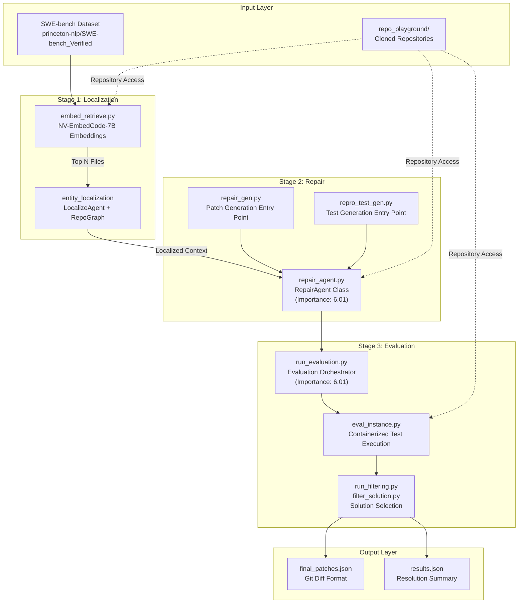
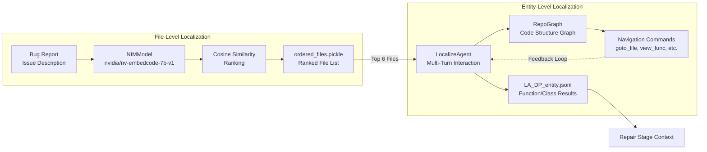
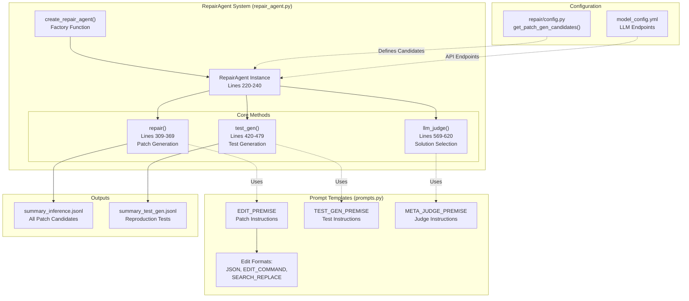
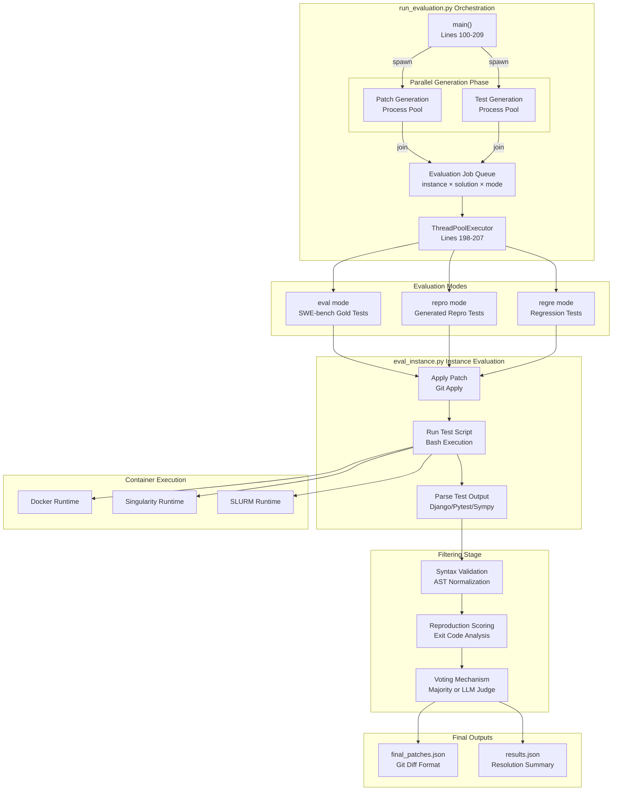
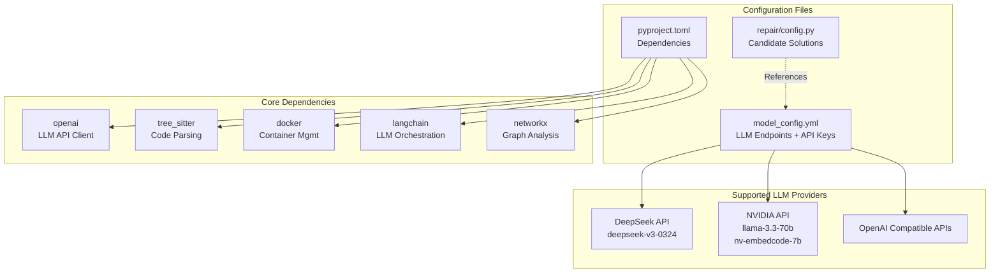

<!-- source: DeepWiki mcp.deepwiki.com · repo NVIDIA/Nemotron-CORTEXA · page 1 Overview · fetched 2026-10-26 -->

# Overview

<details>
<summary>Relevant source files</summary>

The following files were used as context for generating this wiki page:

- [README.md](README.md)
- [pyproject.toml](pyproject.toml)

</details>


## Purpose and Scope

This document provides a high-level introduction to **Nemotron-CORTEXA**, an LLM-powered software engineering tool for automated bug fixing. It explains the system's three-stage pipeline (Localization → Repair → Evaluation), core architectural components, and key design principles.

For detailed information on specific subsystems:
- Localization implementation details: see [Localization Stage](#2)
- Repair and patch generation: see [Repair Stage](#3)  
- Evaluation and testing: see [Evaluation Stage](#4)
- Configuration and setup: see [Configuration and Setup](#5)

**Sources:** [README.md:1-3]()

---

## System Purpose

Nemotron-CORTEXA is an automated bug-fixing system that processes bug reports from the SWE-bench dataset and generates code patches to resolve them. The system combines retrieval-based localization, LLM-powered repair generation, and containerized evaluation to achieve state-of-the-art performance on software engineering benchmarks.

The system targets the following workflow:
1. **Input**: Bug report with issue description from SWE-bench_Verified or SWE-bench_Lite
2. **Processing**: Three-stage pipeline (Localization → Repair → Evaluation)
3. **Output**: Validated patch in git diff format with resolution summary

**Sources:** [README.md:1-4](), [pyproject.toml:1-4]()

---

## Three-Stage Pipeline Architecture



**Three-Stage Pipeline Diagram**: Shows the complete flow from bug reports through localization, repair, and evaluation to final patches. The two core orchestrators (`repair_agent.py` and `run_evaluation.py`) coordinate the middle and final stages.

**Sources:** [README.md:15-74](), Diagram 1 from system architecture

---

## Core Components

The following table lists the primary components and their responsibilities:

| Component | File Path | Importance | Role |
|-----------|-----------|------------|------|
| **File Localization** | `cortexa/retrieval/embed_retrieve.py` | 2.29 | Uses NV-EmbedCode embeddings to rank repository files by relevance to bug description |
| **Entity Localization** | `cortexa/localize/entity_localization.py` | 0.29 | Multi-turn agent that identifies specific functions/classes needing modification |
| **Repair Agent** | `cortexa/repair/repair_agent.py` | 6.01 | Central AI component orchestrating patch generation, test generation, and solution judging |
| **Repair Generation** | `cortexa/repair/repair_gen.py` | - | Entry point for generating diverse patch candidates |
| **Test Generation** | `cortexa/repair/repro_test_gen.py` | - | Generates reproduction tests with iterative refinement |
| **Evaluation Orchestrator** | `cortexa/evaluate/run_evaluation.py` | 6.01 | Coordinates parallel patch/test generation and evaluation across multiple modes |
| **Instance Evaluation** | `cortexa/evaluate/eval_instance.py` | 0.29 | Executes patches in containers and parses test framework output |
| **Solution Filtering** | `cortexa/evaluate/filter_solution.py` | 0.29 | Deduplicates, validates, and selects best patch using voting mechanisms |
| **Prompt Templates** | `cortexa/repair/prompts.py` | - | Defines all LLM prompts for repair, testing, and judging |
| **Model Configuration** | `model_config.yml` | 1.12 | Centralized LLM endpoint and API key configuration |

**Sources:** [README.md:15-105](), Diagrams 1-3 from system architecture

---

## Stage 1: Localization

The localization stage narrows the search space from entire repositories (~1000s of files) to specific code entities (~10s of functions/classes).



**Localization Pipeline Diagram**: Shows two-level granularity reduction using NV-EmbedCode embeddings for file ranking, followed by LocalizeAgent for entity identification.

### Key Characteristics

- **File Localization**: Uses specialized code embedding model (NV-EmbedCode-7B) trained on bug-to-code mapping
- **Entity Localization**: Optional refinement step using multi-turn agent interaction over code structure graph
- **Configurable Depth**: Default top 6 files, 5 turns for entity localization ([README.md:53-57]())
- **Evaluation Metrics**: Precision/recall against oracle files from golden patches

**Sources:** [README.md:15-70](), [embed_retrieve.py](), Diagram 4 from system architecture

---

## Stage 2: Repair

The repair stage is the system's core, generating diverse patch candidates and reproduction tests using the `RepairAgent` class.



**Repair Stage Architecture Diagram**: Shows RepairAgent's three core methods and their relationships to prompt templates, configuration, and output artifacts.

### Key Characteristics

- **Diversity Strategy**: Multiple candidates per instance with different edit styles and models ([README.md:71]())
- **Edit Formats**: Supports JSON, EDIT_COMMAND, and SEARCH/REPLACE instruction styles
- **Iterative Refinement**: Test generation uses feedback loop with exit code semantics ([README.md:110-123]())
- **LLM Judge**: Meta-evaluation where an LLM selects best patch from candidates ([README.md:100-101]())

**Sources:** [README.md:73-137](), [repair_agent.py:220-240](), [repair_agent.py:309-369](), [repair_agent.py:420-479](), [repair_agent.py:569-620](), Diagram 2 from system architecture

---

## Stage 3: Evaluation

The evaluation stage tests patches in isolated containers and selects the best solution using multi-mode testing.



**Evaluation Stage Architecture Diagram**: Shows the parallel generation, multi-mode testing, containerized execution, and filtering pipeline that produces final patches.

### Key Characteristics

- **Parallel Execution**: Separate worker pools for patch generation, test generation, and evaluation ([README.md:84-89]())
- **Three Evaluation Modes**:
  - `eval`: Tests against SWE-bench gold test suite
  - `repro`: Tests against generated reproduction tests
  - `regre`: Tests for regression against existing tests
- **Multi-Runtime Support**: Docker, Singularity, and SLURM execution environments
- **Multi-Stage Filtering**:
  1. Syntax validation using AST normalization
  2. Reproduction test scoring
  3. Voting (majority or LLM judge) for final selection ([README.md:94-105]())

**Sources:** [README.md:73-105](), [run_evaluation.py:100-209](), [run_evaluation.py:139-157](), [run_evaluation.py:198-207](), Diagram 3 from system architecture

---

## Data Flow and Artifacts

The system produces a series of intermediate artifacts at each stage, enabling incremental processing and result caching.

| Stage | Artifact | Format | Purpose |
|-------|----------|--------|---------|
| **File Localization** | `ordered_files.pickle` | Pickle (dict) | Ranked file list per instance |
| **Entity Localization** | `LA_DP_entity.jsonl` | JSONL | Identified functions/classes per instance |
| **Patch Generation** | `summary_inference.jsonl` | JSONL | All generated patch candidates |
| **Test Generation** | `summary_test_gen.jsonl` | JSONL | Generated reproduction tests |
| **Eval Mode** | `summary_eval.jsonl` | JSONL | Gold test execution results |
| **Repro Mode** | `summary_repro.jsonl` | JSONL | Repro test execution results |
| **Regre Mode** | `summary_regre.jsonl` | JSONL | Regression test results |
| **Normalization** | `normalized_outputs.pickle` | Pickle | Deduplicated patch candidates |
| **Final Output** | `final_patches.json` | JSON (dict) | Selected patches in git diff format |
| **Summary** | `results.json` | JSON | Resolution counts and statistics |

All artifacts are stored in `log_dir/` for centralized management. Repository clones reside in `repo_playground/`, and generated tests in `repro_test_dir/`.

**Sources:** [README.md:38-44](), [README.md:99-105](), Diagram 6 from system architecture

---

## Configuration and Extension Points

Nemotron-CORTEXA is designed for extensibility through centralized configuration files:



**Configuration and Dependencies Diagram**: Shows how configuration files control LLM providers and system dependencies.

### Extension Points

1. **New LLM Providers**: Add to `model_config.yml` with OpenAI-compatible API ([README.md:61]())
2. **Custom Edit Styles**: Extend `prompts.py` with new instruction formats
3. **Additional Evaluation Modes**: Modify `eval_instance.py` and `run_evaluation.py` ([README.md:139-166]())
4. **Custom Localization**: Implement new embedding models or agent strategies

For detailed guides on extending the system, see [Extending Nemotron-CORTEXA](#8).

**Sources:** [README.md:61-63](), [model_config.yml](), [pyproject.toml:1-28](), Diagram 5 from system architecture

---

## Quick Start Commands

The following table provides basic commands for running the entire pipeline:

| Stage | Command | Key Arguments |
|-------|---------|---------------|
| **File Localization** | `python -m cortexa.retrieval.embed_retrieve` | `--model_name nvidia/nv-embedcode-7b-v1` |
| **Entity Localization** | `python -m cortexa.localize.entity_localization` | `--num_turns 5 --num_top_files 6` |
| **Unified Pipeline** | `python -m cortexa.evaluate.run_evaluation` | `--run_patch_generation --run_test_generation --modes eval,repro` |
| **Solution Filtering** | `python -m cortexa.evaluate.run_filtering` | `--run_normalization --vote_mode llm_judge` |

See [Quick Start Guide](#1.2) for detailed installation and configuration instructions.

**Sources:** [README.md:21-33](), [README.md:51-59](), [README.md:79-92](), [README.md:94-105]()

---

## System Requirements

- **Python Version**: 3.11 or higher ([README.md:6](), [pyproject.toml:10]())
- **External Services**: LLM API access (DeepSeek, NVIDIA, or OpenAI-compatible)
- **Container Runtime**: Docker, Singularity, or SLURM for evaluation
- **Hardware**: Multi-core CPU recommended for parallel execution

**Installation**:
```bash
pip install -e .
```

**Sources:** [README.md:5-13](), [pyproject.toml:10-28]()

---

## Key Design Principles

1. **Modularity**: Clear separation between localization, repair, and evaluation stages
2. **Diversity**: Multiple patch candidates with different edit styles and models increase coverage
3. **Safety**: All patch testing occurs in isolated containers to prevent host system corruption
4. **Incrementality**: Artifacts at each stage enable resumption and partial reruns
5. **Extensibility**: Configuration-driven design allows easy addition of new models and evaluation modes
6. **Reproducibility**: Comprehensive logging and artifact tracking ensure reproducible experiments

**Sources:** [README.md:1-184](), Diagrams 1-6 from system architecture

---

