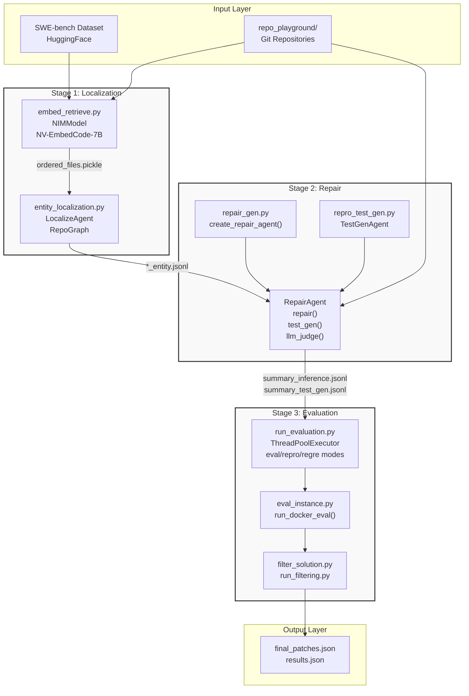
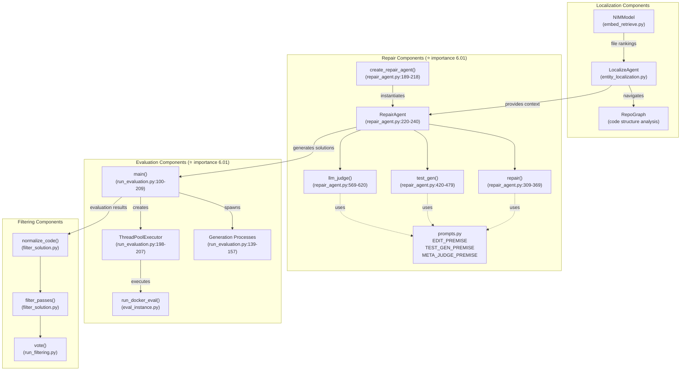
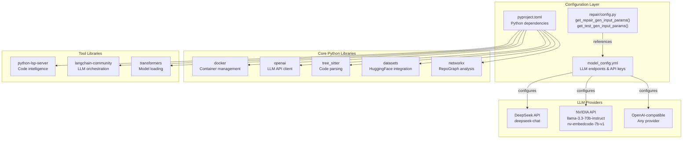
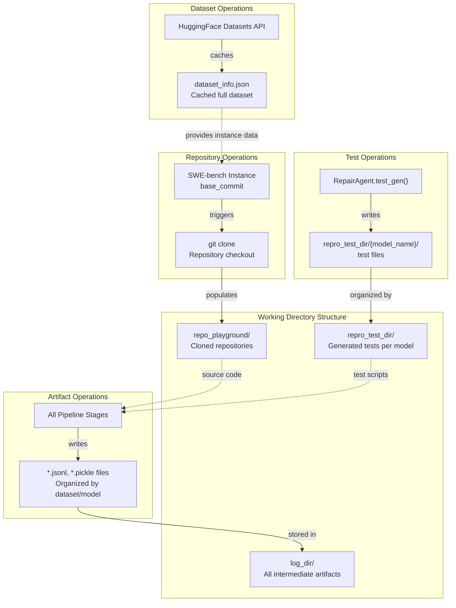

<!-- source: DeepWiki mcp.deepwiki.com · repo NVIDIA/Nemotron-CORTEXA · page 1.1 System Architecture · fetched 2026-10-26 -->

# System Architecture

<details>
<summary>Relevant source files</summary>

The following files were used as context for generating this wiki page:

- [README.md](README.md)
- [model_config.yml](model_config.yml)
- [pyproject.toml](pyproject.toml)

</details>


## Purpose and Scope

This document describes the high-level architecture of Nemotron-CORTEXA, showing how the three main stages (Localization, Repair, and Evaluation) interact to automatically fix software bugs. It covers the pipeline structure, core components, data flow between stages, and external dependencies.

For detailed information about individual stages, see [Localization Stage](#2), [Repair Stage](#3), and [Evaluation Stage](#4). For configuration details, see [Configuration and Setup](#5).

## Overview

Nemotron-CORTEXA is an LLM-powered automated software engineering tool that processes bug reports from the SWE-bench dataset through a three-stage pipeline:

1. **Localization Stage**: Identifies relevant code locations using embedding-based file retrieval and agent-based entity localization
2. **Repair Stage**: Generates diverse patch candidates and reproduction tests using the `RepairAgent`
3. **Evaluation Stage**: Tests patches in isolated containers and filters to select the best solution

The system is designed for modularity, with each stage producing intermediate artifacts that can be reused across experiments.

**Sources**: [README.md:1-74]()

## Three-Stage Pipeline Architecture

The following diagram shows the complete system pipeline with specific code module names:



**Pipeline Stages:**

| Stage | Primary Module | Key Output | Purpose |
|-------|---------------|------------|---------|
| Localization | `embed_retrieve.py`, `entity_localization.py` | `ordered_files.pickle`, `*_entity.jsonl` | Reduce search space from entire repository to specific code entities |
| Repair | `repair_gen.py`, `repro_test_gen.py` | `summary_inference.jsonl`, `summary_test_gen.jsonl` | Generate diverse patch candidates and reproduction tests |
| Evaluation | `run_evaluation.py`, `eval_instance.py` | `summary_eval.jsonl`, `summary_repro.jsonl` | Test patches in containers and select best solution |
| Filtering | `filter_solution.py`, `run_filtering.py` | `final_patches.json`, `results.json` | Deduplicate, validate, and rank patches |

**Sources**: [README.md:15-105](), High-level diagrams 1 and 6

## Core Component Architecture

The system's core logic is implemented across several key modules, with two components marked as critical (importance 6.01):



**Component Descriptions:**

| Component | Module | Key Methods/Classes | Responsibility |
|-----------|--------|---------------------|----------------|
| NIMModel | `embed_retrieve.py:30-64` | `embed()`, `embed_queries()` | Interface to NV-EmbedCode-7B for semantic code search |
| LocalizeAgent | `entity_localization.py` | Multi-turn interaction with RepoGraph | Navigate code structure to find relevant entities |
| RepairAgent | `repair_agent.py:220-240` | `repair()`, `test_gen()`, `llm_judge()` | Core AI agent for patch and test generation |
| ThreadPoolExecutor | `run_evaluation.py:198-207` | Parallel job execution | Orchestrate evaluation across multiple instances |
| filter_passes() | `filter_solution.py` | Syntax validation, regression testing | Multi-stage patch filtering |

**Sources**: [README.md:15-74](), [repair_agent.py]() cluster, [run_evaluation.py]() cluster, High-level diagram 2

## Data Flow and Artifact Persistence

The system maintains a clear data lineage through each stage, with intermediate artifacts stored in `log_dir/`:

```mermaid
graph LR
    subgraph Stage1["Stage 1: Localization"]
        S1Input["Bug Description<br/>(Dataset)"]
        S1Output["ordered_files.pickle<br/>*_entity.jsonl"]
        
        S1Input --> S1Output
    end
    
    subgraph Stage2["Stage 2: Repair"]
        S2Input["Context<br/>(localization results)"]
        S2Process["RepairAgent<br/>Generation"]
        S2Output["summary_inference.jsonl<br/>summary_test_gen.jsonl"]
        
        S2Input --> S2Process
        S2Process --> S2Output
    end
    
    subgraph Stage3["Stage 3: Evaluation"]
        S3Process1["Parallel Evaluation<br/>(eval/repro/regre)"]
        S3Process2["Normalization<br/>& Deduplication"]
        S3Output["summary_eval.jsonl<br/>summary_repro.jsonl<br/>summary_regre.jsonl"]
        
        S3Process1 --> S3Output
        S3Output --> S3Process2
    end
    
    subgraph Stage4["Stage 4: Filtering"]
        S4Process["Voting<br/>(majority/llm_judge)"]
        S4Output["final_patches.json<br/>results.json"]
        
        S4Process --> S4Output
    end
    
    S1Output -->|"pickle file"| S2Input
    S2Output -->|"JSONL files"| S3Process1
    S3Process2 -->|"normalized_outputs.pickle<br/>outputs_hash_map.pickle"| S4Process
```



**Artifact Format Summary:**

| Artifact | Format | Stage | Content |
|----------|--------|-------|---------|
| `ordered_files.pickle` | Pickle | Localization | Dictionary mapping `instance_id` → (ranked_files, oracle_files) |
| `*_entity.jsonl` | JSONL | Localization | Per-line: `instance_id`, `entities`, `context` |
| `summary_inference.jsonl` | JSONL | Repair | Per-line: `instance_id`, `model_patch`, `model_name_or_path` |
| `summary_test_gen.jsonl` | JSONL | Repair | Per-line: `instance_id`, `repro_test_code`, `test_directives` |
| `summary_eval.jsonl` | JSONL | Evaluation | Per-line: `instance_id`, `solution_id`, `test_results` |
| `normalized_outputs.pickle` | Pickle | Filtering | Deduplicated patches with AST normalization |
| `final_patches.json` | JSON | Filtering | Final selected patches in git diff format |

The system uses pickle format for complex Python objects (ranked lists, hash maps) and JSONL for streaming results that can be processed incrementally. All artifacts are namespaced by dataset and model to support experimentation.

**Sources**: [README.md:38-105](), High-level diagram 6

## External Dependencies and Configuration

### Dependency Architecture



### Configuration Files

The system uses three primary configuration files:

**1. model_config.yml** - LLM Provider Configuration

```yaml
deepseek-v3-0324:
  base_url: 'https://api.deepseek.com'
  api_key_name: 'DEEPSEEK_API_KEY'
  model_name: 'deepseek-chat'
```

Each entry specifies:
- `base_url`: OpenAI-compatible API endpoint
- `api_key_name`: Environment variable containing the API key
- `model_name`: Model identifier for the provider

The system reads API keys at runtime via `os.environ[api_key_name]` for security.

**Sources**: [model_config.yml:1-15](), [README.md:61-62]()

**2. repair/config.py** - Candidate Configuration

This module defines which models and configurations to use for patch and test generation:
- `get_default_loc_log_file_map()`: Maps localization results to repair inputs
- `get_repair_gen_input_params()`: Defines patch generation candidates
- `get_test_gen_input_params()`: Defines test generation candidates

These functions enable experimentation with different model combinations for solution diversity.

**Sources**: [README.md:71-76]()

**3. pyproject.toml** - Python Dependencies

| Dependency Category | Libraries | Purpose |
|---------------------|-----------|---------|
| LLM Integration | `openai`, `langchain-community`, `transformers` | API clients and orchestration |
| Code Analysis | `tree_sitter`, `tree_sitter_python` | AST parsing and normalization |
| Developer Tools | `python-lsp-server[all]`, `python-lsp-jsonrpc` | Code intelligence for LocalizeAgent |
| Container Execution | `docker`, `paramiko` | Isolated evaluation environments |
| Data Management | `datasets`, `filelock`, `networkx` | SWE-bench integration, graph analysis |
| Utilities | `tiktoken`, `unidiff`, `jsonschema`, `torch` | Token counting, diff parsing, validation |

The system requires Python 3.11+ as specified in `requires-python = ">=3.11"`.

**Sources**: [pyproject.toml:1-28](), [README.md:6-13]()

## Repository Management

The system manages external repositories and test directories through a structured filesystem layout:



**Directory Purposes:**

- **repo_playground/**: Contains git clones of target repositories checked out to specific commits. Each instance's `base_commit` determines the repository state.

- **repro_test_dir/**: Stores generated reproduction tests organized by model name. Tests from multiple models can be merged for diversity (e.g., `repro_test_dir/merged/`).

- **log_dir/**: Central location for all intermediate and final artifacts. File naming encodes metadata: `{dataset}_{query_type}_{model}_summary_{stage}.jsonl`.

The system uses `dataset_info.json` to cache the full SWE-bench dataset, avoiding repeated HuggingFace API calls across runs.

**Sources**: [README.md:27-32, 81-83, 117](), High-level diagram 6

## System Entry Points

The system provides multiple command-line entry points for different workflows:

| Entry Point | Module | Purpose | Parallel Execution |
|-------------|--------|---------|-------------------|
| File Localization | `cortexa.retrieval.embed_retrieve` | Rank files using NV-EmbedCode | N/A (API batching) |
| Entity Localization | `cortexa.localize.entity_localization` | Find relevant functions/classes | Single instance per run |
| Reproduction Test Gen | `cortexa.repair.repro_test_gen` | Generate reproduction tests | `--num_workers` (multiprocessing) |
| Patch Generation | `cortexa.repair.repair_gen` | Generate patch candidates | `--num_workers` (multiprocessing) |
| Full Evaluation | `cortexa.evaluate.run_evaluation` | Run all stages end-to-end | `--num_workers_patch_gen`, `--num_workers_test_gen`, `--num_workers_eval` |
| Single Patch Eval | `cortexa.evaluate.run_evaluation --single_patch_eval` | Evaluate one patch per instance | `--num_workers_eval` |
| Solution Filtering | `cortexa.evaluate.run_filtering` | Select best patch | N/A (sequential) |

All entry points accept `--instance_id` for subset evaluation. Omitting this argument processes the entire benchmark.

**Sources**: [README.md:22-166]()

---

