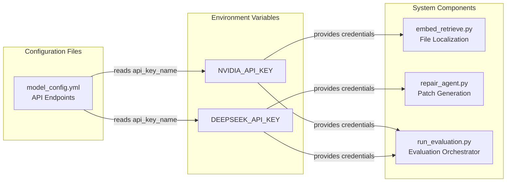
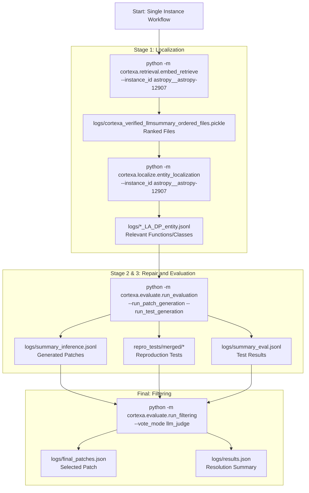
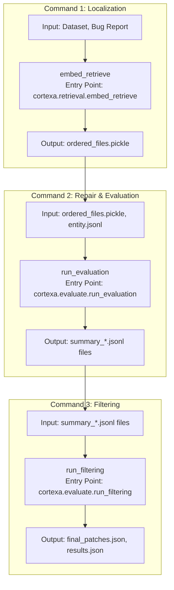

<!-- source: DeepWiki mcp.deepwiki.com · repo NVIDIA/Nemotron-CORTEXA · page 1.2 Quick Start Guide · fetched 2026-10-26 -->

# Quick Start Guide

<details>
<summary>Relevant source files</summary>

The following files were used as context for generating this wiki page:

- [README.md](README.md)
- [model_config.yml](model_config.yml)
- [pyproject.toml](pyproject.toml)

</details>


**Purpose and Scope**: This guide provides step-by-step instructions for installing Nemotron-CORTEXA, configuring API credentials, and executing a complete bug-fixing workflow on a single SWE-bench instance. By the end of this guide, you will have generated and evaluated patch candidates for a specific bug report.

For comprehensive architecture details, see [System Architecture](#1.1). For advanced configuration options including custom model endpoints and candidate solutions, see [Configuration and Setup](#5). For extending the system with new capabilities, see [Extending Nemotron-CORTEXA](#8).

---

## Prerequisites

Before beginning, ensure you have:

| Requirement | Details |
|------------|---------|
| **Python Version** | 3.11 or higher |
| **Disk Space** | ~5 GB for dependencies and repository clones |
| **API Keys** | Access to LLM providers (NVIDIA, DeepSeek, or OpenAI-compatible) |
| **Docker** | Optional but recommended for containerized evaluation |

**Sources**: [README.md:5-6](), [pyproject.toml:10]()

---

## Installation

### Step 1: Clone and Install Dependencies

```bash
git clone https://github.com/NVIDIA/Nemotron-CORTEXA.git
cd Nemotron-CORTEXA
pip install -e .
```

The installation process reads dependency specifications from `pyproject.toml` and installs core packages including:

| Package Category | Key Dependencies |
|-----------------|------------------|
| **LLM Integration** | `openai`, `transformers`, `langchain-community` |
| **Code Analysis** | `tree_sitter`, `tree_sitter_python` |
| **Developer Tools** | `python-lsp-server[all]`, `python-lsp-jsonrpc` |
| **Container Management** | `docker` |
| **Data Processing** | `datasets`, `networkx`, `unidiff` |

**Sources**: [README.md:8-13](), [pyproject.toml:11-28]()

---

## Configuration

### Step 2: Set Up API Keys

Nemotron-CORTEXA requires LLM API access for localization, repair, and evaluation stages. The system reads API credentials from environment variables referenced in `model_config.yml`.



#### Configure Environment Variables

For NVIDIA API access (required for NV-EmbedCode file localization):
```bash
export NVIDIA_API_KEY="nvapi-your-key-here"
```

For DeepSeek API access (recommended for patch generation):
```bash
export DEEPSEEK_API_KEY="sk-your-key-here"
```

#### Verify Model Configuration

Inspect [model_config.yml:1-15]() to see available model endpoints:

| Model Configuration | Provider | Use Case |
|---------------------|----------|----------|
| `deepseek-v3-0324` | DeepSeek Direct | Patch generation, LLM judge |
| `deepseek-v3-0324-nvdev` | NVIDIA API Gateway | Alternative DeepSeek access |
| `llama-3.3-70b-instruct` | NVIDIA API | Localization, repair |
| `nvidia/nv-embedcode-7b-v1` | NVIDIA NIM | File embedding/retrieval |

The system uses the `api_key_name` field to look up credentials via `os.environ` at runtime. For security, API keys are never hardcoded in configuration files.

**Sources**: [README.md:61](), [model_config.yml:1-15]()

---

## Basic Workflow Example

This section demonstrates a complete bug-fixing workflow on a single instance from SWE-bench_Verified: `astropy__astropy-12907`.



### Step 3: Create Working Directories

```bash
mkdir -p logs repos repro_tests/merged
```

| Directory | Purpose |
|-----------|---------|
| `logs/` | Stores all localization, inference, and evaluation artifacts |
| `repos/` | Cloned repository playground for safe modification |
| `repro_tests/merged/` | Generated reproduction test scripts |

---

### Step 4: Run File Localization

Execute file-level localization using NV-EmbedCode embeddings:

```bash
python -m cortexa.retrieval.embed_retrieve \
    --model_name nvidia/nv-embedcode-7b-v1 \
    --base_url https://integrate.api.nvidia.com/v1 \
    --log_dir ./logs \
    --repo_playground ./repos \
    --batch_size 16 \
    --max_length 450 \
    --dataset_name_or_path princeton-nlp/SWE-bench_Verified \
    --query_type llmsummary \
    --instance_id astropy__astropy-12907
```

**Key Parameters**:
- `--model_name`: Specifies the embedding model (NV-EmbedCode-7B)
- `--base_url`: API endpoint for NVIDIA NIM service
- `--query_type llmsummary`: Uses LLM-generated bug summary for retrieval
- `--instance_id`: Single instance ID (omit to process entire benchmark)

**Expected Output**: Creates `logs/cortexa_verified_llmsummary_ordered_files.pickle` containing ranked file lists.

**Sources**: [README.md:21-33]()

---

### Step 5: Run Entity Localization (Optional)

Refine localization to specific functions and classes using the LocalizeAgent:

```bash
python -m cortexa.localize.entity_localization \
    --log_dir ./logs \
    --repo_playground ./repos \
    --num_turns 5 \
    --num_top_files 6 \
    --embed_results cortexa_verified_llmsummary_ordered_files.pickle \
    --instance_id astropy__astropy-12907
```

**Key Parameters**:
- `--num_turns`: Maximum agent interaction rounds (default 5)
- `--num_top_files`: How many ranked files to analyze (default 6)
- `--embed_results`: Pickle file from Step 4

**Expected Output**: Creates three JSONL files:
1. Direct prompt results
2. LocalizeAgent results
3. Merged results (recommended for repair stage)

**Note**: This step is optional but empirically improves repair accuracy. The system includes pre-generated entity localization results at [src/cortexa/retrieval/files/cortexa_all_llmsummary_LA_DP_entity.jsonl]() for convenience.

**Sources**: [README.md:49-64]()

---

### Step 6: Run Repair and Evaluation Pipeline

Execute the integrated pipeline that generates patches, creates reproduction tests, and evaluates all candidates:

```bash
python -m cortexa.evaluate.run_evaluation \
    --repro_test_dir ./repro_tests/merged \
    --repo_playground ./repos \
    --log_dir ./logs \
    --run_patch_generation \
    --run_test_generation \
    --num_workers_patch_gen 2 \
    --num_workers_test_gen 2 \
    --num_workers_eval 4 \
    --modes eval,repro \
    --dataset_name_or_path princeton-nlp/SWE-bench_Verified \
    --instance_id astropy__astropy-12907
```

**Key Parameters**:
- `--run_patch_generation`: Enables parallel patch generation
- `--run_test_generation`: Enables parallel reproduction test generation
- `--num_workers_patch_gen`: Worker pool size for patch generation (default 2)
- `--num_workers_test_gen`: Worker pool size for test generation (default 2)
- `--num_workers_eval`: Worker pool size for evaluation (default 4)
- `--modes`: Evaluation modes (comma-separated: `eval`, `repro`, `regre`)

**Process Flow**:
1. **Generation Phase**: Spawns separate processes for `repair_gen` and `repro_test_gen`
2. **Evaluation Phase**: Uses ThreadPoolExecutor to test patches in parallel
3. **Result Streaming**: Writes results to JSONL files as they complete

**Expected Output**:
- `logs/summary_inference.jsonl`: All generated patch candidates
- `logs/summary_test_gen.jsonl`: Generated reproduction tests
- `logs/summary_eval.jsonl`: Gold test evaluation results
- `logs/summary_repro.jsonl`: Reproduction test results
- `repro_tests/merged/{model_name}/test_{instance_id}.py`: Test scripts

**Sources**: [README.md:78-92](), [README.md:145-153]()

---

### Step 7: Filter and Select Final Patches

Apply multi-stage filtering to select the best patch from candidates:

```bash
python -m cortexa.evaluate.run_filtering \
    --log_dir ./logs \
    --repo_playground ./repos \
    --run_normalization \
    --vote_mode llm_judge \
    --model_name deepseek-v3-0324 \
    --dataset_name_or_path princeton-nlp/SWE-bench_Verified
```

**Key Parameters**:
- `--run_normalization`: Enables AST-based code normalization and deduplication
- `--vote_mode`: Selection strategy (`majority` or `llm_judge`)
- `--model_name`: LLM model for `llm_judge` voting

**Filtering Pipeline**:

| Stage | Function | Description |
|-------|----------|-------------|
| **Syntax Validation** | `filter_solution.py:check_syntax()` | Removes patches with parse errors |
| **Normalization** | `filter_solution.py:normalize_code()` | AST-based deduplication via hashing |
| **Regression Filter** | `filter_solution.py:filter_regre()` | Removes patches failing regression tests |
| **Voting** | `run_filtering.py:filter_solutions()` | Majority or LLM judge selection |

**Expected Output**:
- `logs/final_patches.json`: Selected patch in git diff format
- `logs/results.json`: Resolution summary with resolved/unresolved counts
- `logs/normalized_outputs.pickle`: Deduplicated patch mappings
- `logs/outputs_hash_map.pickle`: Code hash to patch ID mappings

**Sources**: [README.md:94-105]()

---

## Output Verification

### Inspect Final Patch

The `final_patches.json` file contains the selected patch in SWE-bench format:

```json
{
  "astropy__astropy-12907": "diff --git a/astropy/io/ascii/ui.py ...",
  "instance_metadata": {
    "model_name_or_path": "deepseek-v3-0324",
    "timestamp": "2025-01-15T10:30:00Z"
  }
}
```

### Review Resolution Summary

The `results.json` file provides high-level metrics:

```json
{
  "resolved": ["astropy__astropy-12907"],
  "unresolved": [],
  "resolved_count": 1,
  "unresolved_count": 0,
  "resolution_rate": 1.0
}
```

### Examine Intermediate Artifacts

All intermediate artifacts are preserved in `logs/` for debugging and analysis:

| File Pattern | Content |
|-------------|---------|
| `summary_inference.jsonl` | Raw patch candidates with model metadata |
| `summary_eval.jsonl` | Gold test pass/fail results |
| `summary_repro.jsonl` | Reproduction test results |
| `cortexa_*_ordered_files.pickle` | File localization rankings |
| `*_entity.jsonl` | Entity localization results |

**Sources**: [README.md:105]()

---

## Command Reference

For quick reference, here is a summary of the three main commands:



| Command | Module Path | Primary Function |
|---------|-------------|------------------|
| **File Localization** | `cortexa.retrieval.embed_retrieve` | Rank files using NV-EmbedCode embeddings |
| **Entity Localization** | `cortexa.localize.entity_localization` | Identify relevant functions/classes |
| **Integrated Pipeline** | `cortexa.evaluate.run_evaluation` | Generate patches, tests, and evaluate |
| **Final Filtering** | `cortexa.evaluate.run_filtering` | Select best patch from candidates |

**Sources**: [README.md:21-166]()

---

## Alternative Workflows

### Running Stages Separately

Instead of the integrated `run_evaluation` command, you can execute each stage independently:

**Reproduction Test Generation**:
```bash
python -m cortexa.repair.repro_test_gen \
    --log_dir ./logs \
    --out_inference_file summary_test_gen.jsonl \
    --repro_test_dir ./repro_tests \
    --max_round 3 \
    --num_workers 2 \
    --repo_playground ./repos \
    --dataset_name_or_path princeton-nlp/SWE-bench_Verified \
    --instance_id astropy__astropy-12907
```

**Patch Generation**:
```bash
python -m cortexa.repair.repair_gen \
    --log_dir ./logs \
    --out_inference_file summary_inference.jsonl \
    --num_workers 2 \
    --repo_playground ./repos \
    --dataset_name_or_path princeton-nlp/SWE-bench_Verified \
    --instance_id astropy__astropy-12907
```

**Evaluation Only**:
```bash
python -m cortexa.evaluate.run_evaluation \
    --modes eval,repro \
    --log_dir ./logs \
    --out_inference_file summary_inference.jsonl \
    --num_workers_eval 4 \
    --dataset_name_or_path princeton-nlp/SWE-bench_Verified \
    --instance_id astropy__astropy-12907
```

**Sources**: [README.md:107-166]()

### Evaluating External Patches

To evaluate a single pre-generated patch without running generation steps:

```bash
python -m cortexa.evaluate.run_evaluation \
    --modes eval \
    --log_dir ./logs \
    --out_inference_file summary_inference.jsonl \
    --num_workers_eval 4 \
    --dataset_name_or_path princeton-nlp/SWE-bench_Verified \
    --instance_id astropy__astropy-12907 \
    --single_patch_eval
```

The `summary_inference.jsonl` file must contain at minimum:
- `instance_id`: Instance identifier
- `model_patch`: Patch in git diff format

**Sources**: [README.md:155-171]()

---

## Troubleshooting

### API Key Issues

**Symptom**: `KeyError` when accessing environment variables.

**Solution**: Verify API keys are exported:
```bash
echo $NVIDIA_API_KEY
echo $DEEPSEEK_API_KEY
```

Ensure the `api_key_name` in [model_config.yml]() matches your environment variable names.

### Docker Permission Errors

**Symptom**: `PermissionError: [Errno 13] Permission denied` when running evaluation.

**Solution**: Add user to docker group or run with sudo:
```bash
sudo usermod -aG docker $USER
# Log out and back in for changes to take effect
```

### Missing Pre-generated Localization Files

**Symptom**: `FileNotFoundError` when running repair without localization.

**Solution**: The system includes pre-generated localization results at:
- [src/cortexa/retrieval/files/cortexa_all_llmsummary_ordered_files.pickle]()
- [src/cortexa/retrieval/files/cortexa_all_llmsummary_LA_DP_entity.jsonl]()

These files cover the union of SWE-bench_Lite and SWE-bench_Verified (707 instances). If using a custom dataset, you must run localization steps first.

**Sources**: [README.md:44](), [README.md:69]()

---

## Next Steps

After completing this quick start guide, explore:

- **[Localization Stage](#2)**: Deep dive into file and entity localization mechanisms
- **[Repair Stage](#3)**: Understand the RepairAgent and prompt engineering strategies
- **[Evaluation Stage](#4)**: Learn about multi-mode evaluation and container execution
- **[Configuration and Setup](#5)**: Customize model endpoints and candidate solutions
- **[Extending Nemotron-CORTEXA](#8)**: Add new edit styles, LLM providers, or evaluation modes

**Sources**: [README.md:1-184]()

---

