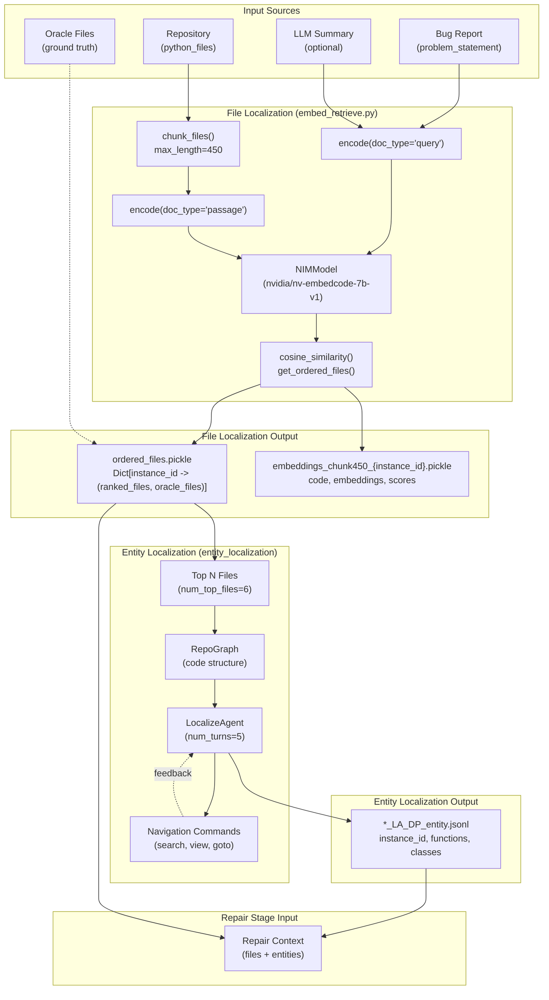
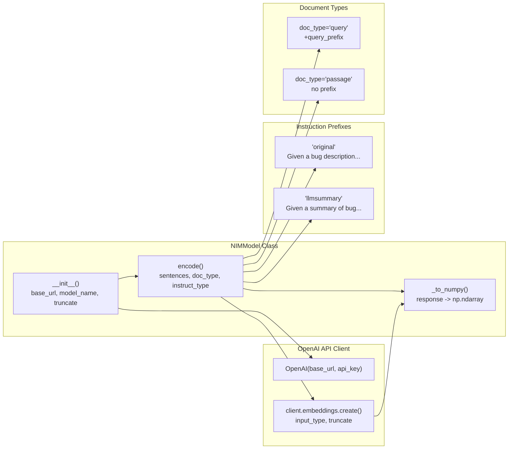
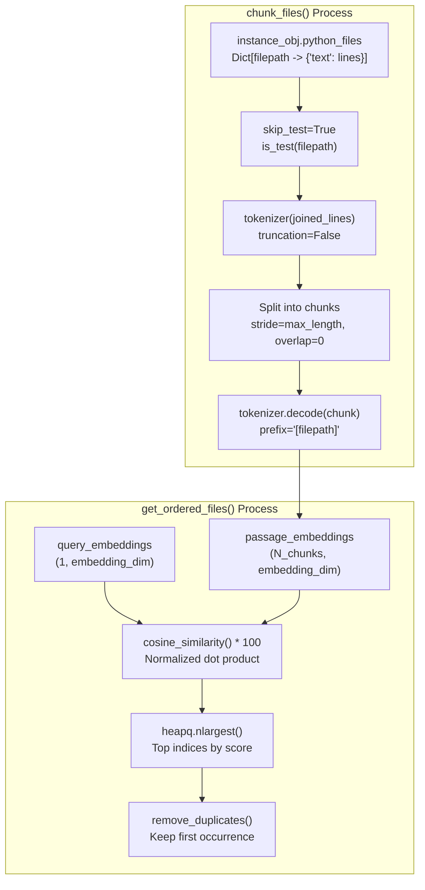
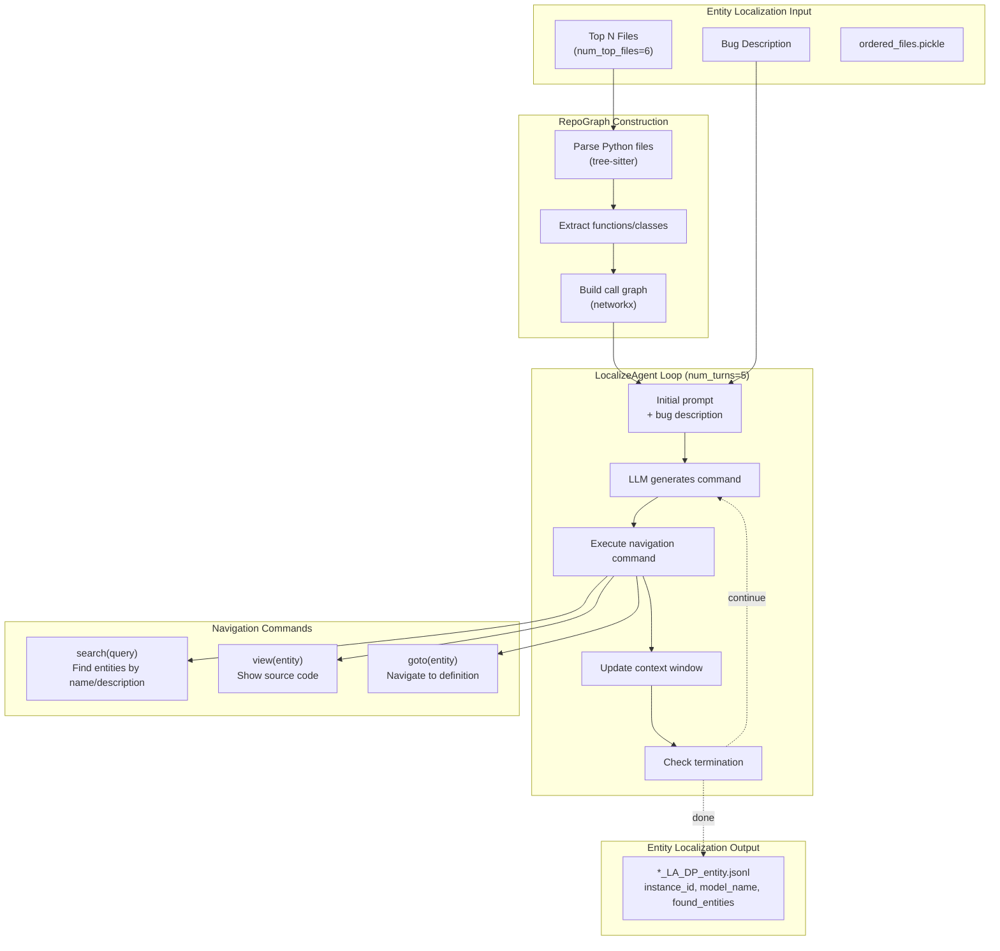
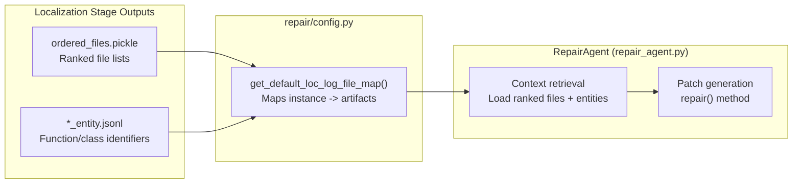
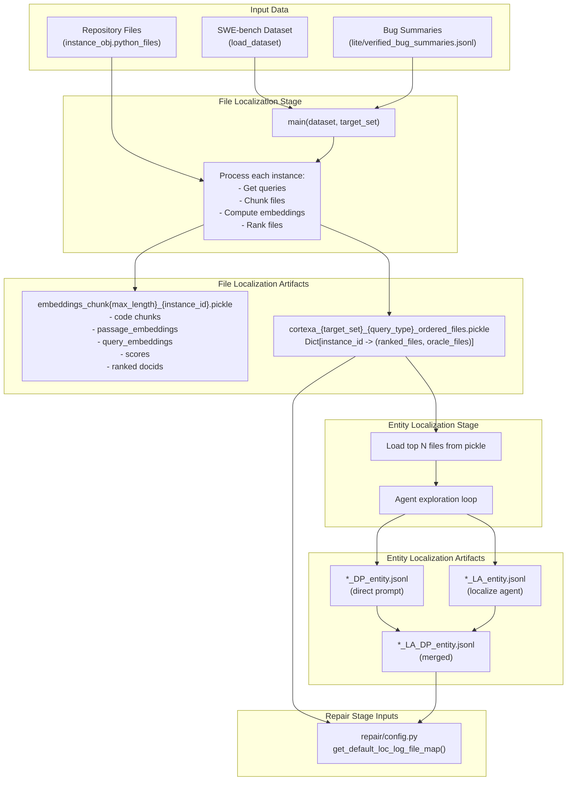

<!-- source: DeepWiki mcp.deepwiki.com · repo NVIDIA/Nemotron-CORTEXA · page 2 Localization Stage · fetched 2026-10-26 -->

# Localization Stage

<details>
<summary>Relevant source files</summary>

The following files were used as context for generating this wiki page:

- [README.md](README.md)
- [src/cortexa/retrieval/embed_retrieve.py](src/cortexa/retrieval/embed_retrieve.py)

</details>


## Purpose and Scope

The Localization Stage is the first phase of the Nemotron-CORTEXA pipeline, responsible for narrowing the search space from entire repositories (thousands of files) to specific code entities (functions, classes) that require modification to fix a bug. This stage operates in two levels: **File Localization** uses semantic embeddings to rank repository files by relevance to bug descriptions, followed by **Entity Localization** which uses an agent-based system to identify specific code constructs within the top-ranked files.

This document provides an overview of how the two localization levels work together. For detailed implementation information, see:
- [File Localization with Embeddings](#2.1) - NV-EmbedCode embedding system
- [Entity Localization with Agents](#2.2) - LocalizeAgent and RepoGraph
- [Localization Evaluation Metrics](#2.3) - Precision/recall measurement

For information about how localization results are consumed, see [Repair Stage](#3).

**Sources:** [README.md:15-72](), [Diagram 4]()

---

## Two-Level Localization Architecture

The localization stage implements a coarse-to-fine strategy that progressively narrows the search space:

| Level | Input | Output | Granularity | Primary Component |
|-------|-------|--------|-------------|-------------------|
| **File Localization** | Bug description or LLM summary | Ranked list of files | File-level | `NIMModel` in `embed_retrieve.py` |
| **Entity Localization** | Top N ranked files + bug description | List of functions/classes | Entity-level | `LocalizeAgent` with `RepoGraph` |

### Localization Pipeline Flow



**Sources:** [README.md:15-72](), [embed_retrieve.py:1-269](), [Diagram 4]()

---

## File Localization Process

File localization reduces the search space from thousands of repository files to approximately 10-20 relevant candidates using semantic similarity.

### NIMModel Embedding System

The system uses the `NIMModel` class [embed_retrieve.py:43-90]() to interact with the NV-EmbedCode-7B-v1 API:



**Key configuration parameters:**
- `model_name`: `nvidia/nv-embedcode-7b-v1` (default)
- `base_url`: `https://integrate.api.nvidia.com/v1`
- `truncate`: `END` (default) - controls how content exceeding model context is handled
- `batch_size`: 16 (default) - number of texts encoded per API call
- `max_length`: 450 (default) - token limit per code chunk

**Sources:** [embed_retrieve.py:43-90](), [README.md:21-33]()

### Code Chunking and Ranking

The `chunk_files()` function [embed_retrieve.py:113-138]() splits repository files into fixed-size token chunks:



**Output structure** saved to `cortexa_{target_set}_{query_type}_ordered_files.pickle` [embed_retrieve.py:231]():
```python
Dict[instance_id: str -> Tuple[
    List[str],  # ranked file paths (deduplicated)
    List[str]   # oracle files from ground truth patch
]]
```

**Sources:** [embed_retrieve.py:113-156](), [embed_retrieve.py:170-231]()

---

## Entity Localization Process

Entity localization refines file-level results to specific code entities (functions, classes, methods) using an agent-based exploration system.

### LocalizeAgent Architecture

The `LocalizeAgent` operates in a multi-turn interaction loop over a `RepoGraph` data structure:



**Sources:** [README.md:46-69](), [Diagram 4]()

### Output Format

Entity localization produces JSONL files with the following structure:

```
{instance_id}_entity_{model_config}_{temperature}.jsonl
```

Each line contains:
- `instance_id`: SWE-bench instance identifier
- `model_name`: Model configuration used for localization
- `functions`: List of identified function names
- `classes`: List of identified class names
- `context`: Aggregated code context from exploration

**Merging strategy:** Running entity localization with multiple model configurations and temperatures, then merging results, empirically increases recall [README.md:63]().

**Sources:** [README.md:47-69]()

---

## Integration with Repair Stage

The localization stage produces two key artifacts consumed by the repair stage:



The `get_default_loc_log_file_map()` function in [repair/config.py]() (referenced in [README.md:71]()) configures which localization results to use for each instance. By default, it reads pre-processed files from `src/cortexa/retrieval/files/`:
- `cortexa_all_llmsummary_ordered_files.pickle` - File rankings for 707 instances (Lite + Verified)
- `cortexa_all_llmsummary_LA_DP_entity.jsonl` - Entity results

**Sources:** [README.md:71-72](), [Diagram 1]()

---

## Configuration and Usage

### Running File Localization

Command-line interface via `embed_retrieve.py` [README.md:21-33]():

```bash
python -m cortexa.retrieval.embed_retrieve \
    --model_name nvidia/nv-embedcode-7b-v1 \
    --base_url https://integrate.api.nvidia.com/v1 \
    --log_dir ./logs \
    --repo_playground ./repos \
    --batch_size 16 \
    --max_length 450 \
    --dataset_name_or_path princeton-nlp/SWE-bench_Verified \
    --query_type llmsummary \
    --instance_id <instance_id>
```

**Key parameters:**
- `--query_type`: `llmsummary` (uses LLM summaries) or `original` (uses raw problem statements)
- `--instance_id`: Comma-separated list of instances, or omit to process entire benchmark
- `--max_length`: Token limit for code chunks (default: 450)

**Environment requirement:** `NVIDIA_API_KEY` must be set [embed_retrieve.py:45-46]()

**Sources:** [README.md:21-44](), [embed_retrieve.py:234-268]()

### Running Entity Localization

Command-line interface via `entity_localization` module [README.md:49-59]():

```bash
python -m cortexa.localize.entity_localization \
    --log_dir ./logs \
    --repo_playground ./repos \
    --num_turns 5 \
    --num_top_files 6 \
    --embed_results cortexa_verified_llmsummary_ordered_files.pickle \
    --instance_id <instance_id>
```

**Key parameters:**
- `--num_turns`: Maximum agent interaction turns (default: 5)
- `--num_top_files`: Number of top-ranked files to explore (default: 6)
- `--embed_results`: Pickle file from file localization stage

**Model configuration:** Reads from `model_config.yml` with API keys loaded from environment variables via `os.environ[api_key_name]` [README.md:61]()

**Sources:** [README.md:49-63]()

---

## Data Flow and Artifacts



**Artifact naming conventions:**
- File localization: `cortexa_{dataset}_{query_type}_ordered_files.pickle`
- Entity localization: `{dataset}_{query_type}_{method}_entity.jsonl`
  - `method`: `DP` (direct prompt), `LA` (localize agent), or `LA_DP` (merged)

**Pre-computed artifacts:** The repository includes pre-computed localization results for SWE-bench Lite and Verified at:
- `src/cortexa/retrieval/files/cortexa_all_llmsummary_ordered_files.pickle` (707 instances) [README.md:44]()
- `src/cortexa/retrieval/files/cortexa_all_llmsummary_LA_DP_entity.jsonl`

**Sources:** [README.md:38-44](), [embed_retrieve.py:170-231](), [README.md:69-72]()

---

## Performance Characteristics

| Metric | File Localization | Entity Localization |
|--------|------------------|---------------------|
| **Input Size** | Full repository (1000s of files) | Top 6-10 files |
| **Output Size** | ~10-20 ranked files | ~5-15 entities |
| **Method** | Semantic similarity (embedding-based) | Agent-based exploration (LLM-driven) |
| **Parallelization** | Batch encoding (batch_size=16) | Sequential agent turns |
| **Caching** | Per-instance pickle files | JSONL streaming |
| **API Calls** | O(N_chunks / batch_size) | O(num_turns) per instance |

**Search space reduction:** File localization reduces search space by ~100x (e.g., 1000 files → 10 files), while entity localization further reduces by ~10x (e.g., 100 entities per file → 10 entities total).

**Evaluation:** Localization quality is measured against ground truth oracle files using standard information retrieval metrics. See [Localization Evaluation Metrics](#2.3) for details.

**Sources:** [README.md:15-72](), [Diagram 4]()

---

