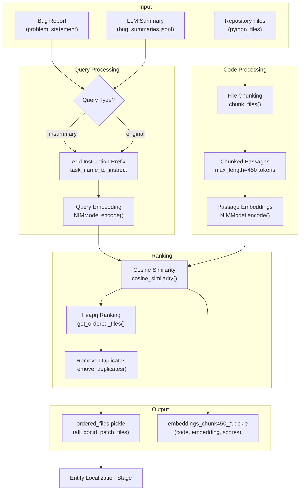
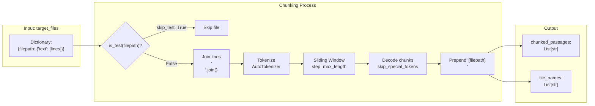
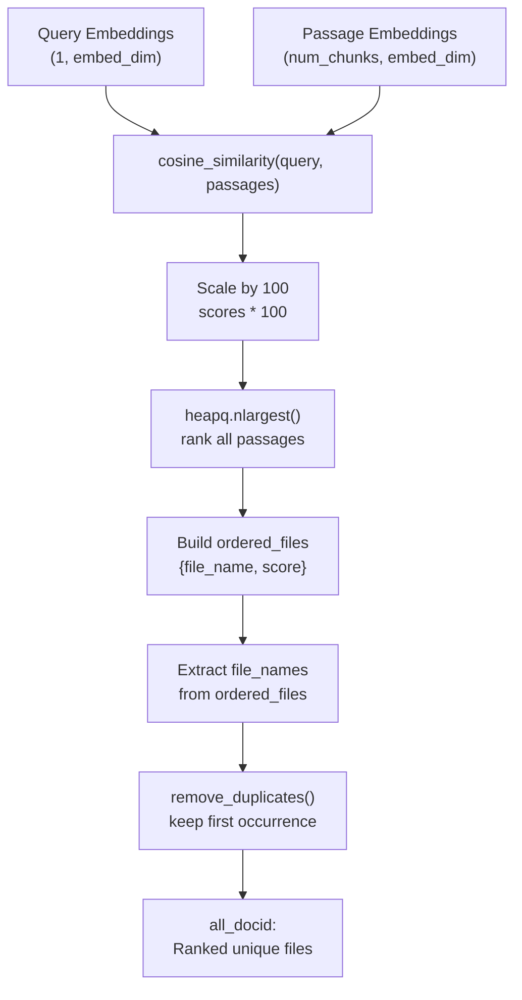
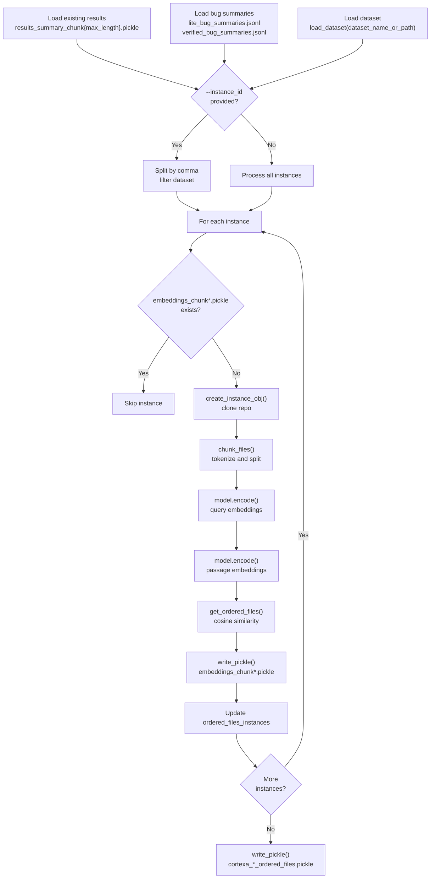

<!-- source: DeepWiki mcp.deepwiki.com · repo NVIDIA/Nemotron-CORTEXA · page 2.1 File Localization with Embeddings · fetched 2026-10-26 -->

# File Localization with Embeddings

<details>
<summary>Relevant source files</summary>

The following files were used as context for generating this wiki page:

- [README.md](README.md)
- [src/cortexa/retrieval/embed_retrieve.py](src/cortexa/retrieval/embed_retrieve.py)

</details>


## Purpose and Scope

This page documents the embedding-based file localization system that performs the first stage of code localization in Nemotron-CORTEXA. The system uses semantic embeddings to rank repository files by relevance to bug descriptions, reducing the search space from thousands of files to approximately 10-20 top candidates for downstream processing.

**Scope**: This page covers the implementation in [src/cortexa/retrieval/embed_retrieve.py](), the `NIMModel` interface for accessing NV-EmbedCode-7B embeddings, file chunking strategies, cosine similarity ranking, and output format generation. For entity-level localization that refines these file results, see [Entity Localization with Agents](#2.2). For evaluation metrics of file localization accuracy, see [Localization Evaluation Metrics](#2.3).

**Sources**: [README.md:15-45](), [src/cortexa/retrieval/embed_retrieve.py]()

---

## System Overview

The file localization system transforms bug descriptions into vector embeddings and compares them against code embeddings to identify relevant files. The pipeline consists of query encoding, code chunking, passage encoding, and similarity-based ranking.



**Diagram**: File Localization Pipeline - end-to-end flow from bug reports to ranked file lists

**Sources**: [src/cortexa/retrieval/embed_retrieve.py:170-232](), [README.md:18-44]()

---

## NIMModel Interface

The `NIMModel` class provides a unified interface for accessing the NV-EmbedCode-7B embedding model through NVIDIA's NIM API. It wraps the OpenAI client and handles instruction prefixing for different query types.

### Class Structure

| Component | Type | Purpose |
|-----------|------|---------|
| `_client` | `OpenAI` | OpenAI-compatible API client for NIM endpoint |
| `_model_name` | `str` | Model identifier (`nvidia/nv-embedcode-7b-v1`) |
| `truncate` | `str` | Truncation strategy (`"END"` by default) |
| `task_name_to_instruct` | `dict` | Instruction templates for query types |
| `query_prefix` | `str` | Dynamic prefix based on `instruct_type` |

### Initialization

The `NIMModel.__init__()` method [src/cortexa/retrieval/embed_retrieve.py:44-54]() initializes the embedding client:

```python
def __init__(self, model_name: str, base_url: str, truncate: str = "END", **kwargs) -> None
```

**Key Behaviors**:
- Validates `NVIDIA_API_KEY` environment variable presence
- Configures instruction templates for two query types:
  - `original`: "Given a bug description, retrieve codes that need to be edited to resolve it."
  - `llmsummary`: "Given a summary of bug description generated by an LLM, retrieve codes that need to be edited to resolve it."
- Creates OpenAI client pointing to NIM base URL (default: `https://integrate.api.nvidia.com/v1`)

### Encoding Method

The `encode()` method [src/cortexa/retrieval/embed_retrieve.py:56-86]() generates embeddings for text inputs:

```python
def encode(
    self,
    sentences, 
    doc_type: str = 'passage',
    instruct_type: str = 'llmsummary',
    batch_size: int = 16,
    **kwargs
) -> np.ndarray
```

**Parameters**:
- `sentences`: List of text strings to embed
- `doc_type`: Either `'query'` (for bug descriptions) or `'passage'` (for code chunks)
- `instruct_type`: Either `'llmsummary'` or `'original'` to select instruction template
- `batch_size`: Number of texts to process per API call (default: 16)

**Processing Logic**:
1. Select instruction prefix based on `instruct_type` (only applied if `doc_type='query'`)
2. Split input into batches for API rate limiting
3. For each batch:
   - Prepend query prefix if `doc_type='query'`
   - Replace empty strings with `"<EMPTY>"` token
   - Call `_client.embeddings.create()` with model name and truncation settings
   - Extract float embeddings from response
4. Return concatenated numpy array of shape `(num_sentences, embedding_dim)`

**Sources**: [src/cortexa/retrieval/embed_retrieve.py:43-90]()

---

## File Chunking Strategy

Large Python files exceed the embedding model's context window (typically 512 tokens). The `chunk_files()` function [src/cortexa/retrieval/embed_retrieve.py:113-138]() splits files into fixed-size chunks without overlap.



**Diagram**: File Chunking Process - tokenization and splitting strategy

### Implementation Details

**Tokenization** [src/cortexa/retrieval/embed_retrieve.py:128]():
- Uses `AutoTokenizer` from Hugging Face Transformers
- Full file text joined with newlines: `'\n'.join(target_files[filepath]['text'])`
- `truncation=False` to preserve full file content

**Chunking** [src/cortexa/retrieval/embed_retrieve.py:129-132]():
- Non-overlapping windows of `max_length` tokens (default: 450)
- Extracts token slices: `tokens[i:i + max_length]`
- Decodes each chunk back to text: `tokenizer.decode(chunk, skip_special_tokens=True)`

**Filepath Prefix** [src/cortexa/retrieval/embed_retrieve.py:134]():
- Each chunk prefixed with `'[{filepath}]\n'` to provide file context
- Enables model to understand code origin when ranking

**Test File Filtering** [src/cortexa/retrieval/embed_retrieve.py:126-127]():
- `skip_test=True` by default to exclude test files from localization
- Uses `is_test(filepath)` utility to identify test files by naming patterns

**Output**:
- `chunked_passages`: List of text chunks with filepath headers
- `file_names`: Parallel list mapping each chunk to its source file

**Sources**: [src/cortexa/retrieval/embed_retrieve.py:113-138]()

---

## Similarity Computation and Ranking

After encoding queries and code chunks, the system computes cosine similarity scores and ranks files by relevance.

### Cosine Similarity

The `cosine_similarity()` function [src/cortexa/retrieval/embed_retrieve.py:92-95]() implements L2-normalized dot product:

```python
def cosine_similarity(a, b):
    a_norm = a / np.linalg.norm(a, axis=1, keepdims=True)
    b_norm = b / np.linalg.norm(b, axis=1, keepdims=True)
    return np.dot(a_norm, b_norm.T)
```

**Mathematical Definition**:
- Normalizes query embeddings: `a_norm = a / ||a||`
- Normalizes passage embeddings: `b_norm = b / ||b||`
- Computes dot product matrix: `similarity = a_norm · b_norm^T`
- Result shape: `(num_queries, num_passages)` with values in [-1, 1]

### File Ranking

The `get_ordered_files()` function [src/cortexa/retrieval/embed_retrieve.py:141-156]() produces the final ranked file list:



**Diagram**: File Ranking Algorithm - from similarity scores to ordered file list

**Algorithm Steps**:

1. **Compute Scores** [src/cortexa/retrieval/embed_retrieve.py:146]():
   - `scores = cosine_similarity(query_embeddings, passage_embeddings) * 100`
   - Scaling by 100 converts [-1, 1] range to [-100, 100] for readability

2. **Heap-based Ranking** [src/cortexa/retrieval/embed_retrieve.py:147]():
   - `heapq.nlargest(len(scores[0]), range(len(scores[0])), key=scores[0].__getitem__)`
   - Returns indices of passages sorted by descending score
   - Efficient for large datasets (O(n log k) where k = output size)

3. **Build File List** [src/cortexa/retrieval/embed_retrieve.py:149-151]():
   - For each top index, create dictionary: `{'file_name': file_names[idx], 'score': scores[0][idx]}`
   - Maps passage indices back to source file paths

4. **Deduplication** [src/cortexa/retrieval/embed_retrieve.py:153-154]():
   - Extract filenames: `all_docid = [f['file_name'] for f in ordered_files]`
   - Remove duplicates while preserving order: `remove_duplicates(all_docid)`
   - Files with multiple high-scoring chunks appear once at their highest-scoring position

**Return Values**:
- `scores`: Full similarity matrix (num_queries × num_passages)
- `all_docid`: Deduplicated list of filepaths ranked by relevance

**Sources**: [src/cortexa/retrieval/embed_retrieve.py:92-95](), [src/cortexa/retrieval/embed_retrieve.py:141-156]()

---

## Query Types and Instruction Prefixes

The system supports two query types for different bug description formats, each with a specialized instruction prefix to guide the embedding model.

### Query Type Configuration

| Query Type | Source | Instruction Template |
|------------|--------|---------------------|
| `llmsummary` | `bug_summaries.jsonl` | "Given a summary of bug description generated by an LLM, retrieve codes that need to be edited to resolve it." |
| `original` | `problem_statement` field | "Given a bug description, retrieve codes that need to be edited to resolve it." |

### Query Selection Logic

The `main()` function [src/cortexa/retrieval/embed_retrieve.py:198-206]() selects query type based on command-line arguments and data availability:

```python
if args.query_type == 'llmsummary' and summaries and instance_id in summaries:
    queries = [summaries[instance_id]['output']] 
    instruct_type = 'llmsummary'
else:
    queries = [instance['problem_statement']] 
    instruct_type = 'original'
```

**Decision Flow**:
1. If `--query_type llmsummary` specified AND summaries loaded AND instance has summary:
   - Use LLM-generated summary from `bug_summaries.jsonl`
   - Set `instruct_type='llmsummary'`
2. Otherwise:
   - Fall back to original problem statement from dataset
   - Set `instruct_type='original'`

### Instruction Prefix Application

The `NIMModel.encode()` method [src/cortexa/retrieval/embed_retrieve.py:65]() constructs the query prefix:

```python
self.query_prefix = "Instruct: " + self.task_name_to_instruct[instruct_type] + "\nQuery: "
```

**Example Formatted Query**:
```
Instruct: Given a summary of bug description generated by an LLM, retrieve codes that need to be edited to resolve it.
Query: The Time class in astropy.time fails to handle leap seconds correctly...
```

**Prefix Application** [src/cortexa/retrieval/embed_retrieve.py:72]():
- Only applied when `doc_type='query'`
- Code passages (`doc_type='passage'`) receive no instruction prefix
- Empty prefix string: `prefix = self.query_prefix if doc_type == 'query' else ''`

### Pre-Generated Summaries

The system loads pre-generated LLM summaries from disk [src/cortexa/retrieval/embed_retrieve.py:174-180]():

```python
summaries_folder = f'{get_root_path()}/retrieval/files'
if os.path.exists(f'{summaries_folder}/lite_bug_summaries.jsonl') and 
   os.path.exists(f'{summaries_folder}/verified_bug_summaries.jsonl'):
    summaries = read_problems(f'{summaries_folder}/lite_bug_summaries.jsonl')
    summaries.update(read_problems(f'{summaries_folder}/verified_bug_summaries.jsonl'))
```

**File Locations**:
- Lite summaries: `src/cortexa/retrieval/files/lite_bug_summaries.jsonl`
- Verified summaries: `src/cortexa/retrieval/files/verified_bug_summaries.jsonl`
- Format: JSONL with `instance_id` → `{'output': 'summary text'}`

**Sources**: [src/cortexa/retrieval/embed_retrieve.py:47-49](), [src/cortexa/retrieval/embed_retrieve.py:65](), [src/cortexa/retrieval/embed_retrieve.py:174-206]()

---

## Output Formats

The file localization system produces two types of pickle files with different levels of detail.

### Summary Output: ordered_files.pickle

The primary output file contains ranked file lists for all processed instances [src/cortexa/retrieval/embed_retrieve.py:231]():

**File Path**: `{log_dir}/cortexa_{target_set}_{query_type}_ordered_files.pickle`

**Example**: `./logs/cortexa_SWE-bench_Verified_llmsummary_ordered_files.pickle`

**Structure**:
```python
{
    'instance_id_1': (
        ['path/to/file1.py', 'path/to/file2.py', ...],  # Ranked files (all_docid)
        ['path/to/gold1.py', 'path/to/gold2.py', ...]   # Ground truth files (patch_files)
    ),
    'instance_id_2': (...),
    ...
}
```

**Dictionary Contents**:
- **Key**: `instance_id` string (e.g., `'astropy__astropy-12907'`)
- **Value**: Tuple of two lists:
  1. **Predicted files** (`all_docid`): Ranked list from `get_ordered_files()`, deduplicated
  2. **Ground truth files** (`patch_files`): Files modified in golden patch from `get_golden_patch_files()`

**Usage**:
- Consumed by entity localization agent (see [Entity Localization with Agents](#2.2))
- Used for file retrieval evaluation (see [Localization Evaluation Metrics](#2.3))
- Pre-generated results available at: `src/cortexa/retrieval/files/cortexa_all_llmsummary_ordered_files.pickle`

### Detailed Output: embeddings_chunk{max_length}_{instance_id}.pickle

Per-instance detailed embeddings and scores [src/cortexa/retrieval/embed_retrieve.py:221-229]():

**File Path**: `{log_dir}/embeddings_chunk{max_length}_{instance_id}.pickle`

**Example**: `./logs/embeddings_chunk450_astropy__astropy-12907.pickle`

**Structure**:
```python
{
    'code': ['[file1.py]\nclass Foo:...', '[file2.py]\ndef bar():...', ...],  # Chunked passages
    'embedding': np.ndarray(shape=(num_chunks, embed_dim)),                    # Passage embeddings
    'file': ['file1.py', 'file1.py', 'file2.py', ...],                        # Chunk-to-file mapping
    'query': ['Bug description or LLM summary'],                               # Query text
    'query_embedding': np.ndarray(shape=(1, embed_dim)),                      # Query embedding
    'scores': np.ndarray(shape=(1, num_chunks)),                              # Similarity scores * 100
    'docid': ['file1.py', 'file2.py', ...]                                    # Ranked unique files
}
```

**Field Descriptions**:

| Field | Type | Description |
|-------|------|-------------|
| `code` | `List[str]` | Text chunks with `[filepath]\n` prefix |
| `embedding` | `np.ndarray` | Passage embeddings from `NIMModel.encode()` |
| `file` | `List[str]` | Source file for each chunk (parallel to `code`) |
| `query` | `List[str]` | Original query text (length 1) |
| `query_embedding` | `np.ndarray` | Query embedding from `NIMModel.encode()` |
| `scores` | `np.ndarray` | Cosine similarity scores scaled by 100 |
| `docid` | `List[str]` | Ranked deduplicated file paths |

**Use Cases**:
- Debugging embedding quality
- Analyzing similarity score distributions
- Reproducing ranking without re-encoding
- Understanding chunk-level vs file-level scores

**Sources**: [src/cortexa/retrieval/embed_retrieve.py:207-232](), [README.md:38-44]()

---

## Command-Line Interface

The `embed_retrieve.py` module [src/cortexa/retrieval/embed_retrieve.py:234-268]() provides a comprehensive CLI for running file localization.

### Basic Usage

```bash
python -m cortexa.retrieval.embed_retrieve \
    --model_name nvidia/nv-embedcode-7b-v1 \
    --base_url https://integrate.api.nvidia.com/v1 \
    --log_dir ./logs \
    --repo_playground ./repos \
    --batch_size 16 \
    --max_length 450 \
    --dataset_name_or_path princeton-nlp/SWE-bench_Verified \
    --query_type llmsummary \
    --instance_id astropy__astropy-12907
```

### Argument Reference

| Argument | Type | Default | Description |
|----------|------|---------|-------------|
| `--model_name` | `str` | `nvidia/nv-embedcode-7b-v1` | Model identifier for NIM or HuggingFace handle |
| `--base_url` | `str` | `https://integrate.api.nvidia.com/v1` | NIM API base URL |
| `--log_dir` | `str` | `{get_root_path()}/logs` | Output directory for pickle files |
| `--batch_size` | `int` | `16` | Batch size for embedding encoder |
| `--max_length` | `int` | `450` | Token limit per code chunk |
| `--dataset_name_or_path` | `str` | `princeton-nlp/SWE-bench_Verified` | HuggingFace dataset identifier |
| `--query_type` | `str` | `llmsummary` | Query source: `llmsummary` or `original` |
| `--instance_id` | `str` | `''` (all) | Comma-separated instance IDs or empty for full dataset |
| `--repo_playground` | `str` | `./repo_playground` | Path to cloned repositories |

### Instance Selection

**Single Instance**:
```bash
--instance_id astropy__astropy-12907
```

**Multiple Instances**:
```bash
--instance_id "astropy__astropy-12907,django__django-11179,sympy__sympy-18532"
```

**All Instances**:
```bash
# Omit --instance_id argument entirely
```

### Execution Flow

The `main()` function [src/cortexa/retrieval/embed_retrieve.py:170-232]() orchestrates the localization pipeline:



**Diagram**: Main Execution Flow - complete pipeline from argument parsing to output generation

**Key Steps**:

1. **Initialization** [src/cortexa/retrieval/embed_retrieve.py:256-267]():
   - Load dataset using HuggingFace `load_dataset()`
   - Initialize `NIMModel` with specified model and base URL
   - Load AutoTokenizer for chunking

2. **Instance Filtering** [src/cortexa/retrieval/embed_retrieve.py:182-197]():
   - Parse comma-separated instance IDs if provided
   - Filter dataset to requested instances
   - Log error if specified instances not found

3. **Per-Instance Processing** [src/cortexa/retrieval/embed_retrieve.py:198-229]():
   - Select query text based on `query_type`
   - Check if detailed pickle already exists (skip if present)
   - Create instance object and extract Python files
   - Chunk files with `chunk_files()`
   - Encode query and passages
   - Compute rankings and extract ground truth
   - Save detailed and summary outputs

**Sources**: [src/cortexa/retrieval/embed_retrieve.py:170-268](), [README.md:21-34]()

---

## Integration with Downstream Stages

The file localization output serves as input to multiple downstream components in the Nemotron-CORTEXA pipeline.

### Entity Localization

The `ordered_files.pickle` is consumed by the entity localization agent [README.md:52-58]():

```bash
python -m cortexa.localize.entity_localization \
    --embed_results cortexa_verified_llmsummary_ordered_files.pickle \
    --num_top_files 6
```

**Data Flow**:
1. Entity localization loads pickle file
2. Extracts top N files (default: 6) from ranked list
3. Constructs `RepoGraph` for selected files
4. Agent navigates code structure to identify specific functions/classes

### Repair Stage

The repair configuration [README.md:71]() references localization results via `get_default_loc_log_file_map()`:

**Configuration in `src/cortexa/repair/config.py`**:
- Maps dataset → localization result file
- Default: Pre-processed files from `src/cortexa/retrieval/files/`
- `RepairAgent` uses entity localization output to construct context prompts

### Evaluation

File retrieval accuracy can be measured using [README.md:36-42]():

```bash
python -m cortexa.retrieval.file_retrieval_eval \
    --log_dir ./logs \
    --dataset_name_or_path princeton-nlp/SWE-bench_Verified \
    --query_type llmsummary
```

**Metrics Computed**:
- Top-K accuracy (K ∈ {1, 3, 5, 10, 20})
- Mean Average Precision (MAP)
- Mean Reciprocal Rank (MRR)

See [Localization Evaluation Metrics](#2.3) for detailed metric definitions.

**Sources**: [README.md:36-71](), [src/cortexa/retrieval/embed_retrieve.py:219]()

---

## Configuration and Best Practices

### Environment Setup

**API Key Configuration** [src/cortexa/retrieval/embed_retrieve.py:45-46]():
```bash
export NVIDIA_API_KEY="your_api_key_here"
```

The `NIMModel` constructor validates key presence at runtime. For alternative providers, update `base_url` and ensure OpenAI API compatibility.

### Chunk Size Selection

**Token Limit Tradeoffs** [src/cortexa/retrieval/embed_retrieve.py:116]():

| max_length | Pros | Cons |
|------------|------|------|
| 450 (default) | Fits within 512-token window with safety margin | May split related code across chunks |
| 256 | More granular localization | Higher chunk count, slower encoding |
| 512 | Maximum context utilization | Risk of truncation with long filepath prefixes |

**Recommendation**: Use default 450 tokens unless experiencing truncation warnings.

### Batch Size Tuning

**API Rate Limits** [src/cortexa/retrieval/embed_retrieve.py:66-69]():
- Default `batch_size=16` balances throughput and latency
- Increase for large-scale experiments with high quota
- Decrease if encountering rate limit errors

### Caching Strategy

**Incremental Processing** [src/cortexa/retrieval/embed_retrieve.py:209-210]():
```python
pickle_file_path = f'{args.log_dir}/embeddings_chunk{args.max_length}_{instance_id}.pickle'
if os.path.exists(pickle_file_path): 
    continue
```

The system skips instances with existing detailed pickles, enabling:
- Resume after interruption
- Incremental updates to subset of instances
- Avoid redundant API calls

### Query Type Selection

**llmsummary vs original** [README.md:31](), [src/cortexa/retrieval/embed_retrieve.py:247-248]():

| Scenario | Recommended Query Type | Rationale |
|----------|------------------------|-----------|
| SWE-bench Lite/Verified | `llmsummary` | Pre-generated summaries available, improved retrieval accuracy |
| Custom datasets | `original` | No pre-generated summaries, fallback to problem statements |
| Evaluation experiments | `original` | Baseline for comparison against summary-enhanced retrieval |

**Sources**: [src/cortexa/retrieval/embed_retrieve.py:44-54](), [src/cortexa/retrieval/embed_retrieve.py:113-138](), [README.md:21-44]()

---

## Architecture Decisions

### Why NV-EmbedCode?

NV-EmbedCode-7B is specialized for code-to-code retrieval tasks with instruction-following capabilities. Key advantages:

1. **Task-Specific Training**: Trained on bug-to-code mapping tasks
2. **Instruction Awareness**: Responds to custom instruction prefixes for query types
3. **NIM Availability**: Accessible via NVIDIA API without local GPU requirements
4. **Competitive Performance**: Achieves high recall@k on SWE-bench datasets

Alternative: Users can replace with HuggingFace models by modifying `initialize_embedding_model()` [src/cortexa/retrieval/embed_retrieve.py:158-168]().

### Why Fixed-Size Chunking?

The system uses non-overlapping fixed-size chunks [src/cortexa/retrieval/embed_retrieve.py:129-132]() rather than semantic chunking:

**Rationale**:
- **Simplicity**: Deterministic, no heuristics for split points
- **Coverage**: Ensures no code is excluded from ranking
- **Efficiency**: Fast tokenization without AST parsing
- **Model Agnostic**: Works with any tokenizer

**Tradeoff**: May split logically related code (e.g., function definition from docstring). However, deduplication at file level [src/cortexa/retrieval/embed_retrieve.py:153-154]() ensures multiple high-scoring chunks elevate the file's overall rank.

### Why Skip Test Files?

The `skip_test=True` default [src/cortexa/retrieval/embed_retrieve.py:116]() excludes test files from localization:

**Reasoning**:
- Bugs typically manifest in production code, not test code
- Test files follow different patterns (assertion-heavy, limited logic)
- Reduces search space and improves precision on relevant files
- Ground truth patches in SWE-bench rarely modify test files

**Override**: Set `skip_test=False` in `chunk_files()` call for test file localization.

**Sources**: [src/cortexa/retrieval/embed_retrieve.py:113-138](), [README.md:16-19]()

---

