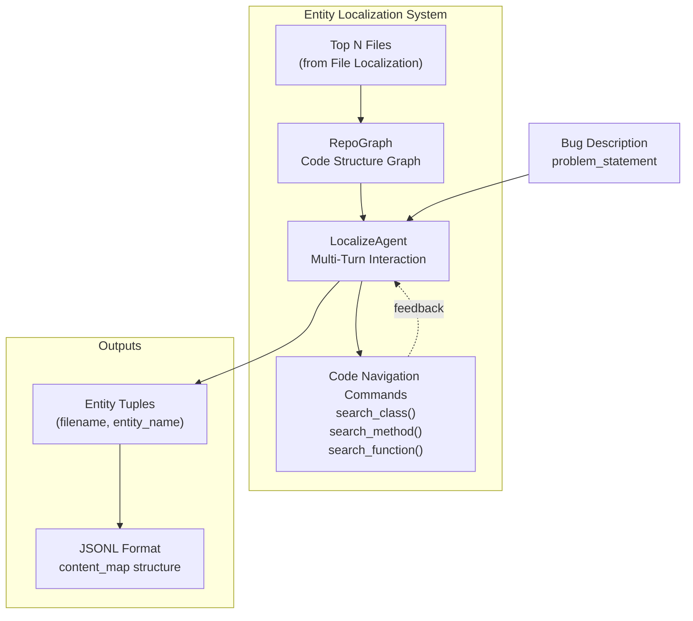
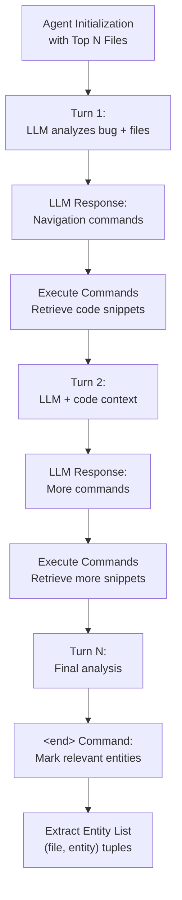
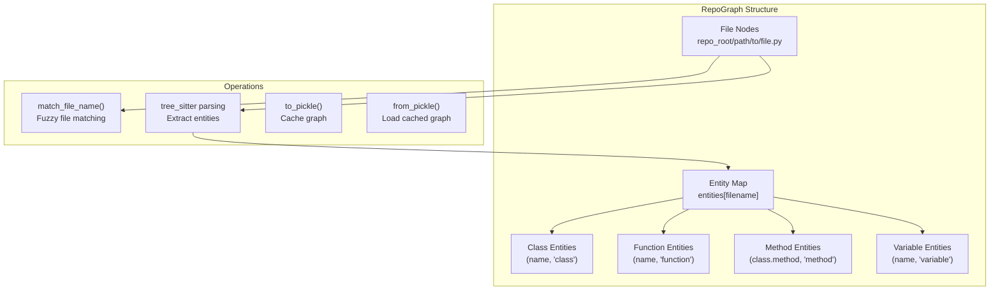
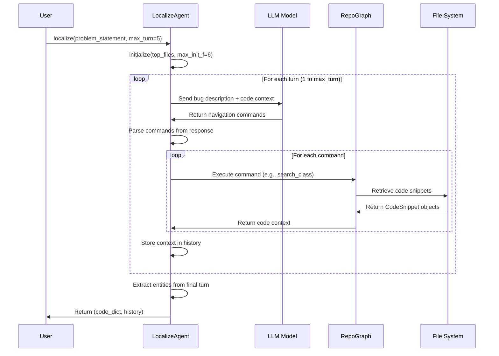
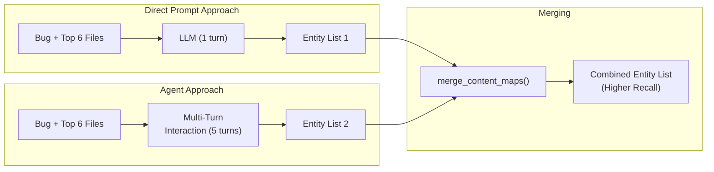
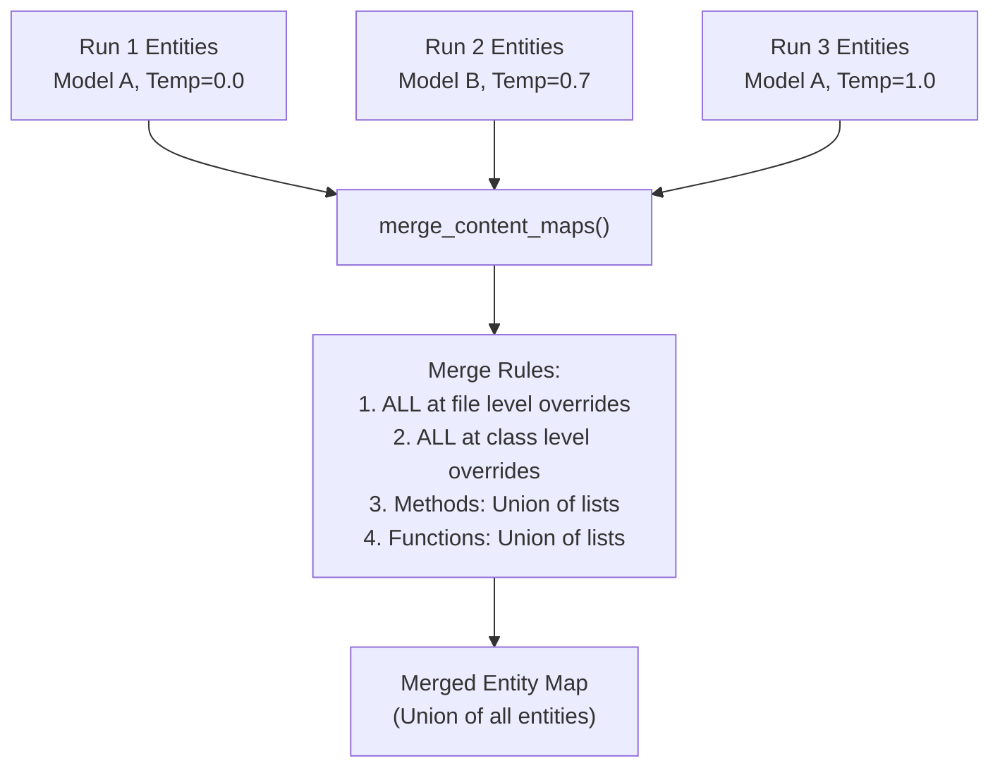

<!-- source: DeepWiki mcp.deepwiki.com · repo NVIDIA/Nemotron-CORTEXA · page 2.2 Entity Localization with Agents · fetched 2026-10-26 -->

# Entity Localization with Agents

<details>
<summary>Relevant source files</summary>

The following files were used as context for generating this wiki page:

- [README.md](README.md)
- [src/cortexa/evaluate/localization_eval.py](src/cortexa/evaluate/localization_eval.py)

</details>


## Purpose and Scope

This document describes the **Entity Localization** system, which refines file-level localization results to identify specific code entities (functions, classes, methods) that require modification for bug fixing. The system uses `LocalizeAgent`, an LLM-powered agent that performs multi-turn interaction over a `RepoGraph` data structure to navigate code and discover relevant entities.

For file-level localization using embeddings, see [File Localization with Embeddings](#2.1). For evaluation metrics and accuracy measurement, see [Localization Evaluation Metrics](#2.3).

**Sources**: [README.md:46-71](), [src/cortexa/evaluate/localization_eval.py:1-918]()

---

## System Overview

Entity localization operates as the second stage of the localization pipeline, taking the top-ranked files from file localization and producing a structured list of specific code entities. The system achieves this through:

1. **RepoGraph Construction**: Parse repository structure into a navigable graph
2. **Agent Initialization**: Load top N files from file localization results
3. **Multi-Turn Interaction**: Agent executes commands to explore code structure
4. **Entity Extraction**: Parse agent responses to identify relevant entities
5. **Format Conversion**: Convert entity tuples to structured JSON format



**Sources**: [README.md:46-59](), [src/cortexa/evaluate/localization_eval.py:605-656]()

---

## LocalizeAgent Architecture

The `LocalizeAgent` class orchestrates multi-turn interaction with an LLM to navigate code structure. The agent maintains conversation history and executes code navigation commands based on LLM responses.

### Key Components

| Component | Purpose | Location |
|-----------|---------|----------|
| `LocalizeAgent` | Main agent class for entity localization | `cortexa.localize.localize` |
| `RepoGraph` | Code structure representation | `cortexa.utils.graph` |
| `model_info` | LLM endpoint configuration | `model_config.yml` |
| `temperature` | Sampling temperature for LLM | Command-line arg |
| `max_tokens` | Maximum response length | Command-line arg |

**Sources**: [src/cortexa/evaluate/localization_eval.py:33-34](), [README.md:61-63]()

### Multi-Turn Interaction Loop



The agent performs iterative refinement over multiple turns (default: 5 turns). Each turn consists of:
1. LLM receives bug description + code context from previous turns
2. LLM outputs navigation commands to explore code
3. System executes commands and retrieves code snippets
4. Code snippets become context for next turn
5. Final turn: LLM outputs `<end>` commands marking relevant entities

**Sources**: [src/cortexa/evaluate/localization_eval.py:621-652](), [README.md:52-59]()

---

## RepoGraph: Code Structure Representation

The `RepoGraph` class represents repository structure as a navigable graph, enabling efficient code lookup and entity resolution.

### RepoGraph Data Structure



### Entity Types in RepoGraph

The graph distinguishes four entity types stored as tuples `(entity_name, entity_type)`:

| Entity Type | Format | Example |
|-------------|--------|---------|
| Class | `(name, 'class')` | `("FitsHeader", "class")` |
| Function | `(name, 'function')` | `("parse_args", "function")` |
| Method | N/A (stored with class) | Referenced as `"FitsHeader.parse"` |
| Variable | `(name, 'variable')` | `("GLOBAL_CACHE", "variable")` |

**Sources**: [src/cortexa/evaluate/localization_eval.py:775-826](), [src/cortexa/evaluate/localization_eval.py:619-620]()

---

## Entity Localization Workflow

### Command Execution

The `LocalizeAgent.localize()` method executes the complete localization workflow:



**Sources**: [src/cortexa/evaluate/localization_eval.py:633-639]()

### Command-Line Usage

```bash
python -m cortexa.localize.entity_localization \
       --log_dir ./logs \
       --repo_playground ./repos \
       --num_turns 5 \
       --num_top_files 6 \
       --embed_results cortexa_verified_llmsummary_ordered_files.pickle \
       --instance_id astropy__astropy-12907
```

**Parameters**:
- `num_turns`: Number of interaction turns (default: 5)
- `num_top_files`: Number of files from file localization to initialize agent (default: 6)
- `embed_results`: Pickle file containing ranked files from file localization
- `instance_id`: Bug instance to localize (omit for full benchmark)

**Sources**: [README.md:51-59]()

---

## Entity Format and Representation

### Tuple Representation

During agent execution, entities are represented as tuples `(filename, entity_name)`:

```python
# Examples from localization_eval.py
("astropy/io/fits/header.py", "FitsHeader")           # Class
("astropy/io/fits/header.py", "FitsHeader.parse")     # Method
("astropy/io/fits/header.py", "parse_card")           # Function
("astropy/io/fits/header.py", "ALL")                  # Entire file
```

**Entity Name Formats**:
- `"ALL"`: Entire file requires modification
- `"ClassName"`: Specific class
- `"function_name"`: Specific function
- `"ClassName.method_name"`: Specific class method
- `"variable_name"`: Variable (treated as `"ALL"` for file/class)

**Sources**: [src/cortexa/evaluate/localization_eval.py:122-147](), [src/cortexa/evaluate/localization_eval.py:740-752]()

### JSON Output Format

The tuple representation is converted to a structured JSON format for downstream consumption:

```json
{
  "instance_id": "astropy__astropy-12907",
  "content_map": {
    "astropy/io/fits/header.py": {
      "classes": {
        "FitsHeader": {
          "methods": ["parse", "fromstring", "tostring"]
        },
        "Card": "ALL"
      },
      "functions": ["parse_card", "_parse_value"]
    },
    "astropy/io/fits/card.py": "ALL"
  }
}
```

**Format Rules**:
1. `"ALL"` at file level: Entire file is relevant
2. `"ALL"` at class level: All class methods are relevant
3. Methods list: Specific methods within a class
4. Functions list: Top-level functions in file
5. Variables: Converted to `"ALL"` (file-level or class-level)

**Sources**: [src/cortexa/evaluate/localization_eval.py:775-826](), [README.md:69]()

---

## Direct Prompt vs Agent-Based Approach

The system evaluates two approaches and can merge their results:

### Comparison

| Aspect | Direct Prompt | Localization Agent |
|--------|---------------|-------------------|
| **Turns** | 1 (first turn only) | Multiple (default: 5) |
| **Context** | Top N files only | Accumulated code snippets |
| **Exploration** | Limited to initial files | Can navigate beyond top files |
| **Extraction** | First turn code snippets | Final turn code snippets + commands |
| **Recall** | Lower | Higher |



**Sources**: [src/cortexa/evaluate/localization_eval.py:441-460](), [README.md:63-64]()

### Code Snippet Extraction

The system extracts entities from code snippets returned by navigation commands:

```python
# From localization_eval.py:188-223
def read_code_dict_entity(code_dict, include_commands=False):
    entity_lst = []
    for command, value in code_dict.items():
        if command == 'reason':
            continue
        
        if value:
            for fname, codes in value.items():
                if fname == 'error':
                    continue
                
                for code in codes:
                    # class method
                    if code.class_name and code.name != code.class_name:
                        entity_name = f'{code.class_name}.{code.name}'
                    else:
                        # function, class, or variable
                        entity_name = code.name
                    
                    entity_lst.append((fname, entity_name))
    
    return list(set(entity_lst))
```

**Sources**: [src/cortexa/evaluate/localization_eval.py:188-223]()

---

## Configuration and Model Settings

### Model Configuration

Entity localization reads LLM configuration from `model_config.yml`:

```yaml
# Example model configuration structure
model_name: "llama-3.3-70b-instruct"
base_url: "https://integrate.api.nvidia.com/v1"
api_key_name: "NVIDIA_API_KEY"  # Environment variable name
```

**Security**: API keys are populated at runtime from environment variables specified by `api_key_name`. The actual key value is accessed via `os.environ[api_key_name]`.

**Sources**: [README.md:61-62]()

### Multi-Model Ensemble

Running with different models and temperatures increases recall accuracy:

```python
# From configs.py example (mentioned in README)
# Define multiple model configurations:
# - Different models (e.g., llama-3.3-70b, deepseek-v3)
# - Different temperatures (0.0, 0.7, 1.0)
# - Merge results using merge_content_maps()
```

**Ensemble Strategy**:
1. Run entity localization with Model A (temperature=0.0)
2. Run entity localization with Model B (temperature=0.7)
3. Merge results using `merge_content_maps()` function
4. Result: Union of entities from both runs (higher recall)

**Sources**: [README.md:63-64](), [src/cortexa/evaluate/localization_eval.py:365-392]()

---

## Output Format and Storage

### Pickle Storage (Agent State)

During execution, the agent stores complete state in pickle format:

```python
# From localization_eval.py:641-649
with open(data_f, 'wb') as f:
    pickle.dump({
        'code_dict': code_dict,           # Final turn code context
        'history': history,               # All turns with responses
        'direct_prompt_result': ...,      # First turn result
        'localization_agent_result': ...  # Final turn result
    }, f)
```

**File Structure**:
```
{log_dir}/results/{instance_id}/data.pickle
{log_dir}/results/{instance_id}/graph.pickle  # Cached RepoGraph
```

**Sources**: [src/cortexa/evaluate/localization_eval.py:641-649]()

### JSONL Output Format

The final output is written in JSONL format for downstream consumption:

```json
{
  "instance_id": "django__django-12856",
  "content_map": {
    "django/db/models/query.py": {
      "classes": {
        "QuerySet": {
          "methods": ["filter", "exclude", "union"]
        }
      },
      "functions": ["prefetch_related_objects"]
    },
    "django/db/models/sql/query.py": {
      "classes": {
        "Query": "ALL"
      },
      "functions": []
    }
  }
}
```

**File Naming Convention**: `{dataset}_{query_type}_LA_DP_entity.jsonl`
- `LA`: Localization Agent results
- `DP`: Direct Prompt results
- Can also have merged versions combining multiple runs

**Sources**: [README.md:69](), [src/cortexa/evaluate/localization_eval.py:740-772]()

---

## Entity Merging and Ensemble

### Merge Algorithm

The `merge_content_maps()` function combines entity results from multiple runs:



**Merge Rules**:
1. If any run marks file as `"ALL"`, the merged result is `"ALL"` for that file
2. If any run marks class as `"ALL"`, the merged result is `"ALL"` for that class
3. Methods: Union of all method lists across runs
4. Functions: Union of all function lists across runs

**Sources**: [src/cortexa/evaluate/localization_eval.py:365-412]()

### Merging Multiple JSONL Files

```python
# From localization_eval.py:395-411
def merge_entity_localization_results(file_lst):
    res_lst = [read_problems(f) for f in file_lst]
    instance_ids = []
    for res in res_lst:
        res_ids = list(res.keys())
        for instance_id in res_ids:
            if instance_id not in instance_ids:
                instance_ids.append(instance_id)
    
    merged_res = {}
    for instance_id in instance_ids:
        instance_dicts = [res[instance_id]['content_map'] 
                         for res in res_lst if instance_id in res]
        merged_dict = merge_content_maps(instance_dicts)
        merged_res[instance_id] = {
            'instance_id': instance_id,
            'content_map': merged_dict
        }
    
    return merged_res
```

**Sources**: [src/cortexa/evaluate/localization_eval.py:395-411]()

---

## Integration with Repair Stage

Entity localization results are consumed by the repair stage through configuration:

```python
# From repair/config.py (mentioned in README)
def get_default_loc_log_file_map():
    return {
        'file_loc': 'cortexa_all_llmsummary_ordered_files.pickle',
        'entity_loc': 'cortexa_all_llmsummary_LA_DP_entity.jsonl'
    }
```

The repair agent uses these localization results to:
1. **Context Retrieval**: Load relevant files and entities for patch generation
2. **Focused Editing**: Target specific functions/classes instead of entire files
3. **Prompt Construction**: Include precise code snippets in repair prompts

**Sources**: [README.md:71]()

---

## Command Reference

### Entity Localization Execution

```bash
# Single instance
python -m cortexa.localize.entity_localization \
       --log_dir ./logs \
       --repo_playground ./repos \
       --num_turns 5 \
       --num_top_files 6 \
       --embed_results cortexa_verified_llmsummary_ordered_files.pickle \
       --instance_id astropy__astropy-12907

# Full benchmark (omit instance_id)
python -m cortexa.localize.entity_localization \
       --log_dir ./logs \
       --repo_playground ./repos \
       --num_turns 5 \
       --num_top_files 6 \
       --embed_results cortexa_verified_llmsummary_ordered_files.pickle
```

### Entity Localization Evaluation

```bash
python src/cortexa/localize/entity_localization_eval.py \
       --loc_f=LOC_RES_F \
       --target_set=verified
```

Where `LOC_RES_F` is a JSONL file following the format in `cortexa_all_llmsummary_LA_DP_entity.jsonl`.

**Sources**: [README.md:51-68]()

---

