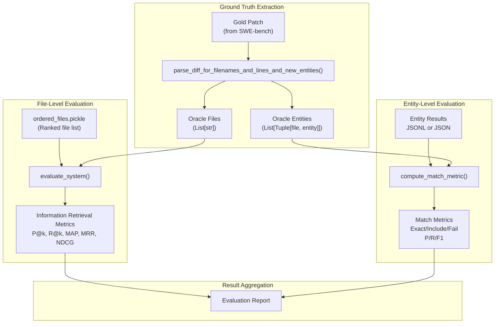
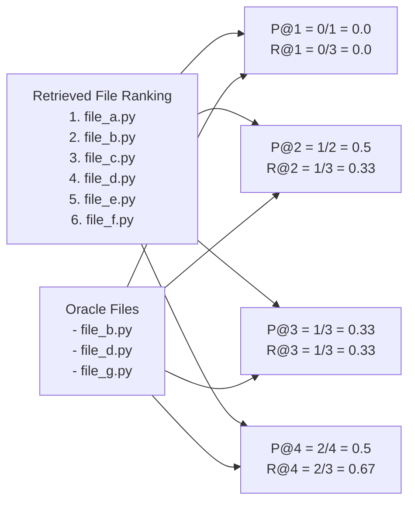
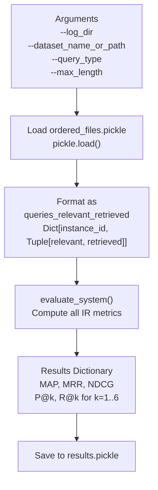
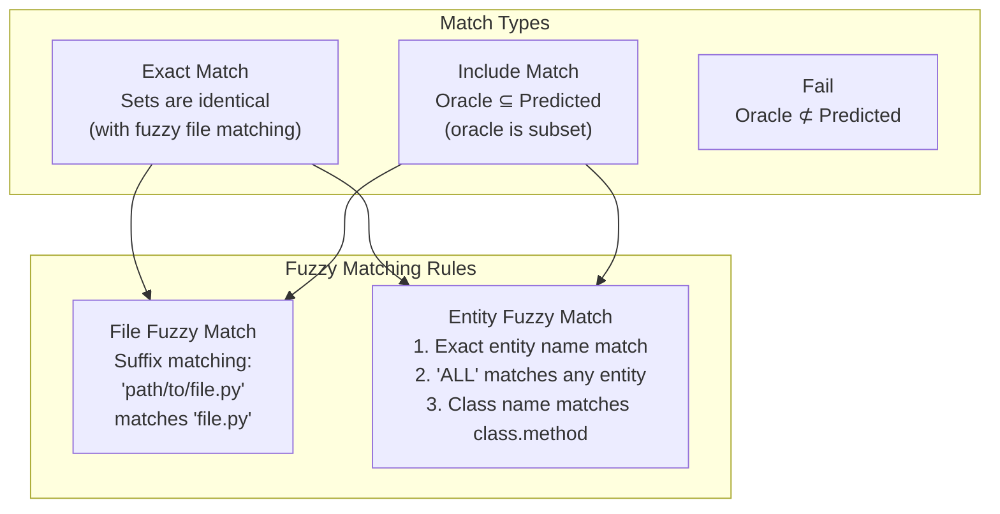
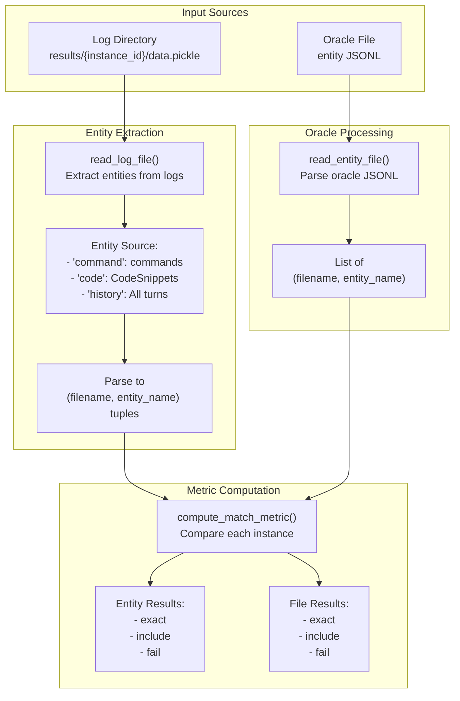
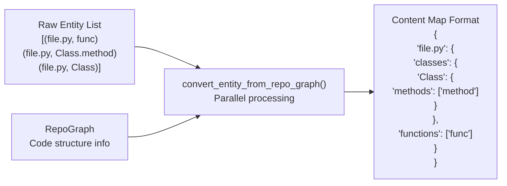
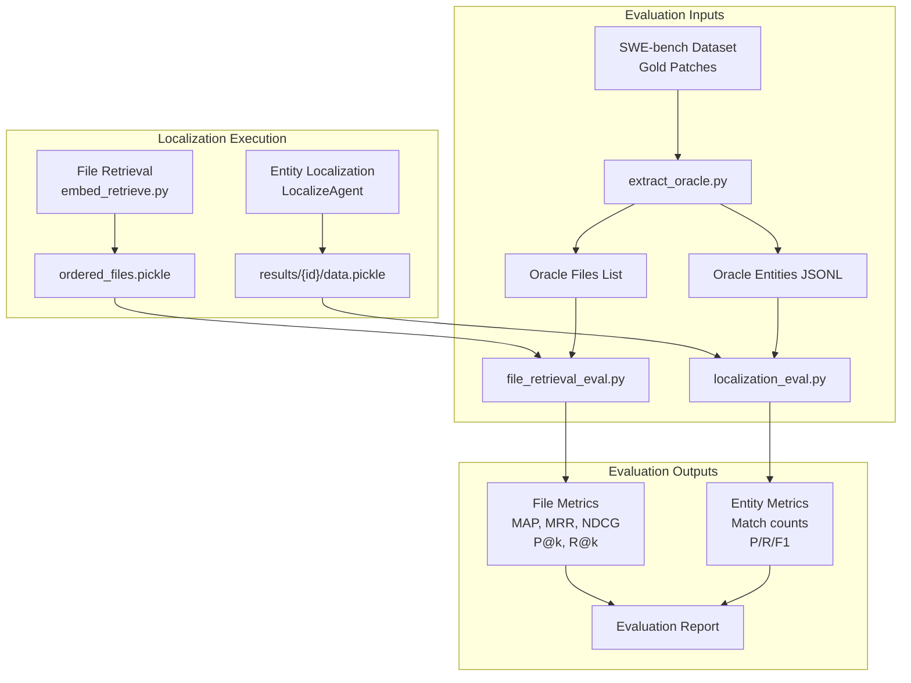

<!-- source: DeepWiki mcp.deepwiki.com · repo NVIDIA/Nemotron-CORTEXA · page 2.3 Localization Evaluation Metrics · fetched 2026-10-26 -->

# Localization Evaluation Metrics

<details>
<summary>Relevant source files</summary>

The following files were used as context for generating this wiki page:

- [src/cortexa/evaluate/localization_eval.py](src/cortexa/evaluate/localization_eval.py)
- [src/cortexa/retrieval/file_retrieval_eval.py](src/cortexa/retrieval/file_retrieval_eval.py)

</details>


This document describes the evaluation methodology for the Localization Stage of Nemotron-CORTEXA. The localization system operates at two granularity levels—file-level and entity-level—and each level uses distinct metrics appropriate to its search task. For information about the localization system architecture itself, see [Localization Stage](#2). For details on the file retrieval implementation, see [File Localization with Embeddings](#2.1). For entity localization details, see [Entity Localization with Agents](#2.2).

## Overview of Two-Level Evaluation

The localization evaluation mirrors the two-stage localization pipeline: first evaluating file retrieval accuracy, then evaluating entity identification accuracy. Both levels compare system outputs against ground truth extracted from gold patches.



**Sources:** [src/cortexa/retrieval/file_retrieval_eval.py](), [src/cortexa/evaluate/localization_eval.py](), [src/cortexa/evaluate/extract_oracle.py]()

## File Localization Evaluation

File localization is evaluated as an information retrieval task, where the system ranks all repository files by relevance to the bug report. The evaluation uses standard IR metrics implemented in [src/cortexa/retrieval/file_retrieval_eval.py]().

### Information Retrieval Metrics

The following metrics are computed by `evaluate_system()` [src/cortexa/retrieval/file_retrieval_eval.py:83-118]():

| Metric | Function | Definition | Use Case |
|--------|----------|------------|----------|
| **Precision@k** | `precision_at_k()` | Fraction of top-k retrieved files that are relevant | "Of the top k files retrieved, how many are correct?" |
| **Recall@k** | `recall_at_k()` | Fraction of all relevant files found in top-k | "Of all correct files, how many did we find in top k?" |
| **Mean Average Precision (MAP)** | `mean_average_precision()` | Average of precision values at each relevant file position | Overall ranking quality across all positions |
| **Mean Reciprocal Rank (MRR)** | `mean_reciprocal_rank()` | Average of 1/rank of first relevant file | "How far down do you look to find the first correct file?" |
| **NDCG@k** | `ndcg_at_k()` | Normalized Discounted Cumulative Gain | Rewards relevant files appearing higher in ranking |

**Sources:** [src/cortexa/retrieval/file_retrieval_eval.py:26-118]()

### Precision and Recall at Multiple Cutoffs

The evaluation computes precision and recall at various cutoff points (k=1 to k=6, plus k=#oracle) to understand performance at different retrieval depths [src/cortexa/retrieval/file_retrieval_eval.py:98-118]():



The special cutoff `P@#o` and `R@#o` compute metrics at k=|oracle|, the number of oracle files [src/cortexa/retrieval/file_retrieval_eval.py:109-117]().

**Sources:** [src/cortexa/retrieval/file_retrieval_eval.py:98-118]()

### File Retrieval Evaluation Workflow



The main entry point [src/cortexa/retrieval/file_retrieval_eval.py:135-157]() expects the embedding retrieval results in pickle format at path `{log_dir}/cortexa_{dataset}_{query_type}_ordered_files.pickle`.

**Sources:** [src/cortexa/retrieval/file_retrieval_eval.py:135-157]()

## Entity Localization Evaluation

Entity localization evaluation is more complex than file evaluation because it must handle hierarchical code structures (files, classes, methods, functions) and support fuzzy matching for path prefixes. The evaluation is implemented in [src/cortexa/evaluate/localization_eval.py]().

### Entity Representation Format

Entities are represented as tuples `(filename, entity_name)` where:
- `filename`: Relative file path
- `entity_name`: Can be:
  - `"ALL"`: All entities in the file
  - `"ClassName"`: A class
  - `"function_name"`: A function
  - `"ClassName.method_name"`: A class method
  - Variable names (treated as `"ALL"` at file/class scope)

**Sources:** [src/cortexa/evaluate/localization_eval.py:122-148](), [src/cortexa/evaluate/localization_eval.py:740-772]()

### Match Semantics

The evaluation supports three match types:



**Sources:** [src/cortexa/evaluate/localization_eval.py:519-551]()

### Entity Matching Functions

Four core matching functions determine evaluation outcomes:

| Function | Purpose | Line Range |
|----------|---------|------------|
| `file_match()` | Check if file sets are identical (with fuzzy suffix matching) | [src/cortexa/evaluate/localization_eval.py:494-500]() |
| `file_include()` | Check if oracle files ⊆ predicted files | [src/cortexa/evaluate/localization_eval.py:503-516]() |
| `entity_match()` | Check if entity sets are identical | [src/cortexa/evaluate/localization_eval.py:519-532]() |
| `entity_include()` | Check if oracle entities ⊆ predicted entities | [src/cortexa/evaluate/localization_eval.py:535-551]() |

The fuzzy matching logic in `entity_include()` [src/cortexa/evaluate/localization_eval.py:543-548]() considers an entity matched if:
```python
# From the implementation:
# Match if:
# 1. File suffix matches AND entity name matches exactly
# 2. File suffix matches AND predicted entity is 'ALL'
# 3. File suffix matches AND predicted entity is the class of a method
if (item1[0].endswith(item2[0]) and 
   (item1[1] == item2[1] 
    or item2[1] == 'ALL' or 
    ('.' in item1[1] and item2[1] == item1[1].split('.')[0]))):
```

**Sources:** [src/cortexa/evaluate/localization_eval.py:494-551]()

### Entity Evaluation Workflow



**Sources:** [src/cortexa/evaluate/localization_eval.py:261-281](), [src/cortexa/evaluate/localization_eval.py:463-491]()

### Precision, Recall, and F1 Scores

In addition to categorical match metrics, the system computes continuous precision/recall/F1 scores [src/cortexa/evaluate/localization_eval.py:875-918]():

```python
# Precision: What fraction of predicted entities are correct?
precision = num_intersecting_entities / num_predicted_entities

# Recall: What fraction of oracle entities were found?
recall = num_intersecting_entities / num_oracle_entities

# F1: Harmonic mean of precision and recall
f1 = 2 / (1/precision + 1/recall)
```

The intersection count is computed by `entity_intersection()` [src/cortexa/evaluate/localization_eval.py:554-565]() using the same fuzzy matching logic as `entity_include()`.

**Sources:** [src/cortexa/evaluate/localization_eval.py:875-918](), [src/cortexa/evaluate/localization_eval.py:554-565]()

## Entity Format Conversion

Entity results from the LocalizeAgent must be converted to a standardized format for evaluation. The `convert_entity_format()` function [src/cortexa/evaluate/localization_eval.py:740-772]() transforms raw entity tuples into the structured content_map format:



The conversion logic [src/cortexa/evaluate/localization_eval.py:775-826]() handles:
1. File name suffix matching via `repo_graph.match_file_name()`
2. `"ALL"` entities (entire file)
3. Class methods (splitting on `'.'`)
4. Functions vs classes (querying `repo_graph.entities`)
5. Variables (escalating to file-level `"ALL"`)

**Sources:** [src/cortexa/evaluate/localization_eval.py:740-826]()

## Ground Truth Extraction

Ground truth for both file and entity evaluation comes from parsing the gold patches in the SWE-bench dataset. The extraction uses `parse_diff_for_filenames_and_lines_and_new_entities()` from [src/cortexa/evaluate/extract_oracle.py]() (referenced but not provided in the files).

### Oracle File Structure

Entity oracle files are JSONL formatted, with each line containing:
```json
{
  "instance_id": "repo__package-12345",
  "content_map": {
    "path/to/file.py": {
      "classes": {
        "ClassName": {
          "methods": ["method1", "method2"]
        }
      },
      "functions": ["function_name"]
    },
    "another/file.py": "ALL"
  }
}
```

The `read_entity_file()` function [src/cortexa/evaluate/localization_eval.py:122-148]() parses this format into the flat list of tuples used by matching functions.

**Sources:** [src/cortexa/evaluate/localization_eval.py:122-148]()

## Running Evaluations

### File Retrieval Evaluation

```bash
python -m cortexa.retrieval.file_retrieval_eval \
  --log_dir /path/to/log/dir \
  --dataset_name_or_path princeton-nlp/SWE-bench_Verified \
  --query_type llmsummary \
  --max_length 450 \
  --out_file_name results.pickle
```

**Input:** Expects `{log_dir}/cortexa_{dataset}_{query_type}_ordered_files.pickle`

**Output:** Saves results dictionary to `{log_dir}/{out_file_name}`

**Sources:** [src/cortexa/retrieval/file_retrieval_eval.py:121-157]()

### Entity Localization Evaluation

The entity evaluation provides multiple functions for different use cases:

| Function | Purpose | Line Range |
|----------|---------|------------|
| `eval_localization()` | Evaluate entity results against oracle file | [src/cortexa/evaluate/localization_eval.py:415-438]() |
| `print_localization_results()` | Print match counts and percentages | [src/cortexa/evaluate/localization_eval.py:829-873]() |
| `print_precision_recall()` | Print continuous P/R/F1 metrics | [src/cortexa/evaluate/localization_eval.py:875-918]() |

**Sources:** [src/cortexa/evaluate/localization_eval.py:415-918]()

## Data Flow for Localization Evaluation



**Sources:** [src/cortexa/retrieval/file_retrieval_eval.py](), [src/cortexa/evaluate/localization_eval.py]()

## Aggregation and Comparison

### Ensemble Runs

The system supports combining results from multiple localization runs via `ensemble_runs()` [src/cortexa/evaluate/localization_eval.py:331-352]():

```python
# Combine entity results from multiple runs
log_entities = ensemble_runs(
    run_dirs=['run1', 'run2', 'run3'],
    entity_source='code'
)
# Result: Union of all entities found across runs
```

This is useful for evaluating the impact of different retrieval strategies or model configurations.

**Sources:** [src/cortexa/evaluate/localization_eval.py:331-363]()

### Comparing Multiple Runs

The `compare_runs()` function [src/cortexa/evaluate/localization_eval.py:690-738]() generates a comparison table across multiple experiment directories:

```python
compare_runs(
    run_dirs=['exp1', 'exp2', 'exp3'],
    oracle_file='oracle_entities.jsonl',
    entity_source='code'
)
# Outputs pandas DataFrame with metrics for each run
```

The comparison includes:
- Entity Match/Include/Total counts
- File Match/Include/Total counts  
- Number of instances with no logs or empty logs
- Total instances processed

**Sources:** [src/cortexa/evaluate/localization_eval.py:690-738]()

## Summary of Key Metrics

| Level | Metric Type | Key Metrics | Function |
|-------|-------------|-------------|----------|
| **File** | IR Metrics | MAP, MRR, NDCG | `evaluate_system()` |
| **File** | Ranking | P@k, R@k (k=1..6, #o) | `precision_at_k()`, `recall_at_k()` |
| **Entity** | Categorical | Exact/Include/Fail | `compute_match_metric()` |
| **Entity** | Continuous | Precision, Recall, F1 | `print_precision_recall()` |
| **Both** | Counts | Match/Include counts | Various functions |

**Sources:** [src/cortexa/retrieval/file_retrieval_eval.py:83-118](), [src/cortexa/evaluate/localization_eval.py:463-491](), [src/cortexa/evaluate/localization_eval.py:875-918]()

---

