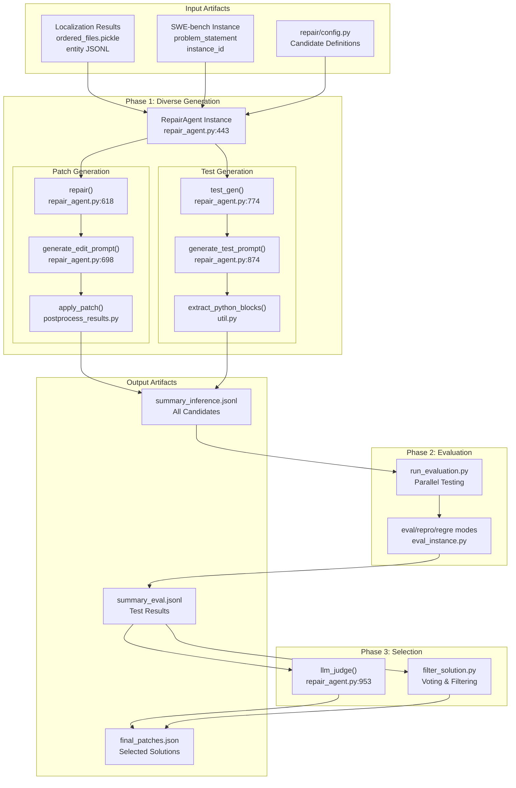
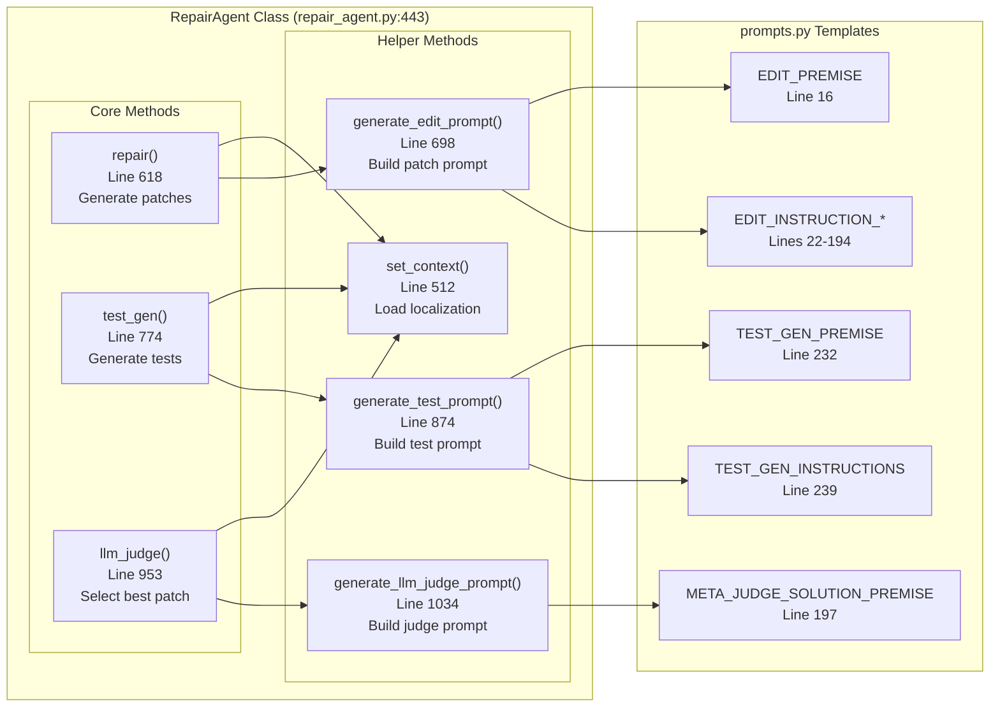
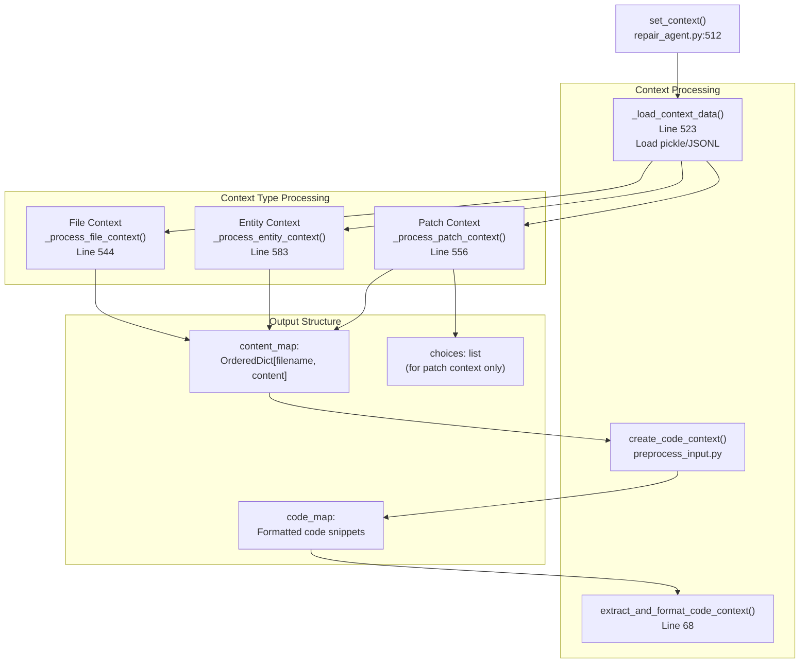
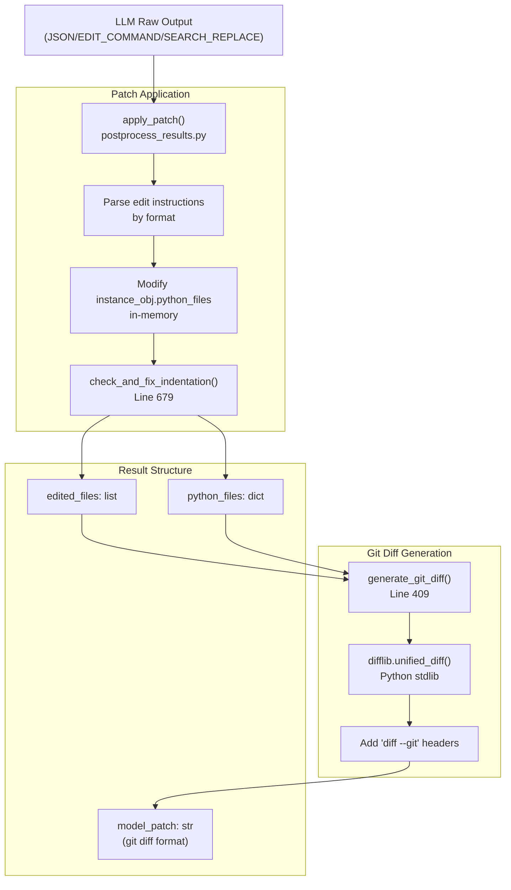
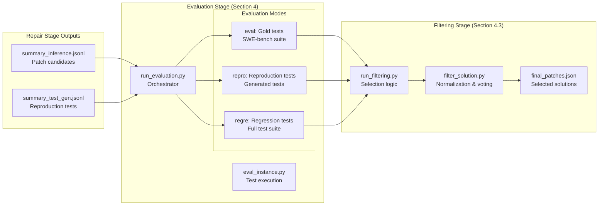

<!-- source: DeepWiki mcp.deepwiki.com · repo NVIDIA/Nemotron-CORTEXA · page 3 Repair Stage · fetched 2026-10-26 -->

# Repair Stage

<details>
<summary>Relevant source files</summary>

The following files were used as context for generating this wiki page:

- [README.md](README.md)
- [src/cortexa/repair/prompts.py](src/cortexa/repair/prompts.py)
- [src/cortexa/repair/repair_agent.py](src/cortexa/repair/repair_agent.py)

</details>


## Purpose and Scope

The Repair Stage is the core component of Nemotron-CORTEXA, responsible for generating diverse candidate patches to fix software bugs, creating reproduction tests to validate fixes, and selecting the best solution from multiple candidates. This stage takes localized bug contexts as input and produces git-style patches as output.

This document provides an overview of the repair pipeline architecture, the `RepairAgent` class, and the three main operations it performs. For detailed information about:
- The `RepairAgent` implementation and methods, see [RepairAgent Core System](#3.1)
- Prompt templates and edit instruction formats, see [Prompt Engineering and Templates](#3.2)
- The patch generation workflow details, see [Patch Generation Workflow](#3.3)
- Reproduction test generation with iterative refinement, see [Reproduction Test Generation](#3.4)
- LLM-based solution selection mechanisms, see [LLM Judge and Solution Selection](#3.5)

For evaluation and filtering of generated patches, see [Evaluation Stage](#4).

**Sources:** [README.md:73-105](), [src/cortexa/repair/repair_agent.py:443-1166]()

## Repair Pipeline Architecture

The repair stage implements a three-phase pipeline that generates diverse solutions and selects the best candidate:



**Diagram: Repair Stage Three-Phase Pipeline**

The pipeline operates in three distinct phases:

1. **Diverse Generation**: The `RepairAgent` generates multiple candidate solutions using different models, contexts, edit styles, and temperatures. Patch generation and test generation can run in parallel.

2. **Evaluation**: All candidates are tested using three modes (eval, repro, regre) to assess correctness and regression behavior.

3. **Selection**: The best solution is chosen either through majority voting on test results or using an LLM judge to compare candidates.

**Sources:** [README.md:73-105](), [src/cortexa/repair/repair_agent.py:443-1166]()

## RepairAgent Class

The `RepairAgent` class ([repair_agent.py:443-1166]()) is the central component that orchestrates all repair operations. It manages LLM interactions, context retrieval, prompt generation, and result post-processing.

### Initialization and Configuration

| Parameter | Type | Default | Purpose |
|-----------|------|---------|---------|
| `log_dir` | str | required | Directory for output artifacts |
| `repair_model_info` | dict/str | required | Model configuration from model_config.yml |
| `temperature` | float | 0 | Sampling temperature for LLM |
| `max_tokens` | int | 1024 | Maximum output tokens |
| `max_input_tokens` | int | 127950 | Maximum context length |
| `retrieval_hits` | int | 1 | Number of top files to include |
| `out_inference_file` | str | 'summary_inference.jsonl' | Output file for generated patches |
| `out_eval_file` | str | 'summary_eval.jsonl' | Output file for evaluation results |
| `repo_playground` | str | '../repo_playground' | Directory with repository checkouts |

The factory function `create_repair_agent()` ([repair_agent.py:1148-1165]()) simplifies instantiation by reading model configurations from `model_config.yml`.

**Sources:** [src/cortexa/repair/repair_agent.py:446-481](), [src/cortexa/repair/repair_agent.py:1148-1165]()

### Three Core Methods



**Diagram: RepairAgent Methods and Dependencies**

Each method serves a distinct purpose in the repair workflow:

- **`repair()`**: Generates code patches using various edit styles (JSON, EDIT_COMMAND, SEARCH_REPLACE). Takes localization results and produces git-style diffs.
  
- **`test_gen()`**: Creates reproduction tests that verify the bug exists before fixes and confirm resolution after fixes. Supports iterative refinement based on test execution feedback.
  
- **`llm_judge()`**: Evaluates multiple candidate patches and selects the best one based on how well it addresses the issue with minimal code changes.

**Sources:** [src/cortexa/repair/repair_agent.py:618-695](), [src/cortexa/repair/repair_agent.py:774-840](), [src/cortexa/repair/repair_agent.py:953-1009]()

## Edit Styles and Formats

The repair stage supports multiple edit instruction formats to maximize diversity and LLM compatibility:

| Edit Style | Prompt Template | Line Numbers | Description |
|------------|-----------------|--------------|-------------|
| `JSON` | `EDIT_INSTRUCTION_JSON` | Yes | Structured JSON objects with filepath, start, end, content fields |
| `EDIT_COMMAND` | `EDIT_INSTRUCTION_COMMAND` | Yes | Function-style API: `edit_file(filepath, start, end, content)` |
| `SEARCH_REPLACE` | `EDIT_INSTRUCTION_SEARCH_REPLACE` | No | Git-style search/replace blocks with `<<<<<<< SEARCH` markers |
| `SEARCH_REPLACE_THINKING` | `EDIT_INSTRUCTION_SEARCH_REPLACE_THINKING` | No | Search/replace with explicit reasoning section |

All formats include detailed instructions about:
- **Indentation preservation**: Content must maintain exact indentation levels
- **Line number handling**: Start/end lines are 1-indexed and inclusive
- **Content preservation**: Important code should not be inadvertently removed
- **Syntax validation**: Generated code must be syntactically correct

The edit style is specified in `repair/config.py` candidate definitions and passed to `repair()` method ([repair_agent.py:618-695]()).

**Sources:** [src/cortexa/repair/prompts.py:22-194](), [src/cortexa/repair/repair_agent.py:698-734]()

## Context Retrieval and Processing

The `set_context()` method ([repair_agent.py:512-587]()) handles multiple context types:



**Diagram: Context Retrieval Pipeline**

Context types correspond to localization outputs:
- **File Context**: Uses `ordered_files.pickle` from embedding retrieval
- **Entity Context**: Uses entity JSONL files from LocalizeAgent (LA) or direct prompting (DP)
- **Patch Context**: Uses existing patches for meta-evaluation or refinement

The `extract_and_format_code_context()` function ([repair_agent.py:68-107]()) formats code with line numbers and handles token budget constraints by truncating at `max_input_tokens`.

**Sources:** [src/cortexa/repair/repair_agent.py:512-587](), [src/cortexa/repair/repair_agent.py:68-107]()

## Output Artifacts

The repair stage produces structured JSONL files containing all generation and evaluation results:

### summary_inference.jsonl

Each line represents one candidate solution with the following schema:

| Field | Type | Description |
|-------|------|-------------|
| `instance_id` | str | SWE-bench instance identifier |
| `model` | str | Model name from model_config.yml |
| `context` | str | Context type (file, LA, DP, patches) |
| `edit_style` | str | Edit format (JSON, EDIT_COMMAND, SEARCH_REPLACE) |
| `temp` | float | Temperature used for generation |
| `run_num` | int | Run number for same configuration |
| `final_prompt` | dict | System and user messages sent to LLM |
| `llm_output` | str | Raw LLM response |
| `model_patch` | str | Generated patch in git diff format |
| `input_num_tokens` | int | Token count of input prompt |
| `output_num_tokens` | int | Token count of LLM response |
| `syntax_status` | str | Syntax validation results per file |
| `resolution` | str | "NO_CHANGE" if no valid edits generated |

For test generation, the schema includes:
- `test_script`: List of patches containing the test code
- `raw_test_scripts`: List of raw test code strings
- `prompt_style`: "test-gen" or "revise-test-gen"

File writing uses `FileLock` ([repair_agent.py:688]()) to enable parallel generation with multiple workers.

**Sources:** [src/cortexa/repair/repair_agent.py:663-689](), [src/cortexa/repair/repair_agent.py:820-837]()

## Patch Application and Git Diff Generation

After LLM generates edit instructions, the system applies them to create modified files:



**Diagram: Patch Application and Diff Generation Flow**

The `generate_edit_patch()` method ([repair_agent.py:736-772]()) calls `apply_patch()` to parse and apply edits, then `generate_git_diff()` ([repair_agent.py:409-440]()) to create standard git diff output. Syntax validation attempts automatic indentation fixes using AST parsing.

**Sources:** [src/cortexa/repair/repair_agent.py:736-772](), [src/cortexa/repair/repair_agent.py:409-440](), [src/cortexa/repair/repair_agent.py:676-693]()

## Candidate Solution Configuration

The `repair/config.py` file defines which model configurations and parameters to use for diversity:

```python
# Example candidate definition structure
{
    'model': 'deepseek-v3-0324',  # Key in model_config.yml
    'context': 'LA_DP_entity',     # Context type
    'edit_style': 'JSON',          # Edit format
    'temp': 0.0,                   # Temperature
    'retrieval_hits': 6,           # Number of files to include
    'run_num': 0                   # Starting run number
}
```

The configuration enables experimentation with:
- Different LLM models and providers
- Various localization results (file-level vs entity-level)
- Multiple edit instruction formats
- Temperature settings for controlled randomness
- Number of context files to include

Multiple candidates can be defined to generate diverse solutions, which are later filtered based on evaluation results.

**Sources:** [README.md:71-72](), [README.md:76-77]()

## Integration with Evaluation

The repair stage outputs are consumed by the evaluation orchestrator:



**Diagram: Repair to Evaluation Data Flow**

The evaluation stage reads patch candidates from `summary_inference.jsonl` and tests from `summary_test_gen.jsonl`, executes them in isolated containers, and produces per-mode evaluation results. The filtering stage then selects the best patch based on test outcomes.

**Sources:** [README.md:73-105](), [README.md:94-105]()

## Usage Examples

### Running Patch Generation

```bash
python -m cortexa.repair.repair_gen \
       --log_dir ./logs \
       --out_inference_file summary_inference.jsonl \
       --num_workers 2 \
       --repo_playground ./repos \
       --dataset_name_or_path princeton-nlp/SWE-bench_Verified \
       --instance_id astropy__astropy-12907
```

### Running Test Generation

```bash
python -m cortexa.repair.repro_test_gen \
       --log_dir ./logs \
       --out_inference_file summary_test_gen.jsonl \
       --repro_test_dir ./reproduction_tests \
       --max_round 3 \
       --num_workers 2 \
       --repo_playground ./repos \
       --dataset_name_or_path princeton-nlp/SWE-bench_Verified \
       --instance_id astropy__astropy-12907
```

### Running Combined Pipeline

```bash
python -m cortexa.evaluate.run_evaluation \
        --repro_test_dir ./repro_tests/merged \
        --repo_playground ./repos \
        --log_dir ./logs \
        --run_patch_generation \
        --run_test_generation \
        --num_workers_patch_gen 2 \
        --num_workers_test_gen 2 \
        --num_workers_eval 4 \
        --modes eval,repro \
        --dataset_name_or_path princeton-nlp/SWE-bench_Verified \
        --instance_id astropy__astropy-12907
```

The combined pipeline runs patch generation, test generation, and evaluation sequentially using separate worker pools for parallel processing.

**Sources:** [README.md:78-105](), [README.md:107-167]()

---

