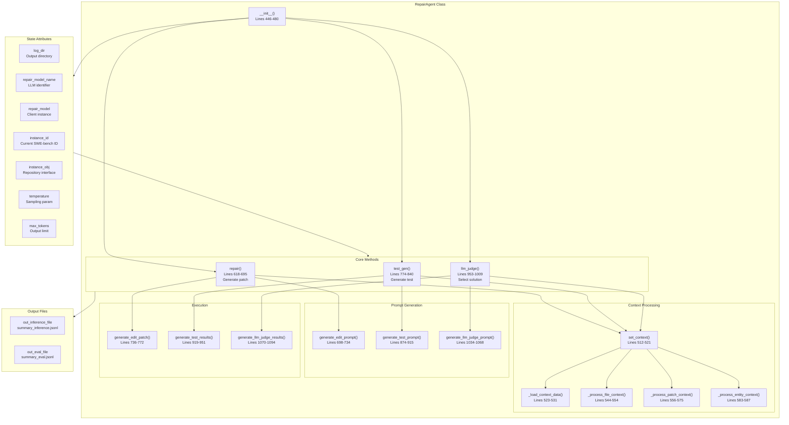
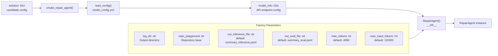
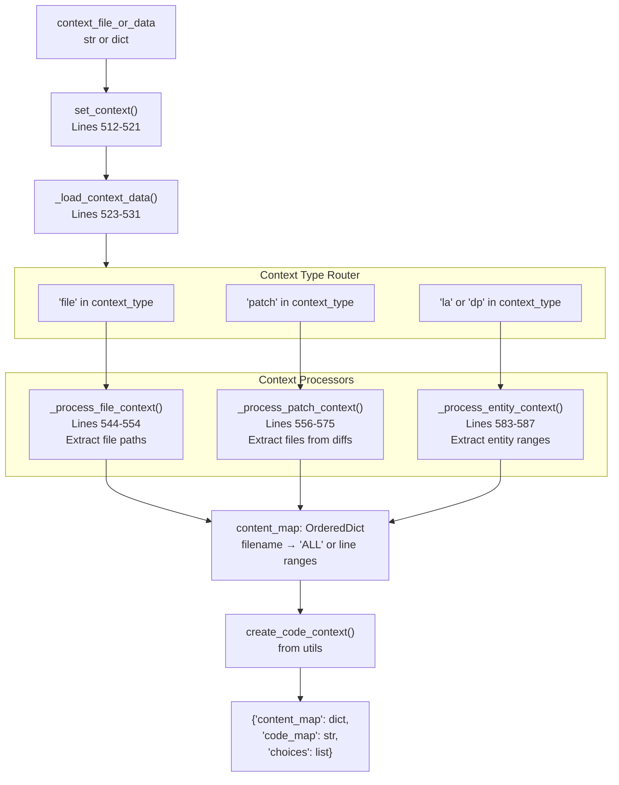
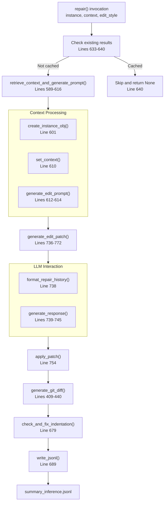
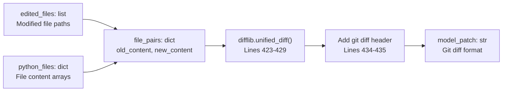
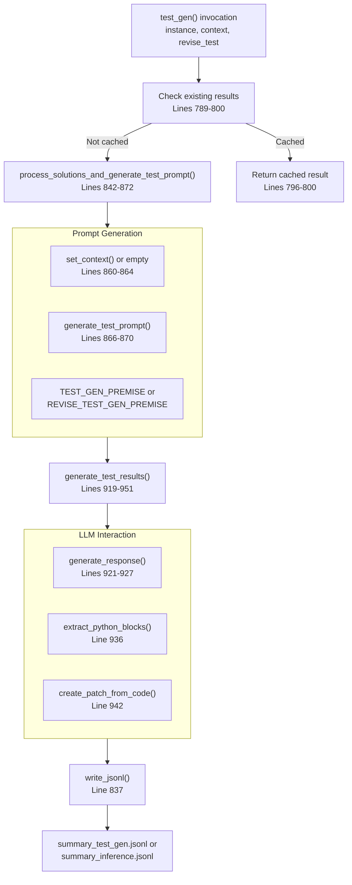
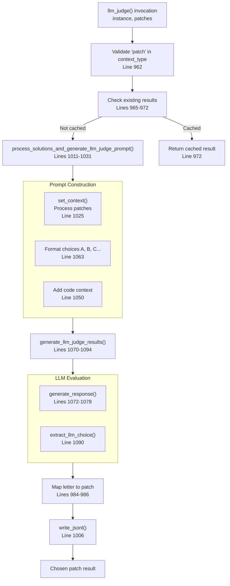
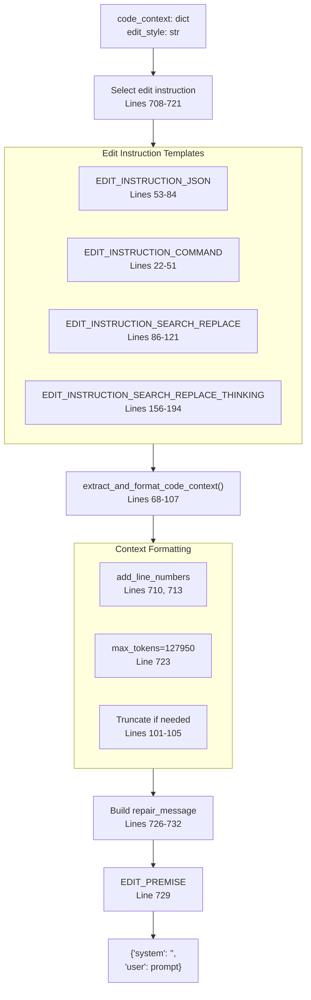
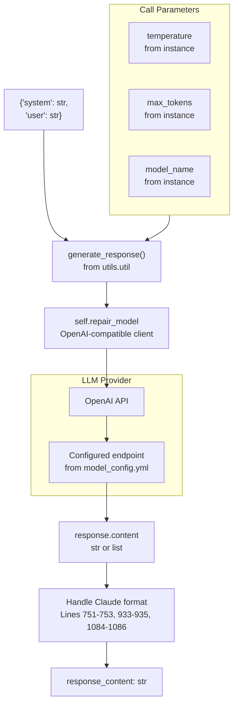
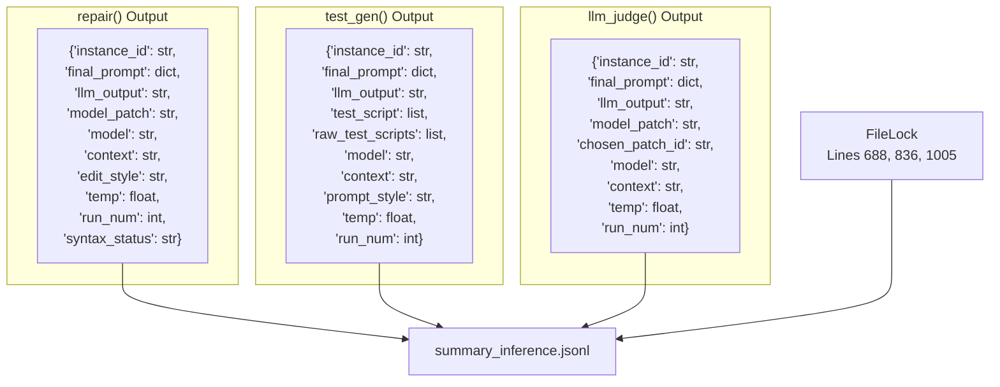

<!-- source: DeepWiki mcp.deepwiki.com · repo NVIDIA/Nemotron-CORTEXA · page 3.1 RepairAgent Core System · fetched 2026-10-26 -->

# RepairAgent Core System

<details>
<summary>Relevant source files</summary>

The following files were used as context for generating this wiki page:

- [src/cortexa/repair/prompts.py](src/cortexa/repair/prompts.py)
- [src/cortexa/repair/repair_agent.py](src/cortexa/repair/repair_agent.py)

</details>


## Purpose and Scope

This document provides in-depth technical documentation of the `RepairAgent` class, the central AI-powered component of Nemotron-CORTEXA's repair stage. The `RepairAgent` orchestrates three critical operations: (1) patch generation via `repair()`, (2) reproduction test generation via `test_gen()`, and (3) solution selection via `llm_judge()`. This page covers the class architecture, initialization, core methods, prompt generation, and integration with LLM providers.

For information about the evaluation of generated patches, see [Evaluation Orchestration](#4.1). For details about prompt templates and edit instruction formats, see [Prompt Engineering and Templates](#3.2). For the overall repair workflow including parallel execution, see [Repair Stage](#3).

---

## RepairAgent Class Architecture

The `RepairAgent` class ([src/cortexa/repair/repair_agent.py:443-1146]()) serves as the main interface for LLM-powered code repair operations. It maintains state about the current instance, manages LLM client connections, and coordinates the end-to-end workflow from context retrieval to patch generation.

### Class Structure and Key Attributes



**Sources**: [src/cortexa/repair/repair_agent.py:443-1146]()

### Key Instance Attributes

| Attribute | Type | Purpose | Initialized At |
|-----------|------|---------|----------------|
| `log_dir` | `str` | Directory for all output artifacts | Line 463 |
| `repair_model_name` | `str` | LLM model identifier (e.g., "deepseek-v3-0324") | Lines 466-469 |
| `repair_model` | Client | OpenAI-compatible LLM client instance | Line 476 |
| `instance_id` | `str` | Current SWE-bench instance ID | Set per-call |
| `instance_obj` | InstanceObj | Repository access interface | Set per-call |
| `temperature` | `float` | LLM sampling temperature | Line 472 |
| `max_tokens` | `int` | Maximum output tokens per LLM call | Line 473 |
| `max_input_tokens` | `int` | Maximum input tokens (context window) | Line 480 |
| `out_inference_file` | `str` | Path to summary_inference.jsonl | Line 477 |
| `out_eval_file` | `str` | Path to summary_eval.jsonl | Line 478 |
| `repo_playground` | `str` | Root directory for cloned repositories | Line 479 |

**Sources**: [src/cortexa/repair/repair_agent.py:446-480]()

---

## Factory Function and Initialization

The `create_repair_agent()` factory function ([src/cortexa/repair/repair_agent.py:1148-1165]()) provides the standard interface for instantiating `RepairAgent` instances with configuration from `repair/config.py`.

### Factory Function Workflow



**Sources**: [src/cortexa/repair/repair_agent.py:1148-1165]()

### Initialization Process

The `__init__()` method ([src/cortexa/repair/repair_agent.py:446-480]()) performs the following steps:

1. **Directory Setup**: Creates `log_dir` if it doesn't exist (line 464)
2. **Model Configuration**: Extracts model name from `repair_model_info` dict or string (lines 466-469)
3. **Client Initialization**: Creates LLM client via `get_model_client()` (line 476)
4. **Output File Paths**: Sets paths for inference and evaluation JSONL files (lines 477-478)
5. **Parameter Storage**: Stores temperature, max_tokens, and other configuration (lines 472-480)

**Sources**: [src/cortexa/repair/repair_agent.py:446-480]()

---

## Context Processing Pipeline

The context processing system converts various input formats (file lists, entity locations, patch data) into a unified structure that can be used for prompt generation. This abstraction allows the same `RepairAgent` to work with different localization strategies.

### Context Processing Architecture



**Sources**: [src/cortexa/repair/repair_agent.py:512-587]()

### Context Loading (`_load_context_data`)

The `_load_context_data()` method ([src/cortexa/repair/repair_agent.py:523-531]()) handles three input formats:

1. **JSONL File**: Reads via `read_problems()` (line 530)
2. **Pickle File**: Loads via `pickle.load()` (line 530)
3. **Dictionary**: Returns as-is (line 531)

**Sources**: [src/cortexa/repair/repair_agent.py:523-531]()

### File Context Processing (`_process_file_context`)

For file-based localization results ([src/cortexa/repair/repair_agent.py:544-554]()):

1. Extracts file list for `instance_id` (line 547)
2. Handles special case for localization file format (lines 550-551)
3. Removes duplicates and limits to `retrieval_hits` (line 553)
4. Returns `content_map` with all files marked as `'ALL'` (line 554)

**Sources**: [src/cortexa/repair/repair_agent.py:544-554]()

### Patch Context Processing (`_process_patch_context`)

For patch-based context ([src/cortexa/repair/repair_agent.py:556-575]()):

1. Deduplicates patches by content (lines 561-569)
2. Extracts filenames from git diffs via `extract_filenames()` (lines 577-581)
3. Returns both `content_map` and `choices` list for LLM judge (lines 572-575)

**Sources**: [src/cortexa/repair/repair_agent.py:556-575]()

### Entity Context Processing (`_process_entity_context`)

For entity localization results ([src/cortexa/repair/repair_agent.py:583-587]()):

1. Validates `instance_id` exists (line 585)
2. Validates `content_map` field exists (line 586)
3. Returns pre-built `content_map` with line ranges (line 587)

**Sources**: [src/cortexa/repair/repair_agent.py:583-587]()

---

## Core Method: repair()

The `repair()` method ([src/cortexa/repair/repair_agent.py:618-695]()) is the primary interface for patch generation. It orchestrates context retrieval, prompt generation, LLM inference, and result persistence.

### Repair Method Workflow



**Sources**: [src/cortexa/repair/repair_agent.py:618-695](), [src/cortexa/repair/repair_agent.py:736-772]()

### Repair Method Parameters

| Parameter | Type | Purpose |
|-----------|------|---------|
| `instance` | `dict` | SWE-bench instance with `instance_id`, `problem_statement`, etc. |
| `context_file_or_data` | `str` or `dict` | Path to localization results or data dict |
| `edit_style` | `str` | Format for edit instructions: `'JSON'`, `'EDIT_COMMAND'`, `'SEARCH_REPLACE'`, `'SEARCH_REPLACE_THINKING'` |
| `context_type` | `str` | Type of context: `'file'`, `'patch'`, `'la'`, `'dp'` |
| `temperature` | `float` | LLM sampling temperature |
| `run_num` | `int` | Run number for tracking multiple generations |
| `repo_graph_file` | `str` | (Optional) Path to repository graph pickle |

**Sources**: [src/cortexa/repair/repair_agent.py:618-625]()

### Repair Method Steps

1. **Cache Check** (lines 633-640): Reads `summary_inference.jsonl` to avoid regenerating existing patches
2. **Context Retrieval** (line 642): Calls `retrieve_context_and_generate_prompt()` to build LLM prompt
3. **Patch Generation** (line 647): Calls `generate_edit_patch()` with prompt and repair history
4. **Result Processing** (lines 652-694):
   - Extracts LLM response content (line 654)
   - Applies patch via `apply_patch()` (lines 754-757)
   - Generates git diff (line 763)
   - Checks syntax and fixes indentation (line 679)
   - Writes to JSONL with FileLock (line 689)

**Sources**: [src/cortexa/repair/repair_agent.py:618-695]()

### Patch Application and Git Diff Generation

The `apply_patch()` function ([src/cortexa/utils/postprocess_results.py]()) parses the LLM output based on `edit_style` and applies edits to the repository files. The `generate_git_diff()` function ([src/cortexa/repair/repair_agent.py:409-440]()) creates unified diffs:



**Sources**: [src/cortexa/repair/repair_agent.py:409-440]()

---

## Core Method: test_gen()

The `test_gen()` method ([src/cortexa/repair/repair_agent.py:774-840]()) generates reproduction tests that can verify whether a bug is present. These tests return exit code 2 when the bug exists, 0 when fixed, and 1 on unexpected errors.

### Test Generation Workflow



**Sources**: [src/cortexa/repair/repair_agent.py:774-840](), [src/cortexa/repair/repair_agent.py:919-951]()

### Test Generation Parameters

| Parameter | Type | Purpose |
|-----------|------|---------|
| `instance` | `dict` | SWE-bench instance data |
| `context_file_or_data` | `str` or `dict` | (Optional) Context for test generation |
| `context_type` | `str` | Type of context if provided |
| `temperature` | `float` | LLM sampling temperature |
| `run_num` | `int` | Run number for tracking |
| `revise_test` | `bool` | Whether to revise an existing test |
| `test_script` | `str` | Previous test script (if `revise_test=True`) |
| `test_output` | `str` | Previous test output (if `revise_test=True`) |

**Sources**: [src/cortexa/repair/repair_agent.py:774-782]()

### Test Prompt Generation

The `generate_test_prompt()` method ([src/cortexa/repair/repair_agent.py:874-915]()) creates prompts using:

1. **Premise Selection** (lines 894-899):
   - `TEST_GEN_PREMISE` for new tests
   - `REVISE_TEST_GEN_PREMISE` for revisions
   
2. **Context Inclusion** (lines 889-892):
   - Optional code context via `extract_and_format_code_context()`
   - Without line numbers (line 890)
   
3. **Previous Test Inclusion** (line 911):
   - Only when `revise_test=True`
   - Includes both script and output for analysis

**Sources**: [src/cortexa/repair/repair_agent.py:874-915](), [src/cortexa/repair/prompts.py:232-316]()

### Test Script Extraction

The `generate_test_results()` method ([src/cortexa/repair/repair_agent.py:919-951]()) processes LLM responses:

1. **Extract Python Blocks** (line 936): Uses `extract_python_blocks()` to find ```python...``` blocks
2. **Select Last Block** (line 942): Takes only the final test script (reasoning may revise earlier versions)
3. **Create Patch Format** (line 942): Converts to patch format for storage
4. **Handle Empty Results** (lines 937-940): Logs warning when no valid script generated

**Sources**: [src/cortexa/repair/repair_agent.py:919-951]()

---

## Core Method: llm_judge()

The `llm_judge()` method ([src/cortexa/repair/repair_agent.py:953-1009]()) implements meta-evaluation where an LLM selects the best patch from multiple candidates. This enables ensemble methods and diverse solution generation.

### LLM Judge Workflow



**Sources**: [src/cortexa/repair/repair_agent.py:953-1009](), [src/cortexa/repair/repair_agent.py:1070-1094]()

### LLM Judge Parameters

| Parameter | Type | Purpose |
|-----------|------|---------|
| `instance` | `dict` | SWE-bench instance data |
| `context_file_or_data` | `list` | List of patch dicts with `model_patch` field |
| `temperature` | `float` | LLM sampling temperature |
| `run_num` | `int` | Run number for tracking |
| `context_type` | `str` | Must contain 'patch' (default: 'patches') |

**Sources**: [src/cortexa/repair/repair_agent.py:953-958]()

### Judge Prompt Construction

The `generate_llm_judge_prompt()` method ([src/cortexa/repair/repair_agent.py:1034-1068]()) creates evaluation prompts:

1. **Premise** (line 1055): Uses `META_JUDGE_SOLUTION_PREMISE` with evaluation criteria
2. **Issue Description** (lines 1056-1058): Wraps problem statement in `<issue>` tags
3. **Code Context** (lines 1059-1061): Optional relevant file contents
4. **Choices** (lines 1062-1064): Formats patches as labeled options (A, B, C, ...)

**Sources**: [src/cortexa/repair/repair_agent.py:1034-1068](), [src/cortexa/repair/prompts.py:197-230]()

### Choice Extraction and Mapping

After receiving the LLM response:

1. **Extract Choice** (line 1090): Parses `<chosen_id>` tag via `extract_llm_choice()`
2. **Map to Patch** (lines 984-986): Converts letter (A, B, C) to corresponding patch dict
3. **Build Patch ID** (line 986): Constructs identifier from model, context, edit_style, temp, run_num
4. **Store Result** (lines 990-1006): Writes chosen patch to JSONL

**Sources**: [src/cortexa/repair/repair_agent.py:953-1009]()

---

## Prompt Generation System

The prompt generation system ([src/cortexa/repair/repair_agent.py:698-734](), [src/cortexa/repair/prompts.py:16-316]()) converts context and instructions into structured LLM prompts. Each prompt follows a consistent format with system and user messages.

### Edit Prompt Generation Flow



**Sources**: [src/cortexa/repair/repair_agent.py:698-734](), [src/cortexa/repair/prompts.py:16-194]()

### Edit Instruction Formats

| Format | Template | Line Numbers | Use Case |
|--------|----------|--------------|----------|
| `JSON` | `EDIT_INSTRUCTION_JSON` | Yes | Structured edits with clear field separation |
| `EDIT_COMMAND` | `EDIT_INSTRUCTION_COMMAND` | Yes | Function-call style edits |
| `SEARCH_REPLACE` | `EDIT_INSTRUCTION_SEARCH_REPLACE` | No | Direct code replacement with markers |
| `SEARCH_REPLACE_THINKING` | `EDIT_INSTRUCTION_SEARCH_REPLACE_THINKING` | No | Includes reasoning step before solution |

**Sources**: [src/cortexa/repair/prompts.py:22-194]()

### Context Extraction and Formatting

The `extract_and_format_code_context()` function ([src/cortexa/repair/repair_agent.py:68-107]()) formats code context:

1. **File Headers** (line 72): Adds `[start of {filename}]` markers
2. **Line Selection** (lines 78-93):
   - For list entries: Extracts specific line ranges
   - For 'ALL' entries: Includes entire file
   - Inserts `...` for omitted sections
3. **Line Numbering** (line 88): Optional prefix with line numbers
4. **Token Limiting** (lines 101-105): Truncates context if exceeding `max_tokens`
5. **File Footers** (line 98): Adds `[end of {filename}]` markers

**Sources**: [src/cortexa/repair/repair_agent.py:68-107]()

---

## LLM Integration

The `RepairAgent` integrates with LLM providers through a unified interface in the `generate_response()` utility function. All three core methods (`repair()`, `test_gen()`, `llm_judge()`) use this interface.

### LLM Call Flow



**Sources**: [src/cortexa/repair/repair_agent.py:736-772](), [src/cortexa/repair/repair_agent.py:919-951](), [src/cortexa/repair/repair_agent.py:1070-1094]()

### Response Format Handling

The system handles multiple response formats:

1. **Standard Format** (string): Direct text content
2. **Claude Format** (list of dicts): Extracts from `[{'text': content}]` (lines 751-753)

This check appears in all three generation methods:
- `generate_edit_patch()`: Lines 751-753
- `generate_test_results()`: Lines 933-935
- `generate_llm_judge_results()`: Lines 1084-1086

**Sources**: [src/cortexa/repair/repair_agent.py:751-753](), [src/cortexa/repair/repair_agent.py:933-935](), [src/cortexa/repair/repair_agent.py:1084-1086]()

---

## Output Formats and Persistence

The `RepairAgent` persists results to JSONL files with thread-safe locking via `FileLock`. Each operation writes to `summary_inference.jsonl` or operation-specific files.

### Output File Structure



**Sources**: [src/cortexa/repair/repair_agent.py:663-689](), [src/cortexa/repair/repair_agent.py:820-837](), [src/cortexa/repair/repair_agent.py:990-1006]()

### Repair Output Fields

| Field | Type | Description | Source Line |
|-------|------|-------------|-------------|
| `instance_id` | `str` | SWE-bench instance identifier | 664 |
| `final_prompt` | `dict` | Complete prompt sent to LLM | 665 |
| `input_num_tokens` | `int` | Token count of input | 666 |
| `llm_output` | `str` | Raw LLM response | 667 |
| `output_num_tokens` | `int` | Token count of output | 668 |
| `model_patch` | `str` | Generated git diff | 669 |
| `model` | `str` | LLM model identifier | 670 |
| `temp` | `float` | Sampling temperature | 671 |
| `run_num` | `int` | Run number (for multiple generations) | 672 |
| `context` | `str` | Context type used | 673 |
| `edit_style` | `str` | Edit instruction format | 674 |
| `syntax_status` | `str` | Syntax validation result | 687 |
| `resolution` | `str` | Set to 'NO_CHANGE' if no edits generated | 685 |

**Sources**: [src/cortexa/repair/repair_agent.py:663-687]()

### Test Generation Output Fields

| Field | Type | Description | Source Line |
|-------|------|-------------|-------------|
| `test_script` | `list` | Processed test in patch format | 826 |
| `raw_test_scripts` | `list` | Raw Python code blocks | 827 |
| `prompt_style` | `str` | 'test-gen' or 'revise-test-gen' | 832 |

**Sources**: [src/cortexa/repair/repair_agent.py:820-832]()

### LLM Judge Output Fields

| Field | Type | Description | Source Line |
|-------|------|-------------|-------------|
| `chosen_patch_id` | `str` | Identifier of selected patch | 997 |
| `model_patch` | `str` | Git diff of chosen solution | 996 |

**Sources**: [src/cortexa/repair/repair_agent.py:990-997]()

### Thread-Safe Persistence

All write operations use `FileLock` to ensure atomic JSONL appends:

```python
with FileLock(self.out_inference_file + ".lock"):
    write_jsonl(filename=self.out_inference_file, data=repair_data, append=True)
```

This prevents data corruption when multiple workers generate patches in parallel.

**Sources**: [src/cortexa/repair/repair_agent.py:688-689](), [src/cortexa/repair/repair_agent.py:836-837](), [src/cortexa/repair/repair_agent.py:1005-1006]()

---

## Helper Functions and Utilities

The `RepairAgent` relies on several helper functions for code manipulation, context processing, and format conversion.

### Context Processing Helpers

| Function | Location | Purpose |
|----------|----------|---------|
| `extract_and_format_code_context()` | Lines 68-107 | Format code snippets with line numbers and truncation |
| `dedup_codes()` | Lines 130-152 | Remove duplicate/overlapping code ranges |
| `dedup_and_sort_context()` | Lines 161-173 | Deduplicate and sort within each file |
| `format_repair_history()` | Lines 110-120 | Format failed repairs for context |

**Sources**: [src/cortexa/repair/repair_agent.py:68-173]()

### Code Range Helpers

| Function | Location | Purpose |
|----------|----------|---------|
| `is_range_included()` | Lines 123-127 | Check if one range is within another |
| `code_range_compare()` | Lines 155-158 | Compare function for sorting by start line |
| `find_error_block()` | Lines 376-406 | Find contiguous code block around error line |

**Sources**: [src/cortexa/repair/repair_agent.py:123-406]()

### Docker Execution Helpers

| Function | Location | Purpose |
|----------|----------|---------|
| `run_docker_eval()` | Lines 333-373 | Execute evaluation in Docker/Singularity/SLURM |
| `base_image_key()` | Lines 206-208 | Convert instance_id to Docker image name |
| `get_singularity_image_path()` | Lines 328-331 | Get Singularity image path |
| `_build_cortexa_eval_command()` | Lines 215-228 | Build evaluation command string |

**Sources**: [src/cortexa/repair/repair_agent.py:206-373]()

### Caching and Deduplication

The `already_run()` function ([src/cortexa/repair/repair_agent.py:176-204]()) checks if a specific patch has already been generated and evaluated, enabling resume functionality and avoiding redundant work.

**Sources**: [src/cortexa/repair/repair_agent.py:176-204]()

---

