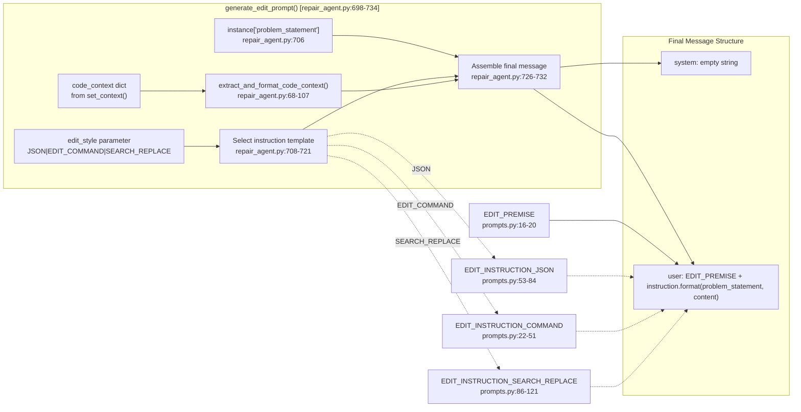
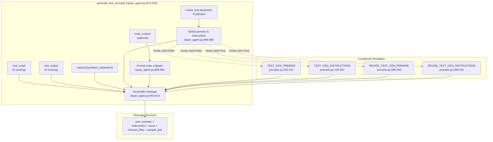
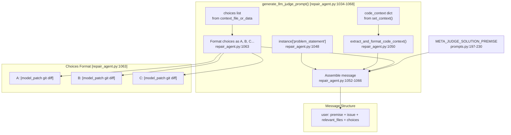

<!-- source: DeepWiki mcp.deepwiki.com · repo NVIDIA/Nemotron-CORTEXA · page 3.2 Prompt Engineering and Templates · fetched 2026-10-26 -->

# Prompt Engineering and Templates

<details>
<summary>Relevant source files</summary>

The following files were used as context for generating this wiki page:

- [src/cortexa/repair/prompts.py](src/cortexa/repair/prompts.py)
- [src/cortexa/repair/repair_agent.py](src/cortexa/repair/repair_agent.py)

</details>


This document describes the prompt templates that drive the LLM-powered repair, test generation, and solution selection capabilities of Nemotron-CORTEXA. All prompt templates are defined in [src/cortexa/repair/prompts.py]() and consumed by the `RepairAgent` class in [src/cortexa/repair/repair_agent.py]().

For information about how the RepairAgent orchestrates these prompts, see [RepairAgent Core System](#3.1). For details on the patch generation workflow that uses edit prompts, see [Patch Generation Workflow](#3.3). For test generation specifics, see [Reproduction Test Generation](#3.4).

**Sources**: [src/cortexa/repair/prompts.py:1-316](), [src/cortexa/repair/repair_agent.py:35]()

---

## Prompt Template Architecture

The prompt system is organized into three functional categories, each supporting a distinct capability of the RepairAgent:

| Category | Purpose | Prompt Templates | RepairAgent Method |
|----------|---------|------------------|-------------------|
| **Edit/Repair** | Generate code patches to fix issues | `EDIT_PREMISE`, `EDIT_INSTRUCTION_JSON`, `EDIT_INSTRUCTION_COMMAND`, `EDIT_INSTRUCTION_SEARCH_REPLACE`, `EDIT_INSTRUCTION_SEARCH_REPLACE_THINKING` | `repair()` |
| **Test Generation** | Create reproduction tests | `TEST_GEN_PREMISE`, `TEST_GEN_INSTRUCTIONS`, `REVISE_TEST_GEN_PREMISE`, `REVISE_TEST_GEN_INSTRUCTIONS` | `test_gen()` |
| **Solution Selection** | Judge between candidate patches | `META_JUDGE_SOLUTION_PREMISE` | `llm_judge()` |

All prompts follow a two-component structure: a **premise** establishes context and role definition, while **instructions** specify the output format and constraints. This separation enables flexible composition when building final prompts.

**Sources**: [src/cortexa/repair/prompts.py:16-316](), [src/cortexa/repair/repair_agent.py:698-734](), [src/cortexa/repair/repair_agent.py:874-915](), [src/cortexa/repair/repair_agent.py:1034-1068]()

---

## Prompt Assembly Flow

```mermaid
graph TB
    subgraph "RepairAgent Methods"
        RepairMethod["repair()<br/>repair_agent.py:618-695"]
        TestGenMethod["test_gen()<br/>repair_agent.py:774-840"]
        JudgeMethod["llm_judge()<br/>repair_agent.py:953-1009"]
    end
    
    subgraph "Prompt Generation Methods"
        GenEditPrompt["generate_edit_prompt()<br/>repair_agent.py:698-734"]
        GenTestPrompt["generate_test_prompt()<br/>repair_agent.py:874-915"]
        GenJudgePrompt["generate_llm_judge_prompt()<br/>repair_agent.py:1034-1068"]
    end
    
    subgraph "Prompt Templates (prompts.py)"
        EditPremise["EDIT_PREMISE<br/>prompts.py:16-20"]
        EditInstructions["EDIT_INSTRUCTION_*<br/>prompts.py:22-194"]
        TestPremise["TEST_GEN_PREMISE<br/>prompts.py:232-237"]
        TestInstructions["TEST_GEN_INSTRUCTIONS<br/>prompts.py:239-287"]
        ReviseTestPremise["REVISE_TEST_GEN_PREMISE<br/>prompts.py:289-296"]
        ReviseTestInstructions["REVISE_TEST_GEN_INSTRUCTIONS<br/>prompts.py:299-316"]
        JudgePremise["META_JUDGE_SOLUTION_PREMISE<br/>prompts.py:197-230"]
    end
    
    RepairMethod --> GenEditPrompt
    TestGenMethod --> GenTestPrompt
    JudgeMethod --> GenJudgePrompt
    
    GenEditPrompt --> EditPremise
    GenEditPrompt --> EditInstructions
    
    GenTestPrompt --> TestPremise
    GenTestPrompt --> TestInstructions
    GenTestPrompt --> ReviseTestPremise
    GenTestPrompt --> ReviseTestInstructions
    
    GenJudgePrompt --> JudgePremise
    
    subgraph "Context Inputs"
        CodeContext["Code Context<br/>extract_and_format_code_context()"]
        ProblemStatement["instance['problem_statement']"]
        Choices["Multiple Candidate Patches"]
    end
    
    CodeContext --> GenEditPrompt
    CodeContext --> GenTestPrompt
    CodeContext --> GenJudgePrompt
    
    ProblemStatement --> GenEditPrompt
    ProblemStatement --> GenTestPrompt
    ProblemStatement --> GenJudgePrompt
    
    Choices --> GenJudgePrompt
```



**Sources**: [src/cortexa/repair/repair_agent.py:618-695](), [src/cortexa/repair/repair_agent.py:698-734](), [src/cortexa/repair/repair_agent.py:774-840](), [src/cortexa/repair/repair_agent.py:874-915](), [src/cortexa/repair/repair_agent.py:953-1009](), [src/cortexa/repair/repair_agent.py:1034-1068]()

---

## Edit Prompt Templates

### EDIT_PREMISE

The foundation for all repair prompts, `EDIT_PREMISE` establishes the LLM's role and explains the input format conventions:

- Partial code base with `...` indicating omitted code
- Lines may be prefixed with line numbers (depending on edit style)
- Issue statement describes the problem to resolve

**Sources**: [src/cortexa/repair/prompts.py:16-20]()

### Edit Style Instructions

The system supports four distinct edit styles, each with its own instruction template that defines the output format:

| Edit Style | Prompt Template | Line Numbers | Format | Use Case |
|-----------|----------------|--------------|---------|----------|
| **JSON** | `EDIT_INSTRUCTION_JSON` | Yes | JSON objects with `filepath`, `start`, `end`, `content` | Structured editing with explicit line ranges |
| **EDIT_COMMAND** | `EDIT_INSTRUCTION_COMMAND` | Yes | `edit_file(filepath, start, end, content)` Python function calls | Programmatic API-style edits |
| **SEARCH_REPLACE** | `EDIT_INSTRUCTION_SEARCH_REPLACE` | No | Git-style search/replace blocks with `<<<<<<< SEARCH` and `>>>>>>> REPLACE` markers | Fuzzy matching without explicit line numbers |
| **SEARCH_REPLACE_THINKING** | `EDIT_INSTRUCTION_SEARCH_REPLACE_THINKING` | No | Same as SEARCH_REPLACE but with separate `

<solution>
```python
### file/path.py
<<<<<<< SEARCH
[buggy code]
=======
[fixed code]
>>>>>>> REPLACE
```
</solution>
```

This format separates "thinking tokens" from "solution tokens", enabling more deliberate problem-solving. The prompt explicitly requests localization analysis before generating edits.

**Sources**: [src/cortexa/repair/prompts.py:156-194]()

---

## Prompt Composition in RepairAgent



The `generate_edit_prompt()` method ([repair_agent.py:698-734]()) performs three key operations:

1. **Instruction Selection** ([repair_agent.py:708-721]()): Maps `edit_style` parameter to corresponding instruction template
2. **Context Formatting** ([repair_agent.py:723]()): Calls `extract_and_format_code_context()` to format code snippets with optional line numbers and token limit enforcement
3. **Message Assembly** ([repair_agent.py:726-732]()): Combines `EDIT_PREMISE`, selected instruction (with interpolated problem statement and code context), into a single user message

The method enforces `max_input_tokens` limit ([repair_agent.py:723]()) by truncating context when necessary. Line numbers are added for JSON and EDIT_COMMAND styles but omitted for SEARCH_REPLACE variants.

**Sources**: [src/cortexa/repair/repair_agent.py:698-734](), [src/cortexa/repair/repair_agent.py:68-107]()

---

## Test Generation Prompt Templates

### TEST_GEN_PREMISE and Instructions

The test generation system uses a two-tier approach based on whether a test is being created from scratch or revised:

**Initial Test Generation**:
- `TEST_GEN_PREMISE` ([prompts.py:232-237]()): Establishes role as expert Python coder tasked with generating a complete reproduction test
- `TEST_GEN_INSTRUCTIONS` ([prompts.py:239-287]()): Defines the three-exit-code contract and provides a complete example

**Test Revision**:
- `REVISE_TEST_GEN_PREMISE` ([prompts.py:289-296]()): Frames the task as analyzing and fixing a failed test script
- `REVISE_TEST_GEN_INSTRUCTIONS` ([prompts.py:299-316]()): Maintains the same exit code contract but adds analysis steps

**Sources**: [src/cortexa/repair/prompts.py:232-316]()

### Exit Code Semantics

The test generation prompts enforce a strict exit code contract ([prompts.py:243-245](), [prompts.py:303-305]()):

| Exit Code | Meaning | Expected Timing |
|-----------|---------|----------------|
| **0** | Issue is SOLVED | After applying a correct patch |
| **1** | Unexpected error / crash | Automatic when script crashes |
| **2** | Issue NOT YET SOLVED | Before any patches are applied (baseline) |

This three-value system enables automated validation:
- Exit code 2 on the original codebase confirms the test reproduces the issue
- Exit code 0 on patched codebase confirms the patch resolves the issue
- Exit code 1 indicates test infrastructure problems

The prompts provide a complete example ([prompts.py:248-280]()) demonstrating the pattern:

```python
import sys

def test_issue():
    try:
        # Test logic that compares actual vs expected output
        if actual_output == expected_output:
            sys.exit(0)  # Issue is fixed
        else:
            print(f"Issue still exists...")
            sys.exit(2)  # Issue still exists
    except Exception as e:
        print(f"Unexpected error occurred: {e}")
        sys.exit(1)  # Unexpected error

if __name__ == "__main__":
    test_issue()
```

**Sources**: [src/cortexa/repair/prompts.py:239-287](), [src/cortexa/repair/prompts.py:299-316]()

### Test Prompt Composition



The `generate_test_prompt()` method ([repair_agent.py:874-915]()) constructs test generation prompts with the following logic:

1. **Mode Selection** ([repair_agent.py:894-899]()): Choose between initial test generation or revision based on `revise_test` flag
2. **Context Formatting** ([repair_agent.py:889-892]()): Optional code snippets formatted without line numbers
3. **Message Assembly** ([repair_agent.py:902-913]()): Combines premise, instructions, issue description, optional relevant files, and optional sample test/output

For revision mode, the prompt includes the failing test script and its output ([repair_agent.py:911]()), enabling the LLM to diagnose and fix test issues.

**Sources**: [src/cortexa/repair/repair_agent.py:874-915]()

---

## LLM Judge Prompt Template

### META_JUDGE_SOLUTION_PREMISE

The `META_JUDGE_SOLUTION_PREMISE` ([prompts.py:197-230]()) implements a meta-evaluation system where an LLM judges multiple candidate patches. The prompt structure emphasizes:

**Context Provided**:
- Issue description from the repository
- Relevant file contents or snippets
- Several proposed fixes labeled A, B, C, etc. (as git diffs)

**Evaluation Criteria** ([prompts.py:203-213]()):
1. Understand each proposed fix and its intent
2. Decide which fix correctly addresses the stated issue
3. Choose exactly one fix with bias towards simpler solutions
4. Never reference code not present in the prompt

**Output Format** ([prompts.py:215-229]()):
- Analysis and justification must precede selection
- Logical rationale referencing only prompt content
- Final tag: `<chosen_id>A</chosen_id>` (where A is the chosen label)

This design ensures the LLM makes selection decisions based solely on provided context, avoiding hallucination of external information.

**Sources**: [src/cortexa/repair/prompts.py:197-230]()

### Judge Prompt Composition



The `generate_llm_judge_prompt()` method ([repair_agent.py:1034-1068]()) constructs judge prompts by:

1. **Context Formatting** ([repair_agent.py:1050]()): Format code context without line numbers
2. **Choice Labeling** ([repair_agent.py:1063]()): Convert list of patches to labeled format (A, B, C...) with each patch as a git diff
3. **Message Assembly** ([repair_agent.py:1052-1066]()): Combine premise, issue, relevant files, and labeled choices

The system extracts the LLM's choice using `extract_llm_choice()` ([repair_agent.py:1090]()), which parses the `<chosen_id>` tag to retrieve the selected patch ID.

**Sources**: [src/cortexa/repair/repair_agent.py:1034-1068](), [src/cortexa/repair/repair_agent.py:1070-1094]()

---

## Prompt Engineering Patterns

### Indentation Preservation

All edit instruction templates emphasize indentation preservation through repeated warnings and examples. The pattern appears consistently across all edit styles:

1. **Warning Statement**: "Preserve Indentation: The content string must maintain the exact indentation..." ([prompts.py:43](), [prompts.py:76](), [prompts.py:117](), [prompts.py:187]())
2. **Concrete Example**: "if you would like to add the line '        print(x)', you must fully write that out, with all those spaces before the code!"
3. **Context Explanation**: "If the code block is inside a function or a loop, the new content should align with that structure"

This repetition addresses a common failure mode where LLMs generate syntactically incorrect code due to improper indentation in Python.

**Sources**: [src/cortexa/repair/prompts.py:43-47](), [src/cortexa/repair/prompts.py:76-78](), [src/cortexa/repair/prompts.py:117-119](), [src/cortexa/repair/prompts.py:187-189]()

### Reasoning-Before-Solution Pattern

The `EDIT_INSTRUCTION_SEARCH_REPLACE_THINKING` template ([prompts.py:156-194]()) implements a structured thinking pattern:

```


<solution>
[SEARCH/REPLACE edits]
</solution>
```

This separation leverages the observation that LLMs produce better solutions when required to articulate their reasoning process first. The same pattern appears in test generation instructions ([prompts.py:286](), [prompts.py:315]()): "Your script should be the FINAL thing you output. You MUST first talk through the problem..."

**Sources**: [src/cortexa/repair/prompts.py:156-194](), [src/cortexa/repair/prompts.py:286-287](), [src/cortexa/repair/prompts.py:315-316]()

### Explicit Constraint Enumeration

Rather than providing abstract guidelines, the prompts enumerate concrete constraints:

- **Line Number Constraints** ([prompts.py:38-39]()): "start >= 1", "start <= end <= number of lines in the file"
- **Content Constraints** ([prompts.py:80]()): "do not attempt to fix coding style issues in the original file"
- **Exit Code Semantics** ([prompts.py:243-245]()): Exact meanings for 0, 1, and 2
- **Judge Selection** ([prompts.py:211]()): "Choose exactly one fix"

This specificity reduces ambiguity and improves output consistency.

**Sources**: [src/cortexa/repair/prompts.py:38-39](), [src/cortexa/repair/prompts.py:80-81](), [src/cortexa/repair/prompts.py:211](), [src/cortexa/repair/prompts.py:243-245]()

---

## Context Extraction and Formatting

The `extract_and_format_code_context()` function ([repair_agent.py:68-107]()) transforms code context dictionaries into formatted strings suitable for prompt injection:

**Input Format**:
```python
{
    "file/path.py": [
        {"start_line": 10, "end_line": 20, "file_length": 100},
        {"start_line": 50, "end_line": 60, "file_length": 100}
    ]
}
```

**Output Format**:
```
[start of file/path.py]
10 def function_name():
11     return True
...
50 def another_function():
51     pass
[end of file/path.py]
```

**Key Behaviors**:
- **Line Number Addition** ([repair_agent.py:87-88]()): Controlled by `add_line_numbers` parameter
- **Gap Indication** ([repair_agent.py:84-93]()): Inserts `...` for omitted lines
- **Token Limiting** ([repair_agent.py:101-105]()): Truncates at `max_tokens` using tiktoken encoder
- **File Headers** ([repair_agent.py:72](), [repair_agent.py:98]()): Wraps content in `[start of ...]` and `[end of ...]` markers

This formatting enables the LLM to understand file boundaries and line positions when generating edits.

**Sources**: [src/cortexa/repair/repair_agent.py:68-107]()

---

