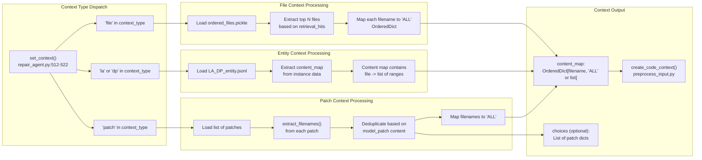
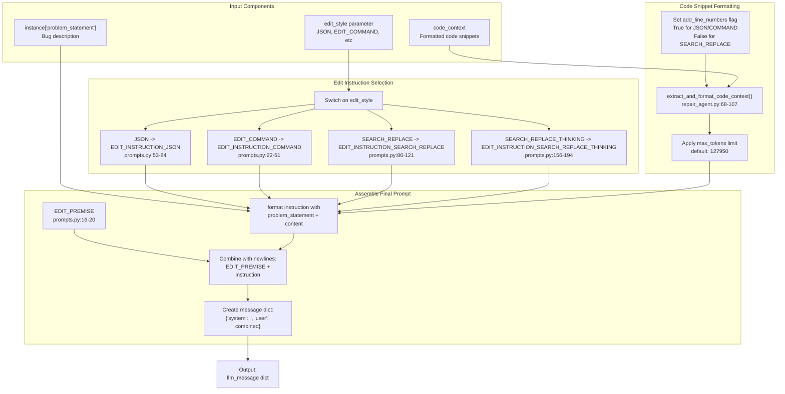
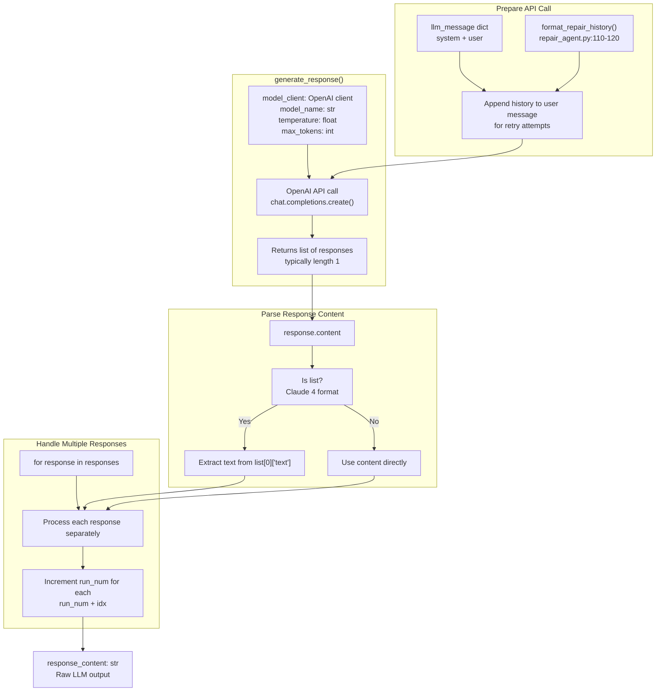
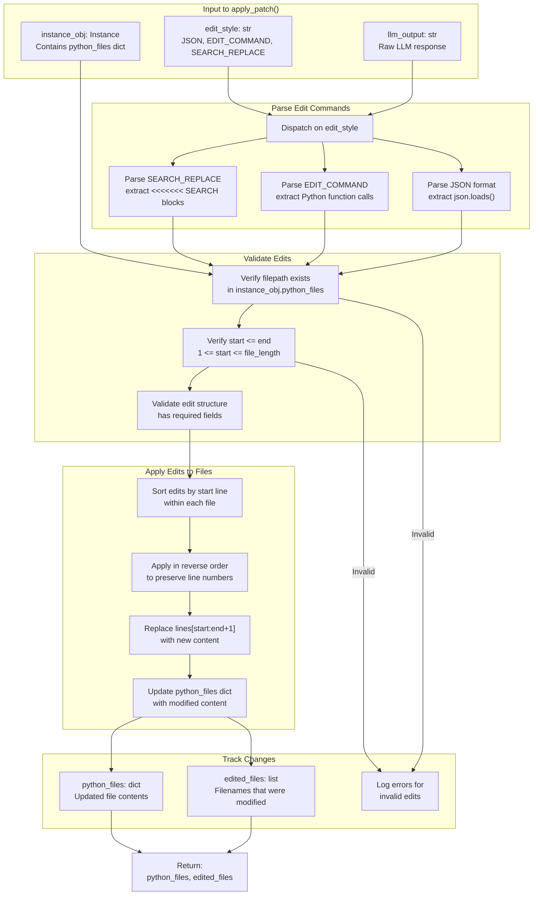
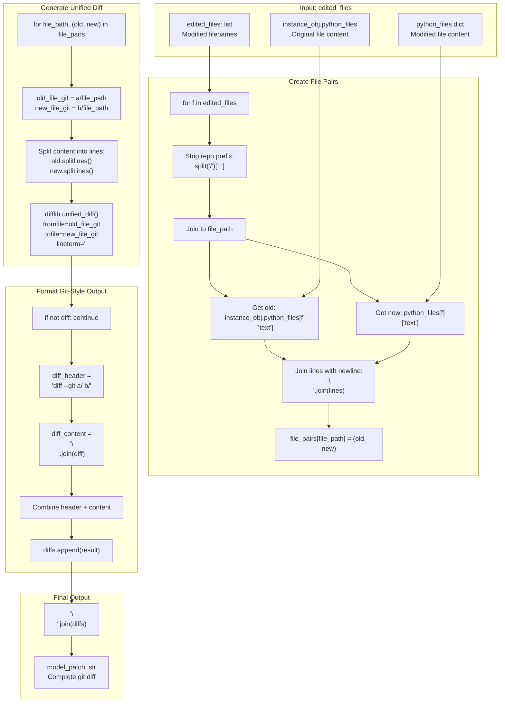
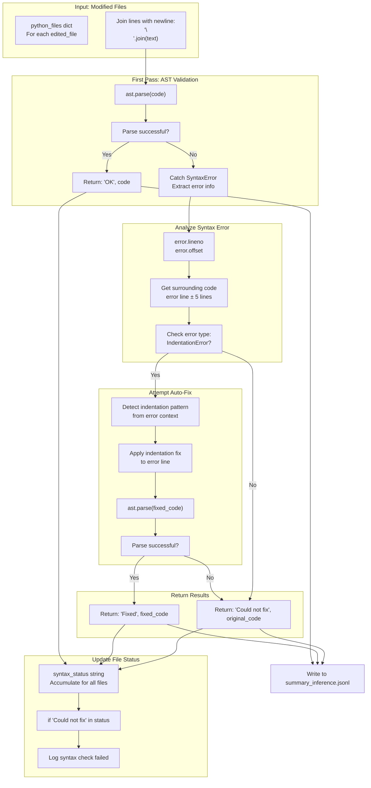
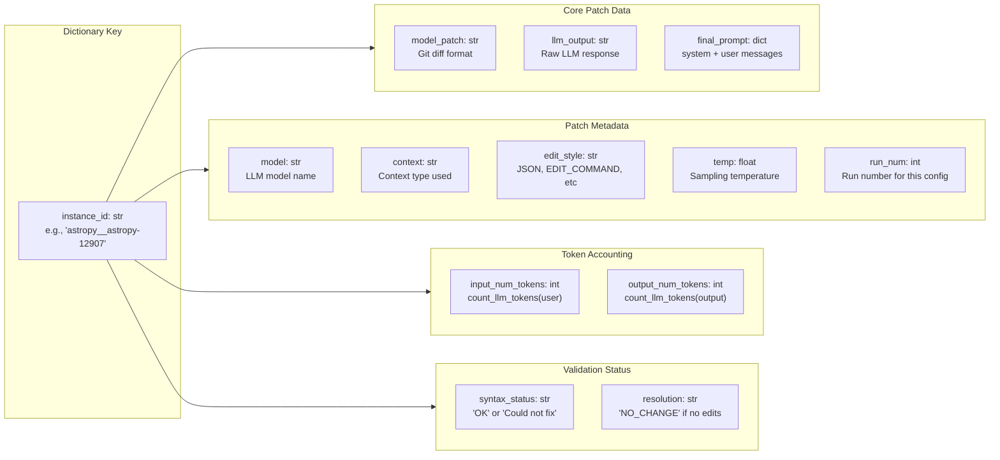
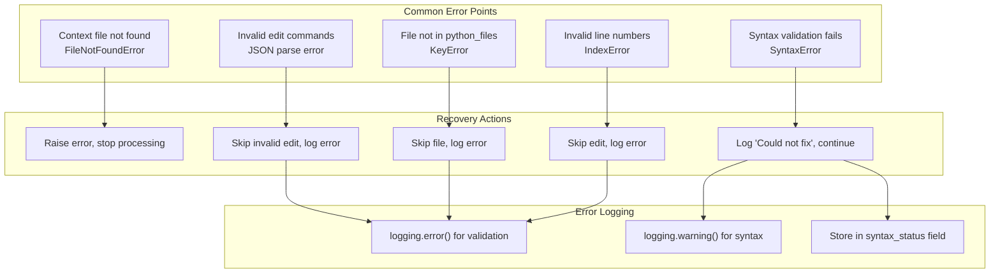

<!-- source: DeepWiki mcp.deepwiki.com · repo NVIDIA/Nemotron-CORTEXA · page 3.3 Patch Generation Workflow · fetched 2026-10-26 -->

# Patch Generation Workflow

<details>
<summary>Relevant source files</summary>

The following files were used as context for generating this wiki page:

- [README.md](README.md)
- [src/cortexa/repair/prompts.py](src/cortexa/repair/prompts.py)
- [src/cortexa/repair/repair_agent.py](src/cortexa/repair/repair_agent.py)

</details>


## Purpose and Scope

This document describes the end-to-end workflow for generating code patches in Nemotron-CORTEXA. It covers context retrieval from localization results, prompt construction with different edit styles, LLM invocation, patch application to files, git diff generation, and syntax validation. 

For information about the RepairAgent class structure and its core methods, see [RepairAgent Core System](#3.1). For details on prompt templates and edit instruction formats, see [Prompt Engineering and Templates](#3.2). For reproduction test generation, see [Reproduction Test Generation](#3.4).

**Sources**: [README.md:73-138](), [src/cortexa/repair/repair_agent.py:618-695]()

---

## Workflow Overview

The patch generation workflow consists of six sequential stages that transform a bug report and localized code context into a validated git diff patch.

### Complete Patch Generation Pipeline

```mermaid
graph TB
    subgraph Input["Input Stage"]
        Instance["Instance Dictionary<br/>instance_id, problem_statement"]
        ContextData["Context Data<br/>localization results<br/>ordered_files.pickle or<br/>LA_DP_entity.jsonl"]
        EditStyle["Edit Style<br/>JSON, EDIT_COMMAND,<br/>SEARCH_REPLACE"]
    end
    
    subgraph Stage1["Stage 1: Context Retrieval"]
        SetContext["set_context()<br/>repair_agent.py:512-522"]
        LoadData["_load_context_data()<br/>Load pickle/jsonl"]
        ProcessContext["_process_context_by_type()<br/>Extract file/entity/patch data"]
        CreateCodeContext["create_code_context()<br/>Format with line numbers"]
        
        SetContext --> LoadData
        LoadData --> ProcessContext
        ProcessContext --> CreateCodeContext
    end
    
    subgraph Stage2["Stage 2: Prompt Construction"]
        GenPrompt["generate_edit_prompt()<br/>repair_agent.py:698-734"]
        SelectTemplate["Select Edit Instruction<br/>EDIT_INSTRUCTION_JSON<br/>EDIT_INSTRUCTION_COMMAND<br/>EDIT_INSTRUCTION_SEARCH_REPLACE"]
        FormatContext["extract_and_format_code_context()<br/>repair_agent.py:68-107"]
        BuildMessage["Combine EDIT_PREMISE +<br/>instruction + issue + code"]
        
        GenPrompt --> SelectTemplate
        GenPrompt --> FormatContext
        SelectTemplate --> BuildMessage
        FormatContext --> BuildMessage
    end
    
    subgraph Stage3["Stage 3: LLM Invocation"]
        GenPatch["generate_edit_patch()<br/>repair_agent.py:736-772"]
        CallLLM["generate_response()<br/>OpenAI API call"]
        ParseResponse["Parse response.content<br/>Handle Claude list format"]
        
        GenPatch --> CallLLM
        CallLLM --> ParseResponse
    end
    
    subgraph Stage4["Stage 4: Patch Application"]
        ApplyPatch["apply_patch()<br/>postprocess_results.py"]
        ParseEdits["Parse edit commands<br/>Based on edit_style"]
        EditFiles["Modify file contents<br/>Line-by-line replacement"]
        TrackChanges["Track edited_files<br/>and python_files"]
        
        ApplyPatch --> ParseEdits
        ParseEdits --> EditFiles
        EditFiles --> TrackChanges
    end
    
    subgraph Stage5["Stage 5: Git Diff Generation"]
        GenDiff["generate_git_diff()<br/>repair_agent.py:409-440"]
        CreatePairs["Create file_pairs<br/>old vs new content"]
        UnifiedDiff["difflib.unified_diff()<br/>Generate diff hunks"]
        FormatGit["Add git headers<br/>diff --git a/ b/"]
        
        GenDiff --> CreatePairs
        CreatePairs --> UnifiedDiff
        UnifiedDiff --> FormatGit
    end
    
    subgraph Stage6["Stage 6: Syntax Validation"]
        CheckSyntax["check_and_fix_indentation()<br/>postprocess_results.py"]
        ASTCompile["ast.parse()<br/>Validate Python syntax"]
        FixIndent["Auto-fix indentation<br/>if possible"]
        SetStatus["Set syntax_status<br/>OK or Could not fix"]
        
        CheckSyntax --> ASTCompile
        ASTCompile --> FixIndent
        FixIndent --> SetStatus
    end
    
    subgraph Output["Output Stage"]
        InferenceFile["summary_inference.jsonl<br/>Patch metadata + diff"]
        RepairData["Repair data dict<br/>instance_id, model_patch,<br/>llm_output, tokens, etc"]
    end
    
    Instance --> SetContext
    ContextData --> LoadData
    EditStyle --> SelectTemplate
    
    CreateCodeContext --> GenPrompt
    BuildMessage --> GenPatch
    ParseResponse --> ApplyPatch
    TrackChanges --> GenDiff
    FormatGit --> CheckSyntax
    SetStatus --> RepairData
    RepairData --> InferenceFile
```



**Sources**: [src/cortexa/repair/repair_agent.py:618-772](), [src/cortexa/utils/postprocess_results.py](), [src/cortexa/utils/preprocess_input.py]()

---

## Stage 1: Context Retrieval

The workflow begins by loading and processing localization results to extract relevant code context. The `set_context()` method supports three context types, each with different processing logic.

### Context Type Processing



| Context Type | Data Source | Processing Function | Output Format |
|-------------|-------------|---------------------|---------------|
| `file` | `ordered_files.pickle` | `_process_file_context()` | `{filename: 'ALL'}` for top N files |
| `entity` (`la`, `dp`) | `LA_DP_entity.jsonl` | `_process_entity_context()` | `{filename: [(range, text), ...]}` |
| `patch` | List of patch dicts | `_process_patch_context()` | `{filename: 'ALL'}` + `choices` list |

**Sources**: [src/cortexa/repair/repair_agent.py:512-587](), [src/cortexa/utils/preprocess_input.py]()

### Code Context Formatting

After extracting the content map, the workflow formats code context with line numbers for LLM consumption via `extract_and_format_code_context()` [src/cortexa/repair/repair_agent.py:68-107]():

**Key formatting behaviors:**
- **All content mode**: When `content_map[filename] = 'ALL'`, includes the entire file
- **Range mode**: When `content_map[filename] = [(range, text), ...]`, includes only specified line ranges
- **Ellipsis insertion**: Adds `...` to indicate omitted lines between non-contiguous ranges
- **Line numbering**: Prefixes each line with its number when `add_line_numbers=True`
- **Token limiting**: Truncates context at `max_tokens` (default 127,950) using tiktoken

**Sources**: [src/cortexa/repair/repair_agent.py:68-107](), [src/cortexa/repair/repair_agent.py:723]()

---

## Stage 2: Prompt Construction

The prompt construction stage assembles the final LLM prompt by combining premise, edit instructions, issue description, and formatted code context.

### Prompt Assembly Flow



### Edit Style Comparison

| Edit Style | Line Numbers | Format | Example Structure |
|-----------|--------------|--------|-------------------|
| `JSON` | Yes | JSON objects | `{"filepath": "...", "start": 10, "end": 15, "content": "..."}` |
| `EDIT_COMMAND` | Yes | Python function calls | `edit_file("path", 10, 15, "content")` |
| `SEARCH_REPLACE` | No | Search/replace blocks | `<<<<<<< SEARCH\nold\n=======\nnew\n>>>>>>> REPLACE` |
| `SEARCH_REPLACE_THINKING` | No | Reasoning + search/replace | `\n<solution>...</solution>` |

**Sources**: [src/cortexa/repair/repair_agent.py:698-734](), [src/cortexa/repair/prompts.py:16-194]()

---

## Stage 3: LLM Invocation

The workflow invokes the LLM through the OpenAI-compatible API and processes the response.

### LLM Call and Response Processing



**Key parameters** (from `repair_agent.py:618-632`):
- `temperature`: Controls randomness (0.0 to 1.0)
- `max_tokens`: Maximum output length (default 4096)
- `model_name`: LLM identifier from `model_config.yml`
- `run_num`: Tracks multiple runs with same configuration

**Sources**: [src/cortexa/repair/repair_agent.py:736-772](), [src/cortexa/utils/util.py:generate_response]()

---

## Stage 4: Patch Application

The patch application stage parses edit commands from the LLM response and applies them to the repository files. The `apply_patch()` function handles three different edit styles.

### Patch Application Architecture



### Edit Format Parsing Details

**JSON Format** [src/cortexa/repair/prompts.py:53-84]():
```json
{
    "filepath": "myproject/utils.py",
    "start": 10,
    "end": 15,
    "content": "def new_function():\n    pass"
}
```

**EDIT_COMMAND Format** [src/cortexa/repair/prompts.py:22-51]():
```python
edit_file("myproject/utils.py", 10, 15, "def new_function():\n    pass")
```

**SEARCH_REPLACE Format** [src/cortexa/repair/prompts.py:86-121]():
```
### myproject/utils.py
<<<<<<< SEARCH
old code here
=======
new code here
>>>>>>> REPLACE
```

**Key validation checks** performed in `apply_patch()`:
- Filepath exists in `instance_obj.python_files`
- `start >= 1` (1-indexed line numbers)
- `end >= start`
- `end <= len(file_content)`
- Content preserves indentation

**Sources**: [src/cortexa/utils/postprocess_results.py:apply_patch](), [src/cortexa/repair/repair_agent.py:754-757]()

---

## Stage 5: Git Diff Generation

After applying edits, the workflow generates a standard git diff format for the modified files using `generate_git_diff()`.

### Git Diff Generation Process



### Git Diff Example Output

The `generate_git_diff()` function produces output in standard git format:

```
diff --git a/myproject/utils.py b/myproject/utils.py
--- a/myproject/utils.py
+++ b/myproject/utils.py
@@ -10,6 +10,9 @@
 def existing_function():
     pass
 
+def new_function():
+    pass
+
 def another_function():
     return True
```

**Key features**:
- Uses `difflib.unified_diff()` for hunk generation
- Adds git-style headers (`diff --git`, `---`, `+++`)
- Empty diffs (no changes) are skipped
- Multiple files are concatenated with newlines

**Sources**: [src/cortexa/repair/repair_agent.py:409-440](), [src/cortexa/repair/repair_agent.py:758-763]()

---

## Stage 6: Syntax Validation

The final stage validates Python syntax and attempts to fix indentation issues using `check_and_fix_indentation()`.

### Syntax Validation Flow



### Syntax Status Values

| Status | Meaning | Action |
|--------|---------|--------|
| `OK` | Syntax valid on first parse | No changes made |
| `Fixed` | Auto-fixed indentation error | Updated code written |
| `Could not fix` | Syntax error cannot be auto-fixed | Original code retained, logged |

**Error handling approach**:
1. **First attempt**: Parse with `ast.parse()` 
2. **On SyntaxError**: Check if it's an `IndentationError`
3. **Auto-fix attempt**: Apply indentation corrections
4. **Re-validate**: Parse fixed code with `ast.parse()`
5. **Fallback**: If still fails, return original code with error status

**Sources**: [src/cortexa/utils/postprocess_results.py:check_and_fix_indentation](), [src/cortexa/repair/repair_agent.py:677-692]()

---

## Output Artifacts

The patch generation workflow produces structured output in `summary_inference.jsonl`, with one entry per generated patch.

### Output Data Structure

Each line in `summary_inference.jsonl` is a JSON object with the following structure:



### JSONL Schema

```json
{
  "instance_id": {
    "instance_id": "astropy__astropy-12907",
    "final_prompt": {
      "system": "",
      "user": "You will be provided with..."
    },
    "input_num_tokens": 15420,
    "llm_output": "```python\nedit_file(...)\n```",
    "output_num_tokens": 342,
    "model_patch": "diff --git a/file.py b/file.py\n...",
    "model": "deepseek-v3-0324",
    "temp": 0.0,
    "run_num": 1,
    "context": "la_dp_entity",
    "edit_style": "JSON",
    "syntax_status": "file.py: OK",
    "resolution": "RESOLVED"
  }
}
```

### Unique Patch Identification

Each patch is uniquely identified by the combination:
```python
patch_id = f"{model}_{context}_{edit_style}_{temp}_{run_num}"
```

This identifier is used to:
- **Skip duplicates**: Check existing entries before generation [src/cortexa/repair/repair_agent.py:633-640]()
- **Lookup patches**: Reference specific patches during evaluation [src/cortexa/evaluate/run_evaluation.py]()
- **Track diversity**: Enable multiple candidates with same parameters

### Writing Process

The workflow uses file locking to ensure thread-safe writes:

```python
with FileLock(self.out_inference_file + ".lock"):
    write_jsonl(filename=self.out_inference_file, data=repair_data, append=True)
```

This allows parallel patch generation with `--num_workers_patch_gen` without corrupting the output file.

**Sources**: [src/cortexa/repair/repair_agent.py:663-689](), [src/cortexa/utils/util.py:write_jsonl](), [README.md:86]()

---

## Complete Workflow Example

Here's a concrete trace through the workflow for a single patch generation:

### Step-by-Step Execution

| Step | Function | Input | Output |
|------|----------|-------|--------|
| 1 | `repair()` | `instance`, `context_file`, `edit_style='JSON'`, `temperature=0.0` | Orchestrates workflow |
| 2 | `set_context()` | `LA_DP_entity.jsonl`, `context_type='la_dp_entity'` | `content_map: {file: [(range, text), ...]}` |
| 3 | `create_code_context()` | `content_map`, `instance_obj` | `code_map: dict` with full context |
| 4 | `generate_edit_prompt()` | `code_map`, `edit_style='JSON'` | `llm_message: {'system': '', 'user': '...'}` |
| 5 | `generate_edit_patch()` | `llm_message` | `response_content: str` (JSON edit commands) |
| 6 | `apply_patch()` | `response_content`, `instance_obj`, `edit_style='JSON'` | `python_files: dict`, `edited_files: list` |
| 7 | `generate_git_diff()` | `file_pairs` (old vs new) | `model_patch: str` (git diff format) |
| 8 | `check_and_fix_indentation()` | Each edited file | `syntax_status: str` ('OK' or 'Fixed' or 'Could not fix') |
| 9 | `write_jsonl()` | `repair_data` dict | Append to `summary_inference.jsonl` |

### Error Handling Throughout



**Key error recovery strategies**:
- **Context errors**: Fail fast with clear error messages
- **Edit parsing errors**: Skip individual invalid edits, continue processing valid ones
- **Syntax errors**: Attempt auto-fix, log status, write original code if unfixable
- **All errors logged**: Check `log_dir/` for detailed error traces

**Sources**: [src/cortexa/repair/repair_agent.py:618-695](), [src/cortexa/utils/postprocess_results.py]()

---

