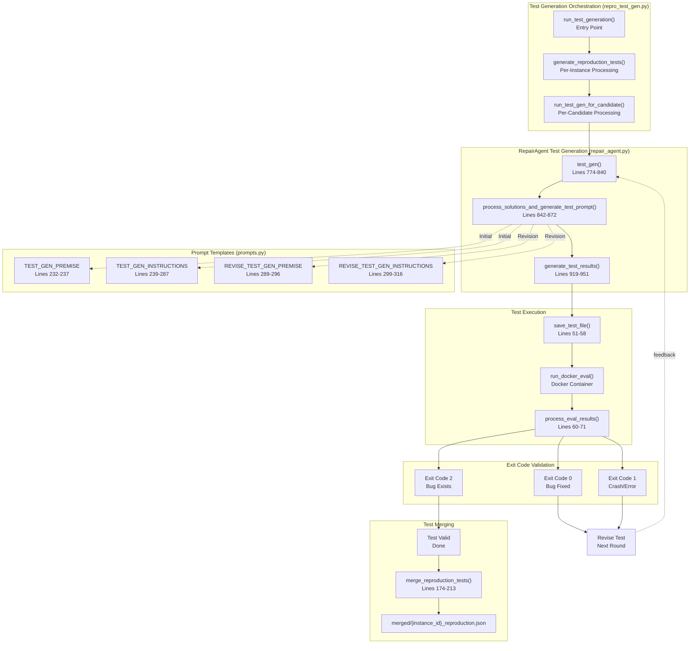
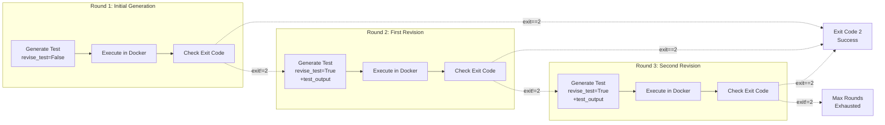
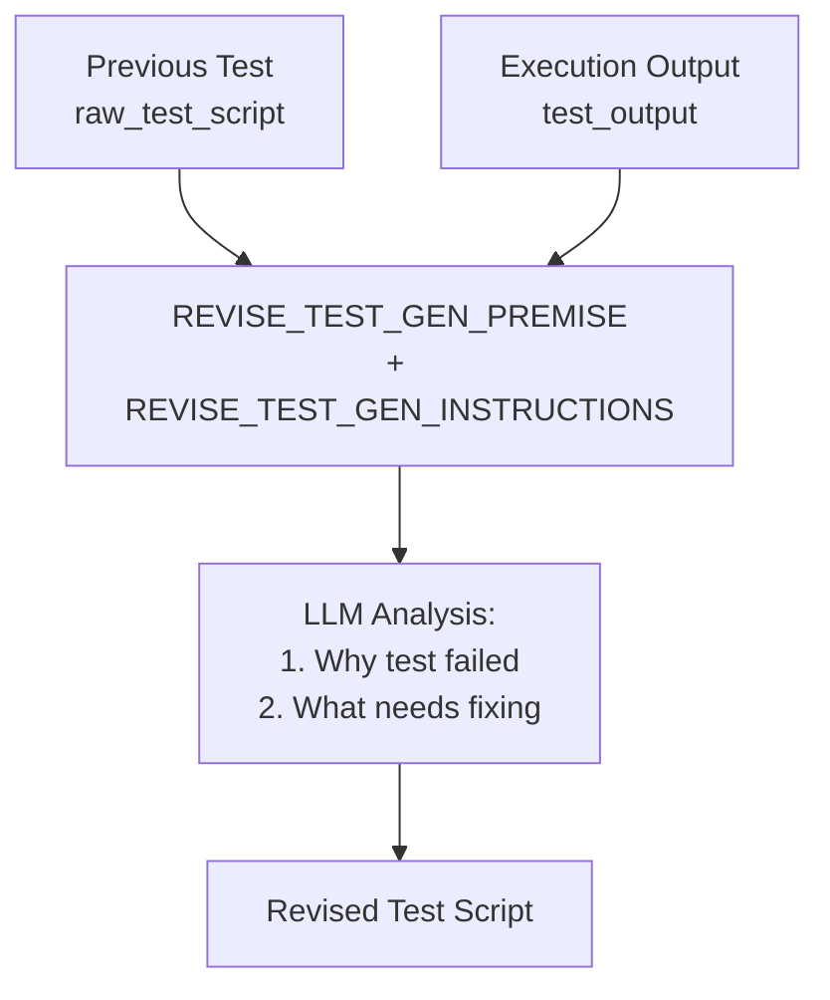
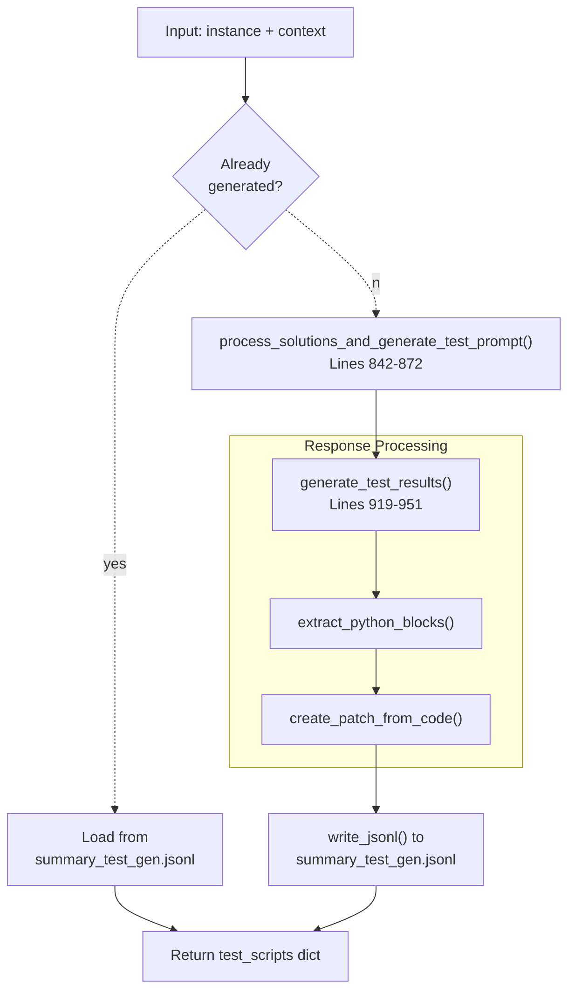
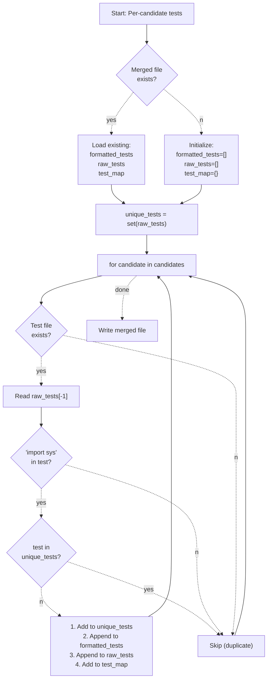
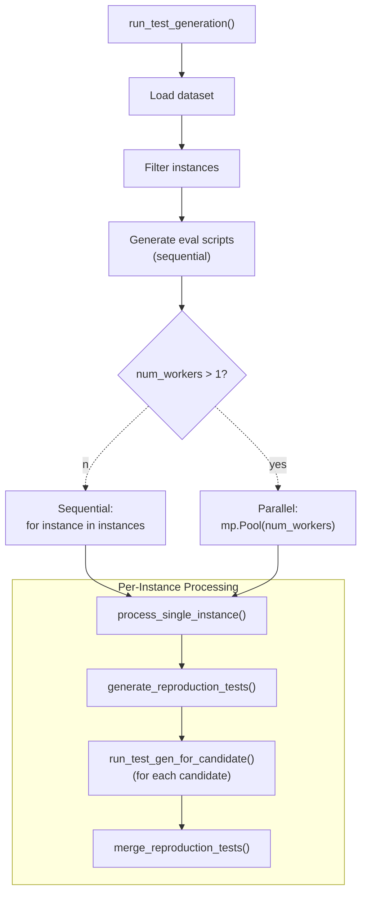
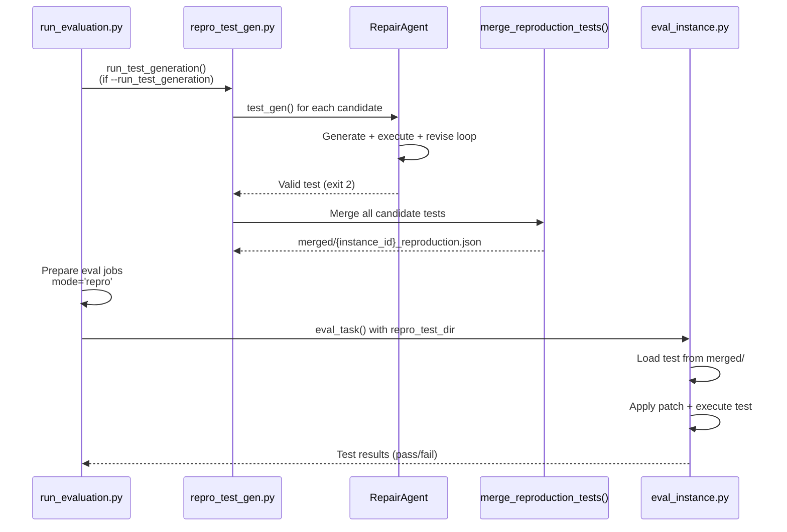
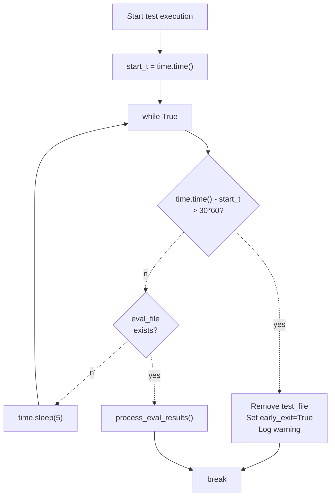

<!-- source: DeepWiki mcp.deepwiki.com · repo NVIDIA/Nemotron-CORTEXA · page 3.4 Reproduction Test Generation · fetched 2026-10-26 -->

# Reproduction Test Generation

<details>
<summary>Relevant source files</summary>

The following files were used as context for generating this wiki page:

- [src/cortexa/evaluate/run_evaluation.py](src/cortexa/evaluate/run_evaluation.py)
- [src/cortexa/repair/prompts.py](src/cortexa/repair/prompts.py)
- [src/cortexa/repair/repair_agent.py](src/cortexa/repair/repair_agent.py)
- [src/cortexa/repair/repro_test_gen.py](src/cortexa/repair/repro_test_gen.py)

</details>


## Purpose and Scope

This document describes the reproduction test generation system in Nemotron-CORTEXA, which automatically creates Python test scripts that reproduce the bugs described in issue statements. These tests serve two critical purposes: (1) validating that patches actually fix the reported issue, and (2) ensuring patches don't introduce regressions. The system implements an iterative feedback loop where failed tests are revised based on execution output until they correctly reproduce the bug.

This page focuses on the test generation workflow (`repro_test_gen.py`) and the `test_gen()` method in `RepairAgent`. For information about how these tests are executed during evaluation, see [4.2](#4.2). For the prompt engineering behind test generation, see [3.2](#3.2).

---

## Overview of Test Generation Pipeline

The reproduction test generation system creates self-contained test scripts that can be executed in isolated environments to determine whether a bug has been fixed. The system follows a generate-execute-revise cycle until a valid test is produced.



**Sources**: 
- [src/cortexa/repair/repro_test_gen.py:73-173]()
- [src/cortexa/repair/repair_agent.py:774-951]()
- [src/cortexa/repair/prompts.py:232-316]()

---

## Exit Code Semantics

The reproduction test system uses a three-valued exit code convention to precisely communicate test results:

| Exit Code | Meaning | Expected Context |
|-----------|---------|------------------|
| **2** | Bug is **not yet solved** | Original codebase (before patch) |
| **0** | Bug is **solved** | Patched codebase (after applying fix) |
| **1** | Test **crashed** or encountered unexpected error | Any context |

This convention allows the system to distinguish between:
- A correctly-functioning reproduction test that detects the bug (exit 2)
- A test that incorrectly passes on the original codebase (exit 0 or 1), indicating the test itself needs revision
- A test that crashes due to incorrect setup or implementation (exit 1)

The test generation loop continues until it produces a test that returns exit code 2 when run on the original codebase, confirming it correctly reproduces the issue.

**Sources**:
- [src/cortexa/repair/prompts.py:243-245]()
- [src/cortexa/repair/repro_test_gen.py:66]()
- [src/cortexa/evaluate/eval_instance.py]() (extract_test_exit_code function)

---

## Iterative Test Generation Loop

### Loop Structure

The test generation process implements a bounded retry mechanism with up to `max_rounds` iterations (default: 3). Each iteration consists of four phases:



### Implementation in run_test_gen_for_candidate

The core loop is implemented in [src/cortexa/repair/repro_test_gen.py:98-172]():

```mermaid
sequenceDiagram
    participant Loop as for i in range(max_rounds)
    participant Agent as repair_agent.test_gen()
    participant File as save_test_file()
    participant Docker as run_docker_eval()
    participant Wait as Polling Loop
    participant Process as process_eval_results()
    
    Loop->>Agent: Call with revise_test flag
    Agent->>Agent: Generate test_script<br/>and raw_test_script
    Agent->>File: Save to test_file
    File->>Docker: Execute in container
    Docker->>Wait: Start execution
    Wait->>Wait: Poll for results (max 30min)
    Wait->>Process: Check eval_data
    
    alt Exit Code == 2
        Process->>Loop: Return '[done]'<br/>Set early_exit=True
        Loop->>Loop: Break
    else Exit Code != 2
        Process->>Loop: Return test_output
        Loop->>Agent: Next iteration with<br/>test_output as feedback
    end
```

**Key variables tracked across iterations**:
- `raw_test_script`: The most recent test code (used as input for revision)
- `test_output`: Execution output from previous attempt (used for debugging)
- `revise_test`: Boolean flag toggled after first iteration
- `early_exit`: Flag set when valid test is found or timeout occurs

**Sources**:
- [src/cortexa/repair/repro_test_gen.py:98-172]()
- [src/cortexa/repair/repro_test_gen.py:60-71]() (process_eval_results)

---

## Test Generation Modes

### Initial Test Generation

The first iteration uses the `TEST_GEN_PREMISE` and `TEST_GEN_INSTRUCTIONS` prompt templates to generate a test from scratch based solely on the issue description and (optionally) relevant code context.

**Prompt structure** ([src/cortexa/repair/prompts.py:232-287]()):
1. **Premise**: Defines the role and task
2. **Issue**: The bug description from the dataset
3. **Relevant Files** (optional): Code context from localization
4. **Instructions**: Detailed requirements including exit code semantics and example template

**Key instructions provided to LLM**:
- Generate a complete, executable test with all imports
- Return exit code 2 if bug exists, 0 if fixed, 1 if crash
- Include reasoning BEFORE outputting the test script
- Wrap test in ````python``` code block
- No placeholders - test must be immediately executable

The LLM response is parsed using `extract_python_blocks()` to extract the test code from the markdown formatting.

**Sources**:
- [src/cortexa/repair/repair_agent.py:874-915]() (generate_test_prompt)
- [src/cortexa/repair/prompts.py:232-287]()

### Test Revision Mode

If the initial test fails to return exit code 2, subsequent iterations switch to revision mode using `REVISE_TEST_GEN_PREMISE` and `REVISE_TEST_GEN_INSTRUCTIONS`.

**Differences from initial generation**:
1. Prompt includes the previous test script in `<sample_test_script>` tags
2. Prompt includes execution output in `<test_output>` tags
3. Instructions explicitly ask LLM to analyze why the test failed
4. LLM must identify problems and plan revisions before writing new test

**Revision workflow**:


**Sources**:
- [src/cortexa/repair/repair_agent.py:857-858]() (revise_test flag)
- [src/cortexa/repair/prompts.py:289-316]()
- [src/cortexa/repair/repair_agent.py:911]() (test_script and test_output in prompt)

---

## RepairAgent Integration

### test_gen() Method

The `test_gen()` method in `RepairAgent` ([src/cortexa/repair/repair_agent.py:774-840]()) serves as the interface between the orchestration layer (`repro_test_gen.py`) and the LLM interaction logic.

**Method signature**:
```python
def test_gen(self, 
           instance,           # Bug instance from dataset
           context_file_or_data,  # Optional: localization results
           context_type,       # Type of context (e.g., 'file', 'LA_DP')
           temperature,        # LLM sampling temperature
           run_num,           # Run number for tracking
           revise_test,       # Boolean: initial vs revision mode
           test_script='',    # Previous test (for revision)
           test_output='')    # Previous output (for revision)
```

**Return value**: Dictionary mapping indices to test results:
```python
{
    0: {
        'response': str,           # Full LLM output
        'test_script': [str],      # Processed test as patch
        'raw_test_scripts': [str], # Raw test code
    }
}
```

### Processing Flow



**Key implementation details**:

1. **Caching**: Lines 789-800 check if test already exists in `summary_test_gen.jsonl` to avoid redundant generation
2. **Patch ID**: Format is `{model}_{context}_{prompt_style}_{temperature}_{run_num}` where `prompt_style` is either `'test-gen'` or `'revise-test-gen'`
3. **Context loading**: Lines 801-806 load localization results if `context_type` is specified
4. **Response extraction**: Line 936 uses `extract_python_blocks()` to parse the LLM's markdown-formatted output
5. **Patch formatting**: Line 942 wraps test code in git diff format for consistency with patch storage

**Sources**:
- [src/cortexa/repair/repair_agent.py:774-840]()
- [src/cortexa/repair/repair_agent.py:842-915]() (prompt generation)
- [src/cortexa/repair/repair_agent.py:919-951]() (LLM interaction)

---

## Test File Organization

The reproduction test generation system maintains a hierarchical directory structure to organize tests from different model configurations and to support test merging.

### Directory Structure

```
reproduction_tests/
├── {model}_context_issue{context}_temp{temp}_{run_num}/
│   ├── {instance_id}_reproduction.json
│   ├── {instance_id}_eval.jsonl
│   └── ...
└── merged/
    └── {instance_id}_reproduction.json
```

**Per-candidate directories** ([src/cortexa/repair/repro_test_gen.py:238]()):
- Format: `{model}_context_issue{context}_temp{temp}_{run_num}`
- Example: `deepseek-v3-0324_context_issueLA_DP_temp0.0_0`
- Contains: Individual test files before merging

**Merged directory** ([src/cortexa/repair/repro_test_gen.py:176]()):
- Location: `reproduction_tests/merged/`
- Purpose: Consolidates unique tests from all candidates
- Used by: Evaluation orchestrator during `repro` mode

### Test File Format

Each `*_reproduction.json` file follows this schema:

```json
{
    "instance_id": "django__django-12345",
    "test_patch": [
        "diff --git a/test_1.py b/test_1.py\n...",
        "diff --git a/test_2.py b/test_2.py\n..."
    ],
    "raw_tests": [
        "import sys\ndef test():\n    ...",
        "import sys\ndef test():\n    ..."
    ],
    "test_map": {
        "1": "deepseek-v3-0324_context_issueLA_DP_temp0.0_0",
        "2": "llama-3.3-70b_context_issuefile_temp0.7_1"
    }
}
```

**Field descriptions**:
- `test_patch`: List of tests in git diff format (for consistent storage with patches)
- `raw_tests`: List of actual Python test code
- `test_map`: Maps test index to the candidate configuration that generated it

**Sources**:
- [src/cortexa/repair/repro_test_gen.py:51-58]() (save_test_file)
- [src/cortexa/repair/repro_test_gen.py:206-213]() (write_jsonl for merged tests)

---

## Test Merging Strategy

After all test generation candidates complete, the system merges unique tests into a single file using `merge_reproduction_tests()` ([src/cortexa/repair/repro_test_gen.py:174-213]()).

### Merging Logic



### Deduplication Criteria

Tests are considered duplicates if their raw Python code is identical (line 196 in repro_test_gen.py). The system also filters out invalid tests that don't import `sys`, as this is required for the exit code mechanism (line 195).

**Index assignment**: Each unique test is assigned a sequential index starting from the previous maximum index if the merged file already exists (lines 188-189). This ensures stable test IDs across multiple merging operations.

**Sources**:
- [src/cortexa/repair/repro_test_gen.py:174-213]()

---

## Parallel Processing and Orchestration

### Entry Point: run_test_generation()

The `run_test_generation()` function ([src/cortexa/repair/repro_test_gen.py:275-342]()) provides the main entry point, supporting both sequential and parallel processing of multiple instances.

**Configuration parameters**:

| Parameter | Default | Description |
|-----------|---------|-------------|
| `instance_id` | `''` | Comma-separated instance IDs (empty = all) |
| `repo_playground` | auto | Repository clone directory |
| `dataset_name_or_path` | `'princeton-nlp/SWE-bench_Verified'` | Dataset to process |
| `max_rounds` | `3` | Maximum test revision iterations |
| `log_dir` | auto | Directory for JSONL logs |
| `num_workers` | `1` | Parallel worker processes |
| `repro_test_dir` | auto | Output directory for tests |

### Multiprocessing Architecture

When `num_workers > 1`, the system uses `multiprocessing.Pool` to parallelize test generation across instances:



**Note**: The system uses `mp.set_start_method('spawn', force=True)` (line 38 in run_evaluation.py) to ensure clean process isolation when running in parallel mode, which is critical for Docker interaction.

**Sources**:
- [src/cortexa/repair/repro_test_gen.py:275-342]() (run_test_generation)
- [src/cortexa/repair/repro_test_gen.py:261-273]() (process_single_instance)
- [src/cortexa/repair/repro_test_gen.py:326-342]() (multiprocessing pool)

---

## Integration with Evaluation Pipeline

The reproduction tests generated by this system are consumed by the evaluation orchestrator during the `repro` evaluation mode.

### Evaluation Flow



**Repro test directory resolution** ([src/cortexa/evaluate/run_evaluation.py:153-156]()):
```python
if args.repro_test_dir is None:
    repro_test_dir = f"{os.path.dirname(os.path.dirname(work_dir))}/reproduction_tests/merged"
else:
    repro_test_dir = os.path.abspath(args.repro_test_dir)
```

This ensures that evaluation uses the merged tests by default, which contain the union of all valid tests from different generation configurations.

**Sources**:
- [src/cortexa/evaluate/run_evaluation.py:80-93]() (test_gen_thread)
- [src/cortexa/evaluate/run_evaluation.py:153-156]() (repro_test_dir setup)
- [src/cortexa/evaluate/run_evaluation.py:43-65]() (eval_task with repro mode)

---

## Timeout and Error Handling

### Timeout Mechanism

Each test execution is bounded by a 30-minute timeout to prevent infinite loops or hung processes:



**Implementation**: [src/cortexa/repair/repro_test_gen.py:150-165]()

### Error Recovery

The system implements several error recovery mechanisms:

1. **Missing test scripts** (lines 113-127): If LLM fails to generate valid test code, log warning and retry in next round
2. **Evaluation file cleanup** (lines 133-134, 167-168): Remove stale evaluation files before/after execution
3. **Test file cleanup** (lines 63, 69, 155): Remove invalid test files when evaluation fails
4. **Exception handling** (lines 253-256 in generate_reproduction_tests): Log full traceback and continue to next candidate

**No test generated fallback**: If all rounds fail to produce a valid test, the instance simply won't have a reproduction test in the merged directory, and evaluation in `repro` mode will be skipped for that instance.

**Sources**:
- [src/cortexa/repair/repro_test_gen.py:113-127]() (missing test scripts)
- [src/cortexa/repair/repro_test_gen.py:150-165]() (timeout)
- [src/cortexa/repair/repro_test_gen.py:253-256]() (exception handling)

---

