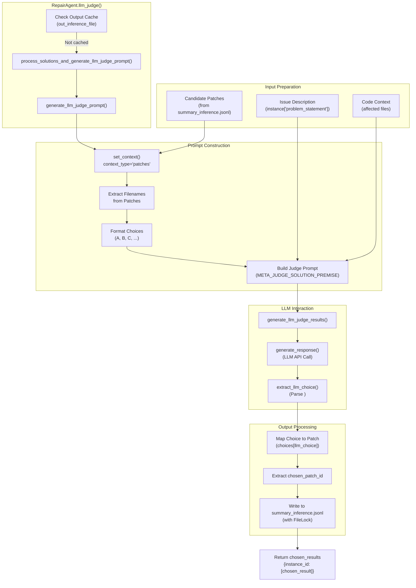
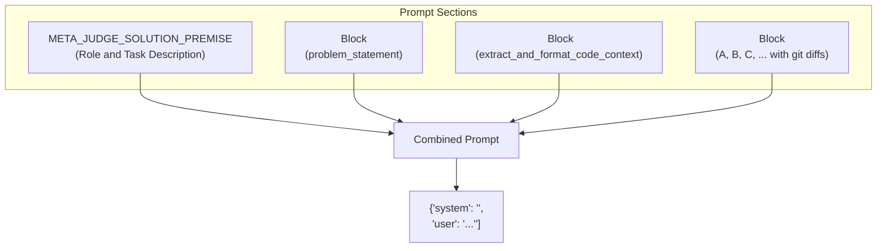
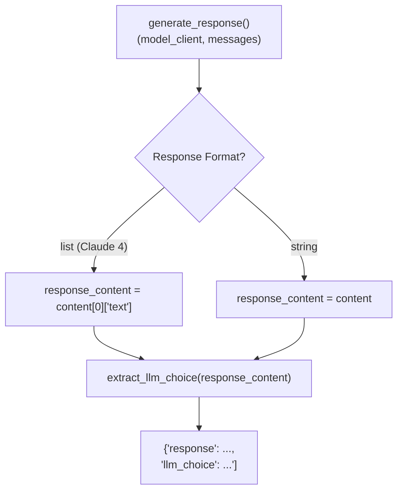
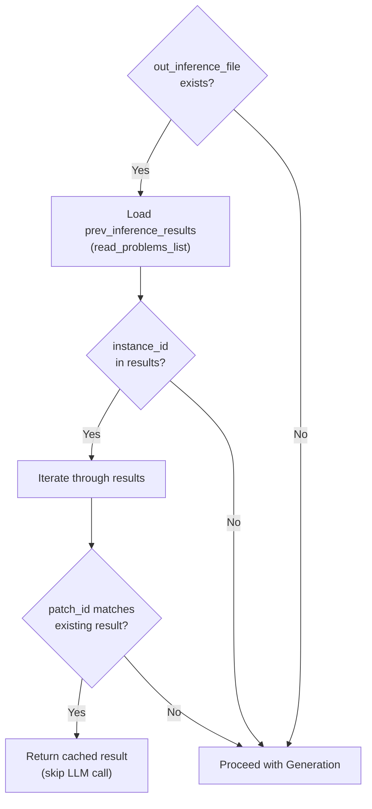

<!-- source: DeepWiki mcp.deepwiki.com · repo NVIDIA/Nemotron-CORTEXA · page 3.5 LLM Judge and Solution Selection · fetched 2026-10-26 -->

# LLM Judge and Solution Selection

<details>
<summary>Relevant source files</summary>

The following files were used as context for generating this wiki page:

- [src/cortexa/repair/prompts.py](src/cortexa/repair/prompts.py)
- [src/cortexa/repair/repair_agent.py](src/cortexa/repair/repair_agent.py)

</details>


## Purpose and Scope

This document describes the **LLM Judge** system, a meta-evaluation component within the Repair Stage that uses an LLM to select the best patch from multiple candidate solutions. The LLM Judge is one of three core methods in the `RepairAgent` class, alongside patch generation ([3.3](#3.3)) and reproduction test generation ([3.4](#3.4)). 

The LLM Judge provides an alternative to majority voting for solution filtering by using an LLM to evaluate patches based on issue alignment, code quality, and minimal change principles. For information about how this selection integrates with the overall filtering pipeline, see Solution Filtering and Selection ([4.3](#4.3)).

## Overview

The LLM Judge system implements a **meta-evaluation strategy** where an LLM acts as a judge to compare and select between multiple candidate patches. This approach is invoked through the `RepairAgent.llm_judge()` method and differs from traditional voting mechanisms by leveraging the LLM's understanding of code semantics and issue requirements.

### Key Characteristics

| Characteristic | Description |
|---------------|-------------|
| **Input** | Multiple candidate patches (git diffs) from previous repair attempts |
| **Context** | Bug issue description + relevant file contents |
| **Output** | Single selected patch with rationale |
| **Evaluation Criteria** | Issue alignment, code quality, minimal changes, maintainability |
| **Context Type** | Must be `'patches'` or contain `'patch'` in lowercase |

**Sources:** [src/cortexa/repair/repair_agent.py:953-1009]()

## LLM Judge Workflow



**Sources:** [src/cortexa/repair/repair_agent.py:953-1009](), [src/cortexa/repair/repair_agent.py:1011-1031](), [src/cortexa/repair/repair_agent.py:1034-1068](), [src/cortexa/repair/repair_agent.py:1070-1094]()

## Method Signature and Parameters

The `llm_judge()` method is invoked as follows:

```python
RepairAgent.llm_judge(
    instance: dict,              # SWE-bench instance with problem_statement
    context_file_or_data: Any,   # List of candidate patches or file path
    temperature: float,          # LLM sampling temperature
    run_num: int,                # Run identifier for tracking
    context_type: str = 'patches'  # Must contain 'patch'
)
```

### Input Requirements

| Parameter | Type | Description | Validation |
|-----------|------|-------------|------------|
| `instance` | `dict` | SWE-bench instance containing `instance_id` and `problem_statement` | Must be dict |
| `context_file_or_data` | `Any` | List of candidate patch dictionaries or path to pickle/jsonl file | Processed by `_process_patch_context()` |
| `temperature` | `float` | Sampling temperature for LLM generation | Stored in output |
| `run_num` | `int` | Run number for tracking multiple evaluations | Incremented per result |
| `context_type` | `str` | Context type identifier | Must contain `'patch'` (case-insensitive) |

The method validates `context_type` contains `'patch'` at [repair_agent.py:962]():

```python
assert 'patch' in context_type.lower()
```

**Sources:** [src/cortexa/repair/repair_agent.py:953-972]()

## Prompt Construction Process

### Patch Context Processing

The `_process_patch_context()` method [repair_agent.py:556-575]() extracts files from candidate patches:

```mermaid
graph LR
    subgraph "Patch Processing"
        Input["context_data<br/>(list of patches)"]
        Dedup["Deduplicate Patches<br/>(by model_patch content)"]
        ExtractFiles["Extract Filenames<br/>(extract_filenames)"]
        CreateMap["Create content_map<br/>(OrderedDict)"]
    end
    
    Input --> Dedup
    Dedup --> ExtractFiles
    ExtractFiles --> CreateMap
    
    CreateMap --> Output["{'content_map': {...},<br/>'choices': [...]"}"]
```

The method iterates through patches and extracts unique solutions:

1. **Deduplication**: Tracks `seen_content` set to avoid duplicate patches
2. **File Extraction**: Calls `extract_filenames()` to parse git diffs for affected files
3. **Path Normalization**: Removes repo base path from filenames
4. **Choice Preservation**: Maintains original patch metadata (model, context, edit_style, temp, run_num)

**Sources:** [src/cortexa/repair/repair_agent.py:556-582]()

### Judge Prompt Structure

The `generate_llm_judge_prompt()` method [repair_agent.py:1034-1068]() constructs a prompt with three sections:



The prompt template `META_JUDGE_SOLUTION_PREMISE` [prompts.py:197-230]() specifies:

| Instruction | Purpose |
|-------------|---------|
| **Understand Each Fix** | Analyze why each patch was proposed and what it addresses |
| **Evaluate Against Issue** | Determine which fix correctly resolves the stated problem |
| **Choose One Fix** | Select exactly one best solution with bias toward simplicity |
| **No External References** | Only refer to code present in the prompt |
| **Analysis First** | Provide justification before selection |

The output format requirement is:
```xml
<chosen_id>
[Label of chosen fix]
</chosen_id>
```

**Sources:** [src/cortexa/repair/repair_agent.py:1034-1068](), [src/cortexa/repair/prompts.py:197-230]()

## Choice Extraction Logic

### LLM Response Processing

The `generate_llm_judge_results()` method [repair_agent.py:1070-1094]() processes the LLM response:



The `extract_llm_choice()` function (imported from `utils/postprocess_results.py`) parses the `<chosen_id>` tags to extract the letter choice (A, B, C, etc.).

**Sources:** [src/cortexa/repair/repair_agent.py:1070-1094](), [src/cortexa/repair/repair_agent.py:39]()

### Choice Mapping

After extraction, the choice is mapped back to the original patch at [repair_agent.py:984-986]():

```python
choices = {f"{chr(65 + i)}": item for i, item in enumerate(code_context['choices'])}
chosen_result = choices[result['llm_choice']]
chosen_patch_id = f"{chosen_result['model']}_{chosen_result['context']}_{chosen_result['edit_style']}_{chosen_result['temp']}_{chosen_result['run_num']}"
```

This mapping:
- Converts index to letter: `chr(65 + i)` produces 'A', 'B', 'C', ...
- Retrieves original patch metadata
- Constructs `chosen_patch_id` for traceability

**Sources:** [src/cortexa/repair/repair_agent.py:984-986]()

## Output Format

### Return Structure

The method returns a dictionary mapping instance ID to chosen results:

```python
{
    instance_id: [chosen_result]
}
```

Where `chosen_result` is the original patch dictionary from the input, containing:
- `model_patch`: Git diff of the selected solution
- `model`, `context`, `edit_style`, `temp`, `run_num`: Original generation metadata

**Sources:** [src/cortexa/repair/repair_agent.py:1009]()

### Persisted Output

Results are written to `summary_inference.jsonl` with the following schema:

| Field | Type | Description |
|-------|------|-------------|
| `instance_id` | `str` | SWE-bench instance identifier |
| `final_prompt` | `dict` | Complete prompt sent to LLM judge |
| `input_num_tokens` | `int` | Token count of prompt |
| `llm_output` | `str` | Raw LLM response with analysis and choice |
| `output_num_tokens` | `int` | Token count of response |
| `model_patch` | `str` | Git diff of selected patch |
| `chosen_patch_id` | `str` | ID of selected patch (format: `{model}_{context}_{edit_style}_{temp}_{run_num}`) |
| `model` | `str` | LLM judge model name |
| `temp` | `float` | Temperature used for generation |
| `run_num` | `int` | Run identifier |
| `context` | `str` | Context type (always contains 'patch') |

The write operation uses `FileLock` to prevent race conditions in parallel execution [repair_agent.py:1005-1006]():

```python
with FileLock(self.out_inference_file + ".lock"):  
    write_jsonl(filename=self.out_inference_file, data=repair_data, append=True)
```

**Sources:** [src/cortexa/repair/repair_agent.py:990-1006]()

## Caching and Resume Logic

The method implements result caching to avoid redundant LLM calls [repair_agent.py:965-972]():



The `patch_id` is constructed as:
```python
patch_id = f"{self.repair_model_name}_{context_type}_{temperature}_{run_num}"
```

This ensures deterministic caching based on model, context type, temperature, and run number.

**Sources:** [src/cortexa/repair/repair_agent.py:965-972]()

## Integration with Evaluation Pipeline

The LLM Judge is invoked during the filtering stage as an alternative to majority voting. The choice between voting strategies is controlled by the `--vote` parameter in `run_filtering.py`:

| Voting Strategy | Description | When to Use |
|----------------|-------------|-------------|
| `majority` | Select patch that passes most evaluation modes | Multiple similar-quality patches |
| `llm_judge` | Use LLM to evaluate and select best patch | Need semantic understanding of fixes |

When `--vote=llm_judge`, the filtering pipeline:
1. Collects all candidate patches that passed syntax validation
2. Passes them to `RepairAgent.llm_judge()` as `context_file_or_data`
3. Uses the returned `chosen_patch_id` to filter the final output

**Sources:** [src/cortexa/repair/repair_agent.py:953-1009]()

## Example Usage

```python
# Create RepairAgent instance
repair_agent = create_repair_agent(
    solution={'model': 'deepseek-v3-0324'},
    repo_playground='/path/to/repos',
    log_dir='/path/to/logs'
)

# Load candidate patches from previous repair attempts
candidate_patches = [
    {
        'model_patch': 'diff --git a/file.py b/file.py\n...',
        'model': 'deepseek-v3',
        'context': 'LA_DP',
        'edit_style': 'JSON',
        'temp': 0.0,
        'run_num': 1
    },
    # ... more candidates
]

# Invoke LLM judge
results = repair_agent.llm_judge(
    instance={
        'instance_id': 'django__django-12345',
        'problem_statement': 'Fix incorrect query generation...'
    },
    context_file_or_data=candidate_patches,
    temperature=0.0,
    run_num=1,
    context_type='patches'
)

# Extract selected patch
selected_patch = results['django__django-12345'][0]['model_patch']
```

**Sources:** [src/cortexa/repair/repair_agent.py:1148-1165]()

---

