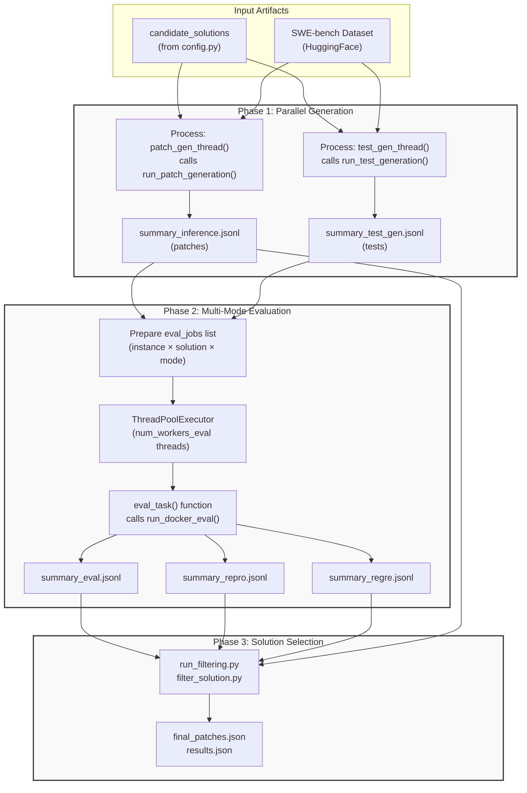
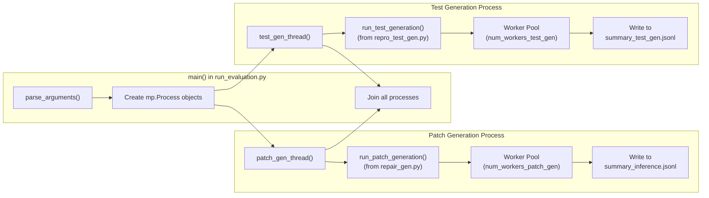
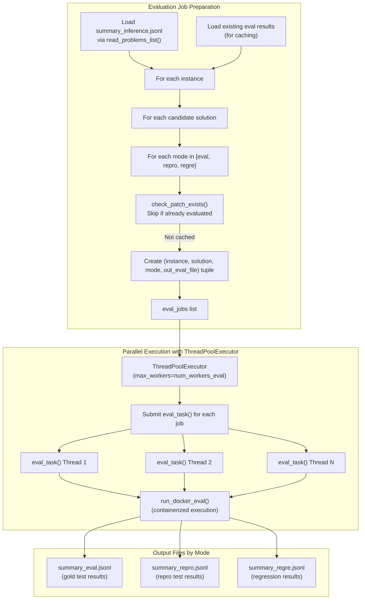
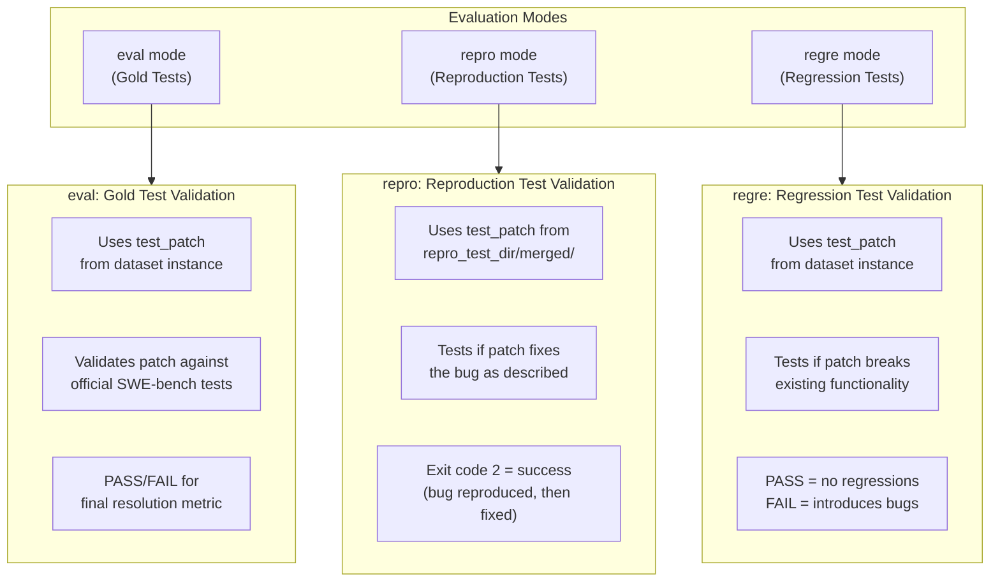
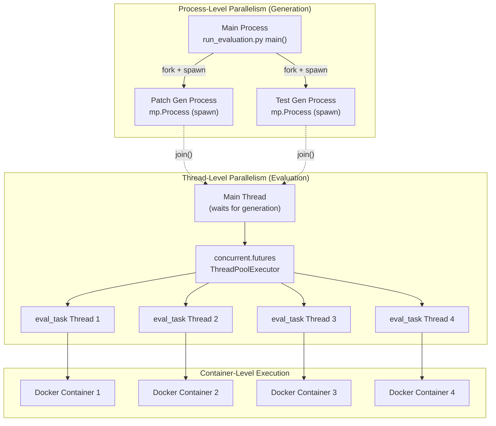
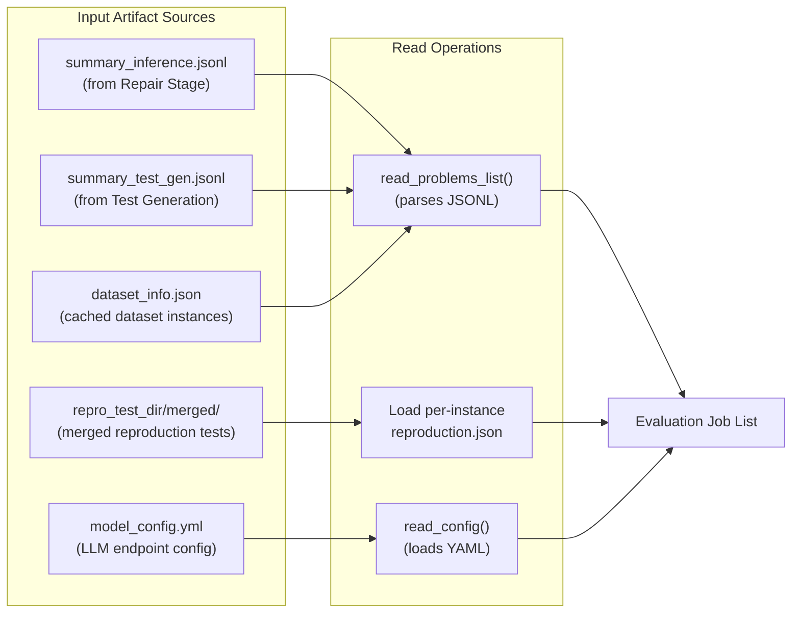
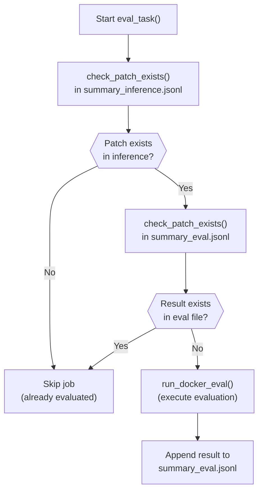
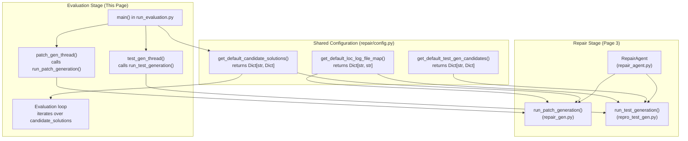

<!-- source: DeepWiki mcp.deepwiki.com · repo NVIDIA/Nemotron-CORTEXA · page 4 Evaluation Stage · fetched 2026-10-26 -->

# Evaluation Stage

<details>
<summary>Relevant source files</summary>

The following files were used as context for generating this wiki page:

- [README.md](README.md)
- [src/cortexa/evaluate/run_evaluation.py](src/cortexa/evaluate/run_evaluation.py)
- [src/cortexa/repair/repro_test_gen.py](src/cortexa/repair/repro_test_gen.py)

</details>


## Purpose and Scope

The Evaluation Stage is the final phase of the Nemotron-CORTEXA pipeline, responsible for testing generated patch candidates in isolated container environments and selecting the best solution for each bug instance. This stage implements a sophisticated three-phase execution model: (1) parallel generation of patches and reproduction tests, (2) multi-mode evaluation across gold tests, reproduction tests, and regression tests, and (3) filtering and selection of the optimal patch.

This document covers the orchestration logic in `run_evaluation.py`, the evaluation modes, parallel execution architecture, and data flow between generation and filtering phases. For details on how individual patches are applied and tested within containers, see [Instance Evaluation and Testing](#4.2). For the filtering algorithms that select the final patch, see [Solution Filtering and Selection](#4.3). For container runtime configuration, see [Container Execution Environments](#4.4).

**Sources**: [README.md:73-106](), [src/cortexa/evaluate/run_evaluation.py:1-236]()

---

## Evaluation Pipeline Overview

The evaluation stage serves as the bridge between the Repair Stage ([Repair Stage](#3)) and the final output. It consumes patch candidates from `summary_inference.jsonl` and reproduction tests from `summary_test_gen.jsonl`, evaluates them across multiple testing modes, and produces filtered results in `final_patches.json`.



**Diagram: End-to-End Evaluation Pipeline**

The pipeline is implemented in the `main()` function at [src/cortexa/evaluate/run_evaluation.py:119-233](). The system uses multiprocessing for generation and threading for evaluation to maximize parallelism while avoiding resource contention.

**Sources**: [src/cortexa/evaluate/run_evaluation.py:119-233](), [README.md:73-106]()

---

## Three-Phase Execution Model

### Phase 1: Generation Phase

The generation phase spawns separate processes for patch and test generation when `--run_patch_generation` and `--run_test_generation` flags are set. This allows both operations to run concurrently, significantly reducing total execution time.



**Diagram: Parallel Generation Architecture**

The process spawning logic is implemented at [src/cortexa/evaluate/run_evaluation.py:162-184]():

```python
# Parallel or sequential generation
threads = []
if args.run_patch_generation:
    t_patch = mp.Process(target=patch_gen_thread, args=(args, out_inf_file, candidate_solutions))
    t_patch.daemon = False
    threads.append(t_patch)
if args.run_test_generation:
    t_test = mp.Process(target=test_gen_thread, args=(args, out_testgen_file, repro_test_dir))
    t_test.daemon = False
    threads.append(t_test)
```

Key characteristics:
- **Process Isolation**: Using `mp.Process` with `spawn` method ([src/cortexa/evaluate/run_evaluation.py:38]()) ensures clean separation between generation tasks
- **Daemon Mode**: Set to `False` to ensure processes complete before main exits
- **Configurable Workers**: Each generation process has its own worker pool size (`num_workers_patch_gen`, `num_workers_test_gen`)
- **Independent Completion**: Processes can finish at different times; evaluation phase waits for both

**Sources**: [src/cortexa/evaluate/run_evaluation.py:38-93](), [src/cortexa/evaluate/run_evaluation.py:162-184]()

---

### Phase 2: Evaluation Phase

Once generation completes, the system prepares evaluation jobs and executes them in parallel using a thread pool. Each job represents a unique combination of (instance, solution, mode).



**Diagram: Evaluation Job Scheduling and Execution**

The job preparation loop is at [src/cortexa/evaluate/run_evaluation.py:188-218](), and parallel execution is at [src/cortexa/evaluate/run_evaluation.py:222-232]():

| Component | Purpose | Configuration Parameter |
|-----------|---------|------------------------|
| `eval_jobs` list | Stores all (instance, solution, mode) combinations to evaluate | N/A |
| `check_patch_exists()` | Caches evaluation results to avoid redundant work | N/A |
| `ThreadPoolExecutor` | Manages parallel thread pool for evaluation | `--num_workers_eval` (default: 4) |
| `eval_task()` | Worker function that calls `run_docker_eval()` for one job | N/A |
| `concurrent.futures.as_completed()` | Provides progress updates as jobs finish | N/A |

The `eval_task()` function at [src/cortexa/evaluate/run_evaluation.py:43-65]() constructs a unique `patch_id` for each solution configuration:

```python
def eval_task(instance, solution, mode, eval_file_name, out_inf_file, repro_test_dir, model_config, args):
    instance_id = instance['instance_id']
    model_name = model_config[solution['model']]['model_name'] if solution['model'] in model_config else solution['model']
    patch_id = f"{model_name}_{solution['context']}_{solution['edit_style']}_{solution['temp']}_{solution['run_num']}"
```

This encoding ensures each patch candidate can be uniquely identified in the output files.

**Sources**: [src/cortexa/evaluate/run_evaluation.py:43-65](), [src/cortexa/evaluate/run_evaluation.py:188-232]()

---

## Evaluation Modes

The system supports three evaluation modes, each testing different aspects of the patch quality. Modes are specified via the `--modes` argument as a comma-separated list (e.g., `--modes eval,repro,regre`).



**Diagram: Three Evaluation Modes**

### Mode Comparison Table

| Mode | Test Source | Primary Purpose | Success Criteria | Output File | Filtering Weight |
|------|-------------|----------------|------------------|-------------|------------------|
| `eval` | `instance['test_patch']` from dataset | Validate against gold standard tests | All gold tests pass | `summary_eval.jsonl` | Final resolution metric only |
| `repro` | `{repro_test_dir}/merged/{instance_id}_reproduction.json` | Verify bug is fixed as described | Exit code 2 (reproduced then fixed) | `summary_repro.jsonl` | High (used for filtering) |
| `regre` | `instance['test_patch']` from dataset (run on base commit) | Detect introduced regressions | No test failures on base | `summary_regre.jsonl` | High (eliminates bad patches) |

The mode selection is parsed at [src/cortexa/evaluate/run_evaluation.py:131-133]():

```python
# Parse modes
modes = [m.strip() for m in args.modes.split(',') if m.strip()]
logging.info(f"Running evaluation modes: {modes}")
```

### Reproduction Test Exit Code Semantics

The `repro` mode uses a special exit code convention implemented in the generated test scripts. The semantics are defined in [src/cortexa/repair/repro_test_gen.py:66-71]():

| Exit Code | Meaning | Interpretation |
|-----------|---------|----------------|
| 0 | Test passed without error | Bug NOT reproduced (bad test) |
| 1 | Test failed with assertion error | Bug reproduced but not fixed |
| 2 | Test failed initially, passed after patch | Bug reproduced AND fixed ✓ |

A patch successfully passes `repro` mode when `extract_test_exit_code()` returns `[2]`, indicating the test reproduced the bug on the base commit and passed after applying the patch.

**Sources**: [src/cortexa/evaluate/run_evaluation.py:131-133](), [src/cortexa/evaluate/run_evaluation.py:209-215](), [src/cortexa/repair/repro_test_gen.py:66-71](), [README.md:140-153]()

---

## Parallel Execution Architecture

The evaluation stage uses a hybrid parallelism model to maximize throughput while respecting resource constraints.

### Process vs. Thread Model



**Diagram: Multi-Level Parallelism Architecture**

The hybrid approach is necessary because:

1. **Generation uses Processes**: LLM API calls and file I/O benefit from true parallelism without GIL contention ([src/cortexa/evaluate/run_evaluation.py:38]())
2. **Evaluation uses Threads**: Docker/Singularity container spawning is I/O-bound, so threading is sufficient and more lightweight
3. **Container Isolation**: Each evaluation runs in its own container, providing safety and reproducibility

### Worker Pool Configuration

```python
# Generation phase worker pools (multiprocessing)
--num_workers_patch_gen 2  # Default: 1, controls parallel patch generation
--num_workers_test_gen 2   # Default: 1, controls parallel test generation

# Evaluation phase worker pool (threading)
--num_workers_eval 4       # Default: 4, controls parallel container evaluation
```

The total parallelism is: `min(num_workers_patch_gen, num_workers_test_gen)` during generation, then `num_workers_eval` during evaluation.

**Sources**: [src/cortexa/evaluate/run_evaluation.py:38](), [src/cortexa/evaluate/run_evaluation.py:107-109](), [src/cortexa/evaluate/run_evaluation.py:222]()

---

## Data Flow and Artifacts

The evaluation stage reads from multiple input sources and produces structured output files for downstream filtering.

### Input Artifacts



**Diagram: Input Artifact Dependencies**

The `dataset_info.json` file is created at startup to cache the full dataset, avoiding repeated HuggingFace API calls ([src/cortexa/evaluate/run_evaluation.py:124-128]()):

```python
dataset = load_dataset(args.dataset_name_or_path, split='test')
dataset_info_file = os.path.join(os.path.abspath(args.log_dir), args.dataset_info_file)
os.makedirs(os.path.dirname(dataset_info_file), exist_ok=True)
with open(dataset_info_file, 'w') as f:
    json.dump({inst['instance_id']: inst for inst in dataset}, f)
```

### Output Artifacts

Each evaluation mode produces a dedicated JSONL file with per-patch results:

| File | Content | Schema Fields | Usage |
|------|---------|---------------|-------|
| `summary_eval.jsonl` | Gold test results | `instance_id`, `patch_id`, `test_results`, `test_status` | Final resolution metric |
| `summary_repro.jsonl` | Reproduction test results | `instance_id`, `patch_id`, `reproduction_tests_results` | Filtering (high weight) |
| `summary_regre.jsonl` | Regression test results | `instance_id`, `patch_id`, `test_results`, `test_status` | Filtering (eliminates bad patches) |
| `summary_eval_singularity.jsonl` | Same as eval but with Singularity runtime | (same as eval) | Alternative to Docker |
| `summary_repro_singularity.jsonl` | Same as repro but with Singularity runtime | (same as repro) | Alternative to Docker |
| `summary_regre_singularity.jsonl` | Same as regre but with Singularity runtime | (same as regre) | Alternative to Docker |

The filename suffix `_singularity` is automatically added when Singularity runtime is detected ([src/cortexa/evaluate/run_evaluation.py:195-198]()):

```python
singularity_run = command_exists('singularity')
file_tag = ''
if singularity_run:
    file_tag = '_singularity'
```

### Caching and Incremental Evaluation

The system implements intelligent caching to avoid re-evaluating patches:



**Diagram: Caching Logic for Incremental Evaluation**

The caching logic at [src/cortexa/evaluate/run_evaluation.py:207-216]() checks both conditions:

```python
if not check_patch_exists(problems_per_file.get(out_inf_file, out_inf_file), instance_id, patch_id, single_patch_eval=args.single_patch_eval, print_warning=False):
    continue  # Patch doesn't exist in inference file
    
# ...

if check_patch_exists(problems_per_file.get(out_eval_file, out_eval_file), instance_id, patch_id, print_warning=True):
    continue  # Result already exists in eval file
```

This allows resuming interrupted evaluation runs without re-running completed jobs.

**Sources**: [src/cortexa/evaluate/run_evaluation.py:124-128](), [src/cortexa/evaluate/run_evaluation.py:195-216](), [src/cortexa/evaluate/run_evaluation.py:210]()

---

## Command-Line Interface

The evaluation stage is invoked via `run_evaluation.py` with extensive configuration options.

### Full Usage Example

```bash
python -m cortexa.evaluate.run_evaluation \
    --dataset_name_or_path princeton-nlp/SWE-bench_Verified \
    --repo_playground ./repos \
    --log_dir ./logs \
    --repro_test_dir ./repro_tests/merged \
    --modes eval,repro,regre \
    --run_patch_generation \
    --run_test_generation \
    --num_workers_patch_gen 2 \
    --num_workers_test_gen 2 \
    --num_workers_eval 4 \
    --max_rounds 3 \
    --instance_id astropy__astropy-12907
```

### Argument Reference Table

| Argument | Type | Default | Purpose |
|----------|------|---------|---------|
| `--dataset_name_or_path` | str | `princeton-nlp/SWE-bench_Verified` | HuggingFace dataset or local path |
| `--repo_playground` | str | `{root}/repo_playground` | Directory for cloned repositories |
| `--log_dir` | str | `{root}/logs` | Output directory for all artifacts |
| `--instance_id` | str | `''` (all) | Comma-separated list of instances to process |
| `--modes` | str | `eval,repro` | Comma-separated evaluation modes to run |
| `--run_patch_generation` | flag | False | Enable patch generation before evaluation |
| `--run_test_generation` | flag | False | Enable test generation before evaluation |
| `--num_workers_patch_gen` | int | 1 | Worker pool size for patch generation |
| `--num_workers_test_gen` | int | 1 | Worker pool size for test generation |
| `--num_workers_eval` | int | 4 | Thread pool size for evaluation |
| `--max_rounds` | int | 3 | Maximum test generation refinement rounds |
| `--out_inference_file` | str | `summary_inference.jsonl` | Output file for patch generation |
| `--out_testgen_file` | str | `summary_test_gen.jsonl` | Output file for test generation |
| `--dataset_info_file` | str | `dataset_info.json` | Cached dataset file |
| `--single_patch_eval` | flag | False | Evaluate only one patch per instance |
| `--repro_test_dir` | str | `{root}/reproduction_tests/merged` | Directory with merged reproduction tests |
| `--hostname` | str | `''` | SSH hostname for remote job submission |
| `--singularity_base_dir` | str | `{root}/singularity_images` | Base directory for Singularity images |

The argument parsing is implemented at [src/cortexa/evaluate/run_evaluation.py:96-117]().

### Single Patch Evaluation Mode

When `--single_patch_eval` is set, the system evaluates only one patch per instance, using the patch ID `'single_patch'`. This is useful for final validation of a single selected patch rather than evaluating all candidates:

```bash
python -m cortexa.evaluate.run_evaluation \
    --modes eval \
    --log_dir ./logs \
    --out_inference_file summary_inference.jsonl \
    --num_workers_eval 4 \
    --dataset_name_or_path princeton-nlp/SWE-bench_Verified \
    --instance_id astropy__astropy-12907 \
    --single_patch_eval
```

This mode is controlled at [src/cortexa/evaluate/run_evaluation.py:47-48]() and [src/cortexa/evaluate/run_evaluation.py:205-206]().

**Sources**: [src/cortexa/evaluate/run_evaluation.py:96-117](), [README.md:78-92](), [README.md:155-166]()

---

## Evaluation Script Generation

Before evaluation begins, the system generates bash scripts for each instance using `generate_scripts()` from `eval_util.py`. This preprocessing step is performed at [src/cortexa/evaluate/run_evaluation.py:149-151]():

```python
# Generate scripts for all instances first (to avoid race conditions)
for instance in tqdm(instances_to_process, desc="Generating eval scripts"):
    generate_scripts(instance, f'{os.path.dirname(os.path.dirname(get_root_path()))}/eval_scripts')
```

These scripts are framework-specific (Django, Pytest, Sympy) and define how tests are executed within containers. The scripts are stored in an `eval_scripts/` directory and referenced during container execution.

**Purpose of script pre-generation**:
1. **Avoid race conditions**: Multiple threads might try to generate the same script simultaneously
2. **Framework detection**: Determines the test framework once per instance
3. **Script caching**: Reusable across multiple evaluation jobs for the same instance

**Sources**: [src/cortexa/evaluate/run_evaluation.py:149-151](), [src/cortexa/repair/repro_test_gen.py:307-308]()

---

## Integration with Repair Stage

The evaluation stage is tightly integrated with the repair stage through shared data structures and configuration.



**Diagram: Integration Between Repair and Evaluation Stages**

The configuration objects define which model/context/temperature combinations to generate and evaluate:

**Candidate Solution Schema** (from `repair/config.py`):
```python
{
    'solution_1': {
        'model': 'deepseek-v3-0324',
        'context': 'issue_file_entity',
        'edit_style': 'json',
        'temp': 0.0,
        'run_num': 0
    },
    # ... more candidates
}
```

The evaluation stage:
1. Loads `candidate_solutions` at [src/cortexa/evaluate/run_evaluation.py:122]()
2. Passes them to generation functions at [src/cortexa/evaluate/run_evaluation.py:69-77]()
3. Iterates over them to create evaluation jobs at [src/cortexa/evaluate/run_evaluation.py:202-218]()

Each solution generates a unique `patch_id` that encodes all configuration parameters ([src/cortexa/evaluate/run_evaluation.py:204]()):

```python
patch_id = f"{model_name}_{solution['context']}_{solution['edit_style']}_{solution['temp']}_{solution['run_num']}"
```

This allows tracking which configuration produced which patch throughout the pipeline.

**Sources**: [src/cortexa/evaluate/run_evaluation.py:19](), [src/cortexa/evaluate/run_evaluation.py:122](), [src/cortexa/evaluate/run_evaluation.py:202-218]()

---

## Error Handling and Logging

The evaluation stage implements comprehensive error handling and progress tracking.

### Logging Configuration

The system uses Python's standard `logging` module with INFO level by default ([src/cortexa/evaluate/run_evaluation.py:40-41]()):

```python
logging.basicConfig(level=logging.INFO, 
                   format='%(asctime)s - %(levelname)s - %(message)s')
```

Key log messages include:
- `"Starting the evaluation process"` - Pipeline initialization
- `f"Running evaluation modes: {modes}"` - Active modes
- `f"Processing {len(instances_to_process)} instances"` - Dataset size
- `f"Running {len(eval_jobs)} evaluation jobs for {len(remaining_instances)} instances."` - Job count
- `f'Running evaluation for instance {instance_id}, patch {patch_id} in {mode} mode'` - Per-job status

### Exception Handling

The evaluation loop catches and logs exceptions without halting the entire pipeline ([src/cortexa/evaluate/run_evaluation.py:226-232]()):

```python
for future in tqdm(concurrent.futures.as_completed(futures)):
    try:
        future.result() 
    except Exception as exc:
        logging.error(f"Exception during evaluation: {exc}")
    finally:
        pbar.update(1)
```

This ensures one failing evaluation doesn't block others.

### Keyboard Interrupt Handling

The generation phase handles Ctrl+C gracefully by terminating spawned processes ([src/cortexa/evaluate/run_evaluation.py:175-181]()):

```python
try:
    for t in threads:
        t.join()
except KeyboardInterrupt:
    print("Keyboard interrupt received")
    for t in threads:
        t.terminate()
```

### Progress Tracking

The system uses `tqdm` progress bars at multiple levels:
1. Dataset loading: `tqdm(dataset, desc="Loading dataset")` ([src/cortexa/evaluate/run_evaluation.py:139]())
2. Script generation: `tqdm(instances_to_process, desc="Generating eval scripts")` ([src/cortexa/evaluate/run_evaluation.py:150]())
3. Evaluation progress: `tqdm(total=len(eval_jobs), desc="Evaluation progress")` ([src/cortexa/evaluate/run_evaluation.py:223]())

**Sources**: [src/cortexa/evaluate/run_evaluation.py:40-41](), [src/cortexa/evaluate/run_evaluation.py:175-181](), [src/cortexa/evaluate/run_evaluation.py:226-232]()

---

## Performance Characteristics

Understanding the performance profile helps optimize resource allocation.

### Execution Time Breakdown

| Phase | Typical Time per Instance | Parallelizable | Bottleneck |
|-------|--------------------------|----------------|------------|
| Patch Generation | 30-120 seconds | Yes (processes) | LLM API latency |
| Test Generation | 60-300 seconds | Yes (processes) | LLM API + container eval feedback loop |
| Evaluation (eval mode) | 10-60 seconds | Yes (threads) | Container startup + test execution |
| Evaluation (repro mode) | 5-30 seconds | Yes (threads) | Container startup + test execution |
| Evaluation (regre mode) | 10-60 seconds | Yes (threads) | Container startup + test execution |
| Filtering | 1-5 seconds | No | Code normalization + AST parsing |

### Scalability Considerations

**Generation Phase**:
- Each worker makes sequential LLM API calls
- Memory usage: ~2GB per worker process
- Recommended: `num_workers_patch_gen = min(4, num_api_keys)`
- Recommended: `num_workers_test_gen = min(4, num_api_keys)`

**Evaluation Phase**:
- Each thread spawns a container (Docker or Singularity)
- Memory usage: ~4GB per container
- Disk I/O: High during container creation/deletion
- Recommended: `num_workers_eval = min(8, available_cpus, available_memory_GB / 4)`

**Example Configuration for 32-core, 128GB RAM Machine**:
```bash
--num_workers_patch_gen 4 \
--num_workers_test_gen 4 \
--num_workers_eval 16
```

This configuration allows:
- 8 concurrent generation workers (4 patch + 4 test)
- 16 concurrent container evaluations
- Total memory: ~64GB (well under 128GB limit)

**Sources**: Based on system architecture from [src/cortexa/evaluate/run_evaluation.py:107-109]()

---

## Troubleshooting Common Issues

### Issue: "Instance not found in dataset"

**Symptom**: Error message `Instance(s) {instance_id} not found in dataset`

**Cause**: Specified instance ID doesn't exist in the dataset

**Solution**: Verify instance ID against dataset:
```bash
python -c "from datasets import load_dataset; ds = load_dataset('princeton-nlp/SWE-bench_Verified', split='test'); print([d['instance_id'] for d in ds])"
```

**Code Reference**: [src/cortexa/evaluate/run_evaluation.py:142-144]()

---

### Issue: "No patches found for evaluation"

**Symptom**: Log shows `Running 0 evaluation jobs`

**Cause**: No patches exist in `summary_inference.jsonl` for the selected instances

**Solution**: 
1. Check if `summary_inference.jsonl` exists in `log_dir`
2. Verify patches exist for the instance ID:
   ```bash
   grep "instance_id" logs/summary_inference.jsonl
   ```
3. Run with `--run_patch_generation` to generate patches first

**Code Reference**: [src/cortexa/evaluate/run_evaluation.py:220]()

---

### Issue: "Container evaluation hangs indefinitely"

**Symptom**: Evaluation thread never completes, no output for extended period

**Cause**: 
- Docker daemon unresponsive
- Container resource limits too low
- Test execution infinite loop

**Solution**:
1. Check Docker status: `docker ps` and `docker stats`
2. Increase container memory limits in Docker settings
3. Check container logs: `docker logs <container_id>`
4. Set timeout in evaluation (future enhancement)

**Code Reference**: [src/cortexa/evaluate/run_evaluation.py:43-65]()

---

### Issue: "Singularity file not found"

**Symptom**: Error during `repro` mode evaluation about missing Singularity image

**Cause**: Reproduction tests require Singularity images at `singularity_base_dir`

**Solution**:
1. Verify `--singularity_base_dir` path is correct
2. Ensure images are built for the dataset (see SWE-bench documentation)
3. Fall back to Docker if Singularity not available

**Code Reference**: [src/cortexa/evaluate/run_evaluation.py:116]()

---

## Next Steps

After the evaluation stage completes and produces `summary_*.jsonl` files, proceed to:

- **[Solution Filtering and Selection](#4.3)**: Understand how the best patch is selected from multiple candidates using reproduction test scores, syntax validation, and voting mechanisms
- **[Instance Evaluation and Testing](#4.2)**: Learn how patches are applied and tested within containers, including framework-specific test parsing
- **[Final Output Formats](#6.3)**: Review the structure of `final_patches.json` and `results.json` produced after filtering

**Sources**: [README.md:94-106]()

---

