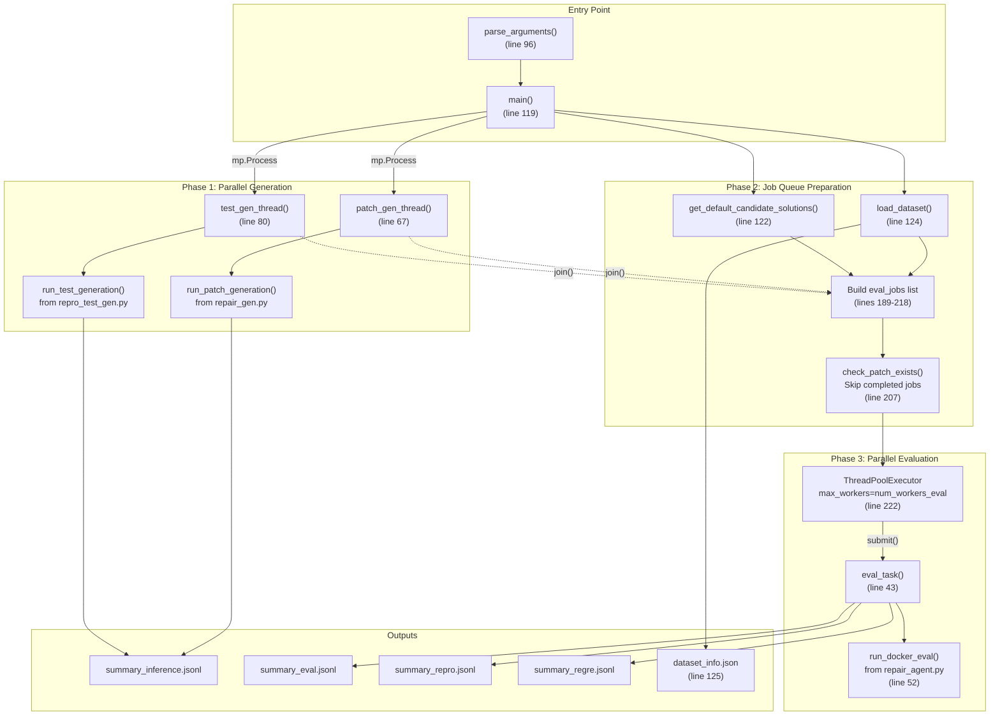
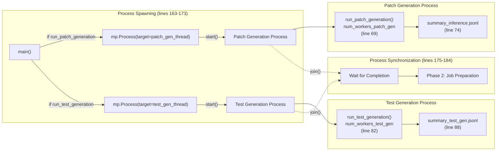
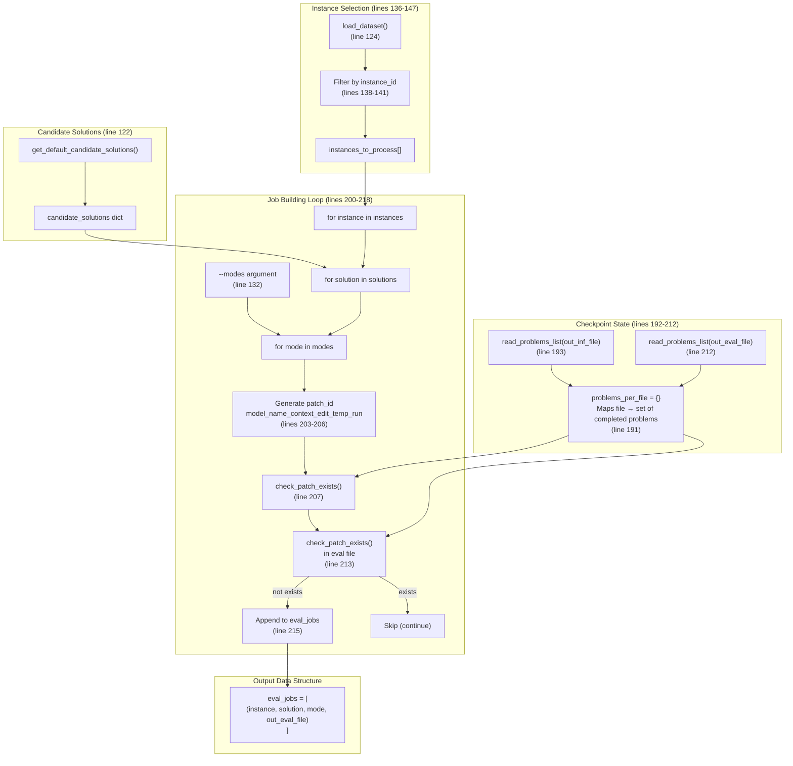
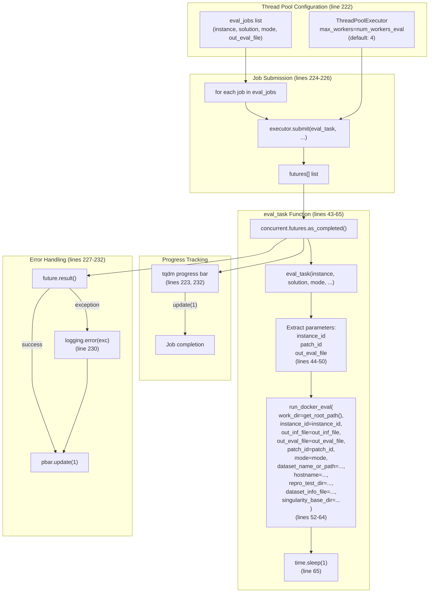
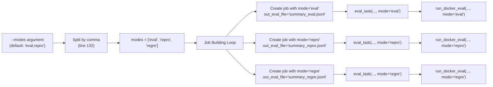
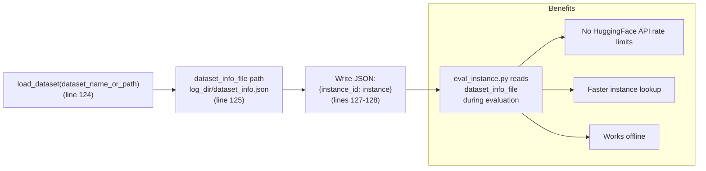
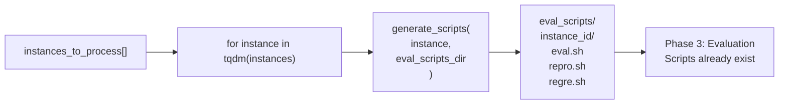
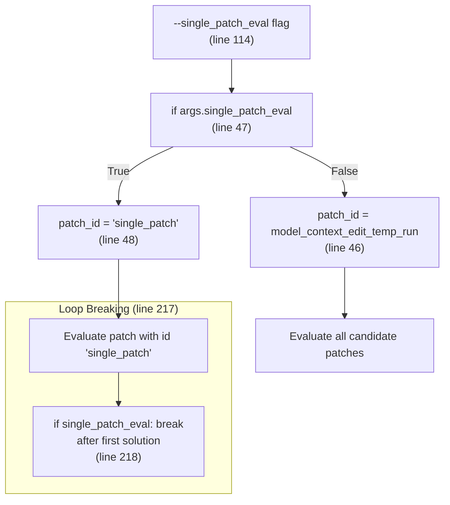

<!-- source: DeepWiki mcp.deepwiki.com · repo NVIDIA/Nemotron-CORTEXA · page 4.1 Evaluation Orchestration · fetched 2026-10-26 -->

# Evaluation Orchestration

<details>
<summary>Relevant source files</summary>

The following files were used as context for generating this wiki page:

- [src/cortexa/evaluate/run_evaluation.py](src/cortexa/evaluate/run_evaluation.py)
- [src/cortexa/repair/repro_test_gen.py](src/cortexa/repair/repro_test_gen.py)

</details>


## Purpose and Scope

This document covers the evaluation orchestration system implemented in [src/cortexa/evaluate/run_evaluation.py](), which coordinates the three-phase pipeline for generating, evaluating, and filtering patch solutions. The orchestrator manages parallel execution of patch generation and test generation processes, prepares evaluation jobs across multiple modes (eval/repro/regre), and distributes work across thread pools for concurrent execution.

For details on the actual evaluation of individual patches inside containers, see [Instance Evaluation and Testing](#4.2). For information on how evaluation results are filtered to select final solutions, see [Solution Filtering and Selection](#4.3). For repair generation specifics, see [Patch Generation Workflow](#3.3) and [Reproduction Test Generation](#3.4).

---

## System Architecture Overview

The evaluation orchestrator implements a three-phase pipeline that processes bug reports through generation, evaluation, and filtering stages. The system supports flexible configuration of worker pools, evaluation modes, and can resume from checkpoints to avoid redundant work.



**Sources:** [src/cortexa/evaluate/run_evaluation.py:1-236]()

---

## CLI Configuration

The orchestrator accepts comprehensive command-line arguments for fine-grained control over the evaluation pipeline. All arguments have sensible defaults but can be overridden for custom deployments.

| Argument | Type | Default | Description |
|----------|------|---------|-------------|
| `--dataset_name_or_path` | str | `princeton-nlp/SWE-bench_Verified` | HuggingFace dataset or local path |
| `--repo_playground` | str | `../repo_playground` | Directory for cloned repositories |
| `--instance_id` | str | `''` | Comma-separated instance IDs to evaluate (empty = all) |
| `--hostname` | str | `''` | Hostname for SSH job submission |
| `--repro_test_dir` | str | `None` | Custom directory for reproduction tests |
| `--modes` | str | `eval,repro` | Comma-separated evaluation modes |
| `--run_patch_generation` | flag | `False` | Enable patch generation before evaluation |
| `--run_test_generation` | flag | `False` | Enable test generation before evaluation |
| `--log_dir` | str | `logs/` | Output directory for all artifacts |
| `--num_workers_patch_gen` | int | `1` | Parallel workers for patch generation |
| `--num_workers_test_gen` | int | `1` | Parallel workers for test generation |
| `--num_workers_eval` | int | `4` | Parallel workers for evaluation |
| `--max_rounds` | int | `3` | Maximum test generation refinement rounds |
| `--out_inference_file` | str | `summary_inference.jsonl` | Patch generation output file |
| `--out_testgen_file` | str | `summary_test_gen.jsonl` | Test generation output file |
| `--dataset_info_file` | str | `dataset_info.json` | Cached dataset file |
| `--single_patch_eval` | flag | `False` | Evaluate only one patch per instance |
| `--singularity_base_dir` | str | `../singularity_images` | Base directory for Singularity images |

**Sources:** [src/cortexa/evaluate/run_evaluation.py:96-117]()

---

## Phase 1: Parallel Generation Processes

The orchestrator can optionally spawn separate processes for patch generation and test generation, allowing both to run concurrently. This parallelism reduces total wall-clock time when both operations are needed.



The orchestrator uses `multiprocessing.Process` rather than threads to enable true parallelism for CPU-bound generation tasks. Each process has its own worker pool (configured via `--num_workers_patch_gen` and `--num_workers_test_gen`) for further parallelism within that generation type.

**Key Implementation Details:**

- **Process spawning** [src/cortexa/evaluate/run_evaluation.py:164-170](): Creates daemon=False processes to ensure clean shutdown
- **Keyboard interrupt handling** [src/cortexa/evaluate/run_evaluation.py:175-181](): Gracefully terminates processes on Ctrl+C
- **Process join** [src/cortexa/evaluate/run_evaluation.py:176-177](): Blocks until both generation processes complete
- **Output files** [src/cortexa/evaluate/run_evaluation.py:158-159](): Paths constructed from `log_dir` and file name arguments

The `patch_gen_thread()` function [src/cortexa/evaluate/run_evaluation.py:67-78]() invokes `run_patch_generation()` from the repair module, passing the candidate solutions configuration and worker pool size. Similarly, `test_gen_thread()` [src/cortexa/evaluate/run_evaluation.py:80-93]() calls `run_test_generation()` with test-specific parameters including the reproduction test directory and maximum refinement rounds.

**Sources:** [src/cortexa/evaluate/run_evaluation.py:67-93](), [src/cortexa/evaluate/run_evaluation.py:161-184]()

---

## Phase 2: Evaluation Job Queue Preparation

After generation processes complete (or if using pre-generated artifacts), the orchestrator builds a comprehensive job queue by computing the Cartesian product of instances × solutions × modes. The system implements intelligent checkpointing to skip already-completed evaluations.



**Job Queue Structure:**

Each job in `eval_jobs` is a 4-tuple:
1. **instance** (dict): Full instance data from the dataset including `instance_id`, `problem_statement`, `repo`, etc.
2. **solution** (dict): Candidate solution configuration with keys `model`, `context`, `edit_style`, `temp`, `run_num`
3. **mode** (str): Evaluation mode - one of `'eval'`, `'repro'`, or `'regre'`
4. **out_eval_file** (str): Basename of the output file for this mode (e.g., `summary_eval.jsonl`)

**Checkpointing Logic:**

The orchestrator maintains a `problems_per_file` dictionary [src/cortexa/evaluate/run_evaluation.py:191]() that caches which (instance_id, patch_id) pairs have already been processed in each output file. This enables:

- **Incremental evaluation**: Run evaluation on new instances without re-evaluating existing ones
- **Resume after failure**: Restart the orchestrator after crashes without losing progress
- **Mode-specific checkpointing**: Each mode (`eval`, `repro`, `regre`) tracks completion independently

The `check_patch_exists()` function from `eval_instance.py` is called twice per potential job:
1. **Patch existence check** [src/cortexa/evaluate/run_evaluation.py:207](): Verify the patch exists in `summary_inference.jsonl`
2. **Evaluation existence check** [src/cortexa/evaluate/run_evaluation.py:213](): Verify the evaluation hasn't already been performed

Only jobs that pass both checks are added to `eval_jobs`.

**Sources:** [src/cortexa/evaluate/run_evaluation.py:188-220]()

---

## Phase 3: Parallel Evaluation Execution

The final phase distributes evaluation jobs across a thread pool for concurrent execution. The system uses `concurrent.futures.ThreadPoolExecutor` rather than `multiprocessing.Pool` because the evaluation tasks are I/O-bound (waiting for container execution) rather than CPU-bound.



**Thread Pool Configuration:**

The number of concurrent evaluation threads is controlled by `--num_workers_eval` (default: 4). This value should be tuned based on:
- **Container runtime capacity**: How many containers can run simultaneously
- **System resources**: Available CPU cores and memory
- **Network bandwidth**: For remote SSH-based evaluation (if using `--hostname`)

**Evaluation Task Execution:**

Each `eval_task()` invocation [src/cortexa/evaluate/run_evaluation.py:43-65]():

1. **Constructs patch_id** from solution parameters [src/cortexa/evaluate/run_evaluation.py:45-48]()
2. **Resolves model name** from `model_config` if it's an alias [src/cortexa/evaluate/run_evaluation.py:45]()
3. **Calls run_docker_eval()** from `repair_agent.py` [src/cortexa/evaluate/run_evaluation.py:52-64]()
4. **Sleeps for 1 second** to avoid overwhelming the container runtime [src/cortexa/evaluate/run_evaluation.py:65]()

The `run_docker_eval()` function handles the actual container orchestration, patch application, test execution, and result parsing. See [Instance Evaluation and Testing](#4.2) for details.

**Progress Monitoring:**

The orchestrator uses `tqdm` to display a real-time progress bar showing:
- Total number of evaluation jobs
- Jobs completed so far
- Estimated time remaining

Errors during evaluation are logged but don't stop the entire pipeline [src/cortexa/evaluate/run_evaluation.py:227-232](). This ensures that one failing instance doesn't prevent other evaluations from completing.

**Sources:** [src/cortexa/evaluate/run_evaluation.py:43-65](), [src/cortexa/evaluate/run_evaluation.py:220-233]()

---

## Evaluation Modes

The orchestrator supports three evaluation modes, each serving a distinct purpose in the validation pipeline. Modes are configured via the `--modes` argument as a comma-separated list (e.g., `--modes eval,repro,regre`).

| Mode | Output File | Purpose | Test Suite Used |
|------|-------------|---------|----------------|
| `eval` | `summary_eval.jsonl` | Validate against gold test suite | `test_patch` from dataset |
| `repro` | `summary_repro.jsonl` | Verify reproduction of reported bug | Generated reproduction tests from `repro_test_dir` |
| `regre` | `summary_regre.jsonl` | Check for regressions | `FAIL_TO_PASS` + `PASS_TO_PASS` tests |

**Mode Selection Logic:**



The `mode` parameter is passed through to `run_docker_eval()` [src/cortexa/evaluate/run_evaluation.py:58](), which uses it to select the appropriate test suite within the container. Each mode produces a separate output file, allowing the filtering stage [see Solution Filtering and Selection](#4.3)] to analyze results across all dimensions.

**Singularity File Tagging:**

If Singularity is detected as the container runtime [src/cortexa/evaluate/run_evaluation.py:195-198](), the output files are tagged with `_singularity` suffix (e.g., `summary_eval_singularity.jsonl`). This prevents conflicts when switching between Docker and Singularity runtimes.

**Sources:** [src/cortexa/evaluate/run_evaluation.py:131-133](), [src/cortexa/evaluate/run_evaluation.py:195-198](), [src/cortexa/evaluate/run_evaluation.py:209-216]()

---

## Dataset Caching

The orchestrator caches the full dataset to `dataset_info.json` [src/cortexa/evaluate/run_evaluation.py:125-128]() to avoid repeated HuggingFace API calls during evaluation. This file stores a dictionary mapping `instance_id` to the full instance data.

**Dataset Caching Flow:**



The cached dataset file is passed to `run_docker_eval()` [src/cortexa/evaluate/run_evaluation.py:62]() and ultimately used by `eval_instance.py` to retrieve instance metadata without network calls. This is particularly important when running thousands of evaluation jobs in parallel.

**Sources:** [src/cortexa/evaluate/run_evaluation.py:124-128](), [src/cortexa/evaluate/run_evaluation.py:50](), [src/cortexa/evaluate/run_evaluation.py:62]()

---

## Script Pre-generation

Before any evaluation begins, the orchestrator pre-generates test execution scripts for all instances [src/cortexa/evaluate/run_evaluation.py:149-151]() using `generate_scripts()` from `eval_util.py`. This avoids race conditions when multiple threads try to generate the same script simultaneously.

**Script Generation:**



The `generate_scripts()` function creates three bash scripts per instance:
- **eval.sh**: Runs the gold test suite
- **repro.sh**: Runs reproduction tests
- **regre.sh**: Runs regression tests

These scripts are stored in `eval_scripts/<instance_id>/` and are executed by the container runtime during evaluation.

**Sources:** [src/cortexa/evaluate/run_evaluation.py:149-151]()

---

## Reproduction Test Directory Resolution

The orchestrator determines the reproduction test directory based on command-line arguments and default conventions [src/cortexa/evaluate/run_evaluation.py:153-156]().

**Directory Resolution Logic:**

| Condition | Directory Path |
|-----------|---------------|
| `--repro_test_dir` specified | Use absolute path of provided directory |
| Default (not specified) | `<parent_of_root>/reproduction_tests/merged` |

The `merged` subdirectory contains reproduction tests that have been aggregated across multiple test generation candidates. See [Reproduction Test Generation](#3.4) for details on how tests are merged.

The resolved directory is passed to:
- `test_gen_thread()` [src/cortexa/evaluate/run_evaluation.py:80]() during test generation
- `eval_task()` [src/cortexa/evaluate/run_evaluation.py:61]() during evaluation

**Sources:** [src/cortexa/evaluate/run_evaluation.py:153-156]()

---

## Single Patch Evaluation Mode

The orchestrator supports a special `--single_patch_eval` flag for evaluating a single pre-generated patch without candidate solution diversity. This is useful for:

- Testing manually-written patches
- Validating a specific solution approach
- Debugging evaluation infrastructure

**Single Patch Mode Behavior:**



When `--single_patch_eval` is set:
1. The `patch_id` is hardcoded to `'single_patch'` [src/cortexa/evaluate/run_evaluation.py:48]()
2. The solution loop breaks after the first candidate [src/cortexa/evaluate/run_evaluation.py:217-218]()
3. Only one patch is evaluated per instance, regardless of how many candidate solutions are configured

This mode expects `summary_inference.jsonl` to contain patches with `patch_id='single_patch'`.

**Sources:** [src/cortexa/evaluate/run_evaluation.py:47-48](), [src/cortexa/evaluate/run_evaluation.py:114-115](), [src/cortexa/evaluate/run_evaluation.py:217-218]()

---

## Integration with Repair Module

The orchestrator integrates tightly with the repair module [see Repair Stage](#3)] through three key function calls:

**1. Patch Generation Integration:**

```python
run_patch_generation(
    instance_id=args.instance_id,
    repo_playground=args.repo_playground,
    dataset_name_or_path=args.dataset_name_or_path,
    log_dir=os.path.abspath(args.log_dir),
    out_inference_file=os.path.basename(out_inf_file),
    num_workers=args.num_workers_patch_gen,
    candidate_solutions=candidate_solutions
)
```

Called from [src/cortexa/evaluate/run_evaluation.py:69-77]() when `--run_patch_generation` is set. Delegates to `repair_gen.py` for the actual patch generation workflow.

**2. Test Generation Integration:**

```python
run_test_generation(
    instance_id=args.instance_id,
    repo_playground=args.repo_playground,
    dataset_name_or_path=args.dataset_name_or_path,
    max_rounds=args.max_rounds,
    log_dir=os.path.abspath(args.log_dir),
    out_inference_file=os.path.basename(out_testgen_file),
    num_workers=args.num_workers_test_gen,
    repro_test_dir=repro_test_dir,
    singularity_base_dir=args.singularity_base_dir
)
```

Called from [src/cortexa/evaluate/run_evaluation.py:82-92]() when `--run_test_generation` is set. Delegates to `repro_test_gen.py` for iterative test generation with feedback.

**3. Docker Evaluation Integration:**

```python
run_docker_eval(
    work_dir=get_root_path(),
    instance_id=instance_id,
    out_inf_file=out_inf_file,
    out_eval_file=out_eval_file,
    patch_id=patch_id,
    mode=mode,
    dataset_name_or_path=args.dataset_name_or_path,
    hostname=args.hostname,
    repro_test_dir=repro_test_dir,
    dataset_info_file=dataset_info_file,
    singularity_base_dir=args.singularity_base_dir
)
```

Called from [src/cortexa/evaluate/run_evaluation.py:52-64]() for each evaluation job. This function, defined in `repair_agent.py`, handles container selection, patch application, and test execution.

**Sources:** [src/cortexa/evaluate/run_evaluation.py:18](), [src/cortexa/evaluate/run_evaluation.py:27-28](), [src/cortexa/evaluate/run_evaluation.py:69-77](), [src/cortexa/evaluate/run_evaluation.py:82-92](), [src/cortexa/evaluate/run_evaluation.py:52-64]()

---

## Logging and Diagnostics

The orchestrator provides comprehensive logging at INFO level [src/cortexa/evaluate/run_evaluation.py:40-41]() with timestamps, log levels, and structured messages.

**Key Log Messages:**

| Stage | Log Message | Line |
|-------|-------------|------|
| Startup | `"Starting the evaluation process"` | 121 |
| Instance Selection | `"Processing {N} instances"` | 147 |
| Mode Configuration | `"Running evaluation modes: {modes}"` | 133 |
| Patch Generation | `"Starting patch generation (repair_gen.py)..."` | 68 |
| Patch Generation | `"Patch generation completed successfully"` | 78 |
| Test Generation | `"Starting test generation (repro_test_gen.py)..."` | 81 |
| Test Generation | `"Test generation completed successfully"` | 93 |
| Generation Complete | `"All generation threads completed"` | 184 |
| Repro Directory | `"Using reproduction test directory: {dir}"` | 185 |
| Job Count | `"Running {N} evaluation jobs for {M} instances."` | 220 |
| Per-Job | `"Running evaluation for instance {id}, patch {pid} in {mode} mode"` | 51 |
| Completion | `"Evaluation process completed"` | 233 |
| Error | `"Exception during evaluation: {exc}"` | 230 |

The structured logging enables easy parsing and monitoring of long-running evaluation pipelines.

**Sources:** [src/cortexa/evaluate/run_evaluation.py:40-41](), [src/cortexa/evaluate/run_evaluation.py:51](), [src/cortexa/evaluate/run_evaluation.py:68](), [src/cortexa/evaluate/run_evaluation.py:78](), [src/cortexa/evaluate/run_evaluation.py:81](), [src/cortexa/evaluate/run_evaluation.py:93](), [src/cortexa/evaluate/run_evaluation.py:121](), [src/cortexa/evaluate/run_evaluation.py:133](), [src/cortexa/evaluate/run_evaluation.py:147](), [src/cortexa/evaluate/run_evaluation.py:184-185](), [src/cortexa/evaluate/run_evaluation.py:220](), [src/cortexa/evaluate/run_evaluation.py:230](), [src/cortexa/evaluate/run_evaluation.py:233]()

---

## Output Artifacts

The orchestrator produces several output artifacts in the configured `--log_dir`:

| File | Format | Content | Generated By |
|------|--------|---------|--------------|
| `summary_inference.jsonl` | JSONL | All generated patches across candidates | Patch generation |
| `summary_test_gen.jsonl` | JSONL | Generated reproduction tests | Test generation |
| `summary_eval.jsonl` | JSONL | Gold test evaluation results | Eval mode |
| `summary_repro.jsonl` | JSONL | Reproduction test results | Repro mode |
| `summary_regre.jsonl` | JSONL | Regression test results | Regre mode |
| `dataset_info.json` | JSON | Cached dataset instances | Dataset loading |

Each JSONL file contains one JSON object per line with keys including `instance_id`, `patch_id`, and mode-specific result fields. These artifacts serve as inputs to the filtering stage [see Solution Filtering and Selection](#4.3)].

**File Naming Convention:**

If Singularity runtime is detected, evaluation files are suffixed with `_singularity` to distinguish from Docker results [src/cortexa/evaluate/run_evaluation.py:196-198](). For example:
- Docker: `summary_eval.jsonl`
- Singularity: `summary_eval_singularity.jsonl`

**Sources:** [src/cortexa/evaluate/run_evaluation.py:111-113](), [src/cortexa/evaluate/run_evaluation.py:158-159](), [src/cortexa/evaluate/run_evaluation.py:195-198](), [src/cortexa/evaluate/run_evaluation.py:210]()

---

