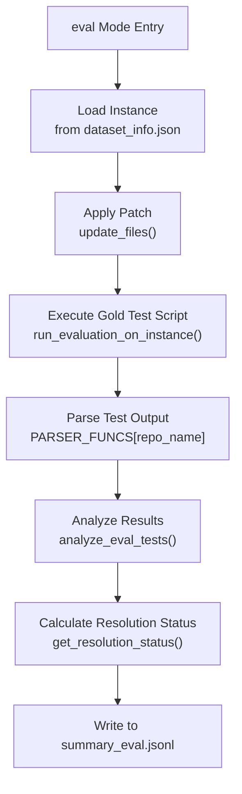
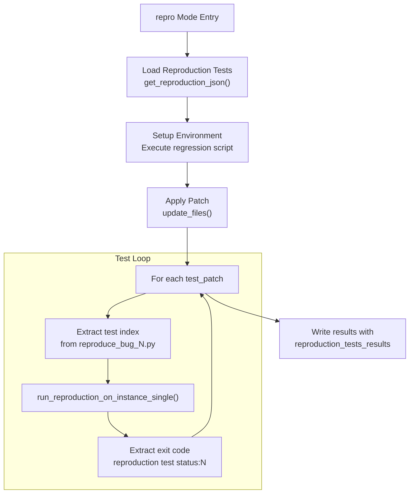
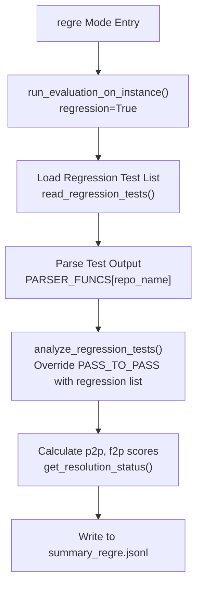
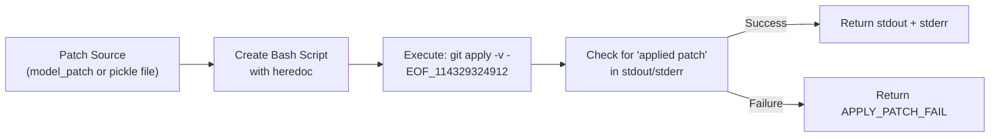
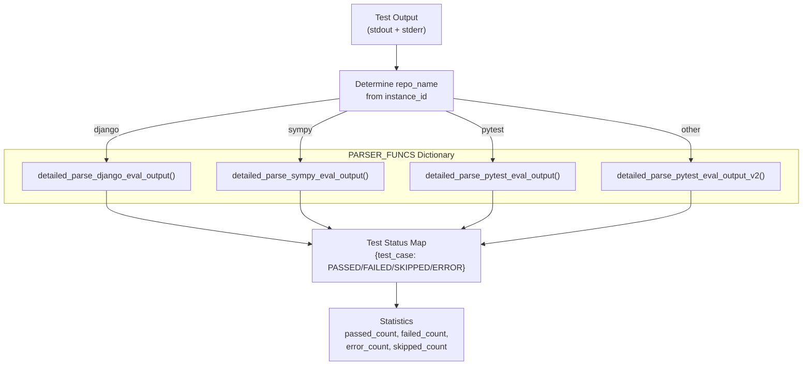
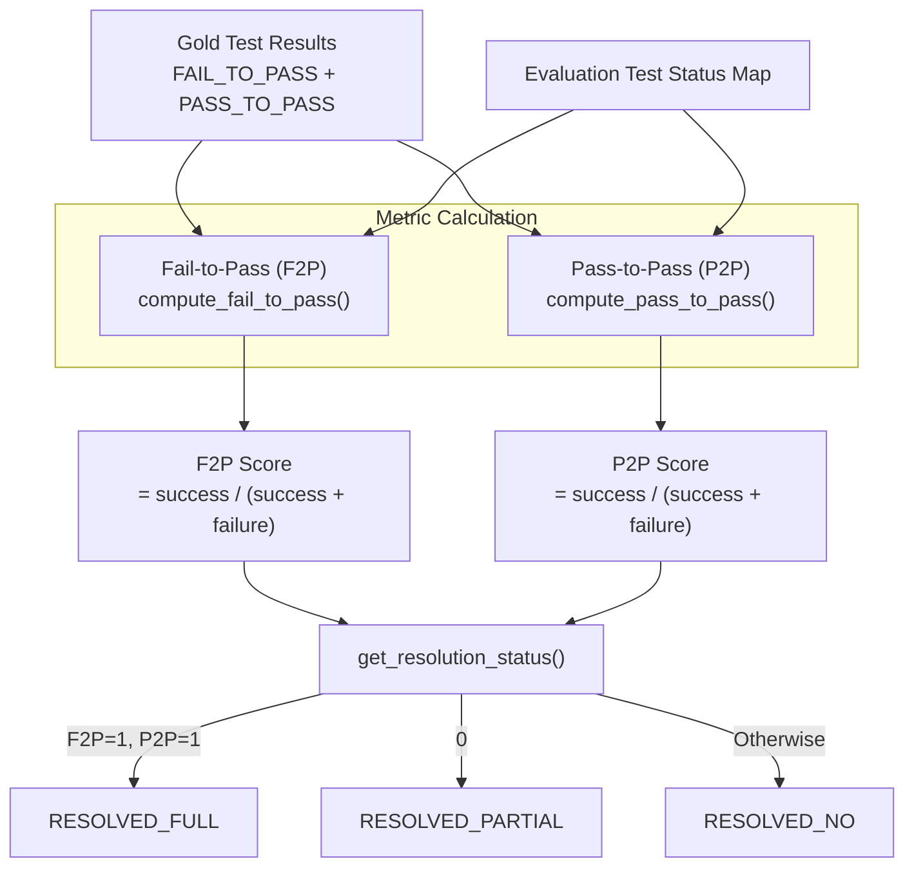
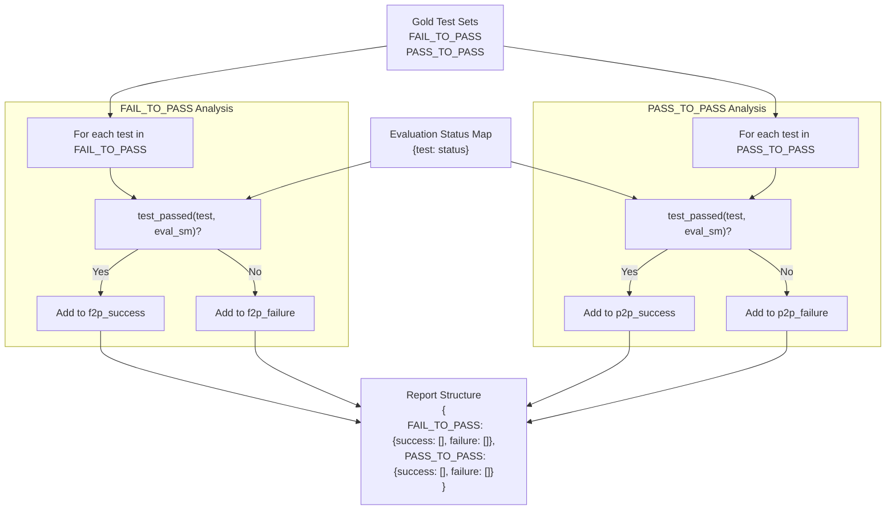
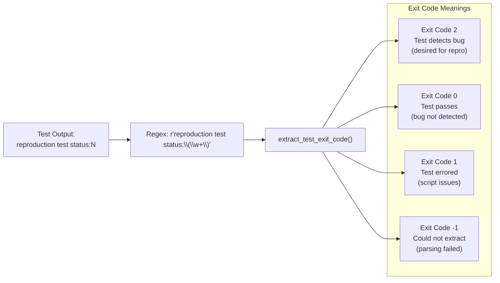
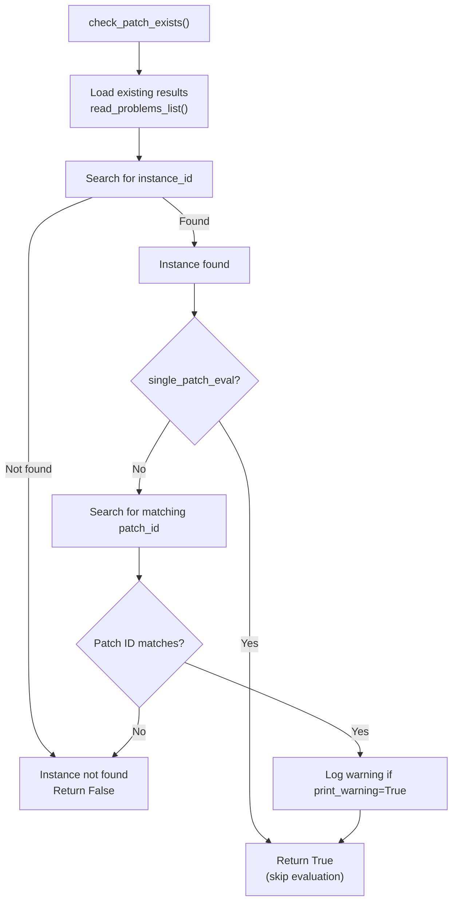

<!-- source: DeepWiki mcp.deepwiki.com · repo NVIDIA/Nemotron-CORTEXA · page 4.2 Instance Evaluation and Testing · fetched 2026-10-26 -->

# Instance Evaluation and Testing

<details>
<summary>Relevant source files</summary>

The following files were used as context for generating this wiki page:

- [src/cortexa/evaluate/eval_instance.py](src/cortexa/evaluate/eval_instance.py)
- [src/cortexa/evaluate/run_evaluation.py](src/cortexa/evaluate/run_evaluation.py)
- [src/cortexa/repair/repro_test_gen.py](src/cortexa/repair/repro_test_gen.py)

</details>


## Purpose and Scope

This document covers the instance-level evaluation system implemented in `eval_instance.py`, which executes patches and tests against individual SWE-bench instances. This module handles three evaluation modes (eval, repro, regre), applies patches to repositories, executes test scripts in containerized environments, and parses framework-specific test outputs to determine resolution status.

For orchestration of evaluation jobs across multiple instances and parallel execution, see [Evaluation Orchestration](#4.1). For filtering and selecting the best patches after evaluation, see [Solution Filtering and Selection](#4.3). For container runtime details, see [Container Execution Environments](#4.4).

---

## Evaluation Modes Overview

The evaluation system supports three distinct modes that test different aspects of a patch solution:

| Mode | Purpose | Test Source | Success Criteria |
|------|---------|-------------|------------------|
| **eval** | Validate patch fixes the bug without breaking existing tests | SWE-bench gold tests (FAIL_TO_PASS + PASS_TO_PASS) | All FAIL_TO_PASS tests pass, all PASS_TO_PASS tests remain passing |
| **repro** | Verify reproduction tests correctly detect the bug before patch | LLM-generated reproduction tests | Tests fail before patch (exit code 2), indicating bug is reproduced |
| **regre** | Check patch doesn't introduce regressions in broader test suite | Repository's full test suite | No new test failures compared to baseline |

Sources: [src/cortexa/evaluate/eval_instance.py:981](), [src/cortexa/evaluate/run_evaluation.py:43-64]()

---

## Evaluation Mode Details

### eval Mode - Gold Test Execution



**Sources**: [src/cortexa/evaluate/eval_instance.py:1051-1059](), [src/cortexa/evaluate/eval_instance.py:672-762]()

The `eval` mode executes the gold tests from SWE-bench (FAIL_TO_PASS and PASS_TO_PASS test sets) to determine if a patch resolves the issue. The process:

1. **Setup Environment**: Executes bash setup script at `{script_dir}/{instance_id}.sh` to clone repo and checkout base commit
2. **Apply Patch**: Calls `update_files()` to apply the model-generated patch via `git apply`
3. **Run Tests**: Executes test script at `{script_dir}/{instance_id}_test.sh`
4. **Parse Output**: Uses framework-specific parser from `PARSER_FUNCS` dictionary
5. **Determine Status**: Calls `analyze_eval_tests()` to compute resolution status

Sources: [src/cortexa/evaluate/eval_instance.py:672-762](), [src/cortexa/evaluate/eval_instance.py:424-431]()

### repro Mode - Reproduction Test Execution



**Sources**: [src/cortexa/evaluate/eval_instance.py:852-930](), [src/cortexa/evaluate/eval_instance.py:824-849]()

The `repro` mode verifies that reproduction tests correctly detect the bug. Each reproduction test is expected to **fail** (exit code 2) when the bug is present, confirming the test accurately captures the buggy behavior.

Key implementation details:
- Loads merged reproduction tests from `{repro_test_dir}/{instance_id}_reproduction.json`
- Applies reproduction test patches that create `reproduce_bug_N.py` files
- Executes each test in isolation using `run_reproduction_on_instance_single()`
- Captures both patch application output and test execution output
- Extracts exit codes using regex pattern `reproduction test status:(\w+)`

Exit code semantics (from repro_test_gen.py):
- **Exit code 2**: Test detects the bug (desired outcome for repro mode)
- **Exit code 0**: Test passes (indicates bug not detected or test incorrect)
- **Exit code 1**: Test errored (test script has issues)

Sources: [src/cortexa/evaluate/eval_instance.py:852-930](), [src/cortexa/evaluate/eval_instance.py:932-943](), [src/cortexa/repair/repro_test_gen.py:60-72]()

### regre Mode - Regression Testing



**Sources**: [src/cortexa/evaluate/eval_instance.py:1069-1083](), [src/cortexa/evaluate/eval_instance.py:556-565](), [src/cortexa/evaluate/eval_instance.py:775-820]()

The `regre` mode checks for regressions by running a broader set of tests that were passing in the original repository. Unlike `eval` mode which uses SWE-bench's PASS_TO_PASS tests, `regre` mode uses a custom regression test list that typically covers more of the codebase.

Process flow:
1. Executes `run_evaluation_on_instance()` with `regression=True` parameter
2. Loads regression test list from `read_regression_tests()` 
3. Parses test output using framework-specific parser
4. Calls `analyze_regression_tests()` which **overrides** the PASS_TO_PASS test set with the regression test list
5. Computes pass-to-pass (p2p) and fail-to-pass (f2p) metrics

Sources: [src/cortexa/evaluate/eval_instance.py:1069-1083](), [src/cortexa/evaluate/eval_instance.py:775-820]()

---

## Patch Application Process

### Git Apply Method

The primary patch application mechanism uses `git apply` within a bash script executed in the container:



**Sources**: [src/cortexa/evaluate/eval_instance.py:571-622]()

The `update_files()` function handles two patch formats:

**1. Unified Diff Format (from `model_patch` field)**:
```bash
#!/bin/bash
cd /testbed

git apply -v - <<'EOF_114329324912'
diff --git a/file.py b/file.py
...
EOF_114329324912
```

**2. Pickle Format (legacy)**:
- Loads edited files from `{log_dir}/pickles/{instance_id}_edited_python_{patch_id}.pickle`
- Directly writes file contents to `/testbed/{filepath}`
- Used when `model_patch` field is not present

The function creates a temporary bash script with executable permissions, runs it using `subprocess.run()`, and checks for success indicators:
- Success: `"applied patch"` appears in output (case-insensitive)
- Failure: `APPLY_PATCH_FAIL`, `RESET_FAILED`, `TESTS_ERROR`, or `TESTS_TIMEOUT` in output

Sources: [src/cortexa/evaluate/eval_instance.py:571-622](), [src/cortexa/evaluate/eval_instance.py:692-716]()

### Bash Script Structure

Evaluation bash scripts are pre-generated by `generate_scripts()` and stored in the `eval_scripts` directory:

| Script Type | Filename Pattern | Purpose |
|-------------|------------------|---------|
| Setup Script | `{instance_id}.sh` | Clone repo, checkout base commit, install dependencies |
| Test Script | `{instance_id}_test.sh` | Run gold tests (FAIL_TO_PASS + PASS_TO_PASS) |
| Regression Script | `{instance_id}_regression.sh` | Setup for reproduction tests |

Sources: [src/cortexa/evaluate/eval_instance.py:624-633](), [src/cortexa/evaluate/eval_util.py:generate_scripts]()

---

## Framework-Specific Test Output Parsing

The evaluation system supports multiple Python testing frameworks, each with different output formats. The `PARSER_FUNCS` dictionary maps repository names to appropriate parser functions:



**Sources**: [src/cortexa/evaluate/eval_instance.py:424-431](), [src/cortexa/evaluate/eval_instance.py:741]()

### Django Parser

The Django parser handles output from Django's test framework which uses a verbose line-based format:

```python
# Example Django output:
test_model_fields (tests.test_models.TestCase) ... ok
test_form_validation (tests.test_forms.FormTests) ... FAIL
test_admin_action (tests.test_admin.AdminTest) ... ERROR
test_skip_feature (tests.test_compat.CompatTest) ... skipped
```

Parser implementation details:
- Looks for patterns: `{test_name} ... ok`, `{test_name} ... FAIL`, `{test_name} ... ERROR`, `{test_name} ... skipped`
- Handles special cases like `FAIL:` and `ERROR:` prefixes
- Deals with Django-specific output interruptions (e.g., "Testing against Django installed in..." messages)
- Uses regex patterns to capture multiline cases

Sources: [src/cortexa/evaluate/eval_instance.py:288-377]()

### Pytest Parser

Two versions of the pytest parser handle different pytest output formats:

**detailed_parse_pytest_eval_output()** - Basic version:
- Parses status lines like: `PASSED tests/test_file.py::test_name`
- Extracts counts from summary line: `=== 5 passed, 2 failed ===`

**detailed_parse_pytest_eval_output_v2()** - Enhanced version:
- Removes ANSI escape codes using regex: `r"\[(\d+)m"`
- Handles parameterized tests with brackets: `test_name[param]`
- Normalizes option paths (e.g., strips leading path from file options)
- Cleans percentage progress indicators: `r"\s*\[\s*\d+\s*%\s*]$"`
- Applies special handling for MouseButton enum values

Sources: [src/cortexa/evaluate/eval_instance.py:234-267](), [src/cortexa/evaluate/eval_instance.py:190-231](), [src/cortexa/evaluate/eval_instance.py:178-188]()

### Sympy Parser

The Sympy parser handles output from the Sympy test framework:

```python
# Example Sympy output:
test_function_1 ok
test_function_2 F
test_function_3 E
____ path/to/test.py:line_num ____
```

Parser logic:
- Looks for lines starting with `test_` followed by status indicator
- Status suffixes: ` ok` (passed), ` F` (failed), ` E` (error)
- Also captures failure context from lines matching pattern: `(_*) (.*)\.py:(.*) (_*)`
- Removes `[OK]` and `[FAIL]` markers before parsing

Sources: [src/cortexa/evaluate/eval_instance.py:380-422]()

### Test Status Mapping

All parsers return a standardized dictionary structure:

```python
{
    'passed_count': int,
    'failed_count': int,
    'error_count': int,
    'skipped_count': int,
    'total_count': int,
    'test_status_map': {
        'test_case_name_1': 'PASSED',
        'test_case_name_2': 'FAILED',
        'test_case_name_3': 'ERROR',
        'test_case_name_4': 'SKIPPED'
    }
}
```

The `test_status_map` enables fine-grained analysis of which specific tests passed or failed, used by the resolution status calculation.

Sources: [src/cortexa/evaluate/eval_instance.py:162-176](), [src/cortexa/evaluate/eval_instance.py:229-230]()

---

## Resolution Status Determination

### Fail-to-Pass and Pass-to-Pass Metrics

The resolution status calculation uses two key metrics defined by SWE-bench:



**Sources**: [src/cortexa/evaluate/eval_instance.py:444-463](), [src/cortexa/evaluate/eval_instance.py:465-482]()

### FAIL_TO_PASS Metric

Tests that **should** transition from failing to passing after the patch is applied.

Calculation in `compute_fail_to_pass()`:
```
f2p_success = tests in FAIL_TO_PASS that passed in eval
f2p_failure = tests in FAIL_TO_PASS that failed in eval
f2p_score = len(f2p_success) / (len(f2p_success) + len(f2p_failure))
```

A test is considered passed if it appears in the test status map with value `"PASSED"`, or if it's silently successful (not in map, assumed passing).

Sources: [src/cortexa/evaluate/eval_instance.py:444-451](), [src/cortexa/evaluate/eval_instance.py:512-519]()

### PASS_TO_PASS Metric

Tests that **should** remain passing after the patch is applied (maintenance metric).

Calculation in `compute_pass_to_pass()`:
```
p2p_success = tests in PASS_TO_PASS that passed in eval
p2p_failure = tests in PASS_TO_PASS that failed in eval
p2p_score = len(p2p_success) / (len(p2p_success) + len(p2p_failure))
```

If PASS_TO_PASS set is empty, returns 1.0 (no maintenance requirements).

Sources: [src/cortexa/evaluate/eval_instance.py:454-462](), [src/cortexa/evaluate/eval_instance.py:522-529]()

### Resolution Status Classification

The `get_resolution_status()` function classifies the patch into three categories:

| Status | Condition | Meaning |
|--------|-----------|---------|
| **RESOLVED_FULL** | F2P = 1.0 AND P2P = 1.0 | All failing tests now pass, no regressions |
| **RESOLVED_PARTIAL** | 0 < F2P < 1.0 AND P2P = 1.0 | Some failing tests fixed, no regressions |
| **RESOLVED_NO** | Otherwise | Either no tests fixed or regressions introduced |

Implementation:
```python
def get_resolution_status(report: dict) -> tuple:
    f2p = compute_fail_to_pass(report)
    p2p = compute_pass_to_pass(report)
    
    if f2p == 1 and p2p == 1:
        return ResolvedStatus.FULL.value, p2p, f2p
    elif f2p < 1 and f2p > 0 and p2p == 1:
        return ResolvedStatus.PARTIAL.value, p2p, f2p
    else:
        return ResolvedStatus.NO.value, p2p, f2p
```

Sources: [src/cortexa/evaluate/eval_instance.py:465-482](), [src/cortexa/evaluate/eval_instance.py:58-61]()

---

## Test Result Analysis

### Report Generation

The `get_eval_tests_report()` function creates a detailed breakdown of test outcomes:



**Sources**: [src/cortexa/evaluate/eval_instance.py:484-542]()

Helper functions:
- `test_passed(case, sm)`: Returns True if test is in status map with value `"PASSED"`
- `test_failed(case, sm)`: Returns True if test not in map OR has status `"FAILED"` or `"ERROR"`

The report structure enables detailed debugging by listing exactly which tests succeeded or failed in each category.

Sources: [src/cortexa/evaluate/eval_instance.py:435-442](), [src/cortexa/evaluate/eval_instance.py:484-542]()

### Instance Evaluation Workflow

The main evaluation entry point `analyze_eval_tests()` orchestrates the full analysis:

```python
def analyze_eval_tests(instance, test_map):
    # Create gold test reference from instance
    eval_ref = {
        'instance_id': instance['instance_id'],
        FAIL_TO_PASS: json.loads(instance[FAIL_TO_PASS]),
        PASS_TO_PASS: json.loads(instance[PASS_TO_PASS]),
    }
    
    # Generate detailed report
    report = get_eval_tests_report(test_map, eval_ref)
    
    # Calculate and return resolution status
    return get_resolution_status(report)[0]
```

For regression testing, `analyze_regression_tests()` follows similar logic but accepts a custom test list parameter that overrides the PASS_TO_PASS tests.

Sources: [src/cortexa/evaluate/eval_instance.py:545-554](), [src/cortexa/evaluate/eval_instance.py:556-565]()

---

## Reproduction Test Exit Code Semantics

Reproduction tests use a specific exit code convention to indicate test outcomes:



**Sources**: [src/cortexa/evaluate/eval_instance.py:932-943]()

The `extract_test_exit_code()` function:
1. Checks for presence of `reproduction_tests_results` in test output
2. Uses regex pattern `r'reproduction test status:(\w+)'` to extract status
3. Returns list of exit codes (one per reproduction test)
4. Exit code 2 indicates successful bug reproduction (test failed as expected)

This is used in the test generation feedback loop:
- If exit code is 2, test generation stops (marked `[done]`)
- Otherwise, test output is fed back to LLM to refine the test

Sources: [src/cortexa/evaluate/eval_instance.py:932-943](), [src/cortexa/repair/repro_test_gen.py:60-72](), [src/cortexa/repair/repro_test_gen.py:163-172]()

---

## File Locking and Concurrent Writes

The evaluation system uses file locks to ensure thread-safe writes to result files:

```python
from filelock import FileLock

with FileLock(out_file + ".lock"):
    write_jsonl(filename=out_file, 
                data=instance_stats,
                append=True)
```

This is critical because:
- Multiple evaluation workers run in parallel (configured via `num_workers_eval`)
- Each worker appends results to the same output file (e.g., `summary_eval.jsonl`)
- Without locking, concurrent writes could corrupt the JSONL file

The lock file pattern `{out_file}.lock` prevents race conditions while allowing high-throughput parallel evaluation.

Sources: [src/cortexa/evaluate/eval_instance.py:757-760](), [src/cortexa/evaluate/eval_instance.py:815-818](), [src/cortexa/evaluate/eval_instance.py:925-928]()

---

## Patch Existence Checking

The `check_patch_exists()` function prevents redundant evaluations by checking if results already exist:



**Sources**: [src/cortexa/evaluate/eval_instance.py:946-968]()

Function signature:
```python
def check_patch_exists(
    file_name,           # JSONL file or dict of existing results
    instance_id,         # Instance to check
    patch_id,            # Patch identifier to search for
    single_patch_eval,   # If True, skip patch_id matching
    print_warning        # Whether to log skip message
) -> bool
```

Patch ID format: `{model}_{context}_{edit_style}_{temp}_{run_num}`

This function is called by the orchestrator before submitting evaluation jobs to avoid re-running completed evaluations.

Sources: [src/cortexa/evaluate/eval_instance.py:946-968](), [src/cortexa/evaluate/run_evaluation.py:207-214]()

---

