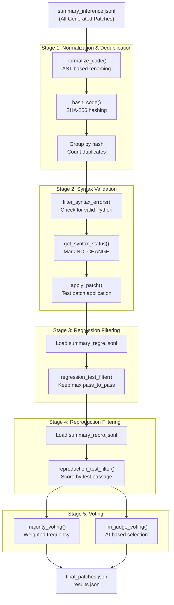
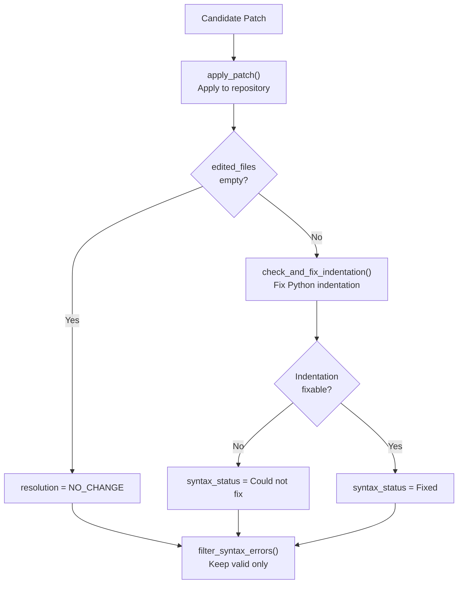
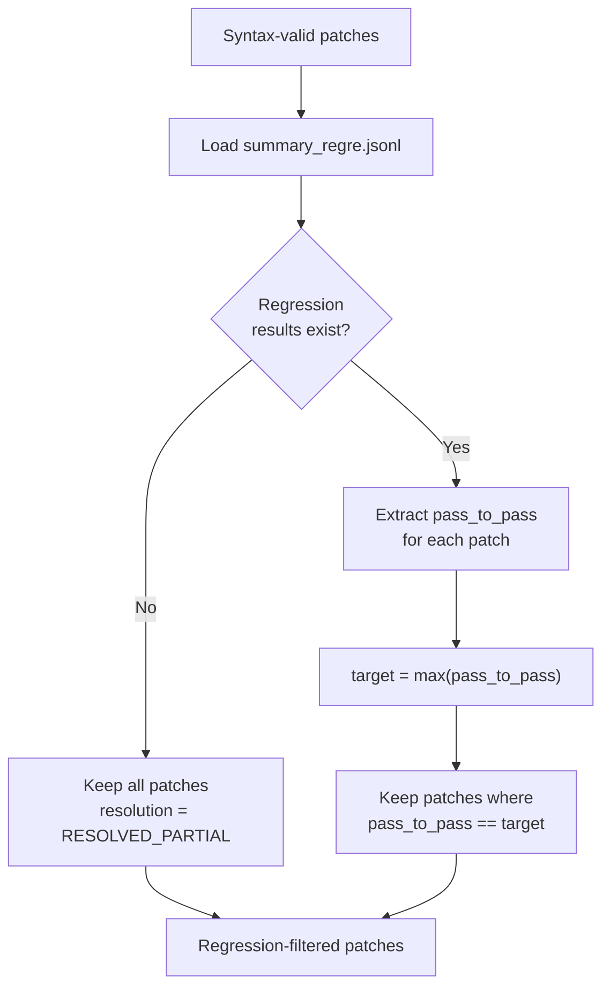
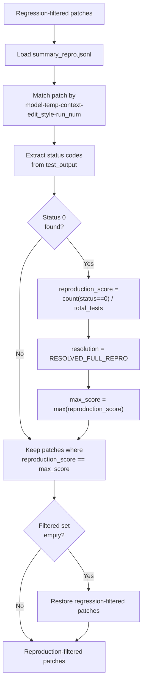
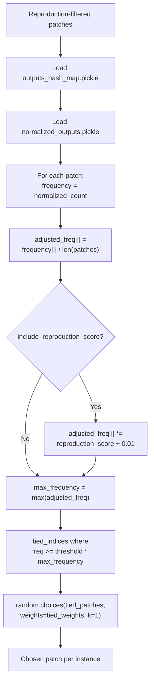
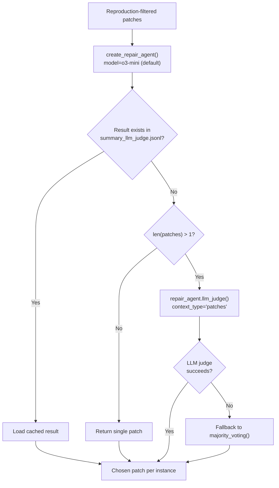
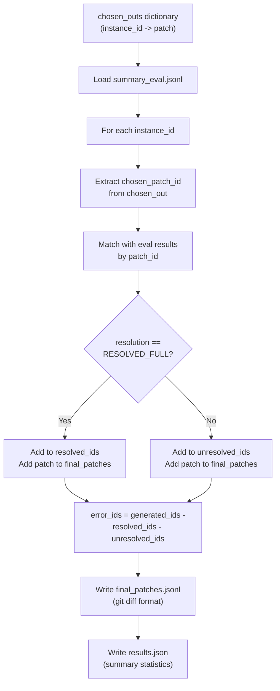

<!-- source: DeepWiki mcp.deepwiki.com · repo NVIDIA/Nemotron-CORTEXA · page 4.3 Solution Filtering and Selection · fetched 2026-10-26 -->

# Solution Filtering and Selection

<details>
<summary>Relevant source files</summary>

The following files were used as context for generating this wiki page:

- [src/cortexa/evaluate/filter_solution.py](src/cortexa/evaluate/filter_solution.py)
- [src/cortexa/evaluate/run_filtering.py](src/cortexa/evaluate/run_filtering.py)

</details>


## Purpose and Scope

This document explains the multi-stage filtering and selection system that processes candidate patches generated during the repair stage to select the best solution for each bug instance. The system applies syntax validation, regression testing, reproduction test scoring, and voting mechanisms to reduce hundreds of candidate patches to a single high-quality solution per instance.

This page focuses on the filtering logic in [src/cortexa/evaluate/filter_solution.py]() and the orchestration script [src/cortexa/evaluate/run_filtering.py](). For information about patch generation, see [Patch Generation Workflow](#3.3). For details on evaluation execution, see [Instance Evaluation and Testing](#4.2).

**Sources**: [src/cortexa/evaluate/filter_solution.py](), [src/cortexa/evaluate/run_filtering.py]()

---

## Multi-Stage Filtering Pipeline

The filtering system implements a four-stage pipeline that progressively narrows the solution space from potentially hundreds of candidate patches to a single selected solution per instance:



**Filtering Pipeline Overview**: Each stage progressively reduces the candidate set while tracking peak performance metrics.

The main orchestration function is `apply_filtering()` [src/cortexa/evaluate/filter_solution.py:578-649](), which coordinates all filtering stages and outputs performance statistics at each step.

**Sources**: [src/cortexa/evaluate/filter_solution.py:578-649](), [src/cortexa/evaluate/run_filtering.py:45-118]()

---

## Code Normalization and Deduplication

The normalization system uses AST (Abstract Syntax Tree) transformations to identify functionally equivalent patches that differ only in variable names, formatting, or comments. This reduces the candidate set by grouping semantically identical solutions.

### Normalization Algorithm

The `CodeNormalizer` class [src/cortexa/evaluate/filter_solution.py:100-128]() implements identifier renaming:

```mermaid
graph LR
    SourceCode["Source Code"]
    
    subgraph RemoveNoise["remove_comments_docstrings_and_empty_lines()"]
        ParseAST1["ast.parse()"]
        RemoveDoc["RemoveDocstrings<br/>NodeTransformer"]
        Unparse1["ast.unparse()"]
    end
    
    subgraph NormalizeNames["CodeNormalizer"]
        ParseAST2["ast.parse()"]
        RenameVars["visit_Name()<br/>name_1, name_2, ..."]
        RenameFunc["visit_FunctionDef()<br/>name_3, name_4, ..."]
        RenameClass["visit_ClassDef()<br/>name_5, name_6, ..."]
        Unparse2["ast.unparse()"]
    end
    
    subgraph HashAndGroup["Hashing"]
        SHA256["hashlib.sha256()"]
        FrozenSet["frozenset(hashes)"]
    end
    
    SourceCode --> ParseAST1
    ParseAST1 --> RemoveDoc
    RemoveDoc --> Unparse1
    Unparse1 --> ParseAST2
    ParseAST2 --> RenameVars
    RenameVars --> RenameFunc
    RenameFunc --> RenameClass
    RenameClass --> Unparse2
    Unparse2 --> SHA256
    SHA256 --> FrozenSet
```



**Normalization Process**: Comments, docstrings, and identifiers are removed or renamed to detect equivalent code structures.

### Key Functions

| Function | Purpose | Location |
|----------|---------|----------|
| `normalize_code()` | Orchestrates full normalization pipeline | [filter_solution.py:162-173]() |
| `CodeNormalizer` | AST transformer for renaming identifiers | [filter_solution.py:100-128]() |
| `remove_comments_docstrings_and_empty_lines()` | Cleans code before normalization | [filter_solution.py:50-95]() |
| `hash_code()` | Generates SHA-256 hash of normalized code | [filter_solution.py:175-177]() |
| `process_set()` | Hashes all edited files in a patch | [filter_solution.py:180-193]() |

The `get_normalized_sets()` function [src/cortexa/evaluate/filter_solution.py:220-301]() applies normalization to all candidate patches and groups them by their hash values. Each group includes:
- `out`: List of original patch outputs
- `count`: Number of times this normalized patch appeared
- `resolution`: Syntax/application status
- `syntax_status`: Detailed error messages if syntax issues exist

**Sources**: [src/cortexa/evaluate/filter_solution.py:50-301]()

---

## Syntax Validation

The syntax validation stage filters out patches that produce invalid Python code or fail to apply cleanly to the repository.

### Validation Criteria

The `filter_syntax_errors()` function [src/cortexa/evaluate/filter_solution.py:327-353]() rejects patches with:

| Rejection Criterion | Detection Method | Example |
|---------------------|------------------|---------|
| `NO_CHANGE` | No files were edited | Empty diff |
| Empty `syntax_status` | Patch application failed | Git apply error |
| `Could not fix` | Indentation errors persist | Mixed tabs/spaces |
| `not exist` | Target file doesn't exist | Wrong file path |

### Syntax Status Flow



**Syntax Validation Workflow**: Patches are applied to the repository and Python files are checked for valid syntax.

The `get_syntax_status()` function [src/cortexa/evaluate/filter_solution.py:304-324]() merges inference results with normalization data to annotate each patch with its syntax status before filtering.

**Sources**: [src/cortexa/evaluate/filter_solution.py:304-353](), [src/cortexa/utils/postprocess_results.py]()

---

## Regression Test Filtering

Regression filtering ensures that selected patches do not break existing functionality by analyzing the `pass_to_pass` metric from regression test evaluation.

### Regression Test Scoring

The `regression_test_filter()` function [src/cortexa/evaluate/filter_solution.py:409-429]() implements the following logic:

1. For each instance, extract all `pass_to_pass` scores from `summary_regre.jsonl`
2. Identify the maximum `pass_to_pass` score
3. Keep only patches that achieve this maximum score
4. If no regression results exist, retain all patches with `resolution = RESOLVED_PARTIAL`



**Regression Filtering Logic**: Only patches with the best regression test performance are retained.

The `pass_to_pass` metric represents the percentage of tests that passed before the patch and still pass after applying the patch. A score of 1.0 indicates no regression.

**Sources**: [src/cortexa/evaluate/filter_solution.py:409-429]()

---

## Reproduction Test Filtering

Reproduction test filtering scores patches based on their ability to pass generated reproduction tests that verify the bug fix.

### Reproduction Test Status Patterns

The `reproduction_test_filter()` function [src/cortexa/evaluate/filter_solution.py:431-487]() analyzes test output using two patterns:

| Pattern Type | Detection | Status Code | Meaning |
|--------------|-----------|-------------|---------|
| Status Pattern | `reproduction test status:(\w+)` | 0 | Issue resolved |
| Status Pattern | `reproduction test status:(\w+)` | 2 | Issue not resolved |
| Printable Pattern | `Issue resolved` | 0 | Issue resolved |
| Printable Pattern | Other | 2 | Issue not resolved |

### Reproduction Scoring Algorithm



**Reproduction Test Filtering**: Patches are scored by their ability to pass generated reproduction tests, with ties broken by maximum score.

The parameter `only_keep_max_score=True` [src/cortexa/evaluate/filter_solution.py:431]() ensures that only patches with the highest reproduction score are retained. If all patches fail reproduction tests, the system falls back to the regression-filtered set.

**Sources**: [src/cortexa/evaluate/filter_solution.py:431-487]()

---

## Voting Mechanisms

After filtering, multiple candidate patches may remain for a single instance. The voting stage selects exactly one patch using either majority voting or LLM judge voting.

### Majority Voting

The `majority_voting()` function [src/cortexa/evaluate/filter_solution.py:489-518]() implements weighted frequency-based selection:



**Majority Voting Algorithm**: Patches are selected based on weighted frequency with optional reproduction score weighting.

The `threshold` parameter (default 0.5) controls tie-breaking. Patches within 50% of the maximum frequency are eligible for selection.

### LLM Judge Voting

The `llm_judge_voting()` function [src/cortexa/evaluate/filter_solution.py:521-575]() uses an LLM to evaluate multiple patches and select the best one:



**LLM Judge Voting**: An LLM evaluates patches and selects the best one, with fallback to majority voting on errors.

The LLM judge uses the `META_JUDGE_PREMISE` prompt template (see [LLM Judge and Solution Selection](#3.5)) to compare patches based on correctness, minimalism, and alignment with the bug description.

**Sources**: [src/cortexa/evaluate/filter_solution.py:489-575]()

---

## Command-Line Interface

The `run_filtering.py` script [src/cortexa/evaluate/run_filtering.py]() provides a command-line interface for the filtering system:

### Key Command-Line Arguments

| Argument | Default | Purpose |
|----------|---------|---------|
| `--log_dir` | `{root}/logs` | Directory containing evaluation results |
| `--inference_file` | `summary_inference.jsonl` | Patch generation results |
| `--regression_file` | `summary_regre.jsonl` | Regression test results |
| `--reproduction_file` | `summary_repro.jsonl` | Reproduction test results |
| `--eval_file` | `summary_eval.jsonl` | Gold test evaluation results |
| `--normalized_file` | `normalized_outputs.pickle` | Cached normalization results |
| `--hash_map_file` | `outputs_hash_map.pickle` | Hash mapping for deduplication |
| `--vote_mode` | `llm_judge` | Voting mechanism (`majority` or `llm_judge`) |
| `--model_name` | `o3-mini` | LLM model for judge voting |
| `--run_normalization` | False | Force re-run of normalization |

### Usage Example

```bash
python -m cortexa.evaluate.run_filtering \
    --log_dir /path/to/logs \
    --vote_mode llm_judge \
    --model_name o3-mini \
    --dataset_name_or_path princeton-nlp/SWE-bench_Verified
```

**Sources**: [src/cortexa/evaluate/run_filtering.py:27-43]()

---

## Final Output Generation

The filtering system generates two output files that summarize the final selected patches and resolution statistics.

### Output File Formats

#### final_patches.json (or .jsonl)

Format: JSONL (one JSON object per line)

```json
{
  "instance_id": "django__django-12345",
  "model_patch": "diff --git a/path/to/file.py b/path/to/file.py\nindex abc..def\n--- a/path/to/file.py\n+++ b/path/to/file.py\n...",
  "model_name_or_path": "o3-mini"
}
```

Each line contains:
- `instance_id`: Bug instance identifier
- `model_patch`: Git diff format patch
- `model_name_or_path`: Model used for final selection (judge model if using LLM voting)

#### results.json

Format: JSON with summary statistics

```json
{
  "generated_ids": ["django__django-12345", "django__django-12346", ...],
  "resolved_ids": ["django__django-12345", ...],
  "unresolved_ids": ["django__django-12346", ...],
  "error_ids": []
}
```

Fields:
- `generated_ids`: All instances with selected patches
- `resolved_ids`: Instances where `resolution == RESOLVED_FULL` in eval results
- `unresolved_ids`: Instances where patch was selected but didn't pass gold tests
- `error_ids`: Instances with evaluation errors (generated but not in resolved/unresolved)

### Output Generation Logic



**Output Generation Flow**: Selected patches are matched with evaluation results to determine final resolution status.

**Sources**: [src/cortexa/evaluate/run_filtering.py:63-118]()

---

## Performance Tracking

The `apply_filtering()` function prints performance statistics at each filtering stage when `print_stats=True`:

```
Peak performance after syntax filtering: 150
Peak performance after regression test: 148
Peak performance after reproduction test: 142
Final pass@1 performance after voting: 138
```

These statistics use the `get_passed_instances()` function [src/cortexa/evaluate/filter_solution.py:385-390]() to count instances with `resolution == RESOLVED_FULL` at each stage. This allows developers to diagnose where the filtering pipeline may be too aggressive or identify which stages provide the most benefit.

**Sources**: [src/cortexa/evaluate/filter_solution.py:385-390](), [src/cortexa/evaluate/filter_solution.py:609-647]()

---

