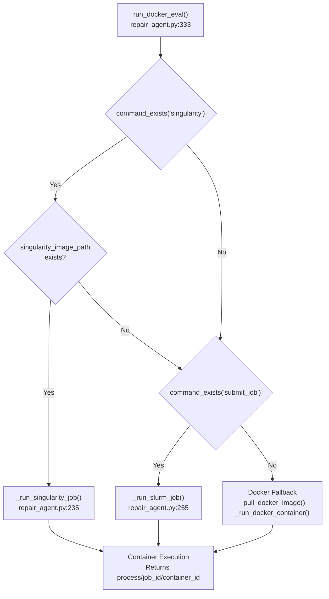
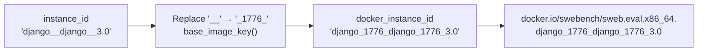
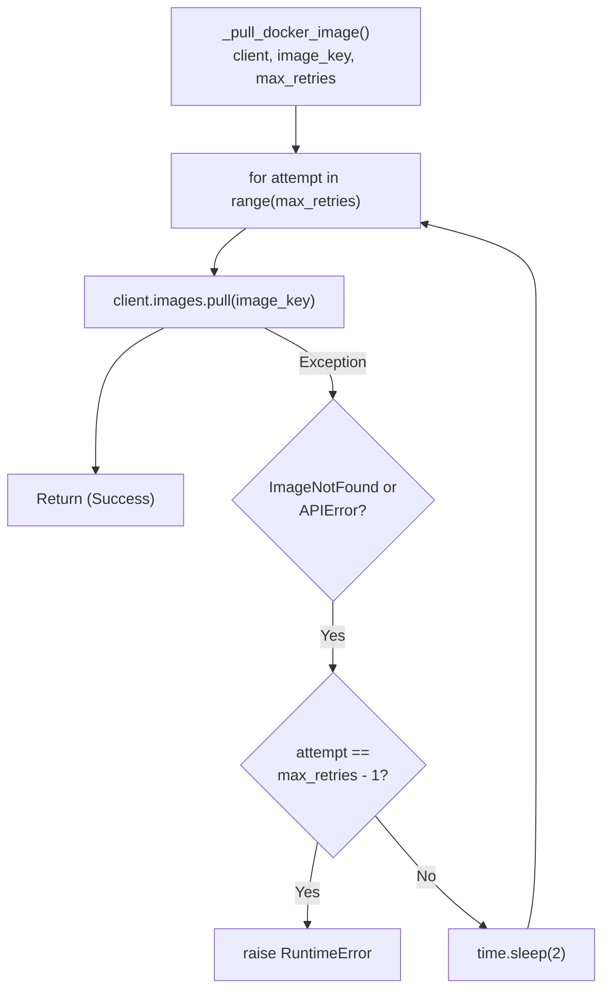
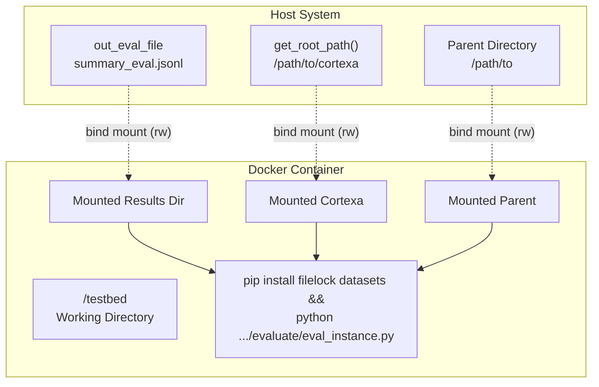
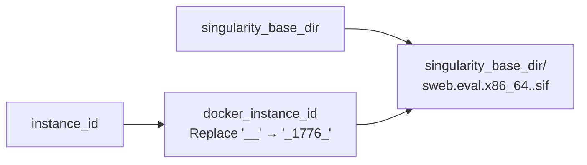
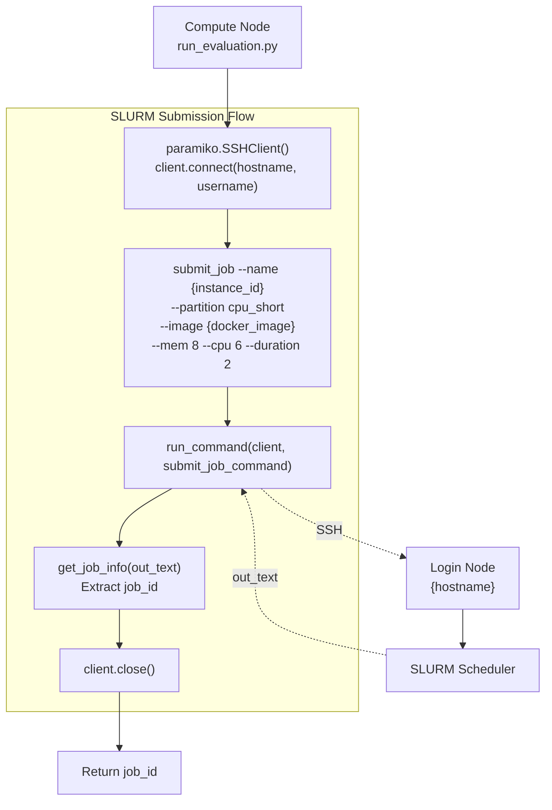
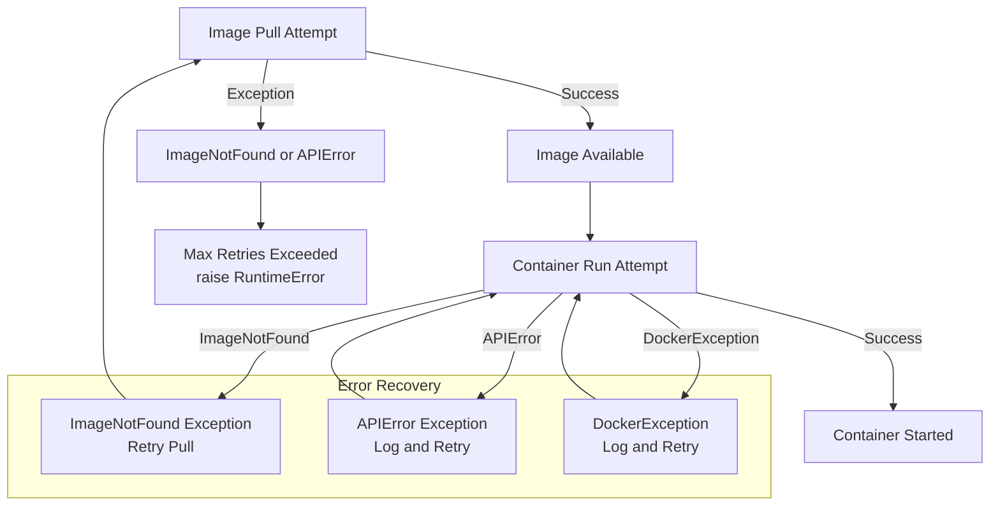
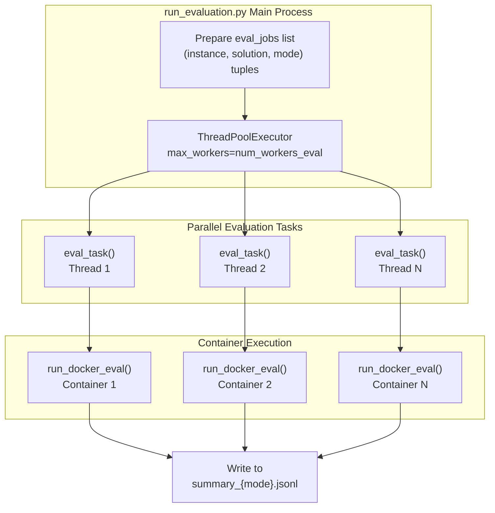
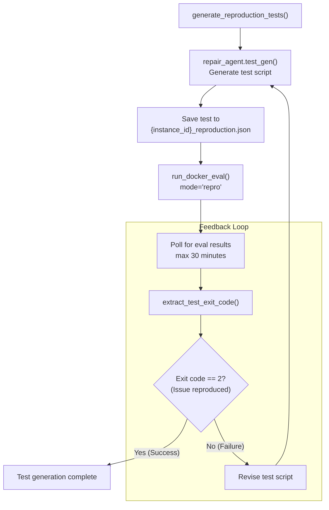
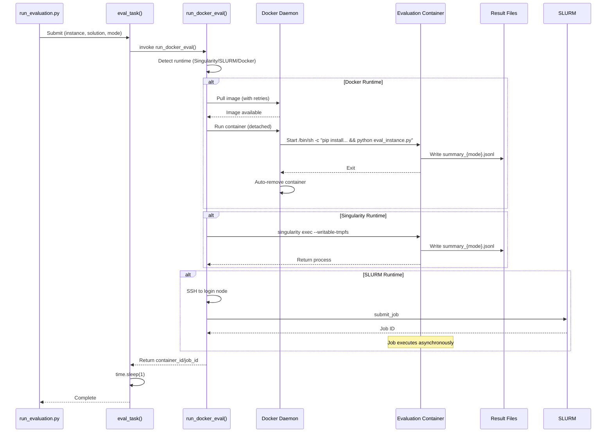

<!-- source: DeepWiki mcp.deepwiki.com · repo NVIDIA/Nemotron-CORTEXA · page 4.4 Container Execution Environments · fetched 2026-10-26 -->

# Container Execution Environments

<details>
<summary>Relevant source files</summary>

The following files were used as context for generating this wiki page:

- [src/cortexa/evaluate/run_evaluation.py](src/cortexa/evaluate/run_evaluation.py)
- [src/cortexa/repair/prompts.py](src/cortexa/repair/prompts.py)
- [src/cortexa/repair/repair_agent.py](src/cortexa/repair/repair_agent.py)
- [src/cortexa/repair/repro_test_gen.py](src/cortexa/repair/repro_test_gen.py)

</details>


## Purpose and Scope

This page documents the container execution system in Nemotron-CORTEXA, which provides isolated runtime environments for safely executing patch evaluations and reproduction tests. The system supports three container runtimes: **Docker**, **Singularity**, and **SLURM**, with automatic selection based on available commands in the execution environment.

For information about what happens inside these containers during evaluation, see [Instance Evaluation and Testing](#4.2). For the orchestration layer that schedules parallel evaluation jobs across containers, see [Evaluation Orchestration](#4.1).

---

## Runtime Selection Architecture

The system implements a cascading selection strategy that prioritizes Singularity over SLURM over Docker, based on command availability detected at runtime.



**Runtime Selection Logic**: The system first checks for Singularity availability using `command_exists('singularity')`. If available, it verifies the image exists at the expected path. If not, it falls back to SLURM if `submit_job` command exists, otherwise defaults to Docker.

**Sources**: [src/cortexa/repair/repair_agent.py:355-373]()

---

## Docker Image Naming Convention

The system uses a standardized naming convention for Docker images based on the SWE-bench instance ID:



**Image Name Construction**: The `base_image_key()` function [repair_agent.py:206-208]() transforms instance IDs by replacing double underscores with `_1776_` to comply with Docker naming restrictions, then prefixes with `docker.io/swebench/sweb.eval.x86_64.`.

**Sources**: [src/cortexa/repair/repair_agent.py:206-208](), [src/cortexa/repair/repair_agent.py:230-233]()

---

## Docker Runtime Implementation

### Image Pulling with Retry Logic



**Retry Mechanism**: The system attempts to pull Docker images up to `max_retries` times (default: 3), with 2-second delays between attempts. This handles transient network failures and Docker daemon issues.

**Sources**: [src/cortexa/repair/repair_agent.py:281-293]()

### Container Execution with Volume Mounting

The Docker runtime mounts three critical directories to enable access to evaluation scripts, repository code, and result files:

| Volume Mount | Purpose | Mode |
|--------------|---------|------|
| `os.path.dirname(out_eval_file)` | Results output directory | `rw` |
| `get_root_path()` | Cortexa codebase root | `rw` |
| `os.path.dirname(os.path.dirname(get_root_path()))` | Parent directory (contains repo_playground) | `rw` |



**Volume Strategy**: All mounts use read-write mode to allow the container to write evaluation results and access repository clones. The container's working directory is set to `/testbed`, which contains the repository code from the SWE-bench image.

**Sources**: [src/cortexa/repair/repair_agent.py:295-326]()

### Container Command Construction

The system builds a multi-stage command that installs dependencies and executes the evaluation script:

```python
full_command = f"pip install filelock datasets && {command}"
# where command = _build_cortexa_eval_command(...)
```

The evaluation command structure:
```
python {work_dir}/evaluate/eval_instance.py 
  --instance_id={instance_id}
  --dataset_name_or_path={dataset_name_or_path}
  --patch_id={patch_id}
  --out_inference_file={out_inf_file}
  --out_eval_file={out_eval_file}
  --script_dir={script_dir}/eval_scripts
  --mode={mode}
  --repro_test_dir={repro_test_dir}
  --dataset_info_file={dataset_info_file}
```

**Command Structure**: The command first installs `filelock` (for concurrent file access) and `datasets` (for loading SWE-bench data), then invokes `eval_instance.py` with all necessary parameters.

**Sources**: [src/cortexa/repair/repair_agent.py:215-228](), [src/cortexa/repair/repair_agent.py:297]()

---

## Singularity Runtime Implementation

### Image Path Resolution

Singularity images are stored in a centralized directory with predictable naming:



**Path Construction**: The `get_singularity_image_path()` function [repair_agent.py:328-331]() applies the same `_1776_` transformation and appends `.sif` extension to locate Singularity Image Format files.

**Sources**: [src/cortexa/repair/repair_agent.py:328-331]()

### Singularity Container Execution

The Singularity runtime uses `subprocess.run()` with writable tmpfs and bind mounts:

```python
singularity_command = (
    f"singularity exec --writable-tmpfs "
    f"--bind {work_dir}:{work_dir} "
    f"--bind {os.path.dirname(out_eval_file)}:{os.path.dirname(out_eval_file)} "
    f"--bind {get_root_path()}:{get_root_path()} "
    f"--bind {os.path.dirname(os.path.dirname(get_root_path()))}:{os.path.dirname(os.path.dirname(get_root_path()))} "
    f"{singularity_image_path} "
    f"bash -c 'pip install filelock && {command}'"
)
```

**Singularity Options**:
- `--writable-tmpfs`: Allows temporary file modifications without altering the base image
- `--bind`: Creates bind mounts with identical host and container paths (simplifies path references)
- Output redirected to `subprocess.DEVNULL` to prevent stdout/stderr pollution

**Sources**: [src/cortexa/repair/repair_agent.py:235-252]()

---

## SLURM Runtime Implementation

### SSH-Based Job Submission

The SLURM runtime submits jobs remotely via SSH using Paramiko, which is necessary when the evaluation orchestrator runs on a compute node but job submission requires login node access:



**SLURM Job Parameters**:
| Parameter | Value | Purpose |
|-----------|-------|---------|
| `--name` | `{instance_id}` | Job identification |
| `--email_mode` | `fail` | Only notify on failures |
| `--partition` | `cpu_short` | Use short-duration CPU queue |
| `--image` | `{docker_image}` | Specify container image |
| `--mem` | `8` | 8 GB memory allocation |
| `--cpu` | `6` | 6 CPU cores |
| `--duration` | `2` | 2-hour time limit |
| `--prolog_command` | `'pip install filelock'` | Pre-execution setup |
| `--command` | `{command}` | Evaluation command |

**Sources**: [src/cortexa/repair/repair_agent.py:255-278](), [src/cortexa/evaluate/eval_util.py]() (for `run_command` and `get_job_info`)

---

## Runtime Comparison Table

| Feature | Docker | Singularity | SLURM |
|---------|--------|-------------|-------|
| **Detection Command** | (default) | `singularity` | `submit_job` |
| **Execution Mode** | Synchronous (detached) | Synchronous | Asynchronous (job queue) |
| **Image Format** | Docker images | `.sif` files | Docker images (via SLURM) |
| **Image Location** | Docker Hub (`docker.io/swebench/...`) | Local filesystem | Docker Hub |
| **Volume Mounting** | Docker volumes | Bind mounts | Managed by SLURM |
| **Output Handling** | Logs in container | Redirected to `/dev/null` | Managed by SLURM |
| **Retry Logic** | Yes (3 attempts) | No (subprocess fails immediately) | No (job submission succeeds or fails) |
| **Resource Limits** | Docker defaults | Host system | SLURM scheduler (8GB, 6 CPU, 2h) |
| **Cleanup** | `remove=True` (auto-cleanup) | No cleanup needed | SLURM manages lifecycle |
| **Return Value** | Container ID | Process object | Job ID |

**Runtime Selection Priority**: Singularity > SLURM > Docker

**Sources**: [src/cortexa/repair/repair_agent.py:333-373]()

---

## Error Handling and Reliability

### Docker Error Recovery

The Docker runtime implements comprehensive error handling for both image pulling and container execution:



**Error Types**:
1. **ImageNotFound**: Image not available locally or remotely → Retry pull operation
2. **APIError**: Docker daemon communication failure → Log error, retry after 2 seconds
3. **DockerException**: General Docker errors → Log error, retry after 2 seconds

**Max Retries**: Configurable via `max_docker_retries` parameter (default: 3). After exhausting retries, raises `RuntimeError` with diagnostic message.

**Sources**: [src/cortexa/repair/repair_agent.py:281-326]()

### Singularity Error Handling

Singularity uses synchronous subprocess execution with minimal error handling:

```python
process = subprocess.run(
    singularity_command,
    shell=True,
    stdout=subprocess.DEVNULL,
    stderr=subprocess.DEVNULL,
    stdin=subprocess.DEVNULL,
    check=True  # Raises CalledProcessError on non-zero exit
)
```

**Failure Mode**: If Singularity image is missing, logs warning and falls back to SLURM or Docker:
```
Singularity image not found: {singularity_image_path}. Running docker instead.
```

**Sources**: [src/cortexa/repair/repair_agent.py:359-364]()

---

## Integration with Evaluation Pipeline

### Parallel Evaluation Workflow

The container execution system integrates with the evaluation orchestrator through a ThreadPoolExecutor pattern:



**Concurrency Model**: The orchestrator spawns multiple threads (default: 4) that each invoke `run_docker_eval()` for different (instance, solution, mode) combinations. Each thread manages its own container lifecycle independently.

**Sources**: [src/cortexa/evaluate/run_evaluation.py:222-232]()

### Evaluation Task Function

The `eval_task()` function bridges the orchestrator and container execution:

```python
def eval_task(instance, solution, mode, eval_file_name, out_inf_file, 
              repro_test_dir, model_config, args):
    instance_id = instance['instance_id']
    model_name = model_config[solution['model']]['model_name']
    patch_id = f"{model_name}_{solution['context']}_{solution['edit_style']}_{solution['temp']}_{solution['run_num']}"
    
    run_docker_eval(
        work_dir=get_root_path(),
        instance_id=instance_id,
        out_inf_file=out_inf_file,
        out_eval_file=out_eval_file,
        patch_id=patch_id,
        mode=mode,
        dataset_name_or_path=args.dataset_name_or_path,
        hostname=args.hostname,
        repro_test_dir=repro_test_dir,
        dataset_info_file=dataset_info_file,
        singularity_base_dir=args.singularity_base_dir
    )
    time.sleep(1)  # Rate limiting
```

**Parameter Flow**:
1. `instance` → `instance_id`: Identifies the bug instance
2. `solution` → `patch_id`: Identifies which patch variant to evaluate
3. `mode` → passed to container: Determines eval/repro/regre mode
4. `args.singularity_base_dir` → runtime selection: Configures Singularity image location

**Sources**: [src/cortexa/evaluate/run_evaluation.py:43-65]()

### Reproduction Test Generation Integration

The reproduction test generation workflow also uses containers, but with a different pattern:



**Test Generation Loop**: The system iteratively generates test scripts, runs them in containers, and revises based on exit codes until the test successfully reproduces the issue (exit code 2) or max rounds are reached.

**Sources**: [src/cortexa/repair/repro_test_gen.py:98-172]()

---

## Configuration Parameters

### Command Line Arguments for Container Configuration

The evaluation orchestrator accepts container-related parameters:

```python
parser.add_argument('--hostname', type=str, default='', 
                    help='Hostname for SSH job submission (SLURM)')
parser.add_argument('--repro_test_dir', type=str, default=None, 
                    help='Directory for reproduction tests')
parser.add_argument('--singularity_base_dir', type=str, 
                    default=f'{os.path.dirname(os.path.dirname(get_root_path()))}/singularity_images',
                    help='Singularity base directory')
parser.add_argument('--num_workers_eval', type=int, default=4, 
                    help='Number of parallel workers for evaluation')
```

### Default Paths

| Parameter | Default Value | Purpose |
|-----------|--------------|---------|
| `repo_playground` | `../../repo_playground` | Repository clones |
| `repro_test_dir` | `../../reproduction_tests/merged` | Reproduction test files |
| `singularity_base_dir` | `../../singularity_images` | Singularity `.sif` files |
| `hostname` | `''` | SLURM login node (empty = not used) |

**Path Resolution**: All paths are resolved relative to `get_root_path()`, which returns the Cortexa installation directory.

**Sources**: [src/cortexa/evaluate/run_evaluation.py:96-116](), [src/cortexa/repair/repro_test_gen.py:344-361]()

---

## Container Lifecycle Summary



**Execution Patterns**:
- **Docker**: Asynchronous (detached mode) with automatic cleanup
- **Singularity**: Synchronous blocking until completion
- **SLURM**: Fire-and-forget job submission

**Sources**: [src/cortexa/repair/repair_agent.py:333-373](), [src/cortexa/evaluate/run_evaluation.py:43-65]()

---

