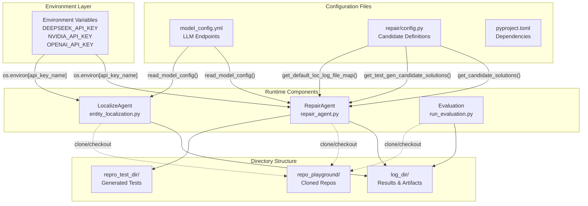
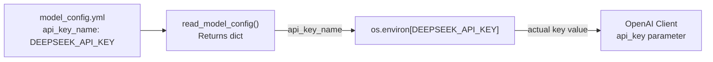
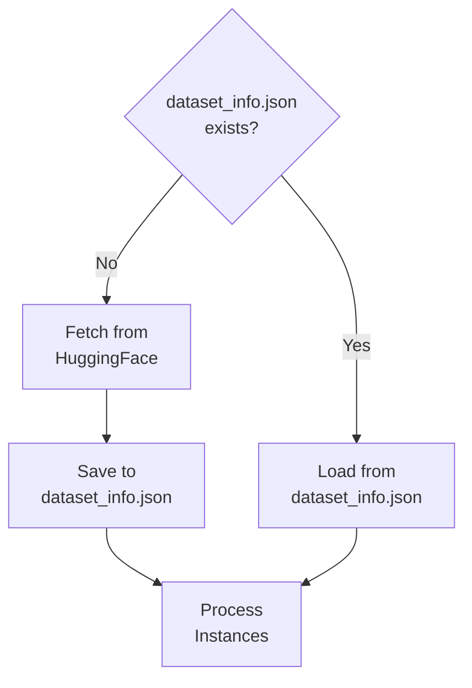
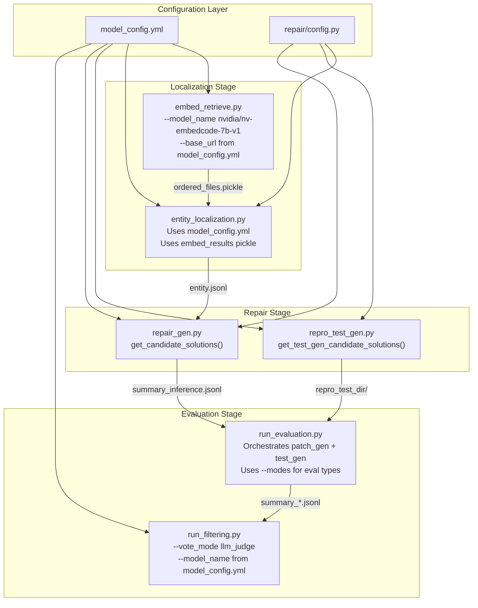

<!-- source: DeepWiki mcp.deepwiki.com · repo NVIDIA/Nemotron-CORTEXA · page 5 Configuration and Setup · fetched 2026-10-26 -->

# Configuration and Setup

<details>
<summary>Relevant source files</summary>

The following files were used as context for generating this wiki page:

- [README.md](README.md)
- [model_config.yml](model_config.yml)

</details>


This document provides a comprehensive guide to configuring Nemotron-CORTEXA before running the automated bug fixing pipeline. It covers model endpoint configuration, API key management, candidate solution definitions, and directory setup. For detailed explanations of specific configuration aspects, see [Model Configuration](#5.1), [Candidate Solution Configuration](#5.2), and [Repository and Dataset Setup](#5.3).

## Purpose and Scope

This page documents the configuration layer that connects Nemotron-CORTEXA to external LLM providers, defines the diversity of repair strategies, and establishes the file system structure required for execution. The configuration system is designed to separate operational settings from code logic, enabling easy experimentation with different models, prompts, and generation strategies without modifying core components.

**Topics covered:**
- `model_config.yml` structure and LLM provider setup
- Environment variable-based API key management
- `repair/config.py` candidate definitions
- Directory structure (`log_dir`, `repo_playground`, `repro_test_dir`)
- Dataset loading and caching mechanisms

**Related pages:**
- For localization configuration details, see [Entity Localization with Agents](#2.2)
- For evaluation container runtime selection, see [Container Execution Environments](#4.4)
- For prompt template customization, see [Prompt Engineering and Templates](#3.2)

## Configuration Architecture Overview



**Sources**: [model_config.yml:1-15](), [README.md:61-62](), [README.md:76-77](), [README.md:71]()

## Model Configuration File Structure

The `model_config.yml` file defines LLM endpoint configurations for all AI-powered components in Nemotron-CORTEXA. Each model entry specifies three required fields:

| Field | Purpose | Example |
|-------|---------|---------|
| `base_url` | API endpoint URL | `https://api.deepseek.com` |
| `api_key_name` | Environment variable name | `DEEPSEEK_API_KEY` |
| `model_name` | Model identifier for API calls | `deepseek-chat` |

### Supported Provider Configurations

```yaml
# DeepSeek Direct API
deepseek-v3-0324:
  base_url: 'https://api.deepseek.com'
  api_key_name: 'DEEPSEEK_API_KEY'
  model_name: 'deepseek-chat'

# NVIDIA API Gateway (DeepSeek via NVIDIA)
deepseek-v3-0324-nvdev:
  base_url: 'https://integrate.api.nvidia.com/v1'
  api_key_name: 'NVIDIA_API_KEY'
  model_name: 'nvdev/deepseek-ai/deepseek-v3-0324'

# NVIDIA API Gateway (Meta Llama)
llama-3.3-70b-instruct:
  base_url: 'https://integrate.api.nvidia.com/v1'
  api_key_name: 'NVIDIA_API_KEY'
  model_name: 'nvdev/meta/llama-3.3-70b-instruct'
```

The configuration keys (e.g., `deepseek-v3-0324`) serve as model identifiers referenced throughout the codebase, particularly in `repair/config.py` when defining candidate solutions.

**Sources**: [model_config.yml:1-15](), [README.md:61-62]()

## API Key Management

Nemotron-CORTEXA uses environment variable-based API key management for security. The system retrieves API keys at runtime using `os.environ[api_key_name]` where `api_key_name` comes from the model configuration.

### Required Environment Variables

Based on the default `model_config.yml`, the following environment variables must be set:

```bash
# DeepSeek API (required for default repair configurations)
export DEEPSEEK_API_KEY="your_deepseek_api_key_here"

# NVIDIA API (required for embeddings and alternative LLM access)
export NVIDIA_API_KEY="your_nvidia_api_key_here"

# OpenAI API (optional, for custom configurations)
export OPENAI_API_KEY="your_openai_api_key_here"
```

### Runtime Key Resolution



The [repair_agent.py:220-240]() `RepairAgent.__init__()` method and [entity_localization.py]() `LocalizeAgent` both follow this pattern to construct OpenAI-compatible API clients.

**Security Note**: Never commit API keys to version control. The configuration design explicitly separates key names (in config files) from key values (in environment variables) to prevent accidental exposure.

**Sources**: [README.md:61-62](), [model_config.yml:3,8,13]()

## Candidate Solution Configuration

The `repair/config.py` file defines the diversity strategy for patch and test generation. It exports three key functions:

### Key Configuration Functions

| Function | Returns | Purpose |
|----------|---------|---------|
| `get_candidate_solutions(dataset_name)` | `List[Dict]` | Defines patch generation candidates with model/edit_style/temperature combinations |
| `get_test_gen_candidate_solutions(dataset_name)` | `List[Dict]` | Defines reproduction test generation candidates |
| `get_default_loc_log_file_map(dataset_name)` | `Dict[str, str]` | Maps datasets to localization artifact file paths |

### Candidate Solution Dictionary Structure

Each candidate in the lists returned by `get_candidate_solutions()` and `get_test_gen_candidate_solutions()` must contain:

```python
{
    "model_name": "deepseek-v3-0324",        # Key from model_config.yml
    "edit_style": "json",                     # One of: json, edit_command, search_replace
    "temperature": 0.8,                       # Sampling temperature
    "seed": 42,                               # Random seed for reproducibility
    "model_name_short": "deepseek",          # Short name for file naming
    # Optional fields for test generation:
    "test_case_role": "Reproduction Test",   # Test type identifier
    "max_round": 3                           # Max feedback iteration rounds
}
```

The `model_name` field must match a key in `model_config.yml`. The `edit_style` determines which prompt template from [prompts.py]() will be used.

**Sources**: [README.md:71](), [README.md:76-77]()

## Directory Structure Setup

Nemotron-CORTEXA requires three primary directories that can be configured via command-line arguments:

### Directory Layout

```mermaid
graph TB
    subgraph "Working Directory"
        LogDir["log_dir/<br/>--log_dir ./logs"]
        RepoPlayground["repo_playground/<br/>--repo_playground ./repos"]
        ReproTestDir["repro_test_dir/<br/>--repro_test_dir ./repro_tests"]
    end
    
    subgraph "log_dir Contents"
        DatasetInfo["dataset_info.json<br/>Cached Dataset"]
        OrderedFiles["cortexa_*_ordered_files.pickle<br/>File Rankings"]
        EntityResults["*_entity.jsonl<br/>Entity Localizations"]
        SummaryInference["summary_inference.jsonl<br/>Patch Candidates"]
        SummaryTestGen["summary_test_gen.jsonl<br/>Test Generation"]
        SummaryEval["summary_eval.jsonl<br/>Gold Test Results"]
        SummaryRepro["summary_repro.jsonl<br/>Repro Test Results"]
        NormalizedOutputs["normalized_outputs.pickle<br/>Deduplicated Patches"]
        FinalPatches["final_patches.json<br/>Selected Solutions"]
        Results["results.json<br/>Resolution Summary"]
    end
    
    subgraph "repo_playground Contents"
        RepoClone["<owner>__<repo>-<base_commit>/<br/>Git Repository Clone"]
    end
    
    subgraph "repro_test_dir Contents"
        ModelTestDir["<model_name>/<br/>Per-Model Tests"]
        InstanceTest["<instance_id>.test<br/>Generated Test File"]
    end
    
    LogDir --> DatasetInfo
    LogDir --> OrderedFiles
    LogDir --> EntityResults
    LogDir --> SummaryInference
    LogDir --> SummaryTestGen
    LogDir --> SummaryEval
    LogDir --> SummaryRepro
    LogDir --> NormalizedOutputs
    LogDir --> FinalPatches
    LogDir --> Results
    
    RepoPlayground --> RepoClone
    ReproTestDir --> ModelTestDir
    ModelTestDir --> InstanceTest
```



### Directory Configuration Parameters

| Directory | CLI Argument | Default | Purpose |
|-----------|--------------|---------|---------|
| Log Directory | `--log_dir` | `./logs` | Stores all artifacts, results, and intermediate files |
| Repository Playground | `--repo_playground` | `./repos` | Contains cloned repositories at specific commits |
| Reproduction Test Directory | `--repro_test_dir` | `./repro_tests` | Stores generated reproduction tests per model |

These paths are accepted by all major entry points: [embed_retrieve.py](), [entity_localization.py](), [repro_test_gen.py](), [repair_gen.py](), [run_evaluation.py](), [run_filtering.py]().

**Sources**: [README.md:26-27](), [README.md:81-83](), [README.md:117]()

## Dataset Configuration and Caching

### Dataset Loading

Nemotron-CORTEXA loads SWE-bench datasets from HuggingFace using the `datasets` library. The system supports:

- `princeton-nlp/SWE-bench_Verified` (300 instances)
- `princeton-nlp/SWE-bench_Lite` (300 instances)
- `princeton-nlp/SWE-bench` (2,294 instances)

Dataset selection is controlled via the `--dataset_name_or_path` argument:

```bash
--dataset_name_or_path princeton-nlp/SWE-bench_Verified
```

### Dataset Caching Mechanism

To avoid repeated HuggingFace API calls, [run_evaluation.py:104-107]() implements a caching strategy:



The `dataset_info.json` file is created in `log_dir` on first run and contains the full dataset dictionary serialized as JSON.

### Instance Filtering

To process a subset of instances, use the `--instance_id` argument with comma-separated IDs:

```bash
--instance_id astropy__astropy-12907,django__django-11999
```

Omitting `--instance_id` processes the entire dataset.

**Sources**: [README.md:30-34](), [README.md:90-91](), [run_evaluation.py:104-107]()

## Pre-processed Localization Results

For convenience, pre-computed localization results are included in the repository:

| File | Location | Contents |
|------|----------|----------|
| Ordered Files | `src/cortexa/retrieval/files/cortexa_all_llmsummary_ordered_files.pickle` | File rankings for 707 instances (union of Lite + Verified) |
| Entity Localizations | `src/cortexa/retrieval/files/cortexa_all_llmsummary_LA_DP_entity.jsonl` | Entity-level localization results |

These files can be referenced in `repair/config.py` via `get_default_loc_log_file_map()` to skip the localization stage entirely during development or testing.

### Pickle File Structure

The `ordered_files.pickle` contains:

```python
{
    "instance_id": (
        ["ranked_file_1.py", "ranked_file_2.py", ...],  # Predicted files
        ["oracle_file_1.py", "oracle_file_2.py", ...]   # Ground truth files
    )
}
```

**Sources**: [README.md:43-44](), [README.md:71]()

## Configuration Validation Checklist

Before running Nemotron-CORTEXA, ensure:

1. **Environment Variables**: All required API keys are set
   ```bash
   echo $DEEPSEEK_API_KEY  # Should output key, not empty
   echo $NVIDIA_API_KEY    # Should output key, not empty
   ```

2. **Model Configuration**: `model_config.yml` exists and is valid YAML
   ```bash
   python -c "import yaml; yaml.safe_load(open('model_config.yml'))"
   ```

3. **Directory Permissions**: Target directories are writable
   ```bash
   mkdir -p ./logs ./repos ./repro_tests
   ```

4. **Candidate Configuration**: `repair/config.py` references valid model names
   - All `model_name` values in candidates must exist as keys in `model_config.yml`

5. **Network Access**: API endpoints are reachable
   ```bash
   curl -I https://api.deepseek.com
   curl -I https://integrate.api.nvidia.com/v1
   ```

## Configuration Flow Through System Components



**Sources**: [README.md:49-63](), [README.md:71](), [README.md:76-77](), [README.md:80-105]()

## Quick Configuration Examples

### Example 1: Adding a New LLM Provider

To add support for OpenAI GPT-4:

1. Edit `model_config.yml`:
```yaml
gpt-4-turbo:
  base_url: 'https://api.openai.com/v1'
  api_key_name: 'OPENAI_API_KEY'
  model_name: 'gpt-4-turbo-preview'
```

2. Set environment variable:
```bash
export OPENAI_API_KEY="sk-..."
```

3. Reference in `repair/config.py`:
```python
{
    "model_name": "gpt-4-turbo",
    "edit_style": "json",
    "temperature": 0.8
}
```

### Example 2: Configuring Multiple Candidate Strategies

To generate patches with diverse strategies:

```python
def get_candidate_solutions(dataset_name):
    return [
        {"model_name": "deepseek-v3-0324", "edit_style": "json", "temperature": 0.8},
        {"model_name": "deepseek-v3-0324", "edit_style": "edit_command", "temperature": 0.8},
        {"model_name": "deepseek-v3-0324", "edit_style": "search_replace", "temperature": 1.0},
        {"model_name": "llama-3.3-70b-instruct", "edit_style": "json", "temperature": 0.7},
    ]
```

This produces 4 patch candidates per instance, enabling the filtering stage to select the best solution.

**Sources**: [README.md:71](), [model_config.yml:1-15]()

## Configuration Best Practices

1. **Model Name Consistency**: Use short, descriptive keys in `model_config.yml` that clearly indicate provider and model version (e.g., `deepseek-v3-0324`, not `model1`).

2. **Temperature Tuning**: Lower temperatures (0.0-0.5) for deterministic tasks like syntax-critical edits; higher temperatures (0.8-1.2) for creative patch generation.

3. **Candidate Diversity**: Include multiple edit styles (`json`, `edit_command`, `search_replace`) to maximize coverage of different bug types.

4. **Localization Reuse**: Use pre-computed `ordered_files.pickle` from `get_default_loc_log_file_map()` during development to save embedding costs.

5. **Directory Organization**: Use separate `log_dir` paths for different experiments to avoid artifact contamination:
   ```bash
   --log_dir ./logs/experiment_1
   --log_dir ./logs/experiment_2
   ```

**Sources**: [README.md:63](), [README.md:71](), [README.md:76-77]()

---

