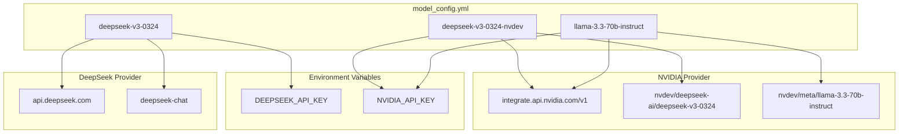
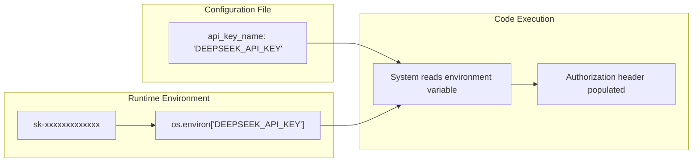
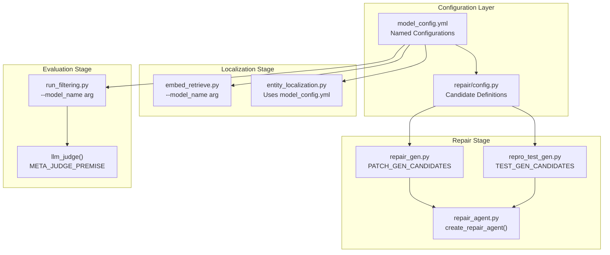
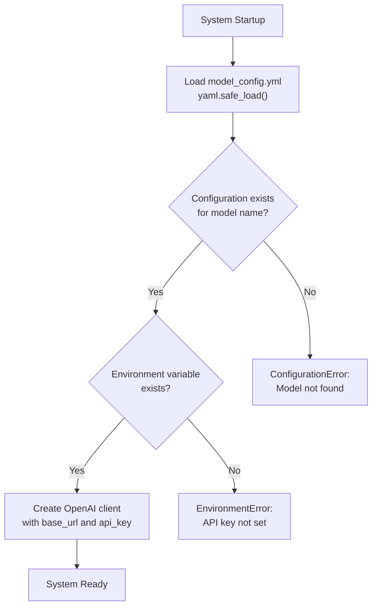

<!-- source: DeepWiki mcp.deepwiki.com · repo NVIDIA/Nemotron-CORTEXA · page 5.1 Model Configuration · fetched 2026-10-26 -->

# Model Configuration

<details>
<summary>Relevant source files</summary>

The following files were used as context for generating this wiki page:

- [README.md](README.md)
- [model_config.yml](model_config.yml)

</details>


## Purpose and Scope

This document describes the **model_config.yml** file, which serves as the central registry for all LLM endpoints used throughout the Nemotron-CORTEXA pipeline. The configuration system provides a unified interface for managing API credentials, base URLs, and model names across multiple providers (DeepSeek, NVIDIA, OpenAI-compatible services).

For information about how these model configurations are used to define candidate solutions during repair, see [Candidate Solution Configuration](#5.2). For general system setup including repository and dataset configuration, see [Repository and Dataset Setup](#5.3).

**Sources**: [README.md:61-62](), [model_config.yml:1-15]()

---

## Configuration File Structure

The **model_config.yml** file is located at the repository root and defines named model configurations that can be referenced throughout the codebase. Each configuration entry specifies three required fields:

| Field | Type | Description |
|-------|------|-------------|
| `base_url` | string | API endpoint URL for the LLM service |
| `api_key_name` | string | Environment variable name containing the API key |
| `model_name` | string | Specific model identifier used by the provider |

### YAML Schema

```yaml
<configuration_name>:
  base_url: '<api_endpoint_url>'
  api_key_name: '<ENV_VAR_NAME>'
  model_name: '<provider_model_identifier>'
```

The `<configuration_name>` becomes the identifier used throughout the codebase to reference this model configuration (e.g., in [repair/config.py]() when defining candidate solutions).

**Sources**: [model_config.yml:1-15](), [README.md:61-62]()

---

## Supported LLM Providers

The system currently includes configurations for two primary providers, with OpenAI API compatibility enabling additional integrations:

### Provider Configuration Examples



**Diagram: Model Configuration Mapping to Providers and Credentials**

### DeepSeek Direct API

```yaml
deepseek-v3-0324:
  base_url: 'https://api.deepseek.com'
  api_key_name: 'DEEPSEEK_API_KEY'
  model_name: 'deepseek-chat'
```

This configuration connects directly to DeepSeek's native API endpoint. The model identifier `deepseek-chat` is DeepSeek's standard chat completion model name.

### NVIDIA NIM (NVIDIA Inference Microservices)

```yaml
deepseek-v3-0324-nvdev:
  base_url: 'https://integrate.api.nvidia.com/v1'
  api_key_name: 'NVIDIA_API_KEY'
  model_name: 'nvdev/deepseek-ai/deepseek-v3-0324'

llama-3.3-70b-instruct:
  base_url: 'https://integrate.api.nvidia.com/v1'
  api_key_name: 'NVIDIA_API_KEY'
  model_name: 'nvdev/meta/llama-3.3-70b-instruct'
```

NVIDIA's integration API provides access to multiple models through a unified endpoint. Model names follow the pattern `nvdev/<provider>/<model_identifier>`.

### OpenAI API Compatibility

The codebase uses the OpenAI Python client library, which means any OpenAI-compatible API can be integrated by providing an appropriate `base_url` and `model_name`. The system automatically populates API keys at runtime using the `api_key_name` field.

**Sources**: [model_config.yml:1-15](), [README.md:76]()

---

## API Key Management

### Security Model

API keys are **never** stored directly in configuration files. Instead, the system uses environment variable indirection:

1. The `api_key_name` field in model_config.yml specifies an environment variable name
2. At runtime, the system reads `os.environ[api_key_name]` to retrieve the actual key
3. If the environment variable is not set, the system will fail with a clear error message



**Diagram: API Key Resolution Flow**

### Setting Environment Variables

Before running any stage of the pipeline, ensure the required API keys are available:

```bash
# For DeepSeek direct API
export DEEPSEEK_API_KEY="sk-your-actual-key-here"

# For NVIDIA API
export NVIDIA_API_KEY="nvapi-your-actual-key-here"
```

For persistent configuration, add these exports to your shell profile (`.bashrc`, `.zshrc`, etc.) or use a `.env` file with a tool like `python-dotenv`.

**Sources**: [README.md:61-62]()

---

## Model Selection Workflow

The model configuration system integrates with multiple stages of the Nemotron-CORTEXA pipeline:



**Diagram: Model Configuration Usage Across Pipeline Stages**

### Stage-Specific Usage

#### File Localization
The embedding model configuration is passed via command-line argument:
```bash
--model_name nvidia/nv-embedcode-7b-v1
```
This references a model served via NVIDIA's NIM endpoint.

#### Entity Localization
By default, reads configurations from `model_config.yml`. Multiple models can be specified in [localize/configs.py]() to run entity localization with diversity, then merge results.

#### Repair Generation
Patch and test generation candidates are defined in [repair/config.py](). Each candidate references a model configuration name from `model_config.yml`:
```python
CandidateSolution(
    localization_type="LA_DP",
    model="deepseek-v3-0324",  # References model_config.yml entry
    edit_format="search_replace",
    temperature=0.0
)
```

#### Solution Filtering
The LLM judge model is specified via `--model_name` argument to `run_filtering.py`, which must match a configuration name in `model_config.yml`.

**Sources**: [README.md:23-32](), [README.md:52-63](), [README.md:76](), [README.md:96-102]()

---

## Adding New Model Configurations

### Step 1: Add Configuration Entry

Edit `model_config.yml` and append a new configuration block:

```yaml
# Existing configurations...

my-custom-model:
  base_url: 'https://api.myprovider.com/v1'
  api_key_name: 'MY_PROVIDER_API_KEY'
  model_name: 'my-provider-model-identifier'
```

### Step 2: Set Environment Variable

Export the API key specified in `api_key_name`:

```bash
export MY_PROVIDER_API_KEY="your-api-key-here"
```

### Step 3: Reference in Code

Update [repair/config.py]() to use the new model in candidate definitions:

```python
def get_patch_gen_candidates(dataset_name):
    return [
        CandidateSolution(
            localization_type="LA_DP",
            model="my-custom-model",  # New configuration name
            edit_format="search_replace",
            temperature=0.0
        ),
        # ... other candidates
    ]
```

### Step 4: Verify OpenAI API Compatibility

The system uses the OpenAI Python client under the hood. Ensure your provider's API is compatible with OpenAI's interface, particularly:
- Chat completion endpoint (`/v1/chat/completions`)
- Request/response schema matching OpenAI's format
- Authentication via `Authorization: Bearer <token>` header

Most modern LLM providers (Together AI, Anyscale, Fireworks, etc.) support OpenAI-compatible APIs.

**Sources**: [model_config.yml:1-15](), [README.md:61-62](), [README.md:71]()

---

## Configuration Loading and Error Handling



**Diagram: Configuration Loading and Validation Flow**

The configuration loading process includes validation at multiple points:

1. **YAML Parsing**: The file must be valid YAML with proper structure
2. **Model Name Lookup**: Referenced model configurations must exist
3. **Environment Variable Check**: Required API keys must be set
4. **API Connectivity**: First API call validates endpoint accessibility

If any validation fails, the system provides clear error messages indicating the missing configuration or environment variable.

**Sources**: [README.md:61-62]()

---

## Configuration Table Reference

The following table summarizes all pre-configured models in the repository:

| Configuration Name | Provider | Base URL | API Key Env Var | Model Identifier |
|-------------------|----------|----------|-----------------|------------------|
| `deepseek-v3-0324` | DeepSeek | `api.deepseek.com` | `DEEPSEEK_API_KEY` | `deepseek-chat` |
| `deepseek-v3-0324-nvdev` | NVIDIA | `integrate.api.nvidia.com/v1` | `NVIDIA_API_KEY` | `nvdev/deepseek-ai/deepseek-v3-0324` |
| `llama-3.3-70b-instruct` | NVIDIA | `integrate.api.nvidia.com/v1` | `NVIDIA_API_KEY` | `nvdev/meta/llama-3.3-70b-instruct` |

**Sources**: [model_config.yml:1-15]()

---

## Integration Points Summary

The following code locations consume model configuration:

| File Path | Purpose | Configuration Source |
|-----------|---------|---------------------|
| [embed_retrieve.py]() | File localization embeddings | `--model_name` CLI arg + inline endpoint config |
| [entity_localization.py]() | Entity localization agent | `model_config.yml` (default) |
| [repair_agent.py:220-240]() | Repair agent instantiation | Via [repair/config.py]() candidates |
| [repro_test_gen.py]() | Test generation | Via [repair/config.py]() candidates |
| [run_filtering.py:96-102]() | LLM judge selection | `--model_name` CLI arg → `model_config.yml` |

Each integration point follows the same pattern:
1. Look up configuration by name in `model_config.yml`
2. Retrieve API key from environment variable
3. Create OpenAI client with `base_url`, `api_key`, and `model_name`
4. Execute LLM calls with standard OpenAI interface

**Sources**: [README.md:23-32](), [README.md:52-63](), [README.md:76](), [README.md:96-102]()

---

