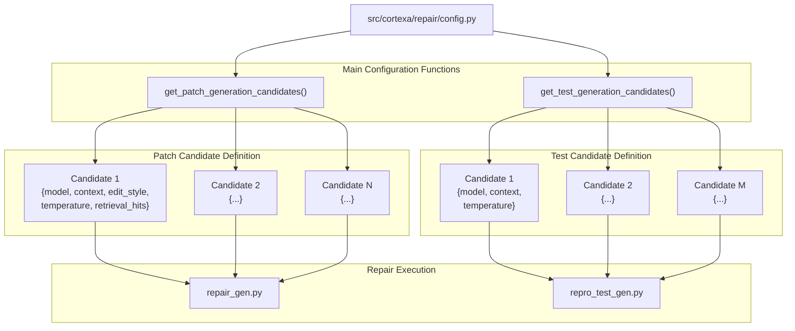
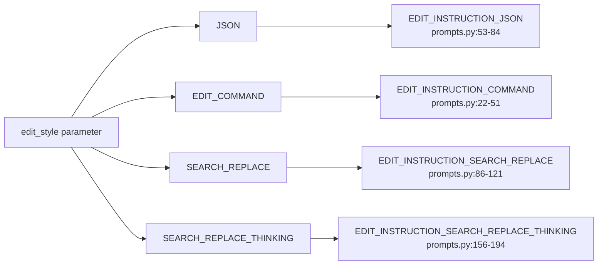
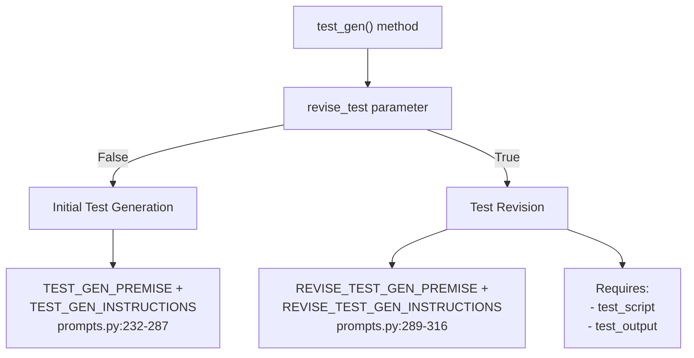
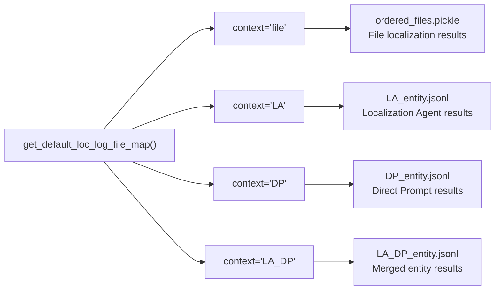
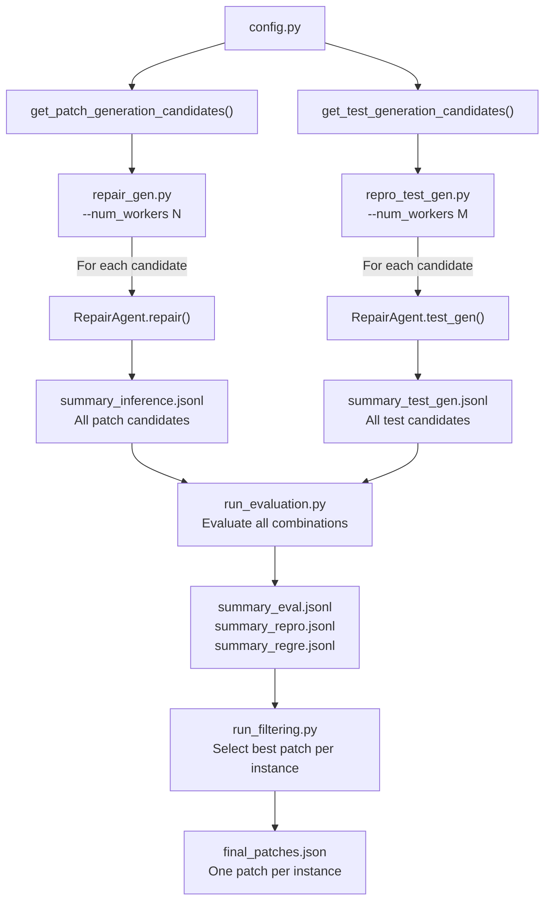

<!-- source: DeepWiki mcp.deepwiki.com · repo NVIDIA/Nemotron-CORTEXA · page 5.2 Candidate Solution Configuration · fetched 2026-10-26 -->

# Candidate Solution Configuration

<details>
<summary>Relevant source files</summary>

The following files were used as context for generating this wiki page:

- [README.md](README.md)
- [src/cortexa/repair/prompts.py](src/cortexa/repair/prompts.py)
- [src/cortexa/repair/repair_agent.py](src/cortexa/repair/repair_agent.py)

</details>


## Purpose and Scope

This page explains how to configure candidate solution definitions in `src/cortexa/repair/config.py` to generate diverse patches and reproduction tests during the repair stage. The configuration system allows experimentation with different combinations of models, edit formats, context types, and sampling parameters to maximize the likelihood of finding a correct fix.

For information about configuring LLM model endpoints and API keys, see [Model Configuration](#5.1). For details on the repair generation workflow itself, see [Patch Generation Workflow](#3.3) and [Reproduction Test Generation](#3.4).

---

## Overview of Solution Diversity Strategy

Nemotron-CORTEXA generates multiple candidate solutions for each bug instance rather than relying on a single patch attempt. This diversity strategy significantly improves resolution rates by exploring different repair approaches in parallel.

### Why Multiple Candidates Matter

Different configurations produce different fixes because:

1. **Model Selection**: Different LLMs have varying strengths in code understanding and generation
2. **Edit Styles**: JSON, EDIT_COMMAND, and SEARCH/REPLACE formats guide the LLM differently
3. **Context Types**: File-level vs. entity-level context affects which code the model considers
4. **Temperature**: Higher values increase exploration, lower values increase consistency
5. **Run Number**: Multiple samples from the same configuration provide stochastic diversity

**Sources**: [README.md:71-76](), [README.md:63]()

---

## Configuration File Structure

The configuration file `src/cortexa/repair/config.py` defines two primary functions that return lists of candidate configurations:



Each function returns a list of dictionaries, where each dictionary specifies the configuration parameters for one candidate solution.

**Sources**: [README.md:71-76](), [src/cortexa/repair/repair_agent.py:1148-1165]()

---

## Patch Generation Candidate Parameters

Each patch generation candidate is defined by a dictionary with the following keys:

| Parameter | Type | Description | Example Values |
|-----------|------|-------------|----------------|
| `model` | str | Model identifier from `model_config.yml` | `"deepseek-v3-0324"`, `"llama-3.3-70b"` |
| `context` | str | Type of code context to provide | `"file"`, `"LA"`, `"DP"`, `"LA_DP"` |
| `edit_style` | str | Format for edit instructions | `"JSON"`, `"EDIT_COMMAND"`, `"SEARCH_REPLACE"`, `"SEARCH_REPLACE_THINKING"` |
| `temperature` | float | Sampling temperature for LLM | `0.0`, `0.7`, `1.0` |
| `retrieval_hits` | int | Number of top files to include (optional) | `1`, `3`, `5` |

### Context Type Values

The `context` parameter determines what code is provided to the LLM:

- **`"file"`**: Entire files from file localization rankings
- **`"LA"`**: Entity-level context from Localization Agent
- **`"DP"`**: Entity-level context from Direct Prompt localization
- **`"LA_DP"`**: Merged results from both LA and DP entity localization
- **`"patches"`**: Context extracted from existing patch candidates (for meta-evaluation)

**Sources**: [src/cortexa/repair/repair_agent.py:533-542](), [src/cortexa/repair/repair_agent.py:618-625]()

### Edit Style Values

The `edit_style` parameter maps to different prompt templates in `src/cortexa/repair/prompts.py`:



Each edit style produces different structured outputs:

- **JSON**: Edit commands as JSON objects with `filepath`, `start`, `end`, `content` fields
- **EDIT_COMMAND**: Python function calls like `edit_file(filepath, start, end, content)`
- **SEARCH_REPLACE**: Git-style search/replace blocks with `<<<<<<< SEARCH` and `>>>>>>> REPLACE` markers
- **SEARCH_REPLACE_THINKING**: Same as SEARCH_REPLACE but with explicit reasoning phase

**Sources**: [src/cortexa/repair/prompts.py:22-194](), [src/cortexa/repair/repair_agent.py:708-721]()

### Patch ID Construction

Each patch candidate is assigned a unique identifier based on its configuration:

```python
patch_id = f"{model}_{context}_{edit_style}_{temperature}_{run_num}"
```

This ID is used throughout the evaluation pipeline to track which configuration produced which patch.

**Sources**: [src/cortexa/repair/repair_agent.py:634](), [src/cortexa/repair/repair_agent.py:638]()

---

## Test Generation Candidate Parameters

Test generation candidates use a simpler parameter structure since they don't require edit styles:

| Parameter | Type | Description | Example Values |
|-----------|------|-------------|----------------|
| `model` | str | Model identifier from `model_config.yml` | `"deepseek-v3-0324"`, `"llama-3.3-70b"` |
| `context` | str | Type of code context to provide | `"file"`, `"LA"`, `"DP"`, `"LA_DP"`, `""` (no context) |
| `temperature` | float | Sampling temperature for LLM | `0.0`, `0.7`, `1.0` |

### Context-Free Test Generation

Unlike patch generation, test generation can operate without code context (`context=""`). The LLM generates a reproduction test based solely on the bug description, which can be advantageous when:

- The issue description is sufficiently detailed
- Avoiding code context reduces the risk of test overfitting
- Context might introduce confusion or distraction

**Sources**: [src/cortexa/repair/repair_agent.py:774-787](), [src/cortexa/repair/repair_agent.py:860-864]()

### Test Prompt Styles

Test generation uses two prompt templates based on whether it's creating a new test or revising an existing one:



The revision prompt includes the previous test script and its output, allowing the LLM to fix issues with the initial test generation.

**Sources**: [src/cortexa/repair/prompts.py:232-316](), [src/cortexa/repair/repair_agent.py:788](), [src/cortexa/repair/repair_agent.py:857-858]()

### Test ID Construction

Test candidates are identified by:

```python
patch_id = f"{model}_{context}_{prompt_style}_{temperature}_{run_num}"
```

where `prompt_style` is either `"test-gen"` or `"revise-test-gen"`.

**Sources**: [src/cortexa/repair/repair_agent.py:790](), [src/cortexa/repair/repair_agent.py:794]()

---

## Localization Results Integration

The configuration system references localization results through the `get_default_loc_log_file_map()` function, which maps context types to their corresponding result files:



By default, the configuration references pre-computed localization results stored in `src/cortexa/retrieval/files/`:

- `cortexa_all_llmsummary_ordered_files.pickle`: File-level rankings
- `cortexa_all_llmsummary_LA_DP_entity.jsonl`: Entity-level localization

**Sources**: [README.md:44-45](), [README.md:69-71]()

---

## Example Configuration Structure

Here is a conceptual example of how patch generation candidates might be defined:

```python
def get_patch_generation_candidates():
    """Returns list of patch generation candidate configurations."""
    candidates = []
    
    # High-confidence candidates: temperature 0, best models
    for model in ["deepseek-v3-0324", "llama-3.3-70b"]:
        for edit_style in ["JSON", "SEARCH_REPLACE"]:
            candidates.append({
                "model": model,
                "context": "LA_DP",  # Merged entity localization
                "edit_style": edit_style,
                "temperature": 0.0,
                "retrieval_hits": 1,
            })
    
    # Diverse exploration: higher temperature
    candidates.append({
        "model": "deepseek-v3-0324",
        "context": "LA_DP",
        "edit_style": "SEARCH_REPLACE_THINKING",
        "temperature": 0.7,
        "retrieval_hits": 1,
    })
    
    # File-level context alternatives
    candidates.append({
        "model": "llama-3.3-70b",
        "context": "file",
        "edit_style": "EDIT_COMMAND",
        "temperature": 0.0,
        "retrieval_hits": 3,  # More files for broader context
    })
    
    return candidates
```

Each configuration in the list will be executed by the repair generation workers, producing one patch candidate per instance.

**Sources**: [README.md:76](), [src/cortexa/repair/repair_agent.py:1148-1165]()

---

## Configuration Workflow in Practice

The following diagram shows how candidate configurations flow through the repair and evaluation pipeline:



The workflow operates as follows:

1. **Configuration Loading**: `repair_gen.py` and `repro_test_gen.py` read candidate definitions from `config.py`
2. **Parallel Generation**: Worker processes execute each candidate configuration in parallel
3. **Result Aggregation**: All candidates are written to JSONL files with their configuration metadata
4. **Comprehensive Evaluation**: All patch-test combinations are evaluated across multiple modes
5. **Solution Selection**: The filtering stage chooses the best patch based on evaluation results

**Sources**: [README.md:78-105](), [src/cortexa/repair/repair_agent.py:618-695](), [src/cortexa/repair/repair_agent.py:774-840]()

---

## Modifying Candidate Configurations

To experiment with different candidate configurations:

1. **Edit `src/cortexa/repair/config.py`**: Modify the return values of `get_patch_generation_candidates()` and/or `get_test_generation_candidates()`

2. **Add New Model Entries**: If using a new model, first add it to `model_config.yml` (see [Model Configuration](#5.1))

3. **Run Generation**: Execute `repair_gen.py` and/or `repro_test_gen.py` with the updated configuration

4. **Monitor Resource Usage**: More candidates increase compute requirements linearly. Use `--num_workers` to control parallelism

5. **Analyze Results**: Check `summary_inference.jsonl` to verify all candidates executed correctly

### Recommended Configuration Strategies

Based on empirical results, effective strategies include:

- **Model Diversity**: Include multiple LLMs to leverage different capabilities
- **Temperature Sweep**: Use temperature 0.0 for deterministic outputs, 0.7-1.0 for exploration
- **Edit Style Coverage**: Test both JSON and SEARCH_REPLACE formats
- **Context Levels**: Compare file-level and entity-level contexts
- **Multiple Runs**: Set multiple run numbers with temperature > 0 for stochastic diversity

**Sources**: [README.md:63](), [README.md:71-76]()

---

## RepairAgent Configuration Loading

The `create_repair_agent()` factory function demonstrates how configuration dictionaries are consumed:

```python
def create_repair_agent(solution: Dict[str, Any], 
                        repo_playground: str,
                        log_dir: str,
                        out_inference_file: str = 'summary_inference.jsonl',
                        out_eval_file: str = 'summary_eval.jsonl',
                        max_tokens: int = 4096,
                        max_input_tokens: int = 115000) -> RepairAgent:
    """Create and configure a RepairAgent instance."""
    return RepairAgent(
        log_dir=log_dir,
        repair_model_info=read_config(default_config_path())[solution['model']],
        max_tokens=max_tokens,
        out_inference_file=out_inference_file,
        out_eval_file=out_eval_file,
        repo_playground=repo_playground,
        retrieval_hits=solution.get('retrieval_hits', 1),
        max_input_tokens=max_input_tokens
    )
```

The function:
1. Extracts the `model` key to look up endpoint configuration in `model_config.yml`
2. Extracts `retrieval_hits` with a default value of 1
3. Other parameters (`edit_style`, `context`, `temperature`) are passed separately to the `repair()` or `test_gen()` methods

**Sources**: [src/cortexa/repair/repair_agent.py:1148-1165]()

---

## Configuration Best Practices

### For Patch Generation

1. **Start Simple**: Begin with 2-3 high-quality candidates (low temperature, proven models)
2. **Add Diversity Gradually**: Increase candidates to explore the solution space
3. **Balance Resources**: Each candidate multiplies evaluation cost by 3x (eval/repro/regre modes)
4. **Monitor Syntax Errors**: Track the `syntax_status` field in results to identify problematic configurations

### For Test Generation

1. **Context vs. No Context**: Try both context-free and context-rich test generation
2. **Iterative Refinement**: Enable test revision to improve reproduction accuracy
3. **Exit Code Semantics**: Verify tests return exit code 2 for unfixed bugs, 0 for fixed bugs
4. **Merge Strategy**: Multiple test candidates can be merged for comprehensive coverage

**Sources**: [README.md:110-123](), [src/cortexa/repair/repair_agent.py:677-687]()

---

