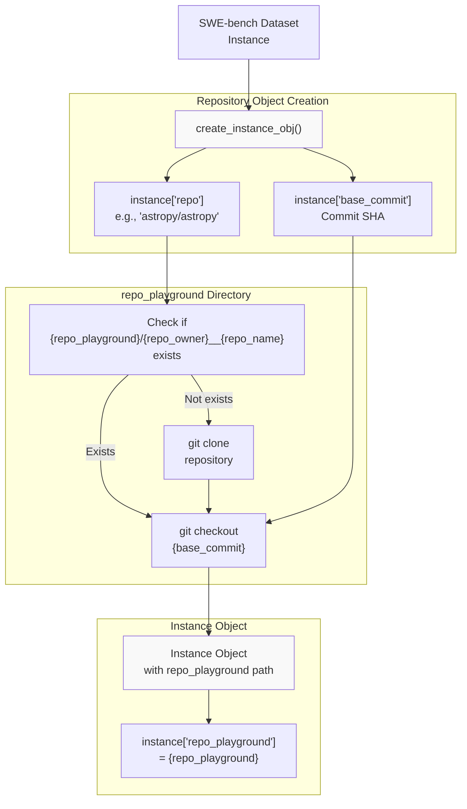
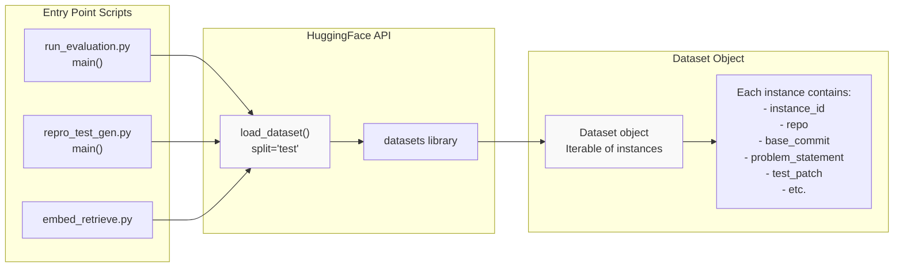
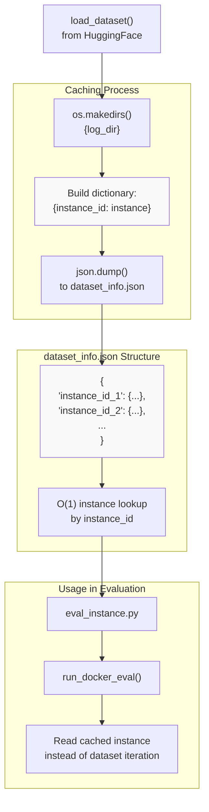
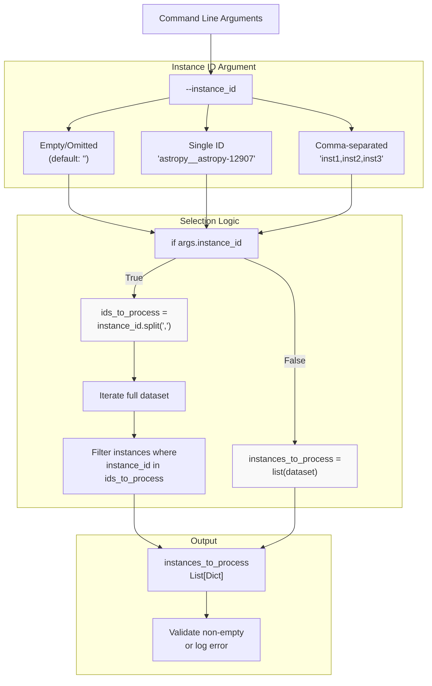
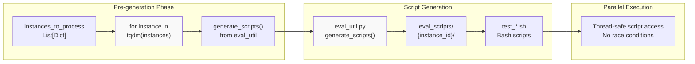

<!-- source: DeepWiki mcp.deepwiki.com · repo NVIDIA/Nemotron-CORTEXA · page 5.3 Repository and Dataset Setup · fetched 2026-10-26 -->

# Repository and Dataset Setup

<details>
<summary>Relevant source files</summary>

The following files were used as context for generating this wiki page:

- [README.md](README.md)
- [src/cortexa/evaluate/run_evaluation.py](src/cortexa/evaluate/run_evaluation.py)
- [src/cortexa/repair/repro_test_gen.py](src/cortexa/repair/repro_test_gen.py)

</details>


This page documents the configuration and setup of the repository playground environment and SWE-bench dataset loading mechanisms. It covers the directory structure for cloned repositories, dataset loading from HuggingFace, the caching strategy via `dataset_info.json`, and instance selection patterns used throughout the codebase.

For configuring LLM model endpoints and API keys, see [Model Configuration](#5.1). For defining candidate solutions, see [Candidate Solution Configuration](#5.2).

---

## Purpose and Scope

The Nemotron-CORTEXA system requires two primary setup components:

1. **Repository Playground** - A directory structure where target repositories are cloned and checked out to specific commits for bug fixing
2. **Dataset Management** - Loading SWE-bench datasets from HuggingFace and caching them locally to avoid repeated API calls

This setup occurs automatically when running any of the main entry points (`embed_retrieve.py`, `entity_localization.py`, `repair_gen.py`, `repro_test_gen.py`, `run_evaluation.py`), but understanding the structure is essential for troubleshooting and custom deployments.

---

## Repository Playground Structure

### Directory Layout

The repository playground is a designated directory where all target repositories are cloned during the evaluation process. The default location is calculated relative to the project root:

```
{parent_of_root}/repo_playground/
├── astropy__astropy/
│   └── (cloned repository contents)
├── django__django/
│   └── (cloned repository contents)
├── matplotlib__matplotlib/
│   └── (cloned repository contents)
└── sympy__sympy/
    └── (cloned repository contents)
```

Each repository is organized by the pattern `{repo_owner}__{repo_name}`, which corresponds to the `repo` field in the SWE-bench dataset instances.

**Sources:** [README.md:27](), [README.md:99](), [run_evaluation.py:99]()

### Configuration Parameters

The repository playground location can be configured via command-line arguments across all main scripts:

| Parameter | Default Value | Description |
|-----------|---------------|-------------|
| `--repo_playground` | `{parent_of_root}/repo_playground` | Directory to store cloned repositories |

Example usage:
```bash
python -m cortexa.evaluate.run_evaluation \
    --repo_playground ./repos \
    --dataset_name_or_path princeton-nlp/SWE-bench_Verified
```

**Sources:** [README.md:27](), [run_evaluation.py:99](), [repro_test_gen.py:348-349]()

### Repository Cloning and Checkout Process



**Diagram: Repository Setup Workflow**

The repository setup follows this process:
1. Extract `repo` and `base_commit` from the dataset instance
2. Check if `{repo_playground}/{repo_owner}__{repo_name}` exists
3. Clone if missing, otherwise reuse existing directory
4. Checkout to the `base_commit` specified in the instance
5. Augment the instance object with `repo_playground` path

**Sources:** [repro_test_gen.py:231-234]()

---

## SWE-bench Dataset Loading

### Supported Datasets

Nemotron-CORTEXA supports two primary SWE-bench dataset variants from HuggingFace:

| Dataset ID | Description | Size |
|------------|-------------|------|
| `princeton-nlp/SWE-bench_Verified` | Manually verified bug instances | 500 instances |
| `princeton-nlp/SWE-bench_Lite` | Subset of diverse bugs | 300 instances |

Both datasets are loaded using the HuggingFace `datasets` library with the `split='test'` parameter.

**Sources:** [README.md:30](), [README.md:90]()

### Dataset Loading Pattern



**Diagram: Dataset Loading from HuggingFace**

All entry point scripts follow the same loading pattern:

```python
from datasets import load_dataset

dataset = load_dataset(args.dataset_name_or_path, split='test')
```

The dataset object is an iterable collection where each element represents a bug instance with standardized fields.

**Sources:** [run_evaluation.py:124](), [repro_test_gen.py:367]()

---

## Dataset Caching with dataset_info.json

### Caching Mechanism

To avoid repeated HuggingFace API calls and enable fast instance lookups, the system caches the entire dataset to a local JSON file immediately after loading:



**Diagram: Dataset Caching Strategy**

**Sources:** [run_evaluation.py:125-128](), [repro_test_gen.py:368-371]()

### Caching Implementation

The caching occurs in both `run_evaluation.py` and `repro_test_gen.py`:

**run_evaluation.py implementation:**
```python
dataset_info_file = os.path.join(os.path.abspath(args.log_dir), args.dataset_info_file)
os.makedirs(os.path.dirname(dataset_info_file), exist_ok=True)
with open(dataset_info_file, 'w') as f:
    json.dump({inst['instance_id']: inst for inst in dataset}, f)
```

**repro_test_gen.py implementation:**
```python
dataset_info_file = os.path.join(os.path.abspath(args.log_dir), 'dataset_info.json')
os.makedirs(os.path.dirname(dataset_info_file), exist_ok=True)
with open(dataset_info_file, 'w') as f:
    json.dump({inst['instance_id']: inst for inst in dataset}, f)
```

**Sources:** [run_evaluation.py:125-128](), [repro_test_gen.py:368-371]()

### Cache File Location

| Parameter | Default Value | Description |
|-----------|---------------|-------------|
| `--dataset_info_file` | `dataset_info.json` | Filename for cached dataset |
| Location | `{log_dir}/dataset_info.json` | Full path combines log_dir with filename |

The cache file is passed to `run_docker_eval()` via the `dataset_info_file` parameter, enabling evaluation containers to access instance metadata without loading the full dataset.

**Sources:** [run_evaluation.py:50](), [run_evaluation.py:62](), [run_evaluation.py:113](), [repro_test_gen.py:144]()

---

## Instance Selection Mechanisms

### Selection Strategies

The system supports two instance selection modes:

1. **Specific Instances** - Process a comma-separated list of instance IDs
2. **Full Benchmark** - Process all instances in the dataset



**Diagram: Instance Selection Logic**

**Sources:** [run_evaluation.py:136-147](), [repro_test_gen.py:293-305]()

### Implementation Details

**run_evaluation.py selection logic:**

[run_evaluation.py:136-147]()
```python
instances_to_process = []
if args.instance_id:
    ids_to_process = args.instance_id.split(',') if ',' in args.instance_id else [args.instance_id]
    for instance in tqdm(dataset, desc="Loading dataset"):
        if instance['instance_id'] in ids_to_process:
            instances_to_process.append(instance)
    if not instances_to_process:
        logging.error(f"Instance(s) {args.instance_id} not found in dataset")
        return
else:
    instances_to_process = list(dataset)
```

This pattern is replicated consistently across all entry point scripts with minor variations in logging messages.

**Sources:** [run_evaluation.py:136-147](), [repro_test_gen.py:293-305]()

### Example Usage

**Single instance:**
```bash
python -m cortexa.evaluate.run_evaluation \
    --instance_id astropy__astropy-12907 \
    --dataset_name_or_path princeton-nlp/SWE-bench_Verified
```

**Multiple instances:**
```bash
python -m cortexa.evaluate.run_evaluation \
    --instance_id astropy__astropy-12907,django__django-11099,sympy__sympy-18532 \
    --dataset_name_or_path princeton-nlp/SWE-bench_Verified
```

**Full benchmark:**
```bash
python -m cortexa.evaluate.run_evaluation \
    --dataset_name_or_path princeton-nlp/SWE-bench_Verified
```

**Sources:** [README.md:32](), [README.md:91](), [README.md:100]()

---

## Pre-generation Script Requirements

### Evaluation Script Generation

Before running evaluation tasks, the system pre-generates evaluation scripts for all instances to avoid race conditions during parallel execution:



**Diagram: Pre-generation of Evaluation Scripts**

This pre-generation occurs in both `run_evaluation.py` and `repro_test_gen.py`:

**run_evaluation.py:**
[run_evaluation.py:150-151]()
```python
for instance in tqdm(instances_to_process, desc="Generating eval scripts"):
    generate_scripts(instance, f'{os.path.dirname(os.path.dirname(get_root_path()))}/eval_scripts')
```

**repro_test_gen.py:**
[repro_test_gen.py:307-308]()
```python
for instance in tqdm(instances_to_process, desc="Generating eval scripts"):
    generate_scripts(instance, f'{os.path.dirname(os.path.dirname(get_root_path()))}/eval_scripts')
```

The `generate_scripts()` function (from `eval_util.py`) creates repository-specific test execution scripts based on the test framework used (Django, Pytest, Sympy, etc.). For detailed information about script generation, see [Evaluation Utilities](#7.1).

**Sources:** [run_evaluation.py:150-151](), [repro_test_gen.py:307-308]()

---

## Directory Structure Summary

The complete directory structure for repository and dataset setup:

```
{parent_of_root}/
├── repo_playground/                    # Cloned repositories
│   ├── {repo_owner}__{repo_name}/     # Per-repository directory
│   │   └── (git repository contents)
│   └── ...
├── eval_scripts/                       # Pre-generated evaluation scripts
│   ├── {instance_id}/
│   │   └── test_*.sh
│   └── ...
└── {project_root}/
    └── logs/                           # Log and cache directory
        └── dataset_info.json           # Cached dataset instances
```

**Key Directories:**

| Directory | Purpose | Created By |
|-----------|---------|------------|
| `repo_playground/` | Store cloned repositories | `create_instance_obj()` |
| `eval_scripts/` | Store pre-generated test scripts | `generate_scripts()` |
| `logs/` | Store cached datasets and results | All entry point scripts |
| `logs/dataset_info.json` | Cache dataset for fast lookup | `run_evaluation.py`, `repro_test_gen.py` |

**Sources:** [run_evaluation.py:99](), [run_evaluation.py:151](), [repro_test_gen.py:154](), [repro_test_gen.py:229](), [repro_test_gen.py:308]()

---

## Configuration Reference

### Complete Parameter List

The following table summarizes all command-line parameters related to repository and dataset setup across the main entry points:

| Parameter | Type | Default | Description |
|-----------|------|---------|-------------|
| `--dataset_name_or_path` | str | `princeton-nlp/SWE-bench_Verified` | HuggingFace dataset ID or local path |
| `--repo_playground` | str | `{parent_of_root}/repo_playground` | Directory for cloned repositories |
| `--instance_id` | str | `''` (empty) | Comma-separated instance IDs or empty for all |
| `--log_dir` | str | `{root}/logs` | Directory for logs and cached data |
| `--dataset_info_file` | str | `dataset_info.json` | Filename for cached dataset |

**Sources:** [run_evaluation.py:98-113](), [repro_test_gen.py:347-361]()

---

## Usage Examples

### Basic Setup with Default Paths

```bash
# Uses default repo_playground and log_dir
python -m cortexa.evaluate.run_evaluation \
    --dataset_name_or_path princeton-nlp/SWE-bench_Verified \
    --instance_id astropy__astropy-12907
```

**Sources:** [README.md:80-92]()

### Custom Directory Configuration

```bash
# Specify custom paths
python -m cortexa.evaluate.run_evaluation \
    --repo_playground /mnt/data/repos \
    --log_dir /mnt/data/logs \
    --dataset_name_or_path princeton-nlp/SWE-bench_Lite \
    --instance_id django__django-11099
```

**Sources:** [run_evaluation.py:99](), [run_evaluation.py:106]()

### Full Benchmark Execution

```bash
# Process all instances in the dataset
python -m cortexa.evaluate.run_evaluation \
    --repo_playground ./repos \
    --log_dir ./logs \
    --dataset_name_or_path princeton-nlp/SWE-bench_Verified \
    --run_patch_generation \
    --run_test_generation \
    --num_workers_patch_gen 2 \
    --num_workers_test_gen 2 \
    --num_workers_eval 4
```

**Sources:** [README.md:79-92]()

---

