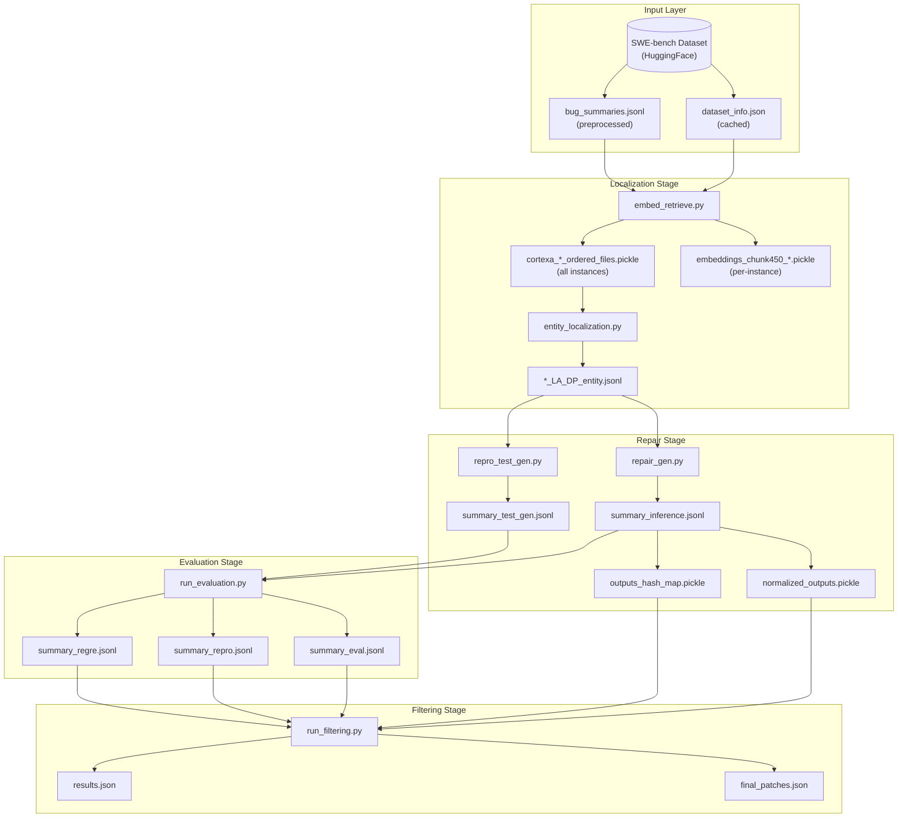
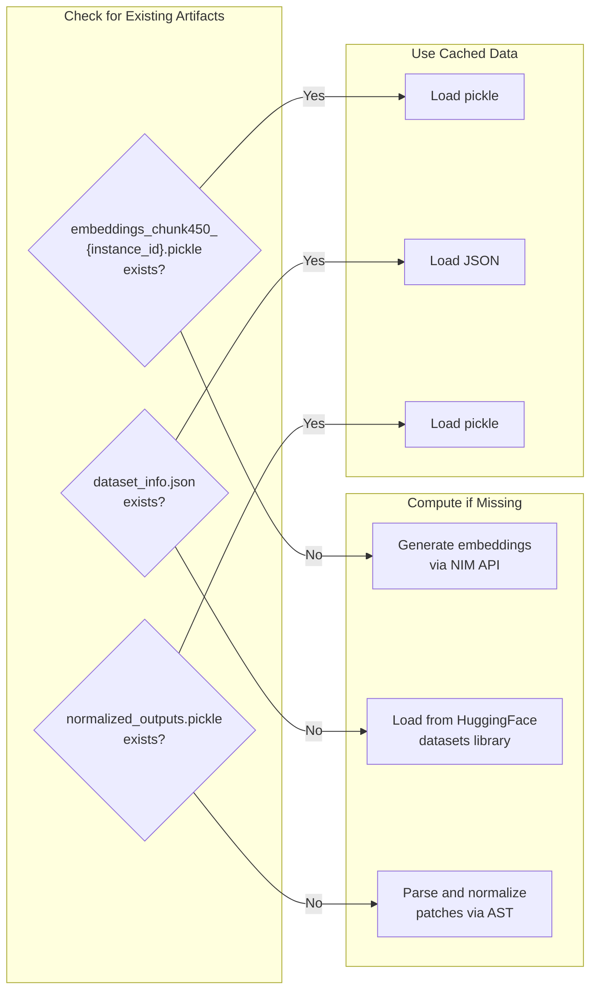
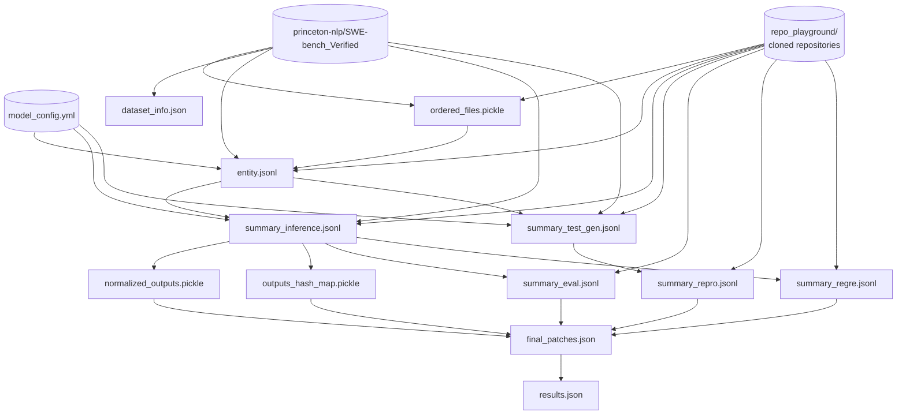

<!-- source: DeepWiki mcp.deepwiki.com · repo NVIDIA/Nemotron-CORTEXA · page 6 Data Formats and Artifacts · fetched 2026-10-26 -->

# Data Formats and Artifacts

<details>
<summary>Relevant source files</summary>

The following files were used as context for generating this wiki page:

- [README.md](README.md)
- [src/cortexa/retrieval/embed_retrieve.py](src/cortexa/retrieval/embed_retrieve.py)

</details>


## Purpose and Scope

This page provides reference documentation for all data formats and artifacts produced and consumed by the Nemotron-CORTEXA system. It covers file naming conventions, directory structures, serialization formats, and the data lineage through the three-stage pipeline (Localization → Repair → Evaluation).

For detailed schemas of specific artifact types, see:
- Localization artifacts (embeddings, entity results): [Localization Artifacts](#6.1)
- Repair and evaluation artifacts (inference logs, test results): [Repair and Evaluation Artifacts](#6.2)
- Final output formats (patches, resolution summaries): [Final Output Formats](#6.3)

This page focuses on the overall persistence model, file organization, and relationships between artifacts.

**Sources**: README.md, Diagram 6 (Data Flow and Persistence)

---

## Artifact Categories

The system produces artifacts in five major categories, each serving a distinct purpose in the pipeline:

| Category | Format(s) | Purpose | Key Examples |
|----------|-----------|---------|--------------|
| **Input** | JSONL, JSON | Source data from SWE-bench datasets and preprocessed summaries | `dataset_info.json`, `bug_summaries.jsonl` |
| **Localization** | Pickle, JSONL | Ranked files and identified code entities | `ordered_files.pickle`, `LA_DP_entity.jsonl` |
| **Repair** | JSONL, Pickle | Generated patches, tests, and normalizations | `summary_inference.jsonl`, `normalized_outputs.pickle` |
| **Evaluation** | JSONL | Test execution results across multiple modes | `summary_eval.jsonl`, `summary_repro.jsonl` |
| **Final Output** | JSON | Selected patches and resolution statistics | `final_patches.json`, `results.json` |

The system uses two primary serialization formats:
- **Pickle (`.pickle`)**: For complex Python objects (embeddings, hash maps, file rankings)
- **JSONL (`.jsonl`)**: For streaming records with one JSON object per line (patches, evaluations, entities)

**Sources**: README.md:38-41, README.md:99-101, Diagram 6

---

## Data Flow Through the Pipeline

The following diagram shows how artifacts flow through the system stages and the file types produced at each step:



**Sources**: README.md:15-105, [src/cortexa/retrieval/embed_retrieve.py:170-232](), Diagram 6

---

## File Naming Conventions

The system uses structured naming patterns to encode metadata in filenames, enabling easy identification and experiment tracking:

### Localization Files

```
Pattern: cortexa_{dataset}_{query_type}_ordered_files.pickle
Examples:
  - cortexa_verified_llmsummary_ordered_files.pickle
  - cortexa_lite_original_ordered_files.pickle
  - cortexa_all_llmsummary_ordered_files.pickle
```

**Components**:
- `dataset`: Target dataset subset (`verified`, `lite`, `all` for union)
- `query_type`: Query strategy (`llmsummary` for LLM-generated summaries, `original` for raw issue text)

### Per-Instance Embedding Cache

```
Pattern: embeddings_chunk{max_length}_{instance_id}.pickle
Example: embeddings_chunk450_astropy__astropy-12907.pickle
```

**Components**:
- `max_length`: Token chunk size (typically 450)
- `instance_id`: SWE-bench instance identifier with double underscore format

### Entity Localization Results

```
Pattern: {model_config}_{method}_entity.jsonl
Examples:
  - cortexa_all_llmsummary_LA_DP_entity.jsonl
  - merged_entity_results.jsonl
```

**Components**:
- `method`: Localization method (`LA` for LocalizeAgent, `DP` for Direct Prompt)

**Sources**: [src/cortexa/retrieval/embed_retrieve.py:207-231](), README.md:44, README.md:69

---

## Directory Structure

The system organizes artifacts across multiple directories with clear separation of concerns:

```mermaid
graph TB
    Root["Project Root"]
    
    Root --> LogDir["log_dir/"]
    Root --> RepoPlay["repo_playground/"]
    Root --> ReproTest["repro_test_dir/"]
    Root --> PreProc["src/cortexa/retrieval/files/"]
    
    LogDir --> Embed["embeddings_chunk450_*.pickle"]
    LogDir --> Order["cortexa_*_ordered_files.pickle"]
    LogDir --> Inf["summary_inference.jsonl"]
    LogDir --> TestG["summary_test_gen.jsonl"]
    LogDir --> Eval["summary_eval.jsonl"]
    LogDir --> Repro["summary_repro.jsonl"]
    LogDir --> Regre["summary_regre.jsonl"]
    LogDir --> Norm["normalized_outputs.pickle"]
    LogDir --> Hash["outputs_hash_map.pickle"]
    LogDir --> Final["final_patches.json"]
    LogDir --> Res["results.json"]
    LogDir --> DSInfo["dataset_info.json"]
    
    RepoPlay --> RepoInst["instance_repo_folder/<br/>git checkout at base_commit"]
    
    ReproTest --> ModelDir["{model_name}/"]
    ModelDir --> InstTests["{instance_id}/<br/>test_*.py"]
    
    PreProc --> BugSum["bug_summaries.jsonl"]
    PreProc --> PreOrd["cortexa_all_llmsummary_ordered_files.pickle"]
    PreProc --> PreEnt["cortexa_all_llmsummary_LA_DP_entity.jsonl"]
```



### Directory Descriptions

| Directory | Purpose | Managed By | Typical Size |
|-----------|---------|------------|--------------|
| `log_dir/` | All artifacts, logs, and results from pipeline stages | User-specified via `--log_dir` | GB-scale for full benchmarks |
| `repo_playground/` | Cloned repositories at specific commits for safe evaluation | [src/cortexa/utils/repo_foundary.py]() | GB-scale (one clone per repo) |
| `repro_test_dir/` | Generated reproduction tests organized by model and instance | [src/cortexa/repair/repro_test_gen.py:70-75]() | MB-scale |
| `src/cortexa/retrieval/files/` | Preprocessed artifacts (summaries, pre-computed localizations) | Developers | MB-scale (bundled with repo) |

**Sources**: README.md:26, README.md:81-83, [src/cortexa/repair/repro_test_gen.py:70-75](), Diagram 6

---

## Common Serialization Patterns

### Pickle Format

Used for Python objects that require preservation of type information and efficient binary serialization:

```python
# Reading pickle artifacts
import pickle

# Ordered files: dict[instance_id] -> (ranked_files: list[str], patch_files: list[str])
with open('cortexa_verified_llmsummary_ordered_files.pickle', 'rb') as f:
    ordered_files = pickle.load(f)
    ranked_files, golden_files = ordered_files['astropy__astropy-12907']

# Embeddings: dict with keys: 'code', 'embedding', 'file', 'query', 'query_embedding', 'scores', 'docid'
with open('embeddings_chunk450_astropy__astropy-12907.pickle', 'rb') as f:
    embed_data = pickle.load(f)
    passage_embeddings = embed_data['embedding']  # numpy array
```

### JSONL Format

Used for streaming records where each line is a self-contained JSON object:

```json
// summary_inference.jsonl structure
{
  "instance_id": "astropy__astropy-12907",
  "model_name_or_path": "deepseek-v3-0324",
  "model_patch": "diff --git a/file.py ...",
  "sol_id": 0,
  "reasoning": "Explanation of the fix",
  "content_map": {...},
  "loc_entities": [...]
}

// summary_eval.jsonl structure
{
  "instance_id": "astropy__astropy-12907",
  "sol_id": 0,
  "model_name_or_path": "deepseek-v3-0324",
  "passed": true,
  "exit_code": 0,
  "output": "Test output...",
  "model_patch": "diff --git a/file.py ..."
}
```

**Sources**: [src/cortexa/retrieval/embed_retrieve.py:221-229](), README.md:168-171, Diagram 6

---

## Artifact Lifecycle and Caching

The system implements aggressive caching to avoid redundant computation:



### Caching Strategies

| Artifact Type | Cache Key | Invalidation Strategy |
|---------------|-----------|----------------------|
| Embeddings | `instance_id` + `max_length` | Manual deletion required |
| Dataset | `dataset_name_or_path` | Timestamp-based (not implemented) |
| Normalized outputs | `log_dir` + inference filename | Regenerated on each filtering run |
| Evaluation results | `instance_id` + `sol_id` + `mode` | Incremental append (JSONL) |

**Sources**: [src/cortexa/retrieval/embed_retrieve.py:207-210](), README.md:104-107, Diagram 6

---

## Metadata Encoding in Artifacts

Many artifacts embed metadata to enable traceability and debugging:

### Instance Identification

All artifacts include `instance_id` following the SWE-bench convention:
```
Format: {repo_owner}__{repo_name}-{issue_number}
Example: astropy__astropy-12907
```

### Solution Identification

Repair and evaluation artifacts use `sol_id` to track multiple candidate solutions per instance:
```python
sol_id: int  # 0-indexed counter for solution candidates
```

### Model Provenance

Artifacts track which model configuration generated the content:
```python
model_name_or_path: str  # From model_config.yml (e.g., "deepseek-v3-0324")
```

**Sources**: README.md:168-171, [src/cortexa/retrieval/embed_retrieve.py:199](), Diagram 6

---

## Data Dependencies and Lineage

The following diagram shows which artifacts depend on which inputs, enabling users to understand rebuild requirements:



### Rebuild Decision Tree

To determine which artifacts need regeneration after a change:

1. **Changed dataset or instances**: Regenerate all artifacts
2. **Changed localization models/config**: Regenerate from `entity.jsonl` onward
3. **Changed repair models/config**: Regenerate from `summary_inference.jsonl` onward
4. **Changed evaluation settings**: Regenerate from `summary_eval.jsonl` onward
5. **Changed filtering logic**: Only regenerate `final_patches.json` and `results.json`

**Sources**: README.md:15-105, Diagram 6

---

## Artifact Size Considerations

Typical artifact sizes for the full SWE-bench Verified dataset (500 instances):

| Artifact | Approximate Size | Scaling Factor |
|----------|-----------------|----------------|
| `dataset_info.json` | 15 MB | Linear with instances |
| `ordered_files.pickle` | 2 MB | Linear with instances |
| `embeddings_chunk450_*.pickle` (per-instance) | 5-50 MB | Linear with code size |
| `entity.jsonl` | 5 MB | Linear with instances |
| `summary_inference.jsonl` | 100-500 MB | Linear with `num_workers_patch_gen` × instances |
| `summary_test_gen.jsonl` | 50-200 MB | Linear with `num_workers_test_gen` × instances |
| `summary_eval.jsonl` | 200-800 MB | Linear with inference solutions |
| `normalized_outputs.pickle` | 50-150 MB | Linear with unique patches |
| `final_patches.json` | 5-10 MB | Linear with instances |
| `repo_playground/` | 10-50 GB | Linear with unique repositories |

Storage requirements scale linearly with the number of candidate solutions generated per instance, which is controlled by:
- `get_cand_repair_configs()` in [src/cortexa/repair/config.py]()
- `get_cand_test_gen_configs()` in [src/cortexa/repair/config.py]()

**Sources**: README.md:71, Diagram 6

---

## Cross-References

For detailed schema definitions of each artifact type:
- File localization embeddings and rankings: [Localization Artifacts](#6.1)
- Patch generation and evaluation logs: [Repair and Evaluation Artifacts](#6.2)
- Final patch selection and resolution summaries: [Final Output Formats](#6.3)

For information about configuring artifact generation:
- Model endpoints and API configuration: [Model Configuration](#5.1)
- Repair candidate configuration: [Candidate Solution Configuration](#5.2)

For information about consuming these artifacts:
- Evaluation orchestration: [Evaluation Orchestration](#4.1)
- Solution filtering: [Solution Filtering and Selection](#4.3)

**Sources**: README.md, Diagram 6, Table of Contents

---

