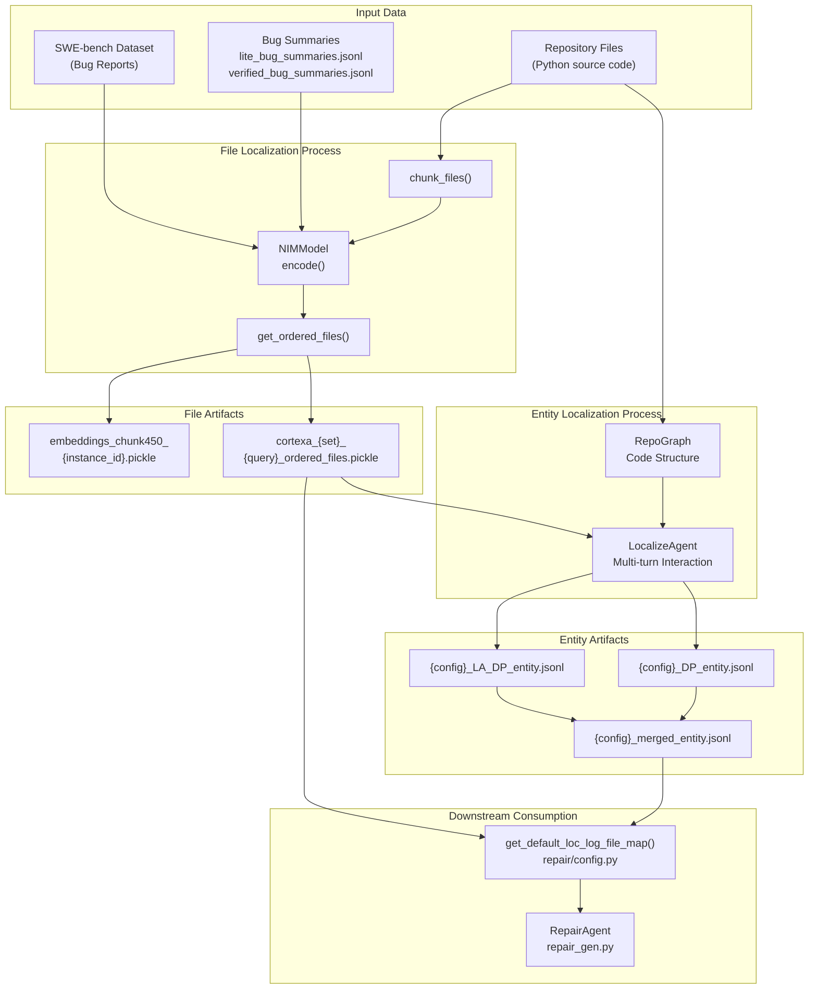
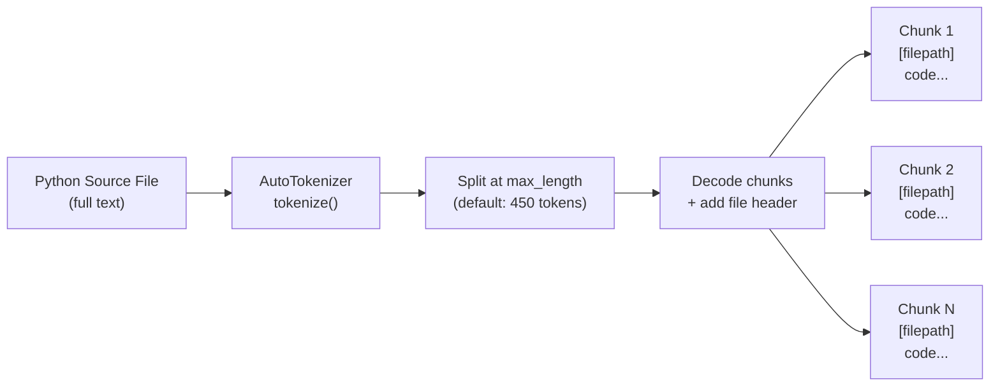
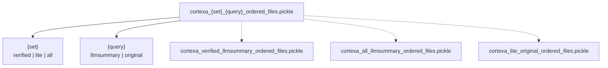
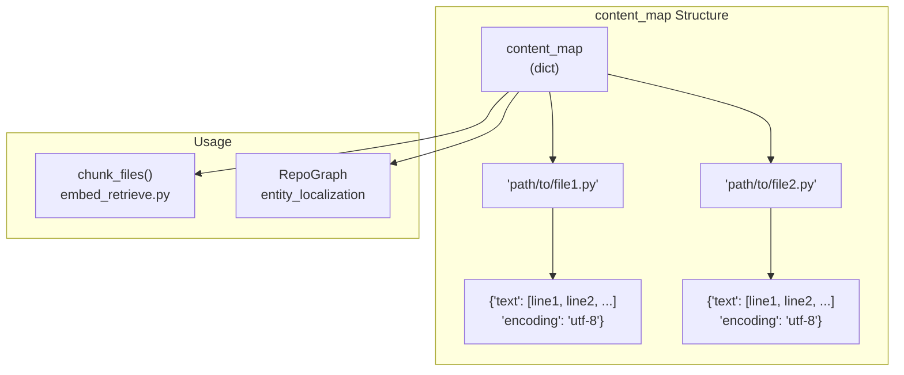
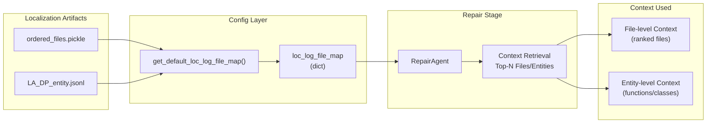

<!-- source: DeepWiki mcp.deepwiki.com · repo NVIDIA/Nemotron-CORTEXA · page 6.1 Localization Artifacts · fetched 2026-10-26 -->

# Localization Artifacts

<details>
<summary>Relevant source files</summary>

The following files were used as context for generating this wiki page:

- [README.md](README.md)
- [src/cortexa/retrieval/embed_retrieve.py](src/cortexa/retrieval/embed_retrieve.py)

</details>


This page documents the format and structure of all artifacts produced by the Localization Stage, including file-level embeddings, ranked file lists, and entity-level localization results. These artifacts serve as input to the Repair Stage, providing essential context about which files and code entities are relevant to each bug instance.

For information about how these artifacts are generated, see [File Localization with Embeddings](#2.1) and [Entity Localization with Agents](#2.2). For information about artifacts produced by later stages, see [Repair and Evaluation Artifacts](#6.2).

---

## Overview

The localization stage produces two categories of artifacts that narrow the search space from entire repositories to specific code entities:

| Artifact Type | Format | Primary File | Purpose |
|--------------|--------|--------------|---------|
| **File Rankings** | Pickle | `cortexa_{set}_{query}_ordered_files.pickle` | Maps instance IDs to ranked file lists |
| **Per-Instance Embeddings** | Pickle | `embeddings_chunk{length}_{instance_id}.pickle` | Stores detailed embedding data for debugging |
| **Entity Results** | JSONL | `{config}_LA_DP_entity.jsonl` | Lists specific functions/classes per instance |

**Sources:** [README.md:44-48](), [embed_retrieve.py:221-232]()

---

## Localization Artifact Flow



**Sources:** [embed_retrieve.py:170-232](), [README.md:47-71]()

---

## File Localization Artifacts

### Summary Pickle Format

The primary file ranking artifact is stored as `cortexa_{set}_{query}_ordered_files.pickle` where:
- `{set}` = `verified`, `lite`, or `all` (union of verified and lite)
- `{query}` = `llmsummary` or `original` (query type used)

**Structure:** Python dictionary mapping instance IDs to tuples.

```python
{
    "instance_id": (
        [ranked_predicted_files],  # List[str] - files ranked by relevance
        [golden_patch_files]        # List[str] - ground truth modified files
    )
}
```

**Example Entry:**
```python
"astropy__astropy-12907": (
    [
        "astropy__astropy/astropy/table/table.py",
        "astropy__astropy/astropy/table/column.py",
        "astropy__astropy/astropy/utils/misc.py",
        ...
    ],
    [
        "astropy__astropy/astropy/table/table.py"  # Ground truth
    ]
)
```

The ranked file list is ordered by descending cosine similarity score, with the most relevant files appearing first. This artifact is produced by [embed_retrieve.py:219]() and consumed by entity localization and repair stages.

**Sources:** [README.md:44-48](), [embed_retrieve.py:219-231]()

---

### Per-Instance Embedding Pickle Format

For each instance, a detailed pickle file is generated at `{log_dir}/embeddings_chunk{max_length}_{instance_id}.pickle` containing complete embedding information for debugging and analysis.

**Structure:** Python dictionary with the following keys:

| Key | Type | Description |
|-----|------|-------------|
| `code` | `List[str]` | Chunked code passages with file path headers |
| `embedding` | `np.ndarray` | Passage embeddings (float32, shape: [n_chunks, embedding_dim]) |
| `file` | `List[str]` | File path for each chunk |
| `query` | `List[str]` | Bug description or LLM summary used as query |
| `query_embedding` | `np.ndarray` | Query embedding (float32, shape: [1, embedding_dim]) |
| `scores` | `np.ndarray` | Cosine similarity scores × 100 (shape: [1, n_chunks]) |
| `docid` | `List[str]` | Deduplicated ordered list of file paths |

**Code Chunk Format:**
Each chunk in the `code` list is prefixed with the file path in brackets:
```
[astropy__astropy/astropy/table/table.py]
class Table:
    def __init__(self, data=None, ...):
        ...
```

**Sources:** [embed_retrieve.py:221-229]()

---

### Code Chunking Strategy

Files are chunked using the `chunk_files()` function with these parameters:



**Chunking Rules:**
- **Token limit:** `max_length` tokens per chunk (default: 450)
- **Overlap:** Zero overlap between chunks
- **Test files:** Skipped if `skip_test=True` (determined by `is_test()` function)
- **File header:** Each chunk prefixed with `[filepath]\n`
- **Empty handling:** Empty strings replaced with `"<EMPTY>"` token

**Sources:** [embed_retrieve.py:113-138]()

---

## Entity Localization Artifacts

### Entity JSONL Format

Entity localization results are stored in JSONL files with one JSON object per line. Three variants are produced:

| File Suffix | Description |
|------------|-------------|
| `_DP_entity.jsonl` | Direct Prompt (single-turn) results |
| `_LA_DP_entity.jsonl` | LocalizeAgent (multi-turn) results |
| `_merged_entity.jsonl` | Union of DP and LA results |

**Schema:** Each line contains:

```json
{
    "instance_id": "astropy__astropy-12907",
    "entities": [
        {
            "file": "astropy/table/table.py",
            "name": "Table.__init__",
            "type": "function",
            "line_start": 120,
            "line_end": 145
        },
        {
            "file": "astropy/table/column.py",
            "name": "Column",
            "type": "class",
            "line_start": 50,
            "line_end": 200
        }
    ],
    "model_config": "deepseek-v3-0324",
    "temperature": 0.7,
    "num_turns": 5
}
```

**Field Definitions:**

| Field | Type | Required | Description |
|-------|------|----------|-------------|
| `instance_id` | string | Yes | SWE-bench instance identifier |
| `entities` | array | Yes | List of located code entities |
| `entities[].file` | string | Yes | Relative file path from repo root |
| `entities[].name` | string | Yes | Fully qualified name (e.g., `Class.method`) |
| `entities[].type` | string | Yes | Entity type: `function`, `class`, or `method` |
| `entities[].line_start` | integer | No | Starting line number (1-indexed) |
| `entities[].line_end` | integer | No | Ending line number (inclusive) |
| `model_config` | string | No | Model identifier from `model_config.yml` |
| `temperature` | float | No | Sampling temperature used |
| `num_turns` | integer | No | Number of agent interaction turns |

**Sources:** [README.md:67-71]()

---

## Artifact Naming Conventions

### File Naming Pattern



### Entity Naming Pattern

```
{model_config}_{agent_type}_entity.jsonl

Examples:
- deepseek_v3_LA_DP_entity.jsonl
- llama_3.3_DP_entity.jsonl
- merged_LA_DP_entity.jsonl
```

Where:
- `{model_config}` = Model identifier or "merged" for union results
- `{agent_type}` = `LA` (LocalizeAgent), `DP` (Direct Prompt), or `LA_DP` (both)

**Sources:** [embed_retrieve.py:231](), [README.md:57-71]()

---

## Content Map Structure

The `content_map` is an internal data structure used during localization to represent repository file contents. It is referenced in configuration but not persisted as a standalone artifact.



**Structure:**
```python
content_map = {
    "repo_name/path/to/file.py": {
        "text": ["line 1\n", "line 2\n", ...],  # List of lines
        "encoding": "utf-8"
    }
}
```

**Sources:** [embed_retrieve.py:121]()

---

## Storage Locations and Defaults

### Pre-Generated Files

The repository includes pre-generated localization results for SWE-bench Lite and Verified:

| File | Location | Contents |
|------|----------|----------|
| File rankings | `src/cortexa/retrieval/files/cortexa_all_llmsummary_ordered_files.pickle` | 707 instances (union of Lite + Verified) |
| Bug summaries | `src/cortexa/retrieval/files/lite_bug_summaries.jsonl` | LLM-generated summaries for Lite set |
| Bug summaries | `src/cortexa/retrieval/files/verified_bug_summaries.jsonl` | LLM-generated summaries for Verified set |
| Entity results | `src/cortexa/retrieval/files/cortexa_all_llmsummary_LA_DP_entity.jsonl` | Pre-generated entity localization |

### Runtime Generated Files

During execution, artifacts are written to `{log_dir}/`:

```
{log_dir}/
├── embeddings_chunk450_astropy__astropy-12907.pickle
├── embeddings_chunk450_django__django-11019.pickle
├── cortexa_verified_llmsummary_ordered_files.pickle
├── deepseek_v3_LA_DP_entity.jsonl
├── deepseek_v3_DP_entity.jsonl
└── deepseek_v3_merged_entity.jsonl
```

**Sources:** [README.md:44-48](), [embed_retrieve.py:172-180](), [embed_retrieve.py:207-210]()

---

## Consumption by Downstream Stages

### Configuration Mapping

The `get_default_loc_log_file_map()` function in [src/cortexa/repair/config.py]() maps localization artifacts to repair configuration:



**Mapping Structure:**
```python
loc_log_file_map = {
    "embed_results": "cortexa_all_llmsummary_ordered_files.pickle",
    "entity_results": "cortexa_all_llmsummary_LA_DP_entity.jsonl"
}
```

### Usage in Repair Generation

The RepairAgent uses localization artifacts in the following sequence:

1. **Load file rankings** from `embed_results` pickle
2. **Extract top N files** (configurable, default: 6) via `num_top_files`
3. **Load entity results** from `entity_results` JSONL
4. **Filter entities** to those within top N files
5. **Build context** by combining file contents and entity definitions
6. **Generate patches** using the combined context

**Sources:** [README.md:70-72]()

---

## Data Validation and Quality Checks

### File Ranking Validation

When loading `ordered_files.pickle`, the system performs these checks:

| Check | Purpose | Failure Action |
|-------|---------|----------------|
| Dictionary structure | Ensure top-level is dict | Raise `TypeError` |
| Instance ID presence | Verify instance exists | Log warning, skip instance |
| Tuple format | Check (files, ground_truth) tuple | Raise `ValueError` |
| File path format | Validate paths are strings | Log warning, filter invalid |

### Entity JSONL Validation

Entity localization results undergo these validations:

| Check | Purpose | Failure Action |
|-------|---------|----------------|
| JSON syntax | Parse each line as valid JSON | Log error, skip line |
| Required fields | Verify `instance_id` and `entities` exist | Skip line |
| Entity structure | Check entity object schema | Filter invalid entities |
| File path resolution | Verify files exist in repo | Mark as unresolved entity |

**Sources:** [embed_retrieve.py:172-173](), [embed_retrieve.py:188-193]()

---

## Performance Considerations

### Embedding Pickle Size

Per-instance embedding pickles can be large due to high-dimensional embeddings:

| Component | Typical Size | Notes |
|-----------|--------------|-------|
| Code chunks | 10-100 KB | Depends on repository size |
| Passage embeddings | 2-20 MB | `n_chunks × embedding_dim × 4 bytes` |
| Query embedding | 4-8 KB | Single embedding vector |
| Scores | 100-1000 KB | Similarity scores for all chunks |

**Storage Optimization:** The summary pickle (`ordered_files.pickle`) stores only file paths and is significantly smaller (typically < 1 MB for all 707 instances).

### JSONL vs Pickle Trade-offs

| Format | Advantages | Disadvantages |
|--------|-----------|---------------|
| **Pickle** | Fast serialization, preserves NumPy arrays | Python-specific, not human-readable |
| **JSONL** | Language-agnostic, human-readable, streamable | Larger size, slower parsing |

Entity results use JSONL for cross-tool compatibility, while embeddings use pickle for performance with large NumPy arrays.

**Sources:** [embed_retrieve.py:221-229]()

---

