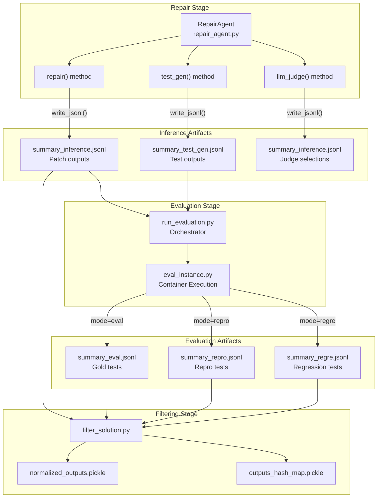
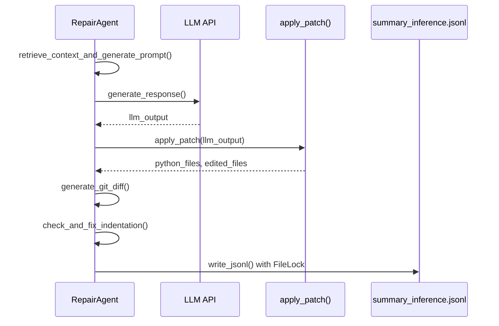
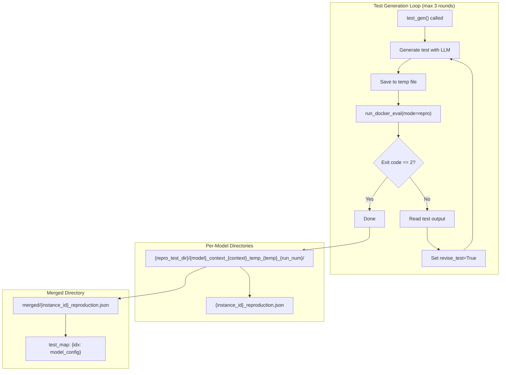

<!-- source: DeepWiki mcp.deepwiki.com · repo NVIDIA/Nemotron-CORTEXA · page 6.2 Repair and Evaluation Artifacts · fetched 2026-10-26 -->

# Repair and Evaluation Artifacts

<details>
<summary>Relevant source files</summary>

The following files were used as context for generating this wiki page:

- [src/cortexa/evaluate/run_evaluation.py](src/cortexa/evaluate/run_evaluation.py)
- [src/cortexa/repair/prompts.py](src/cortexa/repair/prompts.py)
- [src/cortexa/repair/repair_agent.py](src/cortexa/repair/repair_agent.py)
- [src/cortexa/repair/repro_test_gen.py](src/cortexa/repair/repro_test_gen.py)

</details>


This page documents the structure and format of intermediate artifacts produced during the **Repair** and **Evaluation** stages of Nemotron-CORTEXA. These artifacts capture patch generation outputs, test generation results, and evaluation outcomes across multiple modes. For localization artifacts, see [Localization Artifacts](#6.1). For final output formats, see [Final Output Formats](#6.3).

## Overview

The repair and evaluation pipeline produces several categories of JSONL artifacts:

| Artifact Type | File Name | Stage | Purpose |
|--------------|-----------|-------|---------|
| Patch Inference | `summary_inference.jsonl` | Repair | Generated patches with metadata |
| Test Generation | `summary_test_gen.jsonl` | Repair | Generated reproduction tests |
| LLM Judge | `summary_inference.jsonl` | Repair | Selected patches from candidates |
| Gold Test Evaluation | `summary_eval.jsonl` | Evaluation | Results on SWE-bench gold tests |
| Reproduction Test Evaluation | `summary_repro.jsonl` | Evaluation | Results on generated repro tests |
| Regression Test Evaluation | `summary_regre.jsonl` | Evaluation | Results on regression tests |
| Normalized Patches | `normalized_outputs.pickle` | Filtering | Deduplicated and normalized code |
| Patch Hashes | `outputs_hash_map.pickle` | Filtering | Hash map for deduplication |

All JSONL files follow the pattern of one JSON object per line, where each line represents a result for a specific instance-solution combination.

**Sources**: [src/cortexa/repair/repair_agent.py:455-478](), [src/cortexa/evaluate/run_evaluation.py:111-113]()

## Artifact Generation Flow



**Sources**: [src/cortexa/repair/repair_agent.py:618-695](), [src/cortexa/evaluate/run_evaluation.py:189-233]()

## Patch Generation Artifacts (`summary_inference.jsonl`)

### Schema

Each line in `summary_inference.jsonl` represents one generated patch:

```json
{
  "instance_id": "django__django-12345",
  "final_prompt": {
    "system": "",
    "user": "EDIT_PREMISE + instructions + code context"
  },
  "input_num_tokens": 45000,
  "llm_output": "```python\nedit_file(...)\n```",
  "output_num_tokens": 1024,
  "model_patch": "diff --git a/...",
  "model": "deepseek-v3-0324",
  "temp": 0.0,
  "run_num": 0,
  "context": "LA_DP",
  "edit_style": "EDIT_COMMAND",
  "syntax_status": "django/db/models.py: Success",
  "resolution": "NO_CHANGE"
}
```

### Field Descriptions

| Field | Type | Description |
|-------|------|-------------|
| `instance_id` | string | SWE-bench instance identifier |
| `final_prompt` | object | Complete prompt sent to LLM with `system` and `user` keys |
| `input_num_tokens` | integer | Token count for prompt (via `tiktoken`) |
| `llm_output` | string | Raw LLM response containing edit commands |
| `output_num_tokens` | integer | Token count for LLM response |
| `model_patch` | string | Git diff format patch generated from edits |
| `model` | string | Model identifier from `model_config.yml` |
| `temp` | float | Temperature parameter used for generation |
| `run_num` | integer | Run number for this configuration (0-indexed) |
| `context` | string | Context type (e.g., "LA_DP", "file", "patches") |
| `edit_style` | string | Edit format ("JSON", "EDIT_COMMAND", "SEARCH_REPLACE") |
| `syntax_status` | string | Syntax validation result per file |
| `resolution` | string | "NO_CHANGE" if no valid edits generated |

### Generation Process

The `repair()` method in `RepairAgent` generates patches and writes to this file:



**Key Code Locations**:
- Prompt generation: [src/cortexa/repair/repair_agent.py:698-734]()
- Patch generation: [src/cortexa/repair/repair_agent.py:736-772]()
- Data structure assembly: [src/cortexa/repair/repair_agent.py:663-689]()
- File writing with lock: [src/cortexa/repair/repair_agent.py:688-689]()

### Patch ID Format

Each patch is uniquely identified by: `{model}_{context}_{edit_style}_{temp}_{run_num}`

Example: `deepseek-v3-0324_LA_DP_EDIT_COMMAND_0.0_0`

**Sources**: [src/cortexa/repair/repair_agent.py:634-640](), [src/cortexa/evaluate/run_evaluation.py:46]()

## Test Generation Artifacts (`summary_test_gen.jsonl`)

### Schema

Each line represents a generated reproduction test:

```json
{
  "instance_id": "django__django-12345",
  "final_prompt": {
    "system": "",
    "user": "TEST_GEN_PREMISE + instructions + code context"
  },
  "input_num_tokens": 30000,
  "llm_output": "Here's the test:\n```python\nimport sys...",
  "output_num_tokens": 512,
  "test_script": ["diff --git a/reproduce_test.py b/reproduce_test.py..."],
  "raw_test_scripts": ["import sys\ndef test_issue():\n    ..."],
  "model": "deepseek-v3-0324",
  "temp": 0.0,
  "run_num": 0,
  "context": "issue",
  "prompt_style": "test-gen"
}
```

### Field Descriptions

| Field | Type | Description |
|-------|------|-------------|
| `test_script` | list[string] | Git diff format patches for test files |
| `raw_test_scripts` | list[string] | Raw Python test code (last script is used) |
| `prompt_style` | string | "test-gen" or "revise-test-gen" |

Other fields follow the same pattern as patch generation artifacts.

### Test Exit Code Semantics

Generated tests follow a specific exit code convention:

| Exit Code | Meaning | Expected When |
|-----------|---------|---------------|
| 0 | Issue is resolved | After applying fix patch |
| 1 | Unexpected error/crash | Runtime errors in test |
| 2 | Issue still exists | Before applying fix (target) |

**Sources**: [src/cortexa/repair/prompts.py:239-286](), [src/cortexa/repair/repair_agent.py:774-840]()

### Test Generation Workflow



**Sources**: [src/cortexa/repair/repro_test_gen.py:73-172](), [src/cortexa/repair/repro_test_gen.py:174-213]()

## Evaluation Artifacts

### Gold Test Evaluation (`summary_eval.jsonl`)

Results from running patches against SWE-bench gold test suites:

```json
{
  "instance_id": "django__django-12345",
  "patch_id": "deepseek-v3-0324_LA_DP_EDIT_COMMAND_0.0_0",
  "resolved": true,
  "test_results": {
    "passed": 150,
    "failed": 0,
    "errors": 0
  },
  "test_output": "===== test session starts =====\n...",
  "apply_patch_success": true,
  "eval_mode": "eval"
}
```

### Reproduction Test Evaluation (`summary_repro.jsonl`)

Results from running patches against generated reproduction tests:

```json
{
  "instance_id": "django__django-12345",
  "patch_id": "deepseek-v3-0324_LA_DP_EDIT_COMMAND_0.0_0",
  "reproduction_tests_results": [
    {
      "test_id": 1,
      "test_output": "Issue is resolved",
      "exit_code": 0,
      "model_config": "deepseek-v3-0324_context_issue_temp0.0_0"
    },
    {
      "test_id": 2,
      "test_output": "Still broken",
      "exit_code": 2,
      "model_config": "llama-3.3-70b_context_issue_temp0.0_0"
    }
  ],
  "apply_patch_success": true,
  "eval_mode": "repro"
}
```

### Regression Test Evaluation (`summary_regre.jsonl`)

Similar structure to `summary_eval.jsonl` but runs full test suite to detect regressions:

```json
{
  "instance_id": "django__django-12345",
  "patch_id": "deepseek-v3-0324_LA_DP_EDIT_COMMAND_0.0_0",
  "regression_detected": false,
  "test_results": {
    "passed": 15420,
    "failed": 0,
    "errors": 0
  },
  "eval_mode": "regre"
}
```

### Evaluation Mode Comparison

| Mode | File | Tests Run | Purpose |
|------|------|-----------|---------|
| `eval` | `summary_eval.jsonl` | SWE-bench FAIL_TO_PASS + PASS_TO_PASS | Validate fix resolves issue |
| `repro` | `summary_repro.jsonl` | Generated reproduction tests | Confirm fix with multiple perspectives |
| `regre` | `summary_regre.jsonl` | Full test suite | Detect unintended side effects |

**Sources**: [src/cortexa/evaluate/run_evaluation.py:43-65](), [src/cortexa/evaluate/run_evaluation.py:209-215]()

## Reproduction Test Files

### Per-Model Test Files

Located at: `{repro_test_dir}/{model}_context_{context}_temp_{temp}_{run_num}/{instance_id}_reproduction.json`

```json
{
  "instance_id": "django__django-12345",
  "test_patch": [
    "diff --git a/reproduce_test.py b/reproduce_test.py\n..."
  ],
  "raw_tests": [
    "import sys\ndef test_issue():\n    ..."
  ]
}
```

### Merged Test Files

Located at: `{repro_test_dir}/merged/{instance_id}_reproduction.json`

```json
{
  "instance_id": "django__django-12345",
  "test_patch": [
    "diff --git a/reproduce_test_1.py...",
    "diff --git a/reproduce_test_2.py..."
  ],
  "raw_tests": [
    "import sys\ndef test_issue():\n    ...",
    "import sys\ndef test_issue():\n    ..."
  ],
  "test_map": {
    "1": "deepseek-v3-0324_context_issue_temp0.0_0",
    "2": "llama-3.3-70b_context_issue_temp0.0_0"
  }
}
```

The `test_map` field tracks which model configuration generated each test, enabling attribution during evaluation.

**Sources**: [src/cortexa/repair/repro_test_gen.py:51-58](), [src/cortexa/repair/repro_test_gen.py:174-213]()

## Normalization and Deduplication Artifacts

### `normalized_outputs.pickle`

Stores AST-normalized versions of patches for deduplication:

```python
{
  "instance_id": {
    "patch_id_1": {
      "normalized_code": "def normalized_function():\n    ...",
      "hash": "abc123...",
      "original_patch_id": "deepseek-v3-0324_LA_DP_..."
    },
    # ... more normalized patches
  }
}
```

Normalization process:
1. Parse code into AST
2. Rename identifiers deterministically (e.g., `var1` → `var_0`)
3. Remove comments and docstrings
4. Standardize formatting

### `outputs_hash_map.pickle`

Maps content hashes to patch IDs for fast duplicate detection:

```python
{
  "instance_id": {
    "hash_abc123": ["patch_id_1", "patch_id_2"],  # Duplicates
    "hash_def456": ["patch_id_3"]
  }
}
```

These artifacts enable the filtering stage to:
- Identify semantically equivalent patches with different syntax
- Select one representative from duplicate clusters
- Reduce evaluation workload

**Sources**: Referenced in [src/cortexa/evaluate/run_evaluation.py:189-218]() (files consumed by filtering)

## Artifact File Naming Conventions

File tags are appended based on execution environment:

| Environment | Tag | Example |
|-------------|-----|---------|
| Docker | (none) | `summary_eval.jsonl` |
| Singularity | `_singularity` | `summary_eval_singularity.jsonl` |

This allows parallel execution across different container runtimes without conflicts.

**Sources**: [src/cortexa/evaluate/run_evaluation.py:195-210]()

## File Locking for Concurrent Writes

All JSONL artifacts use file locking to enable parallel writes:

```python
from filelock import FileLock

with FileLock(self.out_inference_file + ".lock"):
    write_jsonl(filename=self.out_inference_file, data=repair_data, append=True)
```

This ensures multiple worker processes can safely append results without corruption when:
- Running `repair_gen.py` with multiple workers
- Running `repro_test_gen.py` with multiple workers
- Parallel evaluation tasks write to the same output file

**Sources**: [src/cortexa/repair/repair_agent.py:688-689](), [src/cortexa/repair/repair_agent.py:836-837]()

## Reading Artifact Files

### `read_problems_list()` Function

Returns a dictionary mapping instance IDs to lists of results:

```python
from cortexa.utils.util import read_problems_list

data = read_problems_list("summary_inference.jsonl")
# Returns: {"instance_id": [result1, result2, ...]}

for instance_id, results in data.items():
    for result in results:
        print(f"Patch: {result['patch_id']}")
```

### `read_problems()` Function

Returns a dictionary mapping instance IDs to single result objects (for files with one result per instance):

```python
from cortexa.utils.util import read_problems

data = read_problems("merged/django__django-12345_reproduction.json")
# Returns: {"instance_id": {...}}
```

**Sources**: Referenced throughout [src/cortexa/repair/repair_agent.py:635-640](), [src/cortexa/evaluate/run_evaluation.py:193-212]()

---

