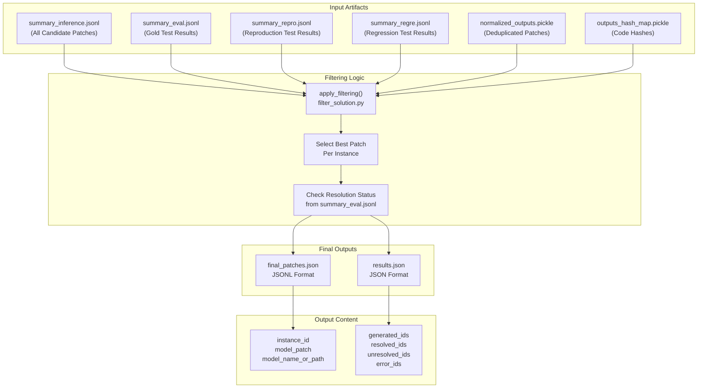
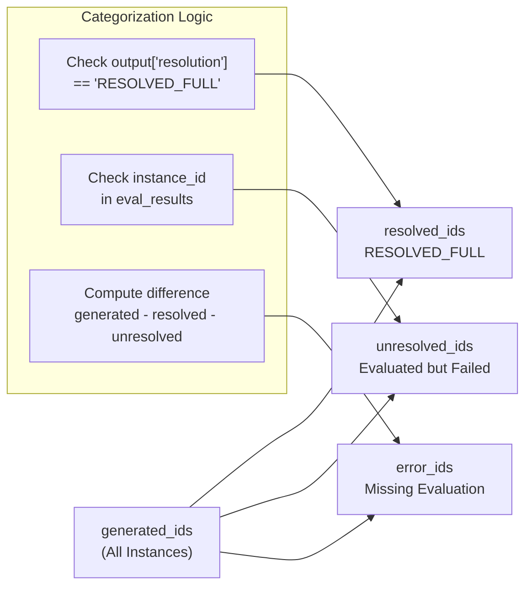
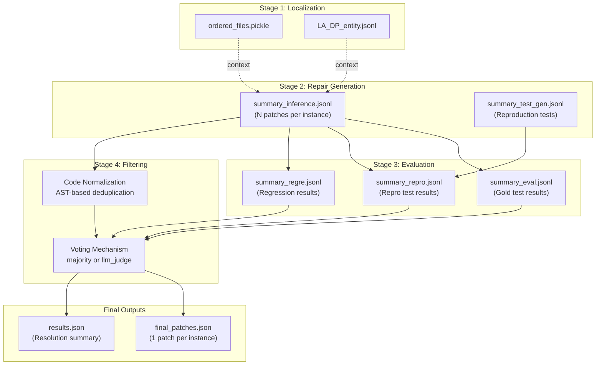

<!-- source: DeepWiki mcp.deepwiki.com · repo NVIDIA/Nemotron-CORTEXA · page 6.3 Final Output Formats · fetched 2026-10-26 -->

# Final Output Formats

<details>
<summary>Relevant source files</summary>

The following files were used as context for generating this wiki page:

- [README.md](README.md)
- [src/cortexa/evaluate/run_filtering.py](src/cortexa/evaluate/run_filtering.py)

</details>


This page documents the two primary output files produced by Nemotron-CORTEXA after completing the full pipeline: `final_patches.json` and `results.json`. These files represent the culmination of the localization, repair, and evaluation stages, providing the selected patch for each instance and a summary of resolution outcomes. For information about intermediate artifacts produced during localization, see [Localization Artifacts](#6.1). For evaluation and repair artifacts, see [Repair and Evaluation Artifacts](#6.2).

## Overview

The filtering stage ([filter_solution.py]() and [run_filtering.py]()) consumes multiple intermediate artifacts and produces two final outputs:

| File | Format | Purpose |
|------|--------|---------|
| `final_patches.json` | JSONL | Contains the selected patch for each instance in git diff format |
| `results.json` | JSON | Resolution summary with categorized instance IDs |

Both files are written to the `log_dir` specified during execution.

**Sources**: [README.md:105](), [src/cortexa/evaluate/run_filtering.py:36-37]()

---

## Final Output Production Pipeline



The filtering process selects the best patch for each instance based on reproduction test success, regression test success, and voting mechanisms (majority or LLM judge). It then cross-references with gold test evaluation results to determine resolution status.

**Sources**: [src/cortexa/evaluate/run_filtering.py:49-59](), [src/cortexa/evaluate/run_filtering.py:69-90]()

---

## final_patches.json Structure

The `final_patches.json` file is written in JSONL (JSON Lines) format, with one JSON object per line representing a single instance's selected patch. Despite the `.json` extension, this is a JSONL file for consistency with other output artifacts.

### Schema

Each line contains a JSON object with the following fields:

| Field | Type | Description |
|-------|------|-------------|
| `instance_id` | string | Unique identifier from SWE-bench dataset (e.g., `"astropy__astropy-12907"`) |
| `model_patch` | string | The selected patch in git unified diff format |
| `model_name_or_path` | string | The model name used for LLM judge voting (e.g., `"deepseek-v3-0324"`) |

### Example Entry

```json
{
  "instance_id": "astropy__astropy-12907",
  "model_patch": "diff --git a/astropy/modeling/core.py b/astropy/modeling/core.py\nindex 1234567..abcdefg 100644\n--- a/astropy/modeling/core.py\n+++ b/astropy/modeling/core.py\n@@ -100,7 +100,7 @@ class Model:\n-    def evaluate(self, x):\n+    def evaluate(self, x, y=None):\n         return x * 2\n",
  "model_name_or_path": "deepseek-v3-0324"
}
```

### Generation Logic

The file is generated in [src/cortexa/evaluate/run_filtering.py:100-105]():

1. Iterate through `chosen_outs` dictionary (output of `apply_filtering()`)
2. Extract the `chosen_patch_id` for each instance
3. Match this ID against entries in `summary_eval.jsonl` to retrieve the full patch
4. Write each match as a JSONL entry

**Sources**: [src/cortexa/evaluate/run_filtering.py:69-103](), [README.md:105]()

---

## results.json Structure

The `results.json` file provides a comprehensive summary of resolution outcomes across all instances in the dataset. It categorizes instances into four mutually exclusive sets.

### Schema

The file contains a single JSON object with the following fields:

| Field | Type | Description |
|-------|------|-------------|
| `generated_ids` | array[string] | All instances for which a patch was selected |
| `resolved_ids` | array[string] | Instances where the selected patch achieved `RESOLVED_FULL` status in gold tests |
| `unresolved_ids` | array[string] | Instances where the selected patch was evaluated but did not achieve `RESOLVED_FULL` |
| `error_ids` | array[string] | Instances with patches but missing evaluation results |

### Example Content

```json
{
  "generated_ids": [
    "astropy__astropy-12907",
    "django__django-11179",
    "sympy__sympy-18057"
  ],
  "resolved_ids": [
    "astropy__astropy-12907"
  ],
  "unresolved_ids": [
    "django__django-11179"
  ],
  "error_ids": [
    "sympy__sympy-18057"
  ]
}
```

### Resolution Categories



The categorization logic in [src/cortexa/evaluate/run_filtering.py:86-91]():

1. **resolved_ids**: Instances where `output['resolution'] == 'RESOLVED_FULL'` in `summary_eval.jsonl`
2. **unresolved_ids**: Instances evaluated but with resolution status other than `RESOLVED_FULL`
3. **error_ids**: Computed as `generated_ids - resolved_ids - unresolved_ids`

**Sources**: [src/cortexa/evaluate/run_filtering.py:66-98](), [src/cortexa/evaluate/run_filtering.py:108-118]()

---

## Resolution Status Semantics

The `resolution` field in `summary_eval.jsonl` (which determines categorization in `results.json`) can have several values:

| Status | Meaning | Category in results.json |
|--------|---------|--------------------------|
| `RESOLVED_FULL` | All gold tests pass | `resolved_ids` |
| `RESOLVED_PARTIAL` | Some tests pass, some fail | `unresolved_ids` |
| `NOT_RESOLVED` | All gold tests fail | `unresolved_ids` |
| `ERROR` | Evaluation error (timeout, syntax error, etc.) | `unresolved_ids` |

Missing evaluation results (instance exists in filtering output but not in `summary_eval.jsonl`) result in categorization as `error_ids`.

**Sources**: [src/cortexa/evaluate/run_filtering.py:79-91]()

---

## File Location and Naming

The output files are written to paths constructed from command-line arguments:

```python
# Default paths from run_filtering.py arguments
log_dir = './logs'  # Configurable via --log_dir
patch_file = 'final_patches.jsonl'  # Configurable via --patch_file (default in code)
results_file = 'results.json'  # Configurable via --results_file

# Actual file paths
final_patches_path = os.path.join(log_dir, patch_file)
results_path = os.path.join(log_dir, results_file)
```

When running with default settings:
- `final_patches.json` → `./logs/final_patches.json`
- `results.json` → `./logs/results.json`

**Note**: The code defines the default as `final_patches.jsonl` ([src/cortexa/evaluate/run_filtering.py:36]()), but the README references `final_patches.json` ([README.md:105]()). Both extensions refer to JSONL format.

**Sources**: [src/cortexa/evaluate/run_filtering.py:29-37](), [README.md:105]()

---

## Patch Selection Process

The `chosen_patch_id` field identifies which candidate patch was selected for each instance. This ID is constructed from metadata fields:

```python
# Patch ID format
patch_id = f"{model}_{context}_{edit_style}_{temp}_{run_num}"

# Example: "deepseek-v3-0324_entity_json_0.0_0"
```

The selection process (implemented in `filter_solution.py`) considers:

1. **Syntax Validation**: Patches must parse correctly
2. **Regression Tests**: Patches must not break existing tests
3. **Reproduction Tests**: Patches should pass generated reproduction tests
4. **Voting Mechanism**: 
   - `majority`: Select patch that appears most frequently across normalized versions
   - `llm_judge`: Use LLM to judge between candidates

**Sources**: [src/cortexa/evaluate/run_filtering.py:75-84](), [src/cortexa/evaluate/run_filtering.py:40-41]()

---

## Command-Line Interface

The final outputs are generated by running the filtering script:

```bash
python -m cortexa.evaluate.run_filtering \
    --log_dir ./logs \
    --repo_playground ./repos \
    --run_normalization \
    --vote_mode llm_judge \
    --model_name deepseek-v3-0324 \
    --dataset_name_or_path princeton-nlp/SWE-bench_Verified
```

Key arguments affecting output generation:

| Argument | Default | Purpose |
|----------|---------|---------|
| `--log_dir` | `./logs` | Directory for output files |
| `--patch_file` | `final_patches.jsonl` | Name for patches output |
| `--results_file` | `results.json` | Name for results summary |
| `--vote_mode` | `llm_judge` | Voting mechanism (`majority` or `llm_judge`) |
| `--model_name` | `o3-mini` | Model name for LLM judge (written to `model_name_or_path`) |
| `--run_normalization` | (flag) | Whether to run code normalization before deduplication |

**Sources**: [src/cortexa/evaluate/run_filtering.py:27-43](), [README.md:94-105]()

---

## Consuming Final Outputs

### Extracting Selected Patches

```python
import json

# Read final patches
with open('logs/final_patches.json', 'r') as f:
    for line in f:
        entry = json.loads(line)
        instance_id = entry['instance_id']
        patch = entry['model_patch']
        # Apply patch to repository
```

### Computing Resolution Rate

```python
import json

# Read results summary
with open('logs/results.json', 'r') as f:
    results = json.load(f)

total_instances = len(results['generated_ids'])
resolved_count = len(results['resolved_ids'])
resolution_rate = (resolved_count / total_instances) * 100

print(f"Resolution Rate: {resolution_rate:.2f}%")
print(f"Resolved: {resolved_count}/{total_instances}")
```

The resolution rate is the primary metric for evaluating system performance on SWE-bench benchmarks.

**Sources**: [src/cortexa/evaluate/run_filtering.py:115-118](), [README.md:105]()

---

## Relationship to Input Artifacts



The final outputs represent a consolidation from potentially hundreds of candidate patches per instance down to a single selected patch, along with evaluation metrics computed from gold test results.

**Sources**: [README.md:74-105](), [src/cortexa/evaluate/run_filtering.py:45-119]()

---

